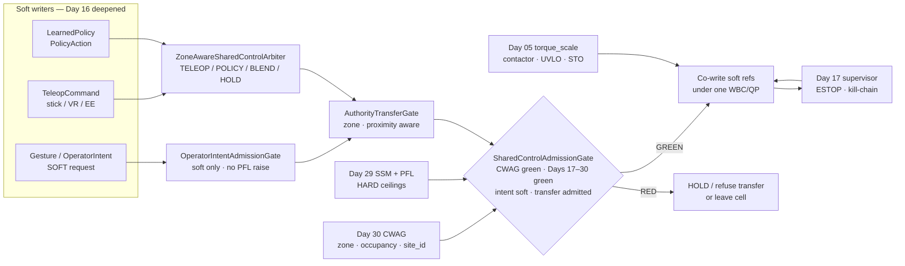
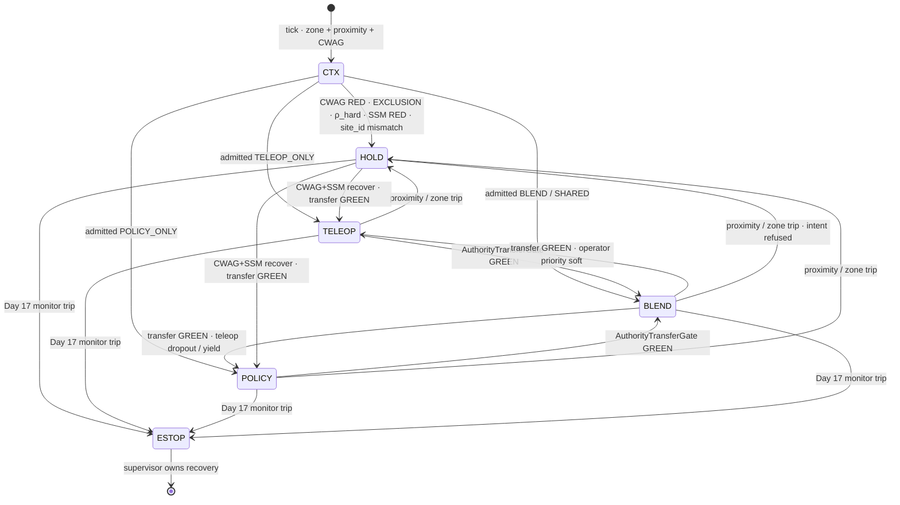
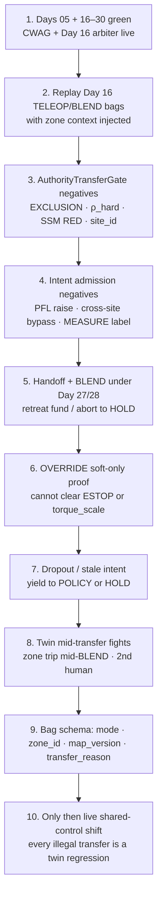

# Day 31 — Shared-control / teleop arbitration under attested zones: ZoneAwareSharedControlArbiter / AuthorityTransferGate / OperatorIntentAdmissionGate / SharedControlAdmissionGate under CollaborativeWorkspaceAdmissionGate + proximity + zone attestation + supervisor + logging + canary + HIL + fleet + fleet-canary + incident + forensics/reopen + change-management + maintenance + thermal + energy gates

![ZoneAwareSharedControlArbiter / AuthorityTransferGate / OperatorIntentAdmissionGate / SharedControlAdmissionGate: Day 16 SharedAutonomyArbiter extended with zone and proximity context so TELEOP / POLICY / BLEND co-writing stays soft while Day 29 PFL ceilings and Day 30 attested zones stay HARD; AuthorityTransferGate admits zone- and proximity-aware TELEOP↔POLICY↔BLEND transfers that demote to HOLD in EXCLUSION, at density hard limit, or when SSM is RED; OperatorIntentAdmissionGate admits gesture and operator intent as soft only — it cannot raise PFL body-region ceilings or bypass CrossSiteZoneConfigGate; SharedControlAdmissionGate fails closed unless CWAG and Days 17–30 are green; Day 17 owns ESTOP/kill-chain forever and Day 05 owns torque_scale forever — today's soft authority never writes those](/images/day31-shared-control-teleop-arbitration.png)

[Day 16](/lessons/day-16-teleop-shared-autonomy) owned `SharedAutonomyArbiter`: teleop and learned policy as **co-equal soft writers** into soft refs / CLAIM admit, with modes `TELEOP_ONLY` | `POLICY_ONLY` | `BLEND` / `SHARED` | `OPERATOR_OVERRIDE` that never attach cones or write `JointCommand` / `torque_scale`. [Day 29](/lessons/day-29-human-proximity-safety) owned SSM envelopes and HARD ISO/TS 15066-style PFL body-region ceilings. [Day 30](/lessons/day-30-collaborative-workspace-zoning) owned `CollaborativeWorkspaceAdmissionGate` (CWAG): attested zone geometry, measured occupancy, handoff under PFL, and `CrossSiteZoneConfigGate`. [Day 17](/lessons/day-17-runtime-safety-supervisor) owns the kill-chain, ESTOP, and stage transitions **forever**. [Day 05](/lessons/day-05-power-bms) owns `torque_scale`, contactor, UVLO, and STO **forever**.

Day 16 made shared autonomy honest *as soft co-writing*. What it did not own — and what every collaborative cell with a live operator eventually needs — is **authority transfer under place and proximity**: which attested polygon you are in, how close the nearest human is, whether a gesture may request BLEND, and whether that request can silently raise a face ceiling or borrow SITE_B's zone file. "Operator takes over" is not a privilege that outranks Day 29 or Day 30. It is a soft mode change admitted under CWAG.

Today owns **`ZoneAwareSharedControlArbiter` / `AuthorityTransferGate` / `OperatorIntentAdmissionGate` / `SharedControlAdmissionGate`**. The question is: **who may co-write soft refs inside an attested collaborative cell, when may authority transfer between TELEOP / POLICY / BLEND, how do gesture and intent stay soft without raising PFL or bypassing CrossSiteZoneConfigGate — without ever writing Day 17's ESTOP or Day 05's `torque_scale`?**

## Soft co-writing is still soft. Zones and PFL are still HARD. Transfer is an admit, not a privilege.

Day 16's rule stands: teleop score, policy score, blend weight, and operator confidence are **not** MEASURED. Today adds three honesty layers on top:

1. **Zone context** — the active `SafeguardedSpaceMap` polygon kind (`COLLABORATIVE` | `EXCLUSION` | `HANDOFF_CORRIDOR` | `TRANSIT`) and CWAG status bound which soft modes may even be *requested*.
2. **Proximity context** — Day 29 SSM envelope and PFL arming bound which transfers are fundable (especially near contact or inside a handoff corridor).
3. **Intent admission** — gesture / voice / UI "take control" / "blend more policy" is a soft request into `OperatorIntentAdmissionGate`. It may shrink authority or refuse; it never authors HARD space, never raises a body-region ceiling, never clears a site_id mismatch.

So the honest labels are:

| Quantity | Label | Where it comes from | How it goes wrong |
|----------|-------|---------------------|-------------------|
| Teleop stick / VR / EE delta | SOFT | Day 16 `TeleopCommand` | Treated as MEASURED contact or cone truth |
| Policy action / residual soft ref | SOFT | Day 15/16 `PolicyAction` | Reward-hack into hard write |
| Gesture / operator intent request | SOFT | UI, gesture model, voice | Confidence labeled MEASURED; raises PFL |
| Arbiter mode (`TELEOP` / `POLICY` / `BLEND` / `HOLD`) | SOFT admit | `ZoneAwareSharedControlArbiter` | Mode change without CWAG / SSM green |
| Authority-transfer request | SOFT | Operator or policy ask | OVERRIDE used as ESTOP bypass |
| Active zone kind + `map_version` | HARD attested | Day 30 `SafeguardedSpaceMap` | Soft paint as zone; wrong `site_id` |
| Measured occupancy $N$ / $\rho$ | MEASURED | Day 30 `MeasuredOccupancyCount` | Soft density used as transfer admit |
| SSM envelope / stop twin | SOFT bound over MEASURED | Day 29 | Cool-day $d^{+}_{stop}$ in hot crowded cell |
| PFL body-region ceilings | HARD | Day 29 attested tables | Gesture "push harder" raises face ceiling |
| Cross-site zone hash / `site_id` | HARD | Day 30 `CrossSiteZoneConfigGate` | Intent path borrows SITE_A map |
| ESTOP / kill-chain / `torque_scale` | HARD owners | Day 17 / Day 05 | Soft dual-write on "operator panic" |

The first rule of today: **admit shared-control co-writing only when CWAG is green, Day 29 is honest, transfer requests stay soft, and intent cannot raise HARD ceilings.** Soft may demote to HOLD; soft may never promote itself into Day 17 or Day 05.

| Layer | Owns | Must not own |
|-------|------|--------------|
| Day 16 `SharedAutonomyArbiter` | Soft mode math, blend weights, soft refs / CLAIM admit | Zone truth; PFL tables; ESTOP |
| `ZoneAwareSharedControlArbiter` | Day 16 arbiter + zone kind / proximity context on every tick | Writing HARD geometry; raising density limits |
| `AuthorityTransferGate` | Zone/proximity-aware TELEOP↔POLICY↔BLEND admit / demote | OVERRIDE-as-bypass; transfer when CWAG RED |
| `OperatorIntentAdmissionGate` | Soft gesture/intent request validation | Raising PFL; bypassing CrossSiteZoneConfigGate |
| `SharedControlAdmissionGate` | Composed fail-closed admit under CWAG + Days 17–30 | Clearing supervisor stage; dual-writing ESTOP / `torque_scale` |
| Day 30 CWAG / zone stack | Attested space, occupancy, handoff, cross-site honesty | Being replaced by operator "I know this floor" |
| Day 29 proximity | SSM inequality, PFL ceilings, stop twin | Being raised by gesture confidence |
| Day 17 / Day 05 | Kill-chain / `torque_scale` | Being written by shared-control soft layer |

**Core thesis:** shared control under attested zones is not "Day 16 plus a map overlay." It is a **zone-aware soft arbiter** whose authority transfers are **admitted** by proximity and CWAG, plus an **intent gate** that keeps gesture soft, composed under a **SharedControlAdmissionGate** that fails closed when Days 17–30 are not green. Teleop, policy, and intent remain soft. Day 29 PFL and Day 30 zone attestation remain HARD. Soft never writes Day 17, Day 05, or Day 25 HARD_SAFETY ChangeSets — including when the operator is shouting OVERRIDE.



## ZoneAwareSharedControlArbiter: Day 16 with place and proximity

`ZoneAwareSharedControlArbiter` does not replace `SharedAutonomyArbiter`. It **wraps** it with context every tick:

- `zone_id`, `zone_kind`, `map_version`, `changeset_hash` from Day 30
- `cwag_status` (RED | YELLOW | GREEN)
- Day 29 `ssm_status`, nearest $d^{-}_{sep}$, whether PFL is armed / which region
- `MeasuredOccupancyCount` $N$ / $\rho$ (MEASURED) — soft $\hat\rho$ may only bias scheduler, not arbiter admit
- Prior soft mode + blend weights from Day 16

Mode table (still all soft outputs):

| Mode | When CWAG + Day 29 allow | Soft output | Still forbidden |
|------|--------------------------|-------------|-----------------|
| `TELEOP_ONLY` | Collaborative or transit; SSM green or YELLOW-hold policy | Human owns soft refs | Cones / `JointCommand` / `torque_scale` |
| `POLICY_ONLY` | Collaborative; SSM green; no live operator required | Policy owns soft refs | Same hard writes |
| `BLEND` / `SHARED` | Collaborative or funded handoff corridor | Weighted soft blend | Blend score as MEASURED |
| `HOLD` | Default on CWAG RED, EXCLUSION, $\rho$ hard, SSM RED, intent refused | Soft refs freeze / safe posture request | Clearing ESTOP to "resume" |
| `OPERATOR_OVERRIDE` | Soft priority bump only — **never** HARD bypass | Prefer teleop in blend | Skip MEASURE, raise PFL, dual-write ESTOP |

**EXCLUSION polygons** admit only HOLD (or supervised leave-cell under Day 29). **HANDOFF_CORRIDOR** may admit BLEND only when Day 30 `HandoffCorridorGate` is green (PFL armed, retreat funded under Day 27/28). **Unknown occupancy** fails closed the same way Day 30 taught — no "operator can see fine" override into HARD space.

## AuthorityTransferGate: transfer is admitted, not assumed

Operators and policies both request mode changes. `AuthorityTransferGate` is the fail-closed admit for those requests:

1. Request arrives (`to_mode`, `reason`, `requester`: OPERATOR | POLICY | SUPERVISOR_SOFT).
2. Gate checks CWAG, zone kind, Day 29 envelope, occupancy honesty, and whether the destination mode is allowed *here*.
3. If GREEN, arbiter applies the soft mode change and tags the Day 18 bag (`transfer_reason`, `from_mode`, `to_mode`, `zone_id`, `map_version`).
4. If RED, stay in current mode or demote toward HOLD — never "force TELEOP because the stick moved."

Illustrative teaching table:

| Context | Request | Verdict |
|---------|---------|---------|
| COLLABORATIVE, CWAG GREEN, SSM green, $N=1$ | OPERATOR → BLEND | GREEN — soft blend |
| COLLABORATIVE, SSM YELLOW (close approach) | POLICY → POLICY_ONLY speed-up | RED or demote — proximity wins |
| HANDOFF_CORRIDOR, retreat unfunded (hot pack) | OPERATOR → BLEND for handoff | RED — Day 30/29 retreat rule |
| EXCLUSION | OPERATOR_OVERRIDE → TELEOP | RED — HOLD / leave only |
| $\rho$ at hard density | Any new BLEND | RED — Day 30 density hard limit |
| `site_id` mismatch on map | Any shared-control admit | RED — CrossSiteZoneConfigGate |
| Open Day 23 incident on unit | Any transfer to BLEND | RED — incident outranks |
| Soft asks raise hand PFL for "firm hold" | — | RED — Day 29 HARD table |

**OVERRIDE is not ESTOP and not a ceiling raise.** Day 16 already said OVERRIDE is soft priority. Today binds that under zones: OVERRIDE may prefer teleop *inside* an already-admitted collaborative envelope; it may not skip CWAG, may not enter EXCLUSION, may not widen PFL, may not clear Day 17 stage.



## OperatorIntentAdmissionGate: gesture stays soft

Gesture models, teach pendants, VR "grab," and voice "take over" are valuable — and dangerous when someone labels $p(\mathrm{intent})$ as MEASURED. `OperatorIntentAdmissionGate` enforces:

- Intent is SOFT with `age_ms`, `confidence` (explicitly not MEASURED), and `forbid` flags.
- Allowed effects: request mode transfer, shrink blend weight toward HOLD, abort soft CLAIM, retarget soft EE ref **inside** attested collaborative geometry.
- Forbidden effects: raise any PFL body-region ceiling; mark CrossSiteZoneConfigGate green; write zone vertices; clear supervisor stage; write `torque_scale`; label confidence MEASURED; promote CONTACT without Day 03/11 MEASURE.

If the gesture says "push harder into the handoff" while Day 29 face-adjacent uncertainty applies, the gate uses the **most restrictive plausible region** (Day 29 rule) and refuses the raise. Broken gesture sensing → expire intent, do not freeze last "OVERRIDE" forever.

## SharedControlAdmissionGate: composed fail-closed under CWAG

`SharedControlAdmissionGate` is today's composition root — the shared-control analogue of CWAG. It fails closed unless:

- Day 30 CWAG GREEN (zone attested, occupancy honest, handoff armed if needed, cross-site green)
- Day 29 `HumanSafetyAdmissionGate` GREEN (or YELLOW with explicit HOLD-only policy)
- Days 17–28 prior gates GREEN as Day 30 already required (supervisor through energy)
- `OperatorIntentAdmissionGate` not trying to raise HARD tables
- `AuthorityTransferGate` destination mode allowed in this zone kind
- No open incident; canary reopen green; hygiene honest; farm not RED

Soft admit blocker only — like CWAG, it does not publish `JointCommand`, does not clear ESTOP, does not write Day 05.

## A worked shared-control transfer example

Collaborative cell, map hash OK, `site_id = SITE_A`, $A = 12\,\mathrm{m}^{2}$, warn density $N=3$, hard $N=5$. Robot in COLLABORATIVE polygon under POLICY_ONLY stocking shelves. Operator approaches with VR.

| Step | MEASURED / HARD | Soft | Verdict |
|------|-----------------|------|---------|
| CWAG + Day 29 green, $N=1$ | Zone armed; SSM green | Policy soft refs | POLICY_ONLY running |
| Operator gesture "BLEND" | — | Intent confidence 0.91 SOFT | OperatorIntentAdmissionGate admits request |
| AuthorityTransferGate | zone COLLABORATIVE; retreat N/A | to_mode=BLEND | GREEN — bag tagged |
| Human closes to handoff lean | In HANDOFF_CORRIDOR; F/T fresh | Operator wants firmer hold | PFL HAND ceiling HARD — no raise |
| Day 27 near thermal ceiling | $d^{+}_{stop}$ up | Soft still wants BLEND contact | If retreat unfunded → demote HOLD / abort handoff |
| Second human enters ($N=3$ at warn) | MEASURED $N$ | Soft density said clear | Scheduler refuses new robots; transfer stays but SSM shrinks |
| Operator copies "override PFL for demo" | HARD tables unchanged | Intent asks raise | Intent gate RED |
| USB map from SITE_B "so we can keep going" | site_id mismatch | — | CrossSiteZoneConfigGate → SCAG RED → HOLD |

Same honesty as Day 16's mid-arbitration fights, now with place: the UI can say "operator has control" while zone, density, or PFL say the transfer is illegal.

## Ownership conflicts

| Conflict | Winner | Behavior |
|----------|--------|----------|
| Operator OVERRIDE vs EXCLUSION polygon | Day 30 zone HARD | HOLD / leave — no TELEOP in exclusion |
| Gesture confidence vs MEASURED contact | MEASURED contact | Soft seek only until MEASURE |
| Intent "raise PFL" vs Day 29 tables | Day 29 HARD | Refuse raise |
| Soft transfer vs CWAG RED | CWAG | No BLEND / TELEOP admit |
| SITE_A intent path loading SITE_B map | CrossSiteZoneConfigGate | SCAG RED |
| Blend score vs CLAIM without MEASURE | Day 16 / measured contact | No cones |
| Soft asks Day 05 raise `torque_scale` for "authority" | Day 05 | Not accepted |
| Soft stop vs Day 17 ESTOP on force spike | Day 17 | Kill-chain wins |
| Policy wants POLICY_ONLY in saturated aisle | Day 30 $\rho$ hard + Day 29 | HOLD / leave |
| Open incident vs operator take-over | Day 23 | Shared-control refused |
| Teleop dropout mid-BLEND | AuthorityTransferGate | Yield to POLICY or HOLD — no stale OVERRIDE |

## Shared API

Same wire discipline as Days 02/04: everything carries `BusHeader`. Shared-control arbitration runs on the host; nothing here enters the cyclic current loop. Day 29 monitors and Day 17 remain independent.

```text
BusHeader:
  t_mono
  seq
  clock_domain         # HOST for gates; SENSOR for proximity/zone inputs
  age_ms
  producer_id

TeleopCommand ⊇ BusHeader:               # SOFT — Day 16
  ee_delta? / joint_shadow?
  teleop_rank
  label: SOFT
  never_hard: true

PolicyAction ⊇ BusHeader:                # SOFT — Day 15/16
  soft_refs?
  policy_rank
  label: SOFT
  never_hard: true

OperatorIntent ⊇ BusHeader:              # SOFT
  intent_kind            # TAKE_CONTROL | BLEND | YIELD | ABORT | RETARGET
  confidence             # NOT MEASURED
  gesture_id?
  age_ms
  label: SOFT
  forbid:
    label_measured: true
    raise_pfl_ceiling: true
    bypass_cross_site_zone: true
    write_torque_scale: true
    clear_supervisor_stage: true
    write_zone_geometry: true

ZoneAwareSharedControlArbiter ⊇ BusHeader:
  mode                   # TELEOP_ONLY | POLICY_ONLY | BLEND | SHARED | HOLD
  blend_weights?         # teleop_w / policy_w
  zone_id
  zone_kind
  map_version
  cwag_status
  ssm_status
  pfl_armed: bool
  observes               # TELEOP | POLICY | INTENT | ZONE | PROXIMITY | POWER | CONTACT
  never_hard: true
  extends: SharedAutonomyArbiter   # Day 16

AuthorityTransferRequest ⊇ BusHeader:
  from_mode
  to_mode
  requester              # OPERATOR | POLICY | SUPERVISOR_SOFT
  reason
  intent_ref?

AuthorityTransferGate ⊇ BusHeader:
  status                 # RED | YELLOW | GREEN
  fail_closed: true
  require:
    shared_control_admission_green: true
    zone_kind_allows_to_mode: true
    cwag_green: true
    day29_allows_transfer: true
    occupancy_honest: true
  refuse_on[]:
    exclusion_teleop
    rho_hard
    ssm_red
    site_id_mismatch
    handoff_retreat_unfunded
    open_incident
    stale_override
    pfl_raise_requested
  bag_tags: [from_mode, to_mode, zone_id, map_version, reason]

OperatorIntentAdmissionGate ⊇ BusHeader:
  status
  soft_admit_blocker_only: true
  require:
    intent_fresh: true
    confidence_not_labeled_measured: true
  refuse_on[]:
    raise_pfl_ceiling
    bypass_cross_site_zone_config_gate
    dual_write_torque_scale
    clear_supervisor_stage
    write_hard_safety_changeset
    promote_contact_without_measure
  forbid:
    joint_command: true
    write_estop: true
    write_torque_scale: true

SharedControlAdmissionGate ⊇ BusHeader:
  fail_closed: true
  soft_admit_blocker_only: true
  status                 # RED | YELLOW | GREEN
  require:
    collaborative_workspace_admission_green: true  # Day 30 CWAG
    human_safety_admission_green: true             # Day 29
    authority_transfer_gate_green_if_transfer: true
    intent_admission_green_if_intent: true
    zone_geometry_attested: true
    cross_site_zone_config_green: true
    energy_admission_gate_green: true              # Day 28
    thermal_admission_gate_green: true             # Day 27
    supervisor_armed: true                         # Day 17
    hygiene_honest: true                           # Day 18
    offline_shadow_canary_green: true              # Day 19
    regression_gate_green_for_unit: true           # Day 20
    fleet_admit_gate_green: true                   # Day 21
    fleet_canary_gate_green: true                  # Day 22
    no_open_incident_on_unit: true                 # Day 23
    canary_reopen_gate_green: true                 # Day 24
    cross_site_config_gate_green: true             # Day 25
    recalibration_gate_green: true                 # Day 26
    estop_pairing: true
    day05_binding: true
  refuse_on[]:
    day16_mode_without_zone_context
    gesture_labeled_measured
    pfl_ceiling_raised_by_intent
    cross_site_zone_bypass
    dual_write_torque_scale
    soft_stop_replacing_estop
    override_into_exclusion
  forbid:
    joint_command: true
    dual_write_torque_scale: true
    clear_supervisor_stage: true
    write_estop: true
    force_flag: true
    write_hard_safety_changeset: true

# Unchanged owners
SharedAutonomyArbiter (Day 16): soft mode math · blend · CLAIM admit
CollaborativeWorkspaceAdmissionGate (Day 30): zone · occupancy · handoff · cross-site
HumanSafetyAdmissionGate (Day 29): SSM · PFL · stop twin
SupervisorState (Day 17): ESTOP · kill-chain · stage · monitors
BmsState / PowerState (Day 05): torque_scale · contactor · UVLO · STO
  accepts_requests_from_soft_layer: false
```

## Physical ↔ digital pairing

| Physical | Digital twin / backing |
|----------|------------------------|
| Operator stick / VR / teach pendant | Soft `TeleopCommand` into zone-aware arbiter |
| Gesture "take over" / voice yield | Soft `OperatorIntent` — never MEASURED contact |
| Policy neural net / residual corrector | Soft `PolicyAction` under same arbiter |
| Stepping into collaborative aisle | Day 30 zone kind + CWAG before BLEND admit |
| Leaning into handoff | HandoffCorridorGate + Day 29 PFL; transfer may BLEND only if funded |
| Crowded aisle during teleop | MEASURED $N$ / $\rho$ demotes transfer; soft density schedules only |
| Hot windings mid-OVERRIDE fantasy | Day 27 in Day 29 stop twin → refuse unfunded contact |
| Operator USB "emergency map" | CrossSiteZoneConfigGate RED — intent cannot bypass |
| Red mushroom / supervisor trip | Day 17 path, independent of arbiter mode |
| "I have control" UI banner | Soft mode label only — not a HARD privilege |

If the twin cannot replay a near-miss with `map_version`, arbiter mode, transfer reason, intent confidence **as SOFT**, Day 29 $d^{-}_{sep}$ / $d^{+}_{stop}$, and CWAG status, it cannot set the next shared-control admit.

## Bring-up sequence (before trusting shared-control under zones)



1. **Days 05 and 16–30 green.** Day 16 arbiter and Day 30 CWAG already honest alone.
2. **Replay Day 16 bags with zone context.** Same teleop/policy streams; inject COLLABORATIVE vs EXCLUSION; confirm EXCLUSION never admits TELEOP.
3. **Transfer negatives.** ρ hard, SSM RED, site_id mismatch, open incident — every one RED or HOLD.
4. **Intent negatives.** Requests that raise PFL, bypass CrossSiteZoneConfigGate, or label confidence MEASURED must refuse.
5. **Handoff + BLEND.** Funded retreat under hot/cold; unfunded → HOLD; second human aborts.
6. **OVERRIDE soft-only.** Prove it cannot write ESTOP or `torque_scale`, cannot enter EXCLUSION.
7. **Dropout / stale intent.** Expire OVERRIDE; yield cleanly; no frozen authority.
8. **Twin mid-transfer fights.** Zone trip mid-BLEND, landmark residual YELLOW, density spike — demote path must work.
9. **Bag schema.** Every transfer and intent decision carries mode, zone_id, map_version, reason for Day 20/24 regress.
10. **Then** run a shared-control shift; every illegal transfer is a Day 18 bag + Day 24 forensic + twin regression.

## Failure gallery

| Symptom | Likely cause |
|---------|--------------|
| Operator "has control" inside exclusion | AuthorityTransferGate bypassed; zone kind ignored |
| Gesture raises face PFL for demo | OperatorIntentAdmissionGate missing forbid |
| SITE_B near-miss after "operator map fix" | Intent path bypassed CrossSiteZoneConfigGate |
| BLEND continues at ρ hard | MEASURED occupancy not in transfer gate |
| Stale OVERRIDE after VR dropout | Intent age_ms not expired |
| Soft stop used instead of ESTOP on spike | Day 17 dual-write / ownership confusion |
| Handoff BLEND with unfunded retreat | Day 27/28 not in transfer/handoff check |
| Blend score attached cones | Day 16 never_hard broken |
| UI shows MEASURED on gesture confidence | Label honesty bug — treat as incident |
| Twin cannot replay transfer | Bag missing map_version / transfer_reason |
| Policy speeds up into SSM RED | ZoneAware arbiter ignored ssm_status |
| Open incident, operator still BLEND | Day 23 not in SharedControlAdmissionGate |

## What to freeze this week

Extend [frames](/frames) and your safety config with:

- `ZoneAwareSharedControlArbiter`: Day 16 `SharedAutonomyArbiter` plus zone kind / CWAG / Day 29 context on every tick; modes still soft; HOLD default when place or proximity is dishonest.
- `AuthorityTransferGate`: zone- and proximity-aware TELEOP↔POLICY↔BLEND admits; EXCLUSION / ρ hard / SSM RED / site mismatch → HOLD; bag-tag every transfer.
- `OperatorIntentAdmissionGate`: gesture/intent SOFT only; **cannot** raise PFL ceilings, bypass `CrossSiteZoneConfigGate`, dual-write ESTOP / `torque_scale`, or label confidence MEASURED.
- `SharedControlAdmissionGate` fail-closed under CWAG + Days 17–30; soft admit blocker only; **no dual-write of ESTOP or `torque_scale`.**
- OVERRIDE remains soft priority inside an already-admitted envelope — never a HARD privilege.
- Every authority-transfer / intent-admit / illegal-raise attempt in a Day 18 bag, replayed as a shared-control regression (Day 20/24).

The lesson isn't "let the operator take over when it gets hard." It's that **shared control under attested zones is soft co-writing whose authority transfers are admitted by CWAG and Day 29, with gesture that cannot raise HARD ceilings or bypass cross-site zone honesty.** Soft may demote and refuse; Day 17 still owns the kill-chain; Day 05 still owns torque.

## Next

**Day 32+** — Multi-operator / fleet shared-control coordination: concurrent operator sessions under SharedControlAdmissionGate, priority arbitration when two operators + autonomy co-write, and intent-bag logging under zone-attested episodes (map_version · mode · transfer_reason · operator_id) so fleet canaries and forensics can regress illegal transfers — without raising PFL ceilings or bypassing CrossSiteZoneConfigGate, under the same gates (supervisor + logging + canary + HIL + fleet + fleet-canary + incident + forensics/reopen + change-management + maintenance + thermal + energy + proximity + zone attestation + shared-control admission).
