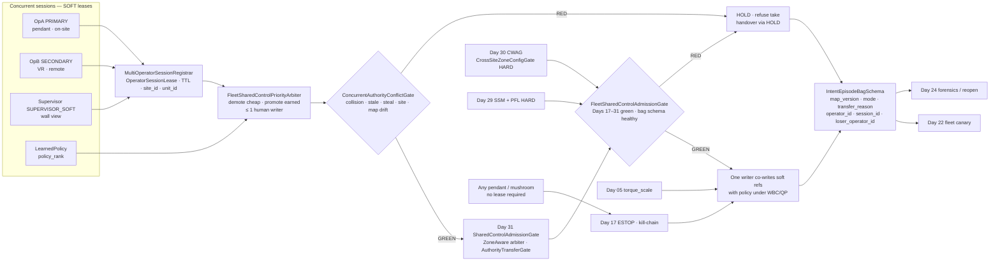
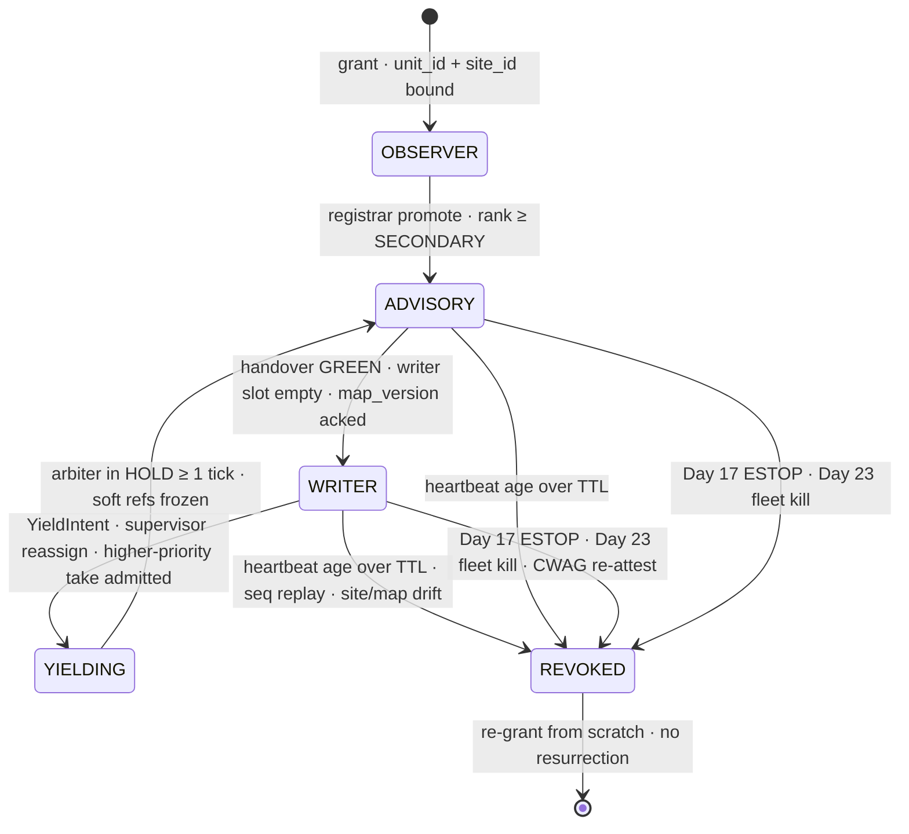
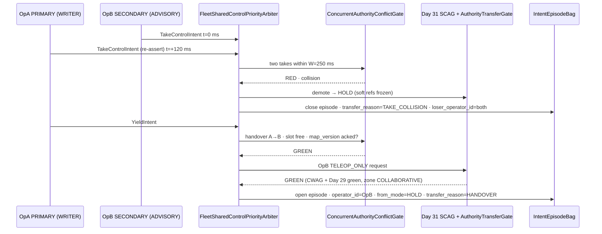
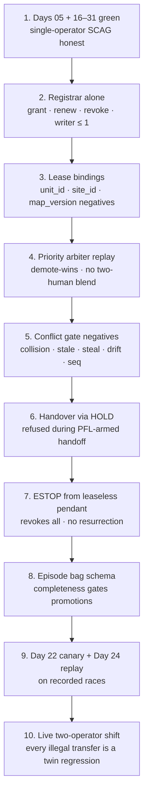

# Day 32 — Multi-operator / fleet shared-control coordination: MultiOperatorSessionRegistrar / OperatorSessionLease / FleetSharedControlPriorityArbiter / ConcurrentAuthorityConflictGate / IntentEpisodeBagSchema / FleetSharedControlAdmissionGate under SharedControlAdmissionGate + CollaborativeWorkspaceAdmissionGate + proximity + zone attestation + supervisor + logging + canary + HIL + fleet + fleet-canary + incident + forensics/reopen + change-management + maintenance + thermal + energy gates

![MultiOperatorSessionRegistrar / OperatorSessionLease / FleetSharedControlPriorityArbiter / ConcurrentAuthorityConflictGate / IntentEpisodeBagSchema / FleetSharedControlAdmissionGate: concurrent operator sessions on one unit are soft leases with session_id, operator_id, rank, TTL, and the unit's site_id; FleetSharedControlPriorityArbiter orders soft requests from supervisor-soft, primary, secondary, and policy so at most one human channel writes soft refs per unit and any lease holder may demote toward HOLD; ConcurrentAuthorityConflictGate fails closed on colliding TAKE_CONTROL intents, stale leases, cross-robot session steal, site_id mismatch, and map_version drift; every episode bags map_version, mode, transfer_reason, operator_id, session_id, loser_operator_id, and policy_rank for Day 22 fleet canaries and Day 24 forensics; FleetSharedControlAdmissionGate composes under Day 31 SharedControlAdmissionGate, Day 30 CWAG, and Day 29 HARD PFL — rank never raises PFL, never bypasses CrossSiteZoneConfigGate, never writes Day 17 ESTOP or Day 05 torque_scale](/images/day32-multi-operator-fleet-shared-control.png)

[Day 16](/lessons/day-16-teleop-shared-autonomy) made teleop and policy co-equal **soft** writers under `SharedAutonomyArbiter`. [Day 21](/lessons/day-21-fleet-continual-learning) through [Day 24](/lessons/day-24-post-incident-forensics) made the fleet honest: ticket-log sync, fleet canaries, coordinated incident kill, and forensic reopen. [Day 29](/lessons/day-29-human-proximity-safety) owns SSM envelopes and HARD ISO/TS 15066-style PFL body-region ceilings. [Day 30](/lessons/day-30-collaborative-workspace-zoning) owns `CollaborativeWorkspaceAdmissionGate` (CWAG) and `CrossSiteZoneConfigGate`. [Day 31](/lessons/day-31-shared-control-teleop-arbitration) owns `ZoneAwareSharedControlArbiter`, `AuthorityTransferGate`, `OperatorIntentAdmissionGate`, and `SharedControlAdmissionGate` (SCAG). [Day 17](/lessons/day-17-runtime-safety-supervisor) owns the kill-chain, ESTOP, and stage transitions **forever**. [Day 05](/lessons/day-05-power-bms) owns `torque_scale`, contactor, UVLO, and STO **forever**.

Day 31 quietly assumed **one** operator. Real cells do not cooperate: an on-site technician holds a teach pendant, a remote ops-center operator has a VR rig on the same unit, a shift supervisor watches four robots on a wall, and the policy is still running. Two people press "take control" in the same 200 ms. A VR headset drops Wi-Fi and its last stick deflection is still in a buffer. Someone re-uses a session token from H-04 on H-07. A remote operator at SITE_B renders the cell with SITE_B's zone file. None of those are new safety ceilings — they are new ways to **launder authority** around the ones you already have.

Today owns **`MultiOperatorSessionRegistrar` / `OperatorSessionLease` / `FleetSharedControlPriorityArbiter` / `ConcurrentAuthorityConflictGate` / `IntentEpisodeBagSchema` / `FleetSharedControlAdmissionGate`**. The question is: **when several humans and the policy all want to co-write one unit's soft refs, who holds the pen, how are collisions resolved fail-closed, and how does every episode leave a bag that Day 22 canaries and Day 24 forensics can regress — without a second operator ever outranking Day 29, Day 30, Day 31, Day 17, or Day 05?**

## Rank orders soft writes. It never orders HARD ceilings.

Day 31's rule stands: modes, blend weights, intent, and transfer requests are SOFT. Today adds three honesty layers:

1. **Sessions are leases, not logins.** An operator is a writer only while a fresh, unit-bound, site-bound `OperatorSessionLease` says so. Lease age is MEASURED on the host monotonic clock; rank is SOFT priority.
2. **Asymmetric arbitration.** Requests that move authority **toward HOLD** (YIELD, ABORT, HOLD) are cheap and admitted from any valid lease holder or the policy. Requests that **promote** authority (TAKE_CONTROL, BLEND up, resume) are expensive and must win priority, pass the conflict gate, and pass Day 31 SCAG.
3. **Episodes are evidence.** Every interval of constant (unit, writer lease, mode, `map_version`) is an episode with a schema-complete bag. An unbagged episode is an unadmitted episode.

So the honest labels are:

| Quantity | Label | Where it comes from | How it goes wrong |
|----------|-------|---------------------|-------------------|
| Operator rank (`SUPERVISOR_SOFT` / `PRIMARY` / `SECONDARY` / `OBSERVER`) | SOFT priority | Registrar policy | Treated as permission to raise PFL or skip CWAG |
| Operator identity / auth token | ATTESTED access-control fact | Site IdP / badge / cert | Treated as a safety privilege ("supervisor can override") |
| Lease age, heartbeat RTT | MEASURED | Host `t_mono` per session | Wall-clock TTL; stale lease still writes |
| `TakeControlIntent` / `YieldIntent` | SOFT | Day 31 `OperatorIntent` per session | Two takes both "win"; confidence labeled MEASURED |
| Priority verdict / writer pick | SOFT admit | `FleetSharedControlPriorityArbiter` | Averaging two operators' sticks |
| Conflict verdict | Fail-closed admit | `ConcurrentAuthorityConflictGate` | Last-writer-wins race |
| Lease `site_id`, `unit_id`, bound `map_version` | HARD binding | Registrar at grant + Day 30 attestation | Remote op renders own site map; token reused on other robot |
| Measured occupancy $N$ / $\rho$, SSM status | MEASURED / SOFT-over-MEASURED | Day 30 / Day 29 | "Two operators watching = safer" fantasy |
| PFL body-region ceilings | HARD | Day 29 attested tables | Supervisor rank raises hand ceiling |
| Cross-site zone hash | HARD | Day 30 `CrossSiteZoneConfigGate` | Lease from SITE_B bypasses gate |
| Episode bag completeness | MEASURED (schema check) | `IntentEpisodeBagSchema` validator | Missing `operator_id` makes forensics unfalsifiable |
| ESTOP / kill-chain / `torque_scale` | HARD owners | Day 17 / Day 05 | "Primary operator owns the stop" |

The first rule of today: **any human may stop the robot through Day 17; only one admitted lease may steer its soft refs; nobody's rank moves a HARD ceiling.** The red mushroom is never lease-gated.

| Layer | Owns | Must not own |
|-------|------|--------------|
| Day 31 SCAG + `AuthorityTransferGate` | Single-writer mode transfers under CWAG + Day 29 | Session identity; multi-operator conflict |
| `MultiOperatorSessionRegistrar` | Lease grant / renew / revoke; unit + site binding; writer-cardinality invariant | Mode math; zone geometry; ESTOP |
| `OperatorSessionLease` | Per-session rank, TTL, heartbeat, bound `map_version` | Any HARD privilege |
| `FleetSharedControlPriorityArbiter` | Ordering of soft requests across sessions + policy | Blending two humans; raising PFL |
| `ConcurrentAuthorityConflictGate` | Fail-closed refusal of colliding / stale / stolen / cross-site authority | Choosing a "winner" by speed |
| `IntentEpisodeBagSchema` | Episode boundaries + required fields for Day 18/20/22/24 | Redacting HARD verdicts; editing past bags |
| `FleetSharedControlAdmissionGate` | Composed fail-closed admit under SCAG + Days 17–31 | Clearing supervisor stage; dual-writing ESTOP / `torque_scale` |
| Day 30 / Day 29 / Day 17 / Day 05 | Space, proximity, kill-chain, torque | Being outranked by any operator |

**Core thesis:** multi-operator shared control is not "Day 31 with a user list." It is a **lease registrar** that keeps at most one human pen per unit, an **asymmetric priority arbiter** where anyone may demote but promotion must be earned, a **conflict gate** that refuses races instead of resolving them by latency, and an **episode bag schema** that makes every transfer replayable by fleet canaries and forensics — all composed under a **FleetSharedControlAdmissionGate** that sits *under* Day 31 SCAG and Days 17–31. A second operator is another soft voice, never a privilege. Day 29 PFL and Day 30 zone attestation stay HARD; Day 17 and Day 05 stay sole owners.



## MultiOperatorSessionRegistrar / OperatorSessionLease: the pen is a lease

`MultiOperatorSessionRegistrar` runs on the unit's host (not in the cloud — a WAN partition must not leave a phantom writer). It grants, renews, and revokes `OperatorSessionLease`s and enforces one invariant every tick:

$$
\#\{\text{leases with role} = \mathrm{WRITER},\ \text{fresh},\ \text{unit} = u\} \le 1
$$

A lease is fresh only while its last heartbeat age on the host monotonic clock is within TTL: $t_{mono} - t_{hb} \le \mathrm{TTL}$. Heartbeat age is MEASURED; the operator's own clock is not consulted.

| Field | Meaning | Binding |
|-------|---------|---------|
| `session_id` | Nonce minted by the registrar on this unit | Bound to `unit_id`; never portable |
| `operator_id` | Attested identity (pseudonymized in fleet aggregates) | Access control only — not a safety privilege |
| `rank` | `SUPERVISOR_SOFT` · `PRIMARY` · `SECONDARY` · `OBSERVER` | SOFT priority |
| `role` | `WRITER` · `ADVISORY` · `READ_ONLY` | At most one fresh WRITER per unit |
| `site_id` | The **unit's** attested site, copied from Day 30 at grant | HARD binding; operator location is separate metadata |
| `bound_map_version` | `map_version` the operator acknowledged at grant | Drift → re-ack before any promote |
| `zone_scope[]` | Zone ids the lease may request authority in | Subset of CWAG-attested zones; EXCLUSION never included |
| `lease_ttl_ms` | e.g. 300 ms WRITER, 2 s ADVISORY | Shorter for WRITER; contact tasks shortest |
| `seq` | Per-session monotonic | Replay / reorder → drop |

Rules that hold for every rank:

- **No lease resurrection.** Day 17 ESTOP, a Day 23 fleet kill, a supervisor stage drop, or a CWAG re-attestation revokes all WRITER leases. Recovery re-grants from scratch; a lease never "comes back" with its old authority.
- **Remote is not a site.** OpB in the SITE_B ops center operating H-07 at SITE_A gets a lease with `site_id = SITE_A` and must render SITE_A's attested geometry. A lease whose `site_id` differs from the unit's is a `CrossSiteZoneConfigGate` failure, not a convenience.
- **Fan-out cap.** One operator may hold WRITER on at most one contact-capable unit at a time; supervisory multi-unit views are `SUPERVISOR_SOFT` + `READ_ONLY` / `ADVISORY`.
- **ESTOP is outside the registrar.** Any pendant, mushroom, or OBSERVER's hardwired stop goes to Day 17 with no lease lookup on the path.



## FleetSharedControlPriorityArbiter: demote is cheap, promote is earned

`FleetSharedControlPriorityArbiter` sits **in front of** Day 31's `ZoneAwareSharedControlArbiter`. It does not compute blend weights; it decides *which single human channel* (if any) the Day 31 arbiter sees as teleop this tick, and which pending transfer request is forwarded to `AuthorityTransferGate`.

Two rules dominate everything else:

1. **Most-restrictive-wins for demotion.** A fresh YIELD / ABORT / HOLD from any lease holder (including ADVISORY) or from the policy is forwarded immediately. Nobody's rank can veto a demotion toward HOLD.
2. **Never blend two humans.** Day 16 BLEND mixes one teleop channel with policy. Averaging OpA's and OpB's sticks produces a command neither intended, with no owner to blame in forensics. SECONDARY input is ADVISORY (waypoint suggestions, soft "look here"), never a second teleop term.

Priority for **promotion** requests (only considered after HARD layers and after any demotion this tick):

| Order | Requester | May request | Never |
|-------|-----------|-------------|-------|
| — | Day 17 / Day 05 / Day 29 / Day 30 | Not participants — they bound the arbiter | Being ranked against operators |
| 0 | Any lease holder or policy | YIELD · ABORT · HOLD (always admitted if fresh) | — |
| 1 | `SUPERVISOR_SOFT` | Reassign writer slot; force YIELD of current writer; TAKE_CONTROL itself | Raise PFL; clear stage; enter EXCLUSION; write ESTOP |
| 2 | `PRIMARY` | TAKE_CONTROL when slot empty or via handover; BLEND up inside SCAG envelope | Pre-empt a writer mid PFL-armed contact |
| 3 | `SECONDARY` | ADVISORY input; TAKE_CONTROL only via explicit handover from writer or supervisor | Silent pre-emption of PRIMARY |
| 4 | Policy (`policy_rank`) | POLICY_ONLY when no human WRITER; BLEND share under writer | Pre-empt any fresh human WRITER |
| — | `OBSERVER` | Stop via Day 17 hardware only | Any soft promotion |

A higher rank **never** shortcuts the gates below it. `SUPERVISOR_SOFT` reassigning the pen to itself still passes the conflict gate, Day 31 `AuthorityTransferGate`, CWAG, and Day 29 — exactly like PRIMARY would. Rank changes *who asks first*, not *what is allowed*.

**Handover passes through HOLD.** Writer-to-writer handover is two-phase: holder YIELD (or supervisor reassign) → arbiter HOLD for at least one tick with soft refs frozen → registrar flips the WRITER slot → new writer's `TakeControlIntent` goes through Day 31 `AuthorityTransferGate`. No hot swap between two human channels while soft refs are moving. If PFL is armed in a `HANDOFF_CORRIDOR`, handover is refused until the handoff completes or aborts to HOLD.

## ConcurrentAuthorityConflictGate: refuse races, do not resolve them

Last-writer-wins is a latency lottery: the operator on the better network wins. `ConcurrentAuthorityConflictGate` is fail-closed — on any of the following it refuses the promotion, demotes toward HOLD if a writer was moving, and bags the conflict.

| Conflict | Detection | Verdict |
|----------|-----------|---------|
| Two `TakeControlIntent` within collision window $W$ (e.g. 250 ms host time) | Registrar sees ≥ 2 fresh takes for one unit | RED for both; HOLD; require supervisor reassign or explicit YIELD |
| Take while a writer is fresh, no handover | Writer slot occupied, no YIELD | RED — no silent pre-emption |
| Stale lease writes | Heartbeat age over TTL; buffered commands with old `t_mono` | Drop writes; revoke lease; yield to POLICY or HOLD per Day 31 |
| Cross-robot session steal | `session_id` presented on a unit other than the one that minted it | RED; revoke; open Day 23 security incident |
| `site_id` mismatch | Lease `site_id` ≠ unit's attested site | RED via `CrossSiteZoneConfigGate`; no "remote override" |
| `map_version` drift | CWAG re-attested; lease `bound_map_version` older | Promotions RED until operator re-acks current map |
| `seq` replay / reorder | Non-monotonic per-session `seq` | Drop; YELLOW → RED on repeat |
| Writer-cardinality violated | Two fresh WRITER leases on one unit | RED; HOLD; registrar bug → Day 23 incident |
| Take during PFL-armed contact | Day 29 PFL armed, handoff in progress | RED until handoff completes / aborts |
| Rank-based PFL / zone ask | Supervisor intent requests ceiling raise or EXCLUSION entry | RED — same as Day 31 intent refusal |

The collision window is a **refusal** window, not a tie-break window. Two people grabbing the same robot is information — the cell's social protocol failed — and the honest response is HOLD plus a human decision, not a coin flip by packet arrival.



## IntentEpisodeBagSchema: every episode is replayable evidence

Day 18 taught dataset hygiene; Day 31 tagged single-operator transfers. With multiple sessions, the tag set must name **who held the pen, who lost, and why** — otherwise Day 22 canaries cannot attribute regressions and Day 24 forensics cannot reconstruct the race.

An **episode** opens and closes on any change of: writer lease, mode, `map_version`, zone id, or gate status color. Required fields:

| Field | Label | Why fleet canary / forensics needs it |
|-------|-------|---------------------------------------|
| `episode_id`, `unit_id`, `site_id` | HARD keys | Join with Day 21 ticket-log sync and Day 25 cross-site config |
| `map_version`, `changeset_hash`, `zone_id`, `zone_kind` | HARD attested | Replay against the geometry that was actually armed |
| `mode`, `from_mode`, `to_mode` | SOFT | Day 31 transfer replay |
| `transfer_reason` | SOFT enum | `HANDOVER` · `TAKE_COLLISION` · `STALE_LEASE` · `SUPERVISOR_REASSIGN` · `ZONE_TRIP` · `SSM_RED` · `MAP_DRIFT` · `ESTOP_REVOKE` · … |
| `operator_id`, `session_id`, `rank`, `role` | ATTESTED / SOFT | Attribution; pseudonymized in fleet aggregates |
| `loser_operator_id?`, `loser_session_id?` | ATTESTED | Who was refused and why — the half of the race you usually lose |
| `policy_id`, `policy_rank`, `policy_version` | SOFT / HARD version | Day 22 canary attribution |
| `conflict_verdict`, `scag_status`, `cwag_status`, `ssm_status`, `fscag_status` | Gate snapshots | Prove the admit chain at the moment of transfer |
| `lease_age_ms`, `hb_rtt_ms` | MEASURED | Stale-lease forensics |
| $d^{-}_{sep}$, $d^{+}_{stop}$, $N$ | MEASURED / SOFT bound | Day 29/30 replay |
| `intent_confidence` | SOFT (never MEASURED) | Label-honesty audit |

Two hard rules:

- **Schema completeness is a gate input.** If the bag writer is backpressured or a required field is missing, `FleetSharedControlAdmissionGate` goes RED for *new promotions* on that unit. Demotions still flow — you never block a HOLD on logging.
- **Bags are append-only.** Forensics annotates in a side table; nobody edits `transfer_reason` after the fact.

Fleet canary use (Day 22): rank policy versions on per-1000-episode rates of `TAKE_COLLISION`, `STALE_LEASE` writes dropped, illegal promotion attempts refused, and operator takeover from POLICY_ONLY. A policy that makes operators grab control more often is a **soft regression signal**, never a reason to raise anything HARD. Forensics use (Day 24): every illegal-transfer episode becomes a HIL/twin regression; reopen canary requires the replay to refuse the same race.

## FleetSharedControlAdmissionGate: composition under SCAG

`FleetSharedControlAdmissionGate` (FSCAG) is today's composition root. It fails closed unless:

- Day 31 `SharedControlAdmissionGate` GREEN (which itself requires CWAG + Day 29 + Days 17–28)
- `MultiOperatorSessionRegistrar` consistent: ≤ 1 fresh WRITER, all leases `site_id` = unit site, no stolen session ids
- `ConcurrentAuthorityConflictGate` GREEN for any pending promotion
- Writer lease `bound_map_version` = current CWAG `map_version`
- `IntentEpisodeBagSchema` writer healthy and last episode schema-complete
- Day 22 fleet canary GREEN for this policy × unit; Day 23 no open incident (including session-steal security incidents); Day 24 reopen GREEN

Soft admit blocker only — it does not publish `JointCommand`, does not clear ESTOP, does not write Day 05, does not touch Day 25 HARD_SAFETY ChangeSets.

## A worked multi-operator example

SITE_A, unit H-07, COLLABORATIVE polygon, `map_version = 41`, warn $N = 3$, hard $N = 5$. Policy runs POLICY_ONLY tote picking. OpA (PRIMARY, on-site pendant) holds ADVISORY. OpB (SECONDARY, VR from the SITE_B ops center) holds ADVISORY. Supervisor (SUPERVISOR_SOFT) watches four units.

| Step | MEASURED / HARD | Soft | Verdict |
|------|-----------------|------|---------|
| OpB lease granted from SITE_B client with `site_id = SITE_B` | Unit attested SITE_A | — | Registrar refuses; re-grant with `site_id = SITE_A`, SITE_A geometry rendered |
| OpA and OpB both send TAKE_CONTROL, 120 ms apart | Host `t_mono` within $W$ | Both confident | CACG RED; POLICY_ONLY demotes to HOLD; episode `TAKE_COLLISION`, both as losers |
| Supervisor reassigns pen to OpA | Slot free; map 41 acked | SUPERVISOR_SOFT reassign | CACG GREEN → Day 31 ATG GREEN → TELEOP_ONLY |
| OpB nudges "BLEND my stick in too" | — | Second teleop term | Refused — ADVISORY only; never blend two humans |
| CWAG re-attests after a fixture move, `map_version = 42` | New geometry HARD | OpA keeps steering | WRITER lease revoked (map drift) → HOLD until OpA re-acks 42 |
| OpA re-acks; policy proposes BLEND for tote handoff | HANDOFF_CORRIDOR armed; PFL HAND HARD | BLEND request | Day 30 HandoffCorridorGate + Day 31 ATG GREEN — BLEND |
| Supervisor asks "raise hand PFL, we're behind" | Day 29 table unchanged | Rank request | CACG RED (rank-based PFL ask) + Day 31 intent gate RED |
| OpB requests TAKE_CONTROL mid-handoff | PFL armed | Handover request | RED until handoff completes or aborts |
| OpA's pendant Wi-Fi drops | Heartbeat age 410 ms over 300 ms TTL | Buffered stick deltas | Writes dropped; lease revoked; BLEND → POLICY_ONLY per Day 31 dropout rule |
| OpA, now leaseless, slaps the mushroom | Day 17 ESTOP | — | Kill-chain fires; no lease check; all WRITER leases revoked |
| Recovery | Day 17 owns stage | — | Fresh grants only; first episode after recovery `from_mode = HOLD`, `transfer_reason = ESTOP_REVOKE` |

Every row is a bag. Day 22 ranks the policy version on whether its handoff BLEND drew more operator takes; Day 24 replays the 120 ms collision and the stale-pendant episode as regressions.

## Ownership conflicts

| Conflict | Winner | Behavior |
|----------|--------|----------|
| Two TAKE_CONTROL within $W$ | `ConcurrentAuthorityConflictGate` | Both refused; HOLD; human decides |
| Supervisor rank vs Day 29 PFL ceiling | Day 29 HARD | Refuse raise |
| Remote lease `site_id` vs unit site | `CrossSiteZoneConfigGate` | RED; re-grant bound to unit site |
| SECONDARY "help" vs PRIMARY writer | Priority arbiter | ADVISORY only; no second teleop term |
| Policy wants POLICY_ONLY vs fresh human WRITER | Human WRITER | Policy may BLEND share or request HOLD only |
| Any YIELD / HOLD vs anyone's promote | Demotion | Most-restrictive-wins |
| Stale lease buffer vs live policy | Freshness | Stale writes dropped; Day 31 dropout path |
| Stolen `session_id` on another unit | Registrar + Day 23 | RED; revoke; security incident |
| CWAG re-attest vs live writer | Day 30 | Revoke WRITER until re-ack |
| Bag writer down vs operator promotion | FSCAG | No new promotions; demotions still flow |
| Leaseless operator ESTOP vs writer's "I'm fine" | Day 17 | Kill-chain wins; no lease lookup |
| Anyone asks Day 05 `torque_scale` for "authority" | Day 05 | Not accepted |

## Shared API

Same wire discipline as Days 02/04: everything carries `BusHeader`. The registrar, arbiter, and gates run on the unit host; nothing here enters the cyclic current loop. Day 29 monitors and Day 17 remain independent.

```text
BusHeader:
  t_mono
  seq
  clock_domain         # HOST for leases and gates; SENSOR for proximity/zone inputs
  age_ms
  producer_id

OperatorSessionLease ⊇ BusHeader:          # SOFT priority, HARD bindings
  session_id             # minted on this unit; non-portable
  operator_id            # ATTESTED identity; pseudonymized in fleet aggregates
  rank                   # SUPERVISOR_SOFT | PRIMARY | SECONDARY | OBSERVER
  role                   # WRITER | ADVISORY | READ_ONLY
  unit_id                # HARD binding
  site_id                # HARD binding = unit's attested site (Day 30)
  operator_location?     # metadata only
  bound_map_version      # acked at grant / re-ack
  zone_scope[]           # ⊆ CWAG-attested; never EXCLUSION
  lease_ttl_ms
  t_last_hb              # host t_mono — MEASURED age
  hb_rtt_ms              # MEASURED
  label: SOFT
  forbid:
    raise_pfl_ceiling: true
    bypass_cross_site_zone: true
    write_estop: true
    write_torque_scale: true
    gate_estop_path: true          # ESTOP never requires a lease
    resurrect_after_revoke: true

MultiOperatorSessionRegistrar ⊇ BusHeader:
  unit_id
  leases[]
  writer_session_id?
  invariant: fresh_writer_count <= 1
  revoke_on[]: [hb_stale, seq_replay, site_mismatch, map_drift, estop, fleet_kill, stage_drop, cwag_reattest]
  fanout_cap_contact_units_per_operator: 1

TakeControlIntent ⊇ OperatorIntent:        # Day 31 OperatorIntent, session-scoped
  session_id
  intent_kind            # TAKE_CONTROL | YIELD | ABORT | HOLD | REASSIGN
  target_operator_id?    # REASSIGN only (SUPERVISOR_SOFT)
  confidence             # NOT MEASURED

FleetSharedControlPriorityArbiter ⊇ BusHeader:
  writer_session_id?
  policy_rank
  forwarded_request?     # to Day 31 AuthorityTransferGate
  rules:
    demotion_most_restrictive_wins: true
    max_human_teleop_channels: 1
    handover_via_hold_ticks: 1
    policy_preempts_human_writer: false
    rank_shortcuts_gates: false
  never_hard: true
  feeds: ZoneAwareSharedControlArbiter    # Day 31

ConcurrentAuthorityConflictGate ⊇ BusHeader:
  status                 # RED | YELLOW | GREEN
  fail_closed: true
  collision_window_ms    # W, host time
  refuse_on[]:
    take_collision
    take_without_handover
    stale_lease_write
    cross_robot_session_steal
    site_id_mismatch
    map_version_drift
    seq_replay
    writer_cardinality_violation
    take_during_pfl_armed_contact
    rank_based_pfl_or_zone_ask
  on_refuse: demote_toward_hold

IntentEpisodeBag ⊇ BusHeader:              # IntentEpisodeBagSchema, append-only
  episode_id
  unit_id
  site_id
  map_version
  changeset_hash
  zone_id
  zone_kind
  mode
  from_mode
  to_mode
  transfer_reason
  operator_id
  session_id
  rank
  role
  loser_operator_id?
  loser_session_id?
  policy_id
  policy_rank
  policy_version
  conflict_verdict
  scag_status
  cwag_status
  ssm_status
  fscag_status
  lease_age_ms
  hb_rtt_ms
  d_sep_lo
  d_stop_hi
  occupancy_n
  intent_confidence      # SOFT — never MEASURED
  schema_complete: bool

FleetSharedControlAdmissionGate ⊇ BusHeader:
  fail_closed: true
  soft_admit_blocker_only: true
  status                 # RED | YELLOW | GREEN
  require:
    shared_control_admission_green: true          # Day 31 SCAG
    collaborative_workspace_admission_green: true # Day 30 CWAG
    cross_site_zone_config_green: true            # Day 30
    human_safety_admission_green: true            # Day 29
    registrar_consistent: true
    conflict_gate_green_if_promotion: true
    writer_map_version_current: true
    episode_bag_schema_healthy: true
    fleet_canary_gate_green: true                 # Day 22
    no_open_incident_on_unit: true                # Day 23
    canary_reopen_gate_green: true                # Day 24
    energy_admission_gate_green: true             # Day 28
    thermal_admission_gate_green: true            # Day 27
    supervisor_armed: true                        # Day 17
    estop_pairing: true
    day05_binding: true
  blocks: promotions_only        # demotions toward HOLD always flow
  forbid:
    joint_command: true
    dual_write_torque_scale: true
    clear_supervisor_stage: true
    write_estop: true
    force_flag: true
    write_hard_safety_changeset: true

# Unchanged owners
SharedControlAdmissionGate (Day 31): single-writer zone-aware transfer admit
CollaborativeWorkspaceAdmissionGate (Day 30): zone · occupancy · handoff · cross-site
HumanSafetyAdmissionGate (Day 29): SSM · PFL · stop twin
SupervisorState (Day 17): ESTOP · kill-chain · stage · monitors
BmsState / PowerState (Day 05): torque_scale · contactor · UVLO · STO
  accepts_requests_from_soft_layer: false
```

## Physical ↔ digital pairing

| Physical | Digital twin / backing |
|----------|------------------------|
| Teach pendant on-site | PRIMARY lease; hardwired stop to Day 17 independent of lease |
| VR rig in remote ops center | SECONDARY lease bound to the **unit's** `site_id` and attested map |
| Supervisor wall of four robots | `SUPERVISOR_SOFT` + `READ_ONLY`; may REASSIGN / force YIELD only |
| Two hands reaching for the same joystick | `TAKE_COLLISION` → HOLD → human protocol |
| "You have it" spoken handover | YIELD → HOLD tick → registrar flip → Day 31 ATG |
| Wi-Fi dead zone by the dock | Heartbeat age over TTL → lease revoke → Day 31 dropout path |
| Badge tapped on the wrong robot | Session minted per unit; cross-robot steal refused |
| Fixture moved, zones re-surveyed | CWAG re-attest → `map_version` drift → WRITER re-ack |
| Red mushroom on any pendant | Day 17, no lease lookup, revokes all WRITER leases |
| Postmortem whiteboard | Append-only episode bags + Day 24 replay |

If the twin cannot replay a two-operator race with both `session_id`s, the loser, the collision window, lease ages, `map_version`, and every gate color, it cannot set the next multi-operator admit.

## Bring-up sequence (before trusting multiple operators on one unit)



1. **Days 05 and 16–31 green.** Single-operator SCAG already honest; do not debug two operators on a broken one-operator stack.
2. **Registrar alone.** Fuzz grant/renew/revoke; prove the writer-cardinality invariant under reordered and duplicated packets.
3. **Lease bindings.** Wrong `site_id`, wrong `unit_id`, old `map_version` — each refuses promotion.
4. **Priority arbiter replay.** Feed recorded multi-session streams; confirm YIELD from ADVISORY beats PRIMARY take, and SECONDARY never becomes a second teleop term.
5. **Conflict gate negatives.** Two takes inside $W$, take without handover, stale buffer flush, stolen session, seq replay — every one RED → HOLD.
6. **Handover via HOLD.** Measure soft-ref freeze for ≥ 1 tick; prove handover refused while PFL is armed in a handoff corridor.
7. **ESTOP from a leaseless pendant.** Kill-chain fires with zero registrar involvement; all WRITER leases revoked; re-grant required.
8. **Episode bag schema.** Kill the bag writer; promotions go RED, demotions still flow. Validate every required field on every episode boundary.
9. **Canary + forensics.** Day 22 ranks policies on take/collision/stale rates; Day 24 replays recorded races and reopen requires refusal of the same race.
10. **Then** run a live two-operator shift; every illegal transfer is a Day 18 bag + Day 24 forensic + twin regression.

## Failure gallery

| Symptom | Likely cause |
|---------|--------------|
| Robot jerks between two operators' intents | Two human channels blended; max-one-teleop rule missing |
| Remote operator's near-miss on a moved fixture | Lease not revoked on `map_version` drift |
| SITE_B geometry rendered for SITE_A unit | Lease `site_id` = operator location, not unit site |
| Ghost commands after VR dropout | Stale lease buffer flushed instead of dropped |
| Same token controls two robots | `session_id` not unit-bound; cross-robot steal |
| Faster network always wins the take | Last-writer-wins instead of collision refusal |
| Supervisor "override" raised hand PFL | Rank treated as HARD privilege |
| Writer swap mid-handoff, object dropped | Handover allowed while PFL armed |
| Robot resumes old operator after ESTOP | Lease resurrection |
| Forensics can't say who lost the race | `loser_operator_id` / `loser_session_id` not bagged |
| Canary can't attribute operator takes to policy | `policy_version` missing from episode bag |
| HOLD blocked because logging was down | FSCAG blocked demotions, not just promotions |
| Observer's stop ignored | ESTOP path routed through lease lookup |

## What to freeze this week

Extend [frames](/frames) and your safety config with:

- `MultiOperatorSessionRegistrar` + `OperatorSessionLease`: unit-minted, unit-bound, site-bound (unit's site), map-version-acked leases; MEASURED heartbeat age against host TTL; ≤ 1 fresh WRITER per unit; no resurrection after ESTOP / fleet kill / CWAG re-attest.
- `FleetSharedControlPriorityArbiter`: demotion most-restrictive-wins from any lease holder or policy; promotion by rank only *into* the gates; never blend two humans; handover passes through HOLD.
- `ConcurrentAuthorityConflictGate`: fail-closed on take collisions, take-without-handover, stale writes, session steal, `site_id` mismatch, `map_version` drift, seq replay, writer-cardinality violation, take during PFL-armed contact, and rank-based PFL / zone asks.
- `IntentEpisodeBagSchema`: append-only episodes with `map_version` · `mode` · `transfer_reason` · `operator_id` · `session_id` · `loser_operator_id` · `policy_rank` · gate colors; schema completeness gates promotions, never demotions.
- `FleetSharedControlAdmissionGate` fail-closed under Day 31 SCAG + CWAG + Days 17–31; soft admit blocker only; **no dual-write of ESTOP or `torque_scale`.**
- ESTOP is never lease-gated. Rank is never a HARD privilege.

The lesson isn't "add a user list to teleop." It's that **multi-operator shared control is a single soft pen per unit, passed through HOLD, refused on races, bound to the unit's attested site and map, and bagged so fleet canaries and forensics can regress every illegal transfer.** A second operator is another soft voice; Day 29 and Day 30 stay HARD; Day 17 still owns the kill-chain; Day 05 still owns torque.

## Next

**Day 33+** — Remote / multi-site teleop under latency: delayed-operator honesty (MEASURED round-trip and jitter vs soft predicted operator intent), latency-aware lease TTL and authority demotion, operator-side zone-view staleness vs attested `map_version`, and WAN-loss failover to POLICY or HOLD — without raising PFL ceilings or bypassing CrossSiteZoneConfigGate, under the same gates (supervisor + logging + canary + HIL + fleet + fleet-canary + incident + forensics/reopen + change-management + maintenance + thermal + energy + proximity + zone attestation + shared-control + multi-operator admission).
