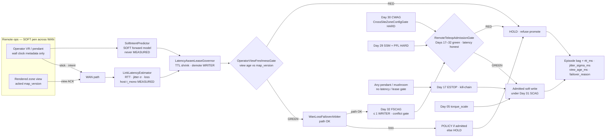
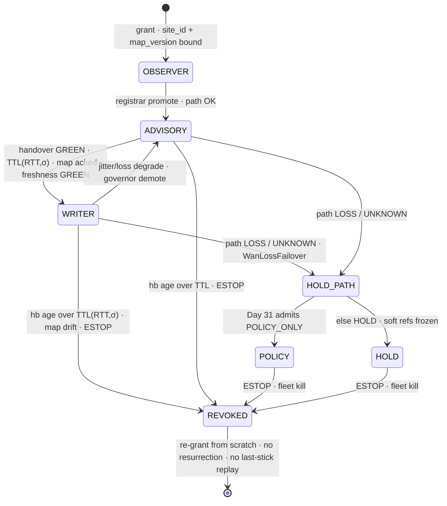
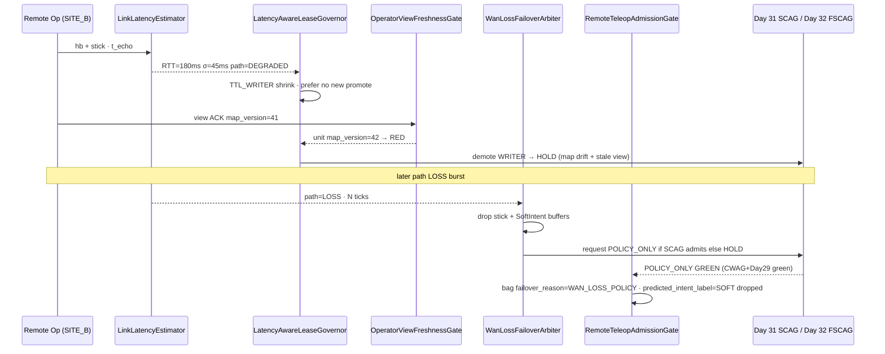

# Day 33 — Remote / multi-site teleop under latency: LinkLatencyEstimator / LatencyAwareLeaseGovernor / SoftIntentPredictor / OperatorViewFreshnessGate / WanLossFailoverArbiter / RemoteTeleopAdmissionGate under FleetSharedControlAdmissionGate + SharedControlAdmissionGate + CollaborativeWorkspaceAdmissionGate + proximity + zone attestation + supervisor + logging + canary + HIL + fleet + fleet-canary + incident + forensics/reopen + change-management + maintenance + thermal + energy gates

![LinkLatencyEstimator / LatencyAwareLeaseGovernor / SoftIntentPredictor / OperatorViewFreshnessGate / WanLossFailoverArbiter / RemoteTeleopAdmissionGate: remote ops-center VR/pendant crosses a WAN whose RTT, jitter σ, and loss are MEASURED on the unit host monotonic clock (never the operator wall clock); LinkLatencyEstimator feeds LatencyAwareLeaseGovernor which shrinks WRITER TTL and demotes authority as latency/jitter rises; SoftIntentPredictor is a SOFT forward model of delayed operator intent — never labeled MEASURED, never writes Day 17 ESTOP or Day 05 torque_scale; OperatorViewFreshnessGate refuses promote when the operator's rendered zone view / map_version is stale vs unit attestation; WanLossFailoverArbiter on path loss goes to POLICY (if admitted) or HOLD — never freezes the last remote stick; RemoteTeleopAdmissionGate composes fail-closed under Day 32 FleetSharedControlAdmissionGate, Day 31 SCAG, Day 30 CWAG, and Day 29 HARD PFL — latency never raises PFL, never bypasses CrossSiteZoneConfigGate](/images/day33-remote-multisite-teleop-latency.png)

[Day 16](/lessons/day-16-teleop-shared-autonomy) made teleop and policy co-equal **soft** writers. [Day 17](/lessons/day-17-runtime-safety-supervisor) owns the kill-chain, ESTOP, and stage transitions **forever**. [Day 05](/lessons/day-05-power-bms) owns `torque_scale`, contactor, UVLO, and STO **forever**. [Day 29](/lessons/day-29-human-proximity-safety) owns SSM envelopes and HARD ISO/TS 15066-style PFL body-region ceilings. [Day 30](/lessons/day-30-collaborative-workspace-zoning) owns `CollaborativeWorkspaceAdmissionGate` (CWAG) and `CrossSiteZoneConfigGate`. [Day 31](/lessons/day-31-shared-control-teleop-arbitration) owns `ZoneAwareSharedControlArbiter`, `AuthorityTransferGate`, `OperatorIntentAdmissionGate`, and `SharedControlAdmissionGate` (SCAG). [Day 32](/lessons/day-32-multi-operator-fleet-shared-control) owns `MultiOperatorSessionRegistrar`, `OperatorSessionLease`, `FleetSharedControlPriorityArbiter`, `ConcurrentAuthorityConflictGate`, `IntentEpisodeBagSchema`, and `FleetSharedControlAdmissionGate` (FSCAG) — at most one human pen per unit, handover via HOLD, races refused.

Day 32 quietly assumed the operator's path was **fast enough that lease TTL and zone-view freshness were local problems**. Real multi-site teleop is not: a VR rig in SITE_B's ops center steers H-07 at SITE_A across a WAN with 80–250 ms RTT, 20–60 ms jitter σ, and occasional loss bursts. The operator's rendered cell is 150 ms behind the unit's attested `map_version`. A SoftIntent "predictor" invents stick motion to hide lag and someone labels it MEASURED. Wi-Fi dies and the last deflection is still in a buffer. None of those are new safety ceilings — they are new ways to **launder a delayed soft pen into a hard privilege**.

Today owns **`LinkLatencyEstimator` / `LatencyAwareLeaseGovernor` / `SoftIntentPredictor` / `OperatorViewFreshnessGate` / `WanLossFailoverArbiter` / `RemoteTeleopAdmissionGate`**. The question is: **when the soft pen lives across a MEASURED latency path, how does RTT/jitter demote authority and shrink lease TTL, how does a SOFT predictor stay honest, how does a stale operator zone view fail closed, and how does WAN loss fail to POLICY or HOLD — without ever raising PFL, bypassing CrossSiteZoneConfigGate, or writing Day 17 / Day 05?**

## Latency orders the soft pen. It never orders HARD ceilings.

Day 32's rule stands: sessions are leases, demotion is cheap, promotion is earned, at most one human writer per unit. Today adds three honesty layers:

1. **Path honesty is MEASURED on the host.** RTT, jitter σ, and loss are sampled against the unit's monotonic clock. The operator's wall clock is metadata, never a TTL input.
2. **Authority follows the path.** As RTT/jitter rise, `LatencyAwareLeaseGovernor` shrinks WRITER TTL and demotes WRITER → ADVISORY → HOLD. SoftIntent prediction may propose stick continuity; it never buys promotion or raises a HARD ceiling.
3. **Stale view and path loss are RED, not "degraded teleop."** An operator rendering an old `map_version` may not promote. A WAN drop fails to POLICY (if Day 31 admits it) or HOLD — never to "keep the last stick."

So the honest labels are:

| Quantity | Label | Where it comes from | How it goes wrong |
|----------|-------|---------------------|-------------------|
| RTT, one-way delay estimate | MEASURED | Host `t_mono` echo / seq timestamps | Operator wall-clock RTT; NTP-corrected "true" delay used as safety |
| Jitter σ, loss rate | MEASURED | Host window over recent samples | Treated as SOFT "feel" the operator can ignore |
| Lease TTL as function of RTT/σ | SOFT policy over MEASURED | `LatencyAwareLeaseGovernor` | Fixed 300 ms WRITER TTL across continents |
| Soft predicted intent / stick | SOFT | `SoftIntentPredictor` forward model | Labeled MEASURED; used to raise PFL or skip freshness |
| Operator rendered `map_version`, view age | MEASURED vs ATTESTED | Operator ACK of unit attestation | Stale view still promotes; SITE_B map rendered for SITE_A unit |
| Freshness / failover verdict | Fail-closed admit | `OperatorViewFreshnessGate` / `WanLossFailoverArbiter` | Last-stick freeze; "hold last command" on loss |
| PFL body-region ceilings | HARD | Day 29 attested tables | "High latency → raise hand force, we need grip" |
| Cross-site zone hash | HARD | Day 30 `CrossSiteZoneConfigGate` | Remote lag used as excuse to skip re-ack |
| Rank / lease role | SOFT priority | Day 32 registrar | Latency demotion skipped for SUPERVISOR_SOFT |
| ESTOP / kill-chain / `torque_scale` | HARD owners | Day 17 / Day 05 | "Remote ESTOP waits for RTT" |

The first rule of today: **any human may stop the robot through Day 17 with no latency gate on the path; only a fresh, latency-honest lease may steer soft refs; nobody's RTT or SoftIntent moves a HARD ceiling.** The red mushroom is never WAN-gated.

| Layer | Owns | Must not own |
|-------|------|--------------|
| Day 32 FSCAG + registrar | ≤ 1 WRITER; site/map bindings; conflict refusal | Path RTT math; SoftIntent |
| `LinkLatencyEstimator` | MEASURED RTT / σ / loss on host `t_mono` | Authority decisions; ESTOP |
| `LatencyAwareLeaseGovernor` | TTL(RTT,σ); demotion ladder toward HOLD | Raising PFL; bypassing CWAG |
| `SoftIntentPredictor` | SOFT forward model of delayed intent | MEASURED label; writing ESTOP / torque |
| `OperatorViewFreshnessGate` | Refuse promote on stale zone view / map drift | Choosing a "good enough" old map |
| `WanLossFailoverArbiter` | POLICY (admitted) or HOLD on path loss | Freezing last remote stick |
| `RemoteTeleopAdmissionGate` | Composed fail-closed under FSCAG + Days 17–32 | Clearing supervisor stage; dual-writing ESTOP / `torque_scale` |
| Day 30 / Day 29 / Day 17 / Day 05 | Zone, proximity, kill-chain, torque | Being outranked by latency or prediction |

**Core thesis:** remote teleop is not "Day 32 over Wi-Fi." It is **MEASURED path honesty** that demotes the soft pen as RTT and jitter rise, a **SOFT predictor** that never becomes a safety privilege, a **freshness gate** that treats a stale operator view of attested zones as RED, and a **WAN-loss arbiter** that fails to POLICY or HOLD — never to ghost commands — all composed under a **RemoteTeleopAdmissionGate** that sits *under* Day 32 FSCAG and Days 17–31. Latency shrinks authority; SoftIntent never buys it. Day 29 PFL and Day 30 zone attestation stay HARD; Day 17 and Day 05 stay sole owners.



## LinkLatencyEstimator: path honesty on the host clock

`LinkLatencyEstimator` runs on the **unit host**, not in the ops-center client. Every control or heartbeat frame carries a host-echoable timestamp / sequence; the estimator maintains a sliding window of samples and publishes:

$$
\mathrm{RTT}_k = t^{\mathrm{host}}_{\mathrm{rx},k} - t^{\mathrm{host}}_{\mathrm{echo},k}, \quad
\hat{\mu}_{\mathrm{RTT}} = \mathrm{EWMA}(\mathrm{RTT}), \quad
\hat{\sigma}_{\mathrm{RTT}} = \mathrm{EWMA}\big(|\mathrm{RTT} - \hat{\mu}_{\mathrm{RTT}}|\big)
$$

Loss rate $\hat{p}_{\mathrm{loss}}$ is the fraction of expected seq gaps in the same window. One-way delay is **not** assumed symmetric; when only RTT is available, the governor uses $\mathrm{RTT}/2$ as a **SOFT bound labeled as such**, never as MEASURED one-way.

Rules:

- **Host `t_mono` only.** Operator NTP time, VR compositor clocks, and client `performance.now()` are bagged as metadata; they never enter TTL or freshness math.
- **Window honesty.** A sample older than the estimator window is dropped, not "held." Burst loss that empties the window publishes `path_status = UNKNOWN` → governor treats as demotion pressure, not as "last good RTT."
- **Independent of SoftIntent.** The predictor may *consume* RTT estimates; it must not *write* them. Labeling a predicted stick age as MEASURED RTT is a schema bug and a Day 24 forensic red flag.

| Field | Label | Binding |
|-------|-------|---------|
| `rtt_ms`, `jitter_sigma_ms`, `loss_rate` | MEASURED | Host window |
| `one_way_bound_ms` | SOFT bound over MEASURED RTT | Never promoted to MEASURED |
| `path_status` | `OK` · `DEGRADED` · `LOSS` · `UNKNOWN` | Feeds governor + failover |
| `sample_count`, `window_ms` | MEASURED | Empty window → UNKNOWN |

## LatencyAwareLeaseGovernor: TTL shrinks, authority demotes

Day 32 fixed WRITER TTL around 300 ms for on-site pendants. Across a WAN that is either too short (constant revoke thrash) or too long (stale pen keeps writing). `LatencyAwareLeaseGovernor` sits beside the Day 32 registrar and sets:

$$
\mathrm{TTL}_{\mathrm{WRITER}}(\hat{\mu},\hat{\sigma}) = \mathrm{clamp}\big(
  \mathrm{TTL}_0 + \kappa_\mu \hat{\mu}_{\mathrm{RTT}} + \kappa_\sigma \hat{\sigma}_{\mathrm{RTT}},\;
  \mathrm{TTL}_{\min},\; \mathrm{TTL}_{\max}
\big)
$$

with $\mathrm{TTL}_{\min}$ still short enough that a dead path cannot hold the pen (e.g. 150–400 ms band for remote WRITER; contact tasks at the low end). ADVISORY TTL may be longer; READ_ONLY longer still. The governor also drives a **demotion ladder** that Day 32's asymmetric arbiter already knows how to honor:

| Path condition | Soft action | Never |
|----------------|-------------|-------|
| $\hat{\mu}$ / $\hat{\sigma}$ in budget | Keep role; renew with `TTL(RTT,σ)` | Raise PFL "because lag needs grip" |
| Degraded (σ or loss up) | Shrink TTL; prefer ADVISORY over new WRITER promotes | Skip freshness gate |
| Above promote ceiling | Refuse TAKE_CONTROL; demote WRITER → ADVISORY | Blend SoftIntent as second teleop term |
| Path LOSS / UNKNOWN past N ticks | Hand to `WanLossFailoverArbiter` | Freeze last stick; resurrect lease |

Promotion is still earned through Day 32 conflict gate + Day 31 `AuthorityTransferGate`. The governor only **tightens** what Day 32 already allowed; it never invents a privilege. SUPERVISOR_SOFT rank does not exempt a lease from TTL(RTT,σ) — rank orders *who asks*, not *how long the path is honest*.



## SoftIntentPredictor: SOFT continuity, never a safety privilege

Operators hate lag. The honest fix is not to pretend the stick arrived earlier — it is to **label prediction as SOFT** and keep it out of HARD paths. `SoftIntentPredictor` maintains a short forward model (constant-velocity stick, learned residual, or hold-last with decay) that may fill SoftIntent for the Day 16/31 blend **only while**:

- a fresh WRITER lease exists,
- `OperatorViewFreshnessGate` is GREEN,
- path is not in LOSS failover,
- the output is tagged `label: SOFT` and `predicted: true` in the episode bag.

It must **never**:

- be published as MEASURED pose / force / separation,
- write or clear Day 17 ESTOP, stage, or monitors,
- write Day 05 `torque_scale` / contactor / STO,
- raise or request a PFL body-region ceiling,
- bypass `CrossSiteZoneConfigGate` or freshness,
- survive a lease revoke or WAN failover as a ghost command.

When failover fires, the predictor's buffer is **dropped**, not flushed. A predicted stick that arrives after HOLD is evidence for Day 24, not a command.

## OperatorViewFreshnessGate: stale zone view is RED

Day 30 made zone geometry ATTESTED; Day 32 bound leases to `bound_map_version`. Remote teleop adds a second clock: the **operator's rendered view**. If the ops-center compositor is showing `map_version = 41` while the unit has re-attested `42`, every promote that assumes the operator sees the live cell is a lie.

`OperatorViewFreshnessGate` fails closed when any of:

| Condition | Detection | Verdict |
|-----------|-----------|---------|
| View `map_version` ≠ unit CWAG `map_version` | ACK field on view heartbeat | RED promote; demote toward HOLD |
| View age over freshness budget $T_v(\hat{\mu})$ | Host age of last view ACK | RED promote; ADVISORY may remain |
| Lease `bound_map_version` older than CWAG | Day 32 map-drift rule | Revoke WRITER; re-ack required |
| `site_id` of rendered geometry ≠ unit site | Cross-site check | RED via `CrossSiteZoneConfigGate` |
| SoftIntent used to "smooth over" map change | Predictor active across version bump | RED; drop predictor buffer |

Demotions still flow. An operator who sees a stale cell may YIELD / HOLD / slap ESTOP; they may not TAKE_CONTROL or BLEND up until the view re-acks the live map.

## WanLossFailoverArbiter: POLICY or HOLD — never last stick

When `LinkLatencyEstimator` publishes `path_status = LOSS` or `UNKNOWN` for $N$ consecutive ticks (or heartbeat age exceeds `TTL(RTT,σ)`), `WanLossFailoverArbiter` runs **before** any buffered remote frame is applied:

1. Drop all pending remote stick / SoftIntent / predicted buffers (no flush).
2. Revoke WRITER (and typically ADVISORY) for that session — Day 32 no-resurrection still holds.
3. If Day 31 SCAG would admit POLICY_ONLY under current CWAG + Day 29 + supervisor stage → transition to POLICY_ONLY and bag `failover_reason = WAN_LOSS_POLICY`.
4. Else → HOLD, soft refs frozen, bag `failover_reason = WAN_LOSS_HOLD`.
5. Never leave "last remote stick" as the live command. Never wait for the operator's client to notice.

ESTOP from any pendant — including a leaseless on-site mushroom — still goes to Day 17 with **no** failover, lease, or latency lookup on the path.



## RemoteTeleopAdmissionGate: composition under FSCAG

`RemoteTeleopAdmissionGate` (RTAG) is today's composition root. It fails closed unless:

- Day 32 `FleetSharedControlAdmissionGate` GREEN (which itself requires Day 31 SCAG + CWAG + Day 29 + Days 17–28)
- `LinkLatencyEstimator` healthy (non-empty window or explicit LOSS handled by failover — not silent stale)
- `LatencyAwareLeaseGovernor` TTL and role consistent with current RTT/σ
- `OperatorViewFreshnessGate` GREEN for any pending promotion
- `WanLossFailoverArbiter` not in unresolved LOSS with buffers still live
- SoftIntent outputs tagged SOFT; no SoftIntent on HARD fields
- Day 22 fleet canary GREEN for this policy × unit; Day 23 no open incident; Day 24 reopen GREEN

Soft admit blocker only — it does not publish `JointCommand`, does not clear ESTOP, does not write Day 05, does not touch Day 25 HARD_SAFETY ChangeSets. Demotions toward HOLD / POLICY failover always flow even if the bag writer is backpressured; new remote promotions do not.

## A worked remote multi-site example

SITE_A unit H-07, COLLABORATIVE polygon, `map_version = 42`. OpB (SECONDARY → aspiring WRITER) in SITE_B ops center, VR rig. Day 32 registrar already bound the lease with `site_id = SITE_A`. Policy can run POLICY_ONLY tote picking.

| Step | MEASURED / HARD | Soft | Verdict |
|------|-----------------|------|---------|
| Link samples RTT 90 ms, σ 12 ms | Host window OK | — | TTL_WRITER ≈ on-site band; promote path open |
| OpB TAKE_CONTROL, view ACK map 42 | Freshness GREEN | Take intent | Day 32 CACG + Day 31 ATG → WRITER |
| RTT climbs to 200 ms, σ 55 ms | DEGRADED | SoftIntent fills gaps | Governor shrinks TTL; SoftIntent tagged SOFT; no PFL change |
| Fixture move; CWAG re-attests map 43 | New geometry HARD | OpB still rendering 42 | Freshness RED; WRITER revoked → HOLD until re-ack 43 |
| OpB re-acks 43; asks "predict harder, raise hand PFL" | Day 29 table unchanged | SoftIntent + PFL ask | SoftIntent OK if tagged; PFL ask RED (Day 31 + today) |
| WAN loss burst, 8 ticks UNKNOWN | path LOSS | Buffered stick + predicted | Buffers dropped; failover → POLICY_ONLY (SCAG admits) |
| POLICY running; OpB stick returns | Path OK again | TakeControl | Must re-grant / handover via HOLD — no lease resurrection, no last-stick replay |
| On-site tech slaps mushroom during remote WRITER | Day 17 ESTOP | — | Kill-chain; no RTT wait; all WRITER revoked |
| Recovery | Day 17 owns stage | — | Fresh grants; first episode `transfer_reason = ESTOP_REVOKE` or `WAN_LOSS_*` |

Every row extends the Day 32 episode bag with `rtt_ms`, `jitter_sigma_ms`, `loss_rate`, `view_age_ms`, `map_version_acked`, `failover_reason`, `predicted_intent_label=SOFT`.

## Ownership conflicts

| Conflict | Winner | Behavior |
|----------|--------|----------|
| SoftIntent vs MEASURED RTT label | Label honesty | SoftIntent never MEASURED |
| High latency vs Day 29 PFL ceiling | Day 29 HARD | Refuse raise |
| Stale operator view vs promote | `OperatorViewFreshnessGate` | RED promote; demote OK |
| Remote lease site vs unit site | `CrossSiteZoneConfigGate` | RED; re-grant to unit site |
| WAN loss vs last stick buffer | `WanLossFailoverArbiter` | Drop buffers; POLICY or HOLD |
| Governor demote vs SUPERVISOR_SOFT rank | Governor + Day 32 demotion rules | Rank does not exempt TTL(RTT,σ) |
| SoftIntent buffer vs lease revoke | Revoke | Buffer dropped |
| Path UNKNOWN vs "use last good RTT" | Estimator | UNKNOWN → demotion pressure |
| Remote ESTOP latency vs mushroom | Day 17 | Local mushroom; no WAN gate |
| Anyone asks Day 05 `torque_scale` for "grip under lag" | Day 05 | Not accepted |
| Bag writer down vs remote promote | RTAG | No new promotions; failover demotions flow |

## Shared API

Same wire discipline as Days 02/04: everything carries `BusHeader`. Estimator, governor, freshness, failover, and RTAG run on the unit host; nothing here enters the cyclic current loop. Day 29 monitors and Day 17 remain independent of WAN RTT.

```text
BusHeader:
  t_mono
  seq
  clock_domain         # HOST for latency/leases/gates; SENSOR for proximity/zone inputs
  age_ms
  producer_id

LinkLatencySample ⊇ BusHeader:             # MEASURED on unit host
  rtt_ms
  jitter_sigma_ms
  loss_rate
  one_way_bound_ms       # SOFT bound over RTT — never labeled MEASURED
  path_status            # OK | DEGRADED | LOSS | UNKNOWN
  sample_count
  window_ms
  label: MEASURED
  forbid:
    use_operator_wall_clock: true
    write_estop: true
    write_torque_scale: true

LatencyAwareLeaseGovernor ⊇ BusHeader:
  ttl_writer_ms          # TTL(mu_RTT, sigma_RTT)
  ttl_advisory_ms
  role_preference        # WRITER | ADVISORY | HOLD_PATH
  demote_on[]: [degraded_jitter, loss_burst, freshness_red, map_drift]
  kappa_mu
  kappa_sigma
  ttl_min_ms
  ttl_max_ms
  rank_exempt_from_ttl: false
  feeds: MultiOperatorSessionRegistrar    # Day 32
  never_hard: true

SoftIntentPredictor ⊇ BusHeader:           # SOFT only
  predicted_intent
  confidence             # NOT MEASURED
  predicted: true
  label: SOFT
  active_only_if:
    writer_lease_fresh: true
    freshness_green: true
    path_not_loss: true
  on_failover_or_revoke: drop_buffer
  forbid:
    label_measured: true
    raise_pfl_ceiling: true
    bypass_cross_site_zone: true
    write_estop: true
    write_torque_scale: true
    survive_as_ghost_command: true

OperatorViewFreshnessGate ⊇ BusHeader:
  status                 # RED | YELLOW | GREEN
  fail_closed: true
  view_map_version
  unit_map_version       # from Day 30 CWAG
  view_age_ms            # MEASURED host age of ACK
  freshness_budget_ms    # may depend on mu_RTT
  refuse_on[]:
    map_version_mismatch
    view_age_over_budget
    lease_bound_map_stale
    rendered_site_mismatch
    softintent_across_map_bump
  on_refuse: demote_toward_hold
  blocks: promotions_only

WanLossFailoverArbiter ⊇ BusHeader:
  status
  fail_closed: true
  loss_ticks_threshold
  on_loss:
    drop_remote_buffers: true
    drop_softintent_buffers: true
    revoke_writer: true
    prefer_policy_if_scag_admits: true
    else_hold: true
    freeze_last_stick: false
  failover_reason        # WAN_LOSS_POLICY | WAN_LOSS_HOLD | ...

RemoteTeleopAdmissionGate ⊇ BusHeader:
  fail_closed: true
  soft_admit_blocker_only: true
  status                 # RED | YELLOW | GREEN
  require:
    fleet_shared_control_admission_green: true   # Day 32 FSCAG
    shared_control_admission_green: true         # Day 31 SCAG
    collaborative_workspace_admission_green: true
    cross_site_zone_config_green: true
    human_safety_admission_green: true
    link_latency_estimator_healthy: true
    lease_governor_consistent: true
    view_freshness_green_if_promotion: true
    wan_failover_buffers_clear: true
    softintent_labeled_soft: true
    fleet_canary_gate_green: true
    no_open_incident_on_unit: true
    canary_reopen_gate_green: true
    energy_admission_gate_green: true
    thermal_admission_gate_green: true
    supervisor_armed: true
    estop_pairing: true
    day05_binding: true
  blocks: promotions_only
  forbid:
    joint_command: true
    dual_write_torque_scale: true
    clear_supervisor_stage: true
    write_estop: true
    force_flag: true
    write_hard_safety_changeset: true
    raise_pfl_for_latency: true

# Unchanged owners
FleetSharedControlAdmissionGate (Day 32): multi-op leases · conflict · episode bags
SharedControlAdmissionGate (Day 31): single-writer zone-aware transfer admit
CollaborativeWorkspaceAdmissionGate (Day 30): zone · occupancy · handoff · cross-site
HumanSafetyAdmissionGate (Day 29): SSM · PFL · stop twin
SupervisorState (Day 17): ESTOP · kill-chain · stage · monitors
BmsState / PowerState (Day 05): torque_scale · contactor · UVLO · STO
  accepts_requests_from_soft_layer: false
```

## Physical ↔ digital pairing

| Physical | Digital twin / backing |
|----------|------------------------|
| VR rig in remote ops center | Lease bound to **unit** `site_id` + attested map; SoftIntent SOFT only |
| WAN spike / jitter storm | `LinkLatencyEstimator` DEGRADED → TTL shrink → demote |
| Ops-center monitor showing yesterday's fixture layout | Freshness RED until view ACK matches CWAG `map_version` |
| Fiber cut between sites | WanLossFailover → POLICY or HOLD; buffers dropped |
| "Hold last command" folklore on radio dropout | Explicitly forbidden; ghost-stick regression in Day 24 |
| Local teach pendant mushroom | Day 17, no RTT wait, revokes remote WRITER |
| Soft "aim assist" under lag | SoftIntentPredictor; bag `predicted_intent_label=SOFT` |
| Supervisor asking for more grip because lag feels unsafe | PFL ask RED — raise the stop twin / slow SSM, not the force ceiling via latency |
| Postmortem of a near-miss under 200 ms RTT | Episode bag with rtt / σ / view_age / failover_reason |

If the twin cannot replay a remote episode with RTT/σ, view age, `map_version` ACK, SoftIntent label, failover reason, and every gate color, it cannot set the next remote admit.

## Bring-up sequence (before trusting remote writers)

```mermaid
flowchart TD
  A[1. Days 05 + 16–32 green<br/>on-site multi-op FSCAG honest] --> B[2. LinkLatencyEstimator alone<br/>host t_mono · empty-window UNKNOWN]
  B --> C[3. LatencyAwareLeaseGovernor<br/>TTL(RTT,σ) · demotion ladder]
  C --> D[4. SoftIntentPredictor negatives<br/>no MEASURED · drop on revoke]
  D --> E[5. OperatorViewFreshnessGate<br/>map mismatch · view age · site]
  E --> F[6. WanLossFailoverArbiter<br/>drop buffers · POLICY or HOLD]
  F --> G[7. ESTOP during remote WRITER<br/>no RTT wait · revoke all]
  G --> H[8. Episode bag extensions<br/>rtt · σ · view_age · failover]
  H --> I[9. Day 22 canary + Day 24 replay<br/>ghost-stick + stale-view races]
  I --> J[10. Live cross-site shift<br/>every illegal remote promote is a twin regression]
```

1. **Days 05 and 16–32 green.** On-site FSCAG already honest; do not debug WAN teleop on a broken local multi-op stack.
2. **LinkLatencyEstimator alone.** Prove host-only sampling; empty window → UNKNOWN; operator clocks ignored.
3. **Lease governor.** Sweep RTT/σ; confirm TTL clamp and demotion ladder; rank does not exempt.
4. **SoftIntent negatives.** Attempt MEASURED labeling, PFL raise, ESTOP write, buffer flush after revoke — all refused / dropped.
5. **Freshness negatives.** Wrong `map_version`, over-age view, rendered SITE_B geometry on SITE_A unit — promote RED.
6. **WAN failover.** Inject LOSS; prove buffers dropped, POLICY or HOLD, no last-stick freeze.
7. **ESTOP during remote WRITER.** Kill-chain with zero RTT wait; leases revoked; re-grant required.
8. **Episode bag extensions.** Schema requires latency and freshness fields; missing fields block promotions only.
9. **Canary + forensics.** Day 22 ranks on stale-view promotes refused, ghost-stick attempts, failover rates; Day 24 replays LOSS and map-drift remote races.
10. **Then** run a live cross-site shift; every illegal remote promotion is a Day 18 bag + Day 24 forensic + twin regression.

## Failure gallery

| Symptom | Likely cause |
|---------|--------------|
| Robot keeps last VR deflection after Wi-Fi death | WanLossFailover missing; buffer flush instead of drop |
| Remote near-miss on moved fixture | Freshness gate not bound to CWAG `map_version` |
| SITE_B layout drawn for SITE_A unit | Rendered geometry not checked against unit site |
| SoftIntent treated as measured force | Predictor output mislabeled MEASURED |
| WRITER thrash every 100 ms on long path | Fixed short TTL; governor not using TTL(RTT,σ) |
| Supervisor exempt from latency demotion | Rank treated as TTL privilege |
| "Raise PFL, lag needs grip" succeeded | Latency path wrote HARD ceiling |
| Remote ESTOP waited for RTT | ESTOP routed through WAN / lease |
| Ghost predicts after map re-attest | SoftIntent buffer survived freshness RED |
| Forensics can't see lag at the incident | `rtt_ms` / `jitter_sigma_ms` / `view_age_ms` not bagged |
| HOLD blocked because logging was down | RTAG blocked demotions/failovers, not just promotions |
| Operator wall clock used for TTL | Estimator not host-`t_mono`-only |

## What to freeze this week

Extend [frames](/frames) and your safety config with:

- `LinkLatencyEstimator`: MEASURED RTT / jitter σ / loss on unit host `t_mono`; empty window → UNKNOWN; never operator wall clock.
- `LatencyAwareLeaseGovernor`: `TTL(RTT,σ)` with clamps; demotion ladder WRITER → ADVISORY → HOLD_PATH; rank not exempt; feeds Day 32 registrar.
- `SoftIntentPredictor`: SOFT-only forward model; `predicted: true`; drop buffer on revoke / freshness RED / WAN loss; never MEASURED, never ESTOP / torque / PFL.
- `OperatorViewFreshnessGate`: fail-closed on map mismatch, view age, lease map drift, rendered site mismatch; promotions only.
- `WanLossFailoverArbiter`: drop buffers; revoke WRITER; POLICY if SCAG admits else HOLD; `freeze_last_stick: false`.
- `RemoteTeleopAdmissionGate` fail-closed under Day 32 FSCAG + Day 31 SCAG + CWAG + Days 17–31; soft admit blocker only; **no dual-write of ESTOP or `torque_scale`; latency never raises PFL.**
- ESTOP is never WAN-gated or lease-gated. SoftIntent is never a HARD privilege.

The lesson isn't "run Day 32 over a VPN." It's that **remote teleop is MEASURED path honesty that demotes the soft pen, a SOFT predictor that never buys safety privilege, a freshness gate that treats stale attested-zone views as RED, and a WAN-loss path that fails to POLICY or HOLD — never to ghost commands.** Latency shrinks authority; Day 29 and Day 30 stay HARD; Day 17 still owns the kill-chain; Day 05 still owns torque.

## Next

**Day 34+** — Immersive telepresence / haptic force-reflection honesty under measured contact + latency budgets: MEASURED contact/force vs SOFT rendered haptics, reflection-delay budgets bound to `LinkLatencyEstimator`, grip/force display that cannot raise Day 29 PFL or write Day 05 `torque_scale`, and telepresence admission under RemoteTeleopAdmissionGate — without bypassing CrossSiteZoneConfigGate, under the same gates (supervisor + logging + canary + HIL + fleet + fleet-canary + incident + forensics/reopen + change-management + maintenance + thermal + energy + proximity + zone attestation + shared-control + multi-operator + remote-teleop admission).
