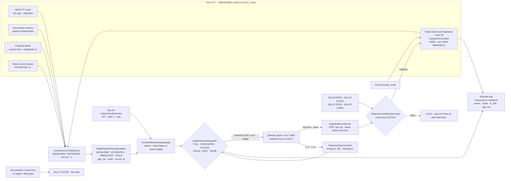
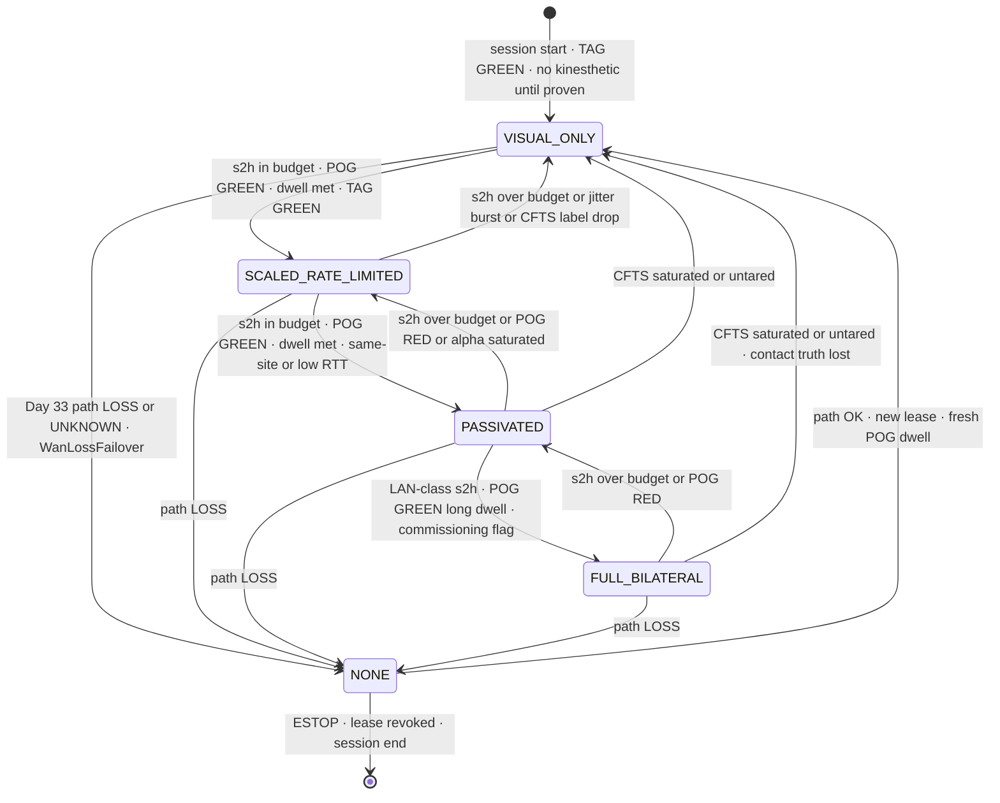
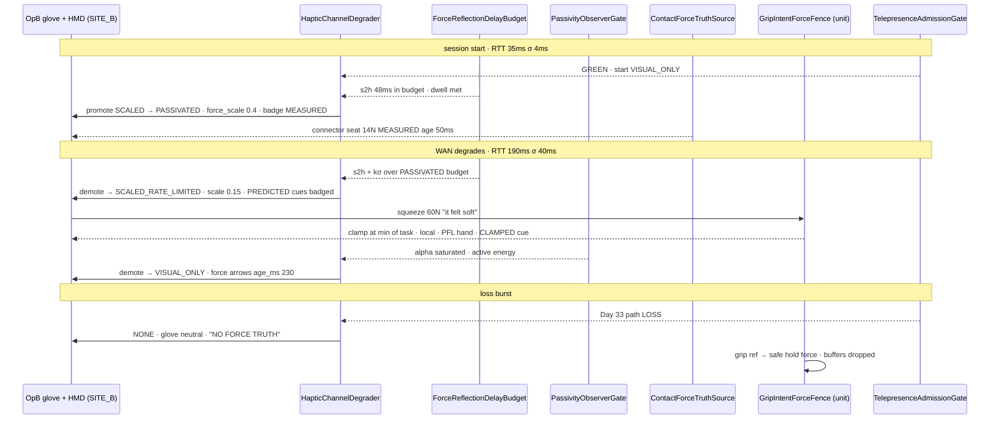
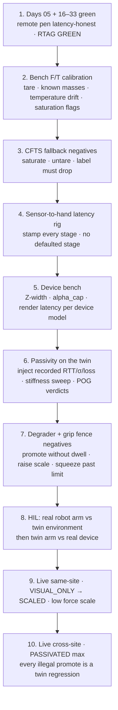

# Day 34 — Immersive telepresence / haptic force-reflection honesty: ContactForceTruthSource / HapticRenderHonestyLabeler / ForceReflectionDelayBudget / PassivityObserverGate / HapticChannelDegrader / GripIntentForceFence / TelepresenceAdmissionGate under RemoteTeleopAdmissionGate + FleetSharedControlAdmissionGate + SharedControlAdmissionGate + CollaborativeWorkspaceAdmissionGate + proximity + zone attestation + supervisor + logging + canary + HIL + fleet + fleet-canary + incident + forensics/reopen + change-management + maintenance + thermal + energy gates

![ContactForceTruthSource / HapticRenderHonestyLabeler / ForceReflectionDelayBudget / PassivityObserverGate / HapticChannelDegrader / GripIntentForceFence / TelepresenceAdmissionGate: wrist F/T, joint torque sensors, fingertip tactile and motor-current torque estimates feed ContactForceTruthSource which publishes MEASURED or ESTIMATED wrench with stated sigma, tare age and saturation flags; HapticRenderHonestyLabeler stamps every cue sent to the operator glove, exoskeleton or HMD with MEASURED / ESTIMATED / PREDICTED / STALE and age_ms; ForceReflectionDelayBudget binds the end-to-end sensor-to-hand delay to Day 33 LinkLatencyEstimator RTT and jitter; PassivityObserverGate runs a time-domain passivity observer and controller on the reflected-force port and demotes when energy is being created; HapticChannelDegrader walks FULL_BILATERAL to PASSIVATED to SCALED_RATE_LIMITED to VISUAL_ONLY to NONE as delay grows; GripIntentForceFence keeps operator squeeze as a SOFT grip reference clamped by robot-side local force limits — haptics never raise Day 29 PFL ceilings or write Day 05 torque_scale; TelepresenceAdmissionGate composes fail-closed under Day 33 RemoteTeleopAdmissionGate](/images/day34-telepresence-haptic-force-honesty.png)

[Day 03](/lessons/day-03-sensing-beyond-joint) put contact and force sensing on the bus with honest rates. [Day 16](/lessons/day-16-teleop-shared-autonomy) made teleop a **soft** writer. [Day 17](/lessons/day-17-runtime-safety-supervisor) owns the kill-chain, ESTOP, and stage transitions **forever**. [Day 05](/lessons/day-05-power-bms) owns `torque_scale`, contactor, UVLO, and STO **forever**. [Day 29](/lessons/day-29-human-proximity-safety) owns SSM envelopes, `ContactForceLimiter`, and HARD ISO/TS 15066-style PFL body-region ceilings. [Day 30](/lessons/day-30-collaborative-workspace-zoning) owns CWAG and `CrossSiteZoneConfigGate`. [Day 31](/lessons/day-31-shared-control-teleop-arbitration) owns SCAG and `AuthorityTransferGate`. [Day 32](/lessons/day-32-multi-operator-fleet-shared-control) owns `OperatorSessionLease` and FSCAG — at most one human pen per unit. [Day 33](/lessons/day-33-remote-multisite-teleop-latency) owns `LinkLatencyEstimator`, `LatencyAwareLeaseGovernor`, `SoftIntentPredictor`, `OperatorViewFreshnessGate`, `WanLossFailoverArbiter`, and `RemoteTeleopAdmissionGate` (RTAG).

Day 33 made the operator's **pen** latency-honest. It left the operator's **hand** out of the loop: the operator saw the cell and moved a stick, but felt nothing. Immersive telepresence closes a second loop in the opposite direction — the robot's contact wrench is pushed back into a glove, exoskeleton, or desktop haptic device so the operator *feels* the tote edge, the door latch, the peg seating. That reverse channel is where three new lies live:

1. **Provenance lies.** A force the operator feels might be a wrist F/T reading, a motor-current guess with ±30 % error, a model-mediated prediction, or a 300 ms-old sample replayed to keep the glove "alive". The glove cannot tell. The operator cannot either — unless you tell them.
2. **Stability lies.** A bilateral loop that is stable on the bench at 2 ms becomes an energy generator at 150 ms. The operator does not perceive "instability" — they perceive the robot shoving back, and they push harder.
3. **Authority lies.** "The glove shows I'm only squeezing 8 N, so let me squeeze harder" — and the squeeze becomes a grip command that walks past the robot's local force limit, or someone raises a Day 29 ceiling "because the haptic feel was too soft".

Today owns **`ContactForceTruthSource` / `HapticRenderHonestyLabeler` / `ForceReflectionDelayBudget` / `PassivityObserverGate` / `HapticChannelDegrader` / `GripIntentForceFence` / `TelepresenceAdmissionGate`**. The question is: **when contact force is reflected to a remote human across a MEASURED latency path, how do you keep every rendered cue labeled with what it really is, keep the bilateral loop passive under delay, degrade the haptic channel honestly as RTT and jitter grow, and guarantee that nothing the operator feels or squeezes ever raises Day 29 PFL, writes Day 05 `torque_scale`, or outranks the robot-side local force limits?**

## Haptics are information to the human. They are never authority over the robot.

The core split of the whole series applies with extra force here, because haptics are the one channel where a SOFT signal physically pushes on a human body:

1. **Contact truth lives on the robot.** Wrench at the wrist, torque at the joint, pressure at the fingertip are MEASURED (or ESTIMATED with stated σ) on the unit host's clock. The operator's device never measures robot contact.
2. **What the operator feels is a rendering.** Rendered force = scale × filter × delay × (measured, estimated, or predicted wrench). It is SOFT by construction, and it must be labeled with its provenance and age.
3. **Robot-side local force limits are authoritative.** The robot's local impedance / admittance controller and Day 29 `ContactForceLimiter` clamp contact force on the unit, at control rate, with zero WAN dependence. If the haptic channel dies, lies, or oscillates, the robot's contact force does not change by one Newton above its local ceiling.

So the honest labels are:

| Quantity | Label | Where it comes from | How it goes wrong |
|----------|-------|---------------------|-------------------|
| Wrist 6-axis wrench | MEASURED | Strain-gauge F/T, tared, temperature-tracked | Tare from yesterday; saturation clipped silently |
| Joint torque | MEASURED | Series-elastic / strain-gauge joint sensor | Gravity / inertia not subtracted; labeled "contact" |
| Fingertip pressure / contact | MEASURED contact, ESTIMATED magnitude | Taxel array | Contact boolean upgraded to a Newton value |
| Current-derived torque | ESTIMATED ±σ | $k_t \cdot i \cdot N \cdot \eta$ minus friction model | Stiction / backlash band reported as MEASURED force |
| Model-mediated / predicted force | PREDICTED (SOFT) | Local environment model at operator side | Rendered without badge; trusted after contact changed |
| Rendered force at the operator | SOFT | `HapticRenderHonestyLabeler` output | Unlabeled; age hidden; scale hidden |
| Sensor-to-hand delay | MEASURED components + SOFT one-way bound | Day 33 estimator + stamped pipeline stages | Bench delay assumed in the field |
| Passivity energy | MEASURED (observer over sampled f·v) | `PassivityObserverGate` | Observer on one port only; reset on every reconnect |
| Operator squeeze / haptic input | SOFT intent | Glove / exo / device | Treated as a force command past local limits |
| Robot-side local force limit | HARD (local) | Unit impedance controller + Day 29 CFL | Remote "feel" used to justify raising it |
| PFL body-region ceilings | HARD | Day 29 attested tables | "Haptic felt too soft, raise the hand ceiling" |
| ESTOP / kill-chain / `torque_scale` | HARD owners | Day 17 / Day 05 | Haptic oscillation "handled" by writing torque_scale |

The first rule of today: **the operator may feel anything you can label honestly; the operator may command only a SOFT reference that the robot clamps locally; nobody's haptic feel, squeeze, or rendering latency moves a HARD ceiling.** The red mushroom is still never WAN-gated, lease-gated, or haptics-gated.

| Layer | Owns | Must not own |
|-------|------|--------------|
| Day 33 RTAG + `LinkLatencyEstimator` | MEASURED RTT / σ / loss; remote pen admission | Haptic mode math; force provenance |
| `ContactForceTruthSource` | MEASURED / ESTIMATED wrench with σ, tare age, saturation | Rendering decisions; raising limits |
| `HapticRenderHonestyLabeler` | Provenance + `age_ms` + scale on every rendered cue | Changing the underlying value |
| `ForceReflectionDelayBudget` | End-to-end sensor-to-hand delay vs mode budgets | Inventing a shorter delay than measured |
| `PassivityObserverGate` | Energy accounting; damping injection; demotion on active energy | Raising force scale to "feel better" |
| `HapticChannelDegrader` | FULL → PASSIVATED → SCALED → VISUAL_ONLY → NONE ladder | Promoting without dwell; skipping RTAG |
| `GripIntentForceFence` | Operator squeeze → SOFT grip ref, clamped below local limit | Writing PFL, `torque_scale`, or the local limit itself |
| `TelepresenceAdmissionGate` | Composed fail-closed under RTAG + Days 17–33 | Clearing supervisor stage; dual-writing ESTOP / `torque_scale` |
| Day 29 / Day 30 / Day 17 / Day 05 | PFL, zone, kill-chain, torque | Being outranked by haptics |

**Core thesis:** immersive telepresence is not "Day 33 plus a glove." It is a **reverse channel of contact truth** whose every cue carries its provenance and age, a **bilateral loop kept passive** by an energy observer that does not care how good the feel is, a **delay budget** that degrades reflection from full bilateral to visual-only as the Day 33 path gets worse, and a **grip fence** that keeps operator force intent SOFT beneath robot-side local limits — all composed under a **TelepresenceAdmissionGate** that sits *under* Day 33 RTAG. Haptics inform the human; they never authorize the robot.



## ContactForceTruthSource: one wrench, honestly sourced

Humanoid hands and wrists rarely have a single clean force signal. `ContactForceTruthSource` (CFTS) runs on the unit host and publishes **one wrench per end-effector per tick**, with provenance per component. It fuses, in strict priority:

| Source | Typical character (order-of-magnitude, measure yours) | Label | Notes |
|--------|------------------------------------------------------|-------|-------|
| Wrist 6-axis F/T (strain gauge) | Sampled at hundreds of Hz to several kHz; resolution in the tens to hundreds of mN class; drifts with temperature; needs tare | MEASURED | Tare only in a commanded no-contact pose; publish `tare_age_s` |
| Joint torque sensor | Sampled at control rate; must subtract gravity + inertia via the plant model | MEASURED joint, ESTIMATED external wrench | External wrench via Jacobian transpose inherits model error |
| Fingertip tactile (taxels) | Good at contact detection and location; magnitude often uncalibrated and hysteretic | MEASURED contact, ESTIMATED magnitude | Never promote a taxel sum to MEASURED Newtons without a calibration |
| Motor current → torque | $\hat{\tau} = k_t \, i \, N \, \eta - \hat{\tau}_{\mathrm{fric}}(\dot{q})$; error easily 10–30 % of reading near zero velocity due to stiction and backlash | ESTIMATED ±σ | Useful as a fallback cue; never as a PFL-grade measurement |

Rules:

- **Every component carries σ and a label.** If the wrist F/T is saturated or untared, the wrench falls back to the joint-torque or current estimate **and the label falls with it** — MEASURED becomes ESTIMATED, and `sigma_n` grows. Silent fallback is a schema bug.
- **Tare honesty.** Tare is a commanded event in a known no-contact pose, bagged with temperature. A tare older than its budget, or taken while `contact_bool` was true on any taxel, flags the F/T as `UNTARED` and demotes its label.
- **Saturation is loud.** A clipped F/T channel publishes `saturated: true`; the renderer may not show the clipped value as "the force" — it shows a saturation cue.
- **CFTS feeds Day 29, not the other way round.** Day 29 `ContactForceLimiter` may consume the same wrench for its local clamp. Nothing in today's stack may *lower the measured value* to make a PFL check pass.

## HapticRenderHonestyLabeler: every cue says what it is

The operator's hand is a terrible lie detector. A crisp 1 kHz spring rendered from a 400 ms-old sample feels exactly as "real" as one rendered from a 2 ms-old sample. `HapticRenderHonestyLabeler` (HRHL) therefore stamps **every** rendered cue — force, vibrotactile pulse, visual force arrow, grip-pressure bar — with:

| Field | Meaning | Rendered how |
|-------|---------|--------------|
| `provenance` | `MEASURED` · `ESTIMATED` · `PREDICTED` · `STALE` | HMD badge color + glove "texture" cue (e.g. a distinct low buzz for PREDICTED) |
| `age_ms` | Host age of the underlying sample at render time | Numeric HUD near the contact arrow |
| `sigma_n` | Uncertainty of the underlying wrench | Arrow halo width |
| `force_scale` | Rendered / measured ratio | HUD "×0.4" next to the arrow |
| `mode` | Current `HapticChannelDegrader` state | HUD banner |
| `source_id` | Which sensor or model produced it | Bag only; HUD on hover |

Provenance rules:

- **PREDICTED** is any force from a local environment model at the operator side — the model-mediated teleoperation idea (Mitra & Niemeyer, 2008): render a local spring/surface model at full haptic rate, update its parameters from delayed measurements. It is a legitimate and often excellent technique — **and it is SOFT**. It must be badged PREDICTED, and it must be invalidated (not extrapolated) when CFTS reports a contact-state change the model did not predict.
- **STALE** is any sample whose `age_ms` exceeds the current mode's freshness budget. A STALE cue may be shown visually; it may not be rendered as kinesthetic force.
- The labeler **never changes the value**. It is a pure annotator. Scaling, filtering, and damping happen in the degrader and passivity gate — and their effect is recorded in `force_scale` and `alpha_damping`.

This is the same discipline as Day 18's "labels refuse soft→MEASURED", applied to a human body instead of a dataset.

## Why bilateral teleop goes unstable with delay

Take the simplest "position-forward, force-back" architecture. The operator moves the master device with velocity $v_m$; the robot (slave) tracks it; the slave's measured contact force $f_e$ comes back and is displayed as $f_m$:

$$
v_s(t) = v_m(t - T_1), \qquad f_m(t) = f_e(t - T_2)
$$

With $T_1 = T_2 = 0$ and a stiff environment, the operator feels the wall. With round-trip delay $T = T_1 + T_2 > 0$, the communication block is no longer passive: it can deliver more energy than it receives. Anderson & Spong (1989) showed this using scattering theory and proposed a passivating transform; Niemeyer & Slotine (1991) recast it as **wave variables**. Lawrence (1993) framed the general four-channel architecture and made the trade-off explicit: **transparency** (the operator feels exactly the environment impedance, $Z_t = Z_e$) and **robust stability** under delay pull in opposite directions — you buy stability by giving up transparency.

The intuition you need on the shop floor:

- Contact against a stiff surface with stiffness $K_e$ through a delay $T$ behaves like a spring that pushes back *late*. Late push-back in phase with the operator's motion injects energy. The operator's arm reacts, the robot follows late, the reflected force arrives late again — a limit cycle that grows with $K_e \cdot T$.
- Even with *zero* network delay, a sampled haptic display has a stability limit. Colgate & Schenkel (1997) give the well-known sufficient condition for a virtual wall of stiffness $K$ and damping $B$ rendered at sample period $\Delta T$ on a device with physical damping $b$: $\; b > \tfrac{K \Delta T}{2} + |B|$. That is why haptic loops run near 1 kHz and why the stable impedance range ("Z-width", Colgate & Brown 1994) is a property you **measure on the bench**, per device.
- Network delay is usually *much* larger than $\Delta T$, so naive direct force reflection across a WAN is not a tuning problem — it is a structural one.

Two families of fixes matter here:

**Wave variables (Niemeyer & Slotine).** Instead of sending $v$ and $f$, send

$$
u = \frac{b\,\dot{x} + F}{\sqrt{2b}}, \qquad w = \frac{b\,\dot{x} - F}{\sqrt{2b}}
$$

with wave impedance $b$. The channel then stores, never creates, energy for any **constant** delay: the power flow is $P = \tfrac{1}{2}u^2 - \tfrac{1}{2}w^2$ and a delayed wave is just a delayed energy packet. The cost is wave reflections and a "spongy" feel that grows with delay; $b$ trades stiffness feel against motion feel. Time-varying delay and packet loss need extra care (wave filtering, energy-bounded reconstruction) — they break the constant-delay assumption.

**Time-domain passivity (Hannaford & Ryu, 2002; Ryu, Kwon & Hannaford, 2004; DLR's TDPA line of work).** Don't assume — *observe*. A passivity observer integrates the energy flowing into a port from sampled force and velocity:

$$
E_{\mathrm{obs}}(n) = \Delta T \sum_{k=0}^{n} f(k)\, v(k)
$$

If $E_{\mathrm{obs}}(n) \geq 0$ the port has only absorbed energy. If it goes negative, the port is generating energy, and a passivity controller injects exactly enough variable damping to cancel it:

$$
\alpha(n) = \begin{cases} -\dfrac{E_{\mathrm{obs}}(n)}{\Delta T\, v(n)^2} & E_{\mathrm{obs}}(n) \lt 0 \\ 0 & \text{otherwise} \end{cases}, \qquad f'(n) = f(n) + \alpha(n)\, v(n)
$$

TDPA is attractive for robots because it is model-free and works per-port, and it naturally turns "the loop is getting unstable" into a **MEASURED number** you can gate on. Its cost: when $\alpha$ is large the operator feels sudden damping ("sticky" or jerky feel), and with delay you need the energy accounting split across both sides of the channel.

Today does **not** pick one architecture for you. It requires that whichever you pick — direct, wave, TDPA, model-mediated — feeds a MEASURED energy number into `PassivityObserverGate`, and that the gate's verdict can only **reduce** what the operator feels.

## ForceReflectionDelayBudget: sensor-to-hand, not just RTT

Day 33 measures the network. The operator's hand experiences the whole pipeline:

$$
\tau_{\mathrm{s2h}} = \tau_{\mathrm{sensor}} + \tau_{\mathrm{filter}} + \tau_{\mathrm{host}} + \tau_{\mathrm{oneway}} + \tau_{\mathrm{render}}
$$

| Stage | How it's measured | Typical trap |
|-------|-------------------|--------------|
| $\tau_{\mathrm{sensor}}$ | Sensor timestamp vs host `t_mono` (Day 04 clock contract) | Sensor clock not disciplined; assumed zero |
| $\tau_{\mathrm{filter}}$ | Group delay of the anti-alias / low-pass chain (computed, then verified on bench) | A 20 Hz low-order Butterworth adds roughly 10–20 ms of group delay and nobody counts it |
| $\tau_{\mathrm{host}}$ | Stamp in, stamp out on host | Bag writer contention |
| $\tau_{\mathrm{oneway}}$ | Day 33 `one_way_bound_ms` — a SOFT bound over MEASURED RTT | Treated as MEASURED one-way |
| $\tau_{\mathrm{render}}$ | Device firmware latency, measured with a bench rig | Vendor datasheet number trusted |

`ForceReflectionDelayBudget` (FRDB) publishes $\tau_{\mathrm{s2h}}$ **plus a jitter term** ($\tau_{\mathrm{s2h}} + k\,\hat{\sigma}$, with $k$ of order 2–3) and compares it against per-mode budgets. The budgets below are a **starting policy for this series**, not literature constants — they must be re-derived on your twin with your device, your stiffest expected contact, and your passivity scheme:

| Mode | Budget on $\tau_{\mathrm{s2h}} + k\hat{\sigma}$ (starting point) | What the operator gets |
|------|------------------------------------------------------------------|------------------------|
| `FULL_BILATERAL` | single-digit to low tens of ms; LAN / same-site only | Direct reflection, force scale up to the device's bench-verified cap, TDPA still on |
| `PASSIVATED` | up to roughly 50–100 ms with low jitter | Wave variables or TDPA mandatory; force scale ≤ 0.5; stiff contacts feel spongy, by design |
| `SCALED_RATE_LIMITED` | roughly 100–250 ms, or jitter rising | Force scale ≤ 0.2, slew-rate limited, plus PREDICTED model-mediated cues badged as such |
| `VISUAL_ONLY` | beyond that, or loss bursts | No kinesthetic force; force arrows / color bars / vibrotactile "contact" ticks only, each with `age_ms` |
| `NONE` | path LOSS / UNKNOWN (Day 33) | Glove goes neutral; HUD shows "NO FORCE TRUTH" |

Notice the shape, not the numbers: **every step down reduces energy injected into the human and makes the provenance more visible.** No step down changes any robot-side limit.

## PassivityObserverGate: energy is a gate, not a tuning knob

`PassivityObserverGate` (POG) runs the observer/controller on the operator port (and, when the architecture allows, on the robot port and across the channel). Its outputs are MEASURED: `E_obs_j`, `alpha_damping`, `alpha_saturated`, `active_energy_events_per_s`.

Verdicts:

| Condition | Verdict |
|-----------|---------|
| $E_{\mathrm{obs}} \geq 0$, $\alpha$ small | GREEN — no change |
| $E_{\mathrm{obs}} \lt 0$ intermittently, $\alpha$ within device damping cap | YELLOW — PC damps; FRDB may not promote |
| $\alpha$ hits its cap (device cannot dissipate enough), or active-energy events persist over a dwell | RED — demote one mode immediately |
| Observer reset mid-session (reconnect, process restart) | RED until a fresh dwell — energy history is not "forgiven" by a restart |
| Anyone proposes raising `force_scale` to "fix the sticky feel" | Refused — scale only goes down under YELLOW/RED |

POG lives on the **operator side** for the operator port and on the **unit host** for the robot port. It never writes to the robot's local impedance gains, never writes `torque_scale`, and never touches Day 29 tables. Its only actuator is *less* force at the operator's hand.

```python
from dataclasses import dataclass
from enum import Enum

class HapticMode(Enum):
    FULL_BILATERAL = 4
    PASSIVATED = 3
    SCALED_RATE_LIMITED = 2
    VISUAL_ONLY = 1
    NONE = 0

@dataclass
class PassivityPort:
    dt_s: float
    alpha_cap: float          # max damping the device can render [N·s/m], bench-measured
    e_obs_j: float = 0.0      # MEASURED energy into the port
    alpha: float = 0.0

    def step(self, f_n: float, v_mps: float) -> float:
        """Return passivated force f' = f + alpha·v; only ever removes energy."""
        self.e_obs_j += self.dt_s * f_n * v_mps
        self.alpha = 0.0
        if self.e_obs_j < 0.0 and abs(v_mps) > 1e-4:
            self.alpha = min(-self.e_obs_j / (self.dt_s * v_mps * v_mps), self.alpha_cap)
            self.e_obs_j += self.dt_s * self.alpha * v_mps * v_mps   # dissipated by PC
        return f_n + self.alpha * v_mps

    @property
    def saturated(self) -> bool:
        return self.alpha >= self.alpha_cap

def degrade(mode: HapticMode, s2h_ms: float, budget_ms: dict[HapticMode, float],
            pog_red: bool, path_loss: bool) -> HapticMode:
    """Demote fast (one call can drop several levels); never promotes."""
    if path_loss:
        return HapticMode.NONE
    m = mode
    while m.value > HapticMode.VISUAL_ONLY.value and (pog_red or s2h_ms > budget_ms[m]):
        m = HapticMode(m.value - 1)
        pog_red = False       # POG RED buys exactly one forced step
    return m
```

Promotion lives elsewhere (in `HapticChannelDegrader` with dwell + TAG), on purpose: the function that demotes must not be able to promote.

## HapticChannelDegrader: demote fast, promote slow, always visible



`HapticChannelDegrader` (HCD) is the only component that changes the rendered mode. Its rules mirror Day 32/33's asymmetry:

- **Demotion is immediate and may skip levels.** A saturated F/T or an untared sensor skips straight to VISUAL_ONLY — you cannot reflect a force you do not know.
- **Promotion is earned one level at a time,** with a dwell (seconds, not ticks) of in-budget delay *and* POG GREEN *and* TAG GREEN. Every session starts in VISUAL_ONLY.
- **Mode changes are perceptible.** On every transition the glove ramps (never steps) force to the new scale over a short window, and the HMD banner changes. An operator must never discover a mode change by surprise.
- **Bumpless toward zero.** On demotion, rendered force ramps *down* within the new scale; it never overshoots to "catch up".
- **FULL_BILATERAL is a commissioning mode,** typically same-site only, behind an explicit flag recorded in the Day 25 ChangeSet as a GATE_THRESHOLD change.

## GripIntentForceFence: the operator's squeeze is a SOFT reference

The reverse direction is just as dangerous. With a force-feedback glove or exoskeleton the operator can **command** force: squeeze harder, push into the surface. `GripIntentForceFence` (GIFF) maps that intent into a SOFT reference and clamps it — on the robot, at control rate:

$$
f_{\mathrm{ref}} = \min\Big(s_{\mathrm{op}} \cdot f_{\mathrm{op}},\;\; f_{\mathrm{task}},\;\; f_{\mathrm{local}},\;\; f_{\mathrm{PFL}}(\text{region}),\;\; f_{\mathrm{cap}}(\texttt{torque\_scale})\Big)
$$

where $f_{\mathrm{local}}$ is the robot-side impedance controller's force limit, $f_{\mathrm{PFL}}$ is the Day 29 body-region ceiling for whatever the hand might contact in the current Day 30 zone, and $f_{\mathrm{cap}}$ is what the actuators can deliver under the Day 05 `torque_scale` (read-only here).

Rules:

- The fence is a `min`. Haptic input can make $f_{\mathrm{ref}}$ **smaller**; it can never make any term on the right **larger**.
- The clamp runs **on the unit**. If the WAN dies mid-squeeze, the robot does not hold "the last squeeze" — Day 33 `WanLossFailoverArbiter` drops buffers, and the grip ref goes to a pre-declared **safe hold force** (enough not to drop the tote, below every ceiling) or releases per the task's declared policy.
- When the clamp is active, the operator must **feel and see** it: render a "you are at the limit" cue (a distinct detent or vibration plus HUD "CLAMPED by PFL/local"), labeled MEASURED from the clamp state. Otherwise the operator squeezes harder against a limit they cannot perceive — and blames the robot.
- No component reachable from the operator's device can write PFL tables, the local impedance limit, or `torque_scale`. Requests of that shape are refused and bagged as `forbidden_request` for Day 24.

## HMD view freshness: the eyes and the hand must agree

Immersive telepresence adds a head-mounted display. Two freshness clocks now matter:

- **Local motion-to-photon** — head motion to updated pixels on the HMD, commonly targeted around 20 ms for comfort. Reprojection / timewarp keeps this low by re-rendering the *old* remote frame for the *new* head pose. That is a rendering trick; the remote scene is still old.
- **Remote frame age** — host capture time of the robot camera frame vs now, which inherits Day 33 RTT.

`TelepresenceAdmissionGate` binds the HMD to Day 33 `OperatorViewFreshnessGate`: the HMD acks the rendered `map_version` and the camera frame `t_mono`; a reprojected frame is labeled `REPROJECTED` with its true remote age; and **haptic contact cues must never be fresher than the visual scene by more than a declared skew**, because a force that arrives before its matching image teaches the operator the wrong cause. If the HMD's remote frame age exceeds budget, HCD demotes to at most VISUAL_ONLY with a STALE badge, and freshness RED blocks promotion exactly as on Day 33.

## TelepresenceAdmissionGate: composition under RTAG

`TelepresenceAdmissionGate` (TAG) is today's composition root. It fails closed unless:

- Day 33 `RemoteTeleopAdmissionGate` GREEN (which requires Day 32 FSCAG, Day 31 SCAG, Day 30 CWAG + `CrossSiteZoneConfigGate`, Day 29 HSAG, and Days 17–28)
- `ContactForceTruthSource` healthy for the end-effectors in use: tare age in budget, no saturation, labels consistent
- `ForceReflectionDelayBudget` has a fresh, complete stage breakdown (no stage defaulted to zero)
- `PassivityObserverGate` not RED, and its observer has a valid dwell since the last reset
- `HapticChannelDegrader` mode consistent with FRDB + POG (no mode above what budget and energy allow)
- `GripIntentForceFence` armed on the unit with a declared safe hold force; clamp state renderable
- HMD freshness bound to `OperatorViewFreshnessGate` GREEN for any promotion
- Episode bag schema includes the haptic extensions below
- Day 22 fleet canary GREEN for this policy × unit × haptic device model; Day 23 no open incident; Day 24 reopen GREEN

Soft admit blocker only — it does not publish `JointCommand`, does not set impedance gains, does not clear ESTOP, does not write Day 05, does not touch Day 25 HARD_SAFETY ChangeSets. **Demotions of the haptic channel always flow** even if TAG is RED or the bag writer is backpressured; only promotions are blocked.

## A worked telepresence example

SITE_A unit H-07, COLLABORATIVE polygon, `map_version = 43`. OpB at SITE_B with an HMD and a force-feedback glove, WRITER lease from Day 33. Task: seat a connector into a fixture, then carry a tote past a human co-worker's handoff corridor.



| Step | MEASURED / HARD | Soft | Verdict |
|------|-----------------|------|---------|
| Session start, RTT 35 ms σ 4 ms | CFTS F/T tared 3 min ago | — | VISUAL_ONLY; promotion dwell starts |
| s2h = 48 ms (sensor 2 + filter 12 + host 3 + one-way bound 18 + render 13) | FRDB stage breakdown complete | — | SCALED → PASSIVATED, scale 0.4, TDPA on |
| Connector seats at 14 N | F/T MEASURED, age 50 ms | Rendered 5.6 N at scale 0.4 | Badge MEASURED · ×0.4 · 50 ms |
| RTT climbs to 190 ms, σ 40 ms | Day 33 DEGRADED | — | Demote to SCALED_RATE_LIMITED; PREDICTED surface model badged |
| OpB squeezes "60 N, it felt soft" | Local limit 30 N; Day 29 hand-region ceiling applies near corridor | Grip intent 60 N | GIFF clamps; CLAMPED cue rendered; no ceiling change |
| Supervisor asks "raise force_scale to 1.0, operator can't feel" | POG YELLOW | Scale ask | Refused — scale only decreases under YELLOW/RED |
| POG α saturates during a stiff contact bounce | Active energy events over dwell | — | RED → VISUAL_ONLY |
| F/T reads 0 during tote carry while current estimate says 9 N | F/T saturated flag on one axis | — | CFTS label drops to ESTIMATED; HCD stays VISUAL_ONLY |
| Loss burst | Day 33 LOSS | Buffered squeeze | NONE; buffers dropped; grip → safe hold force; WanLossFailover → POLICY or HOLD |
| Co-worker slaps mushroom | Day 17 ESTOP | — | Kill-chain; no haptic or WAN wait; lease revoked; glove neutral |

Every row extends the Day 33 bag with `haptic_mode`, `force_scale`, `provenance`, `age_ms`, `s2h_ms` stage breakdown, `E_obs_j`, `alpha_damping`, `alpha_saturated`, `grip_intent_n`, `grip_ref_n`, `clamp_source`, and both **measured and rendered** force traces on the same host clock.

## Ownership conflicts

| Conflict | Winner | Behavior |
|----------|--------|----------|
| Rendered force "feels" vs MEASURED wrench | CFTS label | Rendered is SOFT; never back-written as MEASURED |
| Current-derived estimate vs F/T | F/T if tared and unsaturated | Fallback lowers label and raises σ |
| Model-mediated PREDICTED cue vs new contact state | CFTS | Model invalidated; PREDICTED badge until re-fit |
| Operator wants more feel vs POG RED | POG | Scale only down; demote |
| Operator squeeze vs robot-side local limit | Local limit | GIFF `min`; CLAMPED cue |
| Haptic feel vs Day 29 PFL ceiling | Day 29 HARD | Refuse raise |
| Haptic oscillation vs Day 05 `torque_scale` | Day 05 | Not accepted; HCD demotes instead |
| HMD reprojected frame vs remote frame age | Freshness | Labeled REPROJECTED with true age; RED blocks promote |
| Haptic cue arriving before matching image | Skew budget | Delay or demote haptic cue |
| Bag writer down vs haptic promote | TAG | No promotions; demotions flow |
| ESTOP vs any haptic state | Day 17 | Kill-chain; glove neutral |

## Shared API

Same wire discipline as Days 02/04: everything carries `BusHeader`. CFTS, FRDB, GIFF, and the robot-port POG run on the unit host; the operator-port POG and the device renderer run at haptic rate on the operator side but publish into the same bag on host-aligned time. Nothing here enters the cyclic current loop; the robot-side local force clamp runs at the unit's control rate independent of WAN.

```text
BusHeader:
  t_mono
  seq
  clock_domain         # HOST for gates/bags; SENSOR for F/T, torque, tactile; DEVICE for operator haptics
  age_ms
  producer_id

ContactWrench ⊇ BusHeader:                 # ContactForceTruthSource output, per end-effector
  ee_id
  wrench_n_nm[6]
  sigma_n_nm[6]
  label                  # MEASURED | ESTIMATED
  source_id              # WRIST_FT | JOINT_TORQUE | TACTILE | MOTOR_CURRENT
  contact_bool           # MEASURED (taxel / threshold)
  tare_age_s
  saturated
  untared
  forbid:
    lower_value_to_pass_pfl: true
    write_estop: true
    write_torque_scale: true

RenderedHapticCue ⊇ BusHeader:             # HapticRenderHonestyLabeler output
  cue_kind               # KINESTHETIC | VIBROTACTILE | VISUAL_ARROW | GRIP_BAR
  provenance             # MEASURED | ESTIMATED | PREDICTED | STALE
  source_age_ms
  sigma_n
  force_scale
  haptic_mode
  reprojected_view       # bool, from HMD
  label: SOFT
  forbid:
    modify_value: true
    hide_provenance: true

ForceReflectionDelayBudget ⊇ BusHeader:
  s2h_ms
  stages_ms: { sensor, filter, host, oneway_bound, render }
  jitter_k
  budget_ms_by_mode
  link_latency_ref       # Day 33 LinkLatencySample seq
  any_stage_defaulted    # must be false for promotion

PassivityObserverGate ⊇ BusHeader:
  port                   # OPERATOR | ROBOT | CHANNEL
  e_obs_j                # MEASURED
  alpha_damping
  alpha_cap
  alpha_saturated
  active_energy_events_per_s
  dwell_since_reset_s
  status                 # RED | YELLOW | GREEN
  may_only_reduce_force: true
  forbid:
    raise_force_scale: true
    write_impedance_gains: true
    write_torque_scale: true

HapticChannelDegrader ⊇ BusHeader:
  mode                   # FULL_BILATERAL | PASSIVATED | SCALED_RATE_LIMITED | VISUAL_ONLY | NONE
  start_mode: VISUAL_ONLY
  promote_one_level_only: true
  promote_dwell_s
  demote_may_skip_levels: true
  ramp_ms
  full_bilateral_requires_commissioning_flag: true
  transition_reason      # S2H_OVER_BUDGET | POG_RED | CFTS_LABEL_DROP | PATH_LOSS | FRESHNESS_RED | ...

GripIntentForceFence ⊇ BusHeader:          # runs on unit
  grip_intent_n          # SOFT, from operator device
  grip_ref_n             # min(...) result
  clamp_source           # TASK | LOCAL | PFL | TORQUE_CAP | NONE
  safe_hold_force_n
  on_path_loss: safe_hold_or_declared_release
  forbid:
    write_pfl_table: true
    write_local_limit: true
    write_torque_scale: true
    hold_last_squeeze: true

TelepresenceAdmissionGate ⊇ BusHeader:
  fail_closed: true
  soft_admit_blocker_only: true
  status                 # RED | YELLOW | GREEN
  require:
    remote_teleop_admission_green: true          # Day 33 RTAG
    fleet_shared_control_admission_green: true   # Day 32 FSCAG
    shared_control_admission_green: true         # Day 31 SCAG
    collaborative_workspace_admission_green: true
    cross_site_zone_config_green: true
    human_safety_admission_green: true
    contact_force_truth_healthy: true
    delay_budget_complete: true
    passivity_not_red: true
    haptic_mode_consistent: true
    grip_fence_armed_on_unit: true
    hmd_view_freshness_green_if_promotion: true
    bag_schema_haptic_extensions: true
    fleet_canary_gate_green: true
    no_open_incident_on_unit: true
    canary_reopen_gate_green: true
    energy_admission_gate_green: true
    thermal_admission_gate_green: true
    supervisor_armed: true
    estop_pairing: true
    day05_binding: true
  blocks: promotions_only
  forbid:
    joint_command: true
    set_impedance_gains: true
    dual_write_torque_scale: true
    clear_supervisor_stage: true
    write_estop: true
    force_flag: true
    write_hard_safety_changeset: true
    raise_pfl_for_haptic_feel: true

# Unchanged owners
RemoteTeleopAdmissionGate (Day 33): latency-honest remote pen · failover
FleetSharedControlAdmissionGate (Day 32): multi-op leases · conflict · episode bags
SharedControlAdmissionGate (Day 31): single-writer zone-aware transfer admit
CollaborativeWorkspaceAdmissionGate (Day 30): zone · occupancy · handoff · cross-site
HumanSafetyAdmissionGate (Day 29): SSM · PFL · ContactForceLimiter · stop twin
SupervisorState (Day 17): ESTOP · kill-chain · stage · monitors
BmsState / PowerState (Day 05): torque_scale · contactor · UVLO · STO
  accepts_requests_from_soft_layer: false
```

## Physical ↔ digital pairing

| Physical | Digital twin / backing |
|----------|------------------------|
| Wrist F/T sensor warming up over a shift | CFTS `tare_age_s` + temperature in bag; twin replays drift; label drops when tare budget expires |
| Glove / exo / desktop haptic device | Bench-measured Z-width, `alpha_cap`, render latency, and max force per device model, stored as a Day 25 CALIBRATION artifact |
| Stiff fixture vs soft tote | Twin contact model with stiffness sweep $K_e$; POG verdicts per stiffness under injected delay |
| WAN with 35–250 ms RTT | Twin injects Day 33-recorded RTT/σ/loss traces into the haptic channel, not a constant delay |
| Operator squeezing against a limit | GIFF clamp + CLAMPED cue; bag shows `grip_intent_n` vs `grip_ref_n` vs measured grip |
| HMD timewarp hiding remote lag | REPROJECTED label with true remote frame age |
| "Felt fine" operator report | Overlay of measured vs rendered force traces on one host clock — the feel claim becomes a plot |
| Contact surprise (object slipped) | CFTS contact-state change invalidates PREDICTED model; HCD demotes |

The twin pairing that matters most: **simulate delay plus contact stiffness, and compare rendered vs measured force traces.** For every recorded episode, the twin replays the Day 33 latency trace through your chosen architecture (direct / wave / TDPA / model-mediated), computes what the operator *would* have felt, and compares to what the bag says they *did* feel. Divergence over tolerance is a Day 20 HIL regression. If the twin cannot replay a haptic episode with both traces, every mode transition, `E_obs`, and the grip clamp source, it cannot set the next telepresence admit.

## Bring-up sequence (before reflecting force to a remote human)



1. **Days 05 and 16–33 green.** Do not add a haptic channel to a remote pen that is not yet latency-honest.
2. **Bench F/T calibration.** Known masses through the full range on every axis; tare procedure in a commanded no-contact pose; temperature drift over a warm-up; saturation flags verified by deliberate overload within sensor rating.
3. **CFTS negatives.** Saturate an axis, skip a tare, cover a taxel — labels must drop to ESTIMATED and σ must rise. Never silently.
4. **Sensor-to-hand latency rig.** Tap the end-effector against a load cell while a photodiode / accelerometer on the haptic device records the rendered response; stamp every stage. A stage you cannot measure is not zero — it blocks promotion.
5. **Device bench.** Measure each haptic device model's stable impedance range, max damping it can render (`alpha_cap`), render latency, and force cap. Store as a CALIBRATION ChangeSet.
6. **Passivity on the twin.** Replay recorded Day 33 latency traces (not constants) through the haptic channel against a stiffness sweep from tote to steel. Confirm: naive direct reflection goes unstable where theory says it should; wave / TDPA stays passive; POG goes RED before the operator port injects energy; HCD demotes.
7. **Degrader + grip fence negatives.** Try to promote without dwell, raise scale under YELLOW, squeeze past the local limit, write PFL from the device, hold last squeeze across LOSS — all refused or dropped.
8. **HIL.** Real arm against the twin's virtual environment, then the twin's virtual arm against the real haptic device, before closing real-to-real.
9. **Live same-site, low force scale.** Start VISUAL_ONLY, earn SCALED at a low scale, then PASSIVATED. FULL_BILATERAL only by commissioning flag.
10. **Live cross-site.** Cap at PASSIVATED until canary data says otherwise; every illegal promotion is a Day 18 bag + Day 24 forensic + twin regression.

## Failure gallery

| Symptom | Likely cause |
|---------|--------------|
| Operator reports "the robot pushed back harder and harder" on a stiff fixture | Direct reflection under delay; no POG or POG on wrong port |
| Glove feels crisp, robot is actually pressing 3× harder | Rendered force_scale hidden from HUD; operator calibrated to rendered feel |
| Felt contact on a surface that was already gone | PREDICTED model not invalidated on CFTS contact change |
| Force reading flat at max during a collision | F/T saturation clipped, not flagged |
| "MEASURED 0 N" while the arm is stalled against a wall | Untared F/T; current estimate ignored instead of used as ESTIMATED fallback |
| Delay budget passes on site, fails across WAN with no demote | FRDB using bench delay; Day 33 one-way bound not bound in |
| Sticky / jerky feel at high RTT, someone raised force_scale | POG treated as tuning knob; scale raise not forbidden |
| Grip crushed a part after operator squeezed "because it felt soft" | GIFF not a min; local limit raised from operator side |
| Haptic channel restarts and immediately goes FULL | Observer reset forgiven; promotion not dwell-gated |
| Haptic cue precedes matching image | No skew budget between HMD frame age and haptic cue age |
| Postmortem can't tell what the operator felt | Rendered trace not bagged beside measured trace on host clock |
| Haptic oscillation "fixed" by clamping torque_scale | Soft layer wrote Day 05 |

## What to freeze this week

Extend [frames](/frames) and your safety config with:

- `ContactForceTruthSource`: one wrench per end-effector with per-component label and σ; tare as a commanded, bagged event; saturation and untared flags drop labels loudly; never lowers a value to pass PFL.
- `HapticRenderHonestyLabeler`: every rendered cue carries provenance (MEASURED / ESTIMATED / PREDICTED / STALE), `age_ms`, σ, `force_scale`, and mode; pure annotator.
- `ForceReflectionDelayBudget`: stage-by-stage sensor-to-hand delay plus jitter term, bound to Day 33 `LinkLatencyEstimator`; any defaulted stage blocks promotion.
- `PassivityObserverGate`: MEASURED energy per port; damping injection; RED on α saturation or persistent active energy; may only reduce force.
- `HapticChannelDegrader`: start VISUAL_ONLY; demote fast and skip levels; promote one level with dwell; ramp transitions; FULL_BILATERAL by commissioning flag only.
- `GripIntentForceFence`: on-unit `min` over task, local, PFL, and torque-cap terms; CLAMPED cue; safe hold force on loss; never holds last squeeze.
- `TelepresenceAdmissionGate` fail-closed under Day 33 RTAG + Day 32 FSCAG + Day 31 SCAG + CWAG + Days 17–29; soft admit blocker only; **no dual-write of ESTOP or `torque_scale`; haptics never raise PFL; robot-side local force limits stay authoritative.**
- ESTOP is never WAN-gated, lease-gated, or haptics-gated. Rendered force is never MEASURED.

The lesson isn't "add a force-feedback glove to Day 33." It's that **telepresence is a reverse channel of contact truth that must carry its provenance and age into the operator's hand, stay passive under delay as a MEASURED energy property, degrade from felt force to labeled visual cues as the path worsens, and keep operator force intent SOFT beneath robot-side local limits.** Haptics inform the human; Day 29 and Day 30 stay HARD; Day 17 still owns the kill-chain; Day 05 still owns torque.

## Further reading

Look these up by title; they are the classic sources for today's stability and transparency arguments:

- R. J. Anderson and M. W. Spong, "Bilateral control of teleoperators with time delay," *IEEE Transactions on Automatic Control*, 1989.
- G. Niemeyer and J.-J. E. Slotine, "Stable adaptive teleoperation," *IEEE Journal of Oceanic Engineering*, 1991 — wave variables.
- D. A. Lawrence, "Stability and transparency in bilateral teleoperation," *IEEE Transactions on Robotics and Automation*, 1993 — four-channel architecture, transparency vs stability.
- J. E. Colgate and J. M. Brown, "Factors affecting the Z-width of a haptic display," ICRA 1994; J. E. Colgate and G. G. Schenkel, "Passivity of a class of sampled-data systems: application to haptic interfaces," *Journal of Robotic Systems*, 1997.
- B. Hannaford and J.-H. Ryu, "Time-domain passivity control of haptic interfaces," *IEEE Transactions on Robotics and Automation*, 2002; J.-H. Ryu, D.-S. Kwon, and B. Hannaford, "Stable teleoperation with time-domain passivity control," *IEEE Transactions on Robotics and Automation*, 2004.
- P. Mitra and G. Niemeyer, "Model-mediated telemanipulation," *International Journal of Robotics Research*, 2008.

## Next

**Day 35+** — Dexterous teleop-to-autonomy skill capture / learning from demonstration under honest labels: demonstrations recorded through Day 31–34 telepresence carry haptic provenance, so only MEASURED-contact segments may supervise force targets; PREDICTED / STALE / VISUAL_ONLY segments are soft context, never labels; clamp events and mode transitions become segment boundaries; demo admission through Day 18 DatasetHygiene and Day 15 policy validation — without raising Day 29 PFL, writing Day 05 `torque_scale`, or bypassing CrossSiteZoneConfigGate, under the same gates (supervisor + logging + canary + HIL + fleet + fleet-canary + incident + forensics/reopen + change-management + maintenance + thermal + energy + proximity + zone attestation + shared-control + multi-operator + remote-teleop + telepresence admission).
