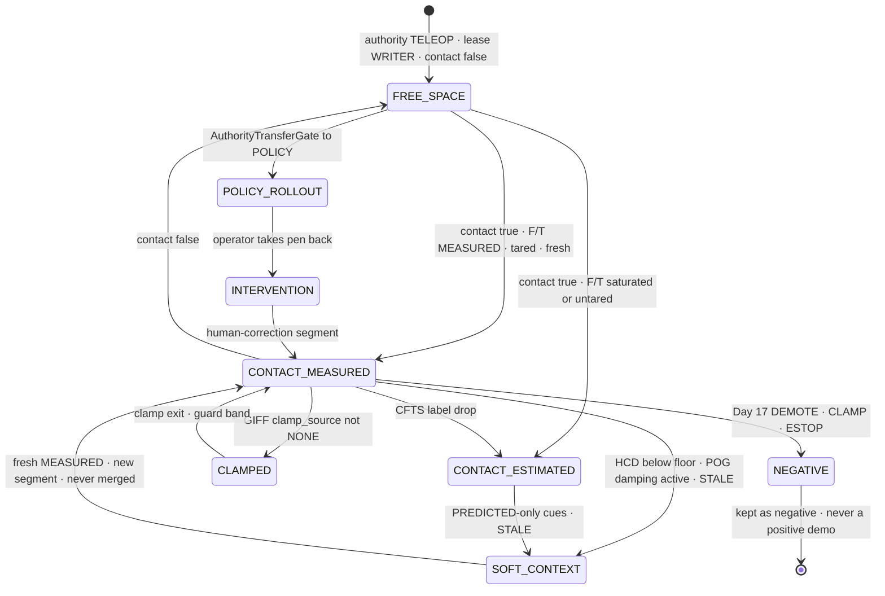
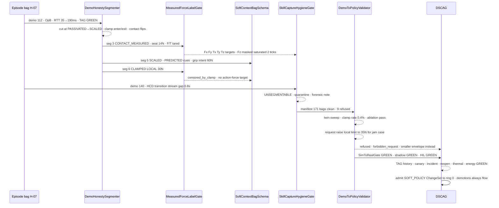
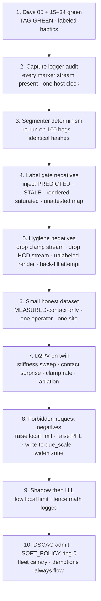

# Day 35 — Dexterous teleop-to-autonomy skill capture / learning from demonstration under honest labels: DemoHonestySegmenter / MeasuredForceLabelGate / SoftContextBagSchema / SkillCaptureHygieneGate / DemoToPolicyValidator / DexterousSkillCaptureAdmissionGate under TelepresenceAdmissionGate + RemoteTeleopAdmissionGate + FleetSharedControlAdmissionGate + SharedControlAdmissionGate + CollaborativeWorkspaceAdmissionGate + proximity + zone attestation + supervisor + logging + canary + HIL + fleet + fleet-canary + incident + forensics/reopen + change-management + maintenance + thermal + energy gates

![DemoHonestySegmenter / MeasuredForceLabelGate / SoftContextBagSchema / SkillCaptureHygieneGate / DemoToPolicyValidator / DexterousSkillCaptureAdmissionGate: a Day 34 telepresence demo bag with measured and rendered force traces, haptic mode, clamp source, authority, lease and contact state on one host clock enters DemoHonestySegmenter, which cuts it at GripIntentForceFence CLAMPED events, HapticChannelDegrader mode transitions, authority transfers, contact-state flips and lease changes; each segment inherits ContactForceTruthSource and HapticRenderHonestyLabeler provenance; MeasuredForceLabelGate lets only MEASURED-contact segments emit Newton force targets, ESTIMATED segments give pose context with stated sigma; PREDICTED, STALE, VISUAL_ONLY and PASSIVATED-degraded stretches go to SoftContextBagSchema as condition-only context; SkillCaptureHygieneGate extends Day 18 DatasetHygiene and refuses bags missing provenance, clamp or mode markers; DemoToPolicyValidator runs the Day 15 SimToRealGate path with shadow and twin eval proving force outputs stay under robot-side local limits and Day 29 ContactForceLimiter; DexterousSkillCaptureAdmissionGate composes fail-closed under Day 34 TelepresenceAdmissionGate — a learned skill never raises Day 29 PFL, never writes Day 05 torque_scale, never bypasses CrossSiteZoneConfigGate](/images/day35-dexterous-skill-capture-lfd.png)

[Day 15](/lessons/day-15-closed-loop-learned-policies) made closed-loop learned policies **soft** writers behind `SimToRealGate`. [Day 16](/lessons/day-16-teleop-shared-autonomy) made teleop a soft co-writer beside them. [Day 17](/lessons/day-17-runtime-safety-supervisor) owns the kill-chain, ESTOP, and stage transitions **forever**. [Day 18](/lessons/day-18-teleop-policy-logging-replay) owns `EpisodeLogger` / `ReplayHarness` / `DatasetHygiene` and the rule that labels refuse soft→MEASURED. [Day 05](/lessons/day-05-power-bms) owns `torque_scale` **forever**. [Day 29](/lessons/day-29-human-proximity-safety) owns `ContactForceLimiter` and HARD PFL body-region ceilings. [Day 30](/lessons/day-30-collaborative-workspace-zoning) owns CWAG and `CrossSiteZoneConfigGate`. [Day 31](/lessons/day-31-shared-control-teleop-arbitration) owns SCAG and `AuthorityTransferGate`. [Day 32](/lessons/day-32-multi-operator-fleet-shared-control) owns `OperatorSessionLease`, FSCAG, and `IntentEpisodeBagSchema`. [Day 33](/lessons/day-33-remote-multisite-teleop-latency) owns RTAG and the latency-honest remote pen. [Day 34](/lessons/day-34-telepresence-haptic-force-honesty) owns `ContactForceTruthSource`, `HapticRenderHonestyLabeler`, `HapticChannelDegrader`, `GripIntentForceFence`, and `TelepresenceAdmissionGate` (TAG).

Days 31–34 built a remote human pen that is zone-aware, lease-bound, latency-honest, and haptically labeled. The obvious next move is the one every lab makes: *record the operator doing the task a few hundred times, then train a policy to do it alone.* That is learning from demonstration (LfD), and on a humanoid hand it is where three new lies enter the dataset:

1. **Label lies.** The bag contains a "force" column. Some rows are a tared wrist F/T reading. Some are a motor-current estimate with ±25 % error. Some are a PREDICTED model-mediated cue the operator *felt*. Some are a 230 ms-old sample shown as an arrow in VISUAL_ONLY mode. A regression loss cannot tell them apart — it fits all of them equally.
2. **Intent lies.** The operator's squeeze is not the force the robot applied. When Day 34 `GripIntentForceFence` clamped a 60 N squeeze to 30 N, the "action" column now holds two numbers that disagree, and whichever one you train on teaches the wrong lesson: the intent teaches the policy to command past the limit; the clamped reference teaches it to hug the ceiling.
3. **Context lies.** A demo recorded at RTT 190 ms in SCALED_RATE_LIMITED looks like the same task as one at 35 ms in PASSIVATED, but the operator was doing something different — move-and-wait, pushing harder because the feel was scaled down, pausing for a stale frame. Without mode boundaries, the policy averages two different behaviors into one that neither operator would do.

Today owns **`DemoHonestySegmenter` / `MeasuredForceLabelGate` / `SoftContextBagSchema` / `SkillCaptureHygieneGate` / `DemoToPolicyValidator` / `DexterousSkillCaptureAdmissionGate`**. The question is: **when a dexterous skill is captured from remote telepresence demos, how do you cut each demo at the events where its meaning changes, let only MEASURED contact supervise Newton targets, keep every predicted / stale / visual-only / degraded stretch as soft context the policy may condition on but never regress against, admit demos through Day 18 hygiene and the resulting skill through Day 15 validation — and guarantee that no demo and no learned skill ever raises Day 29 PFL, writes Day 05 `torque_scale`, or bypasses `CrossSiteZoneConfigGate`?**

## A demonstration is a measured contact episode, not a recording of sticks

The core split of the series, applied to the training pipeline:

1. **Contact truth was measured on the robot.** During the demo, Day 34 CFTS published one wrench per end-effector with label, σ, tare age, and saturation flags on the unit host clock. That is the only thing in the bag that may become a Newton target.
2. **What the operator felt and squeezed was SOFT.** Rendered cues, PREDICTED surface models, grip intent, stick motion, and HMD views are the *operator's* inputs. They explain *why* the demonstrator acted; they are not ground truth about contact.
3. **The skill inherits the demo's ceilings, never its excuses.** A skill trained on demos runs under the same robot-side local limit, Day 29 CFL, and Day 05 `torque_scale` as the operator did. "The demonstrator pushed 40 N" is not evidence that 40 N is allowed — it is evidence the fence clamped them.

So the honest labels are:

| Quantity in a demo bag | Label | May become | Must never become |
|------------------------|-------|------------|-------------------|
| Wrist F/T wrench, tared, unsaturated, fresh | MEASURED | Newton force target (per axis) | — |
| Joint-torque-derived external wrench | ESTIMATED ±σ | Pose / contact-phase context; Newton target only behind commissioning flag + σ budget | Unweighted force target |
| Motor-current torque estimate | ESTIMATED ±σ | Context feature with σ | Force target near zero velocity (stiction band) |
| Fingertip taxel contact boolean | MEASURED contact | Contact-phase label; segment boundary | Newton magnitude without calibration |
| PREDICTED model-mediated cue | SOFT | Soft context (what the operator felt) | Any force label |
| STALE sample (age over mode budget) | SOFT | Soft context with `age_ms` | Any label at all |
| VISUAL_ONLY arrow / grip bar | SOFT | Soft context | Kinesthetic or force label |
| PASSIVATED / SCALED rendered force | SOFT | Soft context with `force_scale`, `alpha_damping` | Force label, even rescaled by 1/scale |
| Any segment captured while haptics were degraded (HCD below the mode floor, or POG actively damping / α saturated) | SOFT context segment | Context; measured wrench kept as an observation | Force target — the demonstrator was fighting the channel |
| Operator grip intent | SOFT intent | Intent context; censored target inside CLAMPED windows | Action target that exceeds the clamp |
| Executed grip ref on unit (post-fence) | SOFT reference, MEASURED as applied | Action target outside CLAMPED windows | Evidence a ceiling can rise |
| Robot-side local limit / Day 29 CFL | HARD | Constraint the skill is validated against | A learned output |
| PFL ceilings / zone attestation / ESTOP / `torque_scale` | HARD owners | Read-only conditioning metadata | Anything a demo or skill writes |

The first rule of today: **a demo may teach a skill anything you can label honestly; only MEASURED contact may teach it Newtons; nothing a demonstrator did, felt, or got away with moves a HARD ceiling.**

| Layer | Owns | Must not own |
|-------|------|--------------|
| Day 34 TAG + CFTS + HRHL + HCD + GIFF | Contact truth labels, rendered-cue provenance, haptic mode, clamp source, at capture time | Training decisions; relabeling after the fact |
| `DemoHonestySegmenter` | Deterministic cut points; per-segment provenance inheritance | Changing any sample value or label |
| `MeasuredForceLabelGate` | Which rows may carry Newton targets; per-axis masks; σ weights | Promoting ESTIMATED / PREDICTED / STALE to MEASURED |
| `SoftContextBagSchema` | Condition-only context rows with `may_regress_force_against: false` | Silent inclusion in force loss |
| `SkillCaptureHygieneGate` | Day 18 hygiene + skill-capture refusals; dataset manifest | Repairing a dishonest bag "so it passes" |
| `DemoToPolicyValidator` | Day 15 closed-loop validation path for captured skills; force-envelope proofs | Raising PFL, `torque_scale`, local limits to make eval pass |
| `DexterousSkillCaptureAdmissionGate` | Composed fail-closed admit under TAG + Days 15–34 | Clearing supervisor stage; dual-writing ESTOP / `torque_scale` |
| Days 05 / 17 / 29 / 30 | Torque, kill-chain, PFL, zone | Being outranked by a demo or a skill |

**Core thesis:** learning from demonstration through telepresence is not "record sticks and replay." It is **honest skill capture**: the physical demo is a measured contact episode whose digital bag carries provenance, so the training pipeline can only supervise force where contact was MEASURED; degraded haptic / predicted / stale / visual-only stretches become context segments bounded by clamp and mode-change events; admission reuses Day 18 hygiene and Day 15 validation; and neither the demo nor the learned skill ever outranks the HARD safety owners.

```mermaid
flowchart LR
  subgraph Capture[Capture — Day 34 telepresence session under TAG]
    BAG[Episode bag on unit host t_mono<br/>measured wrench · rendered cue · haptic_mode<br/>grip_intent · grip_ref · clamp_source<br/>authority · lease · map_version]
  end
  BAG --> DHS[DemoHonestySegmenter<br/>cut at CLAMPED · mode change · authority<br/>contact flip · lease or mode change]
  DHS --> SEG[Segments with inherited provenance<br/>CFTS label · HRHL provenance · age_ms · σ]
  SEG --> MFLG{MeasuredForceLabelGate}
  MFLG -->|MEASURED contact · fresh · tared| FL[Force-label rows<br/>Newton targets · per-axis mask · 1/σ² weight]
  MFLG -->|ESTIMATED| EC[Kinematic and contact-phase context<br/>σ stated · Newtons only by commissioning flag]
  MFLG -->|PREDICTED · STALE · VISUAL_ONLY<br/>PASSIVATED-degraded · CLAMPED intent| SCB[SoftContextBagSchema<br/>condition-only · no force regression]
  FL --> SCHG{SkillCaptureHygieneGate<br/>extends Day 18 DatasetHygiene}
  EC --> SCHG
  SCB --> SCHG
  SCHG -->|refuse| Q[Quarantine + Day 24 forensic note]
  SCHG -->|clean manifest| TRAIN[Training job<br/>masked loss · soft features conditioned only]
  TRAIN --> D2PV[DemoToPolicyValidator<br/>Day 15 SimToRealGate · Day 19 shadow<br/>Day 20 HIL · force envelope proof]
  D2PV --> DSCAG{DexterousSkillCaptureAdmissionGate<br/>under TAG · RTAG · FSCAG · SCAG · CWAG}
  DSCAG -->|GREEN| SKILL[Skill as SOFT_POLICY ChangeSet<br/>Day 25 rings · Day 22 fleet canary]
  DSCAG -->|RED| HOLDSK[Skill stays shadow-only]
  SKILL --> LOC[Unit: GIFF-style min · local limit<br/>Day 29 CFL · Day 05 torque_scale read-only]
  PEND[Any pendant or mushroom] --> D17[Day 17 ESTOP · kill-chain]
```



## Why unlabeled teleop demos poison force policies

Behavior cloning is supervised regression from observation to action. Give it a bag and it will fit *whatever is in the columns*. Four mechanisms turn a careless telepresence dataset into a force policy that is confidently wrong:

**1. Mixed-provenance targets.** Suppose 60 % of the "contact force" rows are tared F/T (MEASURED, σ well under 1 N), 25 % are current-derived (ESTIMATED, σ several N, biased by stiction near zero velocity), and 15 % are PREDICTED cues from a model-mediated renderer that was wrong after the part slipped. A mean-squared-error loss has no way to know the third group is not about the robot at all. The fitted policy learns a force target that is a blend of the contact and the operator's illusion of it. Worse, PREDICTED rows cluster exactly where the link was bad — so the policy is most wrong where the conditions were hardest.

**2. Rendered force is a function of the rendering pipeline.** Day 34 rendered force is $s \cdot H(z) \cdot f(t - \tau_{\mathrm{s2h}})$ with a mode-dependent scale $s$, filter $H$, and delay. Dividing by $s$ does not recover $f$: the passivity controller added damping $\alpha v$, the filter added phase lag, and the delay moved it in time. Any rendered column is a *rendering* label, not a contact label — SOFT forever.

**3. The demonstrator compensated for the channel.** Ferrell's classic observation (1965) is that humans under transmission delay adopt **move-and-wait**: small open-loop moves, then pause for feedback. Under SCALED_RATE_LIMITED, operators also squeeze harder because the feel is scaled down. Those are skilled responses to *the channel*, not to the task. Train on them unsegmented and the robot learns to pause for feedback it no longer needs and to squeeze for a scale factor that no longer exists — and the fence will clamp it every time.

**4. Covariate shift and the clamp.** Ross, Gordon & Bagnell (2011) showed why pure behavior cloning compounds error: the learner visits states the expert never demonstrated, and errors grow with horizon (DAgger addresses this by collecting expert labels on the learner's own state distribution). In contact-rich dexterity the compounding shows up as force. A slight pose error at seat-in turns into a jam; the expert demos never show a jam recovery, so the policy pushes. If the dataset also taught it that "pushing is what demonstrators do near the ceiling" — from CLAMPED windows labeled as normal actions — the policy pushes straight into the fence on every jam.

The fix is not a better loss. It is **refusing to put dishonest columns into the loss at all**, and cutting demos where their meaning changes.

## DemoHonestySegmenter: cut where meaning changes

`DemoHonestySegmenter` (DHS) runs offline over a Day 32/34 episode bag on the unit host's `t_mono`. It never edits a sample; it produces an ordered list of segments, each a half-open interval with inherited labels. Cut points, in priority order:

| Boundary event | Source | Why it is a boundary |
|----------------|--------|----------------------|
| `GripIntentForceFence` clamp enter / exit | Day 34 GIFF `clamp_source` transition (NONE ↔ TASK / LOCAL / PFL / TORQUE_CAP) | Intent and applied reference disagree inside; action target is censored |
| Haptic mode transition | Day 34 HCD `transition_reason` | Operator's feedback channel — and therefore behavior — changed |
| Authority transfer | Day 31 `AuthorityTransferGate` TELEOP ↔ POLICY ↔ BLEND ↔ HOLD | The writer changed; a POLICY stretch is not a human demo |
| Contact-state flip | CFTS `contact_bool` per end-effector, debounced | Free-space vs contact phase; force targets only mean something in contact |
| CFTS label change | MEASURED ↔ ESTIMATED, `saturated`, `untared` | Provenance of the force column changed |
| HRHL provenance change | MEASURED · ESTIMATED · PREDICTED · STALE on rendered cues | What the operator perceived changed |
| Lease / mode change | Day 32 `OperatorSessionLease` grant / renew / revoke; Day 33 TTL demotion; WAN failover | Who held the pen, and whether the pen was trusted |
| Zone / map change | Day 30 `map_version` ack; zone class change | The ceilings the demo ran under changed |
| Supervisor stage change | Day 17 WARN / INHIBIT_SOFT / DEMOTE / CLAMP / ESTOP | Valuable negative; never a positive demo |

Rules:

- **Deterministic.** Same bag + same segmenter version → byte-identical segment list. The segment list hash goes in the dataset manifest. A segmenter that is "smarter" today than yesterday is a new `SOFT_POLICY`-adjacent artifact with a version, not a silent upgrade.
- **Boundaries are inclusive of guard bands.** Each cut extends a short guard on both sides (order of the haptic ramp time plus one control period) labeled `TRANSITION`. The Day 34 degrader ramps force over a window; samples inside that ramp belong to neither mode.
- **Inherit, never infer.** A segment's provenance is the **weakest** label any of its samples carried for that channel. One STALE sample makes the rendered-cue channel STALE for the segment. One `saturated` tick on F/T axis $F_z$ makes that axis non-MEASURED for the segment.
- **Missing markers fail the bag, not the segment.** If the GIFF clamp stream or the HCD transition stream is missing for any interval, the segmenter cannot prove where boundaries are. It emits `UNSEGMENTABLE` and hands the bag to hygiene for refusal.
- **Statistical segmentation is a proposal.** Unsupervised methods (e.g. Niekum et al.'s BP-AR-HMM skill segmentation) are useful for discovering sub-skills *inside* an honest segment. They may add cuts; they may never remove an event-driven cut or merge across one.



Each state is a segment class. Only `CONTACT_MEASURED` — and `INTERVENTION` segments that are themselves MEASURED-contact — can emit force targets. `POLICY_ROLLOUT` stretches are not demonstrations: they are learner rollouts, and their value is the **intervention** that follows them (Kelly et al.'s HG-DAgger: the human takes over only when the learner drifts, and those takeover segments are high-value labels on the learner's own state distribution).

```python
from dataclasses import dataclass, field
from enum import Enum

class Prov(Enum):          # ordered weakest-first for "inherit the weakest"
    STALE = 0
    PREDICTED = 1
    ESTIMATED = 2
    MEASURED = 3

@dataclass(frozen=True)
class Segment:
    t0: int                    # host t_mono ns, inclusive
    t1: int                    # exclusive
    seg_class: str             # CONTACT_MEASURED | CLAMPED | SOFT_CONTEXT | POLICY_ROLLOUT | ...
    wrench_prov: tuple[Prov, ...]   # per axis Fx Fy Fz Tx Ty Tz, weakest over segment
    sigma_max: tuple[float, ...]    # per axis, max over segment
    haptic_mode_min: str            # weakest Day 34 HCD mode in segment
    pog_degraded: bool              # POG YELLOW/RED or alpha near cap anywhere in segment
    clamp_source: str               # NONE | TASK | LOCAL | PFL | TORQUE_CAP
    authority: str                  # TELEOP | POLICY | BLEND | HOLD
    lease_id: str
    map_version: int

def segment(bag, guard_ns: int, version: str) -> list[Segment]:
    """Pure: never edits samples. Cut at every event stream transition; inherit weakest labels."""
    required = ("cfts", "hrhl", "hcd_transitions", "giff", "authority", "lease", "map_ack")
    if any(not bag.stream_complete(s) for s in required):
        raise ValueError("UNSEGMENTABLE: missing marker stream")   # hygiene refuses the bag
    cuts = sorted(bag.event_times(required))
    segs = []
    for a, b in zip(cuts, cuts[1:]):
        lo, hi = a + guard_ns, b - guard_ns
        if hi <= lo:
            continue                                   # pure TRANSITION sliver, no segment
        w = bag.window(lo, hi)
        segs.append(Segment(
            t0=lo, t1=hi, seg_class=w.classify(),
            wrench_prov=tuple(min(w.axis_prov(k), key=lambda p: p.value) for k in range(6)),
            sigma_max=tuple(w.axis_sigma_max(k) for k in range(6)),
            haptic_mode_min=w.weakest_mode(), pog_degraded=w.pog_degraded(),
            clamp_source=w.clamp_source(),
            authority=w.authority(), lease_id=w.lease_id(), map_version=w.map_version()))
    return segs
```

## MeasuredForceLabelGate: Newtons only from MEASURED contact

`MeasuredForceLabelGate` (MFLG) decides, per segment and per wrench axis, whether a row may carry a Newton target. It is a pure filter over segments; it never edits a value.

| Condition on the segment (per axis) | Verdict |
|-------------------------------------|---------|
| CFTS label MEASURED on every tick; not saturated; not untared; `tare_age_s` within budget; `age_ms` within capture budget; `contact_bool` true; haptic mode at or above the floor (PASSIVATED by default) with POG GREEN | **Force target allowed**, weight $1/\sigma^2$ |
| MEASURED wrench, but HCD below the floor (SCALED_RATE_LIMITED, VISUAL_ONLY, NONE) or POG YELLOW/RED (PASSIVATED-degraded: damping injected, α near cap) | Wrench kept as observation; segment routed to `SoftContextBagSchema` — the operator's actions were shaped by a degraded channel |
| Any tick ESTIMATED (joint-torque or current fallback) | Pose / contact-phase context with stated σ. Newton target **only** if `estimated_force_targets` commissioning flag is set **and** $\sigma_{\max} \leq \sigma_{\mathrm{budget}}$; row labeled ESTIMATED forever |
| Current-derived estimate with joint speed inside the stiction band | Never a Newton target, even with the flag |
| Any rendered cue used as the force column (any `force_scale`) | Refused — rendered is SOFT |
| PREDICTED or STALE | Refused as target; routed to `SoftContextBagSchema` |
| Segment class CLAMPED | No action-force target. Measured wrench may be kept as an **observation**; the segment is flagged `censored_by_clamp` |
| Segment authority POLICY or BLEND (not human) | Not a demo target; INTERVENTION segments that follow are eligible on their own merits |
| Supervisor NEGATIVE | Never a positive target; kept as a labeled negative for Day 19 eval |
| `map_version` not attested by `CrossSiteZoneConfigGate` at capture | Whole segment refused |

The resulting loss is a masked, variance-weighted regression. For a policy $\pi_\theta$ predicting wrench target $\hat{f}$ and kinematic action $\hat{a}$:

$$
\mathcal{L}(\theta) = \sum_{i} \sum_{k=1}^{6} m^{F}_{i,k}\, \frac{\big(\hat{f}_{i,k} - f^{\mathrm{meas}}_{i,k}\big)^2}{\sigma_{i,k}^2} \;+\; \lambda \sum_{i} m^{A}_{i}\, \ell\big(\hat{a}_i, a^{\mathrm{exec}}_i\big)
$$

where $m^{F}_{i,k} = 1$ only if MFLG allowed axis $k$ on row $i$, $m^{A}_{i} = 0$ inside CLAMPED and TRANSITION windows, and $a^{\mathrm{exec}}$ is the **executed** soft reference on the unit — post-arbiter, post-fence, stamped at application on host `t_mono` — not the operator-side intent stamped on the operator's clock. Day 33 already told you the one-way delay is a SOFT bound; aligning targets to the unit's application time is what keeps observations and actions causally paired.

Three subtleties:

- **Per-axis, not per-row.** A wrist F/T can saturate on $F_z$ during a press while $F_x, F_y$ and torques stay clean. Mask $F_z$; keep the rest. Dropping the whole row throws away good labels; keeping it poisons the axis that matters most.
- **Clamped windows are censored data, not wrong data.** Inside a clamp, the true "desired" force is only known to be at least the clamp value. The honest choices are to exclude the action target, or — if you need the information — model it as an inequality the policy is penalized for *approaching*, never for missing. Never fit the clamp value as an equality target.
- **ESTIMATED is weighted, never laundered.** With the commissioning flag, an ESTIMATED Newton row enters with its own large σ and its label stays ESTIMATED in the manifest. A dataset report that says "100 % MEASURED" while containing flagged ESTIMATED rows is a hygiene failure.

```python
def force_label_mask(seg: Segment, cfg) -> tuple[bool, ...]:
    """Per-axis Newton-target mask. Pure; refuses rather than repairs."""
    if seg.seg_class in ("CLAMPED", "SOFT_CONTEXT", "POLICY_ROLLOUT", "NEGATIVE", "TRANSITION"):
        return (False,) * 6
    if seg.map_version not in cfg.attested_map_versions:     # CrossSiteZoneConfigGate at capture
        return (False,) * 6
    if cfg.mode_rank[seg.haptic_mode_min] < cfg.mode_rank[cfg.min_haptic_mode] or seg.pog_degraded:
        return (False,) * 6                                    # haptic-degraded → soft context
    out = []
    for p, s in zip(seg.wrench_prov, seg.sigma_max):
        if p is Prov.MEASURED:
            out.append(True)
        elif p is Prov.ESTIMATED and cfg.estimated_force_targets and s <= cfg.sigma_budget_n:
            out.append(True)                                   # stays labeled ESTIMATED
        else:
            out.append(False)                                  # PREDICTED / STALE never
    return tuple(out)
```

## SoftContextBagSchema: what the policy may condition on

Throwing away every non-MEASURED stretch would discard most of what makes a demo useful: where the operator looked, how they approached, what they intended, what they felt and how they reacted. `SoftContextBagSchema` (SCBS) keeps all of it — **as context**.

| Context row field | Source | Use |
|-------------------|--------|-----|
| `pose`, `joint_state` | Day 06 estimator | Observation; kinematic target only outside CLAMPED / TRANSITION |
| `operator_intent`, `grip_intent_n` | Day 31/34, SOFT | Conditioning feature (e.g. a goal or phase token); never a force target |
| `rendered_force`, `force_scale`, `alpha_damping`, `haptic_mode` | Day 34 HRHL / POG / HCD | Explains operator behavior; ablation feature |
| `predicted_force`, `predicted_model_id` | Day 34 model-mediated renderer | Context only; invalidated at the next CFTS contact flip |
| `view_frame_ref`, `remote_frame_age_ms`, `reprojected` | Day 33/34 HMD freshness | Visual observation with true age |
| `rtt_ms`, `jitter_ms`, `lease_state` | Day 33 | Channel conditioning; used to *exclude* channel-compensation behavior |
| `age_ms` | every row | Mandatory; context rows older than budget are dropped from conditioning, not just down-weighted |

Schema invariants, enforced by the loader rather than by convention:

- `may_condition_on: true`, `may_regress_force_against: false` on every SCBS row. The training loader physically cannot join an SCBS column into the force-loss mask.
- Provenance travels with the feature. If a policy conditions on `rendered_force`, the feature vector carries the `provenance` and `age_ms` of that rendering. A policy that receives PREDICTED context at deployment time must receive it **labeled** PREDICTED.
- **Deployment parity.** A context feature is admissible only if the deployed autonomous skill will have the same feature with the same label at run time. Rendered haptics and operator intent do not exist when no operator is connected — so a skill that *depends* on them is not autonomous. DemoToPolicyValidator checks this by ablation.

## SkillCaptureHygieneGate: Day 18 hygiene, extended for skills

Day 18 `DatasetHygiene` already quarantines dishonest episodes, keeps late-kill / demote / ESTOP as negatives, and refuses soft→MEASURED promotion. `SkillCaptureHygieneGate` (SCHG) **adds** refusals that only make sense once demos come from telepresence and labels reach a force loss:

| Check | Day 18 DatasetHygiene | SkillCaptureHygieneGate adds |
|-------|-----------------------|------------------------------|
| Label taxonomy | Refuses soft→MEASURED | Refuses rendered / PREDICTED / STALE force columns entering any target |
| Timing honesty | `age_ms`, `clock_domain` preserved | Measured and rendered traces on **one** host clock; executed action stamped at unit application |
| Negatives | ESTOP / demote kept as negatives | Clamp windows kept as `censored_by_clamp`, never positives |
| Provenance completeness | Channel present | Refuse bag if any rendered cue lacks HRHL provenance or `age_ms` |
| Event markers | — | Refuse bag missing GIFF clamp stream, HCD mode-transition stream, authority stream, or lease stream for any interval |
| Segmentation | — | Refuse `UNSEGMENTABLE`; re-run DHS and compare segment-list hash |
| Force-label rows | — | Refuse any row with a Newton target whose source segment was not MEASURED-contact (or flagged ESTIMATED within σ budget) |
| Zone attestation | — | Refuse segments whose `map_version` was not attested by `CrossSiteZoneConfigGate` at capture |
| Calibration | — | Refuse F/T rows whose tare or calibration artifact is not a recorded Day 25 CALIBRATION ChangeSet |
| Operator mix | — | Manifest reports per-operator, per-site, per-haptic-mode counts so one operator's channel habits cannot dominate silently |

SCHG never repairs. It does not interpolate a missing clamp marker, back-fill provenance, or relabel a STALE cue as "probably fine". The only outputs are **admit to manifest**, **quarantine with reason**, or **keep as negative**. Each quarantine writes a Day 24-style forensic note so the capture process gets fixed, not the dataset.

The dataset manifest is the unit of truth handed to training:

| Manifest field | Meaning |
|----------------|---------|
| `segment_list_hash` | Hash of the DHS output per bag, with segmenter version |
| `rows_by_label` | Counts of MEASURED / ESTIMATED-flagged / context / censored / negative rows |
| `axes_masked` | Per-axis masked fraction (e.g. $F_z$ saturated in 4 % of contact rows) |
| `haptic_mode_hist` | Demo time per Day 34 mode |
| `operators`, `sites`, `map_versions` | Who, where, under which attested zone config |
| `calibration_refs` | Day 25 CALIBRATION ChangeSet ids for every F/T used |
| `refusals` | Reason histogram |

## DemoToPolicyValidator: Day 15's path for captured skills

A clean dataset does not make a safe skill. `DemoToPolicyValidator` (D2PV) runs the captured skill through Day 15's closed-loop validation path — `SimToRealGate`, then Day 19 offline eval and shadow, then Day 20 HIL — with checks specific to force-bearing dexterous skills:

| Stage | What D2PV must prove | RED if |
|-------|----------------------|--------|
| Offline (Day 19 `OfflineEvaluator`) | Held-out MEASURED-contact segments: force error within σ-scaled tolerance per axis; held-out operators and sites | Train/test leak by operator or session; error concentrated in one haptic mode |
| Twin (Day 15 `SimToRealGate`) | Closed-loop rollouts against a stiffness sweep and contact-surprise injection; skill force output $f^{\pi}$ stays below $f_{\mathrm{local}}$ and Day 29 CFL for the zone | Any rollout tick where $f^{\pi}$ exceeds the robot-side local limit before the clamp |
| Clamp-rate check | Fraction of ticks the on-unit fence would clamp the skill's output | Clamp rate above budget — the skill learned to hug the ceiling |
| Ablation (deployment parity) | Remove operator-only soft context (rendered force, intent, RTT); performance degrades gracefully | Skill collapses without operator-only features — it is not autonomous |
| Shadow (Day 19 `ShadowRunner`) | Skill runs beside the live operator or policy, outputs logged not applied, through the same fence math | Shadow output exceeds ceilings, or disagrees with MEASURED contact outcomes above tolerance |
| HIL (Day 20) | Real arm vs twin environment, then real hand on the real fixture at low local force limit | Divergence between twin and HIL force traces over tolerance |
| Recovery coverage | Jam, slip, and misalignment rollouts with intervention segments available | No recovery behavior in data → skill limited to the demo envelope by policy, not by hope |

The force-envelope proof is the heart of D2PV. For every eval tick:

$$
f^{\pi}_{\mathrm{ref}} \;\leq\; \min\Big(f_{\mathrm{task}},\; f_{\mathrm{local}},\; f_{\mathrm{PFL}}(\text{region}),\; f_{\mathrm{cap}}(\texttt{torque\_scale})\Big) \cdot (1 - \mu)
$$

with a declared margin $\mu$ so the skill operates *beneath* the fence rather than against it. The fence still runs on the unit at deployment — D2PV proves the skill rarely needs it; it does not replace it.

What D2PV may **never** do to make eval pass: raise $f_{\mathrm{local}}$, raise a Day 29 PFL ceiling, write Day 05 `torque_scale`, widen a Day 30 zone, or mark a twin-only result as HIL. Those requests are refused and bagged as `forbidden_request`. The only levers D2PV owns are **more honest data**, **a smaller task envelope**, or **RED**.

## DexterousSkillCaptureAdmissionGate: composition under TAG

`DexterousSkillCaptureAdmissionGate` (DSCAG) is today's composition root. It admits two things — a **capture session** (may this telepresence session record skill-capture demos?) and a **captured skill** (may this skill leave shadow?) — and fails closed unless:

- Day 34 `TelepresenceAdmissionGate` GREEN for every capture session (which requires Day 33 RTAG, Day 32 FSCAG, Day 31 SCAG, Day 30 CWAG + `CrossSiteZoneConfigGate`, Day 29 HSAG, and Days 17–28)
- `DemoHonestySegmenter` version pinned; segment-list hashes reproducible for every admitted bag
- `MeasuredForceLabelGate` config pinned; `estimated_force_targets` flag state recorded as a Day 25 GATE_THRESHOLD artifact
- `SkillCaptureHygieneGate` manifest clean; refusal histogram reviewed
- `DemoToPolicyValidator` GREEN through Day 15 `SimToRealGate`, Day 19 shadow, Day 20 HIL; clamp rate within budget; ablation passed
- Skill packaged as a Day 25 `SOFT_POLICY` ChangeSet referencing dataset manifest, calibration refs, and segmenter version
- Day 22 fleet canary GREEN for this skill × unit × hand model; Day 23 no open incident; Day 24 reopen GREEN
- Day 26 maintenance: no open recalibration on the F/T or hand actuators the skill uses; Day 27 thermal and Day 28 energy admits GREEN

Soft admit blocker only — DSCAG does not publish `JointCommand`, does not set impedance gains, does not clear ESTOP, does not write Day 05, does not touch Day 25 HARD_SAFETY ChangeSets. **Demotions always flow**: a skill can be pulled back to shadow by any RED, a Day 23 incident, or a Day 17 trip without waiting for DSCAG.

## A worked skill-capture example

SITE_A unit H-07 and SITE_C unit H-11, same hand model, both COLLABORATIVE polygons, attested `map_version = 43` and `map_version = 17`. Skill: seat connector J3 into its fixture and verify seat by force. 180 telepresence demos from three operators across two operator sites over a week.



| Step | MEASURED / HARD | Soft | Verdict |
|------|-----------------|------|---------|
| Demo 112 starts PASSIVATED at RTT 35 ms | CFTS F/T tared 4 min ago | Rendered ×0.4 | Segment 1 FREE_SPACE, segment 2 approach |
| Connector seats at 14 N, PASSIVATED, POG GREEN | F/T MEASURED; $F_z$ saturated for 2 ticks on impact | — | Segment 3 CONTACT_MEASURED; $F_z$ masked, five axes are targets |
| WAN degrades, HCD → SCALED_RATE_LIMITED | Day 33 DEGRADED | PREDICTED cues badged | Cut; segment 5 SOFT_CONTEXT — below the mode floor; PREDICTED rows never targets; measured wrench kept as observation |
| OpB squeezes 60 N; GIFF clamps at LOCAL 30 N | Clamp MEASURED | Intent 60 N | Segment 6 CLAMPED; `censored_by_clamp`; no action-force target |
| Demo 140 has a 0.8 s gap in HCD transitions | — | — | UNSEGMENTABLE; quarantined; capture logger fixed |
| 6 demos recorded at `map_version = 16` before re-attestation at SITE_C | `CrossSiteZoneConfigGate` shows 16 unattested | — | Segments refused |
| Twin sweep, 2000 rollouts | Local limit 30 N, Day 29 CFL for hand region | Skill output | Clamp rate 0.4 %, max $f^{\pi}$ 24.1 N — under margin |
| Jam-recovery eval fails; engineer asks to raise local limit to 35 N | Local limit HARD | Request | Refused; skill envelope narrowed to "seat or retract"; more intervention demos scheduled |
| Ablation removes rendered force + RTT features | — | — | Success rate drops 3 points — autonomous enough |
| Shadow on H-07 for 2 days, then HIL | Day 19 / Day 20 | — | GREEN; DSCAG admits SOFT_POLICY ring 0 |
| Co-worker hits mushroom during canary | Day 17 ESTOP | Skill running | Kill-chain; skill demoted to shadow; Day 23 ticket; segment kept as NEGATIVE |

## Ownership conflicts

| Conflict | Winner | Behavior |
|----------|--------|----------|
| Rendered force vs MEASURED wrench as label | CFTS MEASURED | Rendered is SOFT context only |
| ESTIMATED wrench wants to be a target | MFLG config | Only with commissioning flag + σ budget; stays labeled ESTIMATED |
| Operator intent vs executed grip ref | Executed (outside clamp) | Intent is context; inside clamp, censored |
| Statistical segmenter vs event cut | Event cut | Statistics may add cuts, never remove |
| Demo shows force above local limit | Local limit | Demo row is CLAMPED / censored; limit unchanged |
| Eval fails jam case vs local limit | Local limit / Day 29 | Narrow envelope or RED; refuse raise |
| Skill needs operator-only features | Deployment parity | Not autonomous; RED |
| Unattested `map_version` demo | `CrossSiteZoneConfigGate` | Refused |
| Bag missing clamp or mode markers | SCHG | Quarantine; never back-fill |
| Learned skill vs Day 05 `torque_scale` | Day 05 | Read-only; skill cannot write |
| ESTOP vs any skill state | Day 17 | Kill-chain; skill demoted; negative kept |

## Shared API

Same wire discipline as Days 02/04: everything carries `BusHeader`. DHS, MFLG, SCHG run offline on the training / forensics host over bags on unit-host time; D2PV runs on the twin, shadow, and HIL infrastructure; DSCAG publishes on the fleet admission path. Nothing here enters the cyclic loop; the on-unit fence still runs at control rate regardless of what any skill outputs.

```text
BusHeader:
  t_mono
  seq
  clock_domain         # HOST for segments/gates; SENSOR for F/T, torque, tactile; DEVICE for operator haptics
  age_ms
  producer_id

DemoSegment ⊇ BusHeader:                   # DemoHonestySegmenter output
  bag_id
  t0_ns, t1_ns
  seg_class              # FREE_SPACE | CONTACT_MEASURED | CONTACT_ESTIMATED | CLAMPED | SOFT_CONTEXT
                         # | POLICY_ROLLOUT | INTERVENTION | NEGATIVE | TRANSITION
  cut_reason             # CLAMP | HAPTIC_MODE | AUTHORITY | CONTACT_FLIP | CFTS_LABEL | HRHL_PROV
                         # | LEASE | MAP_VERSION | SUPERVISOR
  wrench_prov[6]         # weakest over segment
  sigma_max_n_nm[6]
  haptic_mode_min
  pog_degraded
  clamp_source
  authority
  lease_id, operator_id, site_id
  map_version
  segmenter_version
  forbid:
    modify_sample: true
    upgrade_label: true

ForceLabelRow ⊇ BusHeader:                 # MeasuredForceLabelGate output
  segment_ref
  target_wrench_n_nm[6]
  axis_mask[6]
  weight_inv_sigma2[6]
  label                  # MEASURED | ESTIMATED_FLAGGED
  executed_action_ref    # unit-side, post-fence, host t_mono
  forbid:
    rendered_as_target: true
    predicted_as_target: true
    stale_as_target: true
    clamp_value_as_equality_target: true

SoftContextRow ⊇ BusHeader:                # SoftContextBagSchema
  segment_ref
  pose, joint_state
  operator_intent, grip_intent_n
  rendered_force, force_scale, alpha_damping, haptic_mode, provenance
  predicted_force, predicted_model_id
  view_frame_ref, remote_frame_age_ms, reprojected
  rtt_ms, jitter_ms, lease_state
  may_condition_on: true
  may_regress_force_against: false
  operator_only_feature: bool      # true → deployment parity ablation required

SkillCaptureManifest ⊇ BusHeader:          # SkillCaptureHygieneGate output
  dataset_id
  segment_list_hashes
  rows_by_label
  axes_masked_fraction[6]
  haptic_mode_hist
  operators, sites, map_versions
  calibration_refs       # Day 25 CALIBRATION ChangeSet ids
  refusals               # reason → count
  extends: DatasetHygiene (Day 18)
  forbid:
    backfill_markers: true
    relabel_stale: true

DemoToPolicyValidator ⊇ BusHeader:
  skill_id
  sim_to_real_gate       # Day 15 status ref
  shadow_ref             # Day 19
  hil_ref                # Day 20
  max_force_ratio_to_ceiling
  clamp_rate
  margin_mu
  ablation_operator_only_delta
  status                 # RED | YELLOW | GREEN
  forbid:
    raise_local_limit: true
    raise_pfl: true
    write_torque_scale: true
    widen_zone: true
    twin_as_hil: true

DexterousSkillCaptureAdmissionGate ⊇ BusHeader:
  fail_closed: true
  soft_admit_blocker_only: true
  status                 # RED | YELLOW | GREEN
  admits                 # CAPTURE_SESSION | CAPTURED_SKILL
  require:
    telepresence_admission_green: true           # Day 34 TAG
    remote_teleop_admission_green: true          # Day 33 RTAG
    fleet_shared_control_admission_green: true   # Day 32 FSCAG
    shared_control_admission_green: true         # Day 31 SCAG
    collaborative_workspace_admission_green: true
    cross_site_zone_config_green: true
    human_safety_admission_green: true
    segmenter_pinned_and_reproducible: true
    label_gate_config_pinned: true
    skill_capture_hygiene_clean: true
    demo_to_policy_validator_green: true
    sim_to_real_gate_green: true                 # Day 15
    shadow_green: true                           # Day 19
    hil_green: true                              # Day 20
    soft_policy_changeset: true                  # Day 25
    fleet_canary_gate_green: true                # Day 22
    no_open_incident_on_unit: true               # Day 23
    canary_reopen_gate_green: true               # Day 24
    no_open_recalibration: true                  # Day 26
    thermal_admission_gate_green: true           # Day 27
    energy_admission_gate_green: true            # Day 28
    supervisor_armed: true
    estop_pairing: true
    day05_binding: true
  blocks: promotions_only
  forbid:
    joint_command: true
    set_impedance_gains: true
    dual_write_torque_scale: true
    clear_supervisor_stage: true
    write_estop: true
    force_flag: true
    write_hard_safety_changeset: true
    raise_pfl_from_demo_or_skill: true

# Unchanged owners
TelepresenceAdmissionGate (Day 34): labeled haptics · passivity · grip fence
RemoteTeleopAdmissionGate (Day 33): latency-honest remote pen · failover
FleetSharedControlAdmissionGate (Day 32): multi-op leases · episode bags
SharedControlAdmissionGate (Day 31): single-writer zone-aware transfer admit
CollaborativeWorkspaceAdmissionGate (Day 30): zone · cross-site attestation
HumanSafetyAdmissionGate (Day 29): SSM · PFL · ContactForceLimiter
DatasetHygiene (Day 18) · SimToRealGate (Day 15)
SupervisorState (Day 17): ESTOP · kill-chain · stage · monitors
BmsState / PowerState (Day 05): torque_scale · contactor · UVLO · STO
  accepts_requests_from_soft_layer: false
```

## Config

A starting configuration for this series. Every number is a policy you re-derive on your twin and bench, not a literature constant:

```yaml
skill_capture:
  segmenter:
    version: dhs-1.3.0
    guard_band_ms: 40            # ≥ Day 34 HCD ramp_ms + one control period
    contact_debounce_ms: 15
    cut_on: [CLAMP, HAPTIC_MODE, AUTHORITY, CONTACT_FLIP, CFTS_LABEL, HRHL_PROV, LEASE, MAP_VERSION, SUPERVISOR]
    statistical_subsegmentation: proposal_only   # may add cuts, never remove
    on_missing_marker_stream: UNSEGMENTABLE
  measured_force_label_gate:
    require_label: MEASURED
    max_age_ms: 20               # unit-host age of the wrench sample
    max_tare_age_s: 1800
    per_axis_mask: true
    estimated_force_targets: false        # commissioning flag; Day 25 GATE_THRESHOLD change to enable
    sigma_budget_n: 0.8                   # only consulted if the flag is true
    current_estimate_stiction_band_rad_s: 0.05
    clamped_segments: censor     # never an equality target
    min_haptic_mode_for_targets: PASSIVATED   # below this, or POG not GREEN → soft context
    refuse_targets_from: [RENDERED, PREDICTED, STALE, VISUAL_ONLY, POLICY_ROLLOUT, NEGATIVE]
  soft_context:
    may_regress_force_against: false
    max_context_age_ms: 250
    operator_only_features: [rendered_force, force_scale, alpha_damping, grip_intent_n, rtt_ms, jitter_ms]
  hygiene:
    extends: DatasetHygiene@day18
    refuse_missing: [hrhl_provenance, giff_clamp_stream, hcd_transition_stream, authority_stream, lease_stream]
    refuse_unattested_map_version: true
    require_calibration_changeset: true
    backfill: forbidden
  validator:
    path: [offline_day19, sim_to_real_gate_day15, shadow_day19, hil_day20]
    force_margin_mu: 0.15
    max_clamp_rate: 0.01
    ablation_max_drop: 0.10      # operator-only features removed
    holdout: by_operator_and_site
  admission:
    gate: DexterousSkillCaptureAdmissionGate
    under: [TelepresenceAdmissionGate, RemoteTeleopAdmissionGate, FleetSharedControlAdmissionGate,
            SharedControlAdmissionGate, CollaborativeWorkspaceAdmissionGate, CrossSiteZoneConfigGate,
            HumanSafetyAdmissionGate]
    changeset_class: SOFT_POLICY
    demotions_always_flow: true
  forbidden:
    raise_pfl: true
    write_torque_scale: true
    raise_local_force_limit: true
    bypass_cross_site_zone_config_gate: true
```

## Physical ↔ digital pairing

| Physical | Digital twin / backing |
|----------|------------------------|
| Operator seats a connector through a glove at SITE_B | Day 34 bag: measured wrench, rendered cue, haptic mode, clamp source, authority, lease — one host clock |
| Wrist F/T saturates on impact for two ticks | Per-axis mask in `ForceLabelRow`; manifest `axes_masked_fraction` |
| Operator squeezes harder because feel was scaled | CLAMPED segment + SCALED mode context; censored, explains behavior without teaching it |
| WAN degrades mid-demo | Mode-transition cut; SOFT_CONTEXT segment with RTT conditioning, flagged operator-only |
| Learner drifts; operator takes the pen back | POLICY_ROLLOUT → INTERVENTION segments; intervention is the high-value label |
| Fixture re-surveyed at SITE_C | New attested `map_version`; demos under the old version refused if unattested |
| F/T re-tared or recalibrated | Day 25 CALIBRATION ChangeSet referenced by every row that used it |
| Skill seated in shadow beside an operator | Day 19 shadow trace with fence-math applied; clamp-rate metric |
| Jam during canary | Day 17 trip; NEGATIVE segment; Day 23 ticket; twin regression added |

The twin pairing that matters most: **replay every admitted demo through the segmenter and label gate on the twin, then roll the learned skill out against the same contact geometry and compare its force trace to the MEASURED demo trace.** If the twin cannot reproduce the segment list hash, the manifest, and a force-envelope proof from the bag alone, it cannot admit the skill.

## Bring-up sequence (before training a force skill from demos)



1. **Days 05 and 15–34 green.** Do not capture skills from a telepresence stack whose haptics are not yet labeled and passive.
2. **Capture logger audit.** Confirm every marker stream (CFTS, HRHL, HCD transitions, GIFF clamp, authority, lease, map ack) is present for every tick of a test session, on one host clock. A missing stream is a logger bug to fix *before* the first real demo.
3. **Segmenter determinism.** Re-run DHS over a fixed set of bags on two hosts; segment-list hashes must match byte-for-byte.
4. **Label gate negatives.** Inject PREDICTED cues into the force column, mark F/T rows STALE, saturate an axis, swap in a rendered trace, use an unattested `map_version` — every one must be refused or masked.
5. **Hygiene negatives.** Drop the clamp stream, drop the mode stream, strip provenance from a rendered cue, try to back-fill — SCHG must quarantine, never repair.
6. **Small honest dataset first.** One operator, one site, PASSIVATED or better, MEASURED-contact segments only. Prove the pipeline end-to-end on clean data before mixing sites, modes, or flagged ESTIMATED rows.
7. **D2PV on the twin.** Stiffness sweep from soft tote to rigid fixture, contact-surprise injection, clamp-rate and force-margin metrics, operator-only feature ablation.
8. **Forbidden-request negatives.** Have the validator pipeline request a higher local limit, a PFL raise, a `torque_scale` write, and a zone widen — all refused and bagged.
9. **Shadow, then HIL.** Shadow beside a live operator with fence math applied to logged outputs; then real hand on the real fixture at a reduced local force limit.
10. **DSCAG admit to ring 0.** As a Day 25 SOFT_POLICY ChangeSet through Day 22 fleet canary; every RED, incident, or trip demotes without waiting.

## Failure gallery

| Symptom | Likely cause |
|---------|--------------|
| Skill presses noticeably harder than any MEASURED demo did | PREDICTED or rendered-÷-scale rows leaked into force targets |
| Skill hugs the local limit on every seat | CLAMPED windows trained as equality targets |
| Skill pauses mid-motion for no reason | Move-and-wait from high-RTT demos trained without mode cuts |
| Skill fine on H-07, jams on H-11 | Train/test split by demo, not by unit / site; one operator's habit dominated |
| Force error spikes only on hard impacts | Saturated $F_z$ ticks not masked per axis |
| Policy works only when an operator is connected | Conditioning on operator-only features; deployment parity not checked |
| Dataset report says 100 % MEASURED, loss curve says otherwise | Flagged ESTIMATED rows laundered into MEASURED label |
| Same bag gives different segments on two hosts | Segmenter nondeterministic or version unpinned |
| Demos from a stale fixture survey trained in | `map_version` not checked against `CrossSiteZoneConfigGate` |
| "We raised the local limit so the skill could finish the jam case" | D2PV treated a HARD ceiling as a tuning knob |
| Skill canary demoted after an ESTOP, retrained with the ESTOP segment as a positive | NEGATIVE not kept as negative |
| Learned skill "fixed" by writing torque_scale | Soft layer wrote Day 05 |

## What to freeze this week

Extend [frames](/frames) and your safety config with:

- `DemoHonestySegmenter`: deterministic, versioned cuts at clamp, haptic mode, authority, contact flip, CFTS label, HRHL provenance, lease, map version, and supervisor events; guard bands; inherit the weakest label; never edits a sample; missing marker stream → UNSEGMENTABLE.
- `MeasuredForceLabelGate`: per-axis Newton targets only from MEASURED, fresh, tared, unsaturated contact; ESTIMATED only behind a commissioning flag and σ budget and still labeled ESTIMATED; rendered / PREDICTED / STALE never; CLAMPED censored; targets aligned to unit-side executed actions.
- `SoftContextBagSchema`: condition-only rows with provenance and `age_ms`; `may_regress_force_against: false` enforced by the loader; operator-only features flagged for deployment-parity ablation.
- `SkillCaptureHygieneGate`: extends Day 18 `DatasetHygiene`; refuses bags missing haptic provenance, clamp markers, or mode-transition markers, unlabeled rendered force, unattested map versions, and force rows from non-MEASURED segments; never back-fills; manifest is the training contract.
- `DemoToPolicyValidator`: Day 15 `SimToRealGate` → Day 19 shadow → Day 20 HIL; force-envelope proof with margin under robot-side local limits and Day 29 CFL; clamp-rate budget; ablation; the only levers are more honest data, a smaller envelope, or RED.
- `DexterousSkillCaptureAdmissionGate` fail-closed under Day 34 TAG + Day 33 RTAG + Day 32 FSCAG + Day 31 SCAG + CWAG + `CrossSiteZoneConfigGate` + Days 15–29; soft admit blocker only; **no dual-write of ESTOP or `torque_scale`; no demo or skill raises PFL; robot-side local force limits stay authoritative.**
- ESTOP is never skill-gated. Rendered force is never a label.

The lesson isn't "train a policy on telepresence logs." It's that **a demonstration is a measured contact episode whose bag must carry its provenance into the loss, cut at every event where its meaning changes, so only MEASURED contact teaches Newtons, everything the operator felt or intended stays labeled context, and the learned skill earns its admit through the same hygiene, validation, and HARD ceilings the operator ran under.** Demos teach the skill; Day 29 and Day 30 stay HARD; Day 17 still owns the kill-chain; Day 05 still owns torque.

## Further reading

Look these up by title; they are classic sources for today's LfD, interactive imitation, and force-skill arguments:

- S. Schaal, "Is imitation learning the route to humanoid robots?" *Trends in Cognitive Sciences*, 1999.
- B. D. Argall, S. Chernova, M. Veloso, and B. Browning, "A survey of robot learning from demonstration," *Robotics and Autonomous Systems*, 2009.
- A. Billard, S. Calinon, R. Dillmann, and S. Schaal, "Robot programming by demonstration," *Springer Handbook of Robotics*, 2008.
- W. R. Ferrell, "Remote manipulation with transmission delay," *IEEE Transactions on Human Factors in Electronics*, 1965 — move-and-wait.
- S. Ross, G. J. Gordon, and J. A. Bagnell, "A reduction of imitation learning and structured prediction to no-regret online learning," AISTATS 2011 — DAgger.
- M. Kelly, C. Sidrane, K. Driggs-Campbell, and M. J. Kochenderfer, "HG-DAgger: Interactive imitation learning with human experts," ICRA 2019.
- A. J. Ijspeert, J. Nakanishi, H. Hoffmann, P. Pastor, and S. Schaal, "Dynamical movement primitives: learning attractor models for motor behaviors," *Neural Computation*, 2013.
- P. Kormushev, S. Calinon, and D. G. Caldwell, "Imitation learning of positional and force skills demonstrated via kinesthetic teaching and haptic input," *Advanced Robotics*, 2011.
- K. Kronander and A. Billard, "Learning compliant manipulation through kinesthetic and tactile human-robot interaction," *IEEE Transactions on Haptics*, 2014.
- S. Niekum, S. Osentoski, G. Konidaris, and A. G. Barto, "Learning and generalization of complex tasks from unstructured demonstrations," IROS 2012.
- A. Mandlekar et al., "What matters in learning from offline human demonstrations for robot manipulation," CoRL 2021.
- T. Z. Zhao, V. Kumar, S. Levine, and C. Finn, "Learning fine-grained bimanual manipulation with low-cost hardware," RSS 2023.
- C. Chi et al., "Diffusion Policy: Visuomotor policy learning via action diffusion," RSS 2023.

## Next

**Day 36+** — Cross-embodiment skill transfer / sim-to-real under honest contact labels: retargeting a captured skill to a different hand, wrist F/T, or tactile suite (or from twin to hardware) where each embodiment carries its own sensor provenance, calibration, and σ — force targets re-expressed per embodiment and never borrowed across sensors as MEASURED, transfer admitted as Day 25 SOFT_POLICY / PLANT_MODEL ChangeSets through Day 15 SimToRealGate + Day 20 HIL + Day 35 DSCAG — without raising Day 29 PFL, writing Day 05 `torque_scale`, or bypassing CrossSiteZoneConfigGate, under the same gates (supervisor + logging + canary + HIL + fleet + fleet-canary + incident + forensics/reopen + change-management + maintenance + thermal + energy + proximity + zone attestation + shared-control + multi-operator + remote-teleop + telepresence + skill-capture admission).
