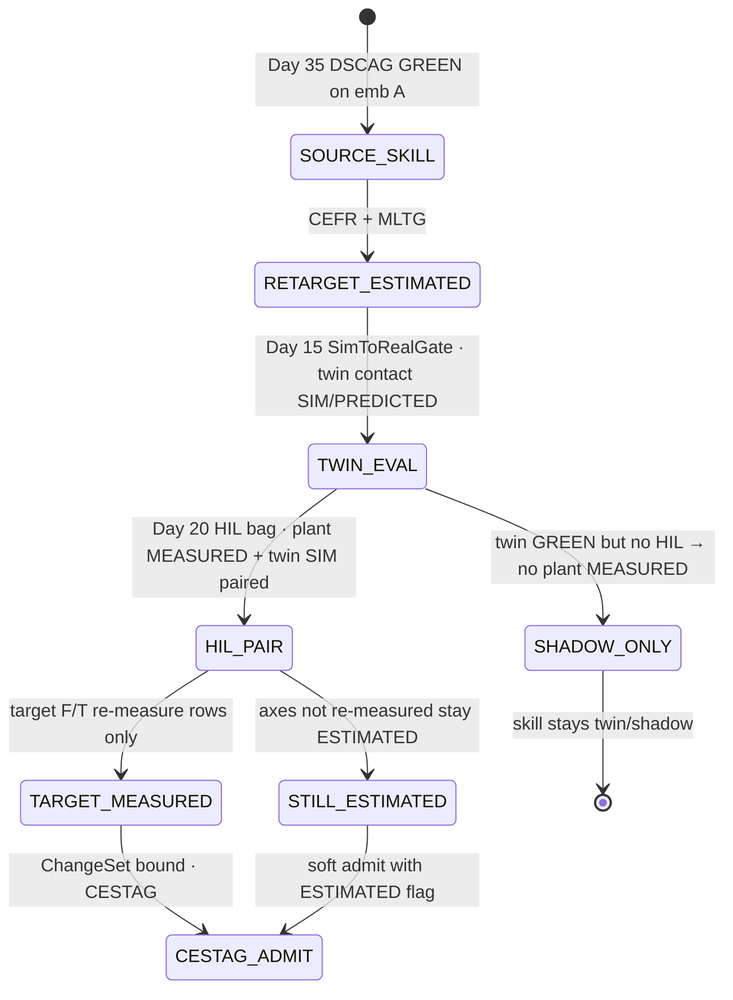
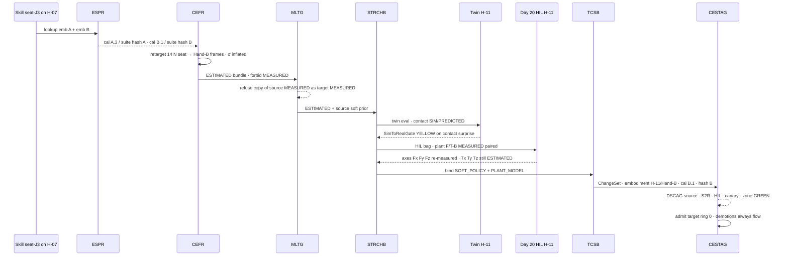
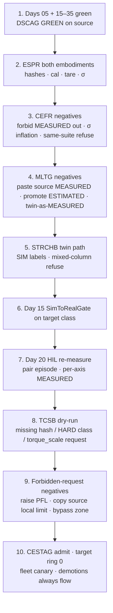

# Day 36 — Cross-embodiment skill transfer / sim-to-real under honest contact labels: EmbodimentSensorProvenanceRegistry / CrossEmbodimentForceRetargeter / MeasuredLabelTransferGate / SimToRealContactHonestyBridge / TransferChangeSetBinder / CrossEmbodimentSkillTransferAdmissionGate under DexterousSkillCaptureAdmissionGate + TelepresenceAdmissionGate + RemoteTeleopAdmissionGate + FleetSharedControlAdmissionGate + SharedControlAdmissionGate + CollaborativeWorkspaceAdmissionGate + proximity + zone attestation + supervisor + logging + canary + HIL + fleet + fleet-canary + incident + forensics/reopen + change-management + maintenance + thermal + energy gates

![EmbodimentSensorProvenanceRegistry / CrossEmbodimentForceRetargeter / MeasuredLabelTransferGate / SimToRealContactHonestyBridge / TransferChangeSetBinder / CrossEmbodimentSkillTransferAdmissionGate: a Day 35 skill captured on Hand-A with wrist F/T-A enters EmbodimentSensorProvenanceRegistry which binds sensor identity, frame, calibration version, tare policy and sigma model per embodiment and never shares them as MEASURED across embodiments; CrossEmbodimentForceRetargeter re-expresses force and pose targets into Hand-B or twin frames and units using the target embodiment calibration and emits ESTIMATED or SOFT until re-measured; MeasuredLabelTransferGate refuses promoting source MEASURED labels onto target sensors so source MEASURED becomes soft context or prior only; SimToRealContactHonestyBridge keeps twin contact labeled SIM or PREDICTED unless a Day 20 HIL bag re-measures on the plant; TransferChangeSetBinder packages the transfer as Day 25 SOFT_POLICY and/or PLANT_MODEL ChangeSets carrying embodiment_id, cal_version and sensor_suite_hash; CrossEmbodimentSkillTransferAdmissionGate fails closed under Day 35 DexterousSkillCaptureAdmissionGate plus Day 15 SimToRealGate plus Day 20 HIL plus Day 25 change-management — a transferred skill never raises Day 29 PFL, never writes Day 05 torque_scale, never bypasses CrossSiteZoneConfigGate](/images/day36-cross-embodiment-skill-transfer.png)

[Day 15](/lessons/day-15-closed-loop-learned-policies) made closed-loop learned policies **soft** writers behind `SimToRealGate`. [Day 18](/lessons/day-18-teleop-policy-logging-replay) owns the rule that labels refuse soft→MEASURED. [Day 20](/lessons/day-20-hil-regression-farm) owns HIL bags that re-measure the plant. [Day 25](/lessons/day-25-fleet-change-management) owns ChangeSets — `SOFT_POLICY`, `PLANT_MODEL`, `CALIBRATION`, and the HARD classes that soft layers may never write. [Day 05](/lessons/day-05-power-bms) owns `torque_scale` **forever**. [Day 29](/lessons/day-29-human-proximity-safety) owns HARD PFL ceilings. [Day 30](/lessons/day-30-collaborative-workspace-zoning) owns `CrossSiteZoneConfigGate`. [Day 34](/lessons/day-34-telepresence-haptic-force-honesty) owns contact truth labels at capture. [Day 35](/lessons/day-35-dexterous-skill-capture-lfd) owns `DemoHonestySegmenter` / `MeasuredForceLabelGate` / `SoftContextBagSchema` / `SkillCaptureHygieneGate` / `DemoToPolicyValidator` / `DexterousSkillCaptureAdmissionGate` (DSCAG) — the skill that exists today was admitted under honest labels on **one** embodiment.

Day 35 left you with a skill that seats connector J3 under MEASURED wrist F/T on Hand-A. The obvious next move is the one every lab makes: *run it on Hand-B, or on the twin, or on unit H-11 with a different F/T.* That is cross-embodiment transfer and sim-to-real, and on a force skill it is where three new lies enter:

1. **Sensor-identity lie.** A Newton measured on F/T-A is not a Newton measured on F/T-B. Different load-cell, different mounting compliance, different saturation curve, different frame. Copying the number into the target skill's force column and calling it MEASURED is laundering provenance across hardware.
2. **Calibration lie.** Even "the same" sensor model has a different tare, a different cal version, a different σ model after thermal soak and Day 26 drift. Borrowing source tare or source σ onto the target embodiment makes ESTIMATED look like MEASURED without a measurement.
3. **Sim-as-measured lie.** The twin's contact wrench is a model. Labeling it MEASURED on the plant — or labeling a plant MEASURED row as if the twin produced it — collapses the Day 15 / Day 20 distinction that `SimToRealGate` and HIL exist to protect.

Today owns **`EmbodimentSensorProvenanceRegistry` / `CrossEmbodimentForceRetargeter` / `MeasuredLabelTransferGate` / `SimToRealContactHonestyBridge` / `TransferChangeSetBinder` / `CrossEmbodimentSkillTransferAdmissionGate`**. The question is: **when a Day 35 captured skill moves to a different hand, wrist F/T, tactile suite, or twin↔hardware, how do you keep each embodiment's sensor provenance, calibration, and σ local; re-state force targets in the target embodiment's frames and units without ever promoting source MEASURED onto target sensors; keep twin contact labeled SIM/PREDICTED until a Day 20 HIL bag re-measures; package the transfer as Day 25 ChangeSets; and admit only through Day 35 DSCAG + Day 15 SimToRealGate + Day 20 HIL + Day 25 change-management — without raising Day 29 PFL, writing Day 05 `torque_scale`, or bypassing `CrossSiteZoneConfigGate`?**

## Transferring a force skill is not copying Newtons

The core split of the series, applied to embodiment change:

1. **MEASURED is local to the sensor that measured it.** Day 34 CFTS and Day 35 MFLG already said this inside one bag. Across embodiments it is absolute: source MEASURED may become a soft prior or soft context on the target; it may never become MEASURED on a different sensor suite.
2. **A retargeted target is ESTIMATED or SOFT until the target plant re-measures.** Frames, units, and kinematics can be transformed with the target's calibration; the *contact truth* cannot. The retargeter's output is a proposal the target embodiment must earn.
3. **HARD ceilings never travel with the skill.** Robot-side local limits, Day 29 PFL, Day 05 `torque_scale`, Day 30 zones, and Day 17 ESTOP are plant owners. A transferred skill inherits the **target** plant's ceilings, not a copy of the source's.

So the honest transfer labels are:

| Quantity after transfer | Label on target | May become | Must never become |
|-------------------------|-----------------|------------|-------------------|
| Source MEASURED wrench (F/T-A) | Soft prior / context | Conditioning feature; initialization prior | MEASURED on F/T-B or twin |
| Retargeted wrench in target frames/units | ESTIMATED ±σ_retarget | Soft skill target until HIL; pose/force proposal | MEASURED without plant re-measure |
| Twin contact wrench (no HIL bag) | SIM / PREDICTED | Twin eval only; Day 15 path | MEASURED on hardware |
| Twin contact after Day 20 HIL pairing | SIM on twin side; MEASURED on plant side of the bag | Paired traces for SimToRealGate | A single MEASURED label spanning both |
| Target F/T-B re-measure during HIL / canary | MEASURED (target-local) | Newton targets for target skill card | Back-labeled onto source bags |
| Source calibration / tare / σ model | Source-local metadata | Provenance of the prior | Target cal / tare / σ |
| Target calibration / tare / σ model | Target-local | Retarget transform inputs; MEASURED eligibility | Something the skill "brings" from source |
| Robot-side local limit / PFL / `torque_scale` / zones | HARD (target plant) | Constraints the transferred skill is validated against | Values copied from source ChangeSets |

The first rule of today: **a force skill may move; its MEASURED labels may not. Retarget into the target's frames, then re-measure on the target — or stay ESTIMATED forever.**

| Layer | Owns | Must not own |
|-------|------|--------------|
| Day 35 DSCAG + skill card | Source skill admitted under honest labels on source embodiment | Target MEASURED rows; target HARD ceilings |
| `EmbodimentSensorProvenanceRegistry` | Per-embodiment sensor identity, frame, cal version, tare policy, σ model, `sensor_suite_hash` | Sharing MEASURED across embodiments; silent cal reuse |
| `CrossEmbodimentForceRetargeter` | Frame/unit/pose re-expression into target calibration; ESTIMATED/SOFT outputs | Emitting MEASURED; writing HARD ceilings |
| `MeasuredLabelTransferGate` | Refusal of source MEASURED → target MEASURED promotion | Repairing labels "so transfer passes" |
| `SimToRealContactHonestyBridge` | Twin↔plant pairing; SIM/PREDICTED until HIL re-measure | Twin-as-MEASURED on plant; plant-as-SIM without marking |
| `TransferChangeSetBinder` | Day 25 SOFT_POLICY / PLANT_MODEL packaging with embodiment_id, cal_version, sensor_suite_hash | HARD_SAFETY ChangeSets; `torque_scale`; PFL |
| `CrossEmbodimentSkillTransferAdmissionGate` | Composed fail-closed soft admit under DSCAG + Day 15 + Day 20 + Day 25 | Clearing supervisor; dual-writing ESTOP / `torque_scale` |
| Days 05 / 17 / 29 / 30 | Torque, kill-chain, PFL, zone | Being outranked by a transferred skill |

**Core thesis:** cross-embodiment and sim-to-real transfer of a force skill is **re-stating the skill under a new plant's sensor provenance**. MEASURED is local to the sensor that measured it; sim and cross-hand transfers arrive as ESTIMATED/SOFT until the target embodiment re-measures; HARD ceilings (PFL, `torque_scale`, zones, ESTOP) never travel with the skill.

```mermaid
flowchart LR
  subgraph Source[Source — Day 35 skill on Hand-A / F/T-A]
    SK[Skill card · DSCAG GREEN<br/>MEASURED targets · cal A · suite hash A]
    REG[EmbodimentSensorProvenanceRegistry<br/>embodiment_id A · frame · tare · σ]
  end
  SK --> CEFR[CrossEmbodimentForceRetargeter<br/>frames · units · pose map → target cal]
  REG --> CEFR
  CEFR --> EST[ESTIMATED / SOFT retargeted targets<br/>σ_retarget stated]
  EST --> MLTG{MeasuredLabelTransferGate}
  MLTG -->|refuse MEASURED copy| PRIOR[Source MEASURED → soft prior / context]
  MLTG -->|allow ESTIMATED| BRIDGE[SimToRealContactHonestyBridge]
  PRIOR --> BRIDGE
  BRIDGE -->|twin path| SIM[SIM / PREDICTED on twin<br/>until Day 20 HIL bag]
  BRIDGE -->|hardware path| HIL[Day 20 HIL re-measure<br/>on target F/T-B]
  SIM --> TCSB[TransferChangeSetBinder<br/>SOFT_POLICY ± PLANT_MODEL]
  HIL --> TCSB
  TCSB --> CS[ChangeSet · embodiment_id B<br/>cal_version · sensor_suite_hash]
  CS --> CESTAG{CrossEmbodimentSkillTransferAdmissionGate<br/>under DSCAG · SimToRealGate · HIL · Day 25}
  CESTAG -->|GREEN| TGT[Target skill card · ring 0<br/>MEASURED only where HIL re-measured]
  CESTAG -->|RED| SHADOW[Shadow / twin-only]
  TGT --> HARD[Target plant: local limit · Day 29 CFL<br/>Day 05 torque_scale · zones · ESTOP]
```



## Three lies when you port a skill

**1. Sensor-identity lie.** Hand-A's wrist F/T reports 14 N at seat. Hand-B's F/T, different serial and mount, would have reported something else for the same physical contact — different compliance in the flange, different crosstalk, different saturation onset. Treating 14 N as a MEASURED target on Hand-B teaches the policy a number that was never measured there. Domain-randomization papers (Tobin et al., 2017) and sim-to-real force work both assume you know which distribution a sample came from; copying across sensors erases that.

**2. Calibration lie.** Day 26 already told you actuators and sensors drift. Day 25 `CALIBRATION` ChangeSets pin tare and cal artifacts. A transfer that applies source tare offsets or source σ to target samples is a silent cal write. `EmbodimentSensorProvenanceRegistry` makes the cal version part of the embodiment identity: different `cal_version` → different registry entry → retarget must re-run, not reuse.

**3. Sim-as-measured lie.** Peng et al. (2018) and the Day 15 gate both require that sim success is not plant success. A twin wrench labeled MEASURED on the plant, or a plant bag whose contact column was filled from the twin, collapses the bridge. `SimToRealContactHonestyBridge` keeps twin contact SIM/PREDICTED until a Day 20 HIL bag pairs plant MEASURED with twin traces under the same episode id.

The fix is not a better transform. It is **refusing to promote labels across sensor suites**, and admitting transfer only as ChangeSets that name the target embodiment.

## EmbodimentSensorProvenanceRegistry: MEASURED stays local

`EmbodimentSensorProvenanceRegistry` (ESPR) is the authoritative map from `embodiment_id` to the sensor suite that may produce MEASURED contact for that embodiment. It does not measure anything; it refuses identity confusion.

| Field | Meaning |
|-------|---------|
| `embodiment_id` | Stable id: unit + hand model + serial + end-effector role (e.g. `H-07/Hand-A/EE_R`) |
| `sensor_suite_hash` | Hash of sensor identities, frames, bus addresses, firmware |
| `ft_sensor_id` / `tactile_suite_id` | Hardware identity; changing it changes the hash |
| `frame_id` | Wrench and pose frames (wrist, tool, taxel map) |
| `cal_version` | Day 25 CALIBRATION ChangeSet id currently binding |
| `tare_policy` | When tare is valid; max tare age; who may tare |
| `sigma_model_id` | Per-axis σ model version (temperature, velocity bands) |
| `may_emit_measured` | True only for this suite on this embodiment |

Rules:

- **One MEASURED owner per contact channel per embodiment.** F/T-A cannot emit MEASURED for Hand-B's skill card. Twin suites have `may_emit_measured: false` for plant skill cards.
- **Hash is content-addressed.** Swap an F/T, reflash firmware, or change the tool frame → new `sensor_suite_hash` → new registry entry. Old skill cards referencing the old hash do not silently bind to the new suite.
- **Cal version is part of identity for transfer.** Retarget inputs include source and target `cal_version`. A transfer ChangeSet that omits either is incomplete.
- **Registry is read by gates; written only by Day 25 CALIBRATION / PLANT_MODEL paths.** Soft skill code never registers a sensor.

```python
from dataclasses import dataclass

@dataclass(frozen=True)
class EmbodimentProvenance:
    embodiment_id: str
    sensor_suite_hash: str
    ft_sensor_id: str
    frame_id: str
    cal_version: str
    tare_policy: str
    sigma_model_id: str
    may_emit_measured: bool   # False for twin-only suites on plant cards

def assert_local_measured(row_embodiment: str, row_suite_hash: str, label: str, reg) -> None:
    """MEASURED rows must cite the registry entry that owns them. Pure check."""
    e = reg.get(row_embodiment)
    if label == "MEASURED":
        if not e.may_emit_measured:
            raise ValueError("SIM/twin suite cannot emit MEASURED on plant card")
        if row_suite_hash != e.sensor_suite_hash:
            raise ValueError("MEASURED suite hash mismatch — refuse cross-embodiment laundering")
```

## CrossEmbodimentForceRetargeter: re-state, don't copy

`CrossEmbodimentForceRetargeter` (CEFR) maps a source skill's force and pose targets into the **target** embodiment's frames and units using the **target** calibration. It never upgrades labels.

$$
f^{\mathrm{tgt}} = R_{\mathrm{src}\rightarrow\mathrm{tgt}}\, f^{\mathrm{src}}, \qquad
\sigma^{\mathrm{tgt}} = \sqrt{ \big\|J_{\mathrm{R}}\,\sigma^{\mathrm{src}}\big\|^2 + \sigma_{\mathrm{cal,tgt}}^2 + \sigma_{\mathrm{map}}^2 }
$$

Pose / joint retarget uses the target hand kinematics (including fingertip frames if the tactile suite differs). The outputs are:

| Output | Label | Use |
|--------|-------|-----|
| Retargeted wrench proposal | ESTIMATED ±σ_retarget | Soft skill target; Day 15 twin eval; never force-loss MEASURED |
| Retargeted pose / aperture | ESTIMATED or SOFT | Kinematic prior; still validated under target local limits |
| Mapping metadata | — | `source_embodiment_id`, `target_embodiment_id`, both cal versions, both suite hashes, retargeter version |

Rules:

- **Target cal only for target quantities.** Source cal explains the prior; it does not transform into target Newtons without target cal.
- **σ always grows.** Retarget uncertainty is at least source σ plus cal uncertainty plus mapping uncertainty. A retarget that shrinks σ is a bug.
- **No MEASURED emission.** CEFR's wire type forbids `label: MEASURED`.
- **Versioned and pure.** Same inputs + retargeter version → byte-identical outputs; version pinned in the ChangeSet.

```python
def retarget(skill_src, emb_src, emb_tgt, cfg) -> "RetargetBundle":
    """Pure. Emits ESTIMATED/SOFT only. Refuses if either registry entry missing."""
    if emb_src.sensor_suite_hash == emb_tgt.sensor_suite_hash and emb_src.cal_version == emb_tgt.cal_version:
        raise ValueError("same suite+cal — not a cross-embodiment transfer; use Day 35 path")
    f_tgt, sig = transform_wrench(skill_src.force_targets, emb_src, emb_tgt, cfg)
    # σ inflation mandatory
    sig = inflate_sigma(sig, emb_tgt.sigma_model_id, cfg.map_sigma)
    return RetargetBundle(
        wrench=f_tgt, sigma=sig, label="ESTIMATED",
        pose=transform_pose(skill_src.pose_targets, emb_src, emb_tgt),
        source_ref=emb_src.embodiment_id, target_ref=emb_tgt.embodiment_id,
        cal_src=emb_src.cal_version, cal_tgt=emb_tgt.cal_version,
        suite_src=emb_src.sensor_suite_hash, suite_tgt=emb_tgt.sensor_suite_hash,
        retargeter_version=cfg.version,
        forbid_measured=True)
```

## MeasuredLabelTransferGate: source MEASURED never becomes target MEASURED

`MeasuredLabelTransferGate` (MLTG) is the Day 35 `MeasuredForceLabelGate` idea applied to **transfer**, not to demo rows. It is a pure filter:

| Proposal | Verdict |
|----------|---------|
| Copy source MEASURED wrench into target skill force column as MEASURED | **Refused** |
| Use source MEASURED as soft prior / context feature on target | Allowed; `may_regress_force_against: false` unless target HIL re-measured the same episode |
| Promote CEFR ESTIMATED → MEASURED without HIL bag | **Refused** |
| Promote twin SIM/PREDICTED → MEASURED on plant | **Refused** (bridge owns this) |
| After Day 20 HIL: plant F/T-B MEASURED rows on target card | Allowed; source rows remain source-local; no back-label onto source bags |
| ESTIMATED retarget used as Newton target in training loss on target | Only with commissioning flag + σ_retarget budget; stays ESTIMATED in manifest |

MLTG does not invent HIL. It only checks that any MEASURED row on a target skill card cites a target registry entry and a plant measurement event (capture demo on target, or HIL re-measure bag).

## SimToRealContactHonestyBridge: twin contact stays SIM until HIL

`SimToRealContactHonestyBridge` (STRCHB) pairs twin and hardware under Day 15 / Day 20 discipline:



| Direction | Twin label | Plant label | Allowed claim |
|-----------|------------|-------------|---------------|
| Twin → hardware (no HIL) | SIM / PREDICTED | — | Twin eval only |
| Twin → hardware (with HIL bag) | SIM on twin half | MEASURED on plant half | Paired divergence metrics; plant MEASURED may train target |
| Hardware → twin | — | MEASURED (source or target) | Twin replay for regression; twin contact still SIM |
| Hardware → hardware (cross hand) | — | Source MEASURED + target ESTIMATED until target HIL/demo | MLTG path; no twin required but Day 15 still runs |

The bridge refuses a single column that mixes twin and plant without `side: TWIN|PLANT` and refuses any plant MEASURED whose `sensor_suite_hash` is the twin's.

## TransferChangeSetBinder: Day 25 packaging

`TransferChangeSetBinder` (TCSB) wraps an accepted retarget + bridge result as Day 25 ChangeSets:

| ChangeSet class | Carries | Must not carry |
|-----------------|---------|----------------|
| `SOFT_POLICY` | Retargeted skill card, retargeter version, MLTG config, source skill id, ESTIMATED/MEASURED row counts | PFL, `torque_scale`, zone geometry, ESTOP |
| `PLANT_MODEL` | Target kinematics / compliance notes used by CEFR, twin contact model id for STRCHB | HARD_SAFETY; silent cal |
| `CALIBRATION` (prerequisite, not written by TCSB) | Target `cal_version` already admitted | Invented by the skill transfer |

Every bound ChangeSet must include:

- `embodiment_id` (target)
- `cal_version` (target)
- `sensor_suite_hash` (target)
- `source_embodiment_id`, `source_suite_hash`, `source_cal_version`
- `retargeter_version`, `bridge_version`
- refs to Day 15 SimToRealGate result and Day 20 HIL bag (or explicit `hil: none` → plant MEASURED forbidden)

## CrossEmbodimentSkillTransferAdmissionGate: composition under DSCAG

`CrossEmbodimentSkillTransferAdmissionGate` (CESTAG) admits a **transferred skill** onto a target embodiment and fails closed unless:

- Day 35 `DexterousSkillCaptureAdmissionGate` GREEN for the **source** skill (honest capture still holds)
- ESPR entries present and unconflicting for source and target; hashes match ChangeSet
- CEFR version pinned; outputs ESTIMATED/SOFT only; σ inflated
- MLTG clean: no source MEASURED promoted; target MEASURED only with plant events
- STRCHB: twin path labeled SIM/PREDICTED; HIL bag present if claiming plant MEASURED
- Day 15 `SimToRealGate` GREEN for target embodiment class
- Day 20 HIL GREEN when leaving shadow on hardware
- Day 25 ChangeSets bound (`SOFT_POLICY` ± `PLANT_MODEL`); no HARD_SAFETY writes
- Day 22 fleet canary GREEN for this skill × target embodiment class; Day 23 no open incident; Day 24 reopen GREEN
- Day 26: no open recalibration on target F/T / hand; Day 27 / Day 28 admits GREEN
- Day 34 TAG / Day 33 RTAG / … stack still GREEN where telepresence re-capture is used on target

Soft admit blocker only — CESTAG does not publish `JointCommand`, does not clear ESTOP, does not write Day 05, does not raise PFL, does not bypass `CrossSiteZoneConfigGate`. **Demotions always flow.**

## A worked transfer example

Source: SITE_A unit H-07, Hand-A, wrist F/T-A, Day 35 skill `seat-J3` DSCAG GREEN. Target: SITE_C unit H-11, Hand-B (different kinematics), wrist F/T-B (different serial), attested `map_version = 17`. Also evaluate twin `twin-H-11` before HIL.



| Step | MEASURED / HARD | Soft / ESTIMATED | Verdict |
|------|-----------------|------------------|---------|
| Source skill on H-07 | F/T-A MEASURED seat 14 N | Soft context from Day 35 | Source card unchanged |
| ESPR lookup | Suite hashes A ≠ B | — | Transfer required; not a same-suite deploy |
| CEFR retarget | — | $f^{\mathrm{tgt}}$ ESTIMATED, σ↑ | Proposal only |
| Engineer tries to paste 14 N as MEASURED on H-11 | — | — | MLTG refused |
| Twin sweep | Twin contact SIM | ESTIMATED skill output | SimToRealGate runs; not plant MEASURED |
| HIL on H-11 | F/T-B MEASURED on re-measure ticks | Unre-measured torque axes stay ESTIMATED | Target card may use new MEASURED rows only |
| Request to raise H-11 local limit to match H-07 | Local limit HARD | Request | Refused; validate under target ceiling |
| ChangeSet missing `sensor_suite_hash` | — | — | TCSB incomplete; CESTAG RED |
| CESTAG admit | Target ceilings bind | SOFT_POLICY ring 0 | GREEN; source MEASURED never on H-11 card |
| Co-worker ESTOP during canary | Day 17 | Skill running | Kill-chain; demote; Day 23 ticket |

## Ownership conflicts

| Conflict | Winner | Behavior |
|----------|--------|----------|
| Source MEASURED vs target MEASURED claim | MLTG + ESPR | Source stays source-local; target needs plant re-measure |
| CEFR ESTIMATED wants MEASURED | MLTG | Refused without HIL/demo on target suite |
| Twin SIM vs plant MEASURED in one column | STRCHB | Split sides; refuse mixed unlabeled column |
| Source cal applied to target samples | ESPR / Day 25 CALIBRATION | Target cal only; source cal is prior metadata |
| Same skill, new F/T serial, old suite hash in ChangeSet | ESPR hash | RED; re-bind ChangeSet |
| Transferred skill vs target local limit | Target local limit | Validate under target; never copy source limit |
| Eval fails → raise PFL / `torque_scale` | Days 29 / 05 | Refused; smaller envelope or RED |
| Unattested `map_version` on target site | `CrossSiteZoneConfigGate` | Refused |
| Soft transfer vs Day 17 ESTOP | Day 17 | Kill-chain; demote |

## Shared API

ESPR, CEFR, MLTG, STRCHB, TCSB run offline / on the fleet admission path over skill cards and bags; CESTAG publishes on the fleet admission path. Nothing here enters the cyclic loop; on-unit fences still run at control rate on the **target** plant.

```text
BusHeader:
  t_mono
  seq
  clock_domain
  age_ms
  producer_id

EmbodimentProvenance ⊇ BusHeader:          # EmbodimentSensorProvenanceRegistry
  embodiment_id
  sensor_suite_hash
  ft_sensor_id, tactile_suite_id
  frame_id
  cal_version
  tare_policy
  sigma_model_id
  may_emit_measured
  forbid:
    cross_emit_measured: true
    soft_register_sensor: true

RetargetBundle ⊇ BusHeader:                # CrossEmbodimentForceRetargeter
  source_embodiment_id, target_embodiment_id
  source_suite_hash, target_suite_hash
  cal_src, cal_tgt
  wrench_n_nm[6]
  sigma_n_nm[6]            # inflated
  pose_target
  label                    # ESTIMATED | SOFT — never MEASURED
  retargeter_version
  forbid:
    emit_measured: true
    shrink_sigma: true

LabelTransferDecision ⊇ BusHeader:         # MeasuredLabelTransferGate
  proposal_ref
  verdict                  # ALLOW_ESTIMATED | ALLOW_SOFT_PRIOR | ALLOW_TARGET_MEASURED | REFUSE
  refuse_reason            # SOURCE_MEASURED_COPY | NO_HIL | SUITE_MISMATCH | TWIN_AS_MEASURED | ...
  may_regress_force_against: bool

ContactHonestyPair ⊇ BusHeader:            # SimToRealContactHonestyBridge
  episode_id
  twin_side:
    label                  # SIM | PREDICTED
    suite_hash_twin
  plant_side:
    label                  # MEASURED | ESTIMATED | NONE
    suite_hash_plant
  hil_bag_ref              # required if plant_side.label == MEASURED from transfer path
  forbid:
    mixed_unlabeled_column: true
    twin_measured_on_plant: true

TransferChangeSet ⊇ BusHeader:             # TransferChangeSetBinder
  classes                  # SOFT_POLICY | PLANT_MODEL
  target_embodiment_id
  cal_version
  sensor_suite_hash
  source_embodiment_id
  source_suite_hash, source_cal_version
  retargeter_version, bridge_version
  sim_to_real_gate_ref
  hil_ref                  # or hil: none
  forbid:
    hard_safety_class: true
    write_torque_scale: true
    raise_pfl: true

CrossEmbodimentSkillTransferAdmissionGate ⊇ BusHeader:
  fail_closed: true
  soft_admit_blocker_only: true
  status                   # RED | YELLOW | GREEN
  require:
    dexterous_skill_capture_admission_green: true   # Day 35 DSCAG source
    embodiment_registry_bound: true
    retarget_estimated_or_soft_only: true
    measured_label_transfer_clean: true
    sim_to_real_contact_honesty: true
    sim_to_real_gate_green: true                     # Day 15
    hil_green_if_plant_measured: true                # Day 20
    transfer_changeset_bound: true                   # Day 25
    fleet_canary_gate_green: true                    # Day 22
    no_open_incident_on_unit: true                   # Day 23
    canary_reopen_gate_green: true                   # Day 24
    no_open_recalibration_on_target: true            # Day 26
    thermal_admission_gate_green: true               # Day 27
    energy_admission_gate_green: true                # Day 28
    telepresence_stack_green_if_recapture: true      # Days 30–34
    cross_site_zone_config_green: true
    human_safety_admission_green: true
    supervisor_armed: true
    estop_pairing: true
    day05_binding: true
  blocks: promotions_only
  forbid:
    joint_command: true
    dual_write_torque_scale: true
    clear_supervisor_stage: true
    write_estop: true
    raise_pfl_from_transfer: true
    bypass_cross_site_zone_config_gate: true
    write_hard_safety_changeset: true
    promote_source_measured_to_target: true

# Unchanged owners
DexterousSkillCaptureAdmissionGate (Day 35): honest capture on source embodiment
TelepresenceAdmissionGate (Day 34) · RemoteTeleopAdmissionGate (Day 33)
FleetSharedControlAdmissionGate (Day 32) · SharedControlAdmissionGate (Day 31)
CollaborativeWorkspaceAdmissionGate (Day 30) · CrossSiteZoneConfigGate
HumanSafetyAdmissionGate (Day 29)
SimToRealGate (Day 15) · HIL farm (Day 20) · Change management (Day 25)
SupervisorState (Day 17): ESTOP · kill-chain · stage · monitors
BmsState / PowerState (Day 05): torque_scale · contactor · UVLO · STO
  accepts_requests_from_soft_layer: false
```

## Config

A starting configuration for this series. Every number is a policy you re-derive on your twin and bench, not a literature constant:

```yaml
cross_embodiment_transfer:
  registry:
    require_fields: [embodiment_id, sensor_suite_hash, ft_sensor_id, frame_id, cal_version, tare_policy, sigma_model_id]
    twin_may_emit_measured_on_plant_card: false
    hash_includes: [sensor_ids, frames, firmware, bus_addrs]
  retargeter:
    version: cefr-1.1.0
    output_labels: [ESTIMATED, SOFT]
    forbid_measured: true
    sigma_inflation: [source_sigma, target_cal_sigma, map_sigma]
    map_sigma_n: 0.5
    same_suite_same_cal: refuse_as_transfer   # use Day 35 deploy path instead
  measured_label_transfer_gate:
    refuse: [SOURCE_MEASURED_COPY, TWIN_AS_MEASURED, ESTIMATED_TO_MEASURED_WITHOUT_HIL]
    allow_soft_prior_from_source_measured: true
    soft_prior_may_regress_force_against: false
    estimated_force_targets: false            # commissioning; Day 25 GATE_THRESHOLD to enable
    sigma_retarget_budget_n: 1.2
    target_measured_requires: [plant_event, matching_suite_hash, matching_cal_version]
  sim_to_real_bridge:
    twin_contact_labels: [SIM, PREDICTED]
    plant_measured_requires_hil_bag: true
    refuse_mixed_unlabeled_column: true
    pair_episode_id: required
  changeset_binder:
    classes: [SOFT_POLICY, PLANT_MODEL]
    require_fields: [target_embodiment_id, cal_version, sensor_suite_hash, source_embodiment_id, retargeter_version]
    forbid_classes: [HARD_SAFETY]
  admission:
    gate: CrossEmbodimentSkillTransferAdmissionGate
    under: [DexterousSkillCaptureAdmissionGate, SimToRealGate, HilFarm, ChangeManagement,
            TelepresenceAdmissionGate, RemoteTeleopAdmissionGate, FleetSharedControlAdmissionGate,
            SharedControlAdmissionGate, CollaborativeWorkspaceAdmissionGate, CrossSiteZoneConfigGate,
            HumanSafetyAdmissionGate]
    demotions_always_flow: true
  forbidden:
    raise_pfl: true
    write_torque_scale: true
    raise_local_force_limit_to_match_source: true
    bypass_cross_site_zone_config_gate: true
    copy_source_measured_as_target_measured: true
```

## Physical ↔ digital pairing

| Physical | Digital twin / backing |
|----------|------------------------|
| Swap Hand-A for Hand-B on H-11 | New `embodiment_id` + `sensor_suite_hash`; ESPR entry; old skill card does not bind |
| Replace wrist F/T serial | New suite hash; CALIBRATION ChangeSet; retarget must re-run |
| Twin seats connector "at 14 N" | SIM/PREDICTED contact; not plant MEASURED |
| HIL run on H-11 with F/T-B | Plant MEASURED rows paired to twin SIM under one episode id |
| Source demo bag from H-07 | Remains source-local; may be soft prior only on H-11 card |
| Target site fixture survey | Attested `map_version`; unattested demos/transfers refused |
| Engineer pastes source Newtons into target loss | MLTG refuse; forensic note |
| Canary ESTOP on H-11 | Day 17; skill demoted; Day 23; source skill unaffected |

The twin pairing that matters most: **retarget on the twin with SIM contact labels, then re-measure on the plant under HIL and prove SimToRealGate divergence stays inside budget — without ever relabeling twin contact as MEASURED on the plant card.**

## Bring-up sequence (before transferring a force skill)



1. **Days 05 and 15–35 green.** Do not transfer a skill whose source capture was not DSCAG-honest.
2. **ESPR both embodiments.** Register source and target with suite hashes, cal versions, tare policies, σ models. Twin suites marked `may_emit_measured: false` on plant cards.
3. **CEFR negatives.** Attempt MEASURED emission, σ shrinkage, and same-suite "transfer" — all refused.
4. **MLTG negatives.** Paste source MEASURED, promote ESTIMATED without HIL, label twin as MEASURED — all refused.
5. **STRCHB twin path.** Twin eval with SIM/PREDICTED only; refuse mixed unlabeled columns.
6. **Day 15 SimToRealGate** on the target embodiment class with retargeted ESTIMATED skill.
7. **Day 20 HIL re-measure** on target hardware; pair episode ids; allow MEASURED only on re-measured axes.
8. **TCSB dry-run.** Incomplete ChangeSets (missing hash/cal), HARD_SAFETY class, `torque_scale` write — refused.
9. **Forbidden-request negatives.** Raise PFL, copy source local limit, bypass `CrossSiteZoneConfigGate` — refused and bagged.
10. **CESTAG admit to target ring 0.** Soft admit; every RED, incident, or trip demotes without waiting.

## Failure gallery

| Symptom | Likely cause |
|---------|--------------|
| Target unit presses like source Newtons but F/T-B never agreed | Source MEASURED copied into target loss |
| Twin GREEN, plant jams immediately | Twin contact labeled MEASURED; no HIL re-measure |
| σ on retargeted targets smaller than source | CEFR skipped inflation / used source cal as target |
| Skill fine after F/T swap until first contact | Suite hash not updated; old MEASURED bound to new sensor |
| ChangeSet admitted without cal_version | TCSB incomplete; CESTAG should have been RED |
| "Matched source local limit on target so seat succeeded" | HARD ceiling treated as transferable tuning |
| Source bags rewritten with target labels | Back-label across embodiments |
| Canary demoted, retrained using twin wrench as MEASURED | STRCHB bypassed |
| Learned transfer "fixed" by writing torque_scale | Soft layer wrote Day 05 |
| Cross-site transfer ignored map_version | `CrossSiteZoneConfigGate` bypassed |

## What to freeze this week

Extend [frames](/frames) and your safety config with:

- `EmbodimentSensorProvenanceRegistry`: per-embodiment sensor identity, frame, cal version, tare policy, σ model, `sensor_suite_hash`; MEASURED emission local; twin suites cannot MEASURED on plant cards.
- `CrossEmbodimentForceRetargeter`: re-express force/pose into target frames and units with target cal; ESTIMATED/SOFT only; σ inflated; version pinned.
- `MeasuredLabelTransferGate`: refuse source MEASURED → target MEASURED; soft prior allowed; target MEASURED only with plant events matching suite+cal.
- `SimToRealContactHonestyBridge`: twin contact SIM/PREDICTED until Day 20 HIL pairing; refuse mixed unlabeled columns; plant MEASURED stays plant-local.
- `TransferChangeSetBinder`: Day 25 `SOFT_POLICY` ± `PLANT_MODEL` with `embodiment_id`, `cal_version`, `sensor_suite_hash`; never HARD_SAFETY / PFL / `torque_scale`.
- `CrossEmbodimentSkillTransferAdmissionGate` fail-closed under Day 35 DSCAG + Day 15 SimToRealGate + Day 20 HIL + Day 25 change-management + Days 22–34 stack; soft admit blocker only; **no dual-write of ESTOP or `torque_scale`; no transfer raises PFL; MEASURED never crosses sensor suites.**
- ESTOP is never skill-gated. Transferring a force skill is not copying Newtons.

The lesson isn't "domain-adapt the weights and deploy." It's that **a force skill moves by re-statement under the target plant's sensor provenance**: source MEASURED stays source-local, retarget arrives ESTIMATED/SOFT, twin contact stays SIM until HIL re-measures, ChangeSets name the embodiment, and HARD ceilings never hitch a ride.

## Further reading

Look these up by title; they are classic sources for today's cross-embodiment, sim-to-real, and domain-adaptation arguments:

- J. Tobin et al., "Domain randomization for transferring deep neural networks from simulation to the real world," IROS 2017.
- X. B. Peng, M. Andrychowicz, W. Zaremba, and P. Abbeel, "Sim-to-real transfer of robotic control with dynamics randomization," ICRA 2018.
- A. A. Rusu et al., "Sim-to-real robot learning from pixels with progressive nets," CoRL 2017.
- A. Rajeswaran et al., "Learning complex dexterous manipulation with deep reinforcement learning and demonstrations," RSS 2018.
- Y. Chebotar et al., "Closing the sim-to-real loop: Adapting simulation randomization with real world experience," ICRA 2019.
- OpenAI et al., "Solving Rubik's Cube with a robot hand," arXiv 2019 — sim-to-real dexterous transfer.
- K. Zakka, A. Zeng, P. Florence, J. Tompson, J. Bohg, and D. Dwibedi, "XIRL: Cross-embodiment inverse reinforcement learning," CoRL 2021.
- I. Radosavovic et al., "Real-world robot learning with masked visual pre-training," CoRL 2022.
- A. Yu, A. Foote, R. Mooney, and R. Martín-Martín, "Natural language can help bridge the sim2real gap," RSS 2024.
- O. Kroemer, S. Niekum, and G. Konidaris, "A review of robot learning for manipulation: Challenges, representations, and algorithms," *Journal of Machine Learning Research*, 2021.
- N. Hogan, "Impedance control: An approach to manipulation," ACC / ASME JDSMC 1985 — why force targets are plant-relative.
- M. H. Raibert and J. J. Craig, "Hybrid position/force control of manipulators," ASME JDSMC 1981.

## Next

**Day 37+** — Fleet skill library / multi-unit skill catalog under embodiment-honest admission: versioned skill cards keyed by `embodiment_id` + `sensor_suite_hash`, queryable across the fleet with canary cohorts per embodiment class, no cross-suite MEASURED reuse, catalog promote/demote as Day 25 ChangeSets through Day 36 CESTAG + Day 35 DSCAG — without raising Day 29 PFL, writing Day 05 `torque_scale`, or bypassing CrossSiteZoneConfigGate, under the same gates (supervisor + logging + canary + HIL + fleet + fleet-canary + incident + forensics/reopen + change-management + maintenance + thermal + energy + proximity + zone attestation + shared-control + multi-operator + remote-teleop + telepresence + skill-capture + cross-embodiment transfer admission).
