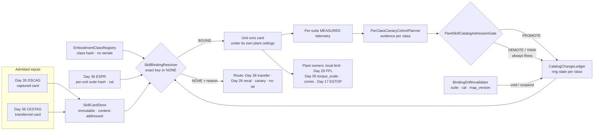
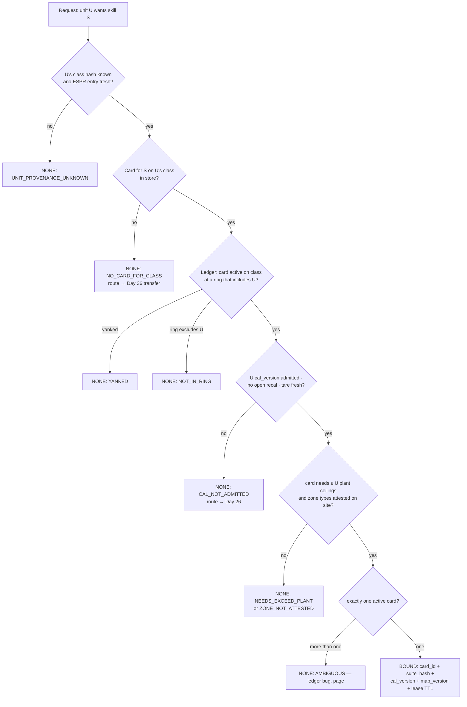
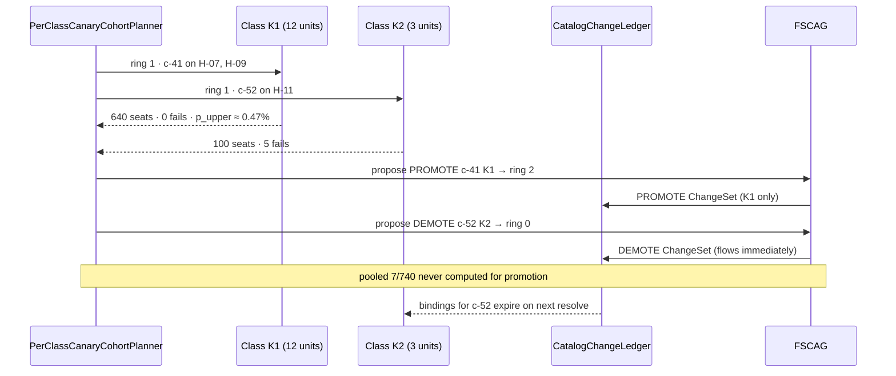
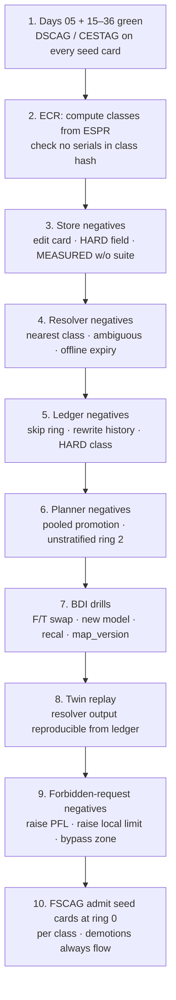

# Day 37 — Fleet skill library / multi-unit skill catalog under embodiment-honest admission: SkillCardStore / EmbodimentClassRegistry / SkillBindingResolver / PerClassCanaryCohortPlanner / CatalogChangeLedger / BindingDriftInvalidator / FleetSkillCatalogAdmissionGate under CrossEmbodimentSkillTransferAdmissionGate + DexterousSkillCaptureAdmissionGate + TelepresenceAdmissionGate + RemoteTeleopAdmissionGate + FleetSharedControlAdmissionGate + SharedControlAdmissionGate + CollaborativeWorkspaceAdmissionGate + proximity + zone attestation + supervisor + logging + canary + HIL + fleet + fleet-canary + incident + forensics/reopen + change-management + maintenance + thermal + energy gates

![SkillCardStore / EmbodimentClassRegistry / SkillBindingResolver / PerClassCanaryCohortPlanner / CatalogChangeLedger / BindingDriftInvalidator / FleetSkillCatalogAdmissionGate: immutable content-addressed skill cards are keyed by skill id, version, embodiment class hash and the sensor suites that measured their labels; EmbodimentClassRegistry groups units by sensor models, frames, firmware and mounting without serials, above the Day 36 per-unit sensor_suite_hash; SkillBindingResolver returns exactly one card or NONE with a reason and never falls back to the nearest card; PerClassCanaryCohortPlanner runs canary rings per embodiment class and refuses pooled promotion across classes; CatalogChangeLedger records promote, demote, yank and deprecate as Day 25 ChangeSets where demotions flow immediately and promotions need per-class evidence; BindingDriftInvalidator voids or suspends bindings when a unit's suite hash, calibration or map_version changes; FleetSkillCatalogAdmissionGate fails closed under Day 36 CESTAG and Day 35 DSCAG — no catalog action raises Day 29 PFL, writes Day 05 torque_scale, or bypasses CrossSiteZoneConfigGate](/images/day37-fleet-skill-library.png)

[Day 22](/lessons/day-22-fleet-canary-orchestration) owns fleet canaries and rings. [Day 25](/lessons/day-25-fleet-change-management) owns ChangeSets and the rule that HARD classes are never written by soft layers. [Day 26](/lessons/day-26-actuator-wear-predictive-maintenance) owns recalibration. [Day 05](/lessons/day-05-power-bms) owns `torque_scale` **forever**. [Day 29](/lessons/day-29-human-proximity-safety) owns HARD PFL ceilings. [Day 30](/lessons/day-30-collaborative-workspace-zoning) owns `CrossSiteZoneConfigGate`. [Day 35](/lessons/day-35-dexterous-skill-capture-lfd) owns honest capture (`DexterousSkillCaptureAdmissionGate`, DSCAG). [Day 36](/lessons/day-36-cross-embodiment-skill-transfer) owns `EmbodimentSensorProvenanceRegistry` and `CrossEmbodimentSkillTransferAdmissionGate` (CESTAG): a force skill moves between embodiments only by re-statement, and MEASURED stays local to the sensor that measured it.

Day 36 moved **one** skill from **one** hand to **one** other hand. A real fleet has forty units across three sites, two hand models, three wrist F/T revisions, a firmware train that never stops, and a maintenance crew that swaps sensors on Tuesdays. After a month you don't have "the seat-J3 skill"; you have eleven versions of it, admitted on four embodiment classes, at three different canary rings, with two of them yanked. That is a **skill library**, and the question stops being "is this skill honest?" and becomes "**which exact card may run on this exact unit, right now, and who says so?**"

Three new lies show up the moment you put skills in a shared catalog:

1. **Nearest-neighbor binding lie.** Unit H-14 asks for `seat-J3`. There's no card for its F/T revision, but there's one for "the same hand." The catalog helpfully returns the closest match. You've just done a Day 36 transfer without Day 36.
2. **Fleet-wide green lie.** The canary dashboard shows a 0.6% failure rate across the fleet, under the 1% bar. One embodiment class is at 5%; the big class is hiding it. Pooled statistics promoted a skill onto hardware where it's failing.
3. **Stale binding lie.** H-07 was bound to card `c-41` on Monday. On Tuesday its F/T was swapped and re-tared. On Wednesday `c-41` is still running, bound to a suite hash that no longer exists on that unit.

Today owns **`SkillCardStore` / `EmbodimentClassRegistry` / `SkillBindingResolver` / `PerClassCanaryCohortPlanner` / `CatalogChangeLedger` / `BindingDriftInvalidator` / `FleetSkillCatalogAdmissionGate`**. The question is: **how do you keep a fleet-wide skill catalog where every card is immutable and content-addressed, keyed by embodiment class and the sensor suites that measured its labels; every unit resolves to exactly one admitted card or to NONE with a reason (never the nearest neighbor); canaries and promotion run per embodiment class with no pooled evidence; promote, demote, yank, and deprecate are Day 25 ChangeSets where demotions flow at once; hardware, calibration, or zone changes void bindings automatically; and every catalog action is admitted through Day 36 CESTAG + Day 35 DSCAG — without raising Day 29 PFL, writing Day 05 `torque_scale`, or bypassing `CrossSiteZoneConfigGate`?**

## A catalog is a binding authority, not a file server

The series' split applied to a library:

1. **The class decides where a card may run; the suite decides what a row may be called.** Embodiment class (hand model, F/T model, frames, firmware family, mount) is the unit of admission. Per-unit `sensor_suite_hash` (Day 36, includes serials) is the unit of label provenance. A card admitted on class K may run on any healthy unit in K whose own suite and calibration are registered, because the skill closes its force loop on that unit's own MEASURED contact. But no row measured on H-07's F/T is ever relabeled as MEASURED for H-11's F/T. Ever.
2. **Resolution is exact or it is NONE.** The catalog never guesses. A miss is a routing decision: to Day 36 transfer, to recalibration, to a canary ring, or to "this unit doesn't do that task."
3. **Cards are immutable; state lives in the ledger.** "Promote card c-41 on class K to ring 2" is a ChangeSet, not an edit to the card. Demotion is cheap and immediate; promotion is earned, per class, with dwell.
4. **HARD ceilings never live in a card.** PFL, `torque_scale`, robot-side local limits, zones, and ESTOP belong to the target plant. A card states what it *needs*; the plant states what it *allows*.

| Layer | Owns | Must not own |
|-------|------|--------------|
| Day 36 CESTAG / Day 35 DSCAG | Honest capture and honest transfer of one skill onto one embodiment | Fleet-wide binding; ring state |
| `SkillCardStore` | Immutable, content-addressed cards with provenance manifests | Mutable "latest"; HARD limits inside cards |
| `EmbodimentClassRegistry` | Class hash over models, frames, firmware family, mount; membership of units | Per-unit MEASURED provenance (that's Day 36 ESPR) |
| `SkillBindingResolver` | Exactly one card or NONE + reason per (unit, skill) | Nearest-neighbor fallback; silent transfer |
| `PerClassCanaryCohortPlanner` | Cohorts, rings, dwell, and evidence per class | Pooled promotion across classes |
| `CatalogChangeLedger` | Append-only PROMOTE / DEMOTE / YANK / DEPRECATE ChangeSets | HARD_SAFETY classes; rewriting history |
| `BindingDriftInvalidator` | Void / suspend bindings on suite, cal, map_version, supervisor changes | Re-binding on its own |
| `FleetSkillCatalogAdmissionGate` | Composed fail-closed admit of catalog actions | Publishing `JointCommand`; clearing ESTOP; writing Day 05 |
| Days 05 / 17 / 29 / 30 | Torque, kill-chain, PFL, zones | Being outranked by a catalog entry |

**Core thesis:** a fleet skill library is a **binding authority**. It answers "which immutable card may run on this unit now" with an exact key or NONE, gathers evidence and promotes per embodiment class, demotes instantly, invalidates on hardware drift, and never moves a MEASURED label across sensor suites or a HARD ceiling into a card.



## Three lies in a shared library

**1. Nearest-neighbor binding.** Every package manager learned this: "latest compatible" is a policy, and an implicit one breaks builds. For a force skill it breaks hardware. If H-14 has F/T rev C and the catalog only holds cards admitted on rev B, any rule that returns the rev-B card has silently re-targeted Newtons onto a sensor with a different compliance and saturation curve. That's exactly the Day 36 sensor-identity lie, now automated and fleet-wide. The fix is structural: the resolver's key includes the class hash, and a miss returns `NONE: NO_CARD_FOR_CLASS → route Day 36`.

**2. Pooled green.** Canary evidence pooled across classes is the textbook setup for Simpson's paradox. Concretely:

| Class | Trials | Failures | Rate |
|-------|--------|----------|------|
| K1 (Hand-A, F/T rev B) | 1000 | 2 | 0.2% |
| K2 (Hand-B, F/T rev C) | 100 | 5 | 5.0% |
| Pooled | 1100 | 7 | 0.64% |

With a 1% promotion bar, pooled says ship. K2 is failing one in twenty. The big class drowns the small one, and the small one is usually the newest hardware, which is the hardware you know least. Promotion must be computed per class; pooling is allowed only in the demotion direction (a failure anywhere can demote everywhere if the root cause is shared).

**3. Stale bindings.** A binding is a claim about a pair: this card, this unit's suite and calibration, this site's attested zone map. Each side drifts. Day 26 recalibrates, maintenance swaps a sensor, Day 30 re-attests a zone. If the binding is stored as "H-07 runs c-41" without the hashes it was granted against, nothing notices. The fix: bindings carry the exact keys they were granted under, and a drift event voids or suspends them automatically.

## SkillCardStore: immutable, content-addressed cards

A **skill card** is everything needed to reproduce a skill's behavior and its admission evidence, frozen:

$$
\mathrm{card\_id} = H\big(\,\mathrm{weights} \,\Vert\, \mathrm{config} \,\Vert\, \mathrm{class\_hash} \,\Vert\, \mathrm{label\_manifest} \,\Vert\, \mathrm{deps}\,\big)
$$

| Field | Meaning |
|-------|---------|
| `card_id` | Content hash; changes if any byte below changes |
| `skill_id`, `skill_version` | Human name and semver (`seat-J3@2.3.0`) |
| `embodiment_class_hash` | The one class this card is admitted for |
| `label_manifest` | Per-row label (MEASURED / ESTIMATED / SOFT) with the **suite hash that produced it** |
| `origin` | `CAPTURE` (Day 35, DSCAG ref) or `TRANSFER` (Day 36, CESTAG ref + source card id) |
| `deps` | Pinned perception model, controller build, PLANT_MODEL id, retargeter version |
| `needs` | Declared requirements: max wrench it will command, contact types, zone types (requests, not limits) |
| `forbid` | No PFL, no `torque_scale`, no local-limit values, no zone geometry |

Rules:

- **Immutable.** A fix is a new card with a new `card_id`. There is no "edit" and no mutable `latest` tag that a unit can follow.
- **One class per card.** Transferring to another class produces a new card through Day 36, with `origin: TRANSFER` pointing to its source. The two cards share a `skill_id` and nothing else that matters.
- **Labels keep their suite.** When canary telemetry from H-11 is folded into a retrained card, H-11's rows are MEASURED on H-11's suite hash; H-07's rows stay MEASURED on H-07's. The manifest never collapses them into "MEASURED on class K."
- **`needs` is not a limit.** A card that "needs" 18 N at seat gets validated against each target's local limit and Day 29 PFL. If the plant allows 15 N, the card is not admitted there; the plant is not raised.

```python
import hashlib, json
from dataclasses import dataclass

@dataclass(frozen=True)
class SkillCard:
    skill_id: str
    skill_version: str
    embodiment_class_hash: str
    origin: str                 # CAPTURE | TRANSFER
    admission_ref: str          # DSCAG or CESTAG result id
    label_manifest: tuple       # ((row_id, label, suite_hash), ...)
    deps: tuple                 # (("perception", "pm-5.2.1"), ("plant_model", "pm-H-K2-7"), ...)
    needs: tuple                # (("max_wrench_n", 18.0), ...) — requests, never limits
    weights_digest: str

    @property
    def card_id(self) -> str:
        blob = json.dumps(self.__dict__, sort_keys=True, default=list).encode()
        return "c-" + hashlib.sha256(blob).hexdigest()[:16]

FORBIDDEN_KEYS = {"pfl", "torque_scale", "local_limit", "zone_geometry", "estop"}

def admit_to_store(card: SkillCard, raw_config: dict) -> None:
    if FORBIDDEN_KEYS & set(raw_config):
        raise ValueError("HARD owner field inside a skill card — refuse")
    for _, label, suite in card.label_manifest:
        if label == "MEASURED" and not suite:
            raise ValueError("MEASURED row without producing suite hash — refuse")
```

## EmbodimentClassRegistry: the unit of admission

Day 36's `sensor_suite_hash` includes serials, so every unit is unique. That's right for labels and useless for admission: you can't canary a class of one forever. `EmbodimentClassRegistry` (ECR) defines a second, coarser hash:

| Included in `embodiment_class_hash` | Excluded |
|-------------------------------------|----------|
| Hand model + kinematic revision | Sensor serial numbers |
| Wrist F/T model + firmware **family** | Individual tare offsets |
| Tactile suite model + taxel map version | Per-unit calibration values |
| Sensor frames and mount geometry revision | Site, operator, map_version |
| Actuator / gearbox revision on the skill's chain | Odometer, wear state (Day 26 owns) |

Rules:

- **Membership is computed, not assigned.** A unit's class is derived from its Day 36 ESPR entry. Nobody "puts H-14 in class K1."
- **Firmware family, not build.** Patch builds that are declared ABI- and timing-compatible stay in class; anything that changes filtering, sample rate, or frames is a new family and a new class. That declaration is itself a Day 25 ChangeSet with HIL evidence.
- **Classes split, never merge silently.** If two classes are "basically the same," prove it with a Day 36 transfer and get a card per class.
- **Per-unit eligibility still applies.** Being in K1 makes a unit *eligible*; its own suite must be registered, its `cal_version` admitted and fresh, and no Day 26 recalibration open.

## SkillBindingResolver: exactly one card or NONE

`SkillBindingResolver` (SBR) is a pure function over the store, the registry, the ledger, and the unit's live state:



Rules:

- **No fallback chain.** There is no "else try the previous class" or "else try the nearest firmware." Every miss is named.
- **Ambiguity is an error.** Two active cards for the same (skill, class, ring) means the ledger is wrong. Refuse and page; don't pick the newer one.
- **A binding is a signed tuple with a lease.** `(unit, card_id, suite_hash, cal_version, map_version, ring, granted_at, ttl)`. The unit caches it and runs only while the lease is valid and its live hashes match.
- **Offline units don't roll forward.** If the unit can't reach the catalog when its lease expires, the binding expires. It doesn't keep the last card and it doesn't fetch a newer one from a mirror: the skill is unavailable and the unit takes its normal safe behavior. ESTOP and HARD fences never depend on the lease.
- **Rollback is a resolve, not a copy.** "Roll back to c-38" means the ledger re-activates c-38 on that class, and every unit re-resolves. If c-38's class hash doesn't match a unit's current class (because its hardware changed since), that unit gets NONE, not c-38.

```python
def resolve(unit, skill_id, store, registry, ledger, plant, site):
    e = registry.unit_entry(unit)            # Day 36 ESPR + class hash
    if e is None or e.stale:
        return NONE("UNIT_PROVENANCE_UNKNOWN")
    cards = [c for c in store.by_skill(skill_id) if c.embodiment_class_hash == e.class_hash]
    if not cards:
        return NONE("NO_CARD_FOR_CLASS", route="DAY36_TRANSFER")
    active = [c for c in cards if ledger.active(c.card_id, e.class_hash, unit)]
    if not active:
        return NONE(ledger.reason(cards, e.class_hash, unit))   # YANKED | NOT_IN_RING | DEPRECATED
    if len(active) > 1:
        return NONE("AMBIGUOUS", page=True)
    card = active[0]
    if not plant.cal_admitted(unit, e.cal_version) or plant.open_recal(unit):
        return NONE("CAL_NOT_ADMITTED", route="DAY26")
    if not plant.needs_within_ceilings(unit, card.needs):     # local limit, PFL — read-only
        return NONE("NEEDS_EXCEED_PLANT")
    if not site.zone_types_attested(card.needs, site.map_version):
        return NONE("ZONE_NOT_ATTESTED")
    return Bound(unit=unit, card_id=card.card_id, suite_hash=e.sensor_suite_hash,
                 cal_version=e.cal_version, map_version=site.map_version,
                 ring=ledger.ring(card.card_id, e.class_hash), ttl_s=900)
```

## PerClassCanaryCohortPlanner: evidence never pools upward

Day 22 gave you rings. Today they become **per class**: each (card, class) pair has its own ring state, cohort, and evidence. The planner's job is to answer "how much evidence do we need on *this* class before ring N+1?"

For a failure-rate bar with zero observed failures, the one-sided 95% upper bound on the true rate after $n$ independent trials is

$$
p_{\mathrm{upper}} = 1 - 0.05^{1/n} \approx \frac{3}{n}
$$

(the rule of three). To claim a seat-failure rate under 0.5% you need about 600 clean trials **on that class**. A class of 4 units doing 50 seats a day each gets there in 3 days; a class of 1 unit takes 12. That's the honest cost of hardware diversity, and the planner shows it rather than hiding it in a pooled number. With failures observed, use an exact binomial (Clopper–Pearson) bound per class.

| Ring | Scope per class | Exit evidence (per class) | Demote trigger |
|------|-----------------|---------------------------|----------------|
| 0 | Shadow / HIL units only | Day 20 HIL GREEN on this class | Any HIL RED |
| 1 | 1–2 canary units, one site, supervised | $n$ trials with $p_{\mathrm{upper}}$ under bar; clamp-rate budget; no incidents | Any failure above budget; any Day 23 incident; any ESTOP during skill |
| 2 | ≤ 25% of class, ≥ 2 sites | Bar held across sites; per-site breakdown clean | Same, plus per-site divergence |
| 3 | Whole class | Dwell time complete; Day 24 reopen GREEN | Same |

Rules:

- **No pooled promotion.** K1's 1000 clean trials say nothing about K2. The planner refuses evidence whose class hash differs from the target class.
- **Pooled demotion is allowed.** If a failure's root cause is in a shared dependency (a perception model pinned in both cards), the ledger may yank every card that pins it, across classes, in one ChangeSet.
- **Evidence is labeled like data.** Canary telemetry rows carry the producing suite hash; outcome labels (seated / jammed / clamped) come from MEASURED signals on that unit, not from the policy's own success estimate.
- **Cohorts are stratified.** Ring 2 spans at least two sites so a site-specific fixture doesn't masquerade as a class property.



## CatalogChangeLedger: Day 25 for the library

Every change to "what runs where" is a ChangeSet in an append-only ledger:

| Action | Meaning | Admission | Latency |
|--------|---------|-----------|---------|
| `PUBLISH` | Card enters store at ring 0 for its class | FSCAG + DSCAG or CESTAG ref | Normal |
| `PROMOTE` | Card moves up one ring on one class | FSCAG + planner evidence for that class + dwell | Normal, never skips a ring |
| `DEMOTE` | Card moves down on one class | Any one signal | **Immediate** |
| `YANK` | Card inactive everywhere; bindings void | Any one signal; may span classes by shared dep | **Immediate** |
| `DEPRECATE` | No new bindings; existing ones run to lease end | FSCAG | Normal |
| `RESTORE` | Re-activate an older card on one class (rollback) | FSCAG + older card's class still matches | Normal |

Rules:

- **Asymmetric.** Promotion needs evidence, a ring at a time, with dwell. Demotion and yank need one trustworthy signal: an incident, a Day 17 ESTOP during the skill, a clamp-rate breach, a Day 24 reopen. They don't wait for review.
- **Append-only.** History is never rewritten. A bad promotion is answered by a DEMOTE entry, so Day 24 forensics can replay the exact ring state at any timestamp.
- **No HARD classes.** The ledger cannot hold a ChangeSet that touches PFL, `torque_scale`, local limits, zones, or ESTOP wiring. A failing canary is never "fixed" by raising a ceiling.
- **One active card per (skill, class, ring scope).** Enforced on write, which is why `AMBIGUOUS` in the resolver is a page and not a normal miss.

## BindingDriftInvalidator: hardware changes void bindings

A binding names the hashes it was granted against. `BindingDriftInvalidator` (BDI) watches for any of them changing:

| Drift event | Source | Effect on bindings |
|-------------|--------|--------------------|
| `sensor_suite_hash` changes, class hash unchanged (same F/T model, new serial) | Day 36 ESPR after maintenance | **SUSPEND**: re-tare, admit new cal, short per-unit check, then re-resolve |
| Class hash changes (new F/T model, new firmware family) | ECR | **VOID**: unit resolves to NONE until a card exists for the new class (Day 36) |
| `cal_version` changes | Day 25 CALIBRATION / Day 26 | **SUSPEND** until the new cal is admitted and the post-cal check passes |
| Open Day 26 recalibration | Day 26 | **SUSPEND** |
| `map_version` changes at site | Day 30 | **SUSPEND** until re-attested; unattested → NONE |
| Card yanked / demoted out of ring | Ledger | **VOID** on next lease check |
| Day 23 incident on unit | Day 23 | **SUSPEND** all force skills on unit |

Rules:

- **Invalidate, never re-bind.** BDI only removes. Re-binding is a fresh resolve through SBR, so all of today's checks run again.
- **The unit checks too.** The on-unit runtime compares the binding's `suite_hash` and `cal_version` with its own live values on every skill start. A mismatch refuses locally, even if the catalog hasn't heard about the swap yet.
- **Suspended is not degraded.** A suspended skill doesn't run "carefully." It doesn't run.

## FleetSkillCatalogAdmissionGate: composition

`FleetSkillCatalogAdmissionGate` (FSCAG) admits catalog actions (PUBLISH, PROMOTE, RESTORE, DEPRECATE) and fails closed unless:

- Day 35 DSCAG GREEN (captured) or Day 36 CESTAG GREEN (transferred) for the card's class
- Card store checks clean: immutable, content hash verifies, no HARD fields, every MEASURED row cites a suite hash
- ECR: target class exists; class hash in the card matches; firmware-family declarations admitted
- Planner evidence: per-class only, rule-of-three or Clopper–Pearson bound under bar, stratified across sites for ring ≥ 2, dwell complete
- Ledger: one ring at a time; no ambiguity created; no HARD ChangeSet class
- `needs` within target plant ceilings on every unit in the ring scope (read-only check against local limit and Day 29 PFL)
- Day 22 fleet canary, Day 23 no open incident, Day 24 reopen GREEN; Day 26 no open recal on cohort units; Days 27 / 28 admits GREEN
- `CrossSiteZoneConfigGate` GREEN for every site in the ring scope
- Day 17 supervisor armed and ESTOP paired on every cohort unit

DEMOTE and YANK bypass FSCAG's promotion checks: they need only an authenticated signal. **Demotions always flow.** FSCAG never publishes `JointCommand`, never clears ESTOP, never writes Day 05, never raises PFL.

## A worked catalog week

Fleet: SITE_A and SITE_C. Class K1 = Hand-A + F/T rev B (12 units). Class K2 = Hand-B + F/T rev C (3 units). Skill `seat-J3`: card c-41 on K1 (captured, Day 35), card c-52 on K2 (transferred, Day 36).

| Day | Event | MEASURED / HARD | Catalog action | Result |
|-----|-------|-----------------|----------------|--------|
| Mon | c-41 K1 ring 1 hits 640 clean seats | F/T rev B MEASURED on H-07, H-09 suites | PROMOTE c-41 K1 → ring 2 | GREEN; K1 only |
| Mon | c-52 K2 ring 1: 5 jams in 100 | F/T rev C MEASURED on H-11 | DEMOTE c-52 K2 → ring 0 | Immediate; H-11 bindings expire |
| Mon | Someone proposes pooled 7/740 = 0.95% "under bar" for K2 | — | — | Planner refuses cross-class evidence |
| Tue | H-14 (new unit, F/T rev C, K2) asks for `seat-J3` | — | Resolve | NONE: NOT_IN_RING (c-52 at ring 0) |
| Tue | H-14 operator asks to "just use c-41, same task" | — | — | Impossible by key: c-41 is K1; NONE: NO_CARD_FOR_CLASS is never upgraded to K1 |
| Tue | Maintenance swaps H-07's F/T (same rev B, new serial) | New suite hash; class hash unchanged | BDI SUSPEND | Re-tare, new cal admitted, short check, re-resolve → c-41 BOUND |
| Wed | c-53 on K2 (retrained with H-11 MEASURED rows, H-11 suite) | Rows labeled H-11 suite only | PUBLISH via CESTAG ref → ring 0 → HIL | Ring 0 GREEN |
| Wed | c-53 needs 18 N; H-12 local limit is 15 N | Local limit HARD | — | c-53 not admitted on H-12; ceiling unchanged |
| Thu | SITE_C re-attests zones → map_version 18 | Day 30 | BDI SUSPEND at SITE_C | Re-resolve after attestation |
| Fri | Perception model pm-5.2.1 found mis-segmenting connector | Shared dep in c-41 and c-53 | YANK both (shared root cause) | Immediate across classes; demotion may pool |
| Fri | Co-worker ESTOP during re-canary on H-09 | Day 17 | — | Kill-chain first; DEMOTE; Day 23 ticket |

## Ownership conflicts

| Conflict | Winner | Behavior |
|----------|--------|----------|
| Nearest-class card vs NONE | SBR | NONE + reason; route to Day 36 |
| Pooled green vs per-class red | Planner | Per-class red demotes; pooled number never promotes |
| Stale binding vs live suite hash | BDI + on-unit check | Refuse locally; re-resolve |
| Card `needs` vs plant local limit / PFL | Plant | Card not admitted there; ceiling never raised |
| "Latest" tag vs pinned card_id | Store | No mutable tags; units run card_ids |
| Rollback card vs changed hardware | SBR | Older card must match current class or NONE |
| Two active cards on one class/ring | Ledger write check | Refused on write; resolver pages if seen |
| Retrain mixes suites into one MEASURED column | Store manifest + Day 36 MLTG | Refuse; rows keep producing suite |
| Catalog promotion vs unattested map_version | `CrossSiteZoneConfigGate` | Refused for that site |
| Catalog anything vs Day 17 ESTOP | Day 17 | Kill-chain; demote |

## Shared API

The store, registry, resolver, planner, ledger, and BDI run on the fleet admission path. Units hold a cached, signed binding with a lease and re-check hashes at skill start. Nothing here enters the cyclic control loop; on-unit fences still run at control rate under the plant's own ceilings.

```text
BusHeader:
  t_mono
  seq
  clock_domain
  age_ms
  producer_id

SkillCard:                                   # SkillCardStore (immutable)
  card_id                  # content hash
  skill_id, skill_version
  embodiment_class_hash
  origin                   # CAPTURE | TRANSFER
  admission_ref            # DSCAG | CESTAG result id
  source_card_id           # TRANSFER only
  label_manifest[]:        # row_id, label, producing_suite_hash
  deps[]                   # perception, controller, plant_model, retargeter (pinned)
  needs                    # requested wrench, contact types, zone types — never limits
  forbid:
    hard_owner_fields: true
    mutable_tag: true
    cross_suite_measured: true

EmbodimentClass ⊇ BusHeader:                 # EmbodimentClassRegistry
  embodiment_class_hash
  hand_model_rev, ft_model, ft_fw_family, tactile_model, taxel_map_ver
  frames_rev, mount_rev, actuator_chain_rev
  members[]                # computed from Day 36 ESPR, never assigned
  forbid:
    include_serials: true
    silent_merge: true

Binding ⊇ BusHeader:                         # SkillBindingResolver
  unit_id
  result                   # BOUND | NONE
  none_reason              # UNIT_PROVENANCE_UNKNOWN | NO_CARD_FOR_CLASS | YANKED | NOT_IN_RING |
                           # DEPRECATED | CAL_NOT_ADMITTED | NEEDS_EXCEED_PLANT | ZONE_NOT_ATTESTED | AMBIGUOUS
  route                    # DAY36_TRANSFER | DAY26 | CANARY | NONE
  card_id, sensor_suite_hash, cal_version, map_version, ring
  lease_ttl_s
  forbid:
    nearest_neighbor: true
    roll_forward_offline: true

CohortEvidence ⊇ BusHeader:                  # PerClassCanaryCohortPlanner
  card_id, embodiment_class_hash, ring
  trials, failures, clamp_events
  p_upper                  # rule of three or Clopper–Pearson, per class
  sites[]
  outcome_label_source     # MEASURED on producing suite
  forbid:
    pooled_promotion: true

CatalogChange ⊇ BusHeader:                   # CatalogChangeLedger (Day 25)
  action                   # PUBLISH | PROMOTE | DEMOTE | YANK | DEPRECATE | RESTORE
  card_ids[], embodiment_class_hashes[]
  from_ring, to_ring
  evidence_ref, fscag_ref  # fscag_ref not required for DEMOTE / YANK
  forbid:
    hard_safety_class: true
    skip_ring: true
    rewrite_history: true

DriftEvent ⊇ BusHeader:                      # BindingDriftInvalidator
  unit_id or site_id
  kind                     # SUITE_HASH | CLASS_HASH | CAL_VERSION | OPEN_RECAL | MAP_VERSION | INCIDENT | LEDGER
  effect                   # SUSPEND | VOID
  forbid:
    rebind: true

FleetSkillCatalogAdmissionGate ⊇ BusHeader:
  fail_closed: true
  soft_admit_blocker_only: true
  status                   # RED | YELLOW | GREEN
  require:
    capture_or_transfer_admission_green: true      # Day 35 DSCAG | Day 36 CESTAG
    card_store_integrity: true
    embodiment_class_bound: true
    per_class_evidence_under_bar: true
    stratified_sites_for_ring_2_plus: true
    one_ring_at_a_time: true
    needs_within_plant_ceilings: true
    fleet_canary_gate_green: true                  # Day 22
    no_open_incident_on_cohort: true               # Day 23
    canary_reopen_gate_green: true                 # Day 24
    no_open_recalibration_on_cohort: true          # Day 26
    thermal_admission_gate_green: true             # Day 27
    energy_admission_gate_green: true              # Day 28
    cross_site_zone_config_green: true             # Day 30
    human_safety_admission_green: true             # Day 29
    supervisor_armed: true
    estop_pairing: true
    day05_binding: true
  blocks: promotions_only
  forbid:
    joint_command: true
    dual_write_torque_scale: true
    clear_supervisor_stage: true
    write_estop: true
    raise_pfl_from_catalog: true
    bypass_cross_site_zone_config_gate: true
    write_hard_safety_changeset: true
    cross_suite_measured_reuse: true

# Unchanged owners
CrossEmbodimentSkillTransferAdmissionGate (Day 36) · EmbodimentSensorProvenanceRegistry (Day 36)
DexterousSkillCaptureAdmissionGate (Day 35) · TelepresenceAdmissionGate (Day 34)
CollaborativeWorkspaceAdmissionGate (Day 30) · CrossSiteZoneConfigGate · HumanSafetyAdmissionGate (Day 29)
Fleet canary (Day 22) · Incident (Day 23) · Forensics/reopen (Day 24) · Change management (Day 25) · Recalibration (Day 26)
SupervisorState (Day 17): ESTOP · kill-chain · stage · monitors
BmsState / PowerState (Day 05): torque_scale · contactor · UVLO · STO
  accepts_requests_from_soft_layer: false
```

## Config

A starting configuration for this series. Every number is a policy you re-derive from your own fleet, not a literature constant:

```yaml
fleet_skill_catalog:
  store:
    card_id: sha256(weights, config, class_hash, label_manifest, deps)
    immutable: true
    mutable_tags: false
    forbid_fields: [pfl, torque_scale, local_limit, zone_geometry, estop]
    measured_rows_require_suite_hash: true
  class_registry:
    hash_includes: [hand_model_rev, ft_model, ft_fw_family, tactile_model, taxel_map_ver, frames_rev, mount_rev, actuator_chain_rev]
    hash_excludes: [serials, tare, cal_values, site, map_version]
    fw_family_change_requires: [changeset, hil_bag]
    merge_classes: via_day36_transfer_only
  resolver:
    fallback: none
    ambiguous: refuse_and_page
    lease_ttl_s: 900
    offline_on_expiry: skill_unavailable    # never last card, never mirror
    on_unit_hash_check: every_skill_start
  planner:
    promotion_bar_failure_rate: 0.005
    confidence: 0.95
    bound: clopper_pearson                  # rule of three when failures == 0
    pooled_promotion: false
    pooled_demotion_on_shared_dep: true
    ring2_min_sites: 2
    ring2_max_class_fraction: 0.25
    dwell_h: { ring1: 48, ring2: 72, ring3: 0 }
    outcome_labels_from: measured_on_producing_suite
  ledger:
    actions: [PUBLISH, PROMOTE, DEMOTE, YANK, DEPRECATE, RESTORE]
    append_only: true
    skip_ring: false
    demote_yank_latency: immediate
    forbid_classes: [HARD_SAFETY]
  drift_invalidator:
    suite_hash_same_class: suspend
    class_hash_change: void
    cal_version_change: suspend
    open_recal: suspend
    map_version_change: suspend
    incident_on_unit: suspend_force_skills
    may_rebind: false
  admission:
    gate: FleetSkillCatalogAdmissionGate
    under: [CrossEmbodimentSkillTransferAdmissionGate, DexterousSkillCaptureAdmissionGate,
            FleetCanaryGate, ChangeManagement, CrossSiteZoneConfigGate, HumanSafetyAdmissionGate]
    demotions_always_flow: true
  forbidden:
    raise_pfl: true
    write_torque_scale: true
    raise_local_limit_to_fit_card: true
    bypass_cross_site_zone_config_gate: true
    reuse_measured_across_suites: true
```

## Physical ↔ digital pairing

| Physical | Digital twin / backing |
|----------|------------------------|
| Fleet of 15 units, two hand models, two F/T revisions | Two `embodiment_class_hash` values; membership computed from ESPR |
| Technician swaps H-07's F/T for an identical model | New suite hash, same class; BDI SUSPEND; re-tare and re-resolve |
| New F/T model installed on H-14 | New class hash; BDI VOID; Day 36 transfer needed for every force skill |
| Unit loses Wi-Fi in a dead corner of SITE_C | Lease expires; skill unavailable; HARD fences unaffected |
| Seat jams on Hand-B units only | Per-class evidence shows it; K2 demoted; K1 untouched |
| Perception camera firmware update fleet-wide | Shared dep in many cards; one YANK ChangeSet can span classes |
| Unit H-12 has a lower local force limit | Card `needs` checked read-only; card not admitted there |
| Forensics after an incident | Ledger replay gives exact card, ring, and binding hashes at that timestamp |

The twin pairing that matters most: **for every unit, the twin should be able to replay "what would the resolver have returned at time t," from the ledger and the ESPR history alone, and get the same card_id or the same NONE reason the unit actually got.** If it can't, your catalog has hidden state.

## Bring-up sequence (before turning on a fleet catalog)



1. **Days 05 and 15–36 green.** Every seed card has a DSCAG or CESTAG reference. No "legacy" cards without one.
2. **ECR.** Compute classes from the live ESPR. Assert that no serial, tare, or site field leaked into a class hash.
3. **Store negatives.** Try to mutate a card, embed a PFL value, or add a MEASURED row without a suite hash: all refused.
4. **Resolver negatives.** Ask for a skill on a class with no card (NONE, routed to Day 36), create two active cards (refused on write), let a lease expire offline (skill unavailable, no roll-forward).
5. **Ledger negatives.** Skip a ring, edit a past entry, write a HARD ChangeSet: refused.
6. **Planner negatives.** Feed K1 evidence into a K2 promotion; promote ring 2 from one site: refused.
7. **BDI drills.** Physically swap an F/T for the same model (SUSPEND), install a different model (VOID), open a recal, change `map_version`. Confirm the on-unit check refuses before the catalog catches up.
8. **Twin replay.** Rebuild resolver outputs for a past week from the ledger and ESPR history; diff against what units logged.
9. **Forbidden-request negatives.** Ask the catalog to raise PFL, raise a local limit "so the card fits," or bypass `CrossSiteZoneConfigGate`: refused and bagged.
10. **FSCAG admit seed cards at ring 0 per class.** Promotion starts from there, one class and one ring at a time.

## Failure gallery

| Symptom | Likely cause |
|---------|--------------|
| New-hardware units jam on a skill that's "green fleet-wide" | Pooled promotion; per-class evidence never computed |
| Unit runs a card admitted for a different F/T model | Resolver fallback to nearest class |
| Skill misbehaves right after maintenance, before anyone re-tares | Binding stored without suite hash; no on-unit check |
| Rollback put an old card on a unit whose hardware changed | RESTORE copied a card instead of re-resolving |
| Two units at the same site run different versions with no ring reason | Mutable `latest` tag or ambiguous ledger state |
| Retrained card "improved" on one class, regressed on another | MEASURED rows from both suites pooled into one label column |
| Offline unit kept running a yanked card for hours | Lease without TTL, or roll-forward from a mirror |
| Forensics can't say which card ran at the time of an incident | Ledger mutable or bindings unlogged |
| Card admitted by raising H-12's local limit | HARD ceiling treated as a catalog parameter |
| Canary "fixed" by writing torque_scale | Soft layer wrote Day 05 |

## What to freeze this week

Extend [frames](/frames) and your safety config with:

- `SkillCardStore`: immutable, content-addressed cards, one class each; label manifest keeps the producing suite hash on every row; no HARD fields; no mutable tags.
- `EmbodimentClassRegistry`: class hash over models, frames, firmware family, mount, and actuator chain revision; no serials; membership computed from Day 36 ESPR; classes split, never merge silently.
- `SkillBindingResolver`: exactly one card or NONE with a named reason and route; no fallback; ambiguity pages; signed bindings with a lease; offline expiry means skill unavailable.
- `PerClassCanaryCohortPlanner`: rings and evidence per class; rule-of-three or Clopper–Pearson bounds; stratified sites; no pooled promotion, pooled demotion only on shared dependencies.
- `CatalogChangeLedger`: append-only Day 25 PUBLISH / PROMOTE / DEMOTE / YANK / DEPRECATE / RESTORE; one ring at a time up, immediate down; never HARD_SAFETY.
- `BindingDriftInvalidator`: suite, class, cal, recal, map_version, incident, and ledger events suspend or void bindings; never re-binds; on-unit hash check at every skill start.
- `FleetSkillCatalogAdmissionGate` fail-closed under Day 36 CESTAG + Day 35 DSCAG + Days 22–34 stack; soft admit blocker only; **no dual-write of ESTOP or `torque_scale`; no catalog action raises PFL; MEASURED never crosses sensor suites.**
- ESTOP is never catalog-gated. A skill library is a binding authority, not a file server.

The lesson isn't "put the skills in a registry and let units pull the latest." It's that **a fleet skill library answers one question exactly**, "which immutable card may this unit run now," and answers NONE whenever it can't prove the answer: per class, per ring, per calibration, per zone map, with demotions that never wait and HARD ceilings that never move.

## Further reading

Look these up by title; they are classic sources for today's catalog, rollout, and evidence arguments:

- C. R. Clopper and E. S. Pearson, "The use of confidence or fiducial limits illustrated in the case of the binomial," *Biometrika*, 1934.
- J. A. Hanley and A. Lippman-Hand, "If nothing goes wrong, is everything all right? Interpreting zero numerators," *JAMA*, 1983 — the rule of three.
- E. H. Simpson, "The interpretation of interaction in contingency tables," *Journal of the Royal Statistical Society B*, 1951.
- B. Beyer, C. Jones, J. Petoff, and N. R. Murphy (eds.), *Site Reliability Engineering*, O'Reilly, 2016 — canarying releases and progressive rollout.
- E. Dolstra, "The purely functional software deployment model," PhD thesis, Utrecht University, 2006 — content-addressed, immutable deployment (Nix).
- J. Samuel, N. Mathewson, J. Cappos, and R. Dingledine, "Survivable key compromise in software update systems," ACM CCS 2010 — The Update Framework (TUF), signed metadata and rollback protection.
- Open X-Embodiment Collaboration, "Open X-Embodiment: Robotic learning datasets and RT-X models," ICRA 2024.
- Octo Model Team, "Octo: An open-source generalist robot policy," RSS 2024.
- M. Mitchell et al., "Model cards for model reporting," FAT* 2019 — why a card must state what it was evaluated on.
- D. Sculley et al., "Hidden technical debt in machine learning systems," NeurIPS 2015 — undeclared consumers and entangled dependencies.
- ISO 10218-1/-2:2025, *Robotics — Safety requirements for industrial robots* — why ceilings belong to the robot system, not the task program.

## Next

**Day 38+** — Task composition over catalog skills under per-skill admission: sequencing bound skills into multi-step tasks (behavior trees / task plans) where each step resolves its own card through `SkillBindingResolver`, preconditions and postconditions are checked on MEASURED state from the unit's own sensors (never on a skill's self-reported success), a composite task inherits the weakest binding and demotes as a whole when any step demotes, and failure recovery routes to HOLD or a named recovery skill — without raising Day 29 PFL, writing Day 05 `torque_scale`, or bypassing `CrossSiteZoneConfigGate`, under the same gates (supervisor + logging + canary + HIL + fleet + fleet-canary + incident + forensics/reopen + change-management + maintenance + thermal + energy + proximity + zone attestation + shared-control + multi-operator + remote-teleop + telepresence + skill-capture + cross-embodiment transfer + fleet skill catalog admission).
