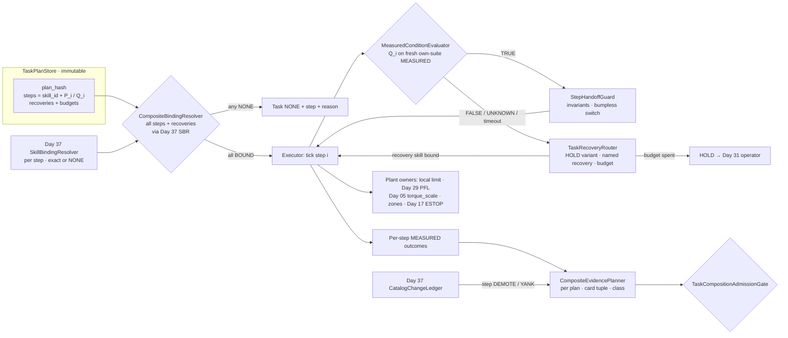
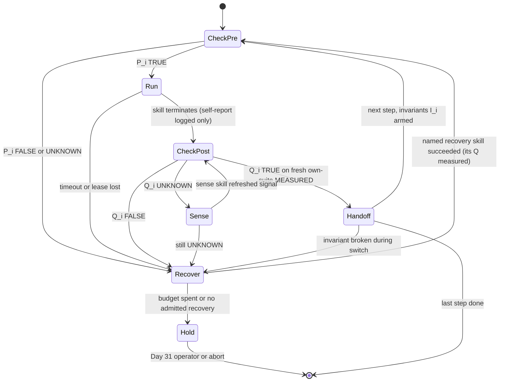
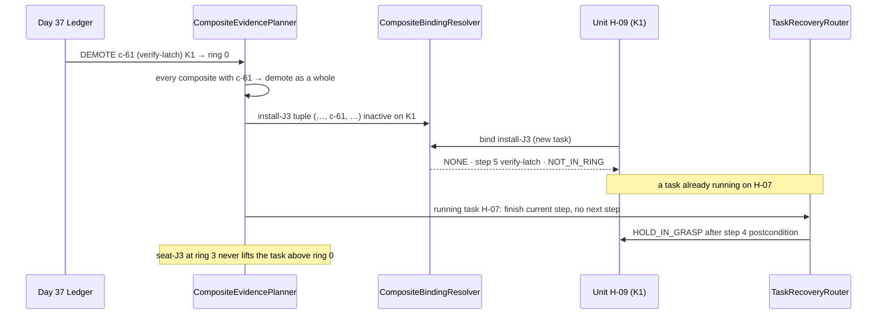
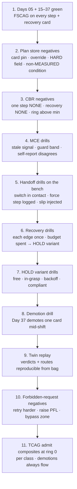

# Day 38 — Task composition over catalog skills under per-skill admission: TaskPlanStore / CompositeBindingResolver / MeasuredConditionEvaluator / StepHandoffGuard / CompositeEvidencePlanner / TaskRecoveryRouter / TaskCompositionAdmissionGate under FleetSkillCatalogAdmissionGate + CrossEmbodimentSkillTransferAdmissionGate + DexterousSkillCaptureAdmissionGate + TelepresenceAdmissionGate + RemoteTeleopAdmissionGate + FleetSharedControlAdmissionGate + SharedControlAdmissionGate + CollaborativeWorkspaceAdmissionGate + proximity + zone attestation + supervisor + logging + canary + HIL + fleet + fleet-canary + incident + forensics/reopen + change-management + maintenance + thermal + energy gates

![TaskPlanStore / CompositeBindingResolver / MeasuredConditionEvaluator / StepHandoffGuard / CompositeEvidencePlanner / TaskRecoveryRouter / TaskCompositionAdmissionGate: an immutable task plan references skills by skill id and contract, never by card id; CompositeBindingResolver resolves every step through the Day 37 SkillBindingResolver before the task starts and binds all steps or none, with the composite ring and lease set by the weakest step; MeasuredConditionEvaluator checks pre and postconditions as three-valued predicates on fresh MEASURED signals from the unit's own sensors and ignores a skill's self-reported success; StepHandoffGuard keeps inter-step invariants like grasp held and makes the controller switch bumpless in contact; CompositeEvidencePlanner bounds task failure by the sum of per-step bounds and demotes the whole task when any step demotes; TaskRecoveryRouter routes failures to a contact-aware HOLD or a named, separately admitted recovery skill with a retry budget and never retries harder; TaskCompositionAdmissionGate fails closed under Day 37 FSCAG — no task raises Day 29 PFL, writes Day 05 torque_scale, or bypasses CrossSiteZoneConfigGate](/images/day38-task-composition-catalog-skills.png)

[Day 05](/lessons/day-05-power-bms) owns `torque_scale` **forever**. [Day 17](/lessons/day-17-runtime-safety-supervisor) owns ESTOP and the kill-chain. [Day 25](/lessons/day-25-fleet-change-management) owns ChangeSets. [Day 29](/lessons/day-29-human-proximity-safety) owns HARD PFL ceilings. [Day 30](/lessons/day-30-collaborative-workspace-zoning) owns `CrossSiteZoneConfigGate`. [Day 31](/lessons/day-31-shared-control-teleop-arbitration) owns operator takeover. [Day 36](/lessons/day-36-cross-embodiment-skill-transfer) owns per-unit sensor provenance. [Day 37](/lessons/day-37-fleet-skill-library) owns the catalog: `SkillBindingResolver` (SBR) returns exactly one immutable card per (unit, skill) or NONE with a reason, rings and evidence live per embodiment class, demotions flow at once, and `FleetSkillCatalogAdmissionGate` (FSCAG) fails closed.

Day 37 answered "which card may this unit run for this skill?" Nobody buys a humanoid to run one skill. They buy it to **install the J3 harness connector**: walk to the bench, pick the connector out of the tray, carry it, seat it, prove it latched, let go, step back. That's seven skills, four contact transitions, two controller families, and one moment (the pull test) where the robot deliberately loads the thing it just built. The question stops being "is this skill admitted?" and becomes "**is this sequence of admitted skills admitted, and who decides that a step actually finished?**"

Four new lies show up the moment you compose:

1. **Self-reported success lie.** `seat-J3` returns `SUCCESS` because its policy head thinks the connector seated. The task advances to `release`. The connector was sitting on the latch ramp, not past it. You find out at end-of-line test, or in the field.
2. **Strongest-link lie.** The task dashboard says "ring 3" because its headline skill, `seat-J3`, is at ring 3 on this class. The `verify-latch` pull test is a new card at ring 1. The composite is running fleet-wide on a ring-1 step.
3. **Handoff gap lie.** `grasp` ends with the connector held. `transport` starts with "connector is in hand" as an assumption, not a measurement, and with its own nominal grip force instead of the one actually being applied. The connector slips during the swing, or the switch from one controller to the next kicks the wrist by a few Newtons while it's touching the tray.
4. **Retry-harder lie.** `seat-J3` fails. The task's fallback branch "tries again with 20% more force." That's a new skill with new `needs`, never admitted, written in a behavior tree by someone who just wanted the line to move.

Today owns **`TaskPlanStore` / `CompositeBindingResolver` / `MeasuredConditionEvaluator` / `StepHandoffGuard` / `CompositeEvidencePlanner` / `TaskRecoveryRouter` / `TaskCompositionAdmissionGate`**. The question is: **how do you sequence catalog skills into multi-step tasks where every step resolves its own card through Day 37 SBR and the task binds all-or-nothing; where pre- and postconditions are judged on fresh MEASURED state from the unit's own sensors, never on a skill's self-report; where hand-offs between steps keep their invariants measured and their contact wrench continuous; where a composite inherits the weakest step's ring and lease and demotes as a whole; and where failure routes to a contact-aware HOLD or a named, separately admitted recovery skill — without raising Day 29 PFL, writing Day 05 `torque_scale`, or bypassing `CrossSiteZoneConfigGate`?**

## A task is a contract between steps, not a script

The series' split applied to composition:

1. **Skills act; the unit's sensors judge.** A step's postcondition is a predicate over MEASURED signals the unit owns (Day 36 provenance, Day 03 sensing). The skill's own success estimate is telemetry, useful for analysis, never the thing that advances the task.
2. **A plan names skills and contracts, never cards.** The plan says "step 4 is `seat-J3`, precondition P4, postcondition Q4." Which card runs is Day 37's question, answered per unit at bind time.
3. **The task is only as admitted as its weakest step.** Ring, lease, evidence, and availability are mins and sums, never maxes.
4. **Recovery is a skill too.** A recovery path is a named catalog skill with its own card, ring, and `needs`, or it is HOLD. "The same skill, harder" is not a recovery; it's an unadmitted skill.
5. **HARD ceilings never live in a plan.** Like cards, plans state what they need; the plant states what it allows.

| Layer | Owns | Must not own |
|-------|------|--------------|
| Day 37 SBR / FSCAG | Exactly one card per (unit, skill); per-class rings | Task sequencing; step success |
| `TaskPlanStore` | Immutable, content-addressed plan graphs over skill ids + contracts | Card ids; HARD values; free-form fallback |
| `CompositeBindingResolver` | All-or-NONE binding of every step and recovery; composite ring and lease | Partial binds; nearest-skill substitution |
| `MeasuredConditionEvaluator` | Three-valued pre/postconditions on fresh, own-suite MEASURED signals | Trusting skill self-reports; treating UNKNOWN as TRUE |
| `StepHandoffGuard` | Inter-step invariants; bumpless controller switch in contact | Re-tuning gains; raising force to "catch" a slip |
| `CompositeEvidencePlanner` | Composite evidence per (plan, card tuple, class); union bound; whole-task demotion | Promoting a task above its weakest step |
| `TaskRecoveryRouter` | Route to HOLD variant or named recovery skill; retry budget | Escalated retries; unbounded loops |
| `TaskCompositionAdmissionGate` | Composed fail-closed admit of plans and composites | `JointCommand`; ESTOP; Day 05; PFL |
| Days 05 / 17 / 29 / 30 / 31 | Torque, kill-chain, PFL, zones, operator takeover | Being outranked by a task plan |

**Core thesis:** a task is a **contract between steps**. Each step binds its own admitted card, finishes only when the unit's own MEASURED state says so, hands over a state that stays measured across the switch, and fails into a named place. The composite is never more admitted than its weakest step.



## Four lies in a composed task

**1. Self-reported success.** A learned skill's termination signal is a classifier trained on demonstrations. It's tuned to fire when things *look* done, and it's wrong in exactly the cases you care about: the latch that didn't click, the grasp that pinched the cable jacket instead of the housing. If the executor advances on that signal, every downstream step inherits the error and runs on a world that doesn't exist. Behavior-tree literature calls this a *success condition*; the fix is to make the condition a measurement. For the J3 connector, "seated" means: axial insertion displacement from joint encoders and forward kinematics is within the seat window, the F/T trace showed the latch force peak and drop (the characteristic snap), and a subsequent pull at a bounded force produced no displacement beyond the latch play. All three are MEASURED on this unit's suite.

**2. Strongest-link admission.** Reliability composes the other way from how dashboards display it. If step $i$ fails with probability $p_i$, the task fails with probability

$$
P(\text{task fails}) \;\le\; \sum_{i=1}^{n} p_i
$$

by the union bound, **with no independence assumption**. That matters, because step failures are correlated (a slightly mis-registered tray hurts grasp *and* seat). Plug in Day 37's per-step 95% upper bounds: seven steps each at $p_{\mathrm{upper}} = 0.5\%$ give a composite bound of 3.5%, not 0.5%. A task's honest ring is the minimum of its steps' rings, and its honest failure bound is at least the sum of theirs until the composite's own canary evidence says otherwise.

**3. Handoff gaps.** Between two steps there's a moment where neither skill owns the world. The previous skill's controller is winding down; the next one is initializing. Two physical things go wrong there. First, **state drift**: the object can slip, the base can settle, a human can reach in. Second, **switching transients**: if the incoming controller starts from its own nominal setpoint instead of the measured state, the commanded wrench jumps. Process control solved this decades ago as *bumpless transfer*: initialize the incoming controller's state from the measured plant state so the output is continuous. In contact, a step in commanded force is a step in contact force, and a few Newtons at a fingertip is a dropped connector.

**4. Retry harder.** Behavior trees have a `Fallback` (selector) node: try child A, if it fails try child B. That's a great tool and the exact shape of the Day 37 nearest-neighbor lie, now one level up. "If seat fails, try seat with more force" is a new `needs` vector, which means a new card, which means Day 35/36 admission and Day 37 rings. Today's rule: a `Fallback` child must be a named recovery skill bound through SBR, with its own measured precondition, or HOLD.

## TaskPlanStore: immutable plans over skill contracts

A **task plan** is a small graph (sequence, fallback, and condition nodes) whose leaves are skills:

$$
\mathrm{plan\_hash} = H\big(\,\mathrm{graph} \,\Vert\, \{\,(\mathrm{skill\_id}_i,\ \mathrm{skill\_semver\_range}_i,\ P_i,\ Q_i,\ I_i)\,\} \,\Vert\, \mathrm{recoveries} \,\Vert\, \mathrm{budgets}\,\big)
$$

| Field | Meaning |
|-------|---------|
| `plan_hash` | Content hash; any change is a new plan |
| `task_id`, `task_version` | Human name (`install-J3@1.4.0`) |
| `steps[]` | `skill_id`, allowed semver range, precondition $P_i$, postcondition $Q_i$, handoff invariants $I_i$, step timeout |
| `recoveries[]` | Per failure kind: named recovery `skill_id` or a HOLD variant, plus a retry budget |
| `needs` | Union of step `needs` the plan will request; checked read-only against the plant |
| `forbid` | Card ids; PFL; `torque_scale`; local limits; zone geometry; per-step force overrides |

Rules:

- **Skill ids, not card ids.** Pinning a card in a plan bypasses Day 37's class keying and rings. The plan says *what*, the resolver says *which*.
- **No parameter overrides.** A plan can't pass `max_force=20` into a skill. If a step needs different behavior, that's a different skill version with its own card.
- **Every condition is typed.** $P_i$ and $Q_i$ are expressions over a closed vocabulary of MEASURED signals (encoder-derived poses, F/T wrench, tactile contact maps, grip motor current, vision poses labeled with their provenance) with explicit thresholds and freshness. A condition that references a skill output field is refused at publish time.
- **Recovery edges are explicit.** Every step names what happens on `FALSE`, `UNKNOWN`, and timeout. An unhandled failure kind is a publish-time error, not a runtime surprise.

```python
from dataclasses import dataclass

MEASURED_SIGNALS = {"ee_pose_fk", "wrench_ft", "tactile_contact", "grip_current",
                    "obj_pose_vision", "insertion_disp_fk", "latch_snap_ft"}
FORBIDDEN_KEYS = {"card_id", "pfl", "torque_scale", "local_limit", "zone_geometry", "estop",
                  "force_override", "gain_override"}

@dataclass(frozen=True)
class Condition:
    signal: str          # must be in MEASURED_SIGNALS
    lo: float
    hi: float
    k_sigma: float       # guard band in units of the signal's own sigma
    max_age_ms: int

@dataclass(frozen=True)
class Step:
    skill_id: str
    semver: str          # e.g. ">=2.3,<3"
    pre: tuple           # (Condition, ...)
    post: tuple
    invariants: tuple    # must hold through the NEXT step's start
    timeout_s: float
    on_false: str        # recovery skill_id | HOLD_*
    on_unknown: str
    on_timeout: str
    retry_budget: int

def publish_check(steps, raw):
    if FORBIDDEN_KEYS & set(raw):
        raise ValueError("plan carries a HARD owner field or a card pin — refuse")
    for s in steps:
        for c in (*s.pre, *s.post, *s.invariants):
            if c.signal not in MEASURED_SIGNALS:
                raise ValueError(f"{s.skill_id}: condition on non-MEASURED signal {c.signal}")
        if not (s.on_false and s.on_unknown and s.on_timeout):
            raise ValueError(f"{s.skill_id}: unhandled failure kind")
```

## CompositeBindingResolver: all steps or none

`CompositeBindingResolver` (CBR) calls Day 37 SBR once per step **and once per recovery skill** before the task starts:

- **All-or-NONE.** If any step or any recovery resolves to NONE, the task is NONE with the step index and SBR's reason. Starting a task you can't finish leaves a half-built assembly and a connector in a hand, which is worse than not starting.
- **Recoveries bind up front.** Discovering mid-task that the recovery skill isn't admitted on this class is the worst possible time to learn it.
- **Composite ring = min.** The composite runs only on units inside the ring scope of *every* bound card. If `verify-latch` is at ring 1 on K1, the task is ring 1 on K1, no matter where `seat-J3` is.
- **Composite lease = min, re-checked per step.** Each step start repeats Day 37's on-unit hash check (suite, cal, map_version) for that step's card. A lease that expires mid-task doesn't kill the current step's HARD fences; it means the next step won't start, and the router takes the task to HOLD.
- **The card tuple is part of the identity.** A composite binding is `(plan_hash, (card_1, …, card_n), (rec_1, …), class_hash, ring)`. If Day 37 promotes a new `seat-J3` card on this class, it's a *different composite* with its own evidence (below).

```python
def bind_task(unit, plan, sbr, ledger):
    step_bindings, rec_bindings = [], {}
    for i, s in enumerate(plan.steps):
        b = sbr.resolve(unit, s.skill_id, semver=s.semver)
        if b.result == "NONE":
            return TaskNone(step=i, skill=s.skill_id, reason=b.none_reason, route=b.route)
        step_bindings.append(b)
    for rid in plan.recovery_skill_ids():
        b = sbr.resolve(unit, rid)
        if b.result == "NONE":
            return TaskNone(step=None, skill=rid, reason="RECOVERY_" + b.none_reason)
        rec_bindings[rid] = b
    all_b = step_bindings + list(rec_bindings.values())
    return TaskBound(plan_hash=plan.plan_hash,
                     card_tuple=tuple(b.card_id for b in step_bindings),
                     recovery_cards=tuple(sorted((k, v.card_id) for k, v in rec_bindings.items())),
                     ring=min(b.ring for b in all_b),
                     lease_ttl_s=min(b.lease_ttl_s for b in all_b))
```

## MeasuredConditionEvaluator: three values, fail closed

A condition is a claim about the physical world, judged from noisy, possibly stale sensors. It has three honest answers, not two. With estimate $\hat{x}$, its own standard deviation $\sigma$ (from the Day 36 calibration record for that suite), a guard factor $k$, and a target interval $[a, b]$:

$$
Q(\hat{x}) =
\begin{cases}
\mathrm{TRUE} & a + k\sigma \le \hat{x} \le b - k\sigma \ \text{ and age} \le \text{max\_age} \\
\mathrm{FALSE} & \hat{x} \lt a - k\sigma \ \text{ or } \ \hat{x} \gt b + k\sigma \\
\mathrm{UNKNOWN} & \text{otherwise (inside the guard band, stale, or not MEASURED)}
\end{cases}
$$

Rules:

- **UNKNOWN never advances.** It routes like FALSE, but to its own named recovery, usually a *sense* skill (re-look, re-touch, a gentle probing contact) rather than an *act* skill.
- **Own suite only.** The signal must come from this unit's registered suite at its admitted `cal_version`. A vision pose from a fixed site camera is allowed if it's registered as a MEASURED source with its own σ and latency; a pose the skill *predicted* is not.
- **Freshness is part of truth.** A wrench from 300 ms ago, before the release, says nothing about now. Age is checked against the step's `max_age_ms`, using the Day 04 shared clock.
- **Self-reports are logged, not trusted.** The skill's `done` probability goes in the bag next to the measured verdict. Their disagreement rate is one of the best early warnings you have that a card is drifting (feed it to Day 37's planner as evidence against the card).
- **Conditions that need action are steps.** "Pull at 8 N and see if it moves" isn't a passive check; it applies load. It's the `verify-latch` skill, with its own card and `needs`, and its postcondition is passive.



## StepHandoffGuard: measured invariants, bumpless switches

The guard owns two things between step $i$ and step $i+1$.

**Invariants that cross the boundary.** $I_i$ lists what step $i$ hands over and step $i+1$ depends on: "connector in grasp" (tactile contact on both pads above threshold, grip current inside a band, object pose relative to the hand stable within tolerance). The guard arms $I_i$ at the end of step $i$ and keeps evaluating it at the condition rate through the first part of step $i+1$, until $P_{i+1}$ has been checked on fresh data. A broken invariant during the switch is a named failure (`HANDOFF_SLIP`), not a mystery in step $i+1$.

**Continuity of command in contact.** If the unit is in contact at the boundary (it usually is in manipulation), the incoming controller is initialized from **measured** state:

$$
\mathbf{w}^{\mathrm{cmd}}_{i+1}(t_0^{+}) = \mathbf{w}^{\mathrm{meas}}(t_0^{-}), \qquad
\big\lVert \dot{\mathbf{w}}^{\mathrm{cmd}} \big\rVert \le \dot{w}_{\max} \ \text{ over the blend window } T_b
$$

Concretely: the new impedance or force controller starts with its reference set to the current measured wrench and pose, its integrators pre-loaded so the output matches, and then ramps toward its own nominal within $T_b$ under a rate limit. Grip force is handed over the same way: `transport` starts at the grip current `grasp` ended with, not at its trained nominal. If the measured wrench at the boundary is already outside what step $i+1$ is admitted for (its card's `needs`), that's `HANDOFF_OUT_OF_ENVELOPE`, and the switch doesn't happen.

Rules:

- **Initialize from measurement, not from the plan.** The plan's idea of where the hand is doesn't matter at $t_0$. The encoders and F/T do.
- **The guard never adds force.** If the object starts slipping, the guard reports `HANDOFF_SLIP` and the router decides. It doesn't increase grip "to save it," because that's a grip-force command no admitted card issued, and on a soft or fragile part it's the wrong move anyway.
- **Blend limits are plant policy.** $\dot{w}_{\max}$ and $T_b$ come from the plant's config for that chain (Day 07 / Day 11 control rates), not from the plan, and are always under the Day 29 PFL envelope.
- **HARD fences never hand over.** Local limits, PFL, Day 05 `torque_scale`, and ESTOP stay armed continuously through the boundary. Only the *soft* controller changes.

## CompositeEvidencePlanner: the task demotes as a whole

Day 37's planner gathers evidence per (card, class). Today's planner gathers it per **(plan_hash, card tuple, class)**, and it starts from what the steps already prove:

$$
p^{\mathrm{task}}_{\mathrm{upper}} \;=\; \min\!\Big(\ \textstyle\sum_i p^{(i)}_{\mathrm{upper}},\ \ p^{\mathrm{composite}}_{\mathrm{upper}}(n_{\mathrm{task}}, f_{\mathrm{task}})\ \Big)
$$

The first term needs no composite trials; the second is the rule-of-three or Clopper–Pearson bound on end-to-end trials of *this exact tuple* on *this class*, where an end-to-end success means every $Q_i$ was MEASURED TRUE and the final assembly passed its own measured check. Taking the min is fine because both are valid upper bounds.

| Ring | Scope (per class) | Composite entry rule | Demote trigger |
|------|-------------------|----------------------|----------------|
| 0 | HIL / twin, then shadow tasks | All step cards ≥ ring 0; HIL GREEN on full sequence incl. recoveries | Any HIL RED |
| 1 | 1–2 units, supervised | All step cards ≥ ring 1; recovery paths each exercised at least once | Any step demoted; any task-level incident; any ESTOP during task |
| 2 | ≤ 25% of class, ≥ 2 sites | All step cards ≥ ring 2; $p^{\mathrm{task}}_{\mathrm{upper}}$ under task bar | Same, plus per-site divergence |
| 3 | Whole class | All step cards at ring 3; dwell complete | Same |

Rules:

- **Weakest step caps the task.** The composite ring is never above `min(step rings)`, whatever the composite evidence says.
- **Any step demotion demotes the task, immediately.** When Day 37's ledger writes `DEMOTE` or `YANK` for any card in the tuple, every composite containing it is demoted in the same breath. Pending tasks resolve to NONE; a running task finishes its current step under HARD fences and goes to HOLD instead of starting the next one.
- **A new card means a new composite.** Promoting `seat-J3` from c-41 to c-44 on K1 creates a new tuple. Its step bound is inherited instantly (it's just arithmetic over Day 37 evidence), but composite end-to-end evidence starts at zero and the ring is re-earned. Old tuples' evidence doesn't transfer to the new one, for the same reason pooled evidence doesn't transfer across classes.
- **Recovery rate is a first-class metric.** A task that "succeeds" 99% of the time but needs `regrasp` on 30% of runs is telling you that `grasp` is failing 30% of the time. The planner reports per-step first-try success, not just end-to-end success, and feeds step failures back into Day 37 evidence for that step's card.



## TaskRecoveryRouter: HOLD is contact-aware, recovery is a skill

When a step fails (FALSE, UNKNOWN that a sense step couldn't resolve, timeout, lease lost, invariant broken), `TaskRecoveryRouter` (TRR) picks exactly one of two things: a **named recovery skill** that CBR already bound, or a **HOLD variant**.

HOLD isn't one behavior. What's safe depends on the MEASURED contact state at the moment of failure, not on which step the plan thought it was in:

| MEASURED contact state | HOLD variant | Behavior |
|------------------------|--------------|----------|
| Free space, nothing in hand | `HOLD_FREE` | Stop at current pose under position hold; arms in a low-energy posture if dwell exceeds a timer |
| Object in grasp, no environment contact | `HOLD_IN_GRASP` | Keep the **measured** grip within its band; don't release; move nothing else |
| Environment contact (pressing, inserting) | `HOLD_BACKOFF` | Under compliant control, bring contact force toward a small preload and retreat a bounded distance along the measured contact normal; never pull hard against a stuck part |
| Contact state UNKNOWN | `HOLD_COMPLIANT` | Switch to the lowest-stiffness admitted impedance and freeze references; wait for operator |

All HOLD variants run *under* the HARD fences. None of them is ESTOP: Day 17 still owns kill-chain decisions, and an ESTOP during a task goes straight to the kill-chain, not through the router.

Rules:

- **Recovery skills are catalog skills.** `regrasp`, `unseat-gentle`, `re-look` each have cards admitted per class through Day 35/36/37, their own `needs`, and their own measured postconditions. A recovery that isn't bound for this unit means HOLD.
- **Budgets, not loops.** Each (step, failure kind) has a retry budget, and the task has a total recovery budget. When either is spent, HOLD, then Day 31 operator takeover or abort. No unbounded `while not done: retry`.
- **Never escalate.** No recovery is "the same skill with more force, faster, or a wider tolerance." The router can't pass parameters into skills (the plan has no field for it), so this lie is impossible by construction, not by policy.
- **Recovery preconditions are measured too.** `unseat-gentle` requires that the connector is MEASURED to be in contact with the receptacle and in grasp. If it's not in grasp, that recovery doesn't apply and the router picks the next named option or HOLD.
- **Operator takeover is a handoff.** Day 31 arbitration receives the HOLD state with the last measured wrench and invariants, so the operator starts from reality, bumplessly, with the same HARD fences.

## TaskCompositionAdmissionGate: composition

`TaskCompositionAdmissionGate` (TCAG) admits plan publication, composite promotion, and per-unit task binding. It fails closed unless:

- Day 37 FSCAG GREEN for every card in the tuple and every recovery card, on this class
- Plan integrity: immutable, content hash verifies, no card pins, no parameter overrides, no HARD fields
- Every $P_i$, $Q_i$, $I_i$ references only registered MEASURED signals with σ and max age; every failure kind has a named route
- CBR bound all steps and all recoveries on this unit; composite ring ≤ min step ring; lease = min
- Plan `needs` within the plant ceilings on every unit in scope (read-only check against local limit and Day 29 PFL)
- Composite evidence for this tuple and class meets the ring's entry rule; union bound computed from per-class step evidence only
- Twin / HIL run of the full sequence, including at least one injected failure per recovery edge, GREEN (Days 15 and 20)
- Days 22–28 admits GREEN; no open Day 23 incident on the unit; no open Day 26 recalibration
- `CrossSiteZoneConfigGate` GREEN for the site; every zone type the plan's skills need is attested at the current `map_version`
- Day 17 supervisor armed and ESTOP paired; Day 31 operator path available for HOLD escalation

DEMOTE of a composite needs only one authenticated signal (a step demotion, an incident, an ESTOP during the task). **Demotions always flow.** TCAG never publishes `JointCommand`, never clears ESTOP, never writes Day 05, never raises PFL.

## A worked shift

Unit H-09, class K1 (Hand-A, F/T rev B), SITE_A. Plan `install-J3@1.4.0`:

| # | Skill | Card (K1) | Ring | Postcondition (MEASURED) |
|---|-------|-----------|------|--------------------------|
| 1 | `approach-tray` | c-12 | 3 | EE pose within 5 mm of pre-grasp, FK |
| 2 | `grasp-connector` | c-30 | 3 | Both pads in contact; grip current in band; object pose stable 200 ms |
| 3 | `transport` | c-14 | 3 | EE at pre-insert pose; grasp invariant held throughout |
| 4 | `seat-J3` | c-41 | 2 | Insertion displacement in seat window; snap peak-then-drop on F/T |
| 5 | `verify-latch` | c-61 | 1 | Under bounded pull, displacement ≤ latch play |
| 6 | `release` | c-22 | 3 | Pads out of contact; F/T shows load transferred |
| 7 | `retreat` | c-12 | 3 | EE at clear pose; no environment contact |

Recoveries: `regrasp` (c-33, ring 2), `unseat-gentle` (c-70, ring 1), `re-look` (c-05, ring 3).
Composite ring = min(3, 3, 3, 2, 1, 3, 3, 2, 1, 3) = **1**. Step bound with each $p_{\mathrm{upper}}$ from Day 37 evidence sums to about 3.1%; the task bar for ring 2 is 2%, so ring 2 waits for end-to-end evidence on this tuple.

| Time | Event | MEASURED / HARD | Router / gate action | Result |
|------|-------|-----------------|----------------------|--------|
| 08:02 | Bind task on H-09 | — | CBR: all 7 steps + 3 recoveries BOUND | Task ring 1, lease 900 s |
| 08:03 | Bind on H-14 (K2) | — | CBR: step 4 NONE `NOT_IN_RING` (Day 37) | Task NONE; not started |
| 08:05 | `grasp` self-reports done; one pad shows no contact | Tactile MEASURED | $Q_2$ FALSE → `regrasp` (budget 1) | Regrasp $Q$ TRUE; continue |
| 08:06 | Switch grasp → transport in contact with tray lip | F/T 3.2 N at boundary | Bumpless: transport init from measured wrench and grip current | No transient; $I_2$ held |
| 08:07 | `seat-J3` self-reports done at 0.93; no snap on F/T, displacement 1.1 mm short | F/T + FK MEASURED | $Q_4$ FALSE → `unseat-gentle` (budget 1) | Backed out; re-run seat; $Q_4$ TRUE |
| 08:08 | Someone proposes a fallback: "seat at +20% force" | — | Plan has no override field; TCAG refuses plan v1.4.1 | Ceiling unchanged; skill unchanged |
| 08:09 | `verify-latch` pull; vision pose stale 420 ms | Age 420 ms above max 150 ms | $Q_5$ UNKNOWN → `re-look` → TRUE | Continue |
| 08:15 | Ledger DEMOTE c-61 on K1 (field return on latch test) | Day 37 | Composite demoted as a whole | New binds NONE at step 5 |
| 08:15 | H-07 mid-task at step 4 | — | Finish step 4 under HARD fences; no step 5 | `HOLD_IN_GRASP` → Day 31 operator |
| 08:21 | Co-worker enters SSM zone during H-09 step 3 | Day 29 speed scaling | Plant slows; step timeout extends only within plan's bound | Not a task failure; PFL unchanged |
| 08:40 | ESTOP during H-09 step 6 | Day 17 | Kill-chain first; router not consulted | Day 23 ticket; composite DEMOTE |

## Ownership conflicts

| Conflict | Winner | Behavior |
|----------|--------|----------|
| Skill self-report vs measured postcondition | MCE | Measured verdict advances; self-report logged |
| Headline skill's ring vs weakest step's ring | CBR / planner | Task ring = min |
| Partial bind vs missing recovery | CBR | Task NONE before start |
| Plan's assumed pose vs measured state at switch | StepHandoffGuard | Initialize from measurement |
| Slip during handoff vs "grip harder" | Router | `HANDOFF_SLIP` → named recovery or HOLD; guard adds no force |
| Fallback "retry harder" vs admitted skills | TaskPlanStore | No parameter overrides; refused at publish |
| UNKNOWN condition vs schedule pressure | MCE | Never advances; sense step or HOLD |
| New step card promoted vs old composite evidence | Planner | New tuple; composite evidence restarts |
| Plan `needs` vs plant local limit / PFL | Plant | Plan not admitted there; ceiling never raised |
| Task HOLD vs Day 17 ESTOP | Day 17 | Kill-chain; HOLD is not ESTOP |
| Task anything vs `CrossSiteZoneConfigGate` | Day 30 | Refused for that site |

## Shared API

The plan store, CBR, planner, and TCAG run on the fleet admission path. The executor, MCE, handoff guard, and router run on the unit at condition rate (tens to hundreds of Hz), above the cyclic control loop. Skills' controllers and every HARD fence keep running at control rate under the plant's ceilings.

```text
BusHeader:
  t_mono
  seq
  clock_domain
  age_ms
  producer_id

TaskPlan:                                    # TaskPlanStore (immutable)
  plan_hash                # content hash
  task_id, task_version
  graph                    # SEQUENCE | FALLBACK | CONDITION nodes; leaves are skill_ids
  steps[]:
    skill_id, semver_range
    pre[], post[], invariants[]   # Condition: signal, lo, hi, k_sigma, max_age_ms
    timeout_s
    on_false, on_unknown, on_timeout   # recovery skill_id | HOLD_FREE | HOLD_IN_GRASP | HOLD_BACKOFF | HOLD_COMPLIANT
    retry_budget
  total_recovery_budget
  needs                    # union of step needs — requests, never limits
  forbid:
    card_pin: true
    parameter_override: true
    hard_owner_fields: true
    condition_on_skill_output: true

TaskBinding ⊇ BusHeader:                     # CompositeBindingResolver
  unit_id
  result                   # BOUND | NONE
  none_step, none_skill, none_reason, route
  plan_hash
  card_tuple[], recovery_cards[]
  embodiment_class_hash
  ring                     # min over all bound cards
  lease_ttl_s              # min over all bound cards
  forbid:
    partial_bind: true
    substitute_skill: true

ConditionVerdict ⊇ BusHeader:                # MeasuredConditionEvaluator
  step_index, kind         # PRE | POST | INVARIANT
  signal, x_hat, sigma, k_sigma, age_ms
  producing_suite_hash, cal_version
  verdict                  # TRUE | FALSE | UNKNOWN
  skill_self_report        # logged only
  forbid:
    unknown_as_true: true
    self_report_as_post: true

Handoff ⊇ BusHeader:                         # StepHandoffGuard
  from_step, to_step
  w_meas_at_switch, grip_meas_at_switch
  init_from_measured: true
  blend_window_s, wdot_max # plant policy
  result                   # OK | HANDOFF_SLIP | HANDOFF_OUT_OF_ENVELOPE
  forbid:
    add_force: true
    disarm_hard_fences: true

CompositeEvidence ⊇ BusHeader:               # CompositeEvidencePlanner
  plan_hash, card_tuple[], embodiment_class_hash, ring
  step_p_upper[], union_bound
  task_trials, task_failures, composite_p_upper
  first_try_success_per_step[], recovery_rate_per_step[]
  forbid:
    ring_above_min_step: true
    evidence_across_tuples: true
    pooled_promotion: true

RecoveryDecision ⊇ BusHeader:                # TaskRecoveryRouter
  step_index, failure_kind # FALSE | UNKNOWN | TIMEOUT | LEASE_LOST | HANDOFF_SLIP | OUT_OF_ENVELOPE
  measured_contact_state
  route                    # recovery skill_id | HOLD variant | OPERATOR | ABORT
  budget_left_step, budget_left_task
  forbid:
    escalated_retry: true
    unbound_recovery: true
    route_estop: true

TaskCompositionAdmissionGate ⊇ BusHeader:
  fail_closed: true
  soft_admit_blocker_only: true
  status                   # RED | YELLOW | GREEN
  require:
    fleet_skill_catalog_admission_green: true      # Day 37 FSCAG, every step + recovery card
    plan_integrity: true
    conditions_measured_only: true
    every_failure_kind_routed: true
    all_steps_and_recoveries_bound: true
    ring_le_min_step: true
    needs_within_plant_ceilings: true
    composite_evidence_for_ring: true
    twin_hil_sequence_with_injected_failures_green: true   # Days 15 / 20
    fleet_canary_gate_green: true                  # Day 22
    no_open_incident_on_unit: true                 # Day 23
    canary_reopen_gate_green: true                 # Day 24
    no_open_recalibration: true                    # Day 26
    thermal_admission_gate_green: true             # Day 27
    energy_admission_gate_green: true              # Day 28
    human_safety_admission_green: true             # Day 29
    cross_site_zone_config_green: true             # Day 30
    operator_path_available: true                  # Day 31
    supervisor_armed: true
    estop_pairing: true
    day05_binding: true
  blocks: promotions_and_binds_only
  forbid:
    joint_command: true
    dual_write_torque_scale: true
    clear_supervisor_stage: true
    write_estop: true
    raise_pfl_from_task: true
    bypass_cross_site_zone_config_gate: true
    write_hard_safety_changeset: true
    cross_suite_measured_reuse: true

# Unchanged owners
FleetSkillCatalogAdmissionGate · SkillBindingResolver · CatalogChangeLedger (Day 37)
CrossEmbodimentSkillTransferAdmissionGate · EmbodimentSensorProvenanceRegistry (Day 36)
DexterousSkillCaptureAdmissionGate (Day 35) · SharedControlAdmissionGate (Day 31)
CollaborativeWorkspaceAdmissionGate · CrossSiteZoneConfigGate (Day 30) · HumanSafetyAdmissionGate (Day 29)
SupervisorState (Day 17): ESTOP · kill-chain · stage · monitors
BmsState / PowerState (Day 05): torque_scale · contactor · UVLO · STO
  accepts_requests_from_soft_layer: false
```

## Config

A starting configuration for this series. Every number is a policy you re-derive from your own fleet, not a literature constant:

```yaml
task_composition:
  plan_store:
    plan_hash: sha256(graph, steps, conditions, recoveries, budgets)
    immutable: true
    card_pins: false
    parameter_overrides: false
    forbid_fields: [card_id, pfl, torque_scale, local_limit, zone_geometry, estop, force_override, gain_override]
    conditions_signal_vocabulary: measured_only
    unhandled_failure_kind: refuse_publish
  binding:
    all_or_none: true
    bind_recoveries_up_front: true
    ring: min_over_all_cards
    lease: min_over_all_cards
    on_unit_hash_check: every_step_start
    lease_expiry_mid_task: finish_step_then_hold
  conditions:
    values: [TRUE, FALSE, UNKNOWN]
    k_sigma_default: 2.0
    max_age_ms_default: 150
    unknown_route: sense_skill_then_recovery
    self_report: log_only
    self_report_disagreement_to_day37: true
  handoff:
    init_controller_from: measured_state
    blend_window_s: 0.25         # plant policy per chain
    wdot_max_n_per_s: 40.0       # plant policy, under Day 29 envelope
    guard_may_add_force: false
    hard_fences_continuous: true
  evidence:
    key: [plan_hash, card_tuple, embodiment_class_hash]
    step_bound: union_of_per_class_p_upper
    composite_bound: clopper_pearson   # rule of three when failures == 0
    task_bar_failure_rate: { ring2: 0.02, ring3: 0.01 }
    ring_cap: min_step_ring
    demote_on_any_step_demote: immediate
    new_card_in_tuple: new_composite
    report: [first_try_success_per_step, recovery_rate_per_step]
  recovery:
    hold_variants: [HOLD_FREE, HOLD_IN_GRASP, HOLD_BACKOFF, HOLD_COMPLIANT]
    hold_selected_from: measured_contact_state
    retry_budget_per_step_default: 1
    total_recovery_budget: 3
    escalated_retry: forbidden
    on_budget_spent: hold_then_day31_operator
    estop_routes_through_router: false
  admission:
    gate: TaskCompositionAdmissionGate
    under: [FleetSkillCatalogAdmissionGate, CrossEmbodimentSkillTransferAdmissionGate,
            DexterousSkillCaptureAdmissionGate, SharedControlAdmissionGate,
            CrossSiteZoneConfigGate, HumanSafetyAdmissionGate]
    demotions_always_flow: true
  forbidden:
    raise_pfl: true
    write_torque_scale: true
    raise_local_limit_to_fit_plan: true
    bypass_cross_site_zone_config_gate: true
    reuse_measured_across_suites: true
```

## Physical ↔ digital pairing

| Physical | Digital twin / backing |
|----------|------------------------|
| Connector sits on the latch ramp, not past it | $Q_4$ FALSE: no snap on F/T, displacement short; self-report 0.93 logged |
| Pad loses contact on one side during grasp | Tactile MEASURED; $Q_2$ FALSE → `regrasp` |
| Wrist touching the tray lip at the grasp → transport switch | Handoff initialized from measured wrench; no step in command |
| Vision pose late because the site camera dropped frames | Age check → UNKNOWN → `re-look`, not advance |
| Latch-test card demoted after field returns | Every composite with it demoted; running units finish the step and HOLD |
| Unit stuck halfway into a receptacle | `HOLD_BACKOFF` under compliance, bounded retreat along measured normal |
| Operator takes over after recovery budget is spent | Day 31 receives last measured wrench + invariants; bumpless |
| Forensics on a bad assembly | Bag has plan_hash, card tuple, every verdict with $\hat{x}$, σ, age, self-report |

The twin pairing that matters most: **for every task run, the twin should be able to replay every condition verdict from the bagged MEASURED signals and their σ and get the same TRUE / FALSE / UNKNOWN the unit got, and replay the router's decisions from those verdicts alone.** If a verdict depends on anything the bag doesn't hold (a skill's internal state, an unlogged threshold), your task has hidden state.

## Bring-up sequence (before running composed tasks)



1. **Days 05 and 15–37 green.** Every step and recovery skill has an FSCAG-admitted card on the class you're bringing up.
2. **Plan store negatives.** Publish plans with a card pin, a `force_override`, a PFL value, and a postcondition on a skill output field: all refused.
3. **CBR negatives.** Make one step's card unavailable (NONE before start), make one recovery's card unavailable (task NONE, not "we'll see"), and check the composite ring is the min.
4. **MCE drills.** Feed a stale wrench, a value inside the guard band, and a run where the skill says done but the measurement says no. Confirm FALSE and UNKNOWN route, and that disagreements reach Day 37's planner.
5. **Handoff drills.** On the bench, with a load cell under the part, switch controllers in contact with and without measured initialization. Log the commanded and measured wrench at the boundary; the initialized version should show no step. Pull the part out of the hand mid-switch and confirm `HANDOFF_SLIP` with no added grip.
6. **Recovery drills.** Inject one failure per recovery edge. Spend a budget and confirm HOLD, not a loop.
7. **HOLD variant drills.** Fail in free space, in grasp, mid-insertion, and with contact state masked. Check each variant, and that ESTOP during any of them goes straight to Day 17.
8. **Demotion drill.** Have Day 37 demote one card in the tuple during a live shift. New binds go NONE; running tasks finish the step and HOLD.
9. **Twin replay.** Re-run a week of verdicts and routes from bags; diff against what units did.
10. **Forbidden-request negatives.** Ask for a "retry with more force" fallback, a PFL raise so a plan fits, and a zone bypass: refused and bagged.
11. **TCAG admit composites at ring 0 per class.** Promotion starts there, one class and one ring at a time, capped by the weakest step.

## Failure gallery

| Symptom | Likely cause |
|---------|--------------|
| Unlatched connectors at end-of-line test, task logs say SUCCESS | Postcondition on skill self-report |
| Task "green fleet-wide" while its pull-test step is new | Composite ring taken from headline skill, not min |
| Half-built assemblies left in hands | Partial bind; recovery not bound up front |
| Wrist kicks a few Newtons at every step change | Incoming controller starts from nominal, not measured |
| Connector dropped during transport | Grasp invariant not armed across the switch |
| Rising force on repeated seat attempts | Fallback with parameter override; escalated retry |
| Robot loops on a jammed part until thermal limit | No retry budget |
| Robot yanks a stuck part out after failure | HOLD not contact-aware; free-space hold used mid-insertion |
| Task advances on a pose from before release | No freshness check on conditions |
| New seat card promoted, task failure rate jumps, nobody notices | Composite evidence carried across card tuples |
| Plan admitted by raising a local limit | HARD ceiling treated as a plan parameter |

## What to freeze this week

Extend [frames](/frames) and your safety config with:

- `TaskPlanStore`: immutable, content-addressed plans over skill ids and contracts; no card pins, no parameter overrides, no HARD fields; every condition on registered MEASURED signals; every failure kind routed.
- `CompositeBindingResolver`: every step and every recovery bound through Day 37 SBR before start, or task NONE with step and reason; ring and lease are mins; per-step on-unit hash checks.
- `MeasuredConditionEvaluator`: TRUE / FALSE / UNKNOWN with σ guard bands and freshness; UNKNOWN never advances; self-reports logged and fed to Day 37 as evidence, never used as postconditions.
- `StepHandoffGuard`: invariants armed across boundaries; incoming controller initialized from measured wrench and grip; plant-owned blend limits; never adds force; HARD fences continuous.
- `CompositeEvidencePlanner`: evidence per (plan, card tuple, class); union bound from per-step bounds; ring capped by weakest step; any step demotion demotes the composite at once; new card means new composite.
- `TaskRecoveryRouter`: named, bound recovery skills or contact-aware HOLD variants; budgets per step and per task; no escalated retries; HOLD is not ESTOP.
- `TaskCompositionAdmissionGate` fail-closed under Day 37 FSCAG + Days 22–36 stack; soft admit blocker only; **no dual-write of ESTOP or `torque_scale`; no task raises PFL; MEASURED never crosses sensor suites.**
- ESTOP is never task-gated. A task is a contract between steps, not a script.

The lesson isn't "chain skills in a behavior tree and check the return codes." It's that **a composed task advances only on what the unit measured**, binds only when every step and every way out is admitted, hands over contact without a bump, is exactly as trustworthy as its weakest step, and fails into a named, gentle place, with HARD ceilings that never move.

## Further reading

Look these up by title; they are classic sources for today's composition, condition, and transfer arguments:

- M. Colledanchise and P. Ögren, *Behavior Trees in Robotics and AI: An Introduction*, CRC Press, 2018.
- M. Colledanchise and P. Ögren, "How behavior trees modularize hybrid control systems and generalize sequential behavior compositions, the subsumption architecture, and decision trees," *IEEE Transactions on Robotics*, 2017.
- R. R. Burridge, A. A. Rizzi, and D. E. Koditschek, "Sequential composition of dynamically dexterous robot behaviors," *International Journal of Robotics Research*, 1999 — funnels: a step's postcondition must land inside the next step's precondition.
- T. Lozano-Pérez, M. T. Mason, and R. H. Taylor, "Automatic synthesis of fine-motion strategies for robots," *International Journal of Robotics Research*, 1984 — preimages and guarded moves.
- M. T. Mason, "Compliance and force control for computer controlled manipulators," *IEEE Transactions on Systems, Man, and Cybernetics*, 1981.
- K. J. Åström and T. Hägglund, *Advanced PID Control*, ISA, 2006 — bumpless transfer and anti-windup.
- B. Meyer, "Applying design by contract," *IEEE Computer*, 1992 — pre/postconditions and invariants.
- R. E. Fikes and N. J. Nilsson, "STRIPS: A new approach to the application of theorem proving to problem solving," *Artificial Intelligence*, 1971.
- C. R. Garrett et al., "Integrated task and motion planning," *Annual Review of Control, Robotics, and Autonomous Systems*, 2021.
- S. Macenski et al., "The Marathon 2: A navigation system," IROS 2020 — Nav2's behavior-tree executor and recovery behaviors in practice.
- ISO 10218-1/-2:2025, *Robotics — Safety requirements for industrial robots* — why ceilings belong to the robot system, not the task program.

## Next

**Day 39+** — Multi-unit cooperative tasks under per-unit admission: two humanoids (or a humanoid and a fixed arm) sharing one task, such as a unit-to-unit object handoff or a two-robot carry, where each unit binds its own cards through Day 37 SBR, the shared object's state is a joint postcondition MEASURED on both units' own suites (never one unit's estimate of the other's grip), the handoff is a two-party contract with a defined moment where load ownership moves, the composite inherits the weakest unit's binding and demotes as a whole, and failure routes each unit to a coordinated HOLD — without raising Day 29 PFL, writing Day 05 `torque_scale`, or bypassing `CrossSiteZoneConfigGate`, under the same gates (supervisor + logging + canary + HIL + fleet + fleet-canary + incident + forensics/reopen + change-management + maintenance + thermal + energy + proximity + zone attestation + shared-control + multi-operator + remote-teleop + telepresence + skill-capture + cross-embodiment transfer + fleet skill catalog + task composition admission).
