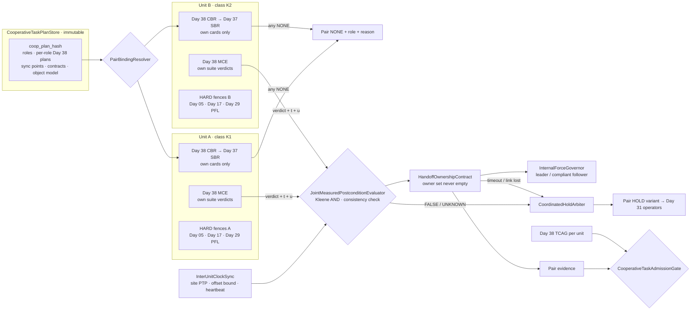
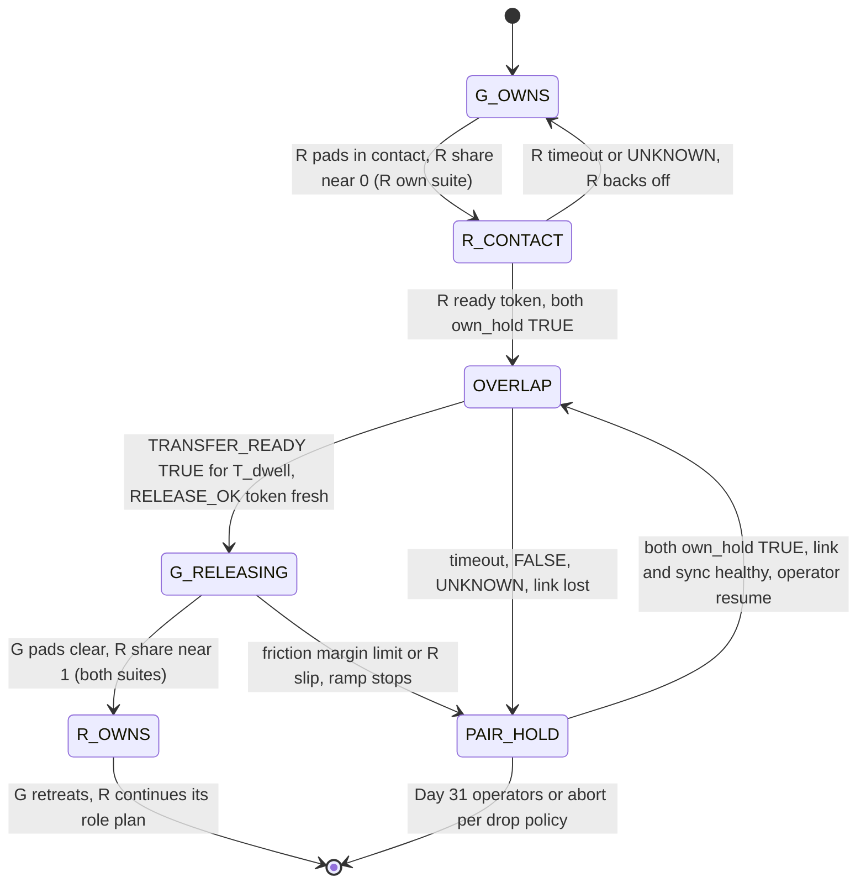
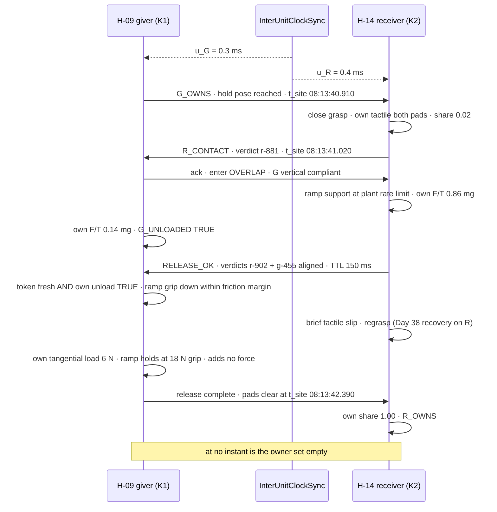
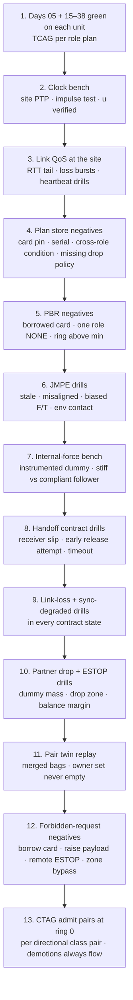

# Day 39 — Multi-unit cooperative tasks under per-unit admission: CooperativeTaskPlanStore / PairBindingResolver / InterUnitClockSync / JointMeasuredPostconditionEvaluator / HandoffOwnershipContract / InternalForceGovernor / CoordinatedHoldArbiter / CooperativeTaskAdmissionGate under TaskCompositionAdmissionGate + FleetSkillCatalogAdmissionGate + CrossEmbodimentSkillTransferAdmissionGate + DexterousSkillCaptureAdmissionGate + TelepresenceAdmissionGate + RemoteTeleopAdmissionGate + FleetSharedControlAdmissionGate + SharedControlAdmissionGate + CollaborativeWorkspaceAdmissionGate + proximity + zone attestation + supervisor + logging + canary + HIL + fleet + fleet-canary + incident + forensics/reopen + change-management + maintenance + thermal + energy gates

![CooperativeTaskPlanStore / PairBindingResolver / InterUnitClockSync / JointMeasuredPostconditionEvaluator / HandoffOwnershipContract / InternalForceGovernor / CoordinatedHoldArbiter / CooperativeTaskAdmissionGate: two humanoids of different embodiment classes share one task; each binds its own role's cards through the Day 38 CompositeBindingResolver and Day 37 SkillBindingResolver and never borrows the partner's cards or MEASURED rows; InterUnitClockSync puts both units on a site PTP timebase with a published offset bound and turns joint verdicts UNKNOWN when sync degrades; JointMeasuredPostconditionEvaluator combines each unit's own three-valued verdict with a Kleene AND and uses the wrench sum only as a consistency check that can demote but never upgrade; HandoffOwnershipContract moves load ownership from giver to receiver through an overlap window so the owner set is never empty, with a receiver token at a measured share threshold and a giver grip ramp limited by its own friction margin; InternalForceGovernor bounds squeeze in the closed kinematic chain through the object by making one unit compliant and checking internal force on both units' own F/T; CoordinatedHoldArbiter puts both units into one HOLD, with defined link-lost and partner-drop behavior; CooperativeTaskAdmissionGate fails closed under Day 38 TCAG — no cooperative task raises Day 29 PFL, writes Day 05 torque_scale, or bypasses CrossSiteZoneConfigGate](/images/day39-multi-unit-cooperative-tasks.png)

[Day 04](/lessons/day-04-bus-time-sync) owns clocks inside one robot. [Day 05](/lessons/day-05-power-bms) owns `torque_scale` **forever**. [Day 07](/lessons/day-07-wbc-balance) owns whole-body balance and [Day 09](/lessons/day-09-push-recovery) owns disturbance rejection. [Day 17](/lessons/day-17-runtime-safety-supervisor) owns ESTOP and the kill-chain, **per unit**. [Day 25](/lessons/day-25-fleet-change-management) owns ChangeSets. [Day 29](/lessons/day-29-human-proximity-safety) owns HARD PFL ceilings. [Day 30](/lessons/day-30-collaborative-workspace-zoning) owns `CrossSiteZoneConfigGate`. [Day 33](/lessons/day-33-remote-multisite-teleop-latency) owns link-latency budgets. [Day 36](/lessons/day-36-cross-embodiment-skill-transfer) owns per-unit sensor provenance. [Day 37](/lessons/day-37-fleet-skill-library) owns the catalog and `SkillBindingResolver` (SBR). [Day 38](/lessons/day-38-task-composition-catalog-skills) owns composition: `CompositeBindingResolver` (CBR) binds every step and recovery or returns NONE, `MeasuredConditionEvaluator` (MCE) judges three-valued conditions on the unit's own MEASURED signals, and `TaskCompositionAdmissionGate` (TCAG) fails closed.

Day 38 composed seven skills on **one** robot. Every condition was judged by one suite, on one clock, against one controller that owned the whole wrench on the part. Today a second robot walks into the cell. H-09 hands a 3.2 kg harness tray to H-14 across a conveyor, and later H-09 and H-21 carry a 14 kg, 1.2 m panel to a rack that neither could carry alone. The moment two units touch the same object, three things you could take for granted stop being true:

- **No single robot measures the whole object.** Each unit sees only its own grasp, through its own F/T and tactile pads, in its own frames.
- **No single clock orders the events.** "The receiver had it before the giver let go" is a claim about two clocks and a radio.
- **No single controller owns the wrench.** Two arms closed through a rigid object form a closed kinematic chain. Their position errors become internal forces that do no useful work and can crush the part, saturate a wrist, or tip a humanoid.

Six new lies show up:

1. **Partner-estimate lie.** H-09's wrist F/T sees its load drop, so the executor concludes "H-14 has it" and opens the hand. The load dropped because the tray's corner touched the conveyor rail. H-14's pads were still closing.
2. **Borrowed-card lie.** H-14 is class K2 (Hand-B, F/T rev C). The cooperative plan was developed on two K1 units, so somebody pins H-14 to the K1 `receive-tray` card "because it's the same task." That's Day 37's nearest-neighbor lie, carried across a radio link.
3. **Ownership-gap lie.** The giver releases on a timer, or on the receiver's `I_HAVE_IT` message, which was sent when the receiver *commanded* its grip, not when it *measured* the load. For 80 ms, nobody holds the tray.
4. **Shared-clock lie.** The joint postcondition compares H-09's 12:00:00.410 wrench with H-14's 12:00:00.405 wrench as if both timestamps came from the same clock. They're 37 ms apart in true time, and the "simultaneous" pair is from before and after the transfer.
5. **Squeeze lie.** Both units run stiff Cartesian position control on the panel. A 5 mm disagreement between their ideas of where the panel is becomes 50 N of internal compression. The task "succeeds." The panel's edge cracks, or H-21's wrist F/T saturates, and from then on its MEASURED rows are garbage.
6. **Solo-HOLD lie.** H-21 hits a fault and goes to Day 38 `HOLD_IN_GRASP`. H-09 keeps walking. Or H-21 is ESTOPed, its arm goes limp, and 57 N lands on H-09's hand as a step disturbance nobody planned for.

Today owns **`CooperativeTaskPlanStore` / `PairBindingResolver` / `InterUnitClockSync` / `JointMeasuredPostconditionEvaluator` / `HandoffOwnershipContract` / `InternalForceGovernor` / `CoordinatedHoldArbiter` / `CooperativeTaskAdmissionGate`**. The question is: **how do you run one task across two units where each unit binds its own role's cards through Day 38 CBR and Day 37 SBR and never borrows the partner's; where a shared-object postcondition is the conjunction of each unit's own MEASURED verdict, on a timebase whose offset is known and bounded; where load moves from one unit to the other through a two-party contract that never leaves the object unowned; where internal forces in the closed chain are bounded and measured on both sides; where the pair is exactly as admitted as its weaker unit and demotes together; and where every failure, including a dead link or a dead partner, routes both units into a defined, coordinated HOLD — without raising Day 29 PFL, writing Day 05 `torque_scale`, or bypassing `CrossSiteZoneConfigGate`?**

## A cooperative task is two admitted tasks and a contract

The series' split, applied across units:

1. **Each unit is sovereign over its own body.** A unit's cards, sensors, controllers, HARD fences, and ESTOP belong to it. Nothing the partner sends is a command to its Day 05 or Day 17 layers.
2. **Each unit testifies only about what it measured.** Shared-object state is never one unit's estimate of the other's grasp. It's each unit reporting its own MEASURED verdict, and a joint predicate over those verdicts.
3. **The contract is about the object, not the units.** It defines who holds the load at every instant, and it has no state where nobody does.
4. **The pair is as admitted as its weaker member.** Ring, lease, evidence, and availability are mins and sums across both units and both composite tuples.
5. **Failure is joint by default.** If one unit stops, the other changes behavior in a defined way, including when it can't hear its partner.

| Layer | Owns | Must not own |
|-------|------|--------------|
| Day 38 CBR / MCE / TCAG (per unit) | That unit's role plan: bound tuple, three-valued conditions, recoveries | The partner's cards or verdicts |
| `CooperativeTaskPlanStore` | Immutable cooperative plans: roles, per-role Day 38 plans, sync points, contracts, object model | Card ids; unit serials; HARD values |
| `PairBindingResolver` | Binding of every role to a unit through that unit's own CBR; pair ring, lease, evidence | Cross-unit card borrowing; partial pairs |
| `InterUnitClockSync` | Site timebase, per-unit offset bound, alignment and freshness of partner data; link heartbeat | Pretending two clocks are one |
| `JointMeasuredPostconditionEvaluator` | Joint three-valued predicates over per-unit verdicts; cross-unit consistency checks | Upgrading UNKNOWN using the partner's sensors |
| `HandoffOwnershipContract` | Owner set over time; overlap window; share thresholds; release token; timeouts | Releasing on a timer or a commanded state |
| `InternalForceGovernor` | Leader/follower compliance assignment; internal-force bound in the closed chain | Raising a unit's force ceiling to win a squeeze |
| `CoordinatedHoldArbiter` | Pair HOLD variants; link-lost and partner-drop behavior per contract state | ESTOP; the partner's kill-chain |
| `CooperativeTaskAdmissionGate` | Composed fail-closed admit of cooperative plans, pairs, and binds | `JointCommand`; ESTOP; Day 05; PFL |
| Days 05 / 07 / 17 / 29 / 30 / 31 | Torque, balance, kill-chain, PFL, zones, operator takeover, per unit | Being outranked by a partner |

**Core thesis:** a cooperative task is **two independently admitted Day 38 tasks joined by a contract about the object**. Each unit binds its own cards, judges with its own sensors, and keeps its own ceilings. The contract decides when the object changes hands, using both units' testimony on a known timebase, and it never lets the object be nobody's. The pair is never more admitted than its weaker unit, and it stops together.



## Physical machine: what changes when two robots hold one object

### Wrench sharing and the grasp matrix

Treat the object as a rigid body with mass $m$, centre of mass at $\mathbf{c}$, and two grasps at points $\mathbf{p}_A$ and $\mathbf{p}_B$, each able to apply a full wrench $\mathbf{f}_k = (\mathbf{F}_k, \boldsymbol{\tau}_k)$ (rigid power grasps: both hands closed on handles). The net wrench on the object about its CoM is

$$
\mathbf{w}_{\mathrm{obj}} = G\,\mathbf{f}, \qquad
G = \begin{bmatrix} I_3 & 0 & I_3 & 0 \\ [\mathbf{r}_A]_\times & I_3 & [\mathbf{r}_B]_\times & I_3 \end{bmatrix}, \qquad
\mathbf{r}_k = \mathbf{p}_k - \mathbf{c}
$$

with $\mathbf{f} = (\mathbf{f}_A, \mathbf{f}_B) \in \mathbb{R}^{12}$. To hold the object still, the hands must supply $\mathbf{w}_{\mathrm{obj}} = (-m\mathbf{g}, \mathbf{0})$, plus whatever accelerates it. $G$ is $6 \times 12$, so the general solution is

$$
\mathbf{f} = G^{+}\,\mathbf{w}_{\mathrm{obj}} + \big(I_{12} - G^{+}G\big)\,\boldsymbol{\lambda}
$$

The first term is the **manipulating** part. The second lives in the 6-dimensional null space of $G$: equal and opposite forces and moments that squeeze, stretch, shear, or twist the object between the hands. Those are **internal forces**. They do no work on the object's motion, so a task that only checks "panel arrived at the rack" can't see them. The object, the grasps, and both units' wrists feel all of them.

Load share in the simple vertical case: with grasps 1.2 m apart and the CoM 0.1 m toward A, statics give A the share

$$
\alpha_A = \frac{d_B}{d_A + d_B} = \frac{0.7}{1.2} \approx 0.58, \qquad
F_A \approx 0.58 \cdot 137\,\mathrm{N} \approx 80\,\mathrm{N}, \quad F_B \approx 57\,\mathrm{N}
$$

That split is a property of the object and the grasp points, not a choice. A plan that tells each unit "you carry 50%" is asking for about 11.5 N of vertical internal shear plus an uncommanded moment, and the object settles into the statics anyway, through the compliance of whichever unit gives first. The object model in the plan (mass, CoM, grasp frames, each with its own σ) predicts the shares; each unit's own F/T measures them.

### Closed kinematic chains turn position error into force

Two arms holding a rigid object form a loop: base A → arm A → object → arm B → base B → floor → base A. Each unit's controller has its own estimate of where the object is, built from its own encoders, its own base localization, and its own grasp offset. If those estimates disagree by $\delta$ along the line between the grasps, and both units are stiff, the loop closes through springs in series:

$$
f_{\mathrm{int}} = k_{\mathrm{eff}}\,\delta, \qquad
\frac{1}{k_{\mathrm{eff}}} = \frac{1}{k_A} + \frac{1}{k_{\mathrm{obj}}} + \frac{1}{k_B}
$$

With both Cartesian impedances at 20 kN/m and a stiff panel, $k_{\mathrm{eff}} \approx 10$ kN/m. A 5 mm disagreement, which is ordinary localization noise between two walking humanoids, is **50 N of squeeze**. During motion it's worse: if the follower tracks the leader's motion with a lag $\Delta t$ at speed $v$, then $\delta \approx v\,\Delta t$, and 0.3 m/s with a 15 ms lag is another 4.5 mm.

The classical cure (cooperative manipulation since the 1980s, and every pair of movers carrying a sofa) is **asymmetric impedance**: one unit leads and is stiff along the motion direction; the other follows and is deliberately compliant there, so position disagreement becomes motion of the follower's hand rather than force. With the follower at 500 N/m horizontally, the same 5 mm becomes about 2.5 N. Vertically both units must stay stiff enough to support their share, so vertical internal shear is bounded by the object model's share prediction and checked by measurement.

### Compliance, balance, and the humanoid twist

A fixed-base arm doesn't care much where its load comes from. A humanoid does: every Newton at the hand moves the ZMP. For H-09 carrying 80 N at a 0.5 m lever arm in front of the pelvis, the extra centroidal moment is about 40 N·m, which Day 07 WBC handles fine **if it knows about it**. Two physical consequences:

- **Load-share ramps are balance disturbances.** During a handoff the giver's hand load goes from 31 N to 0 and the receiver's from 0 to 31 N. If that happens in 50 ms, it's a Day 09 push. If it happens over 600 ms with each unit's own wrist F/T fed forward into its WBC as a measured external wrench, it's a slow drift the balance controller tracks. The ramp rate $\dot{F}_{\max}$ is plant policy, set by each unit's WBC bandwidth, not by the plan.
- **A partner drop is a step disturbance.** In a two-robot carry, if B's arm goes limp, A doesn't just lose a helper. The panel pivots about A's grasp, and A's hand sees a sudden wrench change as the far end swings down. A stiff A tries to catch it and gets pulled forward. The safe answer is for A to **yield downward** under vertical compliance, protecting its own balance, and let the panel's far end reach the floor. That behavior has to be designed, rehearsed, and admitted before the carry starts. You can't improvise it in 20 ms.

### Clock sync and timestamps between units

Inside a unit, Day 04 gave you EtherCAT distributed clocks with sub-microsecond skew. Between units you have a radio. Run IEEE 1588 PTP (or 802.1AS where the infrastructure supports it) from a **site grandmaster**, with each unit's clock as a slave, and treat the result honestly:

- Each unit publishes, with every sample it shares, its current offset estimate to the site timebase and an **uncertainty bound** $u_k$ from its servo (offset variance, path-delay asymmetry allowance, time since last good sync). Over a wired backhaul plus Wi-Fi with hardware timestamping, $u_k$ of tens to hundreds of microseconds is realistic; with software timestamps over Wi-Fi, low milliseconds. NTP alone gives tens of milliseconds, which isn't good enough for an ownership transfer.
- Two samples are **simultaneous** only if $|t_A - t_B| + u_A + u_B \le W_{\mathrm{align}}$ in site time.
- Partner data **age** at the consumer is $a = t_{\mathrm{now}} - t_{\mathrm{sample}} + u_{\mathrm{self}} + u_{\mathrm{partner}}$. That includes the one-way link latency $L$ automatically, because $t_{\mathrm{sample}}$ was stamped at the producer.

Why it matters physically: with a 0.3 m/s carry and a clock error $\epsilon$, joint pose comparisons are off by $v\,\epsilon$. At $\epsilon = 2$ ms that's 0.6 mm and irrelevant; at 40 ms it's 12 mm, and through a stiff loop that's 120 N of phantom disagreement. In a handoff, the receiver's load rise and the giver's load fall are only evidence of a *transfer* (rather than of the object touching something) if they line up in time within the alignment window.

### Comms latency and loss

Day 33 measured link latency as a distribution, not a number. Today the link carries verdicts, heartbeats, and contract tokens, not control. Rules of thumb:

- **No control loop closes over the radio.** Each unit runs its own impedance controller at control rate on its own sensors. The link carries setpoints only at the trajectory level (the leader's planned object path, time-stamped) and contract messages.
- **Timeouts derive from the tail.** A contract timeout must exceed the round-trip p99.9 plus the ramp time. With a measured RTT p99.9 of 28 ms and a 600 ms ramp, a 1.0 s overlap timeout is reasonable; a 100 ms one turns every jitter spike into an abort.
- **Loss is a state, not an exception.** A 100 Hz heartbeat with three consecutive misses (30 ms) declares `LINK_LOST`. Every contract state defines what each unit does alone in that case.

## CooperativeTaskPlanStore: roles, not robots

A cooperative plan names **roles** (`giver`, `receiver`; or `leader`, `follower`), not units. Each role carries its own Day 38 plan by `plan_hash`. The cooperative layer adds sync points, contracts, and the object model:

$$
\mathrm{coop\_plan\_hash} = H\big(\,\mathrm{roles} \,\Vert\, \mathrm{role\_plan\_hashes} \,\Vert\, \mathrm{sync\_points} \,\Vert\, \mathrm{contracts} \,\Vert\, \mathrm{object\_model} \,\Vert\, \mathrm{drop\_policy}\,\big)
$$

| Field | Meaning |
|-------|---------|
| `coop_plan_hash` | Content hash; any change is a new plan |
| `roles[]` | Role name, the role's Day 38 `plan_hash`, the role's allowed embodiment classes (resolved via Day 37, never pinned) |
| `sync_points[]` | Barriers between role steps: both roles reach step i's postcondition before either starts step i+1 |
| `contracts[]` | Handoff or co-carry contract per joint phase: thresholds, overlap window, timeouts, release token rule |
| `object_model` | Mass, CoM, inertia, grasp frames, each with σ; stiffness class; fragility (max internal force) |
| `drop_policy` | For every contract state and every "one unit stops" case: what the other unit does, and whether that's survivable |
| `needs` | Per role, the union of that role's step `needs` |
| `forbid` | Card ids; unit serials; PFL; `torque_scale`; local limits; zone geometry; cross-role signal references in conditions |

Rules:

- **Roles, not serials.** A plan that names `H-09` can't be re-bound when H-09 is in maintenance, and it hides whether the plan depends on that unit's quirks. Classes come from Day 37's registry at bind time.
- **A role's plan is a full Day 38 plan.** Every role step has its own measured pre- and postconditions, failure routes, and recoveries. The cooperative layer doesn't replace them; it adds barriers and contracts on top.
- **Conditions don't cross roles.** A role's postconditions may only reference that role's own MEASURED signals. Joint predicates are a separate construct (below), evaluated by the joint evaluator, and they can only combine verdicts.
- **The drop policy is mandatory.** A plan with any contract state lacking a defined single-unit behavior is refused at publish time, the same way Day 38 refused an unhandled failure kind.
- **Single-unit survivability is declared, then proven.** For every "partner stops" case, the plan states whether the remaining unit holds, yields, or lowers, and the object model plus that unit's ceilings must make that physically possible. A 14 kg panel can't be held at one end by a 9 kg-payload arm, so that plan's partner-drop behavior must be `HOLD_YIELD_DOWN`, with the drop zone attested free.

```python
from dataclasses import dataclass

FORBIDDEN_KEYS = {"card_id", "unit_serial", "pfl", "torque_scale", "local_limit",
                  "zone_geometry", "estop", "force_override", "gain_override"}
CONTRACT_STATES = {"G_OWNS", "R_CONTACT", "OVERLAP", "G_RELEASING", "R_OWNS",
                   "BOTH_GRASP", "LIFT_SHARE", "CARRY", "PLACE", "BOTH_RELEASE"}
STOP_CASES = {"LINK_LOST", "PARTNER_HOLD", "PARTNER_ESTOP", "PARTNER_DROP"}

@dataclass(frozen=True)
class Role:
    name: str              # "giver" | "receiver" | "leader" | "follower"
    plan_hash: str         # a Day 38 TaskPlan
    classes: tuple         # allowed embodiment class hashes (resolved, never pinned)

def publish_check(roles, contracts, object_model, drop_policy, raw):
    if FORBIDDEN_KEYS & set(raw):
        raise ValueError("cooperative plan carries a HARD field, card pin, or serial — refuse")
    for c in contracts:
        for st in c.states:
            if st not in CONTRACT_STATES:
                raise ValueError(f"unknown contract state {st}")
            for case in STOP_CASES:
                for role in roles:
                    if (st, case, role.name) not in drop_policy:
                        raise ValueError(f"no single-unit behavior for {role.name} in {st} on {case}")
        if c.overlap_timeout_s <= c.rtt_p999_s + c.ramp_s:
            raise ValueError("overlap timeout shorter than RTT tail + ramp")
    if object_model.max_internal_force_n is None:
        raise ValueError("object fragility unknown: internal-force bound undefined")
```

## PairBindingResolver: each unit binds its own

`PairBindingResolver` (PBR) assigns a unit to each role and asks **that unit's** Day 38 CBR to bind **that role's** plan. It never reaches across:

- **Own cards only.** H-14 (K2) binds `receive-tray` through Day 37 SBR on K2. If no K2 card exists, the role is NONE with SBR's reason and route (Day 36 transfer, Day 26 recal). H-09's K1 card is irrelevant; it was admitted against a different hand and a different F/T.
- **All roles or none.** If any role is NONE, the pair is NONE, before either unit moves. Half a handoff is a tray dangling from a hand that was never told what comes next.
- **Pair ring = min over everything.** The pair ring is the min of unit A's task ring, unit B's task ring, and the contract's own ring, where each unit's task ring is already Day 38's min over its own steps and recoveries.
- **Pair lease = min, re-checked at every sync point.** Each sync point repeats both units' Day 38 per-step hash checks. If either lease lapses, the next joint phase doesn't start, and the arbiter takes both units to HOLD.
- **Pairing is attested.** The two units exchange signed `PairBinding` records (unit id, class, suite hash, composite tuple, clock-domain id, current sync uncertainty). A unit refuses contract messages from anyone not in its current pairing.
- **The pair's identity includes both tuples.** A pair binding is `(coop_plan_hash, role → (class_hash, card_tuple), contract_version, ring)`. Day 37 promoting a new card on K2 makes a new pair composite with its own evidence.

```python
def bind_pair(coop_plan, assignment, cbr_by_unit, clock):
    bindings = {}
    for role in coop_plan.roles:
        unit = assignment[role.name]
        if unit.class_hash not in role.classes:
            return PairNone(role=role.name, reason="CLASS_NOT_ALLOWED_FOR_ROLE")
        tb = cbr_by_unit[unit.id].bind(unit, role.plan_hash)   # Day 38 CBR on THAT unit
        if tb.result == "NONE":
            return PairNone(role=role.name, step=tb.none_step, reason=tb.none_reason, route=tb.route)
        bindings[role.name] = tb
    if not clock.pair_sync_ok(assignment.values()):
        return PairNone(role=None, reason="CLOCK_SYNC_UNHEALTHY")
    return PairBound(coop_plan_hash=coop_plan.hash,
                     roles={r: (b.embodiment_class_hash, b.card_tuple) for r, b in bindings.items()},
                     ring=min([b.ring for b in bindings.values()] + [coop_plan.contract_ring]),
                     lease_ttl_s=min(b.lease_ttl_s for b in bindings.values()))
```

**Pair evidence.** Day 38 bounded a task's failure by the sum of its step bounds. A cooperative task adds the contract itself as a failure source (a handoff that dropped the tray even though both units' steps were fine):

$$
p^{\mathrm{pair}}_{\mathrm{upper}} = \min\!\Big(\ p^{A,\mathrm{task}}_{\mathrm{upper}} + p^{B,\mathrm{task}}_{\mathrm{upper}} + p^{\mathrm{contract}}_{\mathrm{upper}},\ \ p^{\mathrm{e2e}}_{\mathrm{upper}}(n_{\mathrm{pair}}, f_{\mathrm{pair}})\ \Big)
$$

Again the union bound needs no independence, which matters, because cooperative failures are maximally correlated: one bad localization hurts both units at once. The contract term starts at the rule-of-three bound from HIL trials of the contract on an instrumented dummy object. A pair's end-to-end evidence is keyed by the **directional class pair**, so K1→K2 handoffs and K2→K1 handoffs are different composites (the giver and receiver skills are different cards). **Any demotion of any card in either tuple, or of the contract, demotes the pair at once.** New binds go NONE, and running pairs finish the current joint phase only if that's safer than stopping (per the drop policy), then HOLD together.

## InterUnitClockSync: one timebase, honestly bounded

`InterUnitClockSync` (IUCS) owns the site timebase as seen by cooperative tasks:

- **Site grandmaster, per-unit servo.** Every unit is a PTP slave to the site grandmaster. Each unit's Day 04 internal clock domain is disciplined to it, so a sample stamped by the wrist F/T's EtherCAT DC time can be expressed in site time with a known error.
- **Published uncertainty.** Each unit publishes $u_k(t)$ alongside its offset. $u_k$ grows with time since the last good sync exchange (holdover: a 20 ppm oscillator drifts 20 µs per second unsynced) and with measured path-delay variance.
- **Health is a gate input.** If $u_A + u_B \gt W_{\mathrm{align}}/2$, IUCS reports `SYNC_DEGRADED`, and every joint verdict that depends on alignment becomes UNKNOWN. You don't start an ownership transfer on a timebase you can't trust; you HOLD and wait for sync to recover.
- **Freshness uses site time.** A partner's verdict is fresh only if its age, as defined above, is under the joint predicate's `max_age_ms`. The receiver's "load ≥ 0.8 mg" verdict from 120 ms ago is not evidence of now.
- **Heartbeat is separate from sync.** Each unit sends a heartbeat every 10 ms carrying its sequence number, its contract state, its last verdict ids, and its supervisor stage. Three misses is `LINK_LOST`. Heartbeats arriving with sane sequence numbers but degraded $u$ is `SYNC_DEGRADED`, not `LINK_LOST`; the two have different HOLD behaviors.

```python
def aligned(sample_a, sample_b, w_align_ms):
    """Two samples from different units are simultaneous only within their combined uncertainty."""
    dt = abs(sample_a.t_site_ms - sample_b.t_site_ms)
    return dt + sample_a.u_ms + sample_b.u_ms <= w_align_ms

def partner_fresh(sample, now_site_ms, u_self_ms, max_age_ms):
    age = now_site_ms - sample.t_site_ms + u_self_ms + sample.u_ms
    return age <= max_age_ms

def sync_health(u_a_ms, u_b_ms, w_align_ms):
    return "OK" if (u_a_ms + u_b_ms) <= w_align_ms / 2 else "SYNC_DEGRADED"
```

How you verify the timebase physically is the most useful bench test of the day: clamp a rigid steel bar between the two units' grippers, strike it once with an instrumented hammer, and compare when each unit's wrist F/T saw the impulse, in site time. The impulse crosses a metre of steel in about 0.2 ms, so any larger difference is clock error plus each F/T's internal filter delay (which you calibrate separately per suite, Day 36). Do it a hundred times across a shift and you have the measured distribution of $\epsilon$, which must sit inside the published $u$.

## JointMeasuredPostconditionEvaluator: two witnesses, no hearsay

Each unit's Day 38 MCE produces its own verdict on its own suite: `TRUE`, `FALSE`, or `UNKNOWN`, with $\hat{x}$, σ, age, and `producing_suite_hash`. `JointMeasuredPostconditionEvaluator` (JMPE) combines them. It never reads the partner's raw sensor values to form its own unit's verdict, and it never borrows the partner's MEASURED rows.

**Combination is a Kleene AND on aligned, fresh verdicts:**

| A verdict | B verdict | Joint |
|-----------|-----------|-------|
| TRUE | TRUE | TRUE (if aligned and both fresh) |
| FALSE | any | FALSE |
| any | FALSE | FALSE |
| otherwise | otherwise | UNKNOWN |

Misalignment or staleness turns a would-be TRUE into UNKNOWN, never into TRUE.

**Consistency checks can only demote.** Both units' measurements of the same object must obey physics. In a static hold, the vertical forces must sum to the object's weight:

$$
r = \big(F^{z}_A + F^{z}_B\big) - m g, \qquad
\sigma_r = \sqrt{\sigma_A^2 + \sigma_B^2 + (g\,\sigma_m)^2}
$$

If $|r| \gt k\,\sigma_r$, something is lying: one F/T has drifted, the object is touching the environment, or the object model is wrong. JMPE turns the joint verdict UNKNOWN and names the residual. It doesn't decide which unit is right, and it never uses B's reading to "correct" A's; that would be cross-suite MEASURED reuse wearing a lab coat. Similarly, internal force estimated from each unit's own F/T projected onto the grasp line must agree in sign (equal and opposite) and roughly in magnitude. Disagreement is UNKNOWN, not an average.

**What "the object is held by B" means.** For the handoff, the receiver's role postcondition `R_HOLDS` is B's own predicate: both pads in contact on B's tactile array, B's grip current in band, B's wrist F/T showing a vertical load of at least $\alpha_{\mathrm{in}} \cdot m g$ for $T_{\mathrm{dwell}}$, object pose relative to B's hand stable. The giver's `G_UNLOADED` is A's own predicate: A's F/T vertical load at most $(1 - \alpha_{\mathrm{in}}) \cdot m g$. The joint predicate `TRANSFER_READY` is `R_HOLDS ∧ G_UNLOADED`, aligned, plus the sum check. A's load dropping, alone, is just `G_UNLOADED`. It's half the evidence, and it's exactly what you'd also see if the tray hit the rail.

```python
def kleene_and(a, b):
    if a == "FALSE" or b == "FALSE":
        return "FALSE"
    if a == "TRUE" and b == "TRUE":
        return "TRUE"
    return "UNKNOWN"

def joint_verdict(va, vb, now, clock, w_align_ms, max_age_ms, consistency=None):
    if not (clock.partner_fresh(va, now, max_age_ms) and clock.partner_fresh(vb, now, max_age_ms)):
        return Joint("UNKNOWN", reason="STALE")
    if not clock.aligned(va, vb, w_align_ms):
        return Joint("UNKNOWN", reason="MISALIGNED")
    assert va.producing_suite_hash != vb.producing_suite_hash   # two witnesses, two suites
    j = kleene_and(va.verdict, vb.verdict)
    if j == "TRUE" and consistency is not None and not consistency.ok(va, vb):
        return Joint("UNKNOWN", reason="CONSISTENCY_RESIDUAL", residual=consistency.r)  # demote only
    return Joint(j)
```

## HandoffOwnershipContract: the owner set is never empty

The contract is a small state machine that both units run as mirrored copies through the joint phases. Its central invariant is about the object:

$$
\forall t:\ \ \mathcal{O}(t) \neq \varnothing, \qquad
\mathcal{O}(t) = \big\{\, k \in \{G, R\} \ :\ \mathrm{own\_hold}_k(t) = \mathrm{TRUE} \,\big\}
$$

where $\mathrm{own\_hold}_k$ is unit $k$'s own MEASURED verdict that its grasp alone could support the object with margin. Ownership moves from giver only, to both, to receiver only. It never jumps straight from giver to receiver, and it never passes through "nobody."

| State | Owners | Entry condition (MEASURED) | What each unit does | Exit |
|-------|--------|-----------------------------|---------------------|------|
| `G_OWNS` | G | G `own_hold` TRUE | G holds still at handoff pose; R approaches | R pads in contact, R share ≈ 0 → `R_CONTACT` |
| `R_CONTACT` | G | R grasp closed, R `own_hold` capacity TRUE at zero load | G holds; R stiffens vertically, does not lift | R ready token → `OVERLAP` |
| `OVERLAP` | G + R | Both `own_hold` TRUE | R ramps its vertical support at plant rate limit; G keeps grip and goes vertically compliant so load flows to R | `TRANSFER_READY` TRUE for T_dwell → R sends release token |
| `G_RELEASING` | G + R | Token received; G verifies `G_UNLOADED` on its own F/T | G ramps grip down in steps, each only if its own friction margin holds | G pads clear, R share ≈ 1 → `R_OWNS` |
| `R_OWNS` | R | R `own_hold` TRUE, G no contact | R continues its role plan; G retreats | Done |

**The release token.** The receiver sends `RELEASE_OK` only when its own `R_HOLDS` has been TRUE for $T_{\mathrm{dwell}}$ (say 200 ms) and `TRANSFER_READY` is TRUE on aligned verdicts. The token carries the verdict ids, their site timestamps, and B's suite hash, and it expires after a short TTL (say 150 ms). The giver acts on the token **and** its own `G_UNLOADED`, re-checked locally at control rate. A token without local unload doesn't release; local unload without a token doesn't release.

**The giver's grip ramp is bounded by its own friction margin.** For a friction grasp with coefficient $\mu$ (from A's own calibration, with σ) and measured tangential load $f_t$ on A's own sensors, A may step its grip force down to $F_{\mathrm{grip}}^{\mathrm{next}}$ only while

$$
\mu_{\mathrm{low}}\,F_{\mathrm{grip}}^{\mathrm{next}} \;\ge\; s\,\big|f_t\big|, \qquad \mu_{\mathrm{low}} = \hat{\mu} - k\,\sigma_\mu, \quad s \ge 1.5
$$

So if the receiver starts slipping mid-release and A's tangential load comes back, A's ramp simply stops at a grip that still holds A's measured share. It doesn't add force (Day 38's handoff guard rule still holds); it stops removing it. That's the physical form of "no gap": the giver is never at a grip that can't hold what its own sensors say it's carrying.

**Timeouts and faults by state:**

| State | Timeout / FALSE / UNKNOWN | `LINK_LOST` | Partner ESTOP or drop |
|-------|---------------------------|-------------|-----------------------|
| `G_OWNS`, `R_CONTACT` | R opens and backs off; G keeps holding | Same: G holds, R backs off (R never took load) | G holds (it owns); R's Day 17 does what it does |
| `OVERLAP` | Both freeze, `HOLD_PAIR_SHARED`; nobody releases | Both hold their measured share; G never releases without a fresh token; R never pulls | Survivor holds if its `own_hold` is TRUE; else `HOLD_YIELD_DOWN` |
| `G_RELEASING` | G stops ramp at current grip; both freeze | G stops ramp, holds; R holds | If R drops: G's ramp stops at once on its own F/T; G re-owns only if `own_hold` is still TRUE |
| `R_OWNS` | Normal Day 38 recovery on R | R holds; G clear | G irrelevant; R's own task logic |





## InternalForceGovernor: who complies, and how much squeeze is allowed

For co-carry phases (`BOTH_GRASP` → `LIFT_SHARE` → `CARRY` → `PLACE` → `BOTH_RELEASE`), `InternalForceGovernor` (IFG) decides the impedance structure and enforces a bound on internal force. It doesn't change gains inside the controllers; it **selects** between admitted controller modes that each unit's cards already contain.

- **One leader, one compliant follower, per axis.** The leader tracks the planned object trajectory (time-stamped in site time). The follower is stiff vertically (to carry its share) and compliant horizontally and in yaw, so loop-closure errors become follower hand motion. The assignment is in the plan and must match modes that both units' cards are admitted for; a unit whose card has no admitted compliant mode can't take the follower role.
- **Bounded internal force, measured on both sides.** Each unit estimates the internal component from its own F/T after removing its predicted share, projected on the grasp line $\mathbf{n}$: $\hat{f}^{\mathrm{int}}_k = \mathbf{n}^{\top}(\mathbf{F}_k - \alpha_k\,m\,\mathbf{g})$. The governor requires both magnitudes below the object's fragility bound and each unit's own envelope, with the JMPE consistency rule (opposite signs, similar magnitude).
- **Over the bound, slow down or stop; never push back.** If internal force grows, the leader slows its trajectory (reducing $v\,\Delta t$) and, past a second threshold, the pair goes to `HOLD_PAIR_SHARED`. Neither unit is allowed to "win" by increasing stiffness or force, and nothing raises a local limit to make a squeeze fit.
- **Trajectory, not control, over the link.** The leader publishes its planned object pose trajectory ahead of time with site timestamps; the follower interpolates locally. If the link stalls, the follower's local controller still holds pose under compliance. It doesn't extrapolate the leader's motion beyond a short, plan-bounded horizon.
- **Each unit's WBC sees its own measured hand wrench.** That's Day 07 and Day 11 again: the external wrench from the object enters each unit's balance controller as a measured disturbance, fed forward from its own F/T, never from the partner's estimate of what this unit is carrying.

```python
def internal_force_check(ft_a, ft_b, alpha_a, m, g_vec, n, f_max_obj, env_a, env_b, k_sigma):
    fa = n @ (ft_a.F - alpha_a * m * g_vec)
    fb = n @ (ft_b.F - (1 - alpha_a) * m * g_vec)
    if fa * fb > 0 and abs(fa) > k_sigma * ft_a.sigma and abs(fb) > k_sigma * ft_b.sigma:
        return "UNKNOWN"                        # internal forces must be equal and opposite
    worst = max(abs(fa), abs(fb))
    bound = min(f_max_obj, env_a, env_b)
    if worst > bound:
        return "HOLD"                           # pair HOLD; never stiffen to win
    if worst > 0.6 * bound:
        return "SLOW"                           # leader reduces speed
    return "OK"
```

## CoordinatedHoldArbiter: one HOLD for two bodies

Day 38's HOLD variants were contact-aware for one unit. `CoordinatedHoldArbiter` (CHA) chooses a **pair** HOLD from the contract state, both units' MEASURED contact state, and the link state:

| Situation | Pair HOLD variant | Each unit |
|-----------|-------------------|-----------|
| Link up, fault in a joint phase | `HOLD_PAIR_SHARED` | Freeze references; keep measured share and grip; follower stays compliant horizontally; nobody releases |
| Link up, hold dwell too long or energy / thermal budget falling | `HOLD_PAIR_LOWER` | Synchronized slow lower to a declared rest surface, leader-led, follower compliant; release only after both measure load on the surface |
| `LINK_LOST` | `HOLD_SOLO_LINKLOST` | Each unit independently: hold current measured share, freeze pose, compliant in horizontal and yaw, no release, no lift; after a timer, local lower only if the plan declares it safe |
| Partner drops its end (own F/T sees a sudden load change, or partner reports ESTOP) | `HOLD_YIELD_DOWN` | Vertical compliance at the hand; let the object pivot to the floor along a bounded path; WBC prioritizes own balance; never try to catch more than own `own_hold` capacity |
| Contact or ownership UNKNOWN | `HOLD_PAIR_COMPLIANT` | Each unit to its lowest-stiffness admitted mode that still supports its measured share; wait for operators |

Rules:

- **Joint by default.** When either unit enters a HOLD during a joint phase, its heartbeat carries it, and the partner enters the matching pair HOLD at its next condition tick. No unit continues a joint phase alone.
- **Local detection beats the radio.** A partner drop shows up on this unit's own F/T within a control period, long before a heartbeat timeout. CHA arms a local load-step detector on every joint phase: a measured hand-load change faster than the plan's ramp limit means `PARTNER_DROP`, whatever the link says.
- **The partner's ESTOP is an input, not a write.** Day 17 owns each unit's kill-chain. A peer ESTOP message makes CHA choose `HOLD_YIELD_DOWN` or `HOLD_SOLO_LINKLOST` on this unit. It never trips this unit's ESTOP, and this unit never clears or overrides the partner's. A site-level stop (a Day 30 zone stop) reaches both units through their own Day 17 paths.
- **ESTOP behavior is part of the drop policy.** If B's stop category drops its arm (STO without brakes), the plan has to account for it: either B's arm joints have holding brakes that engage on stop (a category 1 stop into brakes), or the drop is declared and A's `HOLD_YIELD_DOWN` plus an attested drop zone makes it survivable. "We hope B doesn't ESTOP while carrying" is not a drop policy.
- **Operators take over both.** Operator takeover for a pair is a Day 32 multi-operator session with one operator per unit, or one operator with a pair-level interface. Either way, each receives the unit's last measured wrench, share, contract state, and the partner's last verdicts with their age.
- **HOLD is not ESTOP**, still. Every pair HOLD runs under each unit's HARD fences.

## CooperativeTaskAdmissionGate: cooperation

`CooperativeTaskAdmissionGate` (CTAG) admits cooperative plan publication, pair promotion, and per-pair binding. It fails closed unless:

- Day 38 TCAG GREEN for each role's plan on the bound unit's class, including every step and recovery card (and therefore Day 37 FSCAG and Days 35/36 underneath)
- Plan integrity: immutable, hash verifies, no card pins, no serials, no HARD fields, no cross-role signal references in role conditions
- Drop policy complete for every (contract state, stop case, role), and single-unit survivability shown for each: the remaining unit's `own_hold` capacity, its balance margin under the resulting wrench, and an attested drop zone wherever the policy is to yield
- PBR bound every role on its own unit, through its own CBR; pair ring ≤ min of both task rings and the contract ring; lease = min
- IUCS healthy on both units, with the impulse-test (or equivalent) measured offset distribution inside the published $u$; $W_{\mathrm{align}}$ and freshness bounds set
- Link QoS within contract: RTT p99.9 and loss measured at the site, under load, with overlap timeouts above RTT tail + ramp
- Internal-force bound defined from object fragility and both units' envelopes; follower role bound only to a card with an admitted compliant mode
- Each role's `needs` within that unit's plant ceilings (read-only against local limit and Day 29 PFL); no ceiling raised to make a pair fit
- Twin / HIL GREEN on the **pair**: twin of both units, the object, and the link, with injected clock offset, link loss in each contract state, receiver slip, giver early-release attempt, partner drop, and partner ESTOP (Days 15 and 20)
- Days 22–28 admits GREEN for both units; no open Day 23 incident or Day 26 recalibration on either
- `CrossSiteZoneConfigGate` GREEN; zones for both units' paths and the drop zone attested at the current `map_version`; Day 29 proximity active on both (a person between two units holding a panel is in a pinch point that neither unit owns alone)
- Day 17 supervisors armed and ESTOP paired on both units; Day 31/32 operator path available for a pair

DEMOTE of a pair composite needs one authenticated signal (any card demotion in either tuple, a contract failure, an incident, an ESTOP or `PARTNER_DROP` during a joint phase). **Demotions always flow.** CTAG never publishes `JointCommand`, never clears ESTOP on either unit, never writes Day 05, never raises PFL.

## Digital twin: two units, one object, one link

The twin for a cooperative task is three models and a channel:

- **Unit A and unit B**, each with its own embodiment class, its own sensor suite model (Day 36 σ, filter delays, saturation), and its own controllers at their admitted modes.
- **The object** as a rigid body (or a flexible one, if the plan's stiffness class says so) with mass, CoM, and inertia drawn from the object model's σ, contact with both hands, and contact with the environment (rails, rack, floor).
- **The link** with Day 33's measured latency distribution and loss bursts, and a clock model per unit (offset, drift, servo, holdover).

What the twin is for:

1. **Contract verification.** Enumerate the contract state machine against every injected fault and check the no-empty-owner invariant on the twin's *ground-truth* grasp forces, not on the units' verdicts. If the twin ever finds an interval where neither simulated grasp could hold the object, the contract is wrong, whatever the units believed.
2. **Internal-force sweeps.** Sweep localization error, follower stiffness, and trajectory speed; plot peak internal force; set the governor's SLOW and HOLD thresholds with margin.
3. **Drop rehearsal.** Simulate partner drop at every phase and check the survivor's balance margin (Day 07 centroidal / ZMP), the object's path, and that it lands in the attested drop zone.
4. **Pair replay.** After every real run, merge both units' bags on site time using each sample's timestamp and $u$, and replay JMPE and the contract from the bagged verdicts. The merged replay must reproduce every joint verdict and every state transition both units took. A transition that needs data from a bag that wasn't there, or that only reproduces if you ignore $u$, is a hidden-state bug.

Twin outputs stay labeled SIM. A twin run never contributes MEASURED rows to either unit's evidence (Day 36's `SimToRealContactHonestyBridge` still applies), and the contract's failure bound is only promoted on HIL and real trials.

## A worked shift

**Handoff.** Plan `handoff-tray@2.0.0`: role `giver` (allowed K1, K2), role `receiver` (allowed K1, K2). Object: harness tray, $m = 3.2 \pm 0.1$ kg ($mg \approx 31$ N), friction grasp with $\hat{\mu} = 0.6 \pm 0.05$ on H-09's pads, so $\mu_{\mathrm{low}} = 0.5$ at $k = 2$. $\alpha_{\mathrm{in}} = 0.8$, $T_{\mathrm{dwell}} = 200$ ms, overlap timeout 1.0 s, $W_{\mathrm{align}} = 4$ ms, measured RTT p99.9 = 28 ms.

| Role | Unit | Class | Day 38 task ring | Cards (own class) |
|------|------|-------|------------------|-------------------|
| giver | H-09 | K1 | 2 | `present-tray` c-80, `release-to-partner` c-82 |
| receiver | H-14 | K2 | 1 | `receive-tray` k-31, `carry-tray` k-14 |

Contract ring (from HIL on the instrumented tray): 1. Pair ring = min(2, 1, 1) = **1**.

**Co-carry.** Plan `carry-panel@1.1.0`: `leader` H-09 (K1), `follower` H-21 (K1). Panel 14 kg ($mg \approx 137$ N), grasps 1.2 m apart, CoM 0.1 m toward the leader: predicted shares 80 N / 57 N. Fragility bound 40 N internal. Follower horizontal stiffness 500 N/m. Drop policy for partner drop: `HOLD_YIELD_DOWN` (each arm's admitted payload is 9 kg, so neither can hold the panel alone), drop zone attested under the carry path.

| Time | Event | MEASURED / HARD | Component action | Result |
|------|-------|-----------------|------------------|--------|
| 08:10 | Bind `handoff-tray` with H-14 as receiver | — | PBR: H-14's own CBR on K2 → k-31, k-14 BOUND | Pair ring 1 |
| 08:10 | Someone proposes pinning H-14 to K1 card c-31, "same task" | — | Plan has no card field; PBR binds through H-14's CBR only | Refused; bagged |
| 08:12:04 | R contact, both pads | H-14 tactile | `R_CONTACT`, share 0.02 | `OVERLAP` |
| 08:12:05 | H-09 load drops to 0.4 mg; H-14 at 0.35 mg | Both F/T | `TRANSFER_READY` FALSE (R below 0.8); no token | G keeps grip |
| 08:12:05 | Sum is 0.75 mg: tray corner resting on the conveyor rail | Residual 0.25 mg, above 3σ_r | JMPE: UNKNOWN `CONSISTENCY_RESIDUAL` | `HOLD_PAIR_SHARED`; re-present after operator clears |
| 08:13:41 | Retry: R at 0.86 mg for 200 ms, G at 0.14 mg, aligned within 1.2 ms | Both suites | `RELEASE_OK` token; G re-checks own unload | `G_RELEASING` |
| 08:13:42 | Mid-release, R tactile slip; G tangential load rises to 6 N | H-09 F/T | G ramp stops at 18 N grip (0.5 × 18 = 9 ≥ 1.5 × 6) | No drop; R runs `regrasp` (Day 38 recovery on R) |
| 08:13:42 | R `own_hold` TRUE again | H-14 | Ramp resumes; G pads clear | `R_OWNS` |
| 09:30 | Site AP reboots during `OVERLAP` | 3 heartbeats missed | `LINK_LOST` → `HOLD_SOLO_LINKLOST` on both | G holds, R holds, nobody releases |
| 09:31 | Link back; u_A + u_B = 3.1 ms (holdover) | IUCS | `SYNC_DEGRADED`; joint verdicts UNKNOWN | Stay in HOLD 6 s until u reconverges, then resume |
| 10:05 | Carry: localization disagreement grows to 6 mm at a doorway | Internal +3.1 N / −2.9 N on the two F/T | IFG OK (follower compliant, equal and opposite) | Carry continues |
| 10:06 | A K2 unit is proposed as follower; its card has no admitted compliant mode | — | PBR: follower role NONE `MODE_NOT_ADMITTED` | Pair NONE for that unit |
| 10:20 | H-21 ESTOP mid-carry (zone breach on its side) | Day 17 on H-21; H-09 F/T load step 45 N in 15 ms | H-09 CHA: `PARTNER_DROP` from its own F/T before any heartbeat timeout → `HOLD_YIELD_DOWN` | Far end reaches floor in drop zone; H-09 balance margin held; Day 23 ticket; pair DEMOTE |
| 10:21 | Request: "raise H-09's payload limit so it can catch the panel next time" | Day 29 / local limit | CTAG refuses; ceilings aren't plan parameters | Drop policy stays yield-down |
| 11:00 | Day 37 DEMOTE k-31 on K2 | Ledger | Every pair with k-31 demoted at once | New handoffs to K2 receivers NONE |

## Ownership conflicts

| Conflict | Winner | Behavior |
|----------|--------|----------|
| Giver's load drop vs receiver's own grasp verdict | JMPE | Joint needs both; one side's drop is half the evidence |
| "Same task" vs the partner class's own card | PBR | Each unit binds through its own CBR; no borrowing |
| Receiver's `I_HAVE_IT` message vs measured share | Contract | Token only on MEASURED `R_HOLDS` for T_dwell |
| Release timer vs owner set | Contract | No timer releases; owner set never empty |
| Two timestamps vs their uncertainty | IUCS | Aligned only within u_A + u_B; else UNKNOWN |
| Sum check vs one unit's TRUE | JMPE | Residual demotes to UNKNOWN; never picks a winner |
| Stiff leader vs stiff follower | IFG | Follower compliant; over bound → slow, then pair HOLD |
| One unit in HOLD vs the other continuing | CHA | Pair HOLD at the next tick |
| Partner ESTOP vs this unit's kill-chain | Each unit's Day 17 | Input to CHA only; never a remote ESTOP write |
| Partner drop vs "catch it" | CHA / plant | Yield within own ceilings; never raise payload to catch |
| Pair ring vs stronger unit's ring | PBR / evidence | Pair ring = min |
| Cooperative anything vs `CrossSiteZoneConfigGate` | Day 30 | Refused for that site |

## Shared API

The plan store, PBR, pair evidence, and CTAG run on the fleet admission path. IUCS runs on each unit plus the site grandmaster. JMPE, the contract, IFG, and CHA run **on each unit** as mirrored state machines at condition rate, exchanging verdicts and tokens over the link; neither unit is the other's master for anything below the trajectory level. Controllers and HARD fences stay local at control rate.

```text
BusHeader:
  t_mono
  seq
  clock_domain
  t_site                   # InterUnitClockSync site time
  u_site_ms                # published offset uncertainty
  age_ms
  producer_id

CooperativePlan:                             # CooperativeTaskPlanStore (immutable)
  coop_plan_hash
  task_id, task_version
  roles[]:
    name                   # giver | receiver | leader | follower
    plan_hash              # Day 38 TaskPlan
    allowed_classes[]      # resolved via Day 37, never pinned
  sync_points[]
  contracts[]:
    kind                   # HANDOFF | CO_CARRY
    states[]
    alpha_in, t_dwell_ms, token_ttl_ms
    overlap_timeout_s, ramp_s, rtt_p999_s
    w_align_ms, max_age_ms
    f_internal_max_n
    leader_role, follower_role, follower_compliant_axes[]
  object_model:
    mass_kg, sigma_mass_kg, com, sigma_com, inertia
    grasp_frames[], mu_hat, sigma_mu
    stiffness_class, fragility_internal_n
  drop_policy[]:           # (state, stop_case, role) → HOLD variant + survivability proof ref
  forbid:
    card_pin: true
    unit_serial: true
    hard_owner_fields: true
    cross_role_condition: true

PairBinding ⊇ BusHeader:                     # PairBindingResolver
  coop_plan_hash
  result                   # BOUND | NONE
  none_role, none_step, none_reason, route
  roles:                   # role → (unit_id, class_hash, suite_hash, card_tuple)
  ring                     # min(task rings, contract ring)
  lease_ttl_s              # min
  pairing_signature
  forbid:
    cross_unit_card: true
    partial_pair: true

ClockState ⊇ BusHeader:                      # InterUnitClockSync
  grandmaster_id
  offset_ns, u_ns, holdover_s
  health                   # OK | SYNC_DEGRADED
Heartbeat ⊇ BusHeader:
  contract_state, last_verdict_ids[], supervisor_stage
  link_state               # UP | LINK_LOST (3 misses)

JointVerdict ⊇ BusHeader:                    # JointMeasuredPostconditionEvaluator
  predicate                # TRANSFER_READY | BOTH_HOLD | PLACED | ...
  verdict_a, verdict_b     # each unit's own Day 38 ConditionVerdict id
  suite_hash_a, suite_hash_b   # must differ; never cross-suite reuse
  aligned, fresh
  consistency_residual, sigma_r
  joint                    # TRUE | FALSE | UNKNOWN
  reason                   # STALE | MISALIGNED | CONSISTENCY_RESIDUAL | ...
  forbid:
    upgrade_from_partner: true
    average_across_suites: true

OwnershipState ⊇ BusHeader:                  # HandoffOwnershipContract
  state                    # G_OWNS | R_CONTACT | OVERLAP | G_RELEASING | R_OWNS | PAIR_HOLD
  owner_set                # never empty
  own_hold_self            # this unit's MEASURED verdict
  release_token            # id, verdict ids, t_site, ttl, receiver suite hash
  grip_ramp:
    f_grip_now, f_grip_next, mu_low, f_t_meas, margin_s
  forbid:
    release_on_timer: true
    release_on_commanded_state: true
    release_without_local_unload: true
    empty_owner_set: true

InternalForce ⊇ BusHeader:                   # InternalForceGovernor
  f_int_self, sigma
  f_int_partner_reported   # partner's own estimate, consistency only
  bound_n, status          # OK | SLOW | HOLD | UNKNOWN
  impedance_mode           # admitted mode id: LEADER_STIFF | FOLLOWER_COMPLIANT
  forbid:
    stiffen_to_win: true
    raise_local_limit: true
    control_loop_over_link: true

PairHold ⊇ BusHeader:                        # CoordinatedHoldArbiter
  variant                  # HOLD_PAIR_SHARED | HOLD_PAIR_LOWER | HOLD_SOLO_LINKLOST | HOLD_YIELD_DOWN | HOLD_PAIR_COMPLIANT
  trigger                  # FAULT | LINK_LOST | SYNC_DEGRADED | PARTNER_HOLD | PARTNER_ESTOP | PARTNER_DROP
  detected_by              # OWN_FT | HEARTBEAT | PARTNER_MSG
  forbid:
    remote_estop_write: true
    solo_continue_joint_phase: true
    catch_beyond_own_hold: true

CooperativeTaskAdmissionGate ⊇ BusHeader:
  fail_closed: true
  soft_admit_blocker_only: true
  status                   # RED | YELLOW | GREEN
  require:
    task_composition_admission_green_per_role: true   # Day 38 TCAG on each unit
    plan_integrity: true
    drop_policy_complete: true
    single_unit_survivability: true
    pair_bound_own_cbr_each: true
    ring_le_min_units_and_contract: true
    clock_sync_healthy_and_verified: true
    link_qos_within_contract: true
    internal_force_bound_defined: true
    needs_within_plant_ceilings_each_unit: true
    twin_hil_pair_with_injected_faults_green: true    # Days 15 / 20
    fleet_canary_gate_green: true                     # Day 22
    no_open_incident_either_unit: true                # Day 23
    canary_reopen_gate_green: true                    # Day 24
    no_open_recalibration_either_unit: true           # Day 26
    thermal_admission_gate_green: true                # Day 27
    energy_admission_gate_green: true                 # Day 28
    human_safety_admission_green_both: true           # Day 29
    cross_site_zone_config_green: true                # Day 30, incl. drop zone
    operator_path_available_pair: true                # Days 31 / 32
    supervisor_armed_both: true
    estop_pairing_both: true
    day05_binding_both: true
  blocks: promotions_and_binds_only
  forbid:
    joint_command: true
    dual_write_torque_scale: true
    clear_supervisor_stage: true
    write_estop: true
    raise_pfl_from_task: true
    bypass_cross_site_zone_config_gate: true
    write_hard_safety_changeset: true
    cross_suite_measured_reuse: true
    cross_unit_card_borrowing: true

# Unchanged owners
TaskCompositionAdmissionGate · CompositeBindingResolver · MeasuredConditionEvaluator (Day 38)
FleetSkillCatalogAdmissionGate · SkillBindingResolver · CatalogChangeLedger (Day 37)
CrossEmbodimentSkillTransferAdmissionGate · EmbodimentSensorProvenanceRegistry (Day 36)
DexterousSkillCaptureAdmissionGate (Day 35) · SharedControlAdmissionGate (Day 31)
CollaborativeWorkspaceAdmissionGate · CrossSiteZoneConfigGate (Day 30) · HumanSafetyAdmissionGate (Day 29)
SupervisorState (Day 17, per unit): ESTOP · kill-chain · stage · monitors
BmsState / PowerState (Day 05, per unit): torque_scale · contactor · UVLO · STO
  accepts_requests_from_soft_layer: false
  accepts_requests_from_partner_unit: false
```

## Config

A starting configuration for this series. Every number is a policy you re-derive from your own cell, objects, and radio, not a literature constant:

```yaml
cooperative_tasks:
  plan_store:
    coop_plan_hash: sha256(roles, role_plans, sync_points, contracts, object_model, drop_policy)
    immutable: true
    roles_not_serials: true
    card_pins: false
    forbid_fields: [card_id, unit_serial, pfl, torque_scale, local_limit, zone_geometry, estop, force_override, gain_override]
    cross_role_conditions: refuse_publish
    drop_policy_incomplete: refuse_publish
    single_unit_survivability: required
  pair_binding:
    bind_via: day38_cbr_per_unit
    cross_unit_card_borrowing: forbidden
    all_roles_or_none: true
    ring: min(task_ring_a, task_ring_b, contract_ring)
    lease: min
    recheck_at: every_sync_point
    pairing: signed
  evidence:
    key: [coop_plan_hash, directional_class_pair, card_tuples, contract_version]
    bound: union(task_a, task_b, contract)
    composite: clopper_pearson       # rule of three when failures == 0
    demote_on_any_card_or_contract_demote: immediate
  clock:
    source: site_ptp_grandmaster
    hardware_timestamping: required
    w_align_ms: 4
    sync_degraded_when: u_a + u_b > w_align / 2
    on_degraded: joint_verdicts_unknown
    verify: impulse_test_per_pair_per_site
    heartbeat_hz: 100
    link_lost_after_misses: 3
  joint_evaluator:
    combine: kleene_and
    stale_or_misaligned: unknown
    consistency_checks: [weight_sum, internal_force_sign]
    consistency_may_upgrade: false
    k_sigma_default: 3.0
  handoff_contract:
    alpha_in: 0.8
    t_dwell_ms: 200
    token_ttl_ms: 150
    overlap_timeout_s: 1.0           # > rtt_p999 + ramp
    ramp_s: 0.6                      # plant policy from each unit's WBC bandwidth
    giver_release_requires: [fresh_token, own_unload]
    grip_ramp_margin_s: 1.5
    owner_set_empty: forbidden
    on_link_lost_in_overlap: both_hold_no_release
  internal_force:
    structure: leader_stiff_follower_compliant
    follower_compliant_axes: [x, y, yaw]
    follower_k_n_per_m: 500          # an admitted mode, not a plan override
    slow_at_fraction: 0.6
    hold_at_fraction: 1.0
    stiffen_to_win: forbidden
    control_over_link: forbidden
    trajectory_lookahead_ms: 200
  hold:
    variants: [HOLD_PAIR_SHARED, HOLD_PAIR_LOWER, HOLD_SOLO_LINKLOST, HOLD_YIELD_DOWN, HOLD_PAIR_COMPLIANT]
    joint_by_default: true
    partner_drop_detect: own_ft_load_step
    peer_estop: input_only
    catch_beyond_own_hold: forbidden
  admission:
    gate: CooperativeTaskAdmissionGate
    under: [TaskCompositionAdmissionGate, FleetSkillCatalogAdmissionGate,
            CrossEmbodimentSkillTransferAdmissionGate, DexterousSkillCaptureAdmissionGate,
            SharedControlAdmissionGate, CrossSiteZoneConfigGate, HumanSafetyAdmissionGate]
    demotions_always_flow: true
  forbidden:
    raise_pfl: true
    write_torque_scale: true
    raise_local_limit_to_fit_pair: true
    bypass_cross_site_zone_config_gate: true
    reuse_measured_across_suites: true
    remote_estop_write: true
```

## Physical ↔ digital pairing

| Physical | Digital twin / backing |
|----------|------------------------|
| Giver's load drops because the tray touched a rail | Sum residual over kσ_r → JMPE UNKNOWN; no token |
| Receiver slips during release | Giver's own F/T tangential load rises; grip ramp stops at friction margin |
| Two units disagree by 5 mm about where the panel is | Follower compliance turns it into about 2.5 N, measured on both F/T as equal and opposite |
| Site AP reboots mid-handoff | `LINK_LOST` → both hold, nobody releases; merged bag shows the gap |
| PTP in holdover after the reboot | u grows; `SYNC_DEGRADED`; joint verdicts UNKNOWN until reconverged |
| Partner ESTOP mid-carry | Own F/T load step → `HOLD_YIELD_DOWN`; drop lands in attested zone |
| Receiver is a different hand model | Its own K2 cards via its own CBR; K1 rows never cited |
| A person steps between two units holding a panel | Day 29 on both units; pinch point covered by both zones; pair HOLD |
| Forensics on a dropped tray | Merged bags on site time with u; contract replay shows which state had an empty owner set (the answer must be none) |

The twin pairing that matters most: **merge both units' bags on site time, honoring each sample's uncertainty, and replay every joint verdict and every contract transition from bagged per-unit verdicts alone. The replay must match what both units did, and the twin's ground-truth grasp forces must show an owner at every instant.** If a transition only reproduces when you trust one unit's clock over the other's, or needs the partner's raw sensor values, your cooperation has hidden state.

## Bring-up sequence (before running cooperative tasks)



1. **Days 05 and 15–38 green on each unit.** Each role's Day 38 plan is TCAG-admitted on the class you'll bind.
2. **Clock bench.** Both units on the site grandmaster with hardware timestamping. Run the impulse test across a shift, including after a grandmaster failover and an AP roam. The measured offsets must sit inside the published u.
3. **Link QoS at the site.** Measure RTT and loss under real cell load (cameras, fleet traffic). Kill the link for 10 ms, 30 ms, 1 s, and 10 s; check `LINK_LOST` timing and that heartbeats carry contract state.
4. **Plan store negatives.** Publish with a card pin, a unit serial, a role condition that reads the partner's signal, and a contract state with no drop behavior: all refused.
5. **PBR negatives.** Bind a K2 unit to a role whose only card is K1 (NONE, with the Day 36 route), make one recovery on one unit unavailable (pair NONE), and check the pair ring is the min.
6. **JMPE drills.** Feed stale partner verdicts, misaligned pairs, a biased F/T on one unit (sum residual), and an object resting on a rail. Every one comes out UNKNOWN; none is TRUE.
7. **Internal-force bench.** Use a dummy object with an in-line load cell between the two grasps. Command a known offset with both units stiff, then with the follower compliant; compare the load cell to both units' own internal-force estimates. Set SLOW and HOLD thresholds from data.
8. **Handoff contract drills.** On an instrumented tray: receiver slip during release (the giver's ramp must stop), giver attempting release on a stale token (refused), overlap timeout (both hold), and a receiver `I_HAVE_IT` sent before its load rises (no token).
9. **Link-loss and sync-degraded drills in every state.** Pull the link in each contract state and during carry; degrade sync by forcing holdover. Check each unit's solo behavior against the drop policy.
10. **Partner drop and ESTOP drills.** With a dummy panel of the real mass, crash mats, and the drop zone marked: ESTOP the follower mid-carry; check the leader detects the drop on its own F/T, yields, keeps balance, and the panel lands in the zone. Repeat with the leader.
11. **Pair twin replay.** Merge a week of bench bags on site time, replay, diff against what both units did, and check the twin's ground truth never shows an empty owner set.
12. **Forbidden-request negatives.** Ask to borrow a card across classes, raise a payload limit "to catch it," send a remote ESTOP clear, and bypass a zone for the drop: refused and bagged.
13. **CTAG admit pairs at ring 0, per directional class pair.** K1→K2 and K2→K1 handoffs earn their rings separately, capped by the weaker unit and the contract.

## Failure gallery

| Symptom | Likely cause |
|---------|--------------|
| Trays dropped between units, both logs say SUCCESS | Giver released on its own load drop or a commanded `I_HAVE_IT`, not on the receiver's MEASURED hold |
| Drops cluster after AP roams | Timestamps compared without u; stale token treated as fresh |
| K2 receivers fumble handoffs that K1 receivers never do | Borrowed K1 card, or K1 evidence cited for K2 |
| Panel edges cracked, carry "succeeds" | Two stiff controllers in a closed chain; no internal-force bound |
| Follower's wrist F/T saturates, then its verdicts go strange | Squeeze above sensor range; MEASURED rows after saturation trusted |
| One robot stops, the other walks on | No pair HOLD; HOLD not joint by default |
| Survivor pulled forward when its partner ESTOPs | No partner-drop detection on own F/T; tried to catch beyond own capacity |
| Both units hold forever after a link blip | `SYNC_DEGRADED` never clears; no resume path after reconvergence |
| Tray hangs in two half-open hands after a timeout | Contract allows release in `OVERLAP` without a fresh token |
| Pair "ring 3" while the receiver's task is ring 1 | Pair ring taken from the stronger unit |
| Handoff only works in one direction | Evidence pooled across directional class pairs |
| Pair admitted by raising a payload limit | HARD ceiling treated as a plan parameter |

## What to freeze this week

Extend [frames](/frames) and your safety config with:

- `CooperativeTaskPlanStore`: immutable plans over roles, each a Day 38 plan; sync points, contracts, an object model with σ, and a complete drop policy with survivability; no card pins, serials, HARD fields, or cross-role conditions.
- `PairBindingResolver`: each role bound on its unit through that unit's own Day 38 CBR and Day 37 SBR; all roles or none; pair ring = min of both task rings and the contract; directional class-pair evidence; any demotion demotes the pair.
- `InterUnitClockSync`: site PTP with hardware timestamps; published uncertainty; aligned only within u_A + u_B; `SYNC_DEGRADED` makes joint verdicts UNKNOWN; heartbeat and `LINK_LOST` separate from sync; verified by impulse test.
- `JointMeasuredPostconditionEvaluator`: Kleene AND of each unit's own verdicts on aligned, fresh data; consistency checks can only demote; no cross-suite reuse, no partner upgrades.
- `HandoffOwnershipContract`: owner set never empty; overlap window; receiver token on MEASURED share held for T_dwell; giver releases on token **and** own unload, with a grip ramp bounded by its own friction margin; nobody releases on link loss.
- `InternalForceGovernor`: leader stiff, follower compliant, in admitted modes; internal force bounded and measured on both sides; slow, then HOLD, never stiffen to win; no control loop over the link.
- `CoordinatedHoldArbiter`: pair HOLD variants chosen from contract, contact, and link state; local partner-drop detection on own F/T; peer ESTOP is input only; yield within own ceilings, never catch beyond them.
- `CooperativeTaskAdmissionGate` fail-closed under Day 38 TCAG + Days 22–37 stack; soft admit blocker only; **no dual-write of ESTOP or `torque_scale`; no cooperative task raises PFL; MEASURED never crosses sensor suites; no unit borrows another's cards.**
- ESTOP is never task-gated, and never partner-gated. A cooperative task is two admitted tasks and a contract about the object.

The lesson isn't "sync two robots and split the load in half." It's that **each robot testifies only about its own body, on a clock whose error is known; the object changes hands only when both witnesses agree, with an overlap where both hold it; squeeze is designed out with compliance and measured on both sides; and when anything goes wrong, including the radio or the partner, both bodies go somewhere gentle that was decided before they picked the object up**, with HARD ceilings that never move.

## Further reading

Look these up by title; they are classic sources for today's cooperation, internal-force, sync, and handover arguments:

- M. Uchiyama and P. Dauchez, "A symmetric hybrid position/force control scheme for the coordination of two robots," IEEE ICRA, 1988.
- D. Williams and O. Khatib, "The virtual linkage: A model for internal forces in multi-grasp manipulation," IEEE ICRA, 1993.
- S. A. Schneider and R. H. Cannon, "Object impedance control for cooperative manipulation: Theory and experimental results," *IEEE Transactions on Robotics and Automation*, 1992.
- F. Caccavale and M. Uchiyama, "Cooperative manipulation," in *Springer Handbook of Robotics*, 2nd ed., 2016.
- C. Smith et al., "Dual arm manipulation — A survey," *Robotics and Autonomous Systems*, 2012.
- D. Prattichizzo and J. C. Trinkle, "Grasping," in *Springer Handbook of Robotics* — grasp matrix and internal forces.
- K. Kosuge and colleagues' leader–follower cooperative-transport work (e.g. the DR Helper and multi-robot transport papers, IEEE ICRA / IROS, 1990s–2000s).
- K. Strabala et al., "Toward seamless human-robot handovers," *Journal of Human-Robot Interaction*, 2013 — the handover as a negotiated, multi-phase load transfer.
- IEEE 1588-2019, *Precision Clock Synchronization Protocol for Networked Measurement and Control Systems*; IEEE 802.1AS-2020, *Timing and Synchronization for Time-Sensitive Applications*.
- L. Lamport, "Time, clocks, and the ordering of events in a distributed system," *Communications of the ACM*, 1978.
- ISO 10218-1/-2:2025, *Robotics — Safety requirements for industrial robots* — stop categories, and why each robot system owns its own stop.

## Next

**Day 40+** — Human–robot object handover and co-carry under PFL: the same ownership contract when the partner is a person, who has no sensor suite you can admit, no clock you can sync, no card you can bind, and no HOLD you can command. Ownership transfer must be inferred entirely from the robot's own MEASURED wrench, tactile, and vision of the human hand (with honest UNKNOWN); release waits for a measured human pull, never a timer or a gaze cue; the robot is always the compliant follower, with interaction and internal forces bounded inside Day 29 PFL and Day 30 collaborative zones; intent signals (gaze, reach, voice) are soft context that can delay but never trigger a release; and failure routes to a gentle hold-and-wait the person can always walk away from — without raising Day 29 PFL, writing Day 05 `torque_scale`, or bypassing `CrossSiteZoneConfigGate`, under the same gates (supervisor + logging + canary + HIL + fleet + fleet-canary + incident + forensics/reopen + change-management + maintenance + thermal + energy + proximity + zone attestation + shared-control + multi-operator + remote-teleop + telepresence + skill-capture + cross-embodiment transfer + fleet skill catalog + task composition + multi-unit cooperative task admission).
