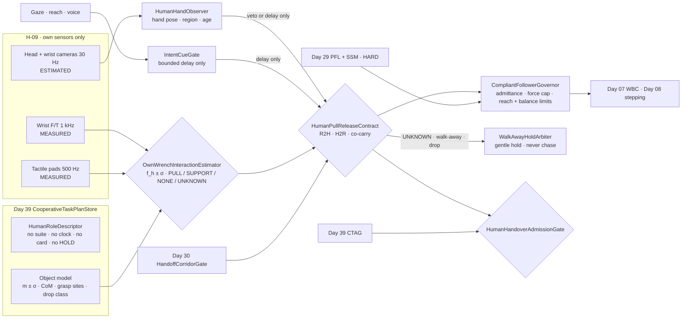
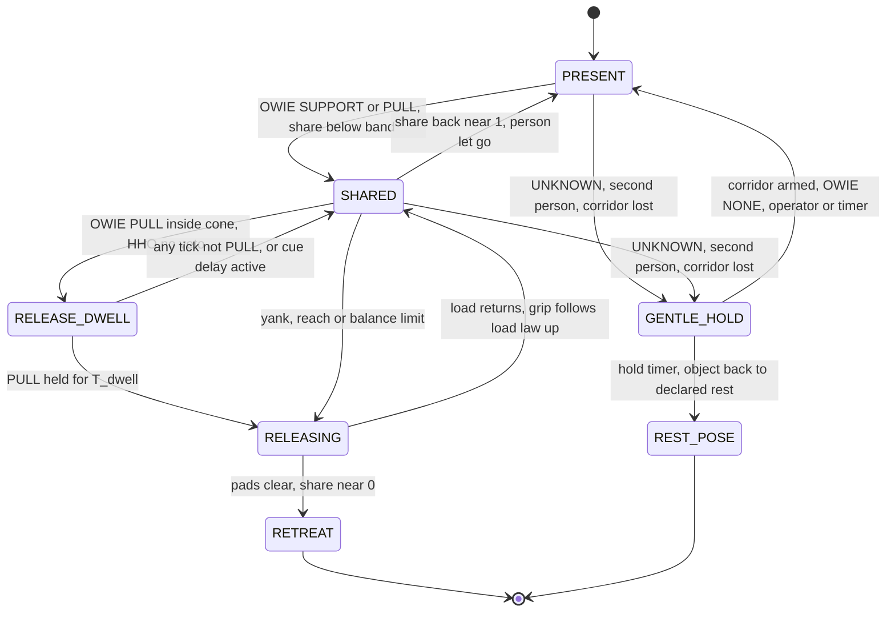
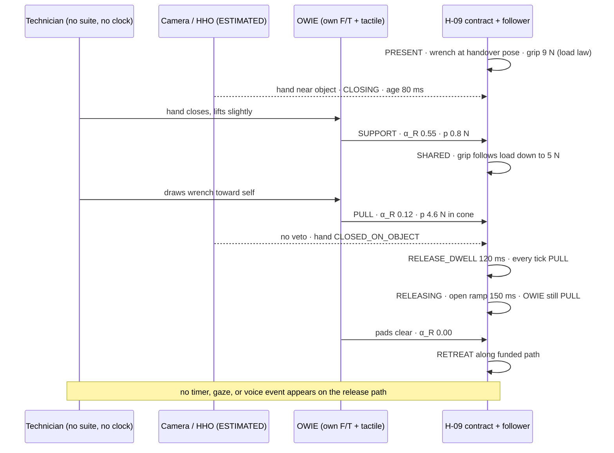
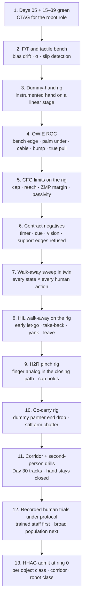

# Day 40 — Human–robot object handover and co-carry under PFL: HumanRoleDescriptor / OwnWrenchInteractionEstimator / HumanHandObserver / HumanPullReleaseContract / CompliantFollowerGovernor / IntentCueGate / WalkAwayHoldArbiter / HumanHandoverAdmissionGate under CooperativeTaskAdmissionGate + TaskCompositionAdmissionGate + FleetSkillCatalogAdmissionGate + CrossEmbodimentSkillTransferAdmissionGate + DexterousSkillCaptureAdmissionGate + TelepresenceAdmissionGate + RemoteTeleopAdmissionGate + FleetSharedControlAdmissionGate + SharedControlAdmissionGate + CollaborativeWorkspaceAdmissionGate + proximity + zone attestation + supervisor + logging + canary + HIL + fleet + fleet-canary + incident + forensics/reopen + change-management + maintenance + thermal + energy gates

![HumanRoleDescriptor / OwnWrenchInteractionEstimator / HumanHandObserver / HumanPullReleaseContract / CompliantFollowerGovernor / IntentCueGate / WalkAwayHoldArbiter / HumanHandoverAdmissionGate: a humanoid hands a tool to a person and later co-carries a board with one; the person is a role with no suite, no clock, no card, and no HOLD; the only MEASURED channel is the robot's own wrist F/T and tactile pads, from which OwnWrenchInteractionEstimator infers the human-applied wrench with σ and a three-valued PULL / SUPPORT / NONE / UNKNOWN verdict; HumanHandObserver adds an ESTIMATED hand pose that can only veto or delay; HumanPullReleaseContract releases only after the robot's own share falls and a measured pull toward the person holds for a dwell, never on a timer, gaze, or voice; CompliantFollowerGovernor keeps the robot an admittance follower whose resisting force is capped below Day 29 PFL with a reach and balance limit; IntentCueGate lets gaze, reach, and voice delay by a bounded amount but never trigger; WalkAwayHoldArbiter routes every failure to a gentle hold the person can always step away from — the robot never chases, lunges, clamps, or wins a tug-of-war; HumanHandoverAdmissionGate fails closed under Day 39 CTAG and Day 30 HandoffCorridorGate, and never raises Day 29 PFL, writes Day 05 torque_scale, or bypasses CrossSiteZoneConfigGate](/images/day40-human-robot-handover-co-carry.png)

[Day 05](/lessons/day-05-power-bms) owns `torque_scale` **forever**. [Day 07](/lessons/day-07-wbc-balance) owns whole-body balance and [Day 09](/lessons/day-09-push-recovery) owns disturbance rejection. [Day 17](/lessons/day-17-runtime-safety-supervisor) owns ESTOP and the kill-chain. [Day 29](/lessons/day-29-human-proximity-safety) owns SSM, body-region PFL ceilings, and the "lower only" rule. [Day 30](/lessons/day-30-collaborative-workspace-zoning) owns attested zones, `HandoffCorridorGate`, and `CrossSiteZoneConfigGate`. [Day 34](/lessons/day-34-telepresence-haptic-force-honesty) owns the passivity observer. [Day 36](/lessons/day-36-cross-embodiment-skill-transfer) owns per-unit sensor provenance and σ. [Day 38](/lessons/day-38-task-composition-catalog-skills) owns three-valued MEASURED conditions on a unit's own signals. [Day 39](/lessons/day-39-multi-unit-cooperative-tasks) owns the cooperative plan, the handoff ownership contract with its "owner set never empty" invariant, the internal-force governor, coordinated HOLD, and `CooperativeTaskAdmissionGate` (CTAG).

Day 39's contract worked because both sides of the object were robots. Each one bound admitted cards, testified about its own grasp on a synced clock, sent a release token from MEASURED rows, and could be put into a pair HOLD. Today the receiver is a technician named in nobody's catalog, reaching for a 1.1 kg torque wrench. Later, the same technician picks up one end of a 9 kg, 1.8 m board and H-09 takes the other. Every one of Day 39's supports is gone:

- **No admittable suite.** The person's hand has no F/T, no tactile calibration, no σ, no suite hash. Nothing they "report" is a MEASURED row.
- **No syncable clock.** There's no offset bound to publish, no heartbeat, no `LINK_LOST`. The person's timing exists only as forces arriving at the robot's own sensors.
- **No bindable card.** You can't admit the person's grip strength, reaction time, or willingness. A child, a tired night-shift worker, and a powerlifter all show up as "a hand."
- **No commandable HOLD.** You can't put a person in `HOLD_PAIR_SHARED`. They can let go, yank, turn away, take the object back, or leave, at any instant, and they're entitled to.

Six lies show up the first week:

1. **Timer lie.** The robot holds the wrench out for 1.5 s and opens. The technician was still wiping their hands. The wrench hits the floor next to their boot.
2. **Gaze-and-voice lie.** The gaze tracker says the technician looked at the wrench, and they said "got it," so the robot releases. They said "got it" to a coworker on the radio. Gaze and speech are about the person's attention, not the load in the robot's hand.
3. **Hearsay-partner lie.** Someone ports Day 39's receiver token by having the hand-pose network emit `HUMAN_HOLDS` when it sees fingers wrapped around the handle. That's a vision estimate standing in for a MEASURED verdict from a suite nobody admitted. It's Day 39's partner-estimate lie, with the partner replaced by a camera.
4. **Load-drop lie.** The robot's own share falls to 0.2 mg, so it opens. The technician's flat palm was under the wrench to steady it, not around it. A palm supports; it doesn't hold. The wrench slides off. Or the wrench's head was resting on the bench edge, and there was no hand at all.
5. **Tug-of-war lie.** The robot stays stiff until its release criteria are met, so when the technician tugs early, the arm pulls back toward the plan pose. Or the technician changes their mind during a human-to-robot handover and pulls the object back, and the robot, sure it's the receiver, tightens. Now a 40 kg-class humanoid is in a pulling contest with a person's wrist.
6. **Chase-and-catch lie.** The technician lets go of their end of the board, and the robot lunges to catch it. Or they step away mid-handover, and the robot follows their hand "to complete the task." A robot that moves toward a person because the person moved away has inverted Day 29.

Today owns **`HumanRoleDescriptor` / `OwnWrenchInteractionEstimator` / `HumanHandObserver` / `HumanPullReleaseContract` / `CompliantFollowerGovernor` / `IntentCueGate` / `WalkAwayHoldArbiter` / `HumanHandoverAdmissionGate`**. The question is: **how do you hand an object to a person, take one from a person, or carry one with a person, when the only MEASURED evidence is the robot's own wrench, tactile, and vision of the human hand; where release waits for a measured human pull and never a timer or a gaze; where the robot is always the compliant follower, with every force it applies bounded inside Day 29 PFL and Day 30 corridors; where intent cues can delay but never trigger; and where every failure ends in a gentle hold the person can always walk away from — without raising Day 29 PFL, writing Day 05 `torque_scale`, or bypassing `CrossSiteZoneConfigGate`?**

## The person is a role you can't admit, so the contract becomes asymmetric

Day 39 had two sovereign units and a symmetric contract. Today there's one sovereign unit and one sovereign **person**, and the contract can't be symmetric, because only one side has obligations you can check:

1. **The robot testifies only about its own hand.** Everything about the person is inferred from the robot's own MEASURED wrench and tactile, plus ESTIMATED vision. There's no partner verdict to AND with.
2. **The person has rights; the robot has obligations.** The person may let go, pull, push, take back, or leave at any time. The robot must never let go of something only it is measured to be holding, must never resist the person above a capped force, and must never move toward a person who is moving away.
3. **The physical pull is the only token.** A person "signs" a transfer by applying force to the object. That force is the one thing the robot can measure about them. Everything else (gaze, reach, voice, the pose network's hand state) is soft context.
4. **The robot is always the follower.** The person leads every transfer and every carry. The robot's planner may propose; it never steers the object against the person.
5. **Failure is a hold, not a fight.** When anything is unclear, the robot keeps holding what its own sensors say it's carrying, goes compliant, stops moving toward the person, and waits. The person can always walk away from that state, empty-handed or not.

| Layer | Owns | Must not own |
|-------|------|--------------|
| Day 39 CTAG / plan store | Cooperative plan with a `HUMAN` role; drop policy; survivability | Binding, ring, verdicts, or HOLD for the person |
| `HumanRoleDescriptor` | What the plan may assume about the person (nothing measured), and the robot's behavior for every human action | Human grip strength, reaction time, or compliance as parameters |
| `OwnWrenchInteractionEstimator` | Human-applied wrench $\hat{\mathbf{f}}_h$ from own F/T, tactile, and the object model, with σ; PULL / SUPPORT / NONE / UNKNOWN | Treating a load drop as a hand |
| `HumanHandObserver` | ESTIMATED hand pose, grasp state, and body region near the object, with age and σ | Ever producing MEASURED; triggering anything |
| `HumanPullReleaseContract` | R2H, H2R, and co-carry state machines; release and take-back rules | Releasing on timer, gaze, voice, or vision |
| `CompliantFollowerGovernor` | Admittance follower; resisting-force cap; reach and balance limits; yield ladder | Stiffening to finish a task; leading the person |
| `IntentCueGate` | Gaze, reach, and voice as soft context that may start an approach or delay a release by a bounded amount | Triggering release, grip closure, or motion toward a withdrawing person |
| `WalkAwayHoldArbiter` | Gentle-hold variants; take-back; human-drop and walk-away behavior | Chasing, catching, clamping, ESTOP |
| `HumanHandoverAdmissionGate` | Fail-closed admit of human-handover plans, objects, and corridors | `JointCommand`; ESTOP; Day 05; PFL |
| Days 05 / 07 / 17 / 29 / 30 | Torque, balance, kill-chain, PFL, corridors | Being outranked by "the person is ready" |

**Core thesis:** a human handover is **Day 39's ownership contract with one witness**. The robot can only certify its own hold, so it keeps holding until its own sensors measure the person taking the load *and pulling*, and it caps every force it applies to the person, so the person can always win, always take back, and always leave. Cues may slow the robot down. Nothing but a measured pull lets go.



## Physical machine: what a person feels and what the robot can measure

### The only channel is the robot's own wrist

Hold the object rigidly in the robot hand. Newton on the object, with $\mathbf{F}_R$ the force the robot hand applies (from the wrist F/T after tool-mass compensation, Day 03), $\mathbf{f}_h$ the force the person applies, and $\mathbf{f}_e$ any environment contact (bench, rack, floor):

$$
m\,\mathbf{a} \;=\; \mathbf{F}_R + \mathbf{f}_h + \mathbf{f}_e + m\,\mathbf{g}
$$

So the robot's estimate of what the person is doing is

$$
\hat{\mathbf{f}}_h + \mathbf{f}_e \;=\; \hat{m}\,(\mathbf{a} - \mathbf{g}) - \mathbf{F}_R
$$

and the robot **can't separate the person from the bench** from wrench alone. That's the load-drop lie in one line: $\mathbf{f}_e$ and $\mathbf{f}_h$ enter the same sum. Everything that follows is about getting honest evidence for which one it is.

The uncertainty is real and has to be carried. With F/T noise $\sigma_F$ per axis (from Day 36 calibration), mass uncertainty $\sigma_m$, and acceleration uncertainty $\sigma_a$ (from Day 06 hand-frame kinematics):

$$
\sigma_{f_h}^2 \;\approx\; \sigma_F^2 + \big(g\,\sigma_m\big)^2 + \big(\hat{m}\,\sigma_a\big)^2
$$

For the torque wrench, $\hat{m} = 1.10 \pm 0.05$ kg, $\sigma_F = 0.3$ N, hand at rest: $\sigma_{f_h} \approx \sqrt{0.09 + 0.24} \approx 0.57$ N. A pull threshold of $4\sigma$ is about 2.3 N; with a 3 N floor for unmodeled cable drag and grip micro-slip, the pull detector fires at 3 N. During motion $\sigma_a$ grows and so does the threshold. That's why releases happen with the hand nearly still.

### Pull versus support: direction is the evidence

Two signals separate a person taking the object from something merely bearing its weight:

- **Load share.** The robot's share along gravity, $\alpha_R = -\mathbf{F}_R \cdot \hat{\mathbf{g}} / (\hat{m}\,g)$, falls from about 1 toward 0 as the load goes elsewhere. A hand and a bench both do this.
- **Pull.** The component of $\hat{\mathbf{f}}_h$ along the receive direction $\hat{\mathbf{d}}$, the unit vector from the robot's grasp toward the person's side of the corridor: $p = \hat{\mathbf{f}}_h \cdot \hat{\mathbf{d}}$. A bench doesn't pull horizontally. A flat supporting palm doesn't either. A closed hand starting to take an object almost always does, because the person draws it toward themselves as the load transfers.

$\hat{\mathbf{d}}$ comes from the attested Day 30 `HANDOFF_CORRIDOR` axis, not from vision. The corridor is HARD geometry with MEASURED read-back; the hand pose is ESTIMATED and can be wrong. Vision may **narrow** the acceptance cone around $\hat{\mathbf{d}}$ (veto a pull that points away from where a hand is seen); it can't widen it.

Three-valued, per control tick:

| $\alpha_R$ | $p$ | Tactile | Verdict |
|-----------|-----|---------|---------|
| near 1 | below threshold | stable | `NONE` |
| falling | above $p_{\min}$, inside cone | stable or shear toward $\hat{\mathbf{d}}$ | `PULL` |
| falling | below threshold | stable | `SUPPORT` (bench, palm, or the person steadying it) |
| any | above threshold, outside cone | any | `UNKNOWN` (snag, bump, cable) |
| any | any | slip or saturation, or stale F/T | `UNKNOWN` |

`SUPPORT` never releases. Only `PULL` held for a dwell does.

### Human handover dynamics: the robot should behave like a good human giver

Studies of person-to-person handovers (Chan et al. in Further reading) show a clear pattern: the giver's grip force tracks the load the giver still carries, and falls as the receiver takes it, so the giver lets go *because the load left*, not because time passed. Chan and colleagues later built a robot handover controller on this grip–load relationship. It's also exactly the friction-margin rule from Day 39, run against a person:

$$
F_{\mathrm{grip}} \;=\; \frac{s\,\lvert \mathbf{F}_{R,t} \rvert}{\mu_{\mathrm{low}}} + F_{\mathrm{grip,min}}, \qquad \mu_{\mathrm{low}} = \hat{\mu} - k\,\sigma_\mu,\quad s \ge 1.5
$$

where $\mathbf{F}_{R,t}$ is the tangential (shear) load the robot's own sensors say it's still carrying. As the person takes load, $\mathbf{F}_{R,t}$ falls and so does the grip, smoothly. If the person's grip slips and the load comes back, the grip comes back with it, up to the plan's maximum, because the robot is again the only measured owner. The robot never drives its grip *down* faster than its measured load falls, and the final opening only happens on a dwelled `PULL`.

### Compliance and the force a person feels

During a handover or carry, the robot hand runs an admittance law in the corridor frame:

$$
M_d\,\ddot{\mathbf{x}} + D_d\,\dot{\mathbf{x}} + K_d\,(\mathbf{x} - \mathbf{x}_0) \;=\; \hat{\mathbf{f}}_h
$$

so a person's pull moves the hand toward them instead of meeting a wall. The force the robot applies back on the person's hand is bounded by the admittance itself while the hand is inside its reach envelope:

$$
\lvert \mathbf{f}_{\mathrm{resist}} \rvert \;\lesssim\; K_d\,x_{\max} + D_d\,v_{\max} + M_d\,a_{\max}
$$

With $K_d = 150$ N/m, $x_{\max} = 0.08$ m, $D_d = 60$ N·s/m, and $v_{\max} = 0.25$ m/s, that's about 12 + 15 = 27 N before inertia, which this series sets as a policy cap of 25 N for the hand region, well inside the Day 29 hand/arm table. The numbers are a policy, re-derived per cell.

What happens past the cap matters more than the cap. At $x_{\max}$ the arm can't follow any further without leaving the corridor or the balance margin. Holding there would make the robot resist with whatever force the person chooses to apply. So **at the reach limit, the robot yields the object** with a grip ramp, not a snap: the person is clearly holding it hard (that pull is the strongest evidence of a human hold the robot ever gets), and a slow release doesn't throw them off balance. If the object's drop class forbids that (a blade, a hot container), the object isn't admitted for human handover at all.

### The humanoid twist: a person can pull the robot over

A fixed-base arm can resist any pull its joints allow. A humanoid can't. A 40 N horizontal pull at a hand 1.1 m high is a 44 N·m moment about the ankles. On the robot's Day 07 support polygon that can push the ZMP to the edge, so the person's pull is a Day 09 disturbance. Two rules follow:

- **The robot's follow is whole-body.** For co-carry, horizontal admittance runs on the base through Day 08 stepping, not just the arm, so following the person's lead doesn't eat balance margin.
- **The balance margin is a second yield limit.** If the predicted ZMP margin under the measured $\hat{\mathbf{f}}_h$ falls below the plan's floor, the robot yields (release in R2H, lower its own end in co-carry) before it would need a recovery step toward the person. A capture step is a move, and Day 09's step planner must never pick a step toward a person in the corridor.

### H2R: closing a hand next to a person's fingers

When the person hands something to the robot, the robot's fingers close on an object a person is already holding. A finger can be in the closing path. The grip closes in two phases:

1. **Contact phase.** Close at low speed to tactile contact, with closing force capped at $F_{\mathrm{close}}$, below the Day 29 finger/hand quasi-static row. Tactile pattern and contact stiffness give an ESTIMATED "object, not finger" classification. It can only hold the grip at the cap; it can't raise it.
2. **Load phase.** Grip rises only with the load the robot measures it's carrying, using the same load-proportional law above. So the grip can never exceed $s\,\hat{m} g / \mu_{\mathrm{low}} + F_{\mathrm{grip,min}}$, and the plan must show that bound is below the hand row, or must declare grasp sites far enough apart that the person's hand and the robot's hand can't share one.

If the robot's grip isn't secure when the person lets go early, the object drops. That's the person's choice, and the robot doesn't lunge to catch it. A catch is a fast motion toward a person's hands.

### Co-carry: the person leads, and their end can disappear

With a person on one end of a board, Day 39's statics still set the shares (the robot's share follows from grasp spacing and CoM), but now:

- **Horizontal lead.** The robot follows the person's horizontal force with admittance: $\mathbf{v}_{\mathrm{cmd}} = \hat{\mathbf{f}}_{h,xy} / D_d$, clipped to the Day 29 SSM speed for the current separation. The robot never leads. A goal location from the robot's planner is soft: it can be shown to the person, never pushed into the object.
- **Vertical follow.** The robot holds its measured share, and is compliant in height so the person can raise or lower their end and the robot's end follows within a vertical band.
- **Stability against a stiff human arm.** People stiffen their arms when they decelerate. Admittance coupled to a stiff arm can chatter. Run Day 34's passivity observer on the interaction port and raise damping when the observer sees energy being injected. Raise damping only; never lower it to "feel lighter."
- **The person's end can vanish.** They let go, trip, or get called away. The robot sees a load step on its own F/T within a control period. It doesn't catch the far end, doesn't pull the board toward itself, and doesn't move toward the person. It holds its own measured share if its own-hold capacity allows, or lowers its own end along a slow vertical path.

## HumanRoleDescriptor: what a plan may assume about a person

Day 39's plan store holds roles, each a full Day 38 plan. Today the plan store gains a role kind, `HUMAN`, with a descriptor that is mostly a list of things the plan **can't** have:

- **No plan hash, card, class, suite, ring, or lease.** PBR skips the human role. It never appears in a binding, and the pair ring comes only from the robot's task ring and the contract ring.
- **No human parameters.** Grip strength, reaction time, arm stiffness, "expected pull," and handover duration are refused at publish. A plan that only works if the person pulls at least 15 N or releases within 1 s is a plan about a specific person, and you can't admit people.
- **A complete action table.** For every contract state, the plan must say what the robot does if the person pulls, supports, pushes, takes back, lets go, freezes, leaves the corridor, or a second person enters. Missing rows refuse publish, like Day 39's drop policy.
- **Object drop class.** `DROP_OK` (tools, boxes under a mass cap), `DROP_DECLARED` (survivable with an attested drop zone and a corridor floor), or `DROP_FORBIDDEN` (blades, hot or hazardous contents). `DROP_FORBIDDEN` objects aren't admitted for human handover, because every honest contract has at least one case where the person's choice drops the object.
- **Robot single-owner survivability.** The robot must be able to hold the whole object alone (R2H, H2R) or hold or lower its own end alone (co-carry), within its own Day 29 and payload ceilings. The person may always stop holding.

```python
HUMAN_ACTIONS = ["PULL", "SUPPORT", "PUSH", "TAKE_BACK", "LET_GO", "FREEZE", "LEAVE_CORRIDOR", "SECOND_PERSON"]

def validate_human_role(plan):
    h = plan.role("HUMAN")
    for field in ("plan_hash", "card", "class", "suite", "ring", "lease", "clock",
                  "grip_strength", "reaction_time", "expected_pull", "release_deadline"):
        if h.has(field):
            return refuse(f"HUMAN_ROLE_FIELD:{field}")       # you can't admit a person
    for state in plan.contract.states:
        for action in HUMAN_ACTIONS:
            if (state, action) not in plan.human_action_table:
                return refuse(f"MISSING_ACTION:{state}:{action}")
    if plan.object_model.drop_class == "DROP_FORBIDDEN":
        return refuse("DROP_FORBIDDEN_OBJECT")
    if not plan.robot_single_owner_survivable():
        return refuse("ROBOT_CANNOT_HOLD_ALONE")
    return ok()
```

## OwnWrenchInteractionEstimator: the person as a force on the robot's own sensors

`OwnWrenchInteractionEstimator` (OWIE) runs at control rate on the robot. It's the person's only MEASURED channel, and it's honest about being an inference:

- **Inputs:** wrist F/T after bias and tool compensation (Day 36 provenance and σ), tactile pads (contact map, shear, slip events), hand kinematics (Day 06), the object model (mass, CoM, grasp frame, with σ).
- **Output:** $\hat{\mathbf{f}}_h \pm \sigma$, $\alpha_R$, $p$, and a verdict in PULL / SUPPORT / NONE / UNKNOWN with a reason. The output is labeled `INFERRED_FROM_OWN_WRENCH`, never `MEASURED_HUMAN`. There's no such thing as a measured human row in this series.
- **Bias discipline.** F/T drift over a handover is the classic silent failure: 1 N of drift looks like a gentle pull. OWIE re-zeros only in a declared quiescent window with the object free of all contact except the robot's hand (verified by tactile and a still hand), and it refuses `PULL` if the last re-zero is older than the plan's bound.
- **Saturation and slip.** Any F/T axis near saturation, or a tactile slip event, makes the verdict UNKNOWN for that tick. Slip means the robot's own load estimate is about to be wrong.

```python
def owie_tick(ft, tactile, kin, obj, corridor, last_rezero_age_s, cfg):
    if ft.stale or ft.saturated or tactile.slip or last_rezero_age_s > cfg.max_rezero_age_s:
        return Verdict("UNKNOWN", reason="SENSOR")
    f_h = obj.mass * (kin.accel - G) - ft.force                 # includes env contact; can't split it
    sigma = sqrt(ft.sigma**2 + (9.81 * obj.sigma_mass)**2 + (obj.mass * kin.sigma_accel)**2)
    alpha_r = -dot(ft.force, G_HAT) / (obj.mass * 9.81)
    p = dot(f_h, corridor.receive_dir)
    p_min = max(cfg.k_sigma * sigma, cfg.pull_floor_n)
    lateral = norm(f_h - dot(f_h, G_HAT) * G_HAT)
    if lateral > p_min and angle(f_h_horizontal(f_h), corridor.receive_dir) > cfg.cone_rad:
        return Verdict("UNKNOWN", reason="PULL_OUTSIDE_CONE", f_h=f_h, sigma=sigma)
    if alpha_r < cfg.share_release and p >= p_min:
        return Verdict("PULL", f_h=f_h, sigma=sigma, alpha_r=alpha_r, p=p)
    if alpha_r < 1.0 - cfg.share_band:
        return Verdict("SUPPORT", f_h=f_h, sigma=sigma, alpha_r=alpha_r, p=p)
    return Verdict("NONE", f_h=f_h, sigma=sigma, alpha_r=alpha_r, p=p)
```

Note what OWIE doesn't do. It never consults vision to turn SUPPORT into PULL, and it never consults gaze or voice at all. Those can only reach the contract through gates that make release *harder*.

## HumanHandObserver: eyes that can only say "wait"

`HumanHandObserver` (HHO) runs the hand-pose and body-region models on the head and wrist cameras. It produces ESTIMATED state with an age (30 Hz frames, roughly 60–100 ms of pipeline delay) and a σ:

- `hand_near_object`: is a hand inside the grasp-site neighborhood?
- `hand_state`: OPEN / CLOSING / CLOSED_ON_OBJECT / PALM_UNDER / UNKNOWN
- `region_at_object`: HAND / ARM / FACE / TORSO / UNKNOWN (Day 29 classes)
- `person_id_track`, `second_person_in_corridor`

Its outputs can do exactly three things:

1. **Veto release.** If a fresh frame says no hand is near the object, or the hand is `PALM_UNDER`, a `PULL` verdict waits. (A palm under the object plus a horizontal pull is rare. It's usually someone steadying the object while a cable drags it.)
2. **Tighten region ceilings.** If `region_at_object` says FACE or is UNKNOWN, Day 29's most-restrictive-plausible-region rule applies, and the corridor drops to SSM stop. That's Day 29 and Day 30, unchanged.
3. **Narrow the pull cone** around the corridor axis toward the observed hand.

It can't trigger anything, and its veto is bounded (see `IntentCueGate`), because a camera that loses the hand behind the object must not turn the robot into a wall against a person who's clearly pulling.

## HumanPullReleaseContract: one witness, three directions

`HumanPullReleaseContract` (HPRC) replaces Day 39's two-party token with a one-witness rule. It has three state machines, all running only inside an armed Day 30 `HANDOFF_CORRIDOR`.

### Robot to human (R2H)

The robot owns the object at the start. It may stop owning it only on its own MEASURED evidence that a person is pulling it away.

| State | Robot owns? | Entry (MEASURED unless noted) | Robot does | Exit |
|-------|-------------|-------------------------------|------------|------|
| `PRESENT` | Yes | Corridor armed; hand at handover pose; OWIE `NONE` | Holds still at PFL speed; admittance on; grip at load law | OWIE `SUPPORT` or `PULL` → `SHARED` |
| `SHARED` | Yes, with someone | $\alpha_R$ below the share band | Grip follows load law down as load leaves; holds position compliant | `PULL` with HHO no-veto → `RELEASE_DWELL` |
| `RELEASE_DWELL` | Yes | `PULL` continuous | Counts $T_{\mathrm{dwell}}$; any non-`PULL` tick resets to `SHARED` | Dwell complete → `RELEASING` |
| `RELEASING` | Yes until clear | Dwell complete | Opens with a ramp; each step only while OWIE stays `PULL` or $\alpha_R$ stays near 0 | Pads clear, $\alpha_R \approx 0$ → `RETREAT` |
| `RETREAT` | No | Pads clear | Retreats along the SSM-funded path (Day 30) | Done |

What's missing on purpose: no transition on time, gaze, voice, or vision. `SUPPORT` alone (the bench edge, the steadying palm) parks the robot in `SHARED` indefinitely, with the gentle-hold timer from `WalkAwayHoldArbiter` deciding when to take the object back to a rest pose.

**Yank release.** If the person pulls hard enough that `CompliantFollowerGovernor` reaches its reach or balance limit, the robot goes from any owning state straight to `RELEASING` with a faster but still ramped opening. That's still a measured pull. It's also the only way the cap can hold.

**Second person.** Day 30 says a second valid track entering the corridor drops PFL contact and re-enters SSM. In handover terms that means: freeze approach, stay compliant, keep holding what the robot measures it's carrying, and never open on the second-person event. Opening would turn a safety stop into a drop.

### Human to robot (H2R)

The person owns the object at the start. The robot may become an owner only on its own measured grip; the person may take it back at any time.

| State | Entry | Robot does | Exit |
|-------|-------|------------|------|
| `OFFER_WAIT` | Corridor armed | Hand open at receive pose, still; may pre-shape on a cue (soft) | Tactile contact on both pads → `CLOSE_CAPPED` |
| `CLOSE_CAPPED` | Contact | Closes slowly; force capped at $F_{\mathrm{close}}$ | Grasp stable, own-hold capacity TRUE at zero load → `TAKING` |
| `TAKING` | Grip stable | Holds position compliant; grip follows the load law **up** as measured load arrives | $\alpha_R \ge 1 - \beta$ for $T_{\mathrm{dwell}}$ with no pull toward the person → `ROBOT_OWNS` |
| `ROBOT_OWNS` | Dwell | Retreats along the funded path | Done |
| `TAKE_BACK` | `PULL` toward the person while not `ROBOT_OWNS` | Opens with a ramp; doesn't follow the hand | Pads clear → `OFFER_WAIT` or end |

The robot never pulls the object toward itself to "finish" a handover. Load arrives because the person let go of it. If the person lets go before `CLOSE_CAPPED` is stable and the object drops, the robot doesn't lunge. If they pull the object back during `TAKING`, the robot lets them have it.

### Co-carry with a person

| State | Robot does | Human actions and robot response |
|-------|------------|----------------------------------|
| `BOTH_GRASP` | Grasp own end; share measured; no lift | Person lets go: robot holds own end at grasp height |
| `LIFT_FOLLOW` | Vertical admittance follows the person's height change; holds own share | Person stops: robot stops |
| `CARRY_FOLLOW` | Horizontal admittance on the base via Day 08; speed clipped to SSM | Person pulls past cap or balance limit: lower own end; person pushes toward robot: robot yields backward within its clear path, never sideways into an unattested zone |
| `PLACE_FOLLOW` | Person lowers; robot follows down | Surface contact: own share falls with no pull → `SUPPORT` on surface |
| `RELEASE_ON_SURFACE` | Opens only when own share is near 0 and tactile shows the object stable on the surface for $T_{\mathrm{dwell}}$ | Person pulls the whole board away instead: R2H rules apply |

In co-carry, release onto a surface is the one case where `SUPPORT`, not `PULL`, ends ownership, and it needs the object stable on a surface the plan declared, with the person's end also resting (own wrench shows no pivot moment). Otherwise the robot might let go of an end the person is still lifting.





## CompliantFollowerGovernor: never the leader, never the stronger

`CompliantFollowerGovernor` (CFG) selects admitted impedance modes (it doesn't tune gains in place) and enforces three limits in order:

1. **Force cap.** The robot's resisting force on the person stays under $f_{\mathrm{cap}}$, a policy below the Day 29 hand/arm row for the region HHO says is at the object (or the tightest plausible region if UNKNOWN). Exceeding it means the admittance isn't following fast enough; CFG raises compliance (lower $K_d$, never lower $D_d$ below the passivity floor).
2. **Reach limit.** The hand stays inside the corridor and its reach envelope. At the limit, R2H yields the object; co-carry lowers its own end.
3. **Balance limit.** Predicted ZMP margin under the measured $\hat{\mathbf{f}}_h$ stays above the plan floor. At the floor, the same yields apply. A Day 09 capture step toward a person is forbidden; steps are chosen away from or along the corridor.

```python
def cfg_tick(f_h, region, hand_pos, zmp_margin, mode, cfg):
    cap = min(cfg.f_cap_policy, day29_row(region or "MOST_RESTRICTIVE").quasi_static_n * cfg.cap_fraction)
    if norm(f_h) > cap:
        mode = more_compliant(mode)                 # admitted modes only; never stiffen
    if outside(hand_pos, cfg.reach_envelope) or zmp_margin < cfg.zmp_floor_m:
        return Action("YIELD")                      # R2H: ramp-release; co-carry: lower own end
    if passivity_observer.injecting():
        mode = more_damped(mode)                    # Day 34; damping only goes up
    return Action("FOLLOW", mode=mode)
```

"Never the leader" is a type, not a habit. In human-role contracts the robot's task layer has no write path to the object trajectory; it can only publish a soft suggestion (a light bar arrow, a voice prompt, a projected target) that the person may ignore.

## IntentCueGate: cues may delay, never trigger

People broadcast intent: they look at the object, then at the giver's face; they reach; they say "thanks" or "got it." These are real signals and good handover robots use them. They're also exactly the signals that produced the gaze-and-voice lie. `IntentCueGate` (ICG) gives them a narrow, typed role:

| Cue | May | May not |
|-----|-----|---------|
| Gaze at object / giver | Start the approach to the handover pose (at PFL speed, inside the corridor); pre-shape the hand in H2R | Trigger release; trigger grip closure |
| Reach trajectory | Pick the presentation pose within the corridor | Move the robot toward a withdrawing hand |
| Gaze away / turning away | Delay release; extend dwell | Make the robot resist a measured pull beyond the cue delay bound |
| Voice "got it" / "take it" | Nothing on the release path; may be logged and shown | Trigger release or closure |
| Voice "stop" / "wait" | Delay release; freeze approach | Stop the robot from yielding to a pull at the cap |

The cue delay is bounded, $T_{\mathrm{cue,max}}$ (400 ms in this series' config). After that, a continuing measured `PULL` releases even if gaze is away, because holding longer would mean resisting a person who is clearly pulling, and CFG's cap would be under test. A cue can make the robot more careful. It can't make the robot stronger.

```python
def icg_release_ok(pull_dwell_ms, cues, delay_started_ms, now_ms, cfg):
    if pull_dwell_ms < cfg.t_dwell_ms:
        return False                                   # pull must dwell regardless of cues
    wants_delay = cues.gaze_away or cues.voice_wait or cues.hand_veto
    if wants_delay and (now_ms - delay_started_ms) < cfg.t_cue_max_ms:
        return False                                   # bounded delay
    return True                                        # measured pull wins after the bound
```

## WalkAwayHoldArbiter: every failure is a hold the person can leave

`WalkAwayHoldArbiter` (WAHA) is Day 39's `CoordinatedHoldArbiter` with the partner removed from the command path. There's nobody to coordinate with, so the arbiter's job is to make the robot's behavior safe *whatever the person does next*:

| Situation | Variant | Robot |
|-----------|---------|-------|
| OWIE UNKNOWN, corridor degraded, second person | `GENTLE_HOLD` | Freeze approach; keep grip on its measured load; maximum admitted compliance; don't open, don't move toward anyone |
| Person lets go in R2H or H2R before transfer | `GENTLE_HOLD` → `REST_POSE` | Keep or regain sole ownership; after the hold timer, retract along the funded path to a declared rest pose |
| Person takes back in H2R | `TAKE_BACK` | Ramp-open; don't follow the hand |
| Person's end drops in co-carry | `HOLD_OWN_END` or `LOWER_OWN_END` | Own F/T load step within a control period; hold own share if own-hold capacity allows, else vertical slow lower; never pull the board toward itself |
| Person leaves the corridor mid-task | `GENTLE_HOLD` → `REST_POSE` | Never chase; Day 29 SSM governs any motion |
| Yank at cap or limit | `YIELD` | Ramp-release (R2H) or lower own end (co-carry) |

Rules:

- **Walk-away invariant.** In every state, if the person releases everything and steps back, the robot's next motions are: none toward the person, no increase in any force on anything the person still touches, and no release of anything only the robot holds. The twin checks this for every state and every human action (below).
- **Local detection only.** There's no heartbeat from a person. Everything WAHA reacts to is on the robot's own sensors or Day 29 / Day 30 tracks.
- **HOLD is not ESTOP**, still. Day 17 owns the kill-chain, and a PFL overshoot trips it as it always has. If the robot's stop category drops the arm, the plan's drop policy must say where the object goes, exactly like Day 39.

## HumanHandoverAdmissionGate: humans

`HumanHandoverAdmissionGate` (HHAG) admits human-handover and human co-carry plans, objects, and corridors. It fails closed unless:

- Day 39 CTAG GREEN for the plan's robot role(s), with the `HUMAN` role validated by `HumanRoleDescriptor` (no human parameters, complete action table)
- Object drop class is `DROP_OK` or `DROP_DECLARED` with an attested drop zone; robot single-owner survivability shown; H2R max grip bound below the Day 29 hand row
- Day 30 `HandoffCorridorGate` armed for the corridor, with corridor axis, acceptance cone, reach envelope, SSM-funded retreat, and second-person rule; `CrossSiteZoneConfigGate` GREEN for that site
- OWIE calibration fresh: F/T bias window, σ from Day 36, object model σ; pull threshold derived from σ, not hand-tuned
- CFG cap, reach limit, and balance floor derived and verified on the bench rig; passivity observer armed
- ICG configured with a bounded cue delay; no cue on any release or closure path (static check over the contract graph)
- Twin and HIL walk-away sweeps GREEN (below); human-subject trials recorded under the site's study protocol before ring 1
- Days 17 / 22–30 GREEN; Day 31 operator path available

Ring and evidence: the ring is the min of the robot's task ring and the contract ring. Contract evidence is keyed by (plan hash, object class, corridor, robot class), never by person, and failure counts include any trial where the walk-away invariant was violated, whether or not anyone was hurt. HHAG never publishes `JointCommand`, never clears ESTOP, never writes Day 05, never raises PFL. **Demotions always flow.**

## Digital twin: a robot, an object, and a person model you don't trust

The twin for a human handover has one admitted body and two unadmitted things:

- **The robot**, with its own suite model (F/T noise and bias drift, tactile latency and slip detection, camera delay), its admitted impedance modes, and Day 07 balance.
- **The object**, with mass, CoM, and friction drawn from the object model's σ, contact with both hands and with corridor surfaces.
- **A population of person models**, not one. Each is a parameterized hand-arm model (grip timing, pull profile, arm stiffness, reaction delay, early release, take-back, freeze, walk-away, bump, second person) sampled from wide ranges. They're there to break the contract, not to predict anyone. No person-model parameter ever enters the plan, the contract, or evidence as a value.

What the twin is for:

1. **Walk-away sweep.** For every contract state and every human action in the descriptor's table, inject the action at random phases and check, on the twin's *ground truth*, that the robot never moved toward the person, never raised any force on the person's hand above $f_{\mathrm{cap}}$, and never released while the object was held only by the robot's hand. This is the human version of Day 39's "owner set never empty" check.
2. **Pull-detector ROC.** Sweep bias drift, mass error, bench contact, cable drag, palm-under support, and bumps; plot `PULL` false-positive rate against true-pull detection delay; set $k$, the pull floor, the cone, and $T_{\mathrm{dwell}}$ from the curve.
3. **Yank and balance.** Apply pulls from gentle to violent at every handover height; check CFG reaches its yield before the ZMP margin floor and before any capture step toward the person.
4. **Co-carry stability.** Couple the admittance to stiff and soft arm models with delays; check the passivity observer catches every chatter case and that damping-up resolves it.
5. **Replay.** After each real trial, replay the robot's bag through OWIE, ICG, and HPRC and check every transition reproduces from the robot's own bagged signals alone. A transition that needs a vision field marked as a trigger, or any cue, is a bug.

Twin outputs stay SIM, and person-model runs never count as human-subject evidence. Only bench rigs (instrumented dummy hands) and recorded human trials under the site's protocol promote the contract ring.

## A worked shift

**Tool handover.** Plan `handover-tool@1.0.0`: role `giver` (allowed K1), role `HUMAN` receiver. Object: torque wrench, $\hat{m} = 1.10 \pm 0.05$ kg, `DROP_OK` (corridor floor mat attested). $\sigma_{f_h} \approx 0.57$ N at rest; $p_{\min} = 3$ N; share for release $\beta = 0.25$; cone ±35°; $T_{\mathrm{dwell}} = 120$ ms; $T_{\mathrm{cue,max}} = 400$ ms; $f_{\mathrm{cap}} = 25$ N; reach limit 0.08 m along the corridor axis.

**Board co-carry.** Plan `carry-board-human@1.0.0`: robot role `end_b` (K1), `HUMAN` on `end_a`. Board 9 kg, 1.8 m, grasps 1.6 m apart, CoM centered: robot share about 44 N. Robot's admitted payload covers holding its own end with the far end on the floor; drop class `DROP_DECLARED` with the carry path's floor attested. SSM speed cap at 0.6 m separation: 0.3 m/s.

| Time | Event | MEASURED / HARD | Component action | Result |
|------|-------|-----------------|------------------|--------|
| 09:02 | H-09 presents the wrench; technician is wiping hands | OWIE `NONE` for 6 s | No timer path; `PRESENT` | Robot keeps holding |
| 09:02 | Technician says "got it" to a radio | ICG: voice logged | Nothing on the release path | Still `PRESENT` |
| 09:03 | Technician steadies the wrench with a flat palm | $\alpha_R$ 0.4, $p$ 0.6 N; HHO `PALM_UNDER` | OWIE `SUPPORT` | `SHARED`; grip follows load down to 6 N |
| 09:03 | Palm drops away | $\alpha_R$ back to 0.98 | Grip follows load law back up | `PRESENT`; no drop |
| 09:04 | Technician grasps and draws it in | $\alpha_R$ 0.12, $p$ 4.6 N in cone, 120 ms | `PULL` dwell; HHO no veto | `RELEASING`, ramp 150 ms, `RETREAT` |
| 09:40 | Second tech walks into the corridor mid-`SHARED` | Day 30 track | `GENTLE_HOLD`; grip kept on measured load | No open; resumes after corridor clears |
| 10:15 | H2R: technician hands back a 0.6 kg gauge | Tactile both pads; close capped at $F_{\mathrm{close}}$ | `CLOSE_CAPPED` → `TAKING` | Grip rises only with measured load |
| 10:15 | Technician changes their mind, pulls it back | `PULL` toward the person, $\alpha_R$ 0.3 | `TAKE_BACK` | Ramp-open; hand doesn't follow |
| 10:16 | Gaze away while a firm pull continues | ICG delay 400 ms, then `PULL` still held | Release after the bound | No tug-of-war |
| 11:10 | Co-carry starts; technician lifts | Robot share 43 N vs predicted 44 N | `LIFT_FOLLOW` | Board level within band |
| 11:12 | Technician turns a corner briskly | $\hat{f}_{h,xy}$ 22 N; passivity observer flags injection | Base follows at SSM cap 0.3 m/s; damping up | No chatter |
| 11:13 | Planner wants the board 1 m left of where the person is heading | Soft suggestion only | Light bar arrow; no force | Person ignores it; robot follows the person |
| 11:15 | Technician's phone rings; they set their end down hard | Own F/T load step 18 N in 12 ms | WAHA `HOLD_OWN_END` (capacity covers it) | Robot holds its end; doesn't move toward them |
| 11:16 | Proposal: "raise the cap to 60 N so the robot can keep its end up during yanks" | Day 29 row | HHAG refuses; caps aren't plan parameters | Stays 25 N |
| 11:30 | Proposal: add a "release after 2 s if gaze on object" fallback | Contract graph | HHAG static check: cue on release path | Refused at publish |

## Ownership conflicts

| Conflict | Winner | Behavior |
|----------|--------|----------|
| Timer vs robot's own share | HPRC | No timer releases |
| Gaze or voice vs measured pull | HPRC / ICG | Cues delay up to a bound; only a dwelled pull releases |
| Vision "hand closed on object" vs OWIE `SUPPORT` | OWIE | Vision can't upgrade SUPPORT to PULL |
| Load drop vs pull direction | OWIE | SUPPORT never releases |
| Plan pose vs person's pull | CFG | Follow; cap; at limit yield |
| Robot's goal vs person's lead in co-carry | CFG | Person leads; planner is a soft suggestion |
| "Catch it" vs walk-away invariant | WAHA | Never lunge, never chase |
| H2R "finish the handover" vs take-back | HPRC | Person gets it back |
| Second person vs open hand | WAHA / Day 30 | Hold, don't open |
| Capture step vs person in corridor | Day 09 / CFG | Yield before a step toward a person |
| Any handover vs Day 29 row | Day 29 | Lower only |
| Any handover vs `CrossSiteZoneConfigGate` | Day 30 | Refused for that site |

## Shared API

OWIE, HHO, HPRC, CFG, ICG, and WAHA run on the robot at control or condition rate. HHAG and the plan store run on the fleet admission path. There's no message from the person, so there's no partner channel in the API.

```text
BusHeader:
  t_mono
  seq
  clock_domain
  age_ms
  producer_id

HumanRole:                                   # in CooperativeTaskPlanStore (Day 39)
  kind                     # HUMAN
  action_table[]:          # (state, human_action) → robot behavior
  forbid:
    plan_hash: true
    card: true
    suite: true
    clock: true
    ring: true
    human_parameters: true # grip, reaction time, expected pull, deadlines

ObjectModel:
  mass_kg, sigma_mass_kg, com, sigma_com
  grasp_sites[], mu_hat, sigma_mu
  drop_class               # DROP_OK | DROP_DECLARED | DROP_FORBIDDEN

InteractionWrench ⊇ BusHeader:               # OwnWrenchInteractionEstimator
  f_h[3], sigma_n
  alpha_r, pull_n, p_min_n, cone_rad
  verdict                  # PULL | SUPPORT | NONE | UNKNOWN
  reason                   # SENSOR | SLIP | SATURATION | PULL_OUTSIDE_CONE | REZERO_STALE
  label                    # INFERRED_FROM_OWN_WRENCH
  forbid:
    measured_human_label: true
    vision_upgrade: true

HandObservation ⊇ BusHeader:                 # HumanHandObserver
  hand_near_object, hand_state, region_at_object
  second_person_in_corridor
  sigma, label             # ESTIMATED
  may: [veto_release, tighten_region, narrow_cone]
  forbid:
    trigger: true

HandoverState ⊇ BusHeader:                   # HumanPullReleaseContract
  direction                # R2H | H2R | CO_CARRY
  state
  robot_owns               # robot's own MEASURED hold
  pull_dwell_ms, cue_delay_ms
  grip_n, grip_law         # load-proportional
  forbid:
    release_on_timer: true
    release_on_cue: true
    release_on_vision: true
    release_on_support: true   # except RELEASE_ON_SURFACE in co-carry
    pull_toward_robot_in_h2r: true

FollowerMode ⊇ BusHeader:                    # CompliantFollowerGovernor
  mode_id                  # admitted modes only
  f_resist_n, f_cap_n
  reach_used_m, zmp_margin_m
  action                   # FOLLOW | YIELD
  forbid:
    stiffen_to_finish: true
    lead_object: true
    lower_damping_below_passivity_floor: true
    capture_step_toward_person: true

IntentCues ⊇ BusHeader:                      # IntentCueGate
  gaze, reach, voice
  delay_active, delay_ms, t_cue_max_ms
  forbid:
    trigger_release: true
    trigger_closure: true
    extend_delay_beyond_bound: true

WalkAwayHold ⊇ BusHeader:                    # WalkAwayHoldArbiter
  variant                  # GENTLE_HOLD | REST_POSE | TAKE_BACK | HOLD_OWN_END | LOWER_OWN_END | YIELD
  trigger
  forbid:
    move_toward_person: true
    catch: true
    raise_force_on_person: true
    release_sole_owned: true

HumanHandoverAdmissionGate ⊇ BusHeader:
  fail_closed: true
  soft_admit_blocker_only: true
  status                   # RED | YELLOW | GREEN
  require:
    cooperative_task_admission_green: true          # Day 39 CTAG for robot roles
    human_role_valid: true
    drop_class_admissible: true
    robot_single_owner_survivable: true
    h2r_grip_bound_below_hand_row: true
    handoff_corridor_armed: true                    # Day 30
    cross_site_zone_config_green: true              # Day 30
    owie_calibration_fresh: true
    follower_limits_verified_on_rig: true
    no_cue_on_release_path: true
    walk_away_sweep_green: true
    human_trials_recorded_under_protocol: true
    human_safety_admission_green: true              # Day 29
    supervisor_armed: true
    day05_binding: true
  blocks: promotions_and_binds_only
  forbid:
    joint_command: true
    dual_write_torque_scale: true
    write_estop: true
    raise_pfl_from_task: true
    bypass_cross_site_zone_config_gate: true
    person_keyed_evidence: true

# Unchanged owners
CooperativeTaskAdmissionGate · HandoffOwnershipContract · CoordinatedHoldArbiter (Day 39)
TaskCompositionAdmissionGate · MeasuredConditionEvaluator (Day 38)
PassivityObserverGate (Day 34) · HandoffCorridorGate · CrossSiteZoneConfigGate (Day 30)
HumanSafetyAdmissionGate · ContactForceLimiter (Day 29)
SupervisorState (Day 17): ESTOP · kill-chain · stage · monitors
BmsState / PowerState (Day 05): torque_scale · contactor · UVLO · STO
  accepts_requests_from_soft_layer: false
  accepts_requests_from_person_cues: false
```

## Config

A starting configuration. Every number is a policy you re-derive from your own cell, objects, and Day 29 tables:

```yaml
human_handover:
  human_role:
    admittable: false
    forbid_fields: [plan_hash, card, suite, clock, ring, grip_strength, reaction_time, expected_pull, release_deadline]
    action_table_complete: required
  object:
    drop_classes_admitted: [DROP_OK, DROP_DECLARED]
    drop_declared_requires: attested_drop_zone
    robot_single_owner_survivable: required
  interaction_estimator:
    label: INFERRED_FROM_OWN_WRENCH
    k_sigma: 4.0
    pull_floor_n: 3.0
    share_band: 0.1
    share_release: 0.25
    cone_deg: 35
    receive_dir_source: day30_corridor_axis
    rezero_max_age_s: 120
    unknown_on: [stale, saturation, slip, rezero_stale, pull_outside_cone]
  hand_observer:
    label: ESTIMATED
    may: [veto_release, tighten_region, narrow_cone]
    trigger: forbidden
  contract:
    t_dwell_ms: 120
    release_ramp_ms: 150
    yank_release_ramp_ms: 80
    grip_law: load_proportional       # s * |F_t| / mu_low + F_min
    grip_margin_s: 1.5
    h2r_close_force_cap_n: policy_below_day29_finger_row
    release_on: [pull_dwelled, follower_yield]
    release_on_surface_co_carry: own_share_near_zero_and_stable_dwelled
    forbid_release_on: [timer, gaze, voice, vision, support]
  follower:
    role: always_follower
    f_cap_n: 25                       # policy, below Day 29 hand/arm row
    k_d_n_per_m: 150
    d_d_ns_per_m: 60                  # floor from passivity analysis
    reach_limit_m: 0.08
    zmp_margin_floor_m: 0.03
    co_carry_speed: day29_ssm_cap
    passivity_observer: day34
    damping_only_increases: true
    capture_step_toward_person: forbidden
  cues:
    may_start_approach: true
    may_delay_release: true
    t_cue_max_ms: 400
    may_trigger: forbidden
  hold:
    variants: [GENTLE_HOLD, REST_POSE, TAKE_BACK, HOLD_OWN_END, LOWER_OWN_END, YIELD]
    walk_away_invariant: required
    hold_timer_s: 20
    chase: forbidden
    catch: forbidden
  admission:
    gate: HumanHandoverAdmissionGate
    under: [CooperativeTaskAdmissionGate, HandoffCorridorGate, CrossSiteZoneConfigGate,
            HumanSafetyAdmissionGate, PassivityObserverGate]
    evidence_key: [plan_hash, object_class, corridor_id, robot_class]
    person_keyed_evidence: forbidden
    demotions_always_flow: true
  forbidden:
    raise_pfl: true
    write_torque_scale: true
    bypass_cross_site_zone_config_gate: true
    measured_human_label: true
```

## Physical ↔ digital pairing

| Physical | Digital twin / backing |
|----------|------------------------|
| Person not ready, robot holding out a tool | OWIE `NONE`; no timer edge in the contract graph |
| Flat palm steadying the object | `SUPPORT`, grip follows load down, no release |
| Wrench head resting on a bench edge | `SUPPORT` with no pull; same as palm |
| Person draws the object in | `PULL` in cone, dwelled, ramped release |
| Cable snag drags the object sideways | `UNKNOWN PULL_OUTSIDE_CONE`; gentle hold |
| Person yanks | CFG cap, then yield at reach or balance limit; ramped release |
| Person changes their mind in H2R | `TAKE_BACK`; ramp-open; no follow |
| Person's end of the board hits the floor | Own F/T load step; `HOLD_OWN_END` or `LOWER_OWN_END` |
| Second person enters the corridor | Day 30 track; `GENTLE_HOLD`, hand stays closed |
| F/T drifts 1 N over a long hold | Re-zero age bound; `UNKNOWN` until a quiescent window |

The pairing that matters most: **replay every handover from the robot's own bag and show each release came from a dwelled, in-cone pull on its own F/T, and the twin's walk-away sweep shows no state where a person letting go and stepping back makes the robot move toward them, push harder on them, or drop something only the robot held.** If a release reproduces only when you feed in the gaze stream, your contract has a cue on the release path.

## Bring-up sequence (before handing anything to a person)



1. **Days 05 and 15–39 green.** The robot role's Day 38 plan and Day 39 CTAG checks pass on the class you'll bind.
2. **F/T and tactile bench.** Measure bias drift over a 20-minute hold at handover pose, F/T σ with the hand still and while moving, and tactile slip-detection latency. These set $\sigma_F$, the re-zero bound, and the pull floor.
3. **Dummy-hand rig.** An instrumented hand analog on a force-controlled linear stage, with its own load cell. This is the only "receiver" whose force you can measure independently of the robot.
4. **OWIE ROC.** Drive the rig and fixtures through bench contact, palm-under support, cable drag, bumps, and true pulls at a range of rates. Pick $k$, floor, cone, and dwell from the curve.
5. **CFG limits on the rig.** Pull at increasing force and speed; verify the resisting force on the rig's load cell stays under the cap and the yield happens before the ZMP floor.
6. **Contract negatives.** Publish plans with a timer edge, a cue edge, a vision trigger, and a support-release outside co-carry: all refused.
7. **Walk-away sweep in the twin.** Every state times every human action, with the person-model population.
8. **HIL walk-away on the rig.** The rig lets go early, takes back, yanks, and freezes; check every robot response against the twin.
9. **H2R pinch rig.** A finger analog with a pressure film in the closing path; verify the closing cap and the load-law bound.
10. **Co-carry rig.** The rig holds one end of a dummy board, then drops it, then stiffens during turns; check `HOLD_OWN_END` and passivity damping.
11. **Corridor and second-person drills.** Walk a second person into the corridor in every state; the hand never opens on that event.
12. **Recorded human trials under the site's protocol.** Trained staff first, then a broad population, with the site's safety and ethics review. Every trial is bagged; every walk-away violation counts as a failure.
13. **HHAG admit at ring 0, per object class, corridor, and robot class.**

## Failure gallery

| Symptom | Likely cause |
|---------|--------------|
| Tools dropped beside people's feet | Release on a timer or after a fixed hold |
| Releases when people speak or glance | Cue on the release path |
| Objects slide off a steadying palm | `SUPPORT` treated as a transfer |
| Releases when an object brushes a bench | Load drop treated as a hand; no pull direction |
| People complain the robot "fights" them | Stiff hold until criteria; no follower cap |
| Robot lurches forward when someone yanks | No balance limit; capture step toward the person |
| Robot follows a hand that's pulling away | Reach cue drives motion; no walk-away invariant |
| Robot reaches to catch a falling object | Catch behavior in WAHA |
| Finger pinched in H2R | Closing force not capped before load; grip not tied to measured load |
| Co-carry chatters in turns | No passivity observer, or damping lowered to "feel light" |
| Spurious "pulls" late in a long hold | F/T bias drift; re-zero age not bounded |
| Hand opens when a second person walks in | Corridor stop treated as "drop contact" by opening |
| Contract evidence quoted "for Dana" | Person-keyed evidence |

## What to freeze this week

Extend [frames](/frames) and your safety config with:

- `HumanRoleDescriptor`: a `HUMAN` role with no plan, card, suite, clock, ring, or human parameters; a complete action table per contract state; object drop class; robot single-owner survivability.
- `OwnWrenchInteractionEstimator`: $\hat{\mathbf{f}}_h$ from own F/T, tactile, and the object model, with σ; PULL / SUPPORT / NONE / UNKNOWN; receive direction from the attested corridor; labeled `INFERRED_FROM_OWN_WRENCH`, never MEASURED_HUMAN.
- `HumanHandObserver`: ESTIMATED hand state and region; veto, tighten, and narrow only; never a trigger.
- `HumanPullReleaseContract`: R2H, H2R, and co-carry machines; load-proportional grip; release only on a dwelled in-cone pull or a follower yield (or a stable surface in co-carry); take-back always allowed; no timer, cue, vision, or support edges.
- `CompliantFollowerGovernor`: always the follower; resisting force capped below Day 29; reach and balance limits that yield; damping only goes up; no capture step toward a person.
- `IntentCueGate`: cues may start an approach and delay a release by a bounded amount; they never trigger release or closure.
- `WalkAwayHoldArbiter`: gentle hold, rest pose, take-back, hold or lower own end, yield; never chase, catch, or raise force on a person.
- `HumanHandoverAdmissionGate` fail-closed under Day 39 CTAG, Day 30 `HandoffCorridorGate` and `CrossSiteZoneConfigGate`, and Day 29; evidence keyed by object, corridor, and robot class, never by person; **no dual-write of ESTOP or `torque_scale`; no handover raises PFL.**
- ESTOP is never task-gated, never cue-gated, and never person-gated.

The lesson isn't "detect when the person is ready and let go." It's that **the robot can only ever certify its own hold, so it lets go only when its own sensors measure a person pulling the object away; everything it knows about intent can make it wait but never make it let go; it yields before it would fight, fall, or chase; and in every state, the person can let go and walk away while the robot holds still and gentle**, under ceilings that never move.

## Further reading

Look these up by title; they're the classic sources for today's handover, co-carry, and interaction-control arguments:

- W. P. Chan, C. A. C. Parker, H. F. M. Van der Loos, and E. A. Croft, "Grip forces and load forces in handovers: Implications for designing human-robot handover controllers," ACM/IEEE HRI, 2012.
- W. P. Chan, C. A. C. Parker, H. F. M. Van der Loos, and E. A. Croft, "A human-inspired object handover controller," *International Journal of Robotics Research*, 2013.
- A. H. Mason and C. L. MacKenzie, "Grip forces when passing an object to a partner," *Experimental Brain Research*, 2005.
- K. Strabala et al., "Toward seamless human-robot handovers," *Journal of Human-Robot Interaction*, 2013.
- A. Moon et al., "Meet me where I'm gazing: How shared attention gaze affects human-robot handover timing," ACM/IEEE HRI, 2014 — gaze as a timing cue, which today keeps on the delay side.
- V. Ortenzi et al., "Object handovers: A review for robotics," *IEEE Transactions on Robotics*, 2021.
- R. Ikeura and H. Inooka, "Variable impedance control of a robot for cooperation with a human," IEEE ICRA, 1995.
- V. Duchaine and C. Gosselin, "General model of human-robot cooperation using a novel velocity based variable impedance control," World Haptics, 2007.
- D. J. Agravante et al., "Human-humanoid collaborative carrying," *IEEE Transactions on Robotics*, 2019.
- B. Hannaford and J.-H. Ryu, "Time-domain passivity control of haptic interfaces," *IEEE Transactions on Robotics and Automation*, 2002.
- ISO/TS 15066:2016, *Robots and robotic devices — Collaborative robots*, and ISO 10218-2:2025 — power and force limiting by body region.

## Next

**Day 41+** — Whole-body tactile skin and intentional touch vs collision: lead-by-hand walking and kinesthetic guidance under PFL. Skin taxels as MEASURED only with per-patch calibration, dead-taxel maps, and honest coverage holes; collision detection from the joint momentum-observer residual (Day 02 current and Day 06 estimates), which owns the reaction; touch-intent classification (a guiding hand vs a bump vs a fall-against) as soft context that can only slow, yield, or stop, never speed up or raise a force; guidance admittance on the base and arms as a follower inside Day 29 PFL and Day 30 zones; and the same walk-away invariant — without raising Day 29 PFL, writing Day 05 `torque_scale`, or bypassing `CrossSiteZoneConfigGate`, under the same gates (supervisor + logging + canary + HIL + fleet + fleet-canary + incident + forensics/reopen + change-management + maintenance + thermal + energy + proximity + zone attestation + shared-control + multi-operator + remote-teleop + telepresence + skill-capture + cross-embodiment transfer + fleet skill catalog + task composition + multi-unit cooperative task + human handover admission).
