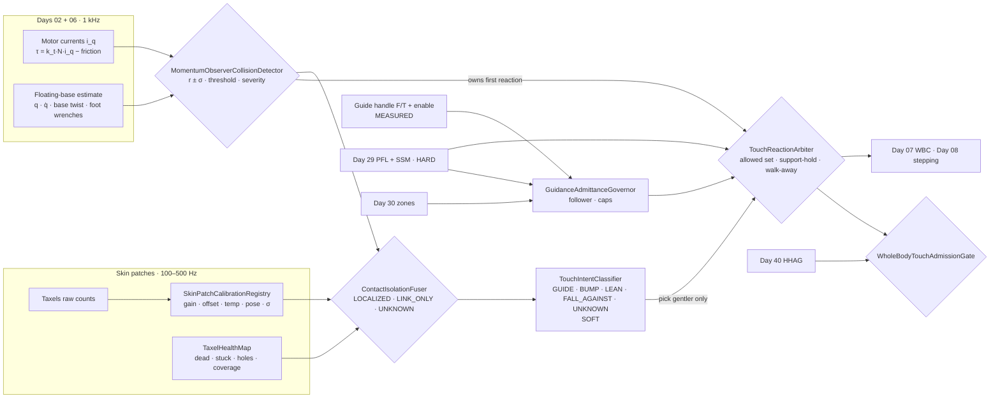
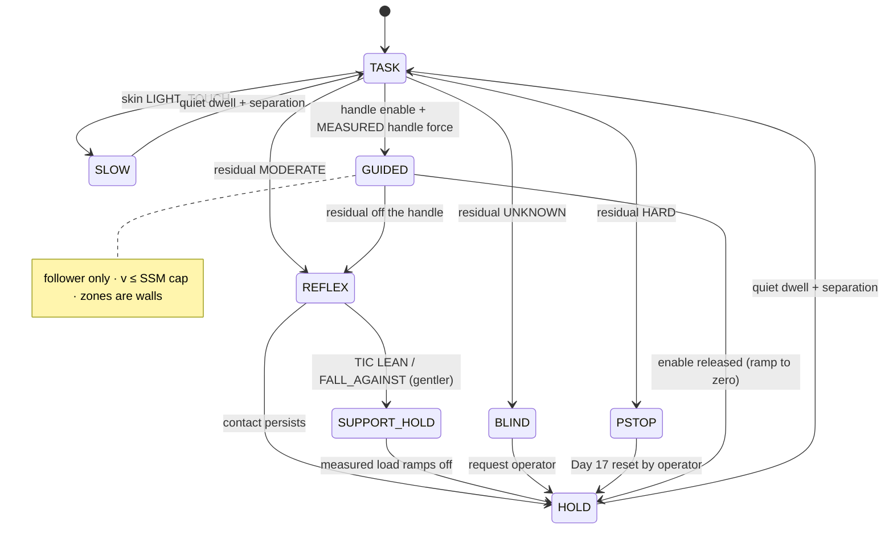
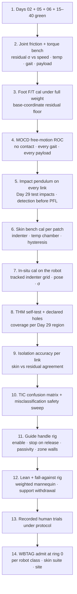

# Day 41 — Whole-body tactile skin and intentional touch vs collision: SkinPatchCalibrationRegistry / TaxelHealthMap / MomentumObserverCollisionDetector / ContactIsolationFuser / TouchIntentClassifier / GuidanceAdmittanceGovernor / TouchReactionArbiter / WholeBodyTouchAdmissionGate under HumanHandoverAdmissionGate + CooperativeTaskAdmissionGate + TaskCompositionAdmissionGate + FleetSkillCatalogAdmissionGate + CrossEmbodimentSkillTransferAdmissionGate + DexterousSkillCaptureAdmissionGate + TelepresenceAdmissionGate + RemoteTeleopAdmissionGate + FleetSharedControlAdmissionGate + SharedControlAdmissionGate + CollaborativeWorkspaceAdmissionGate + proximity + zone attestation + supervisor + logging + canary + HIL + fleet + fleet-canary + incident + forensics/reopen + change-management + maintenance + thermal + energy gates

![SkinPatchCalibrationRegistry / TaxelHealthMap / MomentumObserverCollisionDetector / ContactIsolationFuser / TouchIntentClassifier / GuidanceAdmittanceGovernor / TouchReactionArbiter / WholeBodyTouchAdmissionGate: a humanoid covered in capacitive skin patches with an honest coverage map (dead taxels in red, declared holes at the elbow, knee, and hand seams); a person leads it by a guide handle on the forearm while a second person bumps its back; the momentum-observer residual from Day 02 currents and Day 06 estimates detects every contact on the whole body, covered or not, and owns the reaction; the skin only localizes and characterizes contact where calibrated taxels exist; TouchIntentClassifier labels GUIDE / BUMP / FALL_AGAINST / UNKNOWN as soft context that may only pick a slower, softer, or stiller reaction; GuidanceAdmittanceGovernor moves the base and arm only from MEASURED handle force with a physical enable, capped by Day 29 SSM speed and PFL, inside Day 30 zones; release the handle and the robot stops; WholeBodyTouchAdmissionGate fails closed under Day 40 HHAG, and never raises Day 29 PFL, writes Day 05 torque_scale, or bypasses CrossSiteZoneConfigGate](/images/day41-whole-body-tactile-skin-touch.png)

[Day 02](/lessons/day-02-joint-foc) owns the current loop and the $i_q \to \tau$ map. [Day 05](/lessons/day-05-power-bms) owns `torque_scale` **forever**. [Day 06](/lessons/day-06-estimation-balance) owns the floating-base estimate and its honesty under derating. [Day 07](/lessons/day-07-wbc-balance) owns whole-body balance and [Day 09](/lessons/day-09-push-recovery) owns disturbance rejection. [Day 17](/lessons/day-17-runtime-safety-supervisor) owns ESTOP and the kill-chain. [Day 29](/lessons/day-29-human-proximity-safety) owns SSM, body-region PFL ceilings, and the "lower only" rule. [Day 30](/lessons/day-30-collaborative-workspace-zoning) owns attested zones and `CrossSiteZoneConfigGate`. [Day 34](/lessons/day-34-telepresence-haptic-force-honesty) owns the passivity observer. [Day 36](/lessons/day-36-cross-embodiment-skill-transfer) owns per-unit sensor provenance and σ. [Day 40](/lessons/day-40-human-robot-handover-co-carry) owns the person as an unadmittable role, the follower cap, the walk-away invariant, and `HumanHandoverAdmissionGate` (HHAG).

Day 40 had one place where a person touched the robot: the object in its hand, read through a calibrated wrist F/T. Today the person touches **anywhere**. A technician puts a hand on H-09's forearm to lead it down an aisle. Someone squeezes past and their shoulder brushes its back. A tired worker leans on it. A cart clips its knee. The robot's own elbow sweeps into a shelf post. Each one is "contact," and each needs a different answer, but they arrive through sensors that are far less honest than a wrist F/T.

Six lies show up the first week:

1. **Skin-as-truth lie.** A patch on the upper arm reads 14 N, so the robot "knows" it was touched there at 14 N. The patch was calibrated at 22 °C on the bench; it's 34 °C next to the shoulder actuator, and capacitive taxels drift with temperature and with humidity. Half the reading is the motor's heat.
2. **Coverage lie.** The coverage dashboard says "92% skin." The 8% is the elbow crease, the knee, the hand seams, and the joint gaps: exactly where pinches happen. A contact there reads zero on the skin, so the skin-first detector says "no contact" while a finger is in the elbow.
3. **Dead-taxel lie.** Taxel 7 on the back patch failed open three weeks ago. It reads a perfect, quiet zero. The health dashboard shows the patch as green because the patch's CAN heartbeat is fine.
4. **Classifier-owns-the-reaction lie.** The intent net labels a contact as "guiding hand, confidence 0.91," so the robot follows it instead of reacting as for a collision. It was a cart handle hitting the forearm at 0.8 m/s. The classifier decided whether to obey the collision detector.
5. **Follow-the-push lie.** Lead-by-hand mode is "on" whenever any sustained force appears on the arm, so a person leaning on it to steady themselves gets walked backward into the aisle. Or a child pushes the robot's chest, and the base drives where the push points.
6. **Retreat-drops-them lie.** Every contact triggers "back away." The worker leaning on H-09 because they felt dizzy loses their support at the worst moment.

Today owns **`SkinPatchCalibrationRegistry` / `TaxelHealthMap` / `MomentumObserverCollisionDetector` / `ContactIsolationFuser` / `TouchIntentClassifier` / `GuidanceAdmittanceGovernor` / `TouchReactionArbiter` / `WholeBodyTouchAdmissionGate`**. The question is: **how do you let people touch, lead, lean on, and bump a humanoid anywhere on its body, when skin taxels are MEASURED only where a calibrated, healthy taxel exists and every hole is declared; where the joint momentum-observer residual detects contact everywhere and owns the reaction; where touch intent is soft context that can only slow, yield, or stop; where guided motion is a capped follower that needs a physical enable and stops when the hand lets go — without raising Day 29 PFL, writing Day 05 `torque_scale`, or bypassing `CrossSiteZoneConfigGate`?**

## Two sensors, two jobs

The design rests on splitting detection from description:

1. **The residual detects.** The generalized-momentum observer, built from motor currents (Day 02) and the floating-base estimate (Day 06), sees every external wrench that reaches the joints, wherever it lands on the body, skin or no skin. It's whole-body by construction, runs at the torque-loop rate, and has a σ you can measure. It owns "was there a collision, and how hard."
2. **The skin describes.** Taxels say *where* and *how spread out* a contact is, with millimeter resolution and low force thresholds, but only on calibrated, healthy patches. The skin owns "where on the surface, what area, how it's evolving," and only inside its declared coverage.
3. **Intent is a guess about a person.** Contact duration, area, location, force rate, and context feed a classifier whose output is labeled `SOFT`. It may pick a gentler reaction from the residual's allowed set. It may never veto one.
4. **Guidance is a mode, not an inference.** Lead-by-hand is armed by a physical enable on an instrumented guide handle. The motion comes from MEASURED handle force through an admittance capped by Day 29. The classifier can't arm it, and a push on the chest can't drive it.
5. **Walk-away still holds.** Every reaction leaves the person free to let go and step back without the robot following, pushing harder, or dropping support it was giving.

| Layer | Owns | Must not own |
|-------|------|--------------|
| `SkinPatchCalibrationRegistry` | Per-patch, per-taxel gain, offset, temperature coefficient, hysteresis, spatial pose on the link mesh, cal version, σ | Patch "health" from heartbeat; borrowing another patch's cal |
| `TaxelHealthMap` | Dead, stuck, noisy, and drifting taxels; declared coverage holes; effective coverage per link and body region | Hiding a hole by interpolation |
| `MomentumObserverCollisionDetector` | Residual $\mathbf{r}$, σ-derived thresholds, collision verdict and severity; first reaction | Waiting for skin or classifier before reacting |
| `ContactIsolationFuser` | Contact link, location, and wrench from residual + skin; three-valued `LOCALIZED` / `LINK_ONLY` / `UNKNOWN` | Calling a residual-only location MEASURED_SKIN |
| `TouchIntentClassifier` | `GUIDE` / `BUMP` / `LEAN` / `FALL_AGAINST` / `UNKNOWN` as SOFT with age | Selecting a reaction outside the allowed set; arming guidance |
| `GuidanceAdmittanceGovernor` | Lead-by-hand on the guide handle; admittance to base and arm velocity; caps and enable | Following force from anywhere but the handle; leading |
| `TouchReactionArbiter` | Reaction ladder, support-hold for lean and fall-against, walk-away invariant | ESTOP; raising stiffness on a person |
| `WholeBodyTouchAdmissionGate` | Fail-closed admit of skin suites, coverage, thresholds, and guidance | `JointCommand`; Day 05; PFL |
| Days 02 / 05 / 06 / 07 / 17 / 29 / 30 | Current, torque, estimate, balance, kill-chain, PFL, zones | Being outranked by "it was a friendly touch" |

**Core thesis:** **the residual owns the reaction because it's the only whole-body detector you can bound; the skin is MEASURED only where you can prove a taxel is calibrated and alive, and it can only add detail; intent can only make the robot gentler; and guided motion comes from a handle you can measure, with an enable a person has to hold.**



## Physical machine: what touch does to a humanoid

### The momentum observer: the whole body as a force sensor

For a floating-base humanoid with joint coordinates $\mathbf{q}$ (base plus joints), the dynamics are

$$
\mathbf{M}(\mathbf{q})\ddot{\mathbf{q}} + \mathbf{C}(\mathbf{q},\dot{\mathbf{q}})\dot{\mathbf{q}} + \mathbf{g}(\mathbf{q}) = \mathbf{S}^\top \boldsymbol{\tau} + \sum_{f \in \text{feet}} \mathbf{J}_f^\top \mathbf{F}_f + \boldsymbol{\tau}_{\mathrm{ext}}
$$

where $\boldsymbol{\tau}_{\mathrm{ext}}$ is everything you didn't plan for: a hand, a shoulder, a cart, a shelf. The generalized momentum is $\mathbf{p} = \mathbf{M}\dot{\mathbf{q}}$, and using $\dot{\mathbf{M}} = \mathbf{C} + \mathbf{C}^\top$ the observer is

$$
\mathbf{r}(t) = \mathbf{K}_O\left[\mathbf{p}(t) - \mathbf{p}(0) - \int_0^t \left(\mathbf{S}^\top\boldsymbol{\tau} + \sum_f \mathbf{J}_f^\top\mathbf{F}_f + \mathbf{C}^\top\dot{\mathbf{q}} - \mathbf{g} + \mathbf{r}\right)ds\right]
$$

which gives first-order dynamics $\dot{\mathbf{r}} = \mathbf{K}_O(\boldsymbol{\tau}_{\mathrm{ext}} - \mathbf{r})$. Three things make it the right owner:

- **No acceleration.** It needs $\mathbf{q}$, $\dot{\mathbf{q}}$, joint torque, and foot wrenches, never $\ddot{\mathbf{q}}$, which is too noisy to differentiate.
- **Whole-body.** A contact anywhere on link $k$ shows up in every joint between that link and the ground: $\boldsymbol{\tau}_{\mathrm{ext}} = \mathbf{J}_{c,k}^\top \mathbf{F}_c$. No skin needed.
- **Tunable bandwidth.** $\mathbf{K}_O$ trades latency against noise. At $K_O = 50\ \mathrm{s^{-1}}$ the residual reaches 63% of a step in 20 ms.

### Where the residual lies

The residual is only as honest as its inputs:

- **Torque from current.** Day 02's $\tau = k_t N i_q$ ignores gearbox friction (Coulomb plus viscous, temperature-dependent), torque ripple, and efficiency differences between driving and back-driving. On a harmonic-drive joint, unmodeled friction can be 5–15% of rated torque. That's the residual's noise floor, and it moves with joint temperature (Day 27) and wear (Day 26).
- **Foot wrenches.** The feet carry the robot's whole weight. A 2% error in a sole F/T at 400 N is an 8 N phantom on the base coordinates. Base-coordinate residual components are the noisiest; arm joints far from the ground are the cleanest.
- **Model mass.** A tool on the wrist, a battery swap, or a cable bundle shifts $\mathbf{M}$ and $\mathbf{g}$. Unmodeled payload is a constant residual. Day 06's derating rule applies: under low `torque_scale`, commanded and delivered torque diverge, so the residual must widen its band, not invent a contact.
- **Fast motion.** At high $\dot{\mathbf{q}}$, friction and Coriolis model errors grow. A fixed threshold either misses gentle contacts at rest or fires constantly while walking.

So thresholds are **σ-derived and state-dependent**, per joint:

$$
\theta_j(\dot{q}_j, T_j, \text{gait phase}) = k\,\sigma_{r,j}(\dot{q}_j, T_j, \text{gait phase}) + \theta_{\min,j}
$$

with $\sigma_{r,j}$ measured on the bench across speed, temperature, and gait phase in free motion, and $k$ chosen from a ROC (below). A contact is declared when $|r_j| > \theta_j$ on any joint, or when a weighted norm crosses its own threshold.

### Isolation: which link, and where on it

The residual gives $\mathbf{J}_{c,k}^\top \mathbf{F}_c$, not $k$ or the contact point. Isolation exploits structure:

- **Link isolation.** The most distal joint with a significant residual bounds the link: a contact on the forearm shows in the elbow and everything proximal, but not the wrist. With noise, that's a three-valued answer.
- **Point isolation.** For a single contact with a pure force (no torque, typical of a fingertip or a bump), $\mathbf{F}_c$ passes through the contact point. Search the link's surface mesh for the point whose force line best explains $\mathbf{r}$ in least squares. It's ill-conditioned on links near the base, and two simultaneous contacts on one chain can't be separated without skin.
- **Skin anchoring.** If a calibrated, healthy taxel cluster fires on the isolated link inside the same time window, the location comes from the skin, and the residual's force estimate is checked against the skin's: agreement within σ upgrades confidence; disagreement means two contacts, or a broken patch.

### Skin: what a taxel is

Most whole-body skins are **capacitive** (a dielectric layer between electrodes; pressure compresses it), some are **piezoresistive**, some **barometric** (MEMS pressure sensors in an elastomer), some **optical**. Every type shares the same physics problems:

- **Temperature.** Capacitive and barometric taxels drift with temperature; a patch near an actuator runs 10–15 °C above ambient. Without a per-taxel temperature coefficient, heat looks like pressure.
- **Hysteresis and creep.** Elastomers relax under sustained load. A hand resting for 10 s reads lower at the end than the start; release reads a brief negative. Lean detection must model this, or a lean "fades away."
- **Crosstalk and proximity.** Capacitive taxels respond to a nearby body before contact, and to neighbors. Proximity mode is useful for Day 29 SSM, but it isn't contact.
- **Curvature and mounting.** A patch wrapped on a forearm reads differently than on the flat bench where it was calibrated.
- **Spatial pose.** A taxel's position on the link mesh must be known to millimeters. Without it, the skin says "taxel 211" instead of a point the controller can use.
- **Bandwidth and bus.** Hundreds or thousands of taxels on a shared CAN-FD or EtherCAT segment usually stream at 50–500 Hz with event-driven bursts. Skin latency can be 5–20 ms worse than the residual.

So a taxel reading is MEASURED only when its patch has a **fresh calibration in situ** (on the robot, at its operating temperature, on its curvature), a known pose, a live health status, and a σ. Otherwise it's `ESTIMATED` or `UNAVAILABLE`, and the fuser treats that area as a hole.

### Coverage holes are real

You can't cover a humanoid. Joints need gaps to rotate, cable exits need openings, and hands need fingertips with different sensors. Holes cluster at the elbow crease, the back of the knee, the armpit, the hip flexion gap, the neck, and the hand seams, which are also the pinch points in Day 29's body-region table. So:

- **Holes are declared**, as mesh regions with a reason, and published. A hole isn't "low coverage"; it's "no skin evidence here, ever."
- **The residual covers holes.** A contact in a hole is still detected by the residual, located at link level, and reacted to. It just can't be characterized by area or pressure distribution.
- **Pinch points get extra rules.** A closing joint whose gap is a declared hole has its closing speed and torque limited near the end of travel, per Day 29's pinch table, because the residual alone can't tell a finger from a cable in the gap.

### The humanoid twist: contact is also a balance disturbance

On a fixed arm, a collision reaction is "stop" or "retract." On a humanoid standing on two feet, every reaction is also a balance event:

- **Retracting an arm fast** shifts the CoM and produces a reaction moment at the feet. A reflex that's too aggressive can trip Day 09 push recovery into a capture step, and a step can land on the person who touched it.
- **Going limp** (zero-gravity torque mode) on one arm is fine; going limp on the torso is falling.
- **A lean is a load the robot is supporting.** A 30 kg lean on the chest is 290 N, which Day 07 must balance. Retreating removes the support; stiffening against it past the PFL row hurts the person.
- **A fall-against is an impulse plus a lean.** The safest reaction is usually to *stay*: hold posture, stay compliant within PFL, take a balance-preserving step only away from the person if needed, never toward them.

That's why the reaction ladder lives in one arbiter that knows balance, PFL, and walk-away, not in the skin driver.

## SkinPatchCalibrationRegistry: per patch, per taxel, in situ

`SkinPatchCalibrationRegistry` (SPCR) stores calibration per patch and per taxel, never per robot model:

- **Identity.** Patch serial, link, firmware, sensor type; part of Day 36's `sensor_suite_hash`.
- **Response.** Per-taxel offset, gain, and a nonlinear map from counts to pressure, fitted against an indenter with a reference load cell. Hysteresis and creep parameters from load-hold-release cycles.
- **Temperature.** Per-taxel coefficient fitted over the operating range, plus the patch's own temperature sensor; a patch without one can't be MEASURED above its bench temperature band.
- **In-situ step.** After mounting, re-run offset and gain on the robot at operating temperature with a handheld instrumented indenter at a grid of known points. Bench-only cal is labeled `BENCH_CAL` and maxes out at `ESTIMATED`.
- **Spatial.** Taxel positions on the link mesh, from a CAD prior refined by in-situ probing with a tracked indenter or self-touch, with a position σ.
- **σ.** Pressure σ per taxel as a function of temperature and load, and a patch-level force σ.
- **Freshness.** Cal age and a drift monitor: at rest and untouched, every taxel's baseline should stay within its band; a drifting baseline ages the cal.

Rules: **no patch borrows another's cal**, even an identical part number (Day 36). A replaced patch is a new suite hash and starts at `UNCALIBRATED`. A cal never promotes a taxel to MEASURED without the in-situ step.

## TaxelHealthMap: dead is quiet

`TaxelHealthMap` (THM) is the honest map of what the skin can actually see:

| Status | Detection | Effect |
|--------|-----------|--------|
| `OK` | Baseline in band, responds to periodic self-test | MEASURED with σ |
| `DEAD_OPEN` | No response to self-test excitation; flatline | Hole |
| `STUCK` | Constant nonzero, no response | Hole; masked from contact |
| `NOISY` | Baseline variance above band | `ESTIMATED` with inflated σ, or hole |
| `DRIFTING` | Baseline moving faster than temp model explains | `ESTIMATED` until recal |
| `CROSSTALK` | Fires only with a neighbor, never alone | Merged or masked |
| `DECLARED_HOLE` | No taxel by design | Hole, permanent |

Self-test is the key: a capacitive patch can drive its electrodes with a test excitation; a barometric patch can check sensor ID and a pressure range; a dead taxel that reads a perfect zero is caught only by actively poking it. THM runs self-test at startup and periodically at rest.

Coverage is published **per body region from Day 29's table**, not as one number: "forearm 94% effective, elbow crease 0% declared, upper back 81% effective (7 dead taxels)." A region whose effective coverage falls below its admitted floor demotes that region's touch features to residual-only, and if guidance or skin-dependent thresholds relied on it, WBTAG demotes those too.

## MomentumObserverCollisionDetector: the reaction owner

`MomentumObserverCollisionDetector` (MOCD) runs at the torque-loop rate on the robot:

- **Inputs.** Day 02 joint torque estimates with a friction model and its σ; Day 06 $\mathbf{q}$, $\dot{\mathbf{q}}$, base twist, and foot wrenches; current $\mathbf{M}$, $\mathbf{C}$, $\mathbf{g}$ with payload from the task (Day 38 object model); `torque_scale` and derating state.
- **Output.** $\mathbf{r} \pm \boldsymbol{\sigma}_r$, per-joint flags, a severity class (`LIGHT` / `MODERATE` / `HARD`) from residual magnitude and rate, and `UNKNOWN` when inputs are stale, saturated, derated beyond the model, or a foot F/T is in fault.
- **Planned contact subtraction.** Contacts the task intends (a grasp, a hand-on-table support from Day 11, a co-carry from Day 40) enter the dynamics as known wrenches from their own sensors, so the residual sees only *unplanned* contact.
- **Reaction ownership.** On a collision verdict, MOCD posts the reaction class immediately to `TouchReactionArbiter`, within one control cycle of the threshold crossing, without waiting for skin, isolation, or intent. Later evidence may soften the reaction inside its allowed set. Nothing later can cancel it.
- **UNKNOWN is not "no contact."** When the residual is `UNKNOWN` (estimator fault, saturation), the arbiter treats the robot as blind to touch: slow to the Day 29 floor and request a hold.

A practical detail: residual thresholds relax when the robot is still and tighten when moving, because the noise floor does the opposite. Day 29 PFL is the ceiling either way; MOCD only makes the robot react *earlier* than PFL would bound.

## ContactIsolationFuser: where, from what, labeled honestly

`ContactIsolationFuser` (CIF) combines residual isolation with skin evidence:

| Residual | Skin on isolated link | Verdict | Label |
|----------|----------------------|---------|-------|
| Contact, link $k$ | Healthy cluster fires, force agrees within σ | `LOCALIZED` at skin centroid, area, pressure map | `MEASURED_SKIN` + `MEASURED_RESIDUAL` |
| Contact, link $k$ | Region is a hole or degraded | `LINK_ONLY`, point estimate from force-line fit | `MEASURED_RESIDUAL`, location `ESTIMATED` |
| Contact, link $k$ | Healthy cluster, force disagrees beyond σ | `UNKNOWN MULTI_OR_FAULT` | Residual severity kept; skin flagged |
| No contact | Healthy cluster fires above floor | `LIGHT_TOUCH` (below residual threshold) | `MEASURED_SKIN` |
| No contact | Proximity only | `PROXIMITY` (to Day 29 SSM) | `ESTIMATED`, not contact |
| `UNKNOWN` | any | `UNKNOWN` | Blind-to-touch handling |

Two points matter. First, the skin can report a contact the residual missed (a light hand on the back, under the residual's noise floor). That's valuable: it's the gentlest touch and the earliest warning. It may make the robot slower or softer; it never makes the robot ignore a residual verdict. Second, a residual contact in a hole never becomes "no contact" because the skin is quiet. Quiet skin over a hole means nothing.

## TouchIntentClassifier: soft context about a person

`TouchIntentClassifier` (TIC) labels each fused contact:

| Label | Typical features | What it may do |
|-------|------------------|----------------|
| `GUIDE` | On the guide handle or forearm, palm-sized area, 5–40 N, smooth, sustained over 300 ms, consistent direction | Nothing by itself; guidance needs the handle enable |
| `BUMP` | Impulsive (under 150 ms), high force rate, small or edge area, any region | Choose the softer reflex in the allowed set |
| `LEAN` | Torso or upper arm, large area, slowly rising, sustained, mostly into the body | Choose `SUPPORT_HOLD` over retract |
| `FALL_AGAINST` | Impulse followed by sustained large load, Day 29 track shows the person's CoM moving toward the robot | Choose `SUPPORT_HOLD`; request help per site policy |
| `UNKNOWN` | Anything else, stale, or low confidence | Default reaction |

The rules are the point:

- **Labeled `SOFT` with age.** TIC is a learned or rule-based classifier on skin, residual, and vision features. Its output is never MEASURED.
- **Gentler only.** TIC may select a reaction from the subset MOCD's severity allows, and only toward lower energy: slower, softer, stiller. It can't select "continue the task," "speed up," "raise stiffness," or "ignore."
- **No arming.** `GUIDE` can't enter guidance mode. `LEAN` can't raise PFL to "hold the person up."
- **Misclassification must be safe both ways.** For every pair (true class, predicted class), the twin checks that the reaction the predicted class picks is inside PFL and the walk-away invariant for the true class. Calling a bump a lean must not drive the robot into the person; calling a lean a bump must not drop them.

## GuidanceAdmittanceGovernor: lead by hand, with a handle

`GuidanceAdmittanceGovernor` (GAG) is the only path by which touch moves the robot on purpose:

- **Instrumented handle.** A guide handle on the forearm (or a designated grasp site) with its own 6-axis F/T, calibrated under SPCR rules, and a **physical enable**: a three-position enabling switch or a capacitive grip detector on the handle with a dual channel. Releasing or squeezing hard drops the enable.
- **Admittance.** With the enable held, handle force $\mathbf{f}_g$ (gravity-compensated, deadband $f_0$) drives a desired base velocity and arm motion:

$$
\mathbf{D}_g \dot{\mathbf{x}}_d + \mathbf{K}_g \mathbf{x}_d = \operatorname{dz}(\mathbf{f}_g, f_0), \qquad \|\dot{\mathbf{x}}_d\| \le v_{\mathrm{SSM}}, \quad \|\mathbf{f}_g\| \le f_{\mathrm{cap}}
$$

  where $v_{\mathrm{SSM}}$ is Day 29's speed cap for the current separation from *every other* tracked person, and the damping floor comes from Day 34 passivity analysis. Arm stiffness $\mathbf{K}_g$ can be near zero for the hand, so the person feels a light, damped robot.
- **Follower always.** The planner may show a suggested route (light bar, voice), never a force. If the person leads toward a Day 30 zone boundary, the admittance saturates at the boundary as a virtual wall with Day 34 passivity, and the robot stops there.
- **Stepping.** Base velocity goes to Day 08 as a walking reference; step placement stays inside Day 30 zones and never toward another person.
- **Stop on release.** Enable lost: base velocity ramps to zero within the Day 29 stopping distance budget; arm goes to a gentle hold; no motion toward where the hand went.
- **Only the handle.** Force on the chest, back, or anywhere else never drives guidance, whatever TIC says. That kills the follow-the-push lie by structure.

## TouchReactionArbiter: the reaction ladder

`TouchReactionArbiter` (TRA) turns the residual verdict, the fused contact, and the soft label into a whole-body reaction that Day 07 executes:

| MOCD severity | Allowed reactions (gentlest last) | Default | TIC may choose |
|---------------|-----------------------------------|---------|----------------|
| `LIGHT` (skin-only or low residual) | slow to Day 29 floor; pause | slow | pause |
| `MODERATE` | stop task motion; compliant reflex on the contacted chain; `SUPPORT_HOLD` | stop + reflex | `SUPPORT_HOLD` (LEAN), softer reflex (BUMP) |
| `HARD` | Day 17 protective stop of the configured category, plus reflex inside balance | protective stop | none softer than protective stop |
| `UNKNOWN` (blind) | slow to floor, hold, request operator | hold | none |

Reactions in detail:

- **Compliant reflex.** On the contacted kinematic chain, switch to torque mode with gravity compensation and a small retract bias along $-\hat{\mathbf{F}}_c$, capped in distance and speed so Day 07 balance holds. On the torso, there's no limp mode; the torso holds posture with impedance reduced to the Day 07 floor.
- **`SUPPORT_HOLD`.** For a lean or fall-against: stop task motion, hold posture, keep the contacted surface compliant up to the Day 29 region cap, and let Day 07 carry the load. If the load would exceed the balance margin, step **away from nothing**: widen stance or lower CoM; a capture step toward the person is forbidden, and one away from them only if Day 30 says that space is free.
- **Walk-away invariant.** In every state, if the person lets go and steps back, the robot's next motions are: none toward them, no force increase on anything they still touch, and no sudden withdrawal of support from someone still leaning (support ramps off as the measured load ramps off, not on a timer).
- **Resume.** Task motion resumes only after the residual and skin have been quiet for a dwell and Day 29 separation is restored. Resume is never triggered by TIC.
- **HOLD is not ESTOP.** Day 17 owns the kill-chain. A PFL overshoot trips it as always.

## WholeBodyTouchAdmissionGate: skin, holes, thresholds, guidance

`WholeBodyTouchAdmissionGate` (WBTAG) admits a robot's touch stack per robot class, skin suite, and site. It fails closed unless:

- Day 40 HHAG GREEN where handovers run; Day 29 `HumanSafetyAdmissionGate` and Day 30 zones GREEN; `CrossSiteZoneConfigGate` GREEN for the site
- Every patch has an in-situ SPCR calibration, fresh, with σ; THM self-test passed; declared holes published per Day 29 body region; effective coverage at or above each region's floor
- MOCD thresholds derived from measured residual σ across speed, temperature, gait phase, and payload; ROC shows detection of the Day 29 test impacts before PFL limits on every region, including holes
- Isolation accuracy measured per link on the bench; links where it's below spec are `LINK_ONLY` by config
- TIC confusion matrix measured; the pairwise misclassification safety check passes in twin and HIL; TIC has no edge to arm guidance, resume, or raise any limit (static check)
- GAG handle F/T calibrated, enable dual-channel verified, stopping-on-release time within Day 29 budget, passivity verified on stiff and soft arm models
- Twin and HIL walk-away and support-withdrawal sweeps GREEN; recorded human trials under the site's study protocol before ring 1
- Days 17 / 22–30 GREEN

Ring and evidence follow Day 40: keyed by (robot class, skin suite hash, site), never by person. A failed patch, a new dead-taxel cluster, a raised residual floor after a gearbox swap, or a payload change outside the model demotes the affected region or the whole stack immediately. WBTAG never publishes `JointCommand`, never clears ESTOP, never writes Day 05, never raises PFL. **Demotions always flow.**



## Digital twin: skin you can break on purpose

The twin carries:

- **Residual model.** The same observer running on simulated currents with friction, ripple, temperature, and foot-F/T errors injected from the measured σ, so the twin's false-positive rate is the real one.
- **Skin model.** Per-taxel response with temperature drift, hysteresis, creep, crosstalk, proximity, and the THM fault set (dead, stuck, noisy, drifting) injected at random. Holes are geometry.
- **Contact population.** Hands (guide, rest, poke), shoulders (bump), torsos (lean, fall-against), carts and shelves (rigid edges at speed), and the robot's own self-collision, at every link including holes.
- **Person models.** As in Day 40, a wide population, used only to break the stack: different lean weights, fall impulses, guide pull styles, let-go timing, and walk-aways.

What the twin is for:

1. **Residual ROC.** Free motion across gait, speed, temperature, and payload vs Day 29 test impacts on every region; pick $k$ and $\theta_{\min}$ so every impact is detected with margin before the PFL energy limit.
2. **Coverage sweep.** Repeat contacts in every declared hole and with random dead-taxel masks; check the residual still detects and the reaction is unchanged in class.
3. **Misclassification sweep.** For every (true, predicted) TIC pair, check PFL and walk-away on ground truth.
4. **Support-withdrawal sweep.** Leans and falls released at random phases; check support ramps with measured load and never drops faster than the person's own unloading.
5. **Guidance sweep.** Enable dropped at every phase; check stopping inside the budget and no motion toward the hand; push on non-handle regions during guidance; check no motion from them.
6. **Replay.** After every real contact, replay the bag and show the reaction came from MOCD and was only softened by TIC.

Twin outputs stay SIM and never count as human-subject evidence.

## A worked shift

Robot H-09, class K1, skin suite `skin-k1-r3` (42 patches, 2,310 taxels, capacitive with per-patch temperature sensors). In-situ cal 3 days old. THM: 9 dead taxels (upper back), declared holes at elbows, knees, armpits, hip gaps, neck, and hand seams. Effective coverage: forearm 95%, upper arm 91%, chest 93%, upper back 86%, thigh 89%. MOCD $K_O = 50\ \mathrm{s^{-1}}$; elbow residual σ 0.6 N·m at rest, 1.4 N·m at 1 rad/s; $k = 5$. GAG: forearm handle, $f_0 = 4$ N, $f_{\mathrm{cap}} = 40$ N, $v_{\mathrm{SSM}}$ 0.5 m/s with nobody else within 2 m.

| Time | Event | MEASURED / HARD | Component action | Result |
|------|-------|-----------------|------------------|--------|
| 08:05 | Patch on left upper arm warm-up after shoulder load | Baseline drift explained by temp model | SPCR temp comp | No phantom touch |
| 08:20 | Startup self-test finds 2 new dead taxels on upper back | THM `DEAD_OPEN` | Coverage upper back 84% vs floor 80% | Still admitted; logged |
| 09:10 | Technician grips the forearm handle, holds enable, pulls | Handle F/T 12 N forward | GAG admittance; base 0.3 m/s | Robot walks alongside |
| 09:12 | A second person comes within 1.2 m | Day 29 track | $v_{\mathrm{SSM}}$ drops to 0.25 m/s | Guidance slows |
| 09:13 | Technician steers into a Day 30 zone edge | Zone wall | Admittance saturates at the wall | Robot stops at the line |
| 09:14 | Technician lets go to answer the phone | Enable lost | Ramp to zero in 0.4 s; gentle hold | No motion toward the hand |
| 10:02 | Passer-by's shoulder brushes the back | Skin `LIGHT_TOUCH` 6 N; residual below threshold | TRA slow | Task slows, resumes after dwell |
| 10:40 | Cart clips the right knee | Residual `MODERATE` at hip/knee; knee is a declared hole | CIF `LINK_ONLY` shank; TRA stop + reflex | Leg goes compliant inside balance |
| 10:40 | TIC says `GUIDE` 0.74 on the same contact | SOFT | Not allowed to change anything but pick gentler | Reaction stays stop + reflex |
| 11:30 | Worker leans on the chest, feels dizzy | Residual rising 180 N; skin chest 0.04 m² | TIC `LEAN`; TRA `SUPPORT_HOLD` | Robot holds still, compliant; Day 07 widens stance |
| 11:31 | Worker straightens up | Measured load ramps to zero over 2 s | Support ramps with load | No sudden withdrawal |
| 13:05 | Gearbox swap on left elbow | Residual σ at elbow 1.1 N·m (was 0.6) | WBTAG demotes left-arm touch to recal | Left arm slow-only until thresholds re-derived |
| 14:20 | Proposal: "use TIC GUIDE to enter guidance without the handle" | Contract graph | WBTAG static check: TIC edge to arm motion | Refused at publish |
| 14:40 | Proposal: "raise chest PFL so the robot can hold up heavier leans" | Day 29 row | Refused; caps aren't task parameters | Stays |

## Ownership conflicts

| Conflict | Winner | Behavior |
|----------|--------|----------|
| Skin says nothing vs residual says contact | MOCD | React; skin quiet means nothing in a hole |
| Skin location vs residual force-line location | CIF | Skin if healthy and forces agree; else `UNKNOWN MULTI_OR_FAULT` |
| TIC `GUIDE` vs MOCD `MODERATE` | MOCD | Reaction stands; TIC only softens within set |
| TIC wants retract vs person leaning | TRA | `SUPPORT_HOLD`; support follows measured load |
| Non-handle push vs guidance | GAG | Only handle force drives motion |
| Guidance pull vs Day 30 zone | Day 30 | Wall; robot stops |
| Guidance speed vs Day 29 SSM for others | Day 29 | Cap from every tracked person |
| Reflex retract vs balance | Day 07 | Retract capped; no capture step toward a person |
| Bench cal vs in-situ | SPCR | Bench-only is `ESTIMATED` |
| Patch heartbeat vs self-test | THM | Self-test decides health |
| Any reaction vs Day 29 row | Day 29 | Lower only |
| Any touch config vs `CrossSiteZoneConfigGate` | Day 30 | Refused for that site |

## Shared API

```text
BusHeader:
  t_mono
  seq
  clock_domain
  age_ms
  producer_id

SkinPatchCal:                                # SPCR
  patch_id
  link_id
  sensor_type              # CAPACITIVE | PIEZORESISTIVE | BAROMETRIC | OPTICAL
  cal_kind                 # IN_SITU | BENCH_CAL | UNCALIBRATED
  cal_version
  cal_age_s
  temp_model_valid_c[2]
  taxels[]:
    taxel_id
    pose_on_mesh           # point + normal, with sigma_mm
    offset
    gain_curve_id
    temp_coeff
    hysteresis_id
    sigma_kpa
  sensor_suite_hash        # Day 36

TaxelHealth:                                 # THM
  header: BusHeader
  patch_id
  taxel_status[]           # OK | DEAD_OPEN | STUCK | NOISY | DRIFTING | CROSSTALK
  declared_holes[]:        # mesh region + reason + day29_region
  coverage_by_region[]:    # region, effective_fraction, floor
  self_test_age_s

CollisionResidual:                           # MOCD
  header: BusHeader
  r[]                      # per generalized coordinate
  sigma_r[]
  threshold[]
  verdict                  # NONE | LIGHT | MODERATE | HARD | UNKNOWN
  unknown_reason           # STALE | SATURATED | DERATED | FOOT_FT_FAULT | MODEL_PAYLOAD
  planned_contacts_subtracted[]

FusedContact:                                # CIF
  header: BusHeader
  verdict                  # LOCALIZED | LINK_ONLY | LIGHT_TOUCH | PROXIMITY | UNKNOWN
  link_id
  point                    # with sigma, label MEASURED_SKIN | ESTIMATED
  wrench                   # with sigma, label MEASURED_RESIDUAL
  area_m2                  # skin only
  day29_region

TouchIntent:                                 # TIC
  header: BusHeader
  label                    # GUIDE | BUMP | LEAN | FALL_AGAINST | UNKNOWN
  confidence
  provenance: SOFT
  may: [choose_gentler_in_allowed_set]

Guidance:                                    # GAG
  header: BusHeader
  enable                   # dual-channel, MEASURED
  handle_wrench            # MEASURED, sigma
  v_cmd
  v_cap_ssm
  zone_wall_active

TouchReaction:                               # TRA
  header: BusHeader
  state                    # TASK | SLOW | REFLEX | SUPPORT_HOLD | HOLD | GUIDED | PSTOP | BLIND
  owner                    # MOCD | GAG | SKIN_LIGHT
  softened_by              # TIC label or none
  walk_away_ok

WholeBodyTouchAdmission:                     # WBTAG
  robot_class
  skin_suite_hash
  site
  ring
  region_status[]
  forbid:
    joint_command: true
    dual_write_torque_scale: true
    write_estop: true
    raise_pfl_from_task: true
    bypass_cross_site_zone_config_gate: true
    intent_arms_motion: true
    person_keyed_evidence: true

# Unchanged owners
HumanHandoverAdmissionGate · CompliantFollowerGovernor · WalkAwayHoldArbiter (Day 40)
PassivityObserverGate (Day 34) · CrossSiteZoneConfigGate (Day 30)
HumanSafetyAdmissionGate · ContactForceLimiter (Day 29)
SupervisorState (Day 17): ESTOP · kill-chain · stage · monitors
BmsState / PowerState (Day 05): torque_scale · contactor · UVLO · STO
  accepts_requests_from_soft_layer: false
  accepts_requests_from_touch_intent: false
```

## Config

A starting configuration. Every number is a policy you re-derive from your own robot, skin, and Day 29 tables:

```yaml
whole_body_touch:
  skin_cal:
    measured_requires: [in_situ_cal, temp_model_valid, pose_sigma_mm_max_3, health_ok]
    bench_cal_max_label: ESTIMATED
    cal_max_age_days: 30
    borrow_cal_across_patches: forbidden
  taxel_health:
    self_test_period_s: 600
    self_test_at_startup: required
    heartbeat_implies_health: false
    coverage_floor_by_region:
      forearm: 0.85
      upper_arm: 0.80
      chest: 0.85
      upper_back: 0.80
      thigh: 0.80
    holes_declared: required
    interpolate_over_holes: forbidden
  residual:
    k_o_per_s: 50
    k_sigma: 5.0
    thresholds_from: measured_sigma(speed, temperature, gait_phase, payload)
    subtract_planned_contacts: true
    unknown_on: [stale, saturation, derate_beyond_model, foot_ft_fault, payload_outside_model]
    owns_reaction: true
    reaction_latency_cycles_max: 1
  isolation:
    skin_force_agree_k_sigma: 3.0
    link_only_links: [pelvis, torso_lower]   # point isolation below spec
  intent:
    label: SOFT
    may: [choose_gentler_in_allowed_set]
    may_not: [cancel_reaction, arm_guidance, resume_task, raise_limit, speed_up]
    misclassification_safety_check: required
  guidance:
    handle: forearm_left
    enable: dual_channel_three_position
    deadband_n: 4
    f_cap_n: 40                     # policy, below Day 29 hand/arm row
    v_cap: day29_ssm_all_tracked
    d_floor_from: day34_passivity
    zone_boundary: virtual_wall_passive
    stop_on_release_s: 0.4          # within Day 29 stopping budget
    force_from_non_handle: ignored
    capture_step_toward_person: forbidden
  reaction:
    light: slow_to_day29_floor
    moderate: [stop_task, compliant_reflex, support_hold]
    hard: day17_protective_stop
    unknown: [slow, hold, request_operator]
    support_withdrawal: follows_measured_load
    resume_requires: [quiet_dwell_1s, day29_separation]
    walk_away_invariant: required
  admission:
    gate: WholeBodyTouchAdmissionGate
    under: [HumanHandoverAdmissionGate, HumanSafetyAdmissionGate, CrossSiteZoneConfigGate, PassivityObserverGate]
    evidence_key: [robot_class, skin_suite_hash, site]
    person_keyed_evidence: forbidden
    demotions_always_flow: true
  forbidden:
    raise_pfl: true
    write_torque_scale: true
    bypass_cross_site_zone_config_gate: true
```

## Physical ↔ digital pairing

| Physical | Digital twin / backing |
|----------|------------------------|
| Patch near a hot actuator | SPCR temp model; drift without touch is not contact |
| Taxel failed open, reads zero | THM self-test `DEAD_OPEN`; region coverage drops |
| Finger in the elbow crease | Declared hole; residual detects; `LINK_ONLY`; pinch rule |
| Hand resting on the back for 10 s | Skin creep model; lean doesn't "fade" |
| Cart edge hits the knee | Residual `MODERATE`; reflex inside balance |
| Person leads by the forearm handle | MEASURED handle force + enable; admittance under SSM cap |
| Person pushes the chest during guidance | Ignored by GAG; residual reaction only |
| Person leans, then straightens | `SUPPORT_HOLD`; support follows measured load |
| Gearbox swap | Residual σ re-measured; thresholds re-derived before re-admit |
| New tool on the wrist | Payload in the model or residual `UNKNOWN MODEL_PAYLOAD` |

The pairing that matters most: **replay every contact from the robot's own bag and show the reaction came from the residual within one cycle and was only ever softened by intent, and the twin's coverage sweep shows every Day 29 test impact detected in every declared hole and under random dead-taxel masks.** If a reaction only reproduces when you feed in the classifier, the classifier owns the reaction.

## Bring-up sequence (before letting people touch it)



1. **Days 02, 05, 06, and 15–40 green.**
2. **Joint friction and torque bench.** Measure $i_q \to \tau$ error per joint across speed and temperature against a joint torque sensor on the bench; fit friction; get residual σ.
3. **Foot F/T calibration under full weight**, with the robot standing and shifting; this sets the base-coordinate floor.
4. **MOCD free-motion ROC.** Run every gait, speed, and payload with no contact; record the residual distribution; derive thresholds.
5. **Impact pendulum on every link,** including holes, at the Day 29 test energies; verify detection latency and that reaction completes before the PFL energy limit.
6. **Skin bench calibration per patch** in a temperature chamber with an indenter and reference load cell.
7. **In-situ calibration on the robot** at operating temperature with a tracked handheld indenter on a grid; fit pose and σ.
8. **THM self-test and declared holes,** published per Day 29 region.
9. **Isolation accuracy per link,** comparing skin centroid to force-line fit; mark links `LINK_ONLY` where it's poor.
10. **TIC confusion matrix and misclassification safety sweep** in twin and on rigs.
11. **Guide handle rig.** Instrumented dummy hand on a stage pulls the handle; drop the enable at every phase; push non-handle regions; drive into zone walls.
12. **Lean and fall-against rig.** A weighted mannequin on a controlled pivot leans and falls against the chest and back; check `SUPPORT_HOLD`, balance, and support withdrawal.
13. **Recorded human trials** under the site's protocol: trained staff first, broad population next. Every walk-away or support-withdrawal violation counts as a failure.
14. **WBTAG admit at ring 0,** per robot class, skin suite, and site.

## Failure gallery

| Symptom | Likely cause |
|---------|--------------|
| Phantom touches near shoulders after heavy lifts | No per-taxel temperature compensation |
| Pinch at the elbow not detected | Skin-first detection; holes treated as "no contact" |
| Back patch "green" but blind | Health from heartbeat; no self-test |
| Robot follows a cart that hit it | Classifier gates the collision reaction |
| Robot walks backward when leaned on | Guidance armed by any sustained force |
| Person loses support when the robot retracts | No `SUPPORT_HOLD`; retract-on-every-contact |
| Constant false collisions while walking | Fixed residual threshold; foot F/T error; no gait-phase σ |
| Missed gentle contacts at rest | Threshold sized for walking, not state-dependent |
| False collisions after a tool change | Payload not in the model |
| Reflex causes a stumble | Retract not bounded by Day 07 balance |
| Lean "fades" and robot resumes on a person | Skin creep not modeled; resume on skin alone |
| Swapped patch reads 30% high | Borrowed calibration |
| Guidance keeps going after release | Enable not dual-channel; stop ramp outside budget |

## What to freeze this week

Extend [frames](/frames) and your safety config with:

- `SkinPatchCalibrationRegistry`: per-patch, per-taxel, in-situ cal with temperature, hysteresis, pose, and σ; no borrowing; bench-only maxes at ESTIMATED; patches in the sensor suite hash.
- `TaxelHealthMap`: self-test health, dead and stuck taxels as holes, declared holes per Day 29 region, effective coverage with floors; no interpolation over holes.
- `MomentumObserverCollisionDetector`: generalized-momentum residual with σ-derived, state-dependent thresholds; planned contacts subtracted; UNKNOWN on bad inputs; owns the first reaction within one cycle.
- `ContactIsolationFuser`: LOCALIZED / LINK_ONLY / LIGHT_TOUCH / PROXIMITY / UNKNOWN with labels; skin quiet over a hole means nothing.
- `TouchIntentClassifier`: SOFT; gentler only; never cancels, arms, resumes, or raises.
- `GuidanceAdmittanceGovernor`: instrumented handle with dual-channel enable; follower admittance capped by Day 29 SSM for everyone; zones as passive walls; stop on release; no force from elsewhere.
- `TouchReactionArbiter`: severity ladder, compliant reflex inside balance, `SUPPORT_HOLD` that follows measured load, walk-away invariant, resume only on quiet dwell and separation.
- `WholeBodyTouchAdmissionGate` fail-closed under Day 40 HHAG, Day 29, and Day 30 `CrossSiteZoneConfigGate`; evidence keyed by robot class, skin suite, and site; **no dual-write of ESTOP or `torque_scale`; no touch config raises PFL.**
- ESTOP is never touch-gated, never intent-gated, and never person-gated.

The lesson isn't "give the robot skin so it knows when it's touched." It's that **the joints already feel every touch, so the residual detects and reacts; the skin adds where and how only where you've proven each taxel is calibrated and alive, and every gap is declared; guesses about intent can only make the robot gentler; and a person leads it by a handle they have to hold, so letting go always means the robot stops and stays put**, under ceilings that never move.

## Further reading

Look these up by title; they're the classic sources for today's collision-detection, skin, and guidance arguments:

- A. De Luca, A. Albu-Schäffer, S. Haddadin, and G. Hirzinger, "Collision detection and safe reaction with the DLR-III lightweight manipulator arm," IEEE/RSJ IROS, 2006 — the generalized-momentum observer.
- S. Haddadin, A. De Luca, and A. Albu-Schäffer, "Robot collisions: A survey on detection, isolation, and identification," *IEEE Transactions on Robotics*, 2017.
- S. Haddadin, A. Albu-Schäffer, A. De Luca, and G. Hirzinger, "Collision detection and reaction: A contribution to safe physical human-robot interaction," IEEE/RSJ IROS, 2008.
- F. Flacco, A. Paolillo, and A. Kheddar, "Residual-based contacts estimation for humanoid robots," IEEE-RAS Humanoids, 2016.
- G. Cannata, M. Maggiali, G. Metta, and G. Sandini, "An embedded artificial skin for humanoid robots," IEEE MFI, 2008 — the iCub capacitive skin.
- P. Maiolino et al., "A flexible and robust large scale capacitive tactile system for robots," *IEEE Sensors Journal*, 2013.
- A. Del Prete et al., "Automatic estimation of the position of tactile sensors on humanoid robots" and related iCub skin spatial-calibration work, IEEE/RSJ IROS, 2011.
- G. Cheng et al., "A comprehensive realization of robot skin: Sensors, sensing, control, and applications," *Proceedings of the IEEE*, 2019.
- R. Dahiya, G. Metta, M. Valle, and G. Sandini, "Tactile sensing — from humans to humanoids," *IEEE Transactions on Robotics*, 2010.
- D. J. Agravante et al., "Human-humanoid collaborative carrying," *IEEE Transactions on Robotics*, 2019 — physical guidance of a humanoid.
- ISO/TS 15066:2016 and ISO 10218-2:2025 — PFL by body region and enabling devices for hand guiding.

## Next

**Day 42+** — Self-collision, environment contact, and contact-rich whole-body motion under the touch stack: using the arm, hip, or shoulder deliberately (bracing on a wall, pushing a door with the forearm, sitting, kneeling) without the residual mistaking intended contact for collision. Planned contacts declared in the task with their own MEASURED sensors and expected wrench band, subtracted from the residual only inside that band; skin-confirmed contact sites; a contact that leaves its band goes back to MOCD ownership; self-collision margins in holes; and the same walk-away and support rules when a person is near — without raising Day 29 PFL, writing Day 05 `torque_scale`, or bypassing `CrossSiteZoneConfigGate`, under the same gates plus whole-body touch admission.
