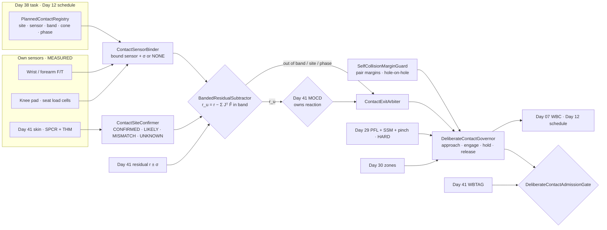
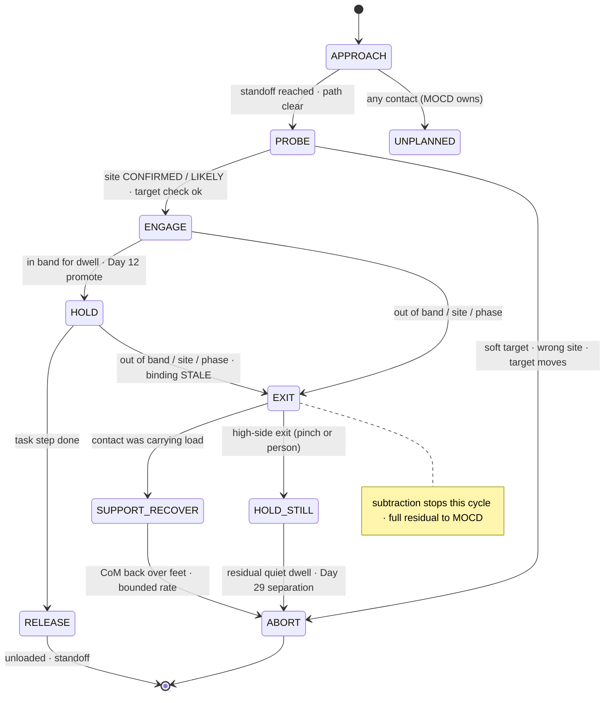
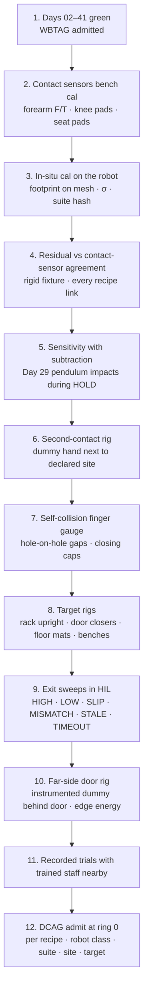

# Day 42 — Deliberate whole-body contact, environment contact, and self-collision under the touch stack: PlannedContactRegistry / ContactSensorBinder / BandedResidualSubtractor / ContactSiteConfirmer / SelfCollisionMarginGuard / DeliberateContactGovernor / ContactExitArbiter / DeliberateContactAdmissionGate under WholeBodyTouchAdmissionGate + HumanHandoverAdmissionGate + CooperativeTaskAdmissionGate + TaskCompositionAdmissionGate + FleetSkillCatalogAdmissionGate + CrossEmbodimentSkillTransferAdmissionGate + DexterousSkillCaptureAdmissionGate + TelepresenceAdmissionGate + RemoteTeleopAdmissionGate + FleetSharedControlAdmissionGate + SharedControlAdmissionGate + CollaborativeWorkspaceAdmissionGate + proximity + zone attestation + supervisor + logging + canary + HIL + fleet + fleet-canary + incident + forensics/reopen + change-management + maintenance + thermal + energy gates

![PlannedContactRegistry / ContactSensorBinder / BandedResidualSubtractor / ContactSiteConfirmer / SelfCollisionMarginGuard / DeliberateContactGovernor / ContactExitArbiter / DeliberateContactAdmissionGate: a humanoid braces its left forearm on a wall, pushes a door with its right forearm, and kneels on an instrumented knee pad; each deliberate contact is declared in the task with a site, a bound MEASURED sensor, an expected wrench band, and a phase; the momentum residual subtracts only the measured wrench at the declared site and only while it stays inside its band; skin confirms the site where taxels exist, and a contact in a declared hole needs its own sensor or stays unadmitted; a finger between the forearm and the door frame leaves the band and hands ownership straight back to MomentumObserverCollisionDetector; self-collision margins inflate where both surfaces are holes; DeliberateContactAdmissionGate fails closed under Day 41 WBTAG, and never raises Day 29 PFL, writes Day 05 torque_scale, or bypasses CrossSiteZoneConfigGate](/images/day42-deliberate-whole-body-contact.png)

[Day 02](/lessons/day-02-joint-foc) owns the current loop and the $i_q \to \tau$ map. [Day 05](/lessons/day-05-power-bms) owns `torque_scale` **forever**. [Day 06](/lessons/day-06-estimation-balance) owns the floating-base estimate. [Day 07](/lessons/day-07-wbc-balance) owns whole-body balance, and [Day 11](/lessons/day-11-hand-support-loco-manipulation) and [Day 12](/lessons/day-12-multicontact-transitions) own promoting a contact into the support set and the contact schedule. [Day 13](/lessons/day-13-support-affordances) owns affordance proposals as candidates. [Day 17](/lessons/day-17-runtime-safety-supervisor) owns ESTOP. [Day 29](/lessons/day-29-human-proximity-safety) owns SSM, body-region PFL ceilings, the pinch table, and "lower only." [Day 30](/lessons/day-30-collaborative-workspace-zoning) owns attested zones and `CrossSiteZoneConfigGate`. [Day 40](/lessons/day-40-human-robot-handover-co-carry) owns the walk-away invariant. [Day 41](/lessons/day-41-whole-body-tactile-skin-touch) owns the momentum residual as the reaction owner (MOCD), skin calibration and holes, and `WholeBodyTouchAdmissionGate` (WBTAG).

Day 41 built a robot that reacts to every unplanned touch. That's correct, and it makes the robot useless for a whole class of real work. A humanoid in a warehouse braces a forearm on a rack upright to reach deep into a shelf. It shoulders a swing door because both hands carry a tote. It kneels to read a label on the bottom shelf. It sits on a bench to charge. It rests its forearm on its own thigh while kneeling. Every one of those is **contact on purpose**, often with large forces (a sit is 600 N on the pelvis), often on links with no skin (knees and hips are Day 41 declared holes), and every one will trip MOCD if the residual doesn't know it's coming.

Day 41 already said that planned contacts are "subtracted from the residual." Today is about what that one sentence costs if you get it wrong. Seven lies show up the first week:

1. **Blanket-mask lie.** The task says "brace left forearm," so the integrator mutes the residual on the whole left arm for the duration. A technician's hand gets caught between the forearm and the upright. The robot can't feel it, because you told it not to.
2. **Planned-equals-measured lie.** The subtractor removes the *planned* brace wrench (40 N from the plan) instead of the *measured* one. When the wall pushes back with 40 N, the residual reads zero. When a person pushes with 40 N while the brace hasn't touched yet, the residual also reads zero.
3. **Band-creep lie.** False positives during door pushes get "fixed" by widening the expected wrench band from 20–60 N to 0–300 N. Now a person on the other side of the door holding it shut is "in band."
4. **Wrong-site lie.** The forearm slides 9 cm along the door and hits the edge of the frame, or a hand on the door. The wrench magnitude is still in band, so the contact is still "the planned one."
5. **Hole-contact lie.** Kneeling puts the knee, a declared hole, on the floor. Nothing measures it, so the planner computes its wrench from statics and subtracts that. Anything else touching the shank while kneeling is now invisible.
6. **Self-touch-is-safe lie.** Self-collision is "just the robot." The forearm resting on the thigh while kneeling closes a gap that's a hole on both sides, and a finger, a cable, or a sleeve in that gap gets the full closing torque.
7. **The-chair-is-a-chair lie.** "Sit" assumes the bench is empty and rigid. The bench is on castors, or a person is already sitting on the end of it.

Today owns **`PlannedContactRegistry` / `ContactSensorBinder` / `BandedResidualSubtractor` / `ContactSiteConfirmer` / `SelfCollisionMarginGuard` / `DeliberateContactGovernor` / `ContactExitArbiter` / `DeliberateContactAdmissionGate`**. The question is: **how do you let a humanoid deliberately brace, push, lean, sit, and kneel with any part of its body, when every intended contact is declared with a site, a bound MEASURED sensor, an expected wrench band, and a phase; when the residual subtracts only the measured wrench, only at the declared site, only inside the band; when a contact that leaves its band, its site, or its phase is a collision again and belongs to MOCD within one cycle; when self-collision margins are honest about holes; and when a person near the contact gets the same walk-away and support rules — without raising Day 29 PFL, writing Day 05 `torque_scale`, or bypassing `CrossSiteZoneConfigGate`?**

## Subtract the measurement, never the plan

Everything follows from one rule about the residual. Day 41's observer converges to

$$
\mathbf{r} \to \boldsymbol{\tau}_{\mathrm{ext}} = \sum_{c \in \text{all contacts}} \mathbf{J}_c^\top \mathbf{F}_c
$$

A deliberate contact $p$ is one more term in that sum. If you have an independent, calibrated measurement $\hat{\mathbf{F}}_p$ of its wrench, the **unplanned residual** is

$$
\mathbf{r}_u = \mathbf{r} - \sum_{p \in \mathcal{P}_{\mathrm{in\,band}}} \mathbf{J}_p^\top \hat{\mathbf{F}}_p, \qquad \boldsymbol{\Sigma}_{r_u} = \boldsymbol{\Sigma}_r + \sum_p \mathbf{J}_p^\top \boldsymbol{\Sigma}_{F_p} \mathbf{J}_p + \boldsymbol{\Sigma}_{J}
$$

and MOCD runs its Day 41 thresholds on $\mathbf{r}_u$ with that inflated σ. Four consequences:

1. **The subtracted term is MEASURED, never PLANNED.** A plan value can tell you what band to expect. It can't stand in for what touched the robot. If the contact has no sensor, there's nothing honest to subtract.
2. **Subtraction costs sensitivity.** Every subtracted contact adds its sensor σ and the Jacobian error from site uncertainty ($\boldsymbol{\Sigma}_J$, a contact point known to 2 cm on a forearm is a moment-arm error at every proximal joint). The unplanned-contact threshold on that chain goes up. That's the true price of deliberate contact, and the gate has to check that the raised threshold still detects the Day 29 test impacts before the PFL limit.
3. **Subtraction is local.** The term enters through $\mathbf{J}_p^\top$, so it only touches joints between the contact link and the ground. Nothing gets muted that the contact can't physically explain. A blanket mask is a different and wrong thing.
4. **Subtraction is conditional.** It's valid only while the measured wrench sits inside its declared band, at its declared site, in its declared phase. Outside that, the contact is reclassified as unplanned, $\hat{\mathbf{F}}_p$ stops being subtracted, and the full residual goes back to MOCD.

| Layer | Owns | Must not own |
|-------|------|--------------|
| `PlannedContactRegistry` | Immutable contact declarations: link, site patch, bound sensor, wrench band, cone, phase plan, target surface | Bands tuned from false-positive rates; "whole-arm" sites |
| `ContactSensorBinder` | Binding each declared contact to a MEASURED sensor with σ on this unit | Statics, plans, or another unit's cal as the "sensor" |
| `BandedResidualSubtractor` | $\mathbf{r}_u$ and its σ; in-band / out-of-band verdict per contact | Muting joints; subtracting a planned wrench |
| `ContactSiteConfirmer` | Site match from skin, contact-sensor geometry, and force-line fit, three-valued | Calling a site confirmed from the plan |
| `SelfCollisionMarginGuard` | Link-pair margins, self-contact declarations, hole-on-hole pinch rules | Treating self-contact as harmless |
| `DeliberateContactGovernor` | Approach, engage, hold, release ramps; force control along the contact normal; target checks | Raising stiffness or force caps; skipping the approach probe |
| `ContactExitArbiter` | Out-of-band and wrong-site handling, release with support, walk-away near people | ESTOP; retreating under a load a person shares |
| `DeliberateContactAdmissionGate` | Fail-closed admit of contact recipes per robot class, sensor suite, site, and target | `JointCommand`; Day 05; PFL |
| Days 05 / 07 / 11 / 12 / 17 / 29 / 30 / 41 | Torque, balance, support set, schedule, kill-chain, PFL, zones, MOCD | Being outranked by "we meant to touch it" |

**Core thesis:** **a deliberate contact is admitted only as a measured, bounded, located exception to the residual; outside its band, its site, or its phase it's a collision again, owned by the residual within one cycle, and no plan can make a joint stop feeling.**



## Physical machine: what deliberate contact does to a humanoid

### Four recipes, four very different loads

| Recipe | Link | Typical wrench | Skin there? | What measures it |
|--------|------|----------------|-------------|------------------|
| Forearm brace on a rack upright | Forearm (ulnar side) | 30–80 N normal, small shear | Yes (forearm 95%) | Forearm F/T between elbow and forearm shell, or wrist F/T plus skin |
| Forearm or shoulder door push | Forearm or upper arm | 20–60 N rising with swing angle (closer spring) | Forearm yes, shoulder partly | Same; shoulder push only with an upper-arm load cell |
| Kneel | Knee (shank front) | 150–350 N normal at the knee | **No, declared hole** | Instrumented knee pad: 3 load cells or a 3-axis cell under a rigid plate |
| Sit on a bench | Pelvis / thigh backs | 400–700 N | Thigh partly, pelvis no | Seat pad load cells, cross-checked against foot F/T unloading |

Two things stand out. The biggest loads land exactly where Day 41's skin can't see. And for the big ones, the feet carry a lot less, so the base-coordinate residual (already the noisiest, Day 41) gets its foot-F/T term changed by hundreds of newtons mid-maneuver. A kneel isn't "one more contact"; it moves the robot's support polygon (Day 12 promotes the knee into the support set) and remaps every residual σ that depended on foot load.

### The knee is a hole, so it needs its own sensor

Day 41 says skin quiet over a hole means nothing. For kneeling, that means there's no skin evidence of where the knee touches, how hard, or whether anything else is under it. Planned statics can estimate the knee load from foot wrenches and gravity, but that's exactly the planned-equals-measured lie: the estimate absorbs anything else pressing on the shank.

So a contact in a declared hole is admissible only with a **dedicated contact sensor** at that site: a pad with load cells, calibrated in situ like a skin patch (Day 41 SPCR rules: per-unit, temperature, σ, no borrowing), with a known footprint on the link mesh. With it, the pad wrench is MEASURED and the shank's *residual remainder* still catches a hand pressing the back of the calf. Without it, kneeling is refused for that robot class.

### Door pushing: the force you measure is the door's, and someone may be behind it

A swing door with a closer is a rotational spring-damper:

$$
\tau_{\mathrm{door}}(\phi, \dot\phi) = \tau_0 + k_\phi \phi + b_\phi \dot\phi, \qquad F_n \approx \frac{\tau_{\mathrm{door}}}{d_{\mathrm{hinge}}}
$$

where $d_{\mathrm{hinge}}$ is the distance from the hinge to the contact site. Pushing 0.6 m from the hinge on an EN 1154 size 3 closer is roughly 25–45 N through the swing. The band is a **function of door angle**, not a constant, which is why a constant 0–300 N band is wrong in both directions.

The physical danger is on the other side. The door's leading edge moves at $v_{\mathrm{edge}} = \dot\phi\,W$ for a door of width $W$. A person behind the door is struck by the edge, not by the robot, so Day 29 SSM can't see them and Day 41 skin can't feel them until the force comes back as a sudden rise in door resistance. Three rules follow:

- **Edge speed is capped** so the edge's kinetic energy against a person stays under the Day 29 PFL energy limit for the torso and hand rows, whatever the robot's own speed cap is.
- **Push only attested doors.** The Day 30 site map marks which doors may be pushed (vision panel, swing side, closer class). An unknown door is a target with no band, so it's refused.
- **A resistance spike is a person until proven otherwise.** Band exit on the high side during a push goes to `ContactExitArbiter` as a stop-and-hold (no further push, no retreat that lets the door slam), not as "push harder."

### Bracing: the brace takes load, so letting go is a balance event

A forearm brace on a rack upright lets the robot lean its CoM past the feet's support polygon to reach deeper. Day 11 already owns promoting the hand (here, the forearm) into the support set. The touch stack adds the other half: if the brace is lost (the upright flexes, the forearm slips), the robot needs a balance response, and if the brace force rises out of band because something got pinched between the forearm and the upright, the response mustn't be "lean harder to keep the reach." Brace exits need a support-preserving reaction: stop the reach, shift CoM back over the feet at a bounded rate, then unload.

### Self-collision: internal forces still show in the joints

When link $a$ touches link $b$ of the same robot with force $\mathbf{F}$, the pair contributes $\mathbf{J}_a^\top \mathbf{F} - \mathbf{J}_b^\top \mathbf{F}$. The base-coordinate rows cancel (it's an internal force), but every joint on the kinematic loop between $a$ and $b$ sees it. That's good news: MOCD detects self-contact on the loop joints. It's also bad news: the cancellation means the base-row residual, often used as a quick whole-body sanity check, is blind to it.

Self-collision usually happens at holes: elbow crease, armpit, hip flexion gap, the back of the knee when squatting, forearm on thigh when kneeling. When both surfaces are holes, nothing but the residual and geometry knows a gap is closing, and that gap is a Day 29 pinch point. So margins are set per link pair from the capsule model's σ, inflated where either side is a hole, and closing speed and torque near the end of travel are capped per the Day 29 pinch table.

## PlannedContactRegistry: declared like a contract, not a mask

`PlannedContactRegistry` (PCR) stores immutable, content-addressed contact declarations referenced by Day 38 plan steps and Day 12 contact schedules:

- **Site.** A link and a *patch* on its mesh (forearm ulnar strip 4 × 12 cm), never "the left arm." Site radius is part of the declaration and bounds the Jacobian σ.
- **Target.** What it touches: an attested surface class from Day 30 or Day 13 (rack upright, door leaf, floor, bench seat), with a target-state check (door closed and attested pushable, bench unoccupied and braked).
- **Bound sensor requirement.** Which sensor kind must measure it (forearm F/T, knee pad, seat pad, wrist F/T plus skin), and the max σ.
- **Wrench band.** Normal-force interval as a function of phase and, for doors, of angle; a friction cone for tangential force; a moment limit around the site. Bands are derived from target physics and measured trials, never from false-positive rates.
- **Phase plan.** `APPROACH` → `PROBE` → `ENGAGE` → `HOLD` → `RELEASE`, with time and distance budgets per phase.
- **Exit policy.** What to do on each exit kind (high, low, slip, wrong site, timeout), chosen from the ContactExitArbiter's allowed set.

Rules: **no declaration covers more than one link patch**; a two-site contact (forearm and shoulder on a door) is two declarations, each bound and banded. No declaration may widen a Day 29 region cap or name a body region above its PFL row. A changed band is a new declaration with a new hash and new evidence (Day 25 ChangeSet).

## ContactSensorBinder: no sensor, no subtraction

`ContactSensorBinder` (CSB) resolves each declaration against this unit's own sensor suite at task bind time (Day 38 CBR) and continuously at run time:

| Declared site | Bound sensor on this unit | Binding | Effect |
|---------------|---------------------------|---------|--------|
| Forearm strip, skin `OK`, forearm F/T fresh | Forearm F/T + skin | `MEASURED` σ 1.5 N | Subtract in band |
| Forearm strip, F/T in fault, skin `OK` | Skin pressure integral only | `ESTIMATED` σ 8 N | No subtraction; contact rides on residual, lower force band |
| Knee, pad cal fresh | Knee pad 3-cell | `MEASURED` σ 6 N | Subtract in band |
| Knee, no pad, or pad `BENCH_CAL` only | Statics | `NONE` | Kneel refused at bind |
| Seat, pad cells + foot unload agree | Seat pad | `MEASURED` σ 12 N | Subtract in band |
| Any site, sensor stale beyond freshness | — | `STALE` | Exit to ContactExitArbiter |

Rules: statics and plans are never a binding. A Day 36 sensor provenance rule applies: the cal belongs to this unit and this pad serial. A pad swap is a new suite hash, and the declaration has to rebind. When a binding degrades mid-contact, the contact doesn't stay subtracted on a stale value; it exits.

## BandedResidualSubtractor: inside the band, at the site, in the phase

`BandedResidualSubtractor` (BRS) runs at the MOCD rate between Day 41's residual and MOCD's threshold check. For each active declaration $p$:

$$
\text{in\_band}_p = \big[F_{n,\min}(\text{phase}, \phi) - k\sigma_{F} \le \hat F_{n,p} \le F_{n,\max}(\text{phase}, \phi) + k\sigma_F\big] \wedge \big[\|\hat{\mathbf{F}}_{t,p}\| \le \mu_{\mathrm{decl}} \hat F_{n,p}\big] \wedge \text{site}_p \ne \text{MISMATCH} \wedge \text{binding}_p = \text{MEASURED}
$$

- **In band:** subtract $\mathbf{J}_p^\top \hat{\mathbf{F}}_p$, add its σ to the chain's thresholds, and publish $\mathbf{r}_u$.
- **Out of band, any reason:** stop subtracting *that cycle*, publish the full residual to MOCD, and post the exit kind to `ContactExitArbiter`. There's no hysteresis on the way out. Hysteresis is only allowed on the way *back in*, and re-entry requires a fresh `PROBE`.
- **Consistency check.** If the residual on the contact chain is much smaller than the measured contact wrench would predict ($\|\mathbf{r} - \mathbf{J}_p^\top \hat{\mathbf{F}}_p\|$ large while $\mathbf{r}$ is small), the sensor is lying or the site is wrong. Verdict `UNKNOWN SENSOR_RESIDUAL_DISAGREE`, which exits.
- **Raised floor check.** BRS publishes the per-chain unplanned threshold. If it rises above the value the gate validated against Day 29 test impacts, the contact exits with `SENSITIVITY_LOST`.

The disagreement check is what kills the planned-equals-measured lie in production: a person pushing the forearm before the brace lands shows up as residual with no matching pad or F/T reading.

## ContactSiteConfirmer: is it where we said it is?

`ContactSiteConfirmer` (CSC) answers the wrong-site lie with three-valued evidence:

| Evidence | Verdict |
|----------|---------|
| Skin cluster centroid inside the declared patch within σ, forces agree | `CONFIRMED` (MEASURED_SKIN) |
| Site in a hole, but a dedicated pad reports load inside its footprint | `CONFIRMED` (MEASURED_PAD) |
| No skin, pad absent, force-line fit from Day 41 isolation inside patch | `LIKELY` (ESTIMATED): band max reduced to the declared `likely_cap` |
| Skin cluster or force-line outside the patch beyond σ | `MISMATCH`: exit |
| Second cluster on the same link | `MISMATCH MULTI`: exit |
| Stale skin, degraded patch | `UNKNOWN`: no new engagement; held contacts exit to HOLD |

The second-cluster rule is the one that saves fingers: a hand caught at the frame edge is a *second* contact on the same forearm. Even if the total wrench is in band, the skin sees two clusters, and the contact is no longer the planned one.

## SelfCollisionMarginGuard: the robot's own body is a pinch hazard

`SelfCollisionMarginGuard` (SCMG) owns self-proximity:

- **Pair table.** Every link pair that can meet, with a capsule or convex-hull model, distance σ from Day 06 joint uncertainty plus mesh error, and a margin $d_{\mathrm{safe}} = d_0 + k\sigma_d$.
- **Hole inflation.** If either surface at the closest points is a Day 41 declared hole, $d_0$ is the Day 29 pinch clearance (25 mm finger clearance as a typical policy), not the collision-avoidance default.
- **Closing caps.** Inside $2 d_{\mathrm{safe}}$ the relative closing speed and joint torque are limited per the Day 29 pinch table, so even an undetected object in the gap gets a bounded squeeze.
- **Declared self-contact.** Deliberate self-contact (forearm resting on thigh, hands clasped) is a PCR declaration like any other: a site on both links, a bound sensor on at least one side, and a band. Its internal wrench is subtracted on the loop joints only while in band.
- **WBC constraint, not a reflex.** SCMG feeds Day 07 as a hard distance constraint; it's never a "back off when close" behavior that fights the controller.

## DeliberateContactGovernor: approach, probe, engage, hold, release

`DeliberateContactGovernor` (DCG) executes a declaration through Day 07 and the Day 12 schedule:

1. **APPROACH.** Move the site to a standoff (30 mm) at the Day 29 speed cap for that region. Skin proximity and Day 29 tracks must show nothing between the site and the target. No subtraction is active; any contact here is unplanned.
2. **PROBE.** Close the last 30 mm at low speed (20 mm/s), with a low force threshold (5 N). First contact must be `CONFIRMED` or `LIKELY` at the declared site, and target-state checks must pass (door doesn't feel locked, bench doesn't move under the probe load, rack upright stiffness within band). Probe stiffness estimate $k = \Delta F / \Delta x$ is compared to the target class. A soft target where a rigid one was declared (a person, a curtain) fails the probe.
3. **ENGAGE.** Ramp force along the contact normal under force control to the band center at a declared rate. For kneel and sit, Day 12 promotes the contact into the support set only after it's in band for a dwell, and Day 07 shifts load at a bounded rate.
4. **HOLD.** Track the band. Admittance along the normal, stiffness never above the declared value, never above the Day 29 region cap.
5. **RELEASE.** Unload at a declared rate, Day 12 demotes the support, retract to standoff. For doors, release only when the door's own closer won't slam it on a tracked person (edge-speed check), else hold.

Rules: **no phase skips PROBE.** A re-engagement after an exit starts at PROBE. DCG never writes stiffness above the declaration, never raises force caps, and never pushes harder to stay in band.



## ContactExitArbiter: leaving the band is a collision again

`ContactExitArbiter` (CEA) chooses the reaction when a deliberate contact stops being deliberate. MOCD still owns the first reaction (Day 41); CEA picks which allowed reaction fits the *kind* of exit, gentler only, and never cancels MOCD.

| Exit kind | Likely physics | Allowed reaction (CEA picks) | Forbidden |
|-----------|----------------|------------------------------|-----------|
| `HIGH` (force above band) | Pinch, person behind door, target stiffened | `HOLD_STILL`: stop pushing, hold position compliantly at the Day 07 floor, no retreat that releases a door or drops a brace abruptly | Push harder; retreat at speed |
| `LOW` (force below band) | Brace slipping, door opened from the other side, bench moved | `SUPPORT_RECOVER`: stop the reach, bring CoM back over the feet at a bounded rate | Chasing the surface |
| `SLIP` (tangential over cone) | Surface wet, wrong surface | `SUPPORT_RECOVER` | Increasing normal force to regain friction |
| `MISMATCH` / `MULTI` | Wrong site, second contact (a hand) | `HOLD_STILL` with compliant reflex on that chain | Continuing with "total wrench in band" |
| `STALE` / `DISAGREE` | Sensor fault | `HOLD_STILL`, then `SUPPORT_RECOVER` at the slowest rate | Subtracting the last good value |
| `TIMEOUT` | Phase budget exceeded | `ABORT` via RELEASE | Extending the budget |

Near people, Day 40's walk-away invariant and Day 41's `SUPPORT_HOLD` apply unchanged. If a person is touching the robot or the target during an exit (a coworker holding the same door, someone steadying themselves on the braced rack), CEA never withdraws support faster than the measured load drops, and never moves toward them.

## DeliberateContactAdmissionGate: recipes, sites, targets

`DeliberateContactAdmissionGate` (DCAG) admits contact **recipes** (a declaration family: forearm brace, forearm door push, kneel on pad, sit on attested bench, declared self-contacts) per robot class, sensor suite hash, site, and target class. It fails closed unless:

- Day 41 WBTAG GREEN for the robot class, skin suite, and site; Day 40 HHAG GREEN where people share the task; Day 29 and Day 30 GREEN; `CrossSiteZoneConfigGate` GREEN for the site
- Every declaration in the recipe binds to a `MEASURED` sensor on this suite; recipes with a hole site require a dedicated pad; statics-only bindings rejected (static check)
- Bands derived from target physics and measured trials, recorded with their derivation; any band whose upper edge reaches a Day 29 region cap is rejected
- Unplanned-contact detection re-validated **with subtraction active**: the pendulum impacts from Day 41 bring-up, repeated on the contact chain during HOLD, detected before PFL limits, including a second contact next to the declared site
- CSC second-cluster detection measured on the contact patch; site σ within declaration
- SCMG pair table covers every link pair reachable in the recipe; hole-on-hole pinch caps verified with a finger-gauge rig
- CEA exit sweeps (high, low, slip, mismatch, stale, timeout) GREEN in twin and HIL, with support-recover balance margins
- Door recipes: doors attested in Day 30 map, edge-speed cap verified; bench recipes: occupancy and brake checks verified
- No path from a declaration to muting a joint residual, writing Day 05, or raising PFL (static check on the contract graph)
- Days 17 / 22–30 GREEN

Evidence follows Day 41: keyed by (robot class, sensor suite hash, site, target class), never by person. A pad swap, a forearm F/T recal, a new door closer, or a residual σ change after maintenance demotes the affected recipe immediately. DCAG never publishes `JointCommand`, never clears ESTOP, never writes Day 05, never raises PFL. **Demotions always flow.**

## Digital twin: contacts you meant, contacts you didn't

The twin carries Day 41's residual and skin models plus:

- **Target models.** Rack uprights with measured stiffness and flex; door leaves with hinge, closer curves by size class, and latch; benches rigid, on castors, and occupied; floors with friction ranges and compliant mats.
- **Contact-sensor models.** Pads and forearm F/T with σ, drift, saturation, and fault injection (stuck, stale, offset jump).
- **Intruder population.** A hand caught between forearm and upright; a person pushing or holding the door from the far side; a person already on the bench; a foot or bag under the kneeling shank; a sleeve or cable in a self-collision gap.
- **Site slip.** Forearm sliding along the door; knee rolling off the pad.

What the twin is for:

1. **Sensitivity-with-subtraction ROC.** For each recipe and phase, the unplanned-contact threshold on every chain and its detection margin against Day 29 test impacts.
2. **Intruder sweep.** Every intruder at every phase; check exit within one cycle, reaction class, and PFL on the intruder's body region.
3. **Band audit.** Show each band's derivation reproduces measured trial distributions, and that a widened band fails the intruder sweep.
4. **Exit sweep.** Every exit kind at every phase; check support-recover balance margins and no withdrawal faster than a sharing person's load drops.
5. **Self-collision sweep.** Random configurations within the recipe envelope with finger-sized objects in hole-on-hole gaps; check squeeze under the pinch cap.

Twin outputs stay SIM and never count as human-subject evidence.

## A worked shift

Robot H-09, class K1, skin suite `skin-k1-r3`, plus forearm F/T on both arms (σ 1.5 N), knee pads `kp-k1-r1` (3 cells each, σ 6 N, in-situ cal 2 days old). Site DC-3. Admitted recipes: `brace-forearm-upright@v4` (band 30–70 N), `door-push-forearm@v2` (band from closer model, attested doors D-11 and D-14), `kneel-pad@v3` (band 150–320 N per knee), `selfrest-forearm-thigh@v1`. Not admitted: `sit-bench` (no seat pad on this site's benches).

| Time | Event | MEASURED / HARD | Component action | Result |
|------|-------|-----------------|------------------|--------|
| 08:30 | Task asks to brace left forearm to reach shelf 4 | PCR `brace-forearm-upright@v4`; CSB forearm F/T `MEASURED` | DCG approach to 30 mm, probe | Probe 6 N, stiffness matches rack class |
| 08:31 | Brace engaged, 48 N | In band; skin `CONFIRMED` | BRS subtracts; elbow unplanned threshold 3.9 N·m (was 3.1) | Reach proceeds |
| 08:34 | Coworker reaches past and their hand lands on the forearm next to the upright | Skin second cluster; total 61 N still in band | CSC `MISMATCH MULTI`; BRS exits | MOCD owns; `HOLD_STILL`, CoM eased back; no push |
| 08:35 | Hand removed | Residual quiet dwell, separation | Re-engage from PROBE | Reach completes |
| 09:50 | Carrying a tote, door push on D-14 | Band from closer at φ; edge-speed cap 0.20 m/s | DCG engage | Door opens to 40° |
| 09:51 | Force jumps from 34 N to 82 N | `HIGH` exit; Day 29 sees nobody (other side) | CEA `HOLD_STILL`; door held, not released, not pushed | Person on the far side steps back; force drops |
| 09:52 | Re-probe | Force in band | Re-engage | Through |
| 10:20 | Task proposes door push on D-17 | Not attested in Day 30 map | DCAG refuses at bind | Route via D-14 |
| 11:05 | Kneel to read label, left knee to pad | Pad `MEASURED` 212 N; Day 12 promotes knee | BRS subtracts on knee/hip chain | Kneel stable |
| 11:07 | Forearm rests on thigh | `selfrest-forearm-thigh@v1`; F/T 18 N in band | SCMG: elbow crease is hole-on-thigh gap; pinch cap on approach | Rest holds |
| 11:09 | A bag strap slides under the shank behind the pad | Shank residual remainder 9 N·m vs pad prediction | BRS `DISAGREE`; CEA `SUPPORT_RECOVER` | Stand up slowly; strap freed |
| 13:40 | Left knee pad replaced | New suite hash | CSB `NONE` until in-situ cal | Kneel recipe demoted for H-09 |
| 14:10 | Proposal: "widen door band to 0–200 N, too many false exits" | Band audit | DCAG: widened band fails intruder sweep | Refused; closer on D-11 re-measured instead |
| 14:30 | Proposal: "mute the left-arm residual during braces, it's simpler" | Contract graph | Static check: declaration edge to joint mute | Refused at publish |

## Ownership conflicts

| Conflict | Winner | Behavior |
|----------|--------|----------|
| Plan says contact vs sensor says no contact | CSB / BRS | No subtraction; any residual is unplanned |
| Total wrench in band vs second skin cluster | CSC | `MISMATCH MULTI`; exit |
| Band wants more force vs Day 29 region cap | Day 29 | Band upper edge below cap, always |
| Door "should" open vs resistance spike | CEA | `HOLD_STILL`; never push harder |
| Brace lost vs reach goal | Day 07 + CEA | Support recover; reach stops |
| Kneel requested vs no pad on this unit | CSB | Refused at bind |
| Self-contact vs pinch clearance | SCMG | Hole-on-hole margin and closing caps |
| Subtraction vs Day 29 test-impact detection | DCAG | Recipe demoted if sensitivity lost |
| Exit reaction vs person sharing the load | Day 40 / 41 | Support follows measured load; walk-away |
| Any recipe vs `CrossSiteZoneConfigGate` | Day 30 | Refused for that site |
| Any reaction vs Day 17 | Day 17 | ESTOP is never contact-gated |

## Shared API

```text
PlannedContact:                              # PCR
  decl_id                  # content hash
  recipe_id
  link_id
  site_patch               # mesh region, radius_mm, sigma_mm
  target_class             # RACK_UPRIGHT | DOOR_LEAF | FLOOR | BENCH_SEAT | SELF
  target_checks[]          # door_attested, bench_unoccupied, braked, stiffness_band
  sensor_kind_required     # FOREARM_FT | WRIST_FT_SKIN | KNEE_PAD | SEAT_PAD
  sigma_max_n
  band:                    # per phase; door: f(angle)
    fn_min_n
    fn_max_n
    mu_decl
    moment_max_nm
  phases[]                 # APPROACH | PROBE | ENGAGE | HOLD | RELEASE with budgets
  exit_policy{}            # exit_kind -> allowed reaction

ContactBinding:                              # CSB
  header: BusHeader
  decl_id
  sensor_id
  sensor_suite_hash        # Day 36
  binding                  # MEASURED | ESTIMATED | NONE | STALE
  sigma_n

UnplannedResidual:                           # BRS
  header: BusHeader
  r_u[]
  sigma_r_u[]
  threshold_u[]
  subtracted[]:            # decl_id, wrench, in_band
  exits[]:                 # decl_id, kind HIGH | LOW | SLIP | MISMATCH | STALE | DISAGREE | TIMEOUT | SENSITIVITY_LOST

SiteConfirmation:                            # CSC
  header: BusHeader
  decl_id
  verdict                  # CONFIRMED | LIKELY | MISMATCH | MISMATCH_MULTI | UNKNOWN
  evidence                 # MEASURED_SKIN | MEASURED_PAD | ESTIMATED_FORCE_LINE

SelfProximity:                               # SCMG
  header: BusHeader
  pairs[]:                 # link_a, link_b, d, sigma_d, d_safe, hole_on_hole
  closing_caps_active[]

DeliberateContactState:                      # DCG
  header: BusHeader
  decl_id
  phase                    # APPROACH | PROBE | ENGAGE | HOLD | RELEASE | EXIT | ABORT
  fn_cmd
  stiffness_cmd            # <= declaration, <= Day 29 row
  probe_stiffness_est

ContactExit:                                 # CEA
  header: BusHeader
  decl_id
  kind
  reaction                 # HOLD_STILL | SUPPORT_RECOVER | ABORT
  mocd_owner: true
  walk_away_ok

DeliberateContactAdmission:                  # DCAG
  robot_class
  sensor_suite_hash
  site
  target_class
  recipe_id
  ring
  forbid:
    joint_command: true
    mute_joint_residual: true
    subtract_planned_wrench: true
    statics_as_sensor: true
    dual_write_torque_scale: true
    write_estop: true
    raise_pfl_from_task: true
    bypass_cross_site_zone_config_gate: true
    person_keyed_evidence: true

# Unchanged owners
WholeBodyTouchAdmissionGate · MomentumObserverCollisionDetector · TouchReactionArbiter (Day 41)
HumanHandoverAdmissionGate · WalkAwayHoldArbiter (Day 40)
CrossSiteZoneConfigGate (Day 30) · HumanSafetyAdmissionGate · ContactForceLimiter (Day 29)
SupervisorState (Day 17): ESTOP · kill-chain
BmsState / PowerState (Day 05): torque_scale
  accepts_requests_from_contact_recipes: false
```

## Config

A starting configuration. Every number is a policy you re-derive from your own robot, targets, and Day 29 tables:

```yaml
deliberate_contact:
  registry:
    site_scope: single_link_patch
    band_source: [target_physics, measured_trials]
    band_from_false_positive_rate: forbidden
    band_upper_below_day29_region_cap: required
    changes_via: day25_changeset
  binding:
    allowed: [FOREARM_FT, WRIST_FT_SKIN, KNEE_PAD, SEAT_PAD]
    statics_as_sensor: forbidden
    hole_site_requires_dedicated_pad: true
    cal_rules: day41_spcr        # in situ, per unit, no borrowing
    stale_ms_max: 20
  subtraction:
    subtract: measured_wrench_only
    scope: jacobian_of_declared_site
    mute_joints: forbidden
    exit_hysteresis: none
    reentry_requires: probe
    disagree_k_sigma: 4.0
    sensitivity_check: day29_test_impacts_with_subtraction
  site:
    second_cluster_on_link: mismatch
    likely_cap_fraction_of_band: 0.6
  self_collision:
    margin: d0 + 3 * sigma_d
    d0_default_mm: 15
    d0_hole_on_hole_mm: 25        # Day 29 pinch clearance policy
    closing_caps_inside: 2x_margin
    declared_self_contact_requires_sensor: true
  governor:
    standoff_mm: 30
    probe_speed_mm_s: 20
    probe_force_n: 5
    probe_stiffness_check: required
    stiffness_max: declaration_and_day29_row
    door_edge_speed_max_m_s: 0.20
    door_requires_day30_attestation: true
    bench_requires: [unoccupied, braked, seat_pad]
  exit:
    HIGH: hold_still
    LOW: support_recover
    SLIP: support_recover
    MISMATCH: hold_still_with_reflex
    STALE: hold_still_then_support_recover
    TIMEOUT: release
    push_harder_to_stay_in_band: forbidden
    support_withdrawal: follows_measured_load
    walk_away_invariant: required
  admission:
    gate: DeliberateContactAdmissionGate
    under: [WholeBodyTouchAdmissionGate, HumanHandoverAdmissionGate, HumanSafetyAdmissionGate, CrossSiteZoneConfigGate]
    evidence_key: [robot_class, sensor_suite_hash, site, target_class]
    person_keyed_evidence: forbidden
    demotions_always_flow: true
  forbidden:
    raise_pfl: true
    write_torque_scale: true
    bypass_cross_site_zone_config_gate: true
```

## Physical ↔ digital pairing

| Physical | Digital twin / backing |
|----------|------------------------|
| Forearm braced on a rack upright | PCR declaration; forearm F/T MEASURED; BRS subtracts in band |
| Hand caught next to the brace | CSC second cluster; exit; MOCD owns |
| Door closer resisting the push | Band as a function of door angle; edge-speed cap |
| Person holding the door from the far side | `HIGH` exit; `HOLD_STILL`; no push harder |
| Knee on the floor | Knee pad MEASURED; Day 12 promote; no pad means no kneel |
| Strap under the shank | Shank residual vs pad disagreement; support recover |
| Forearm resting on thigh | Declared self-contact; hole-on-hole pinch caps |
| Pad replaced | New suite hash; recipe demoted until in-situ cal |
| Band widened to stop false exits | Fails the twin intruder sweep; refused |

The pairing that matters most: **replay every deliberate contact from the robot's own bag and show that, at every cycle, the subtracted wrench was a MEASURED reading at a confirmed site inside its band, that the unplanned threshold on that chain still detected the Day 29 test impacts, and that every exit handed the full residual to MOCD in the same cycle.** If a contact only replays cleanly when you feed in the plan's wrench, the plan owns the residual.

## Bring-up sequence (before letting it lean on the world)



1. **Days 02–41 green,** WBTAG admitted for the class and site.
2. **Contact sensors on the bench:** each forearm F/T and pad against a reference load cell across temperature.
3. **In-situ cal on the robot:** pad footprint and forearm strip on the link mesh with σ; sensor suite hash updated.
4. **Residual vs contact-sensor agreement:** press each recipe site against a rigid instrumented fixture; the residual and the sensor must agree within σ. This calibrates the disagreement check.
5. **Sensitivity with subtraction:** repeat Day 41's pendulum impacts on the contact chain while each recipe is in HOLD; detection before PFL, or the recipe isn't admissible.
6. **Second-contact rig:** a dummy hand with a load cell placed at increasing distances from the declared site; record the CSC second-cluster detection distance.
7. **Self-collision finger gauge:** a 12 mm instrumented gauge in every hole-on-hole gap the recipes can close; squeeze under the pinch cap.
8. **Target rigs:** rack uprights of each class, doors with each closer size, mats, benches rigid and on castors; derive bands from measured trials.
9. **Exit sweeps in HIL:** inject each exit at each phase; check support-recover balance margins.
10. **Far-side door rig:** an instrumented dummy behind the door at several positions; check edge energy and the `HIGH` exit.
11. **Recorded trials** with trained staff nearby, then broad staff under the site protocol.
12. **DCAG admit at ring 0** per recipe, robot class, sensor suite, site, and target class.

## Failure gallery

| Symptom | Likely cause |
|---------|--------------|
| Pinched hand at a brace not detected | Residual muted on the whole arm instead of banded subtraction |
| Person pushing the forearm before contact unnoticed | Planned wrench subtracted instead of measured |
| Robot keeps pushing a door someone is holding | Band widened to stop false exits; high-side exit not a hold |
| Contact "in band" but on the frame edge | No site check; no second-cluster rule |
| Strap under the knee invisible | Knee load from statics; no pad |
| Squeezed sleeve in the elbow crease when resting on thigh | Self-contact treated as harmless; no hole-on-hole margin |
| Stumble when the brace slips | Low-side exit chases the surface instead of support recover |
| False collisions during kneel | Foot-F/T σ not re-derived for the shifted load; residual floor wrong |
| Door slams on someone after release | No edge-speed check on release |
| Bench rolls away during sit | No probe stiffness / brake check on the target |
| Kneel still running after a pad swap | Binding not tied to sensor suite hash |

## Exercises

1. A forearm brace site is known to σ = 2 cm on a forearm 0.35 m from the elbow. Compute the added moment-arm σ at the elbow for a 60 N brace, and the new elbow unplanned threshold if Day 41's was $5 \times 0.6$ N·m. Does a 30 N fingertip impact at the mid-forearm still clear it?
2. Derive the door band $F_n(\phi)$ for a closer with $\tau_0 = 12$ N·m, $k_\phi = 15$ N·m/rad, contact 0.6 m from the hinge, from 0° to 70°. Then find the edge-speed cap that keeps the leading edge's kinetic energy under 0.5 J if the leaf's effective mass at the edge is 20 kg, and compare it with the 0.20 m/s policy in the config. Which number would you trust, and what would you measure to decide?
3. Write the `PlannedContact` declarations for "kneel on left knee and rest left forearm on left thigh." Which of the two needs a dedicated pad, which can use existing sensors, and what does SCMG require for the elbow crease?
4. A teammate proposes using the Day 41 skin pressure integral as the bound sensor for a door push when the forearm F/T is in fault. What binding label does CSB give it, and what happens to subtraction and the band?
5. Sketch the twin intruder sweep for `sit-bench`. What target checks and what sensor would you require before DCAG could admit it?
6. Show that a self-contact between the two forearms (hands clasped) produces zero base-coordinate residual. Which joints does MOCD rely on to detect it, and why does that make the base-row sanity check insufficient?

## What to freeze this week

Extend [frames](/frames) and your safety config with:

- `PlannedContactRegistry`: immutable single-patch declarations with target, bound sensor kind, physics-derived bands, phases, and exit policy; bands below Day 29 caps; changes via Day 25 ChangeSet.
- `ContactSensorBinder`: MEASURED binding on this unit's own sensors; statics are never a sensor; hole sites need a dedicated pad; suite hash binds.
- `BandedResidualSubtractor`: subtract the measured wrench through the declared site's Jacobian only in band; no muting; no exit hysteresis; disagreement and sensitivity checks.
- `ContactSiteConfirmer`: CONFIRMED / LIKELY / MISMATCH / UNKNOWN; a second cluster on the link is a mismatch.
- `SelfCollisionMarginGuard`: σ-based pair margins, hole-on-hole pinch clearance, closing caps, declared self-contact with a sensor.
- `DeliberateContactGovernor`: approach, probe, engage, hold, release; no skipped probe; stiffness and force never above the declaration or Day 29.
- `ContactExitArbiter`: exit kinds mapped to `HOLD_STILL` / `SUPPORT_RECOVER` / `ABORT`; MOCD owns; never push harder; support follows measured load; walk-away.
- `DeliberateContactAdmissionGate` fail-closed under Day 41 WBTAG, Day 40 HHAG, Day 29, and Day 30 `CrossSiteZoneConfigGate`; evidence keyed by robot class, suite, site, and target class; **no dual-write of ESTOP or `torque_scale`; no recipe raises PFL or mutes a joint.**
- ESTOP is never contact-gated.

The lesson isn't "tell the collision detector which contacts are on purpose." It's that **a deliberate contact is a measured, located, bounded exception, and the joints never stop feeling: subtract only what a sensor on this robot measured, only where the declaration says, only inside a band derived from physics; the moment any of that stops being true, it's a collision again and the residual owns it**, under ceilings that never move.

## Further reading

Look these up by title; they're the classic sources for today's contact-subtraction, self-collision, and whole-body contact arguments:

- S. Haddadin, A. De Luca, and A. Albu-Schäffer, "Robot collisions: A survey on detection, isolation, and identification," *IEEE Transactions on Robotics*, 2017 — including distinguishing intended from accidental contact.
- M. Geravand, F. Flacco, and A. De Luca, "Human-robot physical interaction and collaboration using an industrial robot with a closed control architecture," IEEE ICRA, 2013 — separating intentional contact from collision.
- F. Flacco, A. Paolillo, and A. Kheddar, "Residual-based contacts estimation for humanoid robots," IEEE-RAS Humanoids, 2016.
- N. Mansfeld, M. Hamad, M. Becker, A. G. Marin, and S. Haddadin, "Safety map: A unified representation for biomechanics impact data and robot instantaneous dynamic properties," *IEEE RA-L*, 2018.
- A. Escande, N. Mansard, and P.-B. Wieber, "Hierarchical quadratic programming: Fast online humanoid-robot motion generation," *IJRR*, 2014 — self-collision as hard constraints.
- K. Bouyarmane and A. Kheddar, "Humanoid robot locomotion and manipulation step planning," *Advanced Robotics*, 2012 — multi-contact with arbitrary body parts.
- S. Kajita et al. and the HRP-2 / HRP-5P works on knee-and-hand contact and sitting motions.
- C. Ott, A. Dietrich, and A. Albu-Schäffer, "Prioritized multi-task compliance control of redundant manipulators," *Automatica*, 2015.
- ISO/TS 15066:2016 and ISO 13854 (minimum gaps to avoid crushing parts of the human body); EN 1154 (door closers).

## Next

**Day 43+** — Falls and fall-safe contact under the touch stack: when balance is genuinely lost, choosing *where* the robot lands and *what* it lands on — fall detection from Day 06 / Day 09 capture-region exhaustion with honest UNKNOWN, Day 29 tracks and Day 30 zones deciding a fall direction away from people, sacrificial contact sites with their own pads and declared impact bands, joint-level energy absorption within Day 05 power limits and Day 27 thermal state, post-fall MEASURED self-assessment before any get-up, and a get-up recipe built from today's deliberate-contact declarations — without raising Day 29 PFL, writing Day 05 `torque_scale`, or bypassing `CrossSiteZoneConfigGate`, under the same gates plus deliberate contact admission.
