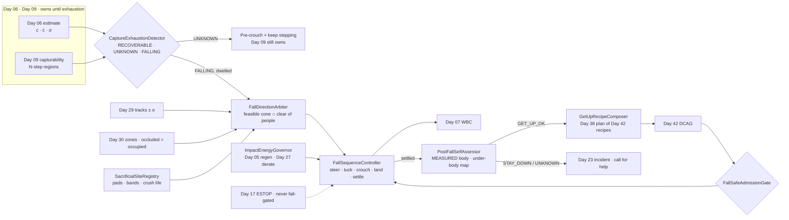
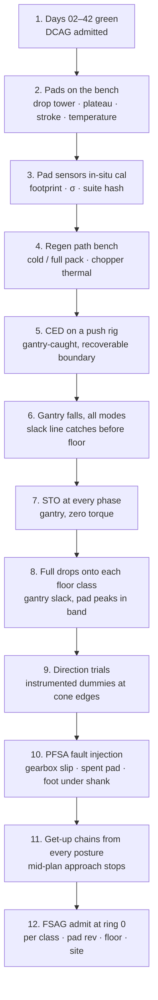

# Day 43 — Falls and fall-safe contact under the touch stack: CaptureExhaustionDetector / FallDirectionArbiter / SacrificialSiteRegistry / ImpactEnergyGovernor / FallSequenceController / PostFallSelfAssessor / GetUpRecipeComposer / FallSafeAdmissionGate under DeliberateContactAdmissionGate + WholeBodyTouchAdmissionGate + HumanHandoverAdmissionGate + CooperativeTaskAdmissionGate + TaskCompositionAdmissionGate + FleetSkillCatalogAdmissionGate + CrossEmbodimentSkillTransferAdmissionGate + DexterousSkillCaptureAdmissionGate + TelepresenceAdmissionGate + RemoteTeleopAdmissionGate + FleetSharedControlAdmissionGate + SharedControlAdmissionGate + CollaborativeWorkspaceAdmissionGate + proximity + zone attestation + supervisor + logging + canary + HIL + fleet + fleet-canary + incident + forensics/reopen + change-management + maintenance + thermal + energy gates

![CaptureExhaustionDetector / FallDirectionArbiter / SacrificialSiteRegistry / ImpactEnergyGovernor / FallSequenceController / PostFallSelfAssessor / GetUpRecipeComposer / FallSafeAdmissionGate: a humanoid's capture point leaves every reachable step region; the detector commits to FALLING only when the gap is beyond its own sigma, and holds UNKNOWN as a pre-crouch that keeps Day 09 stepping alive; the arbiter picks a heading inside the physically feasible fall cone that keeps the swept body clear of every Day 29 person track and Day 30 zone wall, treating occluded space as occupied; the robot tucks its arms, crouches to bleed energy through its knees and hips within Day 05 regen and Day 27 torque limits, and lands on a declared buttock-and-back pad; afterwards it measures itself before moving, finds a person's foot under its shank and stays down, then later gets up through Day 42 kneel and palm recipes; FallSafeAdmissionGate fails closed under Day 42 DCAG and never raises Day 29 PFL, writes Day 05 torque_scale, gates ESTOP, or bypasses CrossSiteZoneConfigGate](/images/day43-falls-fall-safe-contact.png)

[Day 02](/lessons/day-02-joint-foc) owns the current loop. [Day 05](/lessons/day-05-power-bms) owns `torque_scale` **forever**, plus the bus and the pack. [Day 06](/lessons/day-06-estimation-balance) owns the floating-base estimate and its σ. [Day 07](/lessons/day-07-wbc-balance) owns whole-body balance. [Day 09](/lessons/day-09-push-recovery) owns push recovery and the capturability verdict. [Day 12](/lessons/day-12-multicontact-transitions) owns the contact schedule. [Day 17](/lessons/day-17-runtime-safety-supervisor) owns ESTOP and the stop categories. [Day 23](/lessons/day-23-fleet-incident-response) and [Day 24](/lessons/day-24-post-incident-forensics) own incidents and forensics. [Day 27](/lessons/day-27-thermal-budgets-duty-cycle) owns thermal derating. [Day 29](/lessons/day-29-human-proximity-safety) owns person tracks, SSM, and PFL rows. [Day 30](/lessons/day-30-collaborative-workspace-zoning) owns attested zones and `CrossSiteZoneConfigGate`. [Day 40](/lessons/day-40-human-robot-handover-co-carry) owns the walk-away invariant. [Day 41](/lessons/day-41-whole-body-tactile-skin-touch) owns the momentum residual (MOCD) and skin. [Day 42](/lessons/day-42-deliberate-whole-body-contact) owns deliberate contact recipes and `DeliberateContactAdmissionGate` (DCAG).

Every humanoid falls. Not often, if Days 06–09 are good, but a slip on a wet patch, a stair edge that wasn't in the map, a brace that gave way, or a shove bigger than any step can catch will eventually put ξ, the capture point, somewhere no foot can reach. At that moment the question stops being "how do I stay up" and becomes "where do I land, what do I land on, who's nearby, and what do I do once I'm on the floor." A 62 kg machine with its center of mass at 0.92 m carries about 560 J of potential energy. That has to go somewhere in under a second, and today is about choosing where.

Eight lies show up the first time a team writes fall handling:

1. **Late-detection lie.** "It's falling when the trunk tilts past 30°." By then a third of the fall window is gone and the knees can't absorb anything useful.
2. **Early-commit lie.** The detector fires on a noisy estimate during a slip, and the robot dives into a fall it could have stepped out of. Committing to a fall is irreversible. Calling it on UNKNOWN is as wrong as calling it late.
3. **Any-direction lie.** The planner "chooses to fall away from people" as if heading were a free parameter. Momentum decides most of the heading. You get to bias it by tens of degrees, not pick it.
4. **Grab-anything lie.** The arms reach out and grab the nearest rack, cart, or person to arrest the fall. The rack comes down with you. The person comes down under you.
5. **Go-limp lie.** "Cut power and let it drop, that's safest." A limp humanoid falls like a stiff tree with loose joints: maximum head speed, no energy absorption, arms flailing at a random angle.
6. **Regen-is-free lie.** Joints absorbing hundreds of joules dump that energy back into the 48 V bus as regeneration. Nobody checked whether the pack, the DC-link capacitors, or the brake chopper could take it, so the bus overvolts mid-fall and the drives trip, which is the go-limp lie by accident.
7. **Pad-on-paper lie.** The CAD says the hip has a crush pad. Nobody measured what it absorbs, it was already crushed by last week's fall, and nothing on the robot can tell.
8. **Get-up-now lie.** The robot hits the floor and immediately starts the get-up routine. A cracked knee gearbox, a person's foot under the shank, or a battery pack that took the impact all get "tested" by standing up on them.

Today owns **`CaptureExhaustionDetector` / `FallDirectionArbiter` / `SacrificialSiteRegistry` / `ImpactEnergyGovernor` / `FallSequenceController` / `PostFallSelfAssessor` / `GetUpRecipeComposer` / `FallSafeAdmissionGate`**. The question is: **how do you let a humanoid fall on purpose once falling is certain, detecting that certainty from capture-region exhaustion with an honest UNKNOWN; biasing the fall inside its physically feasible cone away from every person track and zone wall; landing on declared sacrificial sites with measured pads and impact bands; absorbing energy through joints only within Day 05 regen and Day 27 torque limits; then measuring itself before any get-up, and getting up only through Day 42 deliberate-contact recipes — without raising Day 29 PFL, writing Day 05 `torque_scale`, gating ESTOP, or bypassing `CrossSiteZoneConfigGate`?**

## Falling is a controlled maneuver, not the absence of control

The rule everything follows from: **a fall is a short, pre-admitted motion with a declared landing, and the robot only switches to it when staying up is measurably impossible.** Day 09 keeps ownership of balance until the moment capture is provably exhausted. After that, fall control owns the body for about a second. Then post-fall assessment owns it until a person or a measured check says otherwise.

Why the fall can't just be "do nothing": the linear inverted pendulum from Day 08 gives the capture point

$$
\boldsymbol{\xi} = \mathbf{c} + \frac{\dot{\mathbf{c}}}{\omega}, \qquad \omega = \sqrt{g / z_c}, \qquad \dot{\boldsymbol{\xi}} = \omega\,(\boldsymbol{\xi} - \mathbf{p})
$$

where $\mathbf{p}$ is the ZMP inside the support polygon. Once ξ is outside every reachable support region, the distance $d = \|\boldsymbol{\xi} - \mathbf{p}\|$ grows as $d(t) = d_0 e^{\omega t}$. For $z_c = 0.92$ m, ω ≈ 3.27 rad/s. Going from a 5 cm excursion to a 60 cm one takes

$$
t = \frac{\ln(0.60/0.05)}{3.27} \approx 0.76\ \text{s}
$$

That 0.76 s is the whole budget for deciding, steering, tucking, crouching, and landing. Every 50 ms of detection latency spends about 7% of it.

If nothing absorbs energy, the CoM hits at roughly $\sqrt{2 g z_c} \approx 4.2$ m/s, and a rigid topple puts the head near 7 m/s. A controlled crouch converts potential energy into negative joint work before impact, and a declared pad takes most of what's left:

$$
m g z_c = E_{\mathrm{joints}} + E_{\mathrm{pads}} + E_{\mathrm{struct}} + E_{\mathrm{rest}}
$$

For the K1 class below: 560 J = 290 J through knees and hips + 160 J into the buttock and back pads + about 19 J into structure and sliding + 91 J left as potential energy in the lying posture (CoM at 0.15 m). The design job is to make every term on the right a measured, budgeted number.

| Layer | Owns | Must not own |
|-------|------|--------------|
| `CaptureExhaustionDetector` | RECOVERABLE / UNKNOWN / FALLING verdict from Day 09 capturability and Day 06 σ, with dwell | Calling FALLING on tilt alone or on UNKNOWN estimates |
| `FallDirectionArbiter` | Heading inside the feasible fall cone that clears person tracks, zone walls, and hazards | Pretending heading is free; extending a limb toward a person |
| `SacrificialSiteRegistry` | Declared landing sites per fall mode, each with a pad, an impact band, and crush life | Landing sites without a measuring pad; reusing a crushed pad |
| `ImpactEnergyGovernor` | Joint absorption profile inside Day 05 regen and bus limits and Day 27 torque derating | Writing `torque_scale`; raising current limits "because it's an emergency" |
| `FallSequenceController` | Commit → steer → tuck → crouch → land → settle, at the WBC rate | ESTOP; grabbing unattested objects |
| `PostFallSelfAssessor` | MEASURED body check, under-body contact map, pack check, verdict | Declaring "fine" from the fall having looked gentle |
| `GetUpRecipeComposer` | Get-up as a Day 38 plan of Day 42 recipes with measured preconditions | Getting up with people inside SSM range or with an unbound pad |
| `FallSafeAdmissionGate` | Fail-closed admit per robot class, pad revision, floor class, site | `JointCommand`; Day 05; PFL; Day 17 |
| Days 05 / 09 / 17 / 23 / 27 / 29 / 30 / 41 / 42 | Torque, recovery, ESTOP, incident, thermal, PFL, zones, MOCD, recipes | Being outranked by "it's an emergency" |

**Core thesis:** **a fall is admitted only as a measured certainty, steered inside what physics allows away from people, landed on measured sacrificial sites with budgeted energy, and followed by a measured stop; nothing about an emergency lets the robot raise a ceiling, grab a person, or get up on a body it hasn't checked.**



## Physical machine: what a fall does to a humanoid

### Four fall modes, four landings

A humanoid doesn't have one fall. It has a small set of fall modes, each with a feasible heading range, a landing posture, and the body sites that take the impact:

| Mode | Triggered by | Landing posture | First contacts | What absorbs |
|------|--------------|-----------------|----------------|--------------|
| Backward sit | ξ behind the heels (slip forward of a foot, push from the front) | Squat then sit, roll onto back | Buttock pad, then upper-back pad | Knee and hip negative work, then pads; head tucked |
| Forward kneel | ξ ahead of the toes (trip, push from behind) | Knees then forearms, never hands first | Knee pads, then forearm pads | Hip and knee, then pads; wrists kept out |
| Side | ξ beyond a foot's lateral edge | Hip, then shoulder; arm tucked across the chest | Hip pad, shoulder pad | Hip abduction, then pads |
| Stair or edge | Foot below expected height, ξ over a drop | Backward sit onto the step if feasible | Buttock pad on tread | Same as backward, with smaller margin |

Backward sit is usually the gentlest, because the knees and hips can do the most negative work on the way down and the buttock is the biggest, best-padded surface. Forward is the most common in practice (trips) and the most dangerous for the hands and the head. That's why the hands are never a landing site: wrists and fingers are the most fragile parts of the robot, and they're the parts most likely to land on something they shouldn't.

### Heading is mostly decided by momentum

The fall direction at commit time is roughly the direction of $\boldsymbol{\xi} - \mathbf{p}$. What the controller can do in the remaining window is move the pivot: a partial step, a hip twist, a foot rotation, or shifting the ZMP to the other edge of the foot. In practice that biases the heading by about ±25° to ±40°, depending on how much time is left and how much friction the floor offers. The feasible fall cone shrinks as the fall progresses, so the heading decision has to happen in the first 100–150 ms after commit, not at the end.

### Joints absorb energy, and that energy comes back as current

During the crouch the knees and hips do negative work: torque opposes velocity, so $P = \tau \omega$ is negative and the motor acts as a generator. In the K1 numbers, the knee and hip pairs absorb 290 J over about 0.35 s, an average of roughly 830 W with peaks near 2.2 kW. After copper and inverter losses, around 60% returns to the bus, so the bus sees peaks of about 1.3 kW of regeneration, around 27 A at 48 V.

Where does it go?

- **DC-link capacitors** hold almost nothing. A 2 mF bank going from 48 V to 58 V stores $\tfrac12 C (V_2^2 - V_1^2) \approx 1.1$ J.
- **The pack** accepts charge only up to the BMS charge-current limit, which drops sharply when cold or near full. A 15 A limit at 10 °C is 720 W.
- **The brake chopper** has to take the rest. A 2.5 Ω resistor at 58 V dissipates about 1.35 kW, and 120 J into a resistor element with 25 J/K of heat capacity is about a 5 K rise. Fine for one fall, but the chopper's thermal state is part of the budget.

If the regen path can't take the peak, the bus overvolts, the drives trip on overvoltage, and the robot goes limp halfway down. That's why `ImpactEnergyGovernor` reads Day 05's live charge-acceptance and chopper headroom and shapes the absorption profile to fit, rather than asking Day 05 for more. If the headroom isn't there, the profile absorbs less and the pads take more, and the gate checks that the pads are rated for that worst case.

### Thermal mostly limits torque, not temperature rise

A single fall heats a knee winding very little: about 58 J of copper loss into a 150 J/K winding is under half a kelvin. The real thermal effect is indirect. If Day 27 has already derated the knee to 60% of peak torque because it's been carrying boxes all morning, the knee can't brake as hard, so the crouch absorbs less, the robot lands faster, and the pads see more energy. `ImpactEnergyGovernor` reads the current derated torque envelope and plans with what's actually available, never with the datasheet peak.

### Pads are measured parts with a life

A crush pad absorbs roughly its plateau force times its stroke. To take 160 J over 40 mm with 80% efficiency you need a plateau near 5 kN, about 8 g on a 62 kg body. Two classes are worth separating:

- **Reusable** viscoelastic pads recover after each impact, with a declared cycle life (say 200 impacts with no more than 10% plateau drift) and temperature sensitivity.
- **Sacrificial** honeycomb or crushable inserts take one impact and are done. They absorb more per gram, but once crushed they're a hole.

Either way, each pad sits on load cells or a pressure bladder so the landing wrench is MEASURED (Day 42's rule for hole sites applies here too). Without that sensor, nothing on the robot knows whether a pad was hit, how hard, or whether it's still good.

## CaptureExhaustionDetector: certain, uncertain, or not yet

`CaptureExhaustionDetector` (CED) consumes Day 09's N-step capture regions $\mathcal{R}_N$ (reachable footholds given swing time, joint limits, and the Day 30 floor map) and Day 06's estimate with σ. The margin is

$$
m = \mathrm{dist}(\boldsymbol{\xi}, \mathcal{R}_N), \qquad \sigma_\xi^2 = \sigma_c^2 + \frac{\sigma_{\dot c}^2}{\omega^2}
$$

with $m > 0$ meaning outside every reachable region. The verdict is three-valued:

| Condition | Verdict | Effect |
|-----------|---------|--------|
| $m \le -k\sigma_\xi$ | `RECOVERABLE` | Day 09 owns; nothing changes |
| $\lvert m \rvert \lt k\sigma_\xi$, or the estimate is degraded (foot F/T stale, slip flag, Day 06 `DEGRADED`) | `UNKNOWN` | Day 09 still owns and keeps stepping; FSC pre-arms: arms start tucking, CoM lowers at a bounded rate, joints move to absorbing gains |
| $m \ge k\sigma_\xi$ for $T_{\mathrm{dwell}}$, or a hard bound is exceeded (trunk angular momentum, tilt beyond any recoverable state) | `FALLING` | Commit: ownership passes from Day 09 to FSC |

Three rules make this honest:

1. **UNKNOWN never commits.** Committing is irreversible, so an uncertain estimate keeps the robot trying to stay up. The pre-arm actions are chosen because they help both outcomes: a lower CoM and tucked arms make a step recovery easier *and* a fall gentler.
2. **Dwell is short and fixed.** $T_{\mathrm{dwell}}$ is a few cycles (10–20 ms at 1 kHz), derived from the estimator's noise, not tuned up to stop false falls. A detector that needs 100 ms of dwell is the late-detection lie with extra steps.
3. **The hard bounds are physics, not tilt.** "Tilt past 30°" is late. The bound that matters is whether any feasible footstep plus hip strategy can still bring ξ back, which is what $\mathcal{R}_N$ already encodes. The trunk-momentum bound is a backstop for when the region computation itself is stale.

## FallDirectionArbiter: inside the cone, away from people

`FallDirectionArbiter` (FDA) gets the feasible fall cone $\mathcal{H}$ from the current state (headings reachable by pivot shifting in the remaining window) and picks a heading $h$ with a fall mode from the `SacrificialSiteRegistry`.

For each candidate heading and mode, it computes the **swept footprint**: the floor area the body will occupy from commit to rest, which for a 1.65 m robot is a region about 1.8 m long. Every person track from Day 29 is predicted to the impact time $t_i$ as a disk of radius

$$
r_j = r_{\mathrm{body}} + \lVert \mathbf{v}_j \rVert\, t_i + 3\sigma_j + r_{\mathrm{margin}}
$$

A heading is **clear** if its swept footprint misses every person disk, every Day 30 zone wall and keep-out, and every hazard the site map marks (stair edges, machinery, racks). Occluded space and Day 29 `UNKNOWN` regions count as occupied.

| Situation | FDA choice |
|-----------|-----------|
| One or more clear headings | The clear heading with the gentlest mode (backward sit first), then largest clearance |
| No clear heading, a person is in the cone | **Least harm**: the heading that maximizes distance to the nearest person disk, the mode with the lowest landing height, arms tucked to the chest, and no extension toward anyone |
| Only clear heading is toward a hazard (stair edge, machine) | The heading that keeps the robot off the hazard, accepting more robot damage |
| Track feed stale or `UNKNOWN` | Whole cone treated as occupied except where Day 30 attests a no-person zone |

Two rules nothing overrides:

- **No limb toward a person, ever.** The arms don't reach out to brace on someone, push someone away, or grab them. A 62 kg fall arrested through a person's body is worse for them than a fall that misses them.
- **Grab only attested fall-arrest affordances.** A railing or a bolted grab bar that Day 30 or Day 13 attests as a fall-arrest support, with a Day 42 recipe and band, may be grabbed. A rack, a cart, a door, or anything unattested may not, because it can come down with you or onto someone else.

FDA picks once, early, and re-checks at a fixed rate. It can switch to a better heading only while that heading is still inside the shrinking cone, and it never switches toward a person.

## SacrificialSiteRegistry: where the robot is allowed to land

`SacrificialSiteRegistry` (SSR) holds immutable, content-addressed declarations, one per fall mode and site, in the same shape as Day 42's `PlannedContact`:

- **Site.** Link and patch (buttock pad, upper-back pad, knee pads, forearm pads, hip pad, shoulder pad), with the pad's footprint on the mesh.
- **Pad.** Class (reusable or sacrificial), revision, serial, plateau force, stroke, cycle life, temperature range.
- **Bound sensor.** Load cells or bladder under the pad, in-situ calibrated per Day 41 SPCR rules; binding through Day 42's `ContactSensorBinder`. No sensor, no landing site.
- **Impact band.** Expected peak force and absorbed energy for this mode, derived from drop-rig trials on this pad revision and this floor class (concrete, vinyl on concrete, anti-fatigue mat), never from CAD alone.
- **Crush state.** Remaining cycles for reusable pads; `SPENT` after one hit for sacrificial inserts.
- **Never-sites.** Hands, wrists, head, face camera housing, battery bay. These aren't landing sites in any mode.

A mode is available only if every one of its sites binds `MEASURED` and isn't `SPENT`. A robot with a crushed buttock insert has no backward-sit mode. FDA then picks from the remaining modes, and if none are available for this robot, `FallSafeAdmissionGate` restricts it to tasks where a fall is already ruled out (seated or docked work), because a humanoid without a fall mode shouldn't be standing near people.

## ImpactEnergyGovernor: absorb what the bus and the joints can take

`ImpactEnergyGovernor` (IEG) turns the chosen mode into a joint absorption profile: how much negative work each joint does, and when. Its inputs are all owned elsewhere and read-only here:

| Input | Owner | Used for |
|-------|-------|----------|
| Derated peak torque per joint | Day 27 | Max braking torque during crouch |
| Charge acceptance, bus voltage headroom, chopper thermal headroom | Day 05 | Max regen power profile |
| Current `torque_scale` | Day 05 | Final multiplier; never written |
| Pad bands and remaining life | SSR | Energy the pads are rated to take |

It solves for a crouch trajectory that maximizes joint absorption subject to

$$
\sum_k \eta_k \max(0, -\tau_k \omega_k) \le P_{\mathrm{regen,max}}(t), \qquad \lvert \tau_k \rvert \le \tau_{k,\mathrm{derated}} \cdot \text{torque\_scale}
$$

and checks that the leftover energy $E_{\mathrm{pads}}$ stays inside the declared pad band. If it doesn't, the mode is wrong for this state, and FDA is told before commit-plus-150 ms so it can switch modes while the cone still allows.

The governor never asks Day 05 for more current, never raises `torque_scale`, and never suppresses an overvoltage trip. If Day 05 does trip mid-fall, that's an outcome the gate already tested (below), not one the governor prevents by overriding the trip.

## FallSequenceController: commit, steer, tuck, crouch, land, settle

`FallSequenceController` (FSC) runs at the WBC rate through fixed phases with time budgets measured from commit:

| Phase | Budget | Does | Must not |
|-------|--------|------|----------|
| `COMMIT` | 0–20 ms | Takes ownership from Day 09; logs the trigger | Re-enter Day 09 once committed |
| `STEER` | 20–150 ms | Shifts the pivot toward the FDA heading; partial step if feasible | Step toward a person disk |
| `TUCK` | 20–250 ms, overlaps | Arms to chest, wrists in, head flexed away from impact | Extend any limb outward except to an attested grab bar |
| `CROUCH` | 100 ms to first contact | IEG absorption profile through knees and hips | Exceed derated torque or regen envelope |
| `LAND` | First contact plus about 150 ms | Compliant joints at the landing sites, pad wrenches MEASURED | Stiffen against the floor; push off |
| `SETTLE` | Until all velocities fall below a threshold | Low-gain hold in the lying posture; MOCD fully armed | Start any get-up motion |

During the fall, Day 41 MOCD stays live. Contact at a declared landing site in its phase is subtracted through Day 42's `BandedResidualSubtractor` exactly like any other deliberate contact. Contact anywhere else (an arm hitting a shelf, a leg landing on a foot) is unplanned, so MOCD owns it and the affected limb goes compliant immediately.

**ESTOP during a fall.** Day 17 is never fall-gated. If a safe-torque-off arrives mid-fall, the robot loses active absorption. That's exactly why the pads, the tucked posture, and the mechanical design have to give an acceptable landing even with zero joint torque from any phase, and why the gate tests "STO at every phase" in the twin and on the drop rig. The site's choice between STO and SS1 (a controlled stop before torque-off) for fall-related triggers belongs to Day 17's config, never to FSC.

## PostFallSelfAssessor: measure the body before moving it

`PostFallSelfAssessor` (PFSA) runs after `SETTLE` and before anything else moves. Every check is MEASURED on this unit or the verdict isn't `GET_UP_OK`:

| Check | How | Fail means |
|-------|-----|-----------|
| Encoder agreement | Motor-side vs output-side encoders on every joint within σ | Gearbox slip or a broken stage |
| Joint health | Small torque-controlled test motion per joint in its free direction; current vs expected friction and backlash from Day 26 baseline | Damaged bearing, cracked housing, jammed stage |
| F/T and IMU | Tare check against gravity in the lying posture; IMU bias vs pre-fall | Sensor shifted or broken |
| Skin and pads | Day 41 self-test; pad load cells for residual load and plateau drift; SSR updates crush state | Dead patches; pads `SPENT` |
| Under-body contact map | Skin, pad cells, and residual: every link in contact with something, and whether that's floor | Something or someone under the robot |
| Pack and bus | Day 05 pack voltage, cell deltas, temperature trend, enclosure switch | Mechanical damage to the pack; do not move |
| Cameras and Day 29 | Person tracks around the robot fresh; nobody within SSM distance | Get-up blocked |

The verdicts:

- `GET_UP_OK`: all checks pass and the area is clear.
- `GET_UP_ASSISTED`: minor degradation (one pad spent, a skin patch dead); get-up only with a trained person present through a Day 41 guide handle, or with a site lift.
- `STAY_DOWN`: any structural, pack, or under-body failure. Torque goes to a low-gain hold, the robot signals visibly and audibly, and a Day 23 incident is opened.
- `UNKNOWN`: any check that couldn't run counts here, and it behaves like `STAY_DOWN`.

**Something under the robot is the highest priority.** If the under-body map shows unplanned contact on a link that isn't on the floor (a foot under a shank, a hand under a forearm), PFSA doesn't get up. It does one thing: unload that link by moving it away from the contact along the measured normal, at Day 29 speed and force caps, the Day 40 walk-away rule applied to a person on the floor. Then it stays down.

Every fall is an incident. PFSA hands Day 23 the full fall bag (estimate, CED margins, FDA choice, pad wrenches, IEG profile, PFSA results), and Day 24 forensics decides whether the fall reopens anything upstream.

## GetUpRecipeComposer: getting up is a task like any other

`GetUpRecipeComposer` (GURC) builds the get-up as a Day 38 task plan whose steps are Day 42 deliberate-contact recipes. For a robot lying on its back, a typical plan is:

1. **Roll to side,** with the shoulder and hip pads declared as contacts.
2. **Roll to prone,** with the forearm pads declared.
3. **Hands-and-knees,** with `kneel-pad@v3` and a palm-support recipe (palm F/T bound).
4. **Half-kneel,** with one knee pad and one foot.
5. **Stand,** with feet promoted by Day 12 and Day 09 taking balance back.

Every step binds through Day 37 `SkillBindingResolver` and Day 42 `ContactSensorBinder` before the plan starts, or the plan is `NONE` with a reason. Every step advances only on MEASURED preconditions (Day 38): pad wrench in band, site `CONFIRMED`, Day 06 estimate `OK`. Every step's recovery is "lie back down slowly," never "push harder." A spent knee pad means step 3 doesn't bind, which means there's no autonomous get-up for this robot today.

Two extra conditions belong to get-up specifically:

- **The zone is clear.** No Day 29 track within SSM distance for the whole get-up envelope, which is large, because arms and legs sweep low near the floor where a kneeling person's head would be. A person approaching mid-get-up stops it at the next safe posture.
- **A helping person isn't a support.** People will try to help a fallen robot up. A push or a pull from a person is a Day 41 touch, owned by MOCD, and the robot yields and stops. Assisted get-up only happens through the guide-handle path in `GET_UP_ASSISTED`.

## FallSafeAdmissionGate: modes, pads, floors, sites

`FallSafeAdmissionGate` (FSAG) admits fall handling per robot class, sensor suite hash, pad revision set, floor class, and site. It fails closed under Day 42 DCAG, Day 41 WBTAG, Day 29, and Day 30 `CrossSiteZoneConfigGate`. Evidence it needs:

- **Drop-rig trials** for every mode on this pad revision and floor class: measured pad peaks inside band, joint absorption matching the IEG model within σ, no never-site contact.
- **STO-at-every-phase trials** on a gantry: landing acceptable with zero active torque from any phase.
- **Regen-limit trials:** absorption profile under cold-pack, full-pack, and hot-chopper conditions, with no overvoltage trip.
- **Direction trials** in the twin with person-track replays, and on the rig with instrumented dummies at cone edges.
- **PFSA fault injection:** seeded gearbox slip, dead pad cells, foot-under-shank dummy, pack enclosure switch.
- **Get-up trials** for every bound recipe chain, with mid-get-up person approach.

Evidence is keyed by robot class, pad revision, floor class, and site, never pooled across classes (Day 37). A new pad revision is a new suite hash, and a floor change in the Day 30 map is a re-admit for that zone.

The gate forbids: any fall component writing `JointCommand` outside WBC, writing Day 05 `torque_scale`, raising Day 29 PFL "for the fall," gating or delaying Day 17 ESTOP, bypassing `CrossSiteZoneConfigGate`, and using a never-site as a landing site.

## Digital twin: falls you can't afford to run for real

The twin carries Days 05–42 plus:

- **Fall dynamics** with contact-rich landing, pad models (plateau, stroke, rate dependence, temperature, crush state), and floor classes.
- **Electrical model** of the regen path: pack charge acceptance by temperature and SOC, DC-link capacitance, chopper resistance and thermal mass, drive overvoltage trips.
- **Derating states** from Day 27 replayed from real bags.
- **Person populations** from Day 29 bags: walking past, standing behind, kneeling to pick something up, occluded behind a rack.
- **Fault injections:** late estimate, slip during commit, stale tracks, STO at each phase, a pad already spent, chopper open.

What the twin is for:

1. **CED ROC.** Pushes and slips across the recoverable boundary: false-fall rate (committed when a step would have worked) vs late-fall rate (committed after the crouch window).
2. **Direction sweep.** Every person population against every fall: swept footprint clearance and least-harm outcomes, with PFL rows on any person contact.
3. **Energy budget sweep.** Every mode across pack, chopper, and derate states: regen envelope respected, pad energy inside band.
4. **STO sweep.** Every phase, zero torque: landing posture and never-site contact.
5. **Get-up sweep.** Every recipe chain from every landing posture, with mid-plan person approach and spent pads.

Twin outputs stay SIM. They narrow which physical drop-rig trials to run; they never replace them.

## A worked shift

Robot H-09, class K1, 62 kg, CoM 0.92 m, skin suite `skin-k1-r3`, knee pads `kp-k1-r1`, buttock and back pads `fp-k1-r2` (reusable, 200-cycle life, 41 used), hip and shoulder pads `fp-k1-r2`, forearm pads with F/T. Site DC-3, floor class vinyl on concrete, mats in zones Z-4 and Z-7. Admitted modes: backward sit, forward kneel, side. Stair mode not admitted at DC-3 (no stairs in admitted zones).

| Time | Event | MEASURED / HARD | Component action | Result |
|------|-------|-----------------|------------------|--------|
| 09:12 | Left foot slips on a wet patch while carrying a tote | Foot F/T shear spike; Day 06 `DEGRADED` | CED `UNKNOWN`; pre-arm: CoM lowers 4 cm, arms start in | Day 09 catches with a cross step; back to `RECOVERABLE` |
| 09:12 | Pre-arm released | — | FSC disarms | Tote kept; Day 23 logs a near-fall |
| 11:40 | Pallet jack clips the robot's heel from behind | ξ 0.31 m ahead of every reachable foothold, σ 0.03 m | CED `FALLING` after 12 ms | Commit at t = 0 |
| 11:40 | Feasible cone 15° to 60° right of forward; person P-3 at 35° right, 1.9 m, walking away | Day 29 track fresh | FDA: heading 15° clears P-3's disk by 0.4 m; mode forward kneel | Steer starts at 20 ms |
| 11:40 | Tote released, arms tuck | — | FSC `TUCK` | Tote lands in front, away from P-3 |
| 11:40 | Knees derated to 82% (Day 27); pack at 85% SOC, 22 °C, accepts 18 A | Day 05 / 27 | IEG: 230 J through hips and knees, regen peak 1.1 kW | No overvoltage |
| 11:41 | Knee pads hit at 0.55 s, forearm pads at 0.68 s | Pads 3.1 kN and 2.4 kN, inside bands | BRS subtracts at landing sites | No never-site contact |
| 11:41 | Settled prone | — | PFSA starts | — |
| 11:41 | PFSA: encoders agree; right wrist test current 30% over Day 26 baseline | MEASURED | `GET_UP_ASSISTED` | Incident opened, wrist flagged |
| 11:52 | Technician arrives with guide handle | Handle enable held | GURC assisted plan, wrist recipe excluded | Robot stands; sent to maintenance |
| 14:05 | H-09 returns with new wrist; buttock pad now at 42 cycles | New suite hash | FSAG re-admit for H-09 | Admitted after PFSA bench run |
| 15:30 | Backward fall in an aisle after a brace gives way; cone 160° to 200° | Rack upright flexed | FDA: only clear heading 200°; mode backward sit | Lands on buttock and back pads |
| 15:30 | Under-body map: unplanned contact on left shank, 40 N, not floor | Skin + residual | PFSA `STAY_DOWN`; unloads the shank along the normal at Day 29 caps | A picker's foot was under the shank; freed |
| 15:31 | Picker offers to help the robot up and pulls its arm | MOCD touch | Yield and stop; no get-up | Picker steps back; supervisor arrives |
| 16:10 | Proposal: "raise knee current limit 20% during falls for better absorption" | Contract graph | FSAG: write path to Day 05 limits | Refused at publish |
| 16:20 | Proposal: "let the hands break forward falls, the pads are slow" | SSR never-site | FSAG | Refused |

## Ownership conflicts

| Conflict | Winner | Behavior |
|----------|--------|----------|
| Day 09 still stepping vs CED `UNKNOWN` | Day 09 | Keep stepping; pre-arm only |
| CED `FALLING` vs a step plan that appears late | CED | Committed; no re-entry |
| Clear heading vs gentler mode toward a person | FDA | Clearance first, then gentleness |
| Grabbing a nearby rack vs falling clear | SSR / FDA | No grab unless attested fall-arrest |
| More absorption vs Day 05 regen headroom | Day 05 | Absorb less, pads take more, within band |
| Absorption vs Day 27 derate | Day 27 | Plan with derated torque |
| FSC vs Day 17 ESTOP | Day 17 | ESTOP is never fall-gated |
| Get-up vs person in SSM range | Day 29 | No get-up |
| Get-up vs spent pad | SSR / CSB | Step doesn't bind; assisted or none |
| Something under the robot vs get-up | PFSA | Unload that link, stay down |
| Any fall config vs `CrossSiteZoneConfigGate` | Day 30 | Refused for that site |

## Shared API

```text
CaptureVerdict:                              # CED
  header: BusHeader
  margin_m
  sigma_xi_m
  verdict                  # RECOVERABLE | UNKNOWN | FALLING
  reason                   # REGION_EXHAUSTED | MOMENTUM_BOUND | ESTIMATE_DEGRADED
  dwell_ms

FallHeading:                                 # FDA
  header: BusHeader
  cone_deg[2]
  heading_deg
  mode                     # BACKWARD_SIT | FORWARD_KNEEL | SIDE_L | SIDE_R | STAIR_SIT
  clear                    # true | false (least-harm)
  nearest_person_clearance_m
  tracks_fresh
  occluded_treated_occupied: true

SacrificialSite:                             # SSR
  decl_id                  # content hash
  mode
  link_id
  pad_patch                # mesh region, footprint
  pad_class                # REUSABLE | SACRIFICIAL
  pad_rev
  pad_serial
  sensor_binding           # via Day 42 CSB: MEASURED | NONE | STALE
  impact_band:             # peak_n, energy_j, per floor_class
  cycles_used
  cycles_max
  state                    # OK | WORN | SPENT
  never_sites: [HAND_L, HAND_R, WRIST_L, WRIST_R, HEAD, FACE_CAM, BATTERY_BAY]

AbsorptionProfile:                           # IEG
  header: BusHeader
  joint_neg_work_j[]
  regen_peak_w
  regen_envelope_w         # read from Day 05
  torque_envelope_nm[]     # read from Day 27 x torque_scale
  pad_energy_j
  pad_band_ok

FallSequenceState:                           # FSC
  header: BusHeader
  phase                    # COMMIT | STEER | TUCK | CROUCH | LAND | SETTLE
  t_since_commit_ms
  landing_contacts[]       # decl_id, wrench, in_band
  unplanned_contacts[]     # owned by Day 41 MOCD

PostFallAssessment:                          # PFSA
  verdict                  # GET_UP_OK | GET_UP_ASSISTED | STAY_DOWN | UNKNOWN
  checks[]                 # name, result, evidence MEASURED | NOT_RUN
  under_body[]             # link, wrench, is_floor
  incident_id              # Day 23

GetUpPlan:                                   # GURC
  plan_id                  # Day 38 TaskPlan
  steps[]                  # Day 42 recipe ids, all bound or NONE
  zone_clear_required: true
  helper_push_is_support: false

FallSafeAdmission:                           # FSAG
  robot_class
  sensor_suite_hash
  pad_rev_set
  floor_class
  site
  modes_admitted[]
  forbid:
    joint_command_outside_wbc: true
    write_torque_scale: true
    raise_current_limits: true
    raise_pfl: true
    gate_estop: true
    never_site_landing: true
    grab_unattested: true
    bypass_cross_site_zone_config_gate: true

# Unchanged owners
DeliberateContactAdmissionGate · BandedResidualSubtractor · ContactSensorBinder (Day 42)
WholeBodyTouchAdmissionGate · MomentumObserverCollisionDetector (Day 41)
WalkAwayHoldArbiter (Day 40)
CrossSiteZoneConfigGate (Day 30) · ContactForceLimiter · person tracks (Day 29)
ThermalDerate (Day 27) · Incident (Day 23) · SupervisorState ESTOP (Day 17)
Capturability (Day 09) · EstimatorState (Day 06)
BmsState / PowerState (Day 05): torque_scale, charge_accept_a, chopper_headroom_j
  accepts_requests_from_fall_control: false
```

## Config

A starting configuration. Every number is a policy you re-derive from your own robot, pads, floors, and Day 29 tables:

```yaml
fall_safe:
  detector:
    k_sigma: 3.0
    dwell_ms: 12
    unknown_commits: false
    unknown_prearm: [lower_com_rate_limited, tuck_arms_start, absorbing_gains]
    tilt_only_trigger: forbidden
  direction:
    decide_within_ms: 150
    person_disk: { r_body_m: 0.30, margin_m: 0.25, sigma_k: 3 }
    occluded_is_occupied: true
    stale_tracks: whole_cone_occupied_except_attested_empty
    limb_toward_person: forbidden
    grab_targets: attested_fall_arrest_only
    mode_preference: [BACKWARD_SIT, SIDE, FORWARD_KNEEL]
  sites:
    sensor_binding_required: MEASURED
    never_sites: [hands, wrists, head, face_cam, battery_bay]
    band_source: [drop_rig_trials_per_floor_class]
    spent_pad_mode_available: false
  energy:
    torque_source: day27_derated_envelope
    regen_source: day05_live_charge_accept_and_chopper
    write_torque_scale: forbidden
    raise_current_limit: forbidden
    leftover_to_pads_must_fit_band: true
  sequence:
    phases: [COMMIT, STEER, TUCK, CROUCH, LAND, SETTLE]
    reenter_day09_after_commit: false
    mocd_live_during_fall: true
    estop_gated: never
  post_fall:
    move_before_assessment: forbidden
    unknown_check_is: STAY_DOWN
    under_body_unplanned: unload_link_then_stay_down
    incident: always
  get_up:
    composed_from: day42_recipes_via_day38_plan
    ssm_clear_required: true
    helper_push: yield_and_stop
    assisted_only_via: day41_guide_handle
  admission:
    keyed_by: [robot_class, sensor_suite_hash, pad_rev_set, floor_class, site]
    pooled_across_classes: forbidden
    sto_every_phase_trials: required
    changes_via: day25_changeset
```

## Physical ↔ digital pairing

| Physical | Digital twin / backing |
|----------|------------------------|
| Slip that a step can still catch | CED `UNKNOWN`; pre-arm; Day 09 owns |
| Heel clipped, ξ beyond every foothold | CED `FALLING` after dwell; FSC commit |
| Person walking past during the fall | Day 29 track predicted to impact time; swept footprint clearance |
| Rack next to the robot | Unattested; no grab; hazard in the footprint check |
| Knees braking the crouch | IEG profile inside Day 27 derate and Day 05 regen |
| Brake chopper getting warm | Day 05 chopper headroom feeds IEG |
| Buttock pad hit | SSR band, pad load cells MEASURED, cycle count increments |
| Pad crushed | `SPENT`; mode unavailable; FSAG restricts the robot |
| Foot under the shank after landing | Under-body map; unload and stay down |
| Coworker helping it up | MOCD touch; yield and stop |

The pairing that matters most: **replay every fall from the robot's own bag and show that CED committed only after the margin cleared kσ for the dwell, that the chosen heading was inside the feasible cone and clear of every predicted person disk, that joint torque and regen never left the Day 27 and Day 05 envelopes, that every landing contact was a MEASURED wrench at a declared site inside its band, and that nothing moved after settling until PFSA had a MEASURED verdict.** If a fall only looks safe in replay when you use the planned heading or the CAD pad values, the plan owns the fall.

## Bring-up sequence (before letting it fall near anyone)



1. **Days 02–42 green,** DCAG admitted for the class and site.
2. **Pads on the bench:** drop-tower tests for each pad revision across temperature and cycle count; plateau and stroke as measured distributions.
3. **Pad sensors on the robot:** in-situ cal of the load cells or bladders, footprint on the mesh, suite hash updated.
4. **Regen path on the bench:** drive the absorption profile into a dyno with the pack cold and full and the chopper hot; confirm no overvoltage trip.
5. **CED on a push rig,** robot on a gantry with a slack line: sweep pushes across the recoverable boundary and measure false-fall and late-fall rates.
6. **Gantry falls in every mode,** with the line set to catch before floor contact, to check steer, tuck, and crouch timing.
7. **STO at every phase** on the gantry: confirm the passive landing posture.
8. **Full drops onto each floor class** with the line slack: pad peaks inside band, no never-site contact.
9. **Direction trials** with instrumented dummies placed at cone edges and in occluded positions.
10. **PFSA fault injection:** seeded gearbox slip, dead pad cells, a foot-shaped load cell under the shank, a pack enclosure switch.
11. **Get-up chains** from every landing posture, with a person approaching mid-plan and with one pad spent.
12. **FSAG admit at ring 0** per robot class, pad revision set, floor class, and site.

## Failure gallery

| Symptom | Likely cause |
|---------|--------------|
| Robot lands hard with no crouch | Tilt-threshold trigger; detection too late |
| Robot dives during a slip it could have stepped out of | CED commits on `UNKNOWN` or uses long dwell on a noisy estimate |
| Fall lands toward a person despite "fall away" logic | Heading treated as free; no feasible-cone check |
| Rack pulled over in a fall | Arms allowed to grab unattested objects |
| Robot goes limp halfway down | Regen overvolted the bus; drives tripped |
| Wrist broken on a forward fall | Hands not on the never-site list |
| Pad "absorbed" but robot cracked anyway | Pad already spent; no crush-state tracking |
| Robot stands up and a knee gives way | Get-up before PFSA; no encoder or test-motion check |
| Robot stands up with a foot under it | No under-body contact map |
| Robot fights a coworker helping it up | Helper push treated as support, not a touch |
| Fall config changed silently at one site | Floor class change not tied to re-admission |

## Exercises

1. For $z_c = 0.92$ m, compute ω and the time for the capture-point excursion to grow from 4 cm to 50 cm. If detection latency is 80 ms instead of 15 ms, what fraction of the window is lost?
2. A 62 kg robot must absorb 290 J in its knees and hips over 0.35 s. With 60% regen efficiency, a 48 V bus, a pack accepting 12 A when cold, and a 2 mF DC link, how much energy must the chopper take, and what resistance keeps the bus under 58 V?
3. Write the `SacrificialSite` declarations for the forward-kneel mode. Which never-sites must the tuck keep off the floor, and what happens to the mode when a knee pad reaches `SPENT`?
4. The feasible cone is 0° to 50°. Person A is at 30°, 2.2 m, standing still with σ 0.1 m. Person B is behind a rack at 45°, occluded. Using the config's person disk, which headings are clear, and what does FDA do if none are?
5. Day 27 has derated both knees to 55%. Rework the energy split for a backward sit and check whether the `fp-k1-r2` pad band (160 J ± 40 J) still holds. If not, what does FDA do?
6. Sketch PFSA's check list for a robot that fell onto its side with the left arm tucked. Which checks can't run in that posture, and what verdict does that produce?

## What to freeze this week

Extend [frames](/frames) and your safety config with:

- `CaptureExhaustionDetector`: RECOVERABLE / UNKNOWN / FALLING from Day 09 regions and Day 06 σ; short fixed dwell; UNKNOWN pre-arms and never commits; no tilt-only trigger.
- `FallDirectionArbiter`: heading only inside the feasible cone; swept footprint clear of predicted person disks, zone walls, and hazards; occluded is occupied; least-harm when nothing is clear; no limb toward a person; grab only attested fall-arrest supports.
- `SacrificialSiteRegistry`: per-mode landing sites with MEASURED pad sensors, drop-rig bands per floor class, crush life, and never-sites; spent pads remove modes.
- `ImpactEnergyGovernor`: absorption inside Day 27 derated torque and Day 05 regen headroom; leftover must fit pad bands; never writes `torque_scale` or raises limits.
- `FallSequenceController`: COMMIT → STEER → TUCK → CROUCH → LAND → SETTLE with time budgets; no re-entry to Day 09; MOCD live; ESTOP never fall-gated, and the landing must be acceptable under STO from any phase.
- `PostFallSelfAssessor`: nothing moves before a MEASURED verdict; under-body contact unloads and stays down; UNKNOWN is STAY_DOWN; every fall is a Day 23 incident.
- `GetUpRecipeComposer`: get-up as a Day 38 plan of Day 42 recipes, all bound or none; SSM clear; helper pushes are touches.
- `FallSafeAdmissionGate` fail-closed under Day 42 DCAG, Day 41 WBTAG, Day 29, and Day 30 `CrossSiteZoneConfigGate`; evidence keyed by robot class, pad revision, floor class, and site; **no dual-write of ESTOP or `torque_scale`; no fall raises PFL or current limits.**

The lesson isn't "make the robot fall gracefully." It's that **a fall is the one maneuver where the robot has the least time and the most energy, so everything about it has to be decided and measured beforehand: commit only on measured certainty, steer only inside what physics allows and away from people, land only on measured sites with budgeted energy, and don't move again until the robot has measured itself**, under ceilings that never move, not even for an emergency.

## Further reading

Look these up by title; they're the classic sources for today's fall detection, fall control, and get-up arguments:

- K. Fujiwara et al., "UKEMI: Falling motion control to minimize damage to biped humanoid robot," IEEE/RSJ IROS, 2002, and the follow-up HRP-2P falling and getting-up works.
- F. Kanehiro et al., "The first humanoid robot that has the same size as a human and that can lie down and get up," IEEE ICRA, 2003.
- J. Pratt, J. Carff, S. Drakunov, and A. Goswami, "Capture point: A step toward humanoid push recovery," IEEE-RAS Humanoids, 2006.
- T. Koolen, T. de Boer, J. Rebula, A. Goswami, and J. Pratt, "Capturability-based analysis and control of legged locomotion," *IJRR*, 2012.
- S.-K. Yun, A. Goswami, and Y. Sakagami, "Safe fall: Humanoid robot fall direction change through intelligent stepping and inertia shaping," IEEE ICRA, 2009.
- U. Nagarajan and A. Goswami, "Generalized direction changing fall control of humanoid robots among multiple objects," IEEE ICRA, 2010.
- J. Wang, E. Whitman, and M. Stilman, "Whole-body trajectory optimization for humanoid falling," American Control Conference, 2012.
- S. Ha and C. K. Liu, "Multiple contact planning for minimizing damage of humanoid falls," IEEE/RSJ IROS, 2015.
- J. Ruiz-del-Solar et al., "Fall detection and management in biped humanoid robots," IEEE ICRA, 2010.
- ISO/TS 15066:2016 and IEC 61800-5-2 (safe torque off and safe stop functions).

## Next

**Day 44+** — Stairs, ramps, and uneven terrain under the fall-safe stack: terrain as MEASURED geometry with σ from the robot's own depth and foot contact, never assumed from the map; step-height and edge confidence feeding Day 08 footstep planning and Day 09 capture regions; per-zone terrain attestation in Day 30 with a stair mode admitted only where today's stair-sit fall mode is admitted; handrail use as a Day 42 recipe on attested rails; and descent speed bounded by the fall window it leaves — without raising Day 29 PFL, writing Day 05 `torque_scale`, or bypassing `CrossSiteZoneConfigGate`, under the same gates plus fall-safe admission.
