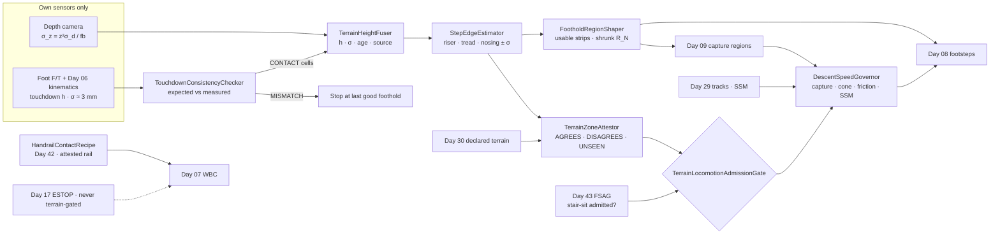
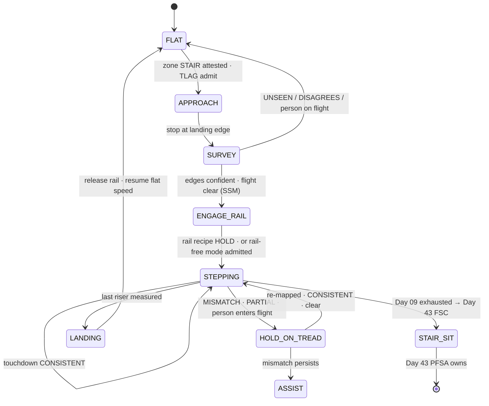
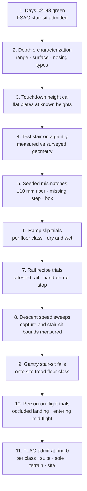

# Day 44 — Stairs, ramps, and uneven terrain under the fall-safe stack: TerrainHeightFuser / StepEdgeEstimator / TouchdownConsistencyChecker / FootholdRegionShaper / TerrainZoneAttestor / HandrailContactRecipe / DescentSpeedGovernor / TerrainLocomotionAdmissionGate under FallSafeAdmissionGate + DeliberateContactAdmissionGate + WholeBodyTouchAdmissionGate + HumanHandoverAdmissionGate + CooperativeTaskAdmissionGate + TaskCompositionAdmissionGate + FleetSkillCatalogAdmissionGate + CrossEmbodimentSkillTransferAdmissionGate + DexterousSkillCaptureAdmissionGate + TelepresenceAdmissionGate + RemoteTeleopAdmissionGate + FleetSharedControlAdmissionGate + SharedControlAdmissionGate + CollaborativeWorkspaceAdmissionGate + proximity + zone attestation + supervisor + logging + canary + HIL + fleet + fleet-canary + incident + forensics/reopen + change-management + maintenance + thermal + energy gates

![TerrainHeightFuser / StepEdgeEstimator / TouchdownConsistencyChecker / FootholdRegionShaper / TerrainZoneAttestor / HandrailContactRecipe / DescentSpeedGovernor / TerrainLocomotionAdmissionGate: a humanoid descends a flight of stairs; its own depth camera builds a height map whose sigma grows with range and at the stair nosing; each touchdown measures the tread height with millimetre sigma and checks it against the map; the usable foothold on each tread is the strip between the riser and the nosing minus k sigma, not the whole tread; the robot's right hand slides along an attested handrail as a Day 42 recipe; descent speed is the minimum of the capture bound and the speed that keeps the Day 43 stair-sit fall in the feasible cone; a person at the bottom of the flight inside SSM range makes the robot wait on the landing; TerrainLocomotionAdmissionGate fails closed under Day 43 FSAG and never raises Day 29 PFL, writes Day 05 torque_scale, or bypasses CrossSiteZoneConfigGate](/images/day44-stairs-ramps-uneven-terrain.png)

[Day 05](/lessons/day-05-power-bms) owns `torque_scale` **forever**. [Day 06](/lessons/day-06-estimation-balance) owns the floating-base estimate and its σ. [Day 07](/lessons/day-07-wbc-balance) owns whole-body balance. [Day 08](/lessons/day-08-stepping-locomotion) owns footstep planning and the support polygon. [Day 09](/lessons/day-09-push-recovery) owns capture regions and the capturability verdict. [Day 17](/lessons/day-17-runtime-safety-supervisor) owns ESTOP. [Day 25](/lessons/day-25-fleet-change-management) owns change sets. [Day 29](/lessons/day-29-human-proximity-safety) owns person tracks, SSM, and PFL rows. [Day 30](/lessons/day-30-collaborative-workspace-zoning) owns attested zones and `CrossSiteZoneConfigGate`. [Day 41](/lessons/day-41-whole-body-tactile-skin-touch) owns the momentum residual (MOCD). [Day 42](/lessons/day-42-deliberate-whole-body-contact) owns deliberate contact recipes. [Day 43](/lessons/day-43-falls-fall-safe-contact) owns fall modes, landing sites, and `FallSafeAdmissionGate` (FSAG).

Everything up to now could pretend the floor was a plane at z = 0. Day 43 already named where that breaks: "a stair edge that wasn't in the map" was on the list of reasons a humanoid falls. Stairs, ramps, thresholds, cable covers, and broken tiles are where the floor stops being a constant and becomes a measurement, and like every other measurement in this course it has a σ, an age, and a way of being wrong.

Seven lies show up the first time a team takes a humanoid off flat ground:

1. **Map-is-terrain lie.** "The building scan says the stairs are 178 mm risers and 280 mm treads." The scan is from before the renovation, the bottom riser is 12 mm shorter because the floor was re-leveled, and somebody left a box on the third tread.
2. **Flat-σ lie.** The height map carries one σ for every cell. Depth error grows with the square of range, explodes at edges, and is meaningless on glass, black rubber, and wet tile.
3. **Whole-tread lie.** "The foot fits on the tread, so the tread is the foothold." With a 25 mm nosing, an edge σ of 8 mm, and a 220 mm sole on a 280 mm tread, the honest usable strip is a few millimetres longer than the foot, and sometimes shorter.
4. **Touchdown-is-a-surprise lie.** The foot lands 15 mm early and the controller treats it as a disturbance to reject. That early touchdown was the best terrain measurement the robot had all day, and it said the map was wrong.
5. **Rail-is-a-rail lie.** The arm grabs whatever cylinder is at hand height. It's a decorative rail on a drywall anchor, or it's a person's hand.
6. **Downhill-is-easy lie.** Descent uses the same speed as flat walking because the motors are working less. The capture point on stairs has to land on the next tread, which is one tread away, and the fall you'd want is backward onto the steps, which only stays reachable while you're slow.
7. **Slope-shrinks-SSM lie.** On a wet ramp the robot keeps its walking speed and "brakes harder if needed." It can't: friction caps braking, so the stopping distance Day 29 uses grows, and either the speed drops or the envelope widens.

Today owns **`TerrainHeightFuser` / `StepEdgeEstimator` / `TouchdownConsistencyChecker` / `FootholdRegionShaper` / `TerrainZoneAttestor` / `HandrailContactRecipe` / `DescentSpeedGovernor` / `TerrainLocomotionAdmissionGate`**. The question is: **how do you take a humanoid up and down stairs, across ramps, and over uneven floor using only terrain it has MEASURED with its own depth sensors and feet, with σ that grows honestly; shrinking Day 08 footholds and Day 09 capture regions by that σ and by edge confidence; admitting stair mode only in Day 30 zones whose terrain is attested and where Day 43 admits the stair-sit fall; using handrails only as Day 42 recipes on attested rails; and bounding descent speed by the capture margin and fall cone it leaves — without raising Day 29 PFL, writing Day 05 `torque_scale`, or bypassing `CrossSiteZoneConfigGate`?**

## Terrain is a sensor, not a setting

The rule everything follows from: **the floor under the next footstep is a MEASURED quantity with σ from this robot's own depth sensors and its own feet, and the map is only an expectation the measurement is checked against.** A zone's declared terrain says what *should* be there. The robot only steps on what it *saw* and, after the first step, what it *felt*.

Three numbers drive the whole lesson.

**Depth σ grows with range squared.** For a stereo pair with focal length $f$ in pixels, baseline $b$, and disparity noise $\sigma_d$:

$$
\sigma_z(z) = \frac{z^2\,\sigma_d}{f\,b}
$$

With $f = 600$ px, $b = 0.06$ m, $\sigma_d = 0.08$ px: 2 mm at 1 m, 9 mm at 2 m, 20 mm at 3 m. A riser is 180 mm, so from 3 m away a step is clear, but its exact height isn't good enough to plan a foot placement. Time-of-flight sensors scale differently but have their own failure modes: multipath in stairwell corners, and mixed pixels that average the tread and the floor below at every nosing.

**Kinematic touchdown height is millimetre-grade.** When a foot is in full flat contact, the Day 06 estimate of the sole height has σ of about 3 mm for the K1 class (leg kinematics, encoder resolution, and base estimate together). That's three to seven times better than the depth camera at stepping range. Every footstep is a terrain measurement.

**Capture on stairs is quantized.** On flat floor the reachable capture region is a continuous blob. On stairs the only admissible footholds are the usable strips of the treads, so a capture point that falls between them is as bad as one that falls off the edge of the world.

| Layer | Owns | Must not own |
|-------|------|--------------|
| `TerrainHeightFuser` | Robot-centric height map with per-cell σ, age, and source (DEPTH / CONTACT / UNKNOWN) | Seeding cells from the site map; one global σ |
| `StepEdgeEstimator` | Riser height, tread depth, nosing position and overhang, each with σ and an edge confidence | Snapping to the declared stair geometry |
| `TouchdownConsistencyChecker` | Expected vs MEASURED touchdown height and timing; mismatch verdicts | Treating early or late touchdown as a disturbance only |
| `FootholdRegionShaper` | Usable foothold strips and shrunk capture regions fed to Days 08 and 09 | Placing feet itself; overriding Day 09 |
| `TerrainZoneAttestor` | Per-zone declared terrain class and its agreement with measurement | Replacing measurement with the declaration |
| `HandrailContactRecipe` | Rail contact as a Day 42 recipe on an attested rail | Grabbing unattested rails, or anything a person's hand is on |
| `DescentSpeedGovernor` | Speed and cadence ceiling from capture margin, stair-sit cone, friction, and SSM stopping distance | Raising any Day 29 row; asking Day 05 for torque |
| `TerrainLocomotionAdmissionGate` | Fail-closed admit per robot class, suite, pad rev, terrain class, floor class, site | `JointCommand`; Day 05; PFL; Day 17 |
| Days 05 / 08 / 09 / 17 / 29 / 30 / 42 / 43 | Torque, footsteps, capture, ESTOP, PFL, zones, recipes, falls | Being outranked by "the stairs are in the map" |

**Core thesis:** **a humanoid steps only on terrain it has measured, with footholds and capture regions shrunk by the σ of that measurement; it enters stairs only where the terrain and the stair-sit fall are both admitted; it touches rails only as recipes; and it descends only as fast as its capture margin and its backward fall allow.**



## Physical machine: what terrain does to a humanoid

### Stair geometry and what the robot can see of it

Building codes bound stairs loosely: in the US, the International Building Code allows risers up to 7 in (178 mm) and treads down to 11 in (279 mm), with nosings up to 1¼ in (32 mm). Real stairs vary from flight to flight and sometimes from step to step, and the top and bottom risers are the ones most often off because floors get re-leveled and re-covered.

What the head camera can see depends on direction:

- **Going up,** the riser faces are visible, but each tread beyond the next one is hidden behind its nosing until the head rises above it. Tread depth for step k+2 is UNSEEN until the robot is on step k.
- **Going down,** the treads are visible from above, but the risers are self-occluded and the nosing overhang hides where the riser meets the tread below. The edge the foot must clear is the nosing, which is the one feature depth sensors get worst, because every pixel straddling it is half tread and half the floor below.

That asymmetry means ascent and descent need different estimators and different margins. It also means some cells are honestly UNKNOWN at the moment the planner wants them, and the only correct answer is to plan fewer steps ahead, not to fill them in.

### The foot is not a point

The K1 sole is 220 mm by 95 mm. On a 280 mm tread with a 25 mm nosing:

$$
L_{\text{use}} = T - m_{\text{riser}} - m_{\text{edge}} - k\,\sigma_e
$$

With $T = 0.28$ m, toe clearance to the riser $m_{\text{riser}} = 0.01$ m, edge margin $m_{\text{edge}} = 0.02$ m, and $k\sigma_e = 3 \times 0.008$ m, $L_{\text{use}} = 0.226$ m. That's 6 mm longer than the foot. On a 255 mm tread the strip is shorter than the foot, and the honest support polygon is the part of the sole that's on the strip. Day 08's ZMP constraint then lives inside a smaller polygon, which reduces the ankle torque authority Day 07 has for balance. Turning the foot sideways doesn't help: a rotated rectangle projects longer, $L\cos\theta + W\sin\theta$, not shorter.

### Ramps are a friction problem

On a slope θ, standing still already needs a friction ratio of tan θ. Braking with deceleration $a$ needs roughly

$$
\mu_{\text{req}} \approx \tan\theta + \frac{a}{g}
$$

An accessible ramp at 1:12 has tan θ = 0.083. Braking at 0.1 g needs μ ≈ 0.18. Floor friction isn't a datasheet value: it's a distribution per floor class and condition, measured with your own sole material. If the 5th-percentile measured μ on wet sealed concrete is 0.25 and you admit with a factor of 1.5, the admissible μ is 0.167. Then braking downhill is capped at $(0.167 - 0.083)\,g \approx 0.82$ m/s². Day 29's stopping distance uses that deceleration, so the robot either walks slower on the wet ramp or Day 29's separation envelope grows. It never gets to keep both.

### Stairs change the energy of a fall

On flat ground Day 43's budget was $m g z_c \approx 560$ J. A forward fall down a flight adds every riser the body crosses: three risers of 0.18 m for a 62 kg robot gives

$$
m g (z_c + 3h) = 62 \times 9.81 \times (0.92 + 0.54) \approx 890\ \text{J}
$$

No pad band from Day 43 covers that, and the forward-kneel mode lands on a nosing, not a floor. That's why the only fall mode that makes stair descent admissible is the backward stair-sit: the buttock lands on the tread behind, which is *higher*, so the drop is shorter than on flat ground. Everything about descent speed follows from keeping that mode reachable.

## TerrainHeightFuser: a map with honest σ

`TerrainHeightFuser` (THF) keeps a robot-centric 2.5D grid, 2 cm cells, about 4 m by 4 m around the robot. Each cell has a height $h$, a variance $\sigma_h^2$, an age, and a source tag.

**Depth updates** fuse per cell with a scalar Kalman step, using the range-dependent $\sigma_z$ above, inflated by the pose σ of the camera from Day 06 and by an edge term where the local depth gradient is large:

$$
K = \frac{\sigma_h^2}{\sigma_h^2 + \sigma_z^2}, \quad h \leftarrow h + K(z - h), \quad \sigma_h^2 \leftarrow (1 - K)\,\sigma_h^2
$$

**Contact updates** happen at every flat-foot touchdown. The cells under the sole get the kinematic height with σ ≈ 3 mm and the source tag CONTACT. These are the best cells in the map, and they're the ones `StepEdgeEstimator` anchors tread heights to.

**Aging** grows variance between observations, $\sigma_h^2 \leftarrow \sigma_h^2 + q\,\Delta t$, because floors don't change but the robot's pose estimate drifts and objects move. A cell whose new measurement disagrees with its fused value by more than 3σ is tagged DYNAMIC and isn't a foothold until it settles.

**Unseen is not flat.** A cell that has never been observed is UNKNOWN, with no height. The planner can't step there. The site map never seeds a cell, because seeding is exactly how the map-is-terrain lie gets into the controller.

**Bad surfaces declare themselves.** Glass, mirrors, black rubber, and standing water produce invalid or wildly noisy depth. THF counts invalid returns per cell and marks cells with too few valid returns as UNKNOWN rather than averaging the survivors.

## StepEdgeEstimator: risers, treads, and the nosing

`StepEdgeEstimator` (SEE) segments the height map into planar patches with RANSAC on the DEPTH and CONTACT cells, then fits a step model: a sequence of horizontal treads separated by risers, each with

- tread height $h_i$ and σ (from the patch fit, tightened to millimetres once a foot has been on it),
- tread depth $T_i$ and σ,
- nosing position $x_{e,i}$ and σ, and overhang if visible,
- an **edge confidence** $c_{e,i}$: the probability, from the fit residuals and the count of valid pixels on both sides, that the true edge is within $k\sigma_e$ of the estimate.

SEE never snaps to the declared geometry. If the Day 30 zone says 178 mm risers and SEE measures 166 ± 4 mm for the bottom step, SEE reports 166 ± 4 mm and `TerrainZoneAttestor` gets a disagreement. An edge with confidence below threshold isn't an edge the planner may use: the tread behind it is UNKNOWN for footholds until the robot gets closer and σ drops.

## TouchdownConsistencyChecker: the foot is the best sensor

Every footstep is a prediction: "the sole will meet the surface at height $\hat h$ at time $\hat t$." `TouchdownConsistencyChecker` (TCC) compares that with the measured touchdown from the foot F/T rise and the Day 06 kinematic height:

$$
r = h_{\text{td}} - \hat h, \qquad |r| > k\sqrt{\sigma_{\hat h}^2 + \sigma_{\text{kin}}^2} \Rightarrow \text{MISMATCH}
$$

| Verdict | Meaning | Action |
|---------|---------|--------|
| `CONSISTENT` | Measured height inside the predicted band | Contact cells written; continue |
| `EARLY` | Surface higher than predicted | Mismatch; stop at this foothold; re-map before next step |
| `LATE` | Surface lower, or no contact by $\hat t + \Delta t$ | Foot keeps descending within a bounded search depth; Day 09 owns balance; stop at the first measured contact |
| `PARTIAL` | Contact on heel or toe only (CoP at the sole edge) | Support polygon is the loaded part; no push-off; re-place |
| `UNKNOWN` | Contact detection disagrees between F/T and kinematics | Treated as MISMATCH |

A late touchdown on stairs is the missing-step case, the one that produced Day 43's stair fall mode. The bounded search depth matters: a foot that keeps reaching down for a step that's 400 mm away instead of 180 mm will drive ξ off every tread. If the search depth runs out, Day 09 owns the recovery, and if Day 09 can't recover, Day 43 owns the fall, which is why stair mode requires the stair-sit fall to be admitted.

Any MISMATCH is logged with the full height-map snapshot. Repeated mismatches at the same zone feed `TerrainZoneAttestor`.

## FootholdRegionShaper: what Days 08 and 09 are allowed to use

`FootholdRegionShaper` (FRS) turns SEE's model and THF's cells into the convex foothold regions Day 08 plans over and Day 09 computes capture regions from. It never places a foot. It only shapes the regions.

For each tread, the usable strip is the tread minus the riser clearance, minus the edge margin, minus $k\sigma_e$, intersected with the cells whose $\sigma_h$ is below the stepping threshold (8 mm for K1). On uneven floor, a foothold region is a patch whose plane-fit residual and σ are both below threshold over at least the sole footprint, with a step-height limit to neighbors.

The important consequence is in Day 09. On flat floor, the N-step capture region is a continuous area. On stairs it becomes a union of usable strips, one per tread, and the capture margin is measured against that union. A capture point between two strips is outside every region. FRS publishes the regions with their σ already subtracted, so Day 09 stays exactly as it was and simply gets smaller, honest regions.



## TerrainZoneAttestor: declared terrain vs measured terrain

Day 30 already attests zone geometry. `TerrainZoneAttestor` (TZA) adds a terrain class to each zone, declared through a Day 25 change set and `CrossSiteZoneConfigGate`:

- `FLAT` with a max step height (say 15 mm for thresholds and cable covers),
- `RAMP` with slope, length, and floor class,
- `STAIR` with riser and tread nominals and tolerances, step count, nosing type, tread floor class, rail ids, and landing extents,
- `UNEVEN` with max step height, max slope, and an obstacle class.

The declaration does two jobs: it decides which locomotion modes may be *admitted* in that zone, and it gives TCC and SEE an expectation to disagree with. It never fills a height cell.

TZA's live verdict per zone is `AGREES` (measured geometry inside the declared tolerances), `DISAGREES` (something differs beyond tolerance), or `UNSEEN` (not enough measured cells yet). Stair mode needs `AGREES` for the whole flight, checked at the landing before the first step and re-checked step by step. `DISAGREES` stops the robot at the landing and files the evidence as a Day 30 attestation issue. A site can't fix it by editing the declaration on one robot; that's a site config change and goes through `CrossSiteZoneConfigGate` like every other zone edit.

**Stair mode requires the stair fall.** TZA admits `STAIR` locomotion for a robot only where Day 43 FSAG has the backward stair-sit mode admitted for the same robot class, pad revision set, tread floor class, and site. If the buttock pad is `SPENT`, or the site's treads are a floor class nobody has drop-tested, there's no stair mode, even if the stairs are perfect.

## HandrailContactRecipe: rails are recipes, not grab targets

A rail roughly halves the lateral balance problem on stairs, because a hand on it adds a contact that can take lateral and some vertical force. Day 42 already owns how the robot touches the world on purpose, so a rail is a recipe:

- **The rail is attested.** Its id, geometry, height, end points, anchor spacing, and load rating are in the zone's declaration, checked against SEE's measurement of the rail cylinder. An unattested rail is a hazard to stay clear of, exactly like Day 43's unattested rack.
- **The hand slides, it doesn't grip.** A C-shaped hand closure around the rail with a capped closing force lets the hand travel along the rail at walking speed without regrasping. Grip force is bounded by the Day 29 hand row, because a person's hand on the same rail is the most likely thing the hand will meet.
- **Contact is MEASURED.** The wrist F/T and the Day 42 `ContactSensorBinder` measure the rail wrench, and `BandedResidualSubtractor` only removes it from the MOCD residual inside the recipe's band. A rail load outside the band (the anchor pulling out, a person pushing on the rail) is a collision again.
- **Support, not arrest.** The recipe bounds the vertical share the rail may carry (say 15% of body weight) and never hangs the robot on it. The rail counts as a Day 43 fall-arrest support only if it's attested as one, with its own load rating.
- **A hand ahead on the rail is a person.** If Day 29 tracks a person on the flight or Day 41 skin and the wrist F/T see an unexpected contact along the rail, the hand stops, opens, and the robot holds on the tread.

If no attested rail exists, stair mode can still be admitted in a **rail-free** variant with lower speed and tighter edge margins, but only with its own evidence.

## DescentSpeedGovernor: slow enough to stop, slow enough to sit

`DescentSpeedGovernor` (DSG) computes a ceiling on forward CoM speed and step cadence. It takes the minimum of four bounds and never writes torque.

**1. Capture bound.** Going down, the step you'd be caught on is a riser lower, so ω uses the height above the lower tread: $z = 0.92 + 0.18 = 1.10$ m gives ω ≈ 2.99 rad/s. The capture point must fit inside the far end of the next tread's usable strip, $x_{\text{far}}$, with kσ margin, after the divergence that happens during detection latency $t_d$:

$$
\frac{v}{\omega}\,e^{\omega t_d} + k\,\sigma_\xi \le x_{\text{far}} \quad\Rightarrow\quad v_{\text{cap}} = \omega\,(x_{\text{far}} - k\sigma_\xi)\,e^{-\omega t_d}
$$

With $x_{\text{far}} = 0.24$ m, $k\sigma_\xi = 3 \times 0.015$ m, $t_d = 50$ ms: $v_{\text{cap}} \approx 2.99 \times 0.195 / 1.16 \approx 0.50$ m/s.

**2. Stair-sit cone bound.** Day 43's `FallDirectionArbiter` can bias a fall by its authority angle only while the fall cone still includes backward. Forward CoM speed pushes the cone forward. For the example K1 numbers, the Day 43 cone model run against gantry stair trials keeps the backward stair-sit reachable below about 0.35 m/s on a 178 mm riser. This bound comes from measured trials per riser class, never from the formula alone.

**3. Friction bound.** On ramps and on tread floor classes, the admissible μ caps braking. DSG picks the speed whose stopping distance at that deceleration fits the Day 29 SSM envelope for the current tracks. A wet ramp lowers speed. It never shrinks the envelope.

**4. Thermal and power bound.** Descent is mostly negative work: knees absorb energy every step. DSG reads Day 27's derated knee torque and Day 05's live regen acceptance and lowers cadence when either is tight. It never asks either owner for more.

In the example, $v = \min(0.50, 0.35, v_\mu, v_{\text{therm}}) = 0.35$ m/s, which is about 0.8 s per 280 mm tread. That feels slow. It's the speed at which the robot can still either step out of a slip or sit down on the steps behind it.

**People on the flight.** A stair flight is narrow and a fall there points along the flight. DSG only admits stepping onto a flight when the flight *below* (descending) or *ahead* (ascending) is clear of person tracks within the SSM distance, with occluded parts of the flight treated as occupied. A person entering the flight puts the robot into `HOLD_ON_TREAD` with the rail held, and the robot waits. It never hurries to clear the flight.

## TerrainLocomotionAdmissionGate

`TerrainLocomotionAdmissionGate` (TLAG) admits locomotion modes per robot class, sensor suite hash, pad revision set, terrain class, floor class, and site, under Day 43 FSAG. It fails closed if any of these is missing:

- THF and SEE characterized on this suite: σ_z vs range and surface, edge σ on the site's nosing types.
- TCC trials with seeded mismatches (riser ±10 mm, missing step, box on a tread) showing stop-at-last-good-foothold.
- For `STAIR`: FSAG stair-sit admitted for the tread floor class; rail recipe admitted per rail id or rail-free variant evidence; DSG bounds measured per riser class.
- For `RAMP`: slip trials on the floor class in each declared condition (dry, wet), with the admissible μ published.
- For `UNEVEN`: step-height and slope limits trialed on a representative course.

Evidence is never pooled across robot classes or sole materials: a new sole compound is a new friction distribution. TLAG never writes `JointCommand`, never touches Day 05 `torque_scale`, never raises a Day 29 row, and never gates ESTOP.

## Data shapes

```text
HeightCell:                                  # THF
  h_m
  sigma_m
  age_ms
  source                 # DEPTH | CONTACT | UNKNOWN
  dynamic                # true if last update disagreed > 3σ

StepModel:                                   # SEE
  header: BusHeader
  treads[]               # h, sigma_h, depth, sigma_depth
  edges[]                # x_e, sigma_e, overhang, confidence
  unseen_from_index

TouchdownCheck:                              # TCC
  foot                   # L | R
  h_pred, sigma_pred
  h_meas, sigma_kin
  t_pred_ms, t_meas_ms
  verdict                # CONSISTENT | EARLY | LATE | PARTIAL | UNKNOWN

FootholdRegions:                             # FRS
  header: BusHeader
  regions[]              # convex polygon, plane, sigma, source_cells
  capture_regions_N[]    # union of usable strips, σ subtracted

TerrainZoneVerdict:                          # TZA
  zone_id, map_version
  declared_class         # FLAT | RAMP | STAIR | UNEVEN
  verdict                # AGREES | DISAGREES | UNSEEN
  disagreements[]        # feature, declared, measured, sigma

RailContact:                                 # HCR (Day 42 recipe)
  rail_id                # attested only
  phase                  # APPROACH | PROBE | ENGAGE | SLIDE | RELEASE
  wrench_meas, in_band
  vertical_share
  person_on_rail         # Day 29 / Day 41 evidence

DescentBound:                                # DSG
  v_cap, v_cone, v_mu, v_therm, v_max
  cadence_s
  flight_clear           # SSM, occluded = occupied

TerrainLocomotionAdmission:                  # TLAG
  robot_class
  sensor_suite_hash
  sole_material
  pad_rev_set
  terrain_class
  floor_class
  site
  modes_admitted[]       # FLAT_STEP | RAMP | STAIR_RAIL | STAIR_RAIL_FREE | UNEVEN
  forbid:
    seed_cells_from_map: true
    snap_to_declared_geometry: true
    step_on_unknown: true
    grab_unattested_rail: true
    raise_pfl: true
    write_torque_scale: true
    gate_estop: true
    bypass_cross_site_zone_config_gate: true

# Unchanged owners
FallSafeAdmissionGate · stair-sit mode · FallDirectionArbiter (Day 43)
DeliberateContactAdmissionGate · ContactSensorBinder · BandedResidualSubtractor (Day 42)
MomentumObserverCollisionDetector (Day 41)
CrossSiteZoneConfigGate · zone geometry (Day 30) · person tracks · SSM · PFL (Day 29)
ThermalDerate (Day 27) · Changeset (Day 25) · SupervisorState ESTOP (Day 17)
Capturability (Day 09) · Footstep planner (Day 08) · EstimatorState (Day 06)
BmsState / PowerState (Day 05): torque_scale, charge_accept_a
  accepts_requests_from_terrain: false
```

## Config

A starting configuration. Every number is a policy you re-derive from your own robot, sensors, soles, stairs, and Day 29 tables:

```yaml
terrain:
  height_map:
    cell_m: 0.02
    extent_m: 4.0
    sigma_model: stereo_range_squared_plus_pose_plus_edge
    contact_sigma_m: 0.003
    aging_q_m2_per_s: 4.0e-6
    dynamic_threshold_sigma: 3
    seed_from_site_map: forbidden
    unseen_is: UNKNOWN
  edges:
    snap_to_declared: forbidden
    min_edge_confidence: 0.95
  touchdown:
    k_sigma: 3
    late_search_depth_m: 0.05
    mismatch_action: stop_at_last_good_foothold
  footholds:
    max_sigma_m: 0.008
    riser_clearance_m: 0.01
    edge_margin_m: 0.02
    edge_k_sigma: 3
    partial_sole_support: loaded_part_only
  zones:
    classes: [FLAT, RAMP, STAIR, UNEVEN]
    stair_requires: [zone_AGREES_whole_flight, fsag_stair_sit_admitted]
    disagreement_action: stop_at_landing_and_file_day30_issue
    changes_via: [day25_changeset, cross_site_zone_config_gate]
  rail:
    attested_only: true
    hand_mode: sliding_c_closure
    closing_force: day29_hand_row
    max_vertical_share: 0.15
    fall_arrest: only_if_attested_as_fall_arrest
    person_on_rail: open_and_hold
  descent:
    bounds: [capture, stair_sit_cone, friction, thermal_power]
    detection_latency_ms: 50
    capture_k_sigma: 3
    cone_bound_source: gantry_stair_trials_per_riser_class
    flight_clear_required: true
    occluded_is_occupied: true
    person_enters_flight: HOLD_ON_TREAD
  ramps:
    mu_source: slip_trials_p05_per_floor_class_and_condition
    mu_safety_factor: 1.5
    friction_limits: speed_never_ssm
  admission:
    keyed_by: [robot_class, sensor_suite_hash, sole_material, pad_rev_set, terrain_class, floor_class, site]
    pooled_across_classes: forbidden
```

## Physical ↔ digital pairing

| Physical | Digital twin / backing |
|----------|------------------------|
| Flight of stairs seen from 3 m | THF cells with σ ≈ 20 mm; SEE edges below confidence; footholds UNKNOWN |
| Same flight from the landing | σ ≈ 3–5 mm; SEE model; TZA `AGREES` or `DISAGREES` |
| Bottom riser 12 mm short | SEE measures it; TZA disagreement; TCC would catch it at touchdown anyway |
| Box on the third tread | DYNAMIC / non-planar cells; strip removed; flight not admitted |
| Foot lands early | TCC `EARLY`; stop on this tread; re-map |
| Foot finds no step | TCC `LATE`; bounded search; Day 09 then Day 43 stair-sit |
| Hand on the rail | Day 42 recipe; MEASURED wrench in band; slide |
| Person's hand ahead on the rail | Unexpected contact; open; HOLD_ON_TREAD |
| Wet ramp | Admissible μ lower; DSG lowers speed; SSM unchanged |
| Buttock pad spent | FSAG drops stair-sit; TZA drops stair mode for this robot |

The pairing that matters most: **replay every stair traversal from the robot's own bag and show that every foot landed inside a usable strip computed from measured cells with σ below threshold, that every touchdown was checked and every mismatch stopped the robot on its last good foothold, that speed stayed under the minimum of the capture and stair-sit bounds, that rail contact was a MEASURED in-band recipe on an attested rail, and that no person was on the flight inside SSM range while the robot stepped.** If a traversal only looks safe in replay when you load the declared stair geometry, the map owns the stairs.

## Bring-up sequence (before stairs anyone uses)



1. **Days 02–43 green,** FSAG admitted including the stair-sit mode for the site's tread floor class.
2. **Depth σ characterization:** measure σ_z vs range on matte, glossy, dark, and wet samples, and edge σ on each nosing type at the site.
3. **Touchdown height calibration:** step onto plates at known heights and confirm the kinematic σ.
4. **Test stair on a gantry:** a surveyed test flight; compare SEE's model to the survey across lighting.
5. **Seeded mismatches:** shim a riser up and down 10 mm, remove a step, put a box on a tread; confirm stop-at-last-good-foothold every time.
6. **Ramp slip trials** with your sole material per floor class and condition; publish the 5th-percentile μ.
7. **Rail trials** on each attested rail: slide, measured band, and a person's hand (an instrumented dummy hand) on the rail ahead.
8. **Descent speed sweeps** on the gantry: measure where capture fails and where backward stair-sit stops being reachable, per riser class.
9. **Gantry stair-sit falls** onto the site's tread material with the line slack enough to land.
10. **Person-on-flight trials:** dummies on the landing, occluded around a turn, and entering mid-flight.
11. **TLAG admit at ring 0** per robot class, sensor suite, sole material, terrain class, floor class, and site.

## Failure gallery

| Symptom | Likely cause |
|---------|--------------|
| Toe catches the bottom riser | Height map seeded from the site scan; renovation changed the riser |
| Heel slips off a nosing on descent | Whole tread used as the foothold; no edge margin or kσ_e |
| Robot steps confidently into a dark stairwell | UNKNOWN cells treated as flat |
| Early touchdown "rejected" and the next step trips | TCC missing; touchdown not used as a measurement |
| Robot keeps reaching down for a missing step | No bounded late-touchdown search |
| Rail anchor pulled out of drywall | Unattested rail used as support |
| Robot squeezes a person's hand on the rail | Rail contact not a recipe; no person-on-rail stop |
| Forward fall down the flight | Descent speed above the stair-sit cone bound |
| Robot slides on a wet ramp when a person appears | Speed held, braking assumed; friction ignored in SSM |
| Stairs "fixed" at one site by editing the declaration | Terrain edit bypassed `CrossSiteZoneConfigGate` |
| Stair mode still running with a spent buttock pad | TLAG not tied to FSAG's stair-sit admission |

## Exercises

1. For the stereo parameters above, at what range does σ_z exceed the 8 mm foothold threshold? How many treads ahead can the robot plan footholds on a 280 mm tread flight if the camera is 1.5 m above the tread and looking 30° down?
2. A 255 mm tread has a 30 mm nosing and edge σ of 10 mm. Compute $L_{\text{use}}$ and the loaded part of a 220 mm sole. What does that do to Day 08's ZMP margin?
3. Redo the capture bound for a 165 mm riser, $x_{\text{far}} = 0.21$ m, σ_ξ = 0.02 m, and 80 ms latency. Which bound now sets descent speed?
4. A ramp is 1:10 and the measured 5th-percentile wet μ is 0.22. With a 1.5 safety factor, what deceleration is admissible downhill, and how much longer is the stopping distance from 0.6 m/s than on dry flat floor at 2 m/s²?
5. The robot is on tread 4 of 9 descending. A person appears at the bottom landing, 3.2 m away along the flight. Using Day 29's SSM, does the robot hold, and what does it do with the rail hand?
6. Write the TZA declaration for a 12-step flight with one rail on the right side. Which fields does TCC check every step, and which does SEE check only from the landing?

## What to freeze this week

Extend [frames](/frames) and your safety config with:

- `TerrainHeightFuser`: robot-centric height cells with range-, pose-, and edge-dependent σ; CONTACT cells from touchdowns; aging; DYNAMIC on disagreement; UNKNOWN is never flat; no seeding from the site map.
- `StepEdgeEstimator`: riser, tread, and nosing with σ and edge confidence; never snapped to the declaration.
- `TouchdownConsistencyChecker`: every touchdown checked; EARLY / LATE / PARTIAL / UNKNOWN stop at the last good foothold; bounded late search.
- `FootholdRegionShaper`: usable strips and capture regions with σ and edge margins subtracted; partial-sole support is the loaded part only.
- `TerrainZoneAttestor`: declared terrain classes through Day 25 and `CrossSiteZoneConfigGate`; AGREES / DISAGREES / UNSEEN; stair mode only with a whole-flight AGREES and Day 43 stair-sit admitted.
- `HandrailContactRecipe`: Day 42 recipe on attested rails; sliding hand; Day 29 closing force; bounded vertical share; open on a person's hand.
- `DescentSpeedGovernor`: minimum of capture, stair-sit cone, friction, and thermal bounds; flight clear with occluded as occupied; friction lowers speed, never SSM.
- `TerrainLocomotionAdmissionGate` fail-closed under Day 43 FSAG, Day 42 DCAG, Day 29, and Day 30 `CrossSiteZoneConfigGate`; evidence keyed by robot class, suite, sole material, pad revision, terrain class, floor class, and site; **no dual-write of ESTOP or `torque_scale`; no terrain mode raises PFL.**

The lesson isn't "teach the robot to climb stairs." It's that **the floor stops being a constant the moment it has edges, so the robot steps only where it has measured, shrinks every foothold by what it doesn't know, believes its feet over the map, enters stairs only where it's allowed to fall on them, and goes down slowly enough to sit**, under ceilings that never move because the floor tilted.

## Further reading

Look these up by title; they're the classic sources for today's terrain mapping, foothold planning, and stair-walking arguments:

- P. Fankhauser, M. Bloesch, C. Gehring, M. Hutter, and R. Siegwart, "Robot-centric elevation mapping with uncertainty estimates," CLAWAR, 2014.
- P. Fankhauser, M. Bloesch, and M. Hutter, "Probabilistic terrain mapping for mobile robots with uncertain localization," *IEEE RA-L*, 2018.
- R. Deits and R. Tedrake, "Computing large convex regions of obstacle-free space through semidefinite programming," WAFR, 2014.
- R. Deits and R. Tedrake, "Footstep planning on uneven terrain with mixed-integer convex optimization," IEEE-RAS Humanoids, 2014.
- K. Nishiwaki, J. Chestnutt, and S. Kagami, "Autonomous navigation of a humanoid robot over unknown rough terrain using a laser range sensor," *IJRR*, 2012.
- M. Fallon et al., "An architecture for online affordance-based perception and whole-body planning," *Journal of Field Robotics*, 2015.
- S. Kuindersma et al., "Optimization-based locomotion planning, estimation, and control design for the Atlas humanoid robot," *Autonomous Robots*, 2016.
- T. Koolen, T. de Boer, J. Rebula, A. Goswami, and J. Pratt, "Capturability-based analysis and control of legged locomotion," *IJRR*, 2012.
- J. Lee, J. Hwangbo, L. Wellhausen, V. Koltun, and M. Hutter, "Learning quadrupedal locomotion over challenging terrain," *Science Robotics*, 2020.
- International Building Code, Section 1011 (stairways), and the ADA Standards for Accessible Design (ramps, 1:12 maximum running slope); ANSI A326.3 for dynamic coefficient of friction on floors.

## Next

**Day 45+** — Outdoor and deformable ground under the terrain stack: grass, gravel, sand, mud, snow, and ice as MEASURED compliance, sinkage, and friction with σ from the robot's own foot F/T and kinematics, never from a surface label; slip detection from foot velocity and CoP drift with an honest UNKNOWN; depth sensing in sun, rain, and fog with σ that degrades openly; outdoor zones attested in Day 30 with weather-conditioned modes; and footholds and DSG bounds that shrink with measured ground stiffness — without raising Day 29 PFL, writing Day 05 `torque_scale`, or bypassing `CrossSiteZoneConfigGate`, under the same gates plus terrain admission.
