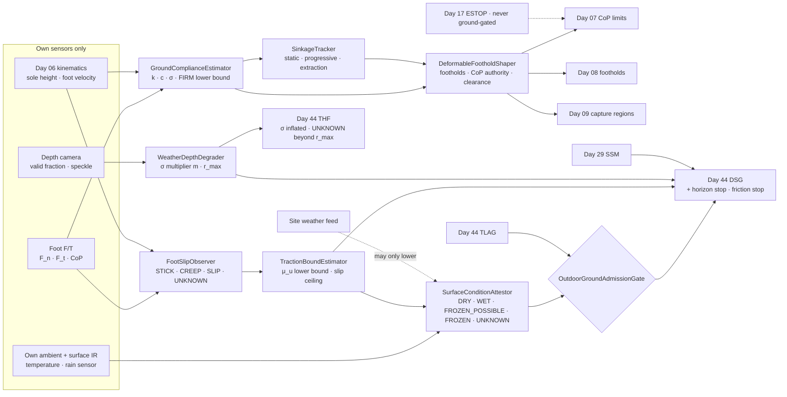
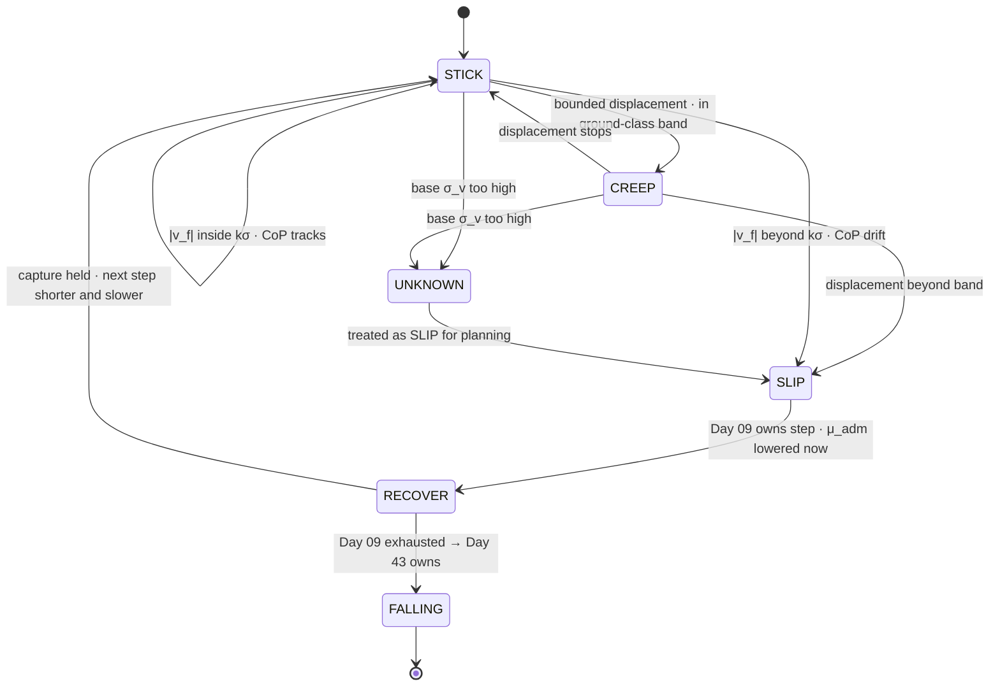
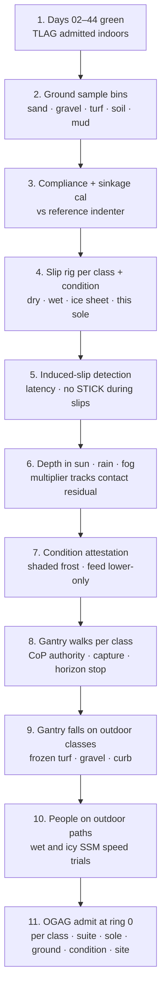

# Day 45 — Outdoor and deformable ground under the terrain stack: GroundComplianceEstimator / SinkageTracker / FootSlipObserver / TractionBoundEstimator / WeatherDepthDegrader / SurfaceConditionAttestor / DeformableFootholdShaper / OutdoorGroundAdmissionGate under TerrainLocomotionAdmissionGate + FallSafeAdmissionGate + DeliberateContactAdmissionGate + WholeBodyTouchAdmissionGate + HumanHandoverAdmissionGate + CooperativeTaskAdmissionGate + TaskCompositionAdmissionGate + FleetSkillCatalogAdmissionGate + CrossEmbodimentSkillTransferAdmissionGate + DexterousSkillCaptureAdmissionGate + TelepresenceAdmissionGate + RemoteTeleopAdmissionGate + FleetSharedControlAdmissionGate + SharedControlAdmissionGate + CollaborativeWorkspaceAdmissionGate + proximity + zone attestation + supervisor + logging + canary + HIL + fleet + fleet-canary + incident + forensics/reopen + change-management + maintenance + thermal + energy gates

![GroundComplianceEstimator / SinkageTracker / FootSlipObserver / TractionBoundEstimator / WeatherDepthDegrader / SurfaceConditionAttestor / DeformableFootholdShaper / OutdoorGroundAdmissionGate: a humanoid walks from a paved path onto sand and then toward a wet, near-freezing patch; each touchdown fits ground stiffness from the foot force against the kinematic sinkage, so firm ground reads as a lower bound and sand reads around 20 kN/m with 30 mm sinkage; the depth camera sees grass tips and rain speckle, so its sigma multiplier rises and the planning horizon shrinks from 1.9 m to under 1 m; stance-foot velocity and centre-of-pressure drift classify STICK, CREEP, SLIP, or UNKNOWN; friction from no-slip steps is only a lower bound, and a live slip can only lower the admitted friction; the speed ceiling is the minimum of the measured-horizon stop, the friction stop inside the Day 29 envelope, and the Day 44 bounds; OutdoorGroundAdmissionGate fails closed under Day 44 TLAG and never raises Day 29 PFL, writes Day 05 torque_scale, or bypasses CrossSiteZoneConfigGate](/images/day45-outdoor-deformable-ground.png)

[Day 05](/lessons/day-05-power-bms) owns `torque_scale` **forever**. [Day 06](/lessons/day-06-estimation-balance) owns the floating-base estimate and its σ. [Day 07](/lessons/day-07-wbc-balance) owns whole-body balance and the CoP it may command. [Day 08](/lessons/day-08-stepping-locomotion) owns footsteps. [Day 09](/lessons/day-09-push-recovery) owns capture regions. [Day 17](/lessons/day-17-runtime-safety-supervisor) owns ESTOP. [Day 25](/lessons/day-25-fleet-change-management) owns change sets. [Day 27](/lessons/day-27-thermal-budgets-duty-cycle) owns thermal derates. [Day 29](/lessons/day-29-human-proximity-safety) owns person tracks, SSM, and PFL rows. [Day 30](/lessons/day-30-collaborative-workspace-zoning) owns attested zones and `CrossSiteZoneConfigGate`. [Day 43](/lessons/day-43-falls-fall-safe-contact) owns fall modes and `FallSafeAdmissionGate` (FSAG). [Day 44](/lessons/day-44-stairs-ramps-uneven-terrain) owns the height map, touchdown checks, foothold strips, `DescentSpeedGovernor` (DSG), and `TerrainLocomotionAdmissionGate` (TLAG).

Day 44 made the floor a measurement, but it kept one quiet assumption: once a foot is down, the ground under it stays where it is and pushes back as hard as needed. Outdoors that breaks on the first step. Sand moves under the sole. Mud keeps sinking for the whole stance. Grass hides the ground under a layer the camera reports as the surface. A wet leaf on a paver has a tenth of the grip of the paver next to it. Ice can look exactly like wet asphalt.

Seven lies show up the first time a team walks a humanoid outside:

1. **Label lie.** A classifier says "grass," and the controller looks up a friction and stiffness for grass. Grass on dry clay, grass over a sprinkler-soaked lawn, and frosted grass at 7 a.m. are three different grounds with one label.
2. **Rigid-ground lie.** First force contact is taken as the ground height. On sand the sole keeps going down another 30 mm after first contact, and Day 44's touchdown check calls every step `LATE`.
3. **No-slip-means-grippy lie.** "We walked across it fifty times without slipping, so μ is fine." Fifty steps that never asked for more than 0.15 prove μ is at least 0.15. They say nothing about whether 0.3 is there.
4. **Same-σ-outdoors lie.** The depth model characterized indoors is used in direct sun, rain, and fog. Active IR projectors wash out in sunlight, droplets turn into speckle, and fog pulls the valid range in.
5. **Forecast lie.** The site weather feed says "dry, 8 °C," so the zone runs in dry mode. The shaded path under the trees is still frozen.
6. **Ankle-still-works lie.** Day 07 keeps commanding CoP shifts to the sole edge on sand. On soft ground the foot rotates into the surface instead, and the ankle strategy is mostly gone.
7. **Soft-landing lie.** "It's grass, so falls are gentle." Frozen turf is as hard as concrete, gravel is abrasive to pads, and outdoor paths have curbs that Day 43 never drop-tested.

Today owns **`GroundComplianceEstimator` / `SinkageTracker` / `FootSlipObserver` / `TractionBoundEstimator` / `WeatherDepthDegrader` / `SurfaceConditionAttestor` / `DeformableFootholdShaper` / `OutdoorGroundAdmissionGate`**. The question is: **how do you walk a humanoid across grass, gravel, sand, mud, snow, and ice using only compliance, sinkage, and friction it has MEASURED with its own feet and kinematics, never a surface label; detecting slip from its own foot velocity and CoP drift with an honest UNKNOWN; letting depth σ degrade openly in sun, rain, and fog; running weather-conditioned modes in Day 30 outdoor zones whose live condition only ever makes the robot more careful; and shrinking footholds, CoP authority, and speed with the measured ground — without raising Day 29 PFL, writing Day 05 `torque_scale`, or bypassing `CrossSiteZoneConfigGate`?**

## The ground is a spring with friction, and you only learn it by standing on it

The rule everything follows from: **outdoor ground is three MEASURED quantities under each foot (where it is, how stiff it is, and how much sideways force it will take), each with a σ from this robot's own sensors, and a surface label or a weather feed may only make those numbers more conservative, never better.**

Three facts set the shape of the lesson.

**Stiffness has a resolution floor.** The foot F/T gives normal force $F_n$ and Day 06 kinematics give the sole height with σ ≈ 3 mm. Sinkage is resolvable only when it's bigger than about 3σ, so for a 62 kg K1 in single support ($F_n \approx 608$ N) the estimator can only say

$$
k \ge k_{\min} = \frac{F_n}{3\,\sigma_{\text{kin}}} = \frac{608}{0.009} \approx 68\ \text{kN/m}
$$

on anything firmer. Concrete, packed gravel, and frozen turf all read `FIRM`, with $k_{\min}$ as a lower bound. That's honest, and it's enough: above $k_{\min}$, sinkage is below the stepping threshold anyway.

**Friction is one-sided evidence.** On every step that doesn't slip, the utilized friction $\mu_u = |F_t| / F_n$ proves $\mu \ge \mu_u$. Only a slip tells you where the ceiling is. A walk that never pushes hard sideways never learns the ceiling, so live walking can lower the admitted friction but can't raise it.

**Seeing degrades faster than walking.** Day 44's σ model, $\sigma_z = z^2 \sigma_d / (f b)$, gets a weather multiplier $m$ on $\sigma_d$. The range at which cells are good enough to step on is

$$
r_{\max} = \sqrt{\frac{\sigma_{\text{th}}\, f\, b}{m\, \sigma_d}}
$$

With Day 44's stereo numbers and the 8 mm threshold, $r_{\max}$ is 1.90 m at $m = 1$, 1.34 m at $m = 2$, and 0.95 m at $m = 4$. In heavy rain the robot can plan about three steps ahead, and its speed has to fit that.

| Layer | Owns | Must not own |
|-------|------|--------------|
| `GroundComplianceEstimator` | Per-touchdown stiffness and damping fit with σ; `FIRM` as a lower bound; canopy-then-ground detection | Stiffness from a surface label |
| `SinkageTracker` | Static, progressive, and extraction sinkage per foot; the moving reference height under stance | Calling expected sinkage a Day 44 `LATE` mismatch |
| `FootSlipObserver` | STICK / CREEP / SLIP / UNKNOWN from stance-foot velocity, displacement, and CoP drift | Treating slip as a disturbance only |
| `TractionBoundEstimator` | Live μ lower bound, live slip-lowered ceiling, and the admitted μ per condition | Raising admitted μ from no-slip walking |
| `WeatherDepthDegrader` | σ multiplier and valid-return fraction per sensor from its own image statistics; planning horizon | Holding indoor σ outdoors |
| `SurfaceConditionAttestor` | Live condition DRY / WET / FROZEN_POSSIBLE / FROZEN / UNKNOWN per Day 30 outdoor zone | Upgrading the condition from a forecast |
| `DeformableFootholdShaper` | Footholds, CoP authority, and swing clearance shrunk by measured stiffness and sinkage | Commanding CoP itself; overriding Days 07–09 |
| `OutdoorGroundAdmissionGate` | Fail-closed admit per robot class, suite, sole, ground class, condition, site | `JointCommand`; Day 05; PFL; Day 17 |
| Days 05 / 07 / 08 / 09 / 17 / 29 / 30 / 43 / 44 | Torque, balance, footsteps, capture, ESTOP, PFL, zones, falls, terrain | Being outranked by "it's just grass" |

**Core thesis:** **a humanoid walks outside on ground it has felt, not ground it has named; it believes the softest stiffness, the deepest sinkage, and the lowest friction it has measured; it lets weather blind it openly and slows to fit what it can still see; and every live surprise makes it more careful, never less.**



## Physical machine: what soft and slippery ground does to a humanoid

### Sinkage and the moving floor

Terramechanics has modeled this for wheels and tracks since the 1950s. Bekker's pressure–sinkage relation for a plate of width $b$ is

$$
p = \left( \frac{k_c}{b} + k_\phi \right) z^n
$$

with soil constants $k_c$, $k_\phi$, and exponent $n$. You don't need the constants for a humanoid, and you shouldn't trust published ones for your site. What matters is the shape: sinkage grows non-linearly with pressure, it depends on contact width, and the constants change with moisture. So the robot fits its own curve every step instead of looking one up.

Three kinds of sinkage matter:

- **Static sinkage:** where the foot settles under single-support load. Loose dry sand gives tens of millimetres for a 220 mm by 95 mm sole at about 29 kPa.
- **Progressive sinkage:** mud and wet snow keep yielding during stance. The sole height drifts down at a rate, not to a value, and the drift is still going when the other foot lands.
- **Extraction:** wet clay and mud hold the sole on lift-off. The foot F/T shows a *negative* normal force (suction) at swing start, and the hip and knee have to pay it out of Day 27's thermal budget.

The consequence for Day 44: the floor under a stance foot is no longer a constant during that step. The Day 06 estimator assumes a stationary contact point; if the contact is sinking at 20 mm/s, the base estimate drifts unless the contact model is told.

### The ankle stops working on soft ground

On rigid ground Day 07 can move the CoP anywhere inside the sole. On a compliant surface, shifting the CoP rotates the foot into the ground. Treat the surface under the sole as a bed of springs (a Winkler foundation) with total stiffness $k$ along a sole of length $L$. The rotational stiffness about the sole centre is

$$
k_\theta = \frac{k\,L^2}{12}
$$

For sand at $k = 20$ kN/m and $L = 0.22$ m, $k_\theta \approx 81$ N·m/rad. If you allow at most 0.05 rad of foot tilt before the sole edge digs in, the ankle torque available for balance is about 4 N·m, and the CoP authority is

$$
\Delta x_{\text{CoP}} = \frac{k_\theta\, \theta_{\max}}{F_n} = \frac{81 \times 0.05}{608} \approx 7\ \text{mm}
$$

That's ±7 mm on a 220 mm sole. The ankle strategy is effectively gone, and balance has to come from stepping (Day 09) and hip/arm momentum (Day 07). The real number has to come from the robot's own measured foot tilt against ankle torque, because sand isn't linear, but the order of magnitude is the lesson: **on soft ground the effective foot is a few millimetres wide.**

### Grass and snow: the camera sees the top, the foot finds the bottom

Depth sensors see a grass canopy or a fresh snow surface as the ground. The foot meets it at low stiffness and then hits the real ground 20–80 mm lower. Day 44's touchdown checker would call that `LATE` on every step. The fix isn't to widen the band for every step everywhere. It's to have `GroundComplianceEstimator` recognize a two-stage force profile (soft layer, then stiff layer) and report a **canopy depth** with σ, so the expected height for the next step on that patch is the measured bottom, not the seen top.

### Friction outdoors is a distribution with a long low tail

Outdoor friction depends on surface, water film, temperature, contamination, and your sole compound. Rough order of magnitude for rubber soles: dry asphalt and concrete are high, wet smooth stone and painted lines are much lower, packed snow is low, and wet ice near 0 °C is the lowest you'll meet, often well under 0.1. Treat these as orientation only; your own trials with your own sole on your own site's surfaces set every number you use.

The braking consequence from Day 44 gets sharper. Admitted deceleration on a slope θ is $a = (\mu_{\text{adm}} - \tan\theta)\,g$. The stopping distance Day 29 uses is

$$
d_{\text{stop}}(v) = v\,t_d + \frac{v^2}{2a}
$$

Fix the budget Day 29 allows at 0.30 m with $t_d = 50$ ms. On dry flat ground with $a = 2$ m/s², the robot may walk at about 1.0 m/s. On wet ice with a trial μ of 0.06 and a 1.5 safety factor, $\mu_{\text{adm}} = 0.04$, $a \approx 0.39$ m/s², and the same budget allows about 0.47 m/s. The envelope stays 0.30 m. The speed drops.

### Falls outdoors

Day 43's pad bands were measured per floor class. Outdoors adds classes Day 43 may never have drop-tested: frozen turf (as hard as concrete), gravel (abrasive, and point loads on pads), mud (soft, but water and grit into joints), and curbs and edging (a hard step in the landing footprint). A slip on ice is usually a fast backward or sideways fall with almost no warning, which squeezes Day 43's detection window. So the outdoor gate keys on Day 43 FSAG having the ground class and condition admitted, the same way Day 44 tied stairs to the stair-sit fall.

## GroundComplianceEstimator: fit the ground every step

`GroundComplianceEstimator` (GCE) runs from first contact to full load on every touchdown. It pairs foot F/T normal force with the kinematic sole height relative to the first-contact height and fits

$$
F_n = k\,s + c\,\dot s
$$

over the loading ramp, with σ from the fit residual and the kinematic σ. Outputs per patch under the sole:

- `FIRM` with $k_{\min}$ when sinkage at full load stays under $3\sigma_{\text{kin}}$,
- `COMPLIANT` with $k$, $c$, and σ,
- `LAYERED` with canopy depth and σ when the force profile shows a soft layer then a stiff one,
- `UNKNOWN` when the F/T and kinematic contact detection disagree, or the load never reached the fit threshold (a toe-only touchdown).

The patch estimate is written into Day 44's height map as a new per-cell field, with an age and the touchdown that produced it. Neighbouring unvisited cells don't inherit it. A patch of sand two steps ago doesn't make the next patch sand, but it does make the next step's expectation wider, which is the job of `DeformableFootholdShaper`.

## SinkageTracker: the stance foot is still moving

`SinkageTracker` (SKT) follows each stance foot from full load to lift-off:

- **Static sinkage** $s_0$ at full load, with σ.
- **Progressive rate** $\dot s$ during stance. Above a threshold it tags the patch `YIELDING` and tells Day 06 the contact point is moving down at that rate, so the base estimate isn't dragged.
- **Extraction force** at lift-off: the most negative $F_n$ and its duration. A suction spike above threshold tags the patch `ADHESIVE`, and the next swing on adhesive ground starts with a slower vertical lift so the peel load stays inside Day 27's knee and hip derate.

SKT also changes how Day 44's `TouchdownConsistencyChecker` reads touchdowns. On a patch with measured sinkage, the predicted touchdown height carries the expected sinkage band, so a sole that settles 30 ± 6 mm on sand is `CONSISTENT`. The band only comes from this patch class's measured history on this walk. If the first step onto new ground sinks 30 mm, that step is still `LATE` and the robot stops on it, because nothing measured said it would sink.

## FootSlipObserver: slip is a measurement, not a surprise

`FootSlipObserver` (FSO) watches every stance foot. Stance-foot velocity in the world frame comes from the Day 06 base velocity and the leg Jacobian:

$$
v_f = v_b + \omega_b \times r_f + J_f(q)\,\dot q
$$

On a foot that isn't moving, $v_f$ should be zero within its σ. FSO combines three signals:

- horizontal $|v_f|$ against $k\sigma_{v_f}$,
- displacement integrated over stance against a band,
- CoP drift that doesn't match the commanded CoP from Day 07.

| Verdict | Meaning | Action |
|---------|---------|--------|
| `STICK` | Foot still within σ; CoP tracks the command | Record $\mu_u$ as a lower bound |
| `CREEP` | Slow bounded displacement inside the ground-class band (sand shearing, gravel settling) | Accept; shorten the next step; band is from trials, not guessed |
| `SLIP` | Velocity or displacement beyond band | Day 09 owns recovery; record $\mu_u$ at slip onset as a ceiling; lower $\mu_{\text{adm}}$ now |
| `UNKNOWN` | Base velocity σ too high to tell (both feet moving, IMU saturated after an impact) | Treated as SLIP for planning; never as STICK |

`UNKNOWN` matters most on ice. When both feet are slipping, the base estimate has nothing still to anchor to, and the honest answer is that the robot doesn't know its own velocity well. Pretending it's `STICK` because the numbers came out small is how the second slip happens.



## TractionBoundEstimator: no-slip walking only lowers your ignorance from below

`TractionBoundEstimator` (TBE) keeps three numbers per ground class and condition:

- **Trial μ:** the 5th-percentile μ at slip onset from bring-up trials with this sole on this surface and condition, divided by the safety factor. This is the only number that can make admitted μ higher, and it changes only through a Day 25 change set.
- **Live lower bound:** the largest $\mu_u$ seen on `STICK` steps this walk. It's logged, compared with the trial distribution, and never used to raise $\mu_{\text{adm}}$.
- **Live ceiling:** any `SLIP` at utilized friction $\mu_s$ sets $\mu_{\text{adm}} \leftarrow \min(\mu_{\text{adm}}, \mu_s / \text{SF})$ for that patch class and condition, immediately, for the rest of the walk.

That asymmetry is the whole point: **the ground can make the robot more careful in-session, and only trials can make it less careful.** A slip at 0.12 on a path admitted for 0.25 also files a `SurfaceConditionAttestor` disagreement, because something about that zone isn't what the condition said.

Gait planning uses $\mu_{\text{adm}}$ directly. Day 08 steps are shortened so the tangential force the step needs, roughly $F_t / F_n \approx \ddot x_{\text{CoM}} / g$ plus the slope term, stays inside $\mu_{\text{adm}}$ with margin. That's why robots on ice take short, flat-footed steps: it's the only gait whose friction demand is low enough.

## WeatherDepthDegrader: let the camera go blind honestly

`WeatherDepthDegrader` (WDD) estimates, per depth sensor and per frame, how much worse the sensor is than its indoor characterization. It uses only the sensor's own data:

- **Valid-return fraction** over a reference ground patch near the feet. Sunlight saturating an active projector or a ToF receiver shows up as falling valid fraction.
- **Residual against CONTACT cells.** Every touchdown gives a millimetre-grade height. The depth reading for the same cell, taken a moment before, gives a live sample of depth error. The running RMS of that residual divided by the model σ is the multiplier $m$.
- **Temporal speckle.** Rain and snow produce returns that flicker frame to frame on cells that should be static. A high flicker rate inflates σ and tags cells `DYNAMIC`.
- **Lens state.** Sudden blur or a drop in texture contrast in the IR image (water on the window) raises $m$ until it clears.

WDD publishes $m$ and $r_{\max}$ to Day 44's height map. Cells beyond $r_{\max}$ stay `UNKNOWN` for footholds even if they have depth. The live residual against CONTACT cells is the honest part: the robot isn't guessing that rain hurts; it's measuring how much, every step.

**Horizon stop.** The robot must be able to stop inside what it can see:

$$
v\,t_d + \frac{v^2}{2a} \le r_{\max} - L_{\text{step}}
$$

With $r_{\max} = 0.95$ m, a 0.3 m step, $t_d = 50$ ms, and $a = 0.39$ m/s² (wet ice), $v \le 0.69$ m/s. Day 44's DSG takes this as a fifth bound.

## SurfaceConditionAttestor: weather-conditioned zones

Day 30 zones get an outdoor ground class (`PAVED`, `GRAVEL`, `TURF`, `SAND`, `SOIL`, `SNOW`) and a set of admitted conditions per class, declared through a Day 25 change set and `CrossSiteZoneConfigGate`. The live condition is decided by `SurfaceConditionAttestor` (SCA) from the robot's own evidence:

| Condition | Evidence |
|-----------|----------|
| `DRY` | Own rain sensor dry; surface IR temperature above the frost margin; no WDD water speckle; TBE no slips below dry trial μ |
| `WET` | Rain sensor wet, or water speckle, or a slip between wet and dry trial μ |
| `FROZEN_POSSIBLE` | Surface IR temperature within the frost margin (say below 3 °C) and any moisture evidence, or ambient below 0 °C in the last 12 h |
| `FROZEN` | A slip below wet trial μ in a `FROZEN_POSSIBLE` zone, or visible ice confirmed by touchdown |
| `UNKNOWN` | Sensors disagree, are stale, or are missing |

Two rules keep this honest. **The weather feed may only lower the condition:** a forecast of frost can move a zone from `DRY` to `FROZEN_POSSIBLE`; a forecast of sun can never move it back. And **black ice is a temperature problem, not a vision problem:** no camera rule may mark a zone `DRY` while the surface temperature is inside the frost margin. Shaded patches get their own sub-zones because they stay frozen hours after the sunny part has thawed.

`UNKNOWN` runs the most conservative admitted condition for that zone, or stops if that condition isn't admitted. SCA's live verdict per zone is `AGREES` or `DISAGREES` with the condition it last attested, exactly as Day 44 did for geometry. Repeated disagreements file a Day 30 attestation issue; a site can't fix them by editing one robot.

## DeformableFootholdShaper: smaller feet, higher swings, shorter steps

`DeformableFootholdShaper` (DFS) extends Day 44's `FootholdRegionShaper` with what GCE and SKT measured:

- **CoP authority** for Day 07: $\Delta x_{\text{CoP}} = \min(\text{sole geometry},\ k_\theta\,\theta_{\max} / F_n)$ from the measured stiffness or, better, from measured foot tilt against ankle torque. Day 07 keeps its controller and gets a smaller polygon.
- **Foothold acceptance** for Day 08: a patch is a foothold only if its stiffness class has trial evidence, its expected sinkage plus σ is under the step-height limit, and it isn't `YIELDING` faster than the stance duration allows.
- **Swing clearance:** apex height covers canopy depth plus expected sinkage of the stance foot plus the Day 44 obstacle margin. On snow the swing foot also has to clear the rim of the last footprint.
- **Capture regions** for Day 09: shrunk by the reduced CoP authority (less ankle means a capture point has to be caught by a step sooner) and by the higher detection latency on soft ground, where the force ramp to touchdown detection is slower.

For Day 44's capture bound, latency is the lever: $v_{\text{cap}} = \omega\,(x_{\text{far}} - k\sigma_\xi)\,e^{-\omega t_d}$. On flat ground with $\omega \approx 3.27$ rad/s at $z_c = 0.92$ m, raising $t_d$ from 50 ms to 120 ms on sand cuts $v_{\text{cap}}$ by $e^{-3.27 \times 0.07} \approx 0.80$, a 20% drop from latency alone.

## OutdoorGroundAdmissionGate

`OutdoorGroundAdmissionGate` (OGAG) admits outdoor modes per robot class, sensor suite hash, sole material, ground class, condition, and site, under Day 44 TLAG and Day 43 FSAG. It fails closed if any of these is missing:

- GCE and SKT characterized on samples of each ground class: stiffness, canopy, sinkage, and extraction against a reference.
- FSO trials with induced slips (lubricated plates, ice sheet, loose gravel tray) showing detection latency and no `STICK` verdicts during real slips.
- TBE slip trials per ground class and condition with this sole; trial μ published.
- WDD characterized in sun, artificial rain, and fog, with the live multiplier tracking the measured residual.
- FSAG admitted for the ground class and condition, including frozen turf and curb edges where the site has them.
- DSG bounds re-measured with the horizon stop and the outdoor friction stop.

Evidence is never pooled across sole materials, and a worn sole is a new sole for friction once its tread depth drops below the replacement mark in the Day 26 maintenance records. OGAG never writes `JointCommand`, never touches Day 05 `torque_scale`, never raises a Day 29 row, and never gates ESTOP.

## Data shapes

```text
GroundPatch:                                  # GCE
  cell_ids[]
  class                  # FIRM | COMPLIANT | LAYERED | UNKNOWN
  k_n_per_m, sigma_k     # k_min for FIRM
  c_ns_per_m
  canopy_m, sigma_canopy # LAYERED only
  touchdown_id, age_ms

SinkageTrack:                                 # SKT
  foot                   # L | R
  s0_m, sigma_s0
  rate_m_per_s           # progressive
  extraction_n, extraction_ms
  tags[]                 # YIELDING | ADHESIVE

SlipVerdict:                                  # FSO
  foot
  v_f_mps, sigma_v
  displacement_m
  cop_drift_m
  mu_utilized
  verdict                # STICK | CREEP | SLIP | UNKNOWN

TractionBound:                                # TBE
  ground_class, condition
  mu_trial_p05, safety_factor
  mu_live_lower          # logged only
  mu_live_ceiling        # from slips
  mu_admitted            # min(trial/SF, ceiling/SF)

DepthDegradation:                             # WDD
  sensor_id
  valid_fraction
  contact_residual_rms_m
  multiplier_m
  r_max_m

SurfaceCondition:                             # SCA
  zone_id, map_version
  ground_class           # PAVED | GRAVEL | TURF | SAND | SOIL | SNOW
  condition              # DRY | WET | FROZEN_POSSIBLE | FROZEN | UNKNOWN
  evidence[]             # own sensors, slips, feed (lower-only)
  verdict                # AGREES | DISAGREES

OutdoorFootholds:                             # DFS
  cop_authority_m
  footholds[]            # Day 44 regions with stiffness class
  swing_clearance_m
  capture_regions_N[]

OutdoorGroundAdmission:                       # OGAG
  robot_class
  sensor_suite_hash
  sole_material
  ground_class
  condition
  site
  modes_admitted[]       # OUTDOOR_FIRM | OUTDOOR_COMPLIANT | OUTDOOR_WET | OUTDOOR_FROZEN
  forbid:
    stiffness_from_label: true
    raise_mu_from_no_slip: true
    upgrade_condition_from_feed: true
    indoor_sigma_outdoors: true
    step_beyond_r_max: true
    raise_pfl: true
    write_torque_scale: true
    gate_estop: true
    bypass_cross_site_zone_config_gate: true

# Unchanged owners
TerrainLocomotionAdmissionGate · THF · TCC · FRS · DSG (Day 44)
FallSafeAdmissionGate (Day 43) · CrossSiteZoneConfigGate · zones (Day 30)
person tracks · SSM · PFL (Day 29) · ThermalDerate (Day 27) · Changeset (Day 25)
SupervisorState ESTOP (Day 17) · Capturability (Day 09) · Footsteps (Day 08)
WBC CoP (Day 07) · EstimatorState (Day 06)
BmsState / PowerState (Day 05): torque_scale
  accepts_requests_from_ground: false
```

## Config

A starting configuration. Every number is a policy you re-derive from your own robot, soles, sensors, and site:

```yaml
outdoor:
  compliance:
    fit: [stiffness, damping]
    firm_if_sinkage_below_k_sigma: 3
    kin_sigma_m: 0.003
    layered_detection: two_stage_force_profile
    from_label: forbidden
  sinkage:
    yielding_rate_m_per_s: 0.005
    adhesive_extraction_n: 40
    expected_band_source: this_walk_measured_history
    first_step_on_new_class: treated_as_mismatch
  slip:
    v_k_sigma: 3
    creep_band_source: trials_per_ground_class
    unknown_is: SLIP
    on_slip: [day09_owns, lower_mu_now, shorten_next_step]
  traction:
    mu_source: slip_trials_p05_per_class_condition_sole
    safety_factor: 1.5
    live_lower_bound: log_only
    live_slip: lowers_admitted_now
    raise_only_via: day25_changeset
  depth:
    multiplier_from: [valid_fraction, contact_residual, speckle, lens_contrast]
    foothold_sigma_m: 0.008
    beyond_r_max: UNKNOWN
  condition:
    states: [DRY, WET, FROZEN_POSSIBLE, FROZEN, UNKNOWN]
    frost_margin_c: 3
    feed_may: lower_only
    shaded_subzones: required
    unknown_runs: most_conservative_admitted_or_stop
  footholds:
    foot_tilt_max_rad: 0.05
    cop_authority_from: measured_tilt_vs_ankle_torque
    swing_clearance: canopy_plus_sinkage_plus_day44_margin
  speed:
    extra_bounds: [horizon_stop, friction_stop]
    ssm_envelope: unchanged
  admission:
    keyed_by: [robot_class, sensor_suite_hash, sole_material, ground_class, condition, site]
    requires: [day44_tlag, day43_fsag_for_ground_class_and_condition]
    pooled_across_soles: forbidden
```

## Physical ↔ digital pairing

| Physical | Digital twin / backing |
|----------|------------------------|
| Paved path, dry | GCE `FIRM` with $k_{\min}$; TBE trial μ; full CoP authority |
| First step onto sand | Unexpected 30 mm sinkage; TCC `LATE`; stop on that foot |
| Next steps on sand | SKT band from measured history; `CONSISTENT`; CoP authority ±7 mm; shorter steps |
| Mud | `YIELDING` rate to Day 06; `ADHESIVE` extraction; slower lift-off inside Day 27 |
| Long grass | GCE `LAYERED` canopy depth; expected height is the measured bottom |
| Sun on the depth sensor | Valid fraction falls; $m$ up; $r_{\max}$ down; speed down |
| Rain | Contact residual up; speckle `DYNAMIC`; condition `WET` |
| Shaded path at 1 °C | `FROZEN_POSSIBLE` regardless of the feed; wet-ice speed |
| Foot slides on a leaf | FSO `SLIP`; Day 09 step; $\mu_{\text{adm}}$ lowered for that class |
| Person 3 m ahead on ice | Day 29 envelope unchanged; DSG friction stop sets 0.47 m/s or holds |

The pairing that matters most: **replay every outdoor walk from the robot's own bag and show that every foothold's stiffness, sinkage, and friction came from this robot's measurements on this walk or from trials for this sole, never from a label; that every slip lowered admitted μ and none raised it; that depth was never trusted past the live $r_{\max}$; that the zone condition never rose above what the robot's own sensors supported; and that the Day 29 envelope was the same size on ice as on asphalt.** If the walk only looks safe in replay when you load the surface classifier's output, the label owns the ground.

## Bring-up sequence (before ground anyone walks on)



1. **Days 02–44 green,** TLAG admitted for the site's indoor modes.
2. **Ground sample bins** of each class the site has, a few square metres each, refreshed from the actual site soil.
3. **Compliance and sinkage calibration** against a reference plate indenter, so GCE's $k$ and SKT's sinkage agree with an independent measurement.
4. **Slip trials** per ground class and condition with your sole compound, including a frozen sheet; publish the 5th-percentile μ.
5. **Induced-slip detection:** lubricated plates and loose trays under one foot on the gantry; measure detection latency and confirm no `STICK` verdict during a real slip.
6. **Depth characterization** in direct sun, under a rain bar, and in a fog chamber or real fog; confirm the live multiplier tracks the contact residual.
7. **Condition attestation** on site: shaded and sunny sub-zones across a frosty morning; confirm the feed only ever lowers.
8. **Gantry walks** on each class: measured CoP authority, capture margins, and the horizon stop.
9. **Gantry falls** onto frozen turf, gravel, and a curb edge; extend Day 43's pad bands or exclude those classes.
10. **People on outdoor paths:** instrumented dummies ahead on wet and icy segments; confirm DSG speed falls and the envelope doesn't.
11. **OGAG admit at ring 0** per robot class, sensor suite, sole material, ground class, condition, and site.

## Failure gallery

| Symptom | Likely cause |
|---------|--------------|
| Every step on sand flagged `LATE` | No sinkage tracking; touchdown band assumes rigid ground |
| Toe catches in long grass | Swing clearance from the seen canopy, not the measured bottom |
| Base estimate drifts in mud | Progressive sinkage not given to Day 06 |
| Knee over-temperature leaving a muddy field | Extraction load ignored in Day 27 budget |
| Robot rocks and topples standing on sand | Day 07 still commanding full-sole CoP |
| Slip on a painted line after "fifty clean steps" | Admitted μ raised from no-slip walking |
| Stumbles into a pothole in rain | Indoor depth σ used outdoors; stepping beyond $r_{\max}$ |
| Falls on the shaded path at 8 a.m. | Condition upgraded from the forecast; no surface temperature rule |
| Second slip right after the first | `UNKNOWN` base velocity read as `STICK` |
| Robot slides toward a person on ice | Speed held; SSM envelope shrunk instead of speed lowered |
| Pad damage on gravel falls | FSAG not admitted for the outdoor ground class |

## Exercises

1. For Day 44's stereo numbers, what weather multiplier $m$ shrinks $r_{\max}$ below 1.2 m? With a 0.3 m step and $a = 1.5$ m/s², what speed does the horizon stop allow?
2. A sand patch measures $k = 30 \pm 5$ kN/m. Compute $k_\theta$ for a 220 mm sole and the CoP authority at 0.05 rad tilt, using the lower end of the σ band. Why the lower end?
3. On a wet paver, the robot logged 200 `STICK` steps with $\mu_u$ up to 0.18, then one `SLIP` at 0.14. Trial wet μ is 0.30 p05. What is $\mu_{\text{adm}}$ after the slip, and why doesn't the 0.18 count?
4. The site feed says 6 °C and sunny. The robot's surface IR reads 1.5 °C on a shaded path with dew on the rain sensor. Which condition does SCA set, and what does the robot do if `FROZEN_POSSIBLE` isn't admitted for that zone?
5. Redo the Day 29 speed bound for a 0.30 m budget on packed snow with trial μ 0.20 on a 1:20 slope going downhill.
6. Write the Day 30 outdoor zone declaration for a lawn crossing with a shaded strip under trees. Which fields does SCA check live, and which come only from a Day 25 change set?

## What to freeze this week

Extend [frames](/frames) and your safety config with:

- `GroundComplianceEstimator`: per-touchdown stiffness and damping with σ; `FIRM` as a lower bound; `LAYERED` canopy depth; `UNKNOWN` on disagreement; no stiffness from a label.
- `SinkageTracker`: static, progressive, and extraction sinkage; `YIELDING` to Day 06; `ADHESIVE` lift-off inside Day 27; expected-sinkage bands only from measured history this walk.
- `FootSlipObserver`: STICK / CREEP / SLIP / UNKNOWN from foot velocity, displacement, and CoP drift; UNKNOWN treated as SLIP.
- `TractionBoundEstimator`: trial μ per class, condition, and sole; live no-slip bound logged only; live slips lower admitted μ immediately; raises only through Day 25.
- `WeatherDepthDegrader`: live multiplier from valid fraction, contact residual, speckle, and lens state; $r_{\max}$ and the horizon stop.
- `SurfaceConditionAttestor`: DRY / WET / FROZEN_POSSIBLE / FROZEN / UNKNOWN from own sensors; feed lower-only; frost margin beats vision; shaded sub-zones; changes through Day 25 and `CrossSiteZoneConfigGate`.
- `DeformableFootholdShaper`: CoP authority, footholds, swing clearance, and capture regions shrunk by measured ground.
- `OutdoorGroundAdmissionGate` fail-closed under Day 44 TLAG and Day 43 FSAG; evidence keyed by robot class, suite, sole, ground class, condition, and site; **no dual-write of ESTOP or `torque_scale`; no outdoor mode raises PFL; friction and blindness lower speed, never the envelope.**

The lesson isn't "teach the robot to walk on grass." It's that **outside, the ground stops being a surface and becomes a spring with friction that changes with the weather, so the robot learns it with every step, believes the worst it has felt, lets rain and sun blind it openly, and slows down to stay inside what it can see and what it can stop on**, under ceilings that never move because the weather turned.

## Further reading

Look these up by title; they're the classic sources for today's terramechanics, contact, and slip arguments:

- M. G. Bekker, *Theory of Land Locomotion*, University of Michigan Press, 1956, and *Introduction to Terrain-Vehicle Systems*, 1969.
- J. Y. Wong, *Theory of Ground Vehicles*, Wiley (terramechanics chapters on pressure–sinkage and shear).
- C. Li, T. Zhang, and D. I. Goldman, "A terradynamics of legged locomotion on granular media," *Science*, 2013.
- M. Bloesch et al., "State estimation for legged robots: consistent fusion of leg kinematics and IMU," RSS, 2012.
- M. Focchi, V. Barasuol, M. Frigerio, D. G. Caldwell, and C. Semini, "Slip detection and recovery for quadruped robots," ISRR, 2015.
- J. Lee, J. Hwangbo, L. Wellhausen, V. Koltun, and M. Hutter, "Learning quadrupedal locomotion over challenging terrain," *Science Robotics*, 2020.
- T. Miki et al., "Learning robust perceptive locomotion for quadrupedal robots in the wild," *Science Robotics*, 2022.
- R. Grönqvist, "Mechanisms of friction and assessment of slip resistance of new and used footwear soles on contaminated floors," *Ergonomics*, 1995.
- ASTM F2913 (footwear slip resistance) and ANSI A326.3 (dynamic coefficient of friction on floors), for how human-scale slip testing reports its numbers.

## Next

**Day 46+** — Carrying payloads while walking under the outdoor and terrain stacks: payload mass, CoM, and inertia MEASURED from the robot's own joint torques and wrist F/T with σ, never from a manifest; Day 06/07 models updated only from that measurement; capture, descent, and friction bounds re-derived with the payload; shifting loads (liquids, loose boxes) detected from residuals with an honest UNKNOWN; payload release as an admitted fall-safe option only where Day 43 and Day 29 clear the drop zone — without raising Day 29 PFL, writing Day 05 `torque_scale`, or bypassing `CrossSiteZoneConfigGate`, under the same gates plus outdoor ground admission.
