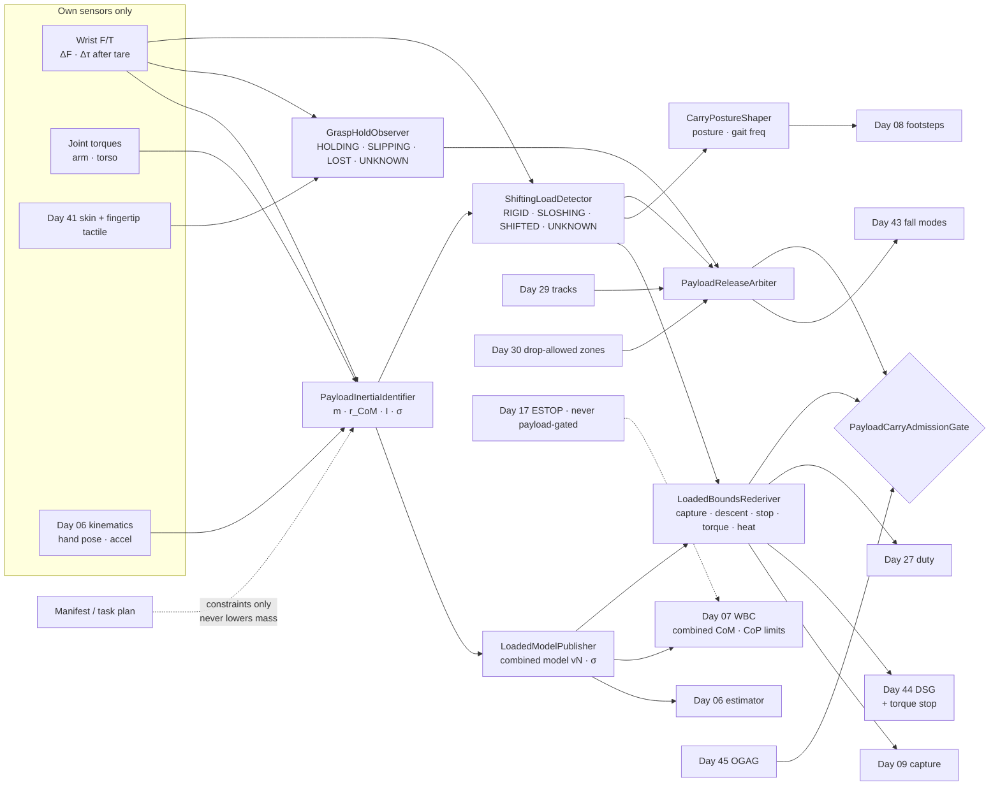
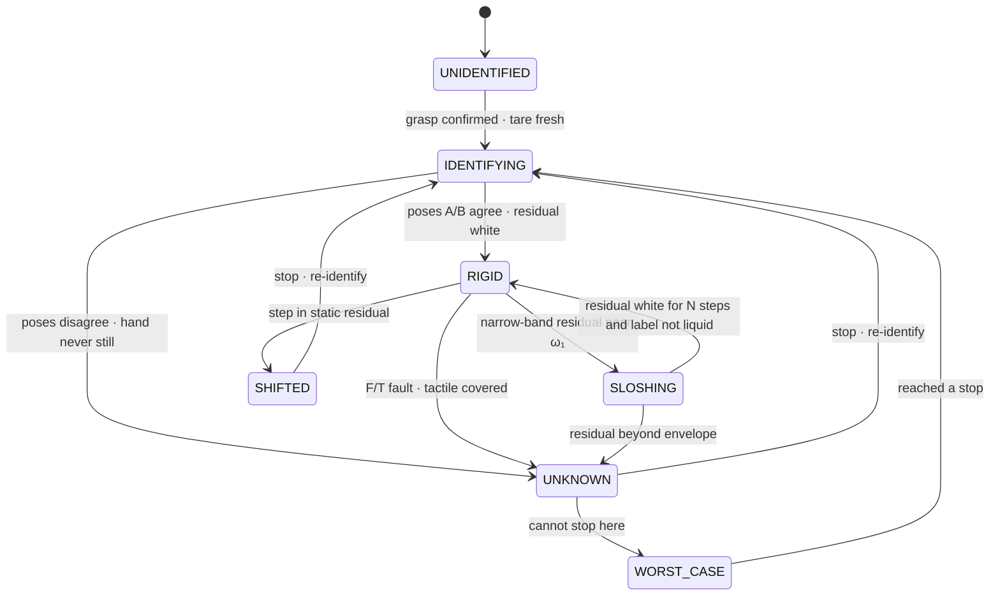
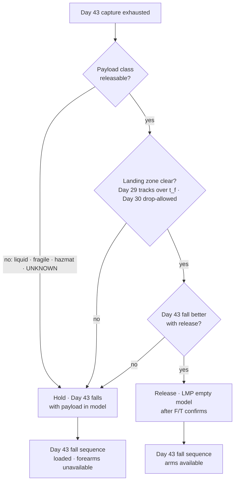
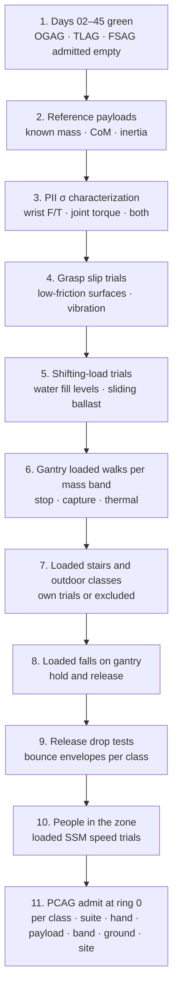

# Day 46 — Carrying payloads while walking under the outdoor and terrain stacks: PayloadInertiaIdentifier / GraspHoldObserver / LoadedModelPublisher / ShiftingLoadDetector / LoadedBoundsRederiver / CarryPostureShaper / PayloadReleaseArbiter / PayloadCarryAdmissionGate under OutdoorGroundAdmissionGate + TerrainLocomotionAdmissionGate + FallSafeAdmissionGate + DeliberateContactAdmissionGate + WholeBodyTouchAdmissionGate + HumanHandoverAdmissionGate + CooperativeTaskAdmissionGate + TaskCompositionAdmissionGate + FleetSkillCatalogAdmissionGate + proximity + zone attestation + supervisor + logging + canary + HIL + fleet + incident + change-management + maintenance + thermal + energy gates

![PayloadInertiaIdentifier / GraspHoldObserver / LoadedModelPublisher / ShiftingLoadDetector / LoadedBoundsRederiver / CarryPostureShaper / PayloadReleaseArbiter / PayloadCarryAdmissionGate: a humanoid lifts a box and holds still while the wrist force/torque sensors measure its mass as 10.0 ± 0.05 kg and its centre of mass offset, ignoring the 8 kg on the shipping label; the combined centre of mass moves about 49 mm forward and Day 06 and Day 07 get that measured model only; a liquid container sloshes near 1.4 Hz, close to the step frequency, and the residual between measured and predicted wrist force classifies the load as RIGID, SLOSHING, SHIFTED, or UNKNOWN; the torque-limited stop drops from 2.0 to 1.72 m/s² so the speed for a 0.30 m stopping budget falls from 1.0 to 0.93 m/s while the friction stop on ice stays the same; release is admitted only for a rigid, drop-tested payload into a drop zone cleared by Day 29 tracks and Day 30 zones; PayloadCarryAdmissionGate fails closed under Day 45 OGAG and never raises Day 29 PFL, writes Day 05 torque_scale, or bypasses CrossSiteZoneConfigGate](/images/day46-carrying-payloads-walking.png)

[Day 05](/lessons/day-05-power-bms) owns `torque_scale` **forever**. [Day 06](/lessons/day-06-estimation-balance) owns the floating-base estimate and the rigid-body model it runs on. [Day 07](/lessons/day-07-wbc-balance) owns whole-body balance, the CoM, and the CoP it may command. [Day 08](/lessons/day-08-stepping-locomotion) owns footsteps. [Day 09](/lessons/day-09-push-recovery) owns capture regions. [Day 17](/lessons/day-17-runtime-safety-supervisor) owns ESTOP. [Day 25](/lessons/day-25-fleet-change-management) owns change sets. [Day 27](/lessons/day-27-thermal-budgets-duty-cycle) owns thermal derates. [Day 29](/lessons/day-29-human-proximity-safety) owns person tracks, SSM, and PFL rows. [Day 30](/lessons/day-30-collaborative-workspace-zoning) owns attested zones and `CrossSiteZoneConfigGate`. [Day 40](/lessons/day-40-human-robot-handover-co-carry) owns handover and the release-on-measured-pull contract. [Day 41](/lessons/day-41-whole-body-tactile-skin-touch) owns the skin and the momentum-observer residual. [Day 43](/lessons/day-43-falls-fall-safe-contact) owns fall modes and `FallSafeAdmissionGate` (FSAG). [Day 44](/lessons/day-44-stairs-ramps-uneven-terrain) owns terrain and `DescentSpeedGovernor` (DSG). [Day 45](/lessons/day-45-outdoor-deformable-ground) owns outdoor ground and `OutdoorGroundAdmissionGate` (OGAG).

Days 44 and 45 taught the robot to measure the ground. Today the robot picks something up, and the thing it most needs to measure is now itself. A 62 kg humanoid carrying a 10 kg box isn't a 62 kg humanoid with a box attached. It's a 72 kg machine whose CoM has moved forward, whose knees carry 16% more load every step, whose arms are no longer free to swing or catch a fall, and which may be carrying something that moves on its own: water in a jug, tools rattling in a crate, a box with one heavy item sliding in it.

Seven lies show up the first time a team has a humanoid carry things:

1. **Manifest lie.** The shipping label says 8 kg, so the controller adds 8 kg. The box weighs 10. Somebody packed it differently from the template.
2. **Point-at-the-hand lie.** The payload is modeled as a point mass at the gripper centre. A long box held at one end has its CoM 200 mm further out than that, and the moment it makes at the shoulder is what tips the robot.
3. **Rigid lie.** "It's a box." Boxes have contents. Half-full jugs slosh at a frequency that happens to sit right on top of a walking gait, and loose items slide at the worst moment, which is braking.
4. **Same-bounds lie.** Capture regions, descent speed, stopping distance, and thermal budgets were all measured empty. Nobody re-measured them with the load, so the robot walks loaded on empty-robot numbers.
5. **Heavier-is-grippier lie.** "More weight on the feet means more grip." Normal force goes up, but the sideways force needed to accelerate the heavier robot goes up by the same ratio. The friction *ratio* the gait needs doesn't improve at all. What does change is torque and heat.
6. **Just-drop-it lie.** "If it starts to fall, it lets go." Into what? A dropped 10 kg box is a projectile with a landing zone, and that zone may have a person's foot in it.
7. **Arms-are-free lie.** Day 07 used arm swing for angular momentum and Day 43 planned falls with arms available. Arms wrapped around a box can't do either, and nobody told Days 07 or 43.

Today owns **`PayloadInertiaIdentifier` / `GraspHoldObserver` / `LoadedModelPublisher` / `ShiftingLoadDetector` / `LoadedBoundsRederiver` / `CarryPostureShaper` / `PayloadReleaseArbiter` / `PayloadCarryAdmissionGate`**. The question is: **how do you have a humanoid walk while carrying a payload whose mass, CoM, and inertia it has MEASURED from its own wrist F/T and joint torques with σ, never from a manifest; give Days 06 and 07 a combined model built only from that measurement; re-derive capture, descent, friction, torque, and thermal bounds for the loaded machine; detect loads that move on their own with an honest UNKNOWN; and treat letting go as a fall-safe option only where the drop zone is clear — without raising Day 29 PFL, writing Day 05 `torque_scale`, or bypassing `CrossSiteZoneConfigGate`?**

## The robot you're walking is the robot plus the box, and only the scale knows the box

The rule everything follows from: **a carried payload is three MEASURED quantities (mass, CoM, inertia), each with a σ from this robot's own sensors, and nothing a label, a manifest, or a task plan says may make the loaded robot look lighter, more centred, more rigid, or more capable than those measurements say.** A manifest may add constraints (fragile, liquid, hazardous, do-not-drop). It may never subtract kilograms.

Three facts set the shape of the lesson.

**Mass is easy, CoM is the point.** At rest, after taring the wrist F/T with the empty hand just before the grasp, the payload weight is the change in measured force:

$$
m_p = \frac{\lVert \Delta F \rVert}{g}, \qquad \sigma_m \approx \frac{\sigma_F}{g}
$$

With a wrist sensor good to σ_F ≈ 0.5 N, that's ±0.05 kg. The CoM comes from the moment, $\Delta \tau = r_p \times m_p g$, and one static pose only gives you the two components perpendicular to gravity. Rotate the wrist through a second orientation and you get the third. Two still poses, a second each, is the whole identification for most rigid loads.

**Offset matters more than height.** Hold a 10 kg box 0.35 m in front of the pelvis on a 62 kg robot and the combined CoM moves forward by

$$
\Delta x = \frac{m_p\, d}{M + m_p} = \frac{10 \times 0.35}{72} \approx 49\ \text{mm}
$$

That's a quarter of the usable front of a 220 mm sole gone before the first step. Raising the box from pelvis height to 1.05 m only moves the combined CoM height from 0.920 to 0.938 m, which changes the pendulum frequency $\omega = \sqrt{g/z_c}$ by about 1%. Day 07 cares most about the horizontal offset.

**Friction doesn't care about mass; torque and heat do.** For a walking CoM, the friction demand is roughly $F_t / F_n \approx \ddot x_{\text{CoM}} / g$, and both forces scale with total mass. So Day 45's friction stop on ice is the same loaded or empty. But stance knee torque scales with total mass (×72/62 ≈ 1.16), and $I^2R$ heat scales with its square (≈ 1.35×). On dry concrete, the binding constraint moves from friction to torque.

| Layer | Owns | Must not own |
|-------|------|--------------|
| `PayloadInertiaIdentifier` | Mass, CoM, inertia with σ from wrist F/T and joint torques; identification poses and excitation | Mass from a manifest or task plan |
| `GraspHoldObserver` | Grasp margin from tactile and F/T; HOLDING / SLIPPING / LOST / UNKNOWN | Deciding to release |
| `LoadedModelPublisher` | The combined rigid-body model handed to Days 06 and 07, versioned, with σ | Publishing any model PII didn't measure |
| `ShiftingLoadDetector` | RIGID / SLOSHING / SHIFTED / UNKNOWN from the force residual | Calling a load rigid because its label says so |
| `LoadedBoundsRederiver` | Capture, descent, stop, torque headroom, and thermal duty for the loaded robot | Reusing empty-robot bounds |
| `CarryPostureShaper` | Carry posture, arm stiffness, payload offset, and gait frequency away from slosh resonance | Commanding CoP or footsteps itself |
| `PayloadReleaseArbiter` | Whether letting go is an admitted fall-safe option right now, and where it lands | Releasing into an uncleared zone; releasing a no-drop class |
| `PayloadCarryAdmissionGate` | Fail-closed admit per robot class, suite, end effector, payload class, mass band, ground class, condition, site | `JointCommand`; Day 05; PFL; Day 17 |
| Days 05 / 06 / 07 / 09 / 17 / 27 / 29 / 30 / 43 / 44 / 45 | Torque, estimate, balance, capture, ESTOP, heat, PFL, zones, falls, terrain, outdoor ground | Being outranked by "it's only a box" |

**Core thesis:** **a humanoid carries what it has weighed, not what it was told; it walks as the heavier, front-loaded, arms-busy machine it has become; it believes a load moves until the residual says it doesn't; and it lets go only where a dropped thing can't hurt anyone.**



## Physical machine: what a payload does to a humanoid

### The combined body

Days 06 and 07 run on a rigid-body model: link masses, CoMs, and inertias from CAD, corrected by your own link identification. Picking up a payload adds one more rigid body to the hand link (or to both hands, or to a hand and the torso for a hugged box). The combined CoM is

$$
c = \frac{M\, c_{\text{robot}}(q) + m_p\, p_{\text{CoM}}(q)}{M + m_p}
$$

where $p_{\text{CoM}}(q)$ is the payload CoM in the world, carried through the arm's forward kinematics. Two things follow. First, every arm motion now moves the combined CoM more than it used to, so Day 07 has to treat arm posture as a balance variable rather than a free one. Second, any error in the payload's CoM is an error in the combined CoM scaled by $m_p/(M+m_p)$. A 30 mm error in a 10 kg payload's CoM is a 4 mm error in the robot's CoM, which is small. A 10 kg error in mass at a 0.35 m offset is a 49 mm error, which isn't. Get mass right first.

### Inertia: mostly the parallel-axis term

A 0.4 × 0.3 × 0.3 m box of 10 kg has its own yaw inertia of $m(a^2 + b^2)/12 \approx 0.21$ kg·m². Carried 0.35 m from the yaw axis, the parallel-axis term $m d^2 \approx 1.23$ kg·m² is six times bigger. So the inertia that matters for turning and for Day 07's angular momentum comes almost entirely from mass and CoM. You can carry a wide σ on the payload's own inertia tensor and still have a good combined model. That's useful, because inertia is the hard part to identify.

### Torque, heat, and the knees

In single support, stance knee and hip torques scale with total supported mass. Going from 62 to 72 kg is +16% torque and roughly +35% copper loss. If the empty robot's stance knee peaked at 70% of its Day 27 derated limit, it's now at about 81%, and the Day 27 duty cycle for a long carry shrinks accordingly. Day 05's `torque_scale` doesn't change because the robot is carrying something. If it already limits torque (cold battery, low state of charge), the payload eats into a smaller budget, and the carry must fit inside it.

### Liquids slosh at walking frequencies

The first sloshing mode of liquid at depth $h$ in a rectangular container of length $L$ along the walking direction has

$$
\omega_1^2 = \frac{\pi g}{L} \tanh\!\left(\frac{\pi h}{L}\right)
$$

For $L = 0.30$ m and $h = 0.10$ m, $\omega_1 \approx 9.0$ rad/s, about 1.43 Hz. A humanoid walking at 0.6 to 1.0 m/s takes steps at roughly 1.4 to 2 Hz. The gait drives the slosh mode almost exactly at resonance, and the liquid pushes back on the hands with a horizontal force at the step frequency that Day 07 never planned for. Half-full is worst: a full container has nowhere to slosh, and an empty one has nothing to slosh.

### Arms aren't free anymore

Day 07 uses arm swing to cancel the legs' yaw angular momentum. Day 43 plans falls with forearms as sacrificial sites. Day 41's skin on the forearms is now covered by a box, so contact there is "the box," not "a person." Each of these has to be told about the payload: arm swing becomes torso twist or a slower gait, Day 43 forearm sites become unavailable, and Day 41 marks covered patches as occupied so the box itself doesn't read as a collision.

## PayloadInertiaIdentifier: weigh it before you walk with it

`PayloadInertiaIdentifier` (PII) runs a short identification routine after every grasp and before the first step:

1. **Tare** the wrist F/T with the empty hand in the grasp pose, immediately before contact. Tares older than a few seconds drift with temperature.
2. **Static pose A:** lift the payload clear, hold still until hand acceleration is under threshold, record $\Delta F$, $\Delta \tau$. Gives $m_p$ and two CoM components.
3. **Static pose B:** rotate the wrist about 30–45° about a horizontal axis; record again. Gives the third CoM component and a consistency check on $m_p$.
4. **Optional excitation** for inertia: a short, slow wrist oscillation. The wrench is linear in the 10 inertial parameters, $w = Y(q, \dot q, \ddot q)\,\phi$, so least squares over the excitation gives $\phi$ with σ from the residual and the condition number of $Y$.

Outputs: `IDENTIFIED` with $m_p$, $r_{\text{CoM}}$, inertia (or a wide bounding inertia), and σ for each; `INCONSISTENT` when pose A and B disagree on mass beyond σ (the load moved between poses, so it isn't rigid); `UNKNOWN` when the hand never got still or the F/T is saturated.

On robots without a wrist F/T, joint torques can do the same job with worse σ. Current-based torque estimates carry friction and hysteresis, often 1–2 N·m at a shoulder, which at a 0.4 m lever is ±0.25–0.5 kg. That's fine for a 10 kg box and useless for a 0.5 kg tool, and the σ says so. Use both sources when you have both, and treat disagreement beyond σ as `UNKNOWN`, not as an average.

**The manifest's only job** is to add constraints and to file disagreements. If the label says 8 kg and PII measures 10.0 ± 0.05, the robot carries 10 and files a manifest discrepancy. If the label says "liquid" and PII measures a rigid load, the label wins for `ShiftingLoadDetector` (assume it can slosh) and PII's measurement wins for mass. Conservative from both sides.

## GraspHoldObserver: the grasp is a contact with a margin

`GraspHoldObserver` (GHO) tracks how close the grasp is to letting go. For a two-finger pinch, the friction cone at each fingertip gives a margin $\mu_g F_{\text{grip}} - \lVert F_{\text{tangential}} \rVert$. Walking adds inertial loads at the step frequency, so a grasp that holds standing still may not hold at heel strike.

| Verdict | Evidence | Action |
|---------|----------|--------|
| `HOLDING` | Tactile shear inside the cone with margin; no micro-slip vibration; F/T matches PII model | Walk |
| `SLIPPING` | Tactile incipient slip (shear patterns at the contact edge), or F/T drift relative to the hand | Raise grip inside the hand's force limit; slow the gait; stop if it continues |
| `LOST` | Payload weight leaving the F/T | Day 43 and PRA own what happens next |
| `UNKNOWN` | Tactile patch dead or covered; F/T and tactile disagree | Treated as `SLIPPING` |

GHO never decides to release. Release belongs to Day 40's contract when a person is pulling, and to `PayloadReleaseArbiter` when the robot is falling. A grasp that is `SLIPPING` with no admitted release option means stop walking and set the payload down on a surface, which is a Day 38 plan.

## LoadedModelPublisher: one combined model, only from measurement

`LoadedModelPublisher` (LMP) is the only writer of the payload body in the rigid-body model Days 06 and 07 use. It publishes a versioned model `vN` that adds a body with PII's mass, CoM, and inertia attached to the grasp frame, with σ. Rules:

- No model is published until PII is `IDENTIFIED`. Between grasp and identification, the robot doesn't walk.
- Day 06 and Day 07 switch models at a declared instant, with a short blend so the commanded CoM doesn't jump. Day 07 shifts the pelvis back by the measured offset before the first step.
- The σ goes with the model. Day 07 shrinks its CoP polygon by the combined CoM σ; Day 06 uses it in its contact-force consistency checks.
- On release or handover, LMP publishes the empty model only after the F/T shows the weight gone. Removing the payload from the model while still holding it is as wrong as adding it before you hold it.

An end-to-end check: with the payload model live, Day 06's predicted foot normal force should match the measured sum of foot F/T within σ. A persistent mismatch means the model is wrong, and LMP marks itself `STALE` and asks PII to re-identify at the next stop.

## ShiftingLoadDetector: the payload has a motion of its own

`ShiftingLoadDetector` (SLD) compares measured wrist wrench with what a rigid body of the identified parameters should produce given the measured hand acceleration:

$$
r(t) = w_{\text{meas}}(t) - Y(q, \dot q, \ddot q)\,\hat\phi
$$

On a rigid load, $r$ is noise. On a sloshing load, $r$ has a narrow-band component near the slosh frequency. On a load that has shifted, the static part of $r$ jumps: the CoM moved and stayed moved.



| Verdict | What the rest of the stack does |
|---------|----------------------------------|
| `RIGID` | Combined model as identified |
| `SLOSHING` | `CarryPostureShaper` moves step frequency away from $\omega_1$; Day 07 gets a horizontal disturbance band; braking deceleration reduced |
| `SHIFTED` | Stop at the next admitted stance; PII re-identifies |
| `UNKNOWN` / `WORST_CASE` | Payload CoM assumed anywhere inside its measured bounding box; Day 07 and Day 09 plan against the worst corner |

`WORST_CASE` is the honest UNKNOWN. If the robot can't stop where it is (mid-stair, on ice), it doesn't pretend the load is centred. It assumes the CoM is at whichever corner of the container's bounding box is worst for the current manoeuvre, and slows accordingly.

## LoadedBoundsRederiver: every empty-robot number gets re-measured

`LoadedBoundsRederiver` (LBR) owns the loaded versions of the bounds earlier days built:

- **Torque stop.** Braking deceleration on dry ground was torque-limited at 2.0 m/s² empty. Loaded, roughly $2.0 \times 62/72 \approx 1.72$ m/s². For Day 29's 0.30 m budget with $t_d = 50$ ms, $v\,t_d + v^2 / 2a \le 0.30$ gives 1.00 m/s empty and 0.93 m/s loaded. The envelope stays 0.30 m. The speed drops.
- **Friction stop.** Unchanged in the ideal case, because the friction ratio doesn't depend on mass. With a `SLOSHING` load the slosh adds horizontal force without adding normal force, so LBR takes a measured slosh band off $\mu_{\text{adm}}$. On Day 45's wet ice, 0.47 m/s stays 0.47 m/s for a rigid load and goes down for a sloshing one.
- **Capture.** $\omega$ changes about 1%, but Day 07's CoP polygon has lost the 49 mm forward offset and its σ. Day 09's capture regions shrink by the lost CoP authority, mostly forward, which is exactly the direction a person trips when carrying a box.
- **Descent.** Day 44's step-down impact energy scales with total mass. LBR re-runs Day 44 DSG with the loaded mass and a front-loaded CoM; carrying a box down stairs is typically admitted at a lower speed, or not at all, until stair-specific loaded trials exist.
- **Soft ground.** Day 45's numbers get heavier: at 706 N in single support the `FIRM` lower bound becomes $706/0.009 \approx 78$ kN/m, sand sinkage at $k = 20$ kN/m becomes about 35 mm, and CoP authority there drops to about $81 \times 0.05 / 706 \approx 5.7$ mm.
- **Thermal.** Day 27's predicted knee and hip temperature over the planned carry, at the loaded torque profile. If the carry doesn't fit, it's split with set-down rests, which is a Day 38 plan, not a derate surprise halfway.

Every loaded bound is keyed by mass band and CoM offset band, measured on the gantry with ballast, never extrapolated from the empty robot by a formula. The formulas above tell you what to expect; the trials tell you what to admit.

## CarryPostureShaper: hold it close, hold it low, step off resonance

`CarryPostureShaper` (CPS) picks how to carry, inside what Days 07 and 08 allow:

- **Close.** Payload CoM as near the torso as the grasp allows. Halving $d$ from 0.35 to 0.18 m halves the combined CoM offset to about 25 mm. A hugged box with torso contact uses a Day 42 deliberate-contact recipe.
- **Low.** Height matters less for balance, but a low carry drops less far on release and makes a lower impact in a fall.
- **Arm impedance.** Stiff arms make the payload part of the torso; compliant arms filter heel-strike shocks to a fragile load but let it swing. CPS picks per payload class, and the choice changes the model LMP publishes (a compliantly held payload is a separate body with a spring).
- **Gait frequency.** With `SLOSHING`, CPS moves the step frequency at least 25% away from the measured slosh peak, usually down, and Day 08 lengthens step duration to match.
- **Arm swing.** Replaced with torso yaw or a slower gait; Day 07 is told arm momentum isn't available.

CPS never commands CoP or footsteps; it hands Days 07 and 08 a posture and a frequency band.

## PayloadReleaseArbiter: letting go is a fall-safe option, not a reflex

When Day 43's `CaptureExhaustionDetector` fires, the robot has a choice it didn't have empty: keep holding (and fall as a heavier, front-loaded body with arms busy) or let go (and fall as itself, with a projectile nearby). `PayloadReleaseArbiter` (PRA) keeps a live answer to "is release admitted right now, and where would it land?"

Release is admitted only when all of these hold:

- **Payload class allows it.** `RIGID`, drop-tested at this mass band, and not tagged fragile, liquid, hazardous, or do-not-drop by the manifest or by SLD.
- **Landing zone predicted.** From hand velocity at release and fall height, $t_f = \sqrt{2h/g} \approx 0.45$ s from 1.0 m; at 0.5 m/s walking speed that's about 0.23 m of forward travel plus the bounce envelope from drop tests.
- **Zone clear.** Day 29 has no person track whose predicted position over $t_f$ plus margin enters the landing zone, and the Day 30 zone is attested as drop-allowed.
- **Fall improved.** Day 43's `FallDirectionArbiter` has a better admitted fall with release than without (arms free for sacrificial sites, less impact energy) — measured, not assumed.

Otherwise the payload stays in the hands, and Day 43 plans the fall with the payload as a rigid body at its measured CoM: forearm sites unavailable, impact energy including $m_p$, and the payload kept between the robot and the ground rather than swung outward. Release never aims at a person and never happens because the grasp got tired; a `SLIPPING` grasp with no admitted release is a stop-and-set-down.



## PayloadCarryAdmissionGate

`PayloadCarryAdmissionGate` (PCAG) admits carry modes per robot class, sensor suite hash, end effector, payload class, mass band, CoM offset band, ground class, condition, and site, under Day 45 OGAG, Day 44 TLAG, and Day 43 FSAG. It fails closed if any of these is missing:

- PII characterized against reference masses with known CoMs across the mass band: σ for mass and CoM matches the published σ.
- GHO trials with induced slip (low-friction payload surfaces, vibration) showing no `HOLDING` verdict during real slip.
- SLD trials with water containers at several fill levels and a box with a sliding ballast, showing detection latency and no `RIGID` verdicts during real slosh or shift.
- LBR loaded bounds measured on the gantry with ballast per mass band: stop, capture, descent, thermal.
- FSAG admitted for loaded falls in that mass band, holding and (if admitted) releasing.
- Release drop tests per releasable class and mass band, giving bounce envelopes.

PCAG never writes `JointCommand`, never touches Day 05 `torque_scale`, never raises a Day 29 row, never lets a loaded mode use empty-robot bounds, and never gates ESTOP.

## Data shapes

```text
PayloadIdentity:                              # PII
  grasp_id, tare_age_ms
  mass_kg, sigma_mass
  com_m[3], sigma_com[3]       # in grasp frame
  inertia_kgm2[6] | bounding_inertia
  bbox_m[3]                    # container bounds for WORST_CASE
  source                       # WRIST_FT | JOINT_TORQUE | BOTH
  verdict                      # IDENTIFIED | INCONSISTENT | UNKNOWN
  manifest_mass_kg             # logged; discrepancy filed; never used

GraspHold:                                    # GHO
  hand                         # L | R | BOTH
  margin_n
  verdict                      # HOLDING | SLIPPING | LOST | UNKNOWN

LoadedModel:                                  # LMP
  version
  payload_body: PayloadIdentity
  attach_frame
  combined_com_offset_m, sigma
  status                       # LIVE | STALE | EMPTY

LoadMotion:                                   # SLD
  residual_rms_n
  slosh_peak_hz
  static_step_n
  verdict                      # RIGID | SLOSHING | SHIFTED | UNKNOWN | WORST_CASE

LoadedBounds:                                 # LBR
  mass_band, com_offset_band
  a_torque_mps2, a_friction_mps2
  v_stop_mps
  capture_regions_N[]
  descent_admitted
  thermal_carry_s

CarryPosture:                                 # CPS
  payload_offset_m
  arm_impedance                # STIFF | COMPLIANT
  step_freq_band_hz
  arm_swing                    # REPLACED_BY_TORSO | NONE

ReleaseOption:                                # PRA
  admitted                     # true | false
  reason
  landing_zone_polygon
  t_fall_s
  day29_clear, day30_drop_allowed

PayloadCarryAdmission:                        # PCAG
  robot_class, sensor_suite_hash, end_effector
  payload_class                # RIGID | LIQUID | LOOSE | FRAGILE | HAZMAT
  mass_band, com_offset_band
  ground_class, condition, site
  modes_admitted[]             # CARRY_FLAT | CARRY_STAIRS | CARRY_OUTDOOR | CARRY_LIQUID
  forbid:
    mass_from_manifest: true
    walk_before_identified: true
    empty_bounds_when_loaded: true
    rigid_from_label: true
    release_into_uncleared_zone: true
    release_no_drop_class: true
    raise_pfl: true
    write_torque_scale: true
    gate_estop: true
    bypass_cross_site_zone_config_gate: true

# Unchanged owners
OutdoorGroundAdmissionGate (Day 45) · TLAG · DSG (Day 44) · FSAG (Day 43)
Handover contract (Day 40) · skin + momentum residual (Day 41)
CrossSiteZoneConfigGate · zones (Day 30) · tracks · SSM · PFL (Day 29)
ThermalDerate (Day 27) · Changeset (Day 25) · SupervisorState ESTOP (Day 17)
Capturability (Day 09) · Footsteps (Day 08) · WBC CoM/CoP (Day 07) · EstimatorState (Day 06)
BmsState / PowerState (Day 05): torque_scale
  accepts_requests_from_payload: false
```

## Config

A starting configuration. Every number is a policy you re-derive from your own robot, hands, sensors, and payloads:

```yaml
payload:
  identify:
    tare_max_age_s: 3
    static_poses: 2
    pose_b_rotation_deg: 40
    still_accel_mps2: 0.05
    inertia: excitation_or_bounding
    sources_disagree: UNKNOWN
    manifest: constraints_only
  grasp:
    unknown_is: SLIPPING
    slipping_action: [raise_grip_within_limit, slow, stop_if_persists]
    release_owner: [day40_contract, payload_release_arbiter]
  model:
    publish_only_if: IDENTIFIED
    blend_ms: 300
    remove_only_after_ft_confirms: true
    foot_force_consistency_check: true
  motion:
    states: [RIGID, SLOSHING, SHIFTED, UNKNOWN, WORST_CASE]
    liquid_label_forces: assume_can_slosh
    shifted_action: stop_and_reidentify
    worst_case_com: bounding_box_corner
  bounds:
    source: gantry_ballast_trials_per_mass_band
    extrapolate_from_empty: forbidden
    ssm_envelope: unchanged
    stairs_loaded: requires_own_trials
  posture:
    prefer: [close, low]
    slosh_freq_separation: 0.25
    arm_swing: replaced_by_torso_yaw
  release:
    classes_allowed: [RIGID_DROP_TESTED]
    never: [LIQUID, FRAGILE, HAZMAT, UNKNOWN]
    requires: [day29_clear_over_t_fall, day30_drop_allowed, day43_fall_improved]
  admission:
    keyed_by: [robot_class, sensor_suite_hash, end_effector, payload_class, mass_band, com_offset_band, ground_class, condition, site]
    requires: [day45_ogag, day44_tlag, day43_fsag_loaded]
```

## Physical ↔ digital pairing

| Physical | Digital twin / backing |
|----------|------------------------|
| Robot grasps a box labelled 8 kg | Tare; PII poses A/B; `IDENTIFIED` 10.0 ± 0.05 kg; manifest discrepancy filed |
| First step loaded | LMP model vN live; pelvis shifted back 49 mm; CoP polygon shrunk by σ |
| Half-full water jug | SLD `SLOSHING` at 1.4 Hz; step frequency moved; braking reduced |
| Tool slides inside crate on braking | SLD `SHIFTED`; stop at next stance; re-identify |
| Long carry across a warehouse | Day 27 loaded knee prediction; Day 38 rest set-down if needed |
| Same carry outdoors on sand | 35 mm sinkage; CoP authority about 5.7 mm; shorter steps |
| Person walks across 3 m ahead | Day 29 envelope unchanged; loaded torque stop sets 0.93 m/s or holds |
| Fingertip shear rising at heel strike | GHO `SLIPPING`; grip up within limit; slower |
| Trip with a rigid box, clear floor | PRA release admitted; landing zone clear; Day 43 falls with arms free |
| Trip with a coffee urn | PRA not admitted; hold; Day 43 loaded fall plan |

The pairing that matters most: **replay every carry from the robot's own bag and show that every model Days 06 and 07 ran on came from PII's measurement on this grasp, never from the manifest; that the robot never walked between grasp and identification; that every bound it used was a loaded bound for its mass band; that every slosh or shift was seen by the residual before the robot needed it to be rigid; and that every release landed in a zone Day 29 and Day 30 had cleared.** If the carry only looks safe in replay when you load the manifest mass, the label owns the robot.

## Bring-up sequence (before the robot carries anything near people)



1. **Days 02–45 green,** with OGAG, TLAG, and FSAG admitted for the empty robot.
2. **Reference payloads:** boxes with known mass, adjustable CoM, and measured inertia (a swing or trifilar pendulum test).
3. **PII σ characterization** across the mass band with each sensor source; confirm reported σ matches observed error.
4. **Grasp slip trials:** slippery and textured surfaces, added vibration at gait frequencies; confirm GHO never says `HOLDING` during measured slip.
5. **Shifting-load trials:** water containers at 25/50/75% fill and boxes with sliding ballast; measure detection latency and slosh peaks.
6. **Gantry loaded walks** per mass band with ballast: stopping distance, capture margins, and knee and hip temperatures over long carries.
7. **Loaded stairs and outdoor ground classes** get their own trials or stay excluded.
8. **Loaded falls on the gantry,** holding and, where you plan to admit it, releasing; extend Day 43 bands for loaded impacts.
9. **Release drop tests** per releasable class and mass band: bounce and slide envelopes.
10. **People in the zone:** instrumented dummies crossing ahead of loaded walks; confirm speed falls and the envelope doesn't.
11. **PCAG admit at ring 0** per robot class, suite, end effector, payload class, mass band, ground class, condition, and site.

## Failure gallery

| Symptom | Likely cause |
|---------|--------------|
| Robot leans and steps forward when it lifts a box | Model never updated; CoM offset not given to Day 07 |
| Robot walks fine with the template box, tips with a re-packed one | Mass from the manifest |
| Steady forward drift in the base estimate while carrying | Payload in Day 07 but not Day 06, or stale model |
| Growing side-to-side wobble with a water jug | Slosh at resonance with the step frequency |
| Fall during braking with a crate of tools | Load shifted; no residual check; empty-robot stop |
| Knee over-temperature halfway through a long carry | Day 27 budget from the empty torque profile |
| Box dropped onto a passer-by's foot during a trip | Release as a reflex; no drop-zone clearance from Day 29 |
| Robot falls on its face holding a box | Day 43 planned with forearm sites the box was covering |
| Skin "collision" stop every time it hugs a box | Day 41 patches under the payload not marked occupied |
| Model removed before the person took the weight in a handover | LMP cleared on intent, not on measured F/T |

## Exercises

1. A 6 kg tray is held 0.45 m in front of the pelvis on a 62 kg robot. What's the combined CoM offset? How far back would you hold the tray to bring that under 25 mm?
2. Wrist F/T σ is 0.8 N per axis. What's σ_m? With a 3 kg payload whose CoM is 0.12 m from the sensor, what's the CoM σ if moment σ is 0.04 N·m?
3. A bucket 0.28 m across holds 0.12 m of water. Compute the first slosh frequency. If the gait is at 1.6 Hz, which way should `CarryPostureShaper` move the step frequency to get 25% separation, and what does that do to speed?
4. Empty torque-limited braking is 2.2 m/s². Estimate the loaded value for a 15 kg payload on the 62 kg robot and the Day 29 speed for a 0.30 m budget with $t_d = 50$ ms.
5. A trip happens while carrying a rigid 5 kg box at 0.7 m/s, held 0.9 m high. Compute the fall time and forward travel. A person track is 0.8 m ahead walking toward the robot at 1.2 m/s. Does PRA admit release?
6. Write the `PayloadCarryAdmission` row for carrying a half-full 10 L water container across a dry lawn. Which modes are admitted, which forbidden, and which Day 45 and Day 43 evidence must already exist?

## What to freeze this week

Extend [frames](/frames) and your safety config with:

- `PayloadInertiaIdentifier`: tare then two still poses then optional excitation; mass, CoM, and inertia with σ; `INCONSISTENT` when poses disagree; manifest is constraints only and discrepancies are filed.
- `GraspHoldObserver`: HOLDING / SLIPPING / LOST / UNKNOWN from tactile and F/T; UNKNOWN treated as SLIPPING; never decides release.
- `LoadedModelPublisher`: sole writer of the payload body into Days 06 and 07; publish only when `IDENTIFIED`; remove only when F/T confirms; foot-force consistency check.
- `ShiftingLoadDetector`: RIGID / SLOSHING / SHIFTED / UNKNOWN / WORST_CASE from the wrench residual; liquid label means assume slosh; WORST_CASE plans against the bounding-box corner.
- `LoadedBoundsRederiver`: loaded stop, capture, descent, soft-ground, and thermal bounds per mass band from gantry trials; never extrapolated from empty.
- `CarryPostureShaper`: close and low; arm impedance per class; step frequency off slosh resonance; arm swing replaced.
- `PayloadReleaseArbiter`: release only for drop-tested rigid classes into a Day 29-cleared, Day 30 drop-allowed zone when Day 43 measures a better fall; otherwise hold and fall loaded.
- `PayloadCarryAdmissionGate` fail-closed under Day 45 OGAG, Day 44 TLAG, and Day 43 FSAG; keyed by robot class, suite, end effector, payload class, mass band, CoM band, ground class, condition, and site; **no dual-write of ESTOP or `torque_scale`; no carry mode raises PFL; a payload lowers speed, never the envelope.**

The lesson isn't "teach the robot to carry a box." It's that **the moment a humanoid picks something up, it becomes a different machine, so it weighs what it holds, rebuilds its own model from that measurement, re-earns every bound it walks by, assumes the load can move until the residual proves otherwise, and only lets go where nothing it drops can land on anyone**, under ceilings that never move because the box was heavy.

## Further reading

Look these up by title; they're the classic sources for today's identification, slosh, and loaded-locomotion arguments:

- C. G. Atkeson, C. H. An, and J. M. Hollerbach, "Estimation of inertial parameters of manipulator loads and links," *International Journal of Robotics Research*, 1986.
- W. Khalil and E. Dombre, *Modeling, Identification and Control of Robots*, Hermes Penton, 2002 (dynamic identification chapters).
- D. Kubus, T. Kröger, and F. M. Wahl, "On-line estimation of inertial parameters using a recursive total least-squares approach," IROS, 2008.
- R. A. Ibrahim, *Liquid Sloshing Dynamics: Theory and Applications*, Cambridge University Press, 2005.
- H. N. Abramson (ed.), *The Dynamic Behavior of Liquids in Moving Containers*, NASA SP-106, 1966.
- K. Harada, S. Kajita, K. Kaneko, and H. Hirukawa, "Pushing manipulation by humanoid considering two-kinds of ZMPs," ICRA, 2003, and related work on ZMP with hand reaction forces.
- R. S. Johansson and J. R. Flanagan, "Coding and use of tactile signals from the fingertips in object manipulation tasks," *Nature Reviews Neuroscience*, 2009 (grip force and incipient slip).
- ISO 11228-1, *Ergonomics — Manual handling — Lifting, lowering and carrying*, for how human carrying limits are framed.

## Next

**Day 47+** — Pushing, pulling, and moving heavy objects the robot can't lift (carts, doors, furniture) under the payload and outdoor stacks: push/pull wrench and the object's resistance MEASURED from own hand F/T and foot forces with σ, never from an object label; Day 07 balance with a sustained hand wrench (the CoP shifts with the push); friction demand at the feet re-derived from the measured push force, so a heavy push on ice is a friction problem first; cart and door dynamics identified online with an honest UNKNOWN when the object stalls or runs away; letting go of a rolling cart treated like payload release, admitted only where Day 29 and Day 30 clear its run-out path — without raising Day 29 PFL, writing Day 05 `torque_scale`, or bypassing `CrossSiteZoneConfigGate`, under the same gates plus payload carry admission.
