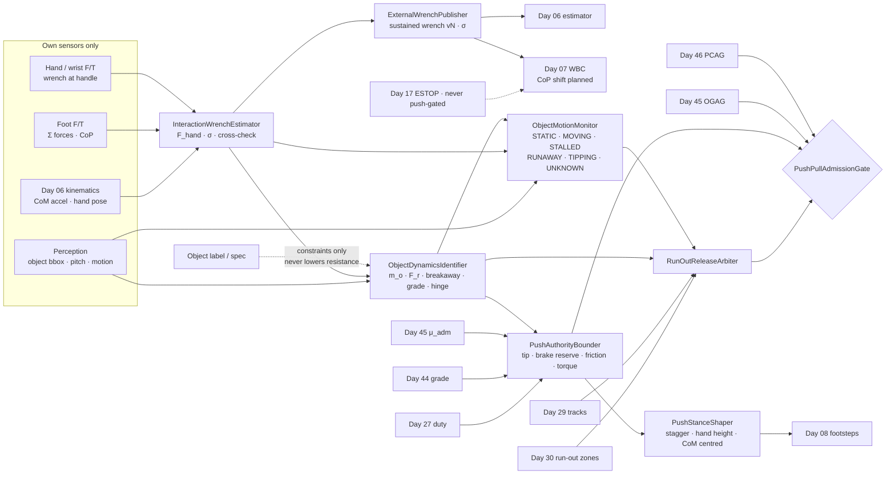
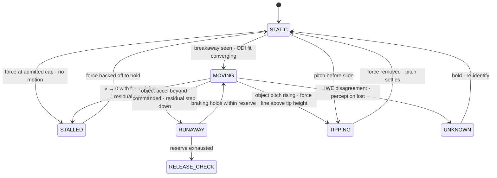
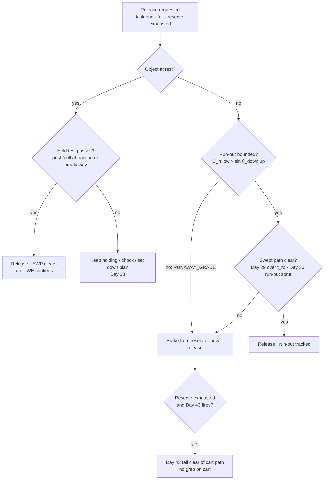
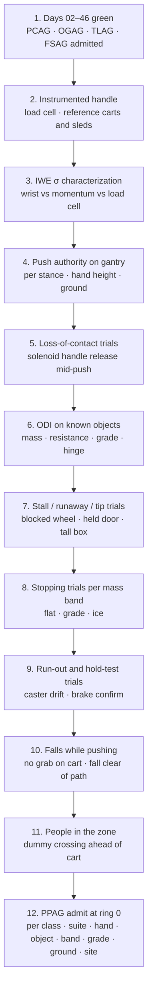

# Day 47 — Pushing, pulling, and moving heavy objects under the payload and outdoor stacks: InteractionWrenchEstimator / ObjectDynamicsIdentifier / ObjectMotionMonitor / ExternalWrenchPublisher / PushAuthorityBounder / PushStanceShaper / RunOutReleaseArbiter / PushPullAdmissionGate under PayloadCarryAdmissionGate + OutdoorGroundAdmissionGate + TerrainLocomotionAdmissionGate + FallSafeAdmissionGate + DeliberateContactAdmissionGate + WholeBodyTouchAdmissionGate + HumanHandoverAdmissionGate + CooperativeTaskAdmissionGate + TaskCompositionAdmissionGate + FleetSkillCatalogAdmissionGate + proximity + zone attestation + supervisor + logging + canary + HIL + fleet + incident + change-management + maintenance + thermal + energy gates

![InteractionWrenchEstimator / ObjectDynamicsIdentifier / ObjectMotionMonitor / ExternalWrenchPublisher / PushAuthorityBounder / PushStanceShaper / RunOutReleaseArbiter / PushPullAdmissionGate: a 62 kg humanoid pushes a 200 kg cart; its hand force is measured by the wrist F/T and cross-checked against the foot forces through the momentum balance, never read off the cart's label; the cart's mass, rolling resistance, and grade term are identified online from a gentle push and a short pull-back; a sustained push at hand height h moves the CoP back by F·h/(M·g), so the robot keeps its CoM centred in a staggered stance and reserves the same authority for braking, giving about 122 N either way at h = 1.0 m; friction caps the push at μ·M·g, about 61 N on wet ice; the stop budget of 0.30 m is measured from the cart's leading edge and gives about 0.64 m/s on dry concrete, 0.44 m/s on ice, 0.31 m/s on ice on a 1° downhill, and nothing at all on ice at 2°; a tall dresser pushed at 1.0 m tips before it slides because μ_s exceeds b/(2h); letting go of a rolling cart is admitted only when the run-out v²/(2g(C_rr − sin θ)) is bounded and its path is cleared by Day 29 and Day 30; PushPullAdmissionGate fails closed under Day 46 PCAG and Day 45 OGAG and never raises Day 29 PFL, writes Day 05 torque_scale, or bypasses CrossSiteZoneConfigGate](/images/day47-pushing-pulling-heavy-objects.png)

[Day 05](/lessons/day-05-power-bms) owns `torque_scale` **forever**. [Day 06](/lessons/day-06-estimation-balance) owns the floating-base estimate. [Day 07](/lessons/day-07-wbc-balance) owns whole-body balance, the CoM, and the CoP. [Day 08](/lessons/day-08-stepping-locomotion) owns footsteps. [Day 09](/lessons/day-09-push-recovery) owns capture regions. [Day 11](/lessons/day-11-hand-support-loco-manipulation) owns hand-as-support on static, attested surfaces. [Day 17](/lessons/day-17-runtime-safety-supervisor) owns ESTOP. [Day 27](/lessons/day-27-thermal-budgets-duty-cycle) owns thermal derates. [Day 29](/lessons/day-29-human-proximity-safety) owns person tracks, SSM, and PFL rows. [Day 30](/lessons/day-30-collaborative-workspace-zoning) owns attested zones and `CrossSiteZoneConfigGate`. [Day 41](/lessons/day-41-whole-body-tactile-skin-touch) owns the momentum-observer residual. [Day 42](/lessons/day-42-deliberate-whole-body-contact) owns planned contacts and their bands, including the forearm door push. [Day 43](/lessons/day-43-falls-fall-safe-contact) owns fall modes and `FallSafeAdmissionGate` (FSAG). [Day 44](/lessons/day-44-stairs-ramps-uneven-terrain) owns terrain and slope. [Day 45](/lessons/day-45-outdoor-deformable-ground) owns admitted friction and `OutdoorGroundAdmissionGate` (OGAG). [Day 46](/lessons/day-46-carrying-payloads-walking) owns lifted payloads and `PayloadCarryAdmissionGate` (PCAG).

Day 46 ended where the robot's arms ran out. A 62 kg humanoid can carry a 10 kg box. It can't carry a 200 kg roll cage, a 60 kg dresser, or a fire door. But it can move all of them, the same way people do: by leaning into them and letting the floor do the work. That's a different physics problem from carrying. The object never joins the robot's rigid body. It stays outside, connected through the hands, pushing back with a force the robot has to measure, balance against, find friction for, and be able to stop. And unlike a carried box, a rolling cart keeps going when the robot lets go.

Eight lies show up the first time a team has a humanoid push things:

1. **Label lie.** The cart's spec sheet says "rolling resistance 20 N." That was new casters on epoxy. This one has a flat-spotted caster, a hair-wrapped axle, and is on carpet. It takes 110 N.
2. **Handle-is-support lie.** Day 11 taught the hand to be a support on a wall. A cart handle isn't a wall. It moves, it can run away, and it can't hold the robot up. Treating it as a support means the robot falls when the cart rolls.
3. **Lean-into-it lie.** "Lean harder until it moves." A robot with its CoM beyond its toes is held up by the object. When a stuck dresser breaks loose, the force vanishes in tens of milliseconds and the robot falls after it.
4. **Push-is-free-to-stop lie.** A robot leaning forward to push has its CoP at its heels and its CoM near its toes. Ask it to brake the cart and it has almost no authority left until it shifts its weight back, which takes a third of a second the cart doesn't wait for.
5. **Heavier-is-grippier lie, again.** The feet have to supply the push force plus the robot's own acceleration, from the robot's own weight. On wet ice, the most a 62 kg robot can push is about 61 N, whatever the cart weighs.
6. **Slide-not-tip lie.** "Push the dresser and it'll slide." Pushed at 1.0 m on a 0.45 m base with μ_s = 0.35, it tips before it slides, onto whoever is on the other side.
7. **Robot-envelope lie.** Day 29's stop budget was measured from the robot's front. The thing that hits the person is now the cart, 1.2 m further forward and 200 kg heavier. No PFL row was ever written for a cart.
8. **Let-it-coast lie.** "It'll stop on its own." On a 1° downhill with good casters, it won't stop at all.

Today owns **`InteractionWrenchEstimator` / `ObjectDynamicsIdentifier` / `ObjectMotionMonitor` / `ExternalWrenchPublisher` / `PushAuthorityBounder` / `PushStanceShaper` / `RunOutReleaseArbiter` / `PushPullAdmissionGate`**. The question is: **how do you have a humanoid push, pull, and slide objects it can't lift, using a hand wrench and an object resistance it has MEASURED from its own hand F/T and foot forces with σ, never from a label; give Day 07 that sustained wrench so the CoP shift is planned rather than discovered; bound the push by tipping, braking reserve, and the friction the feet actually have; identify cart, door, and furniture dynamics online with an honest UNKNOWN when the object stalls, runs away, or starts to tip; and treat letting go of a rolling object like Day 46's payload release, admitted only where Day 29 and Day 30 clear its run-out path — without raising Day 29 PFL, writing Day 05 `torque_scale`, or bypassing `CrossSiteZoneConfigGate`?**

## The object stays outside the robot, and the hands are the only honest witness

The rule everything follows from: **a pushed or pulled object is an external wrench at the hands and a set of MEASURED object parameters (mass, resistance, breakaway, grade, constraint axis), each with a σ from this robot's own sensors, and nothing a label, a spec sheet, or a task plan says may make the object look lighter, freer-rolling, more stable, or easier to stop than those measurements say.** A label may add constraints (no-tip, fragile contents, has a parking brake, door has a closer). It may never subtract newtons.

Three facts set the shape of the lesson.

**A sustained push moves the CoP back.** Push horizontally with force $F$ at hand height $h$, and the object pushes the robot back with the same force. Moment balance about the CoP gives

$$
p = x_c - \frac{F\, h}{M g}
$$

For $M = 62$ kg ($Mg \approx 608$ N) and $h = 1.0$ m, every 100 N of push puts the CoP 165 mm behind the CoM. A single 220 mm sole can't hold much of that. A staggered stance can.

**Friction is the robot's weight, not the object's.** The feet supply the push plus the robot's own acceleration:

$$
F + M a \le \mu_{\text{adm}}\,(M g + F_{z,\downarrow})
$$

where $F_{z,\downarrow}$ is any downward force the object puts back on the robot. On Day 45's wet ice with $\mu_{\text{adm}} = 0.10$, that's 61 N before the robot accelerates at all. A heavy push on ice is a friction problem first.

**The object keeps its momentum when the robot stops.** Stopping a 200 kg cart takes a pull-back force the robot must find in its own balance and friction budget, and the stop distance is measured from the cart's front, not the robot's.

| Layer | Owns | Must not own |
|-------|------|--------------|
| `InteractionWrenchEstimator` | Hand wrench with σ from hand F/T, cross-checked against foot F/T through the momentum balance | Hand force from commanded torque alone, or from a label |
| `ObjectDynamicsIdentifier` | Object mass, resistance, breakaway, grade term, constraint axis, closer torque, with σ | Any parameter the object's label says but nothing measured |
| `ObjectMotionMonitor` | STATIC / MOVING / STALLED / RUNAWAY / TIPPING / UNKNOWN from the force-motion residual | Escalating force on a stall |
| `ExternalWrenchPublisher` | The sustained hand wrench handed to Days 06 and 07, versioned, with σ | Treating the object as a support (that's Day 11, static surfaces only) |
| `PushAuthorityBounder` | Admissible push and brake force; speed from the stop budget at the object's leading edge | Using the robot-only SSM envelope; raising any Day 29 row |
| `PushStanceShaper` | Stance, hand height, CoM placement, brake reserve, push phasing with steps | Commanding CoP or footsteps itself |
| `RunOutReleaseArbiter` | Whether letting go is admitted now, and where the object goes | Releasing into an uncleared run-out; releasing on a runaway grade |
| `PushPullAdmissionGate` | Fail-closed admit per robot class, suite, end effector, object class, mass band, ground class, grade band, condition, site | `JointCommand`; Day 05; PFL; Day 17 |
| Days 05 / 06 / 07 / 09 / 11 / 17 / 27 / 29 / 30 / 42 / 43 / 45 / 46 | Torque, estimate, balance, capture, supports, ESTOP, heat, PFL, zones, bands, falls, friction, payloads | Being outranked by "it's on wheels" |

**Core thesis:** **a humanoid pushes what it has felt, not what it was told; it leans only as far as it could survive the object vanishing; it keeps enough authority to stop what it started; it believes an object can stall, run away, or tip until the residual says it isn't; and it lets go only where the object's run-out can't reach anyone.**



## Physical machine: what an external object does to a humanoid

### Lift or push: the first measurement decides

A task that says "move this" should start with Day 46's identification attempt, bounded. The robot grasps, tares, and pulls up. If the wrist F/T or the shoulder torque reaches its admitted lift limit before the object leaves the floor, the object weighs at least $F_{\text{lift,max}}/g$. That's a **lower bound**, like Day 45's no-slip friction, and it's the only honest mass statement available until the object moves. A 200 kg cart that refuses to lift at 150 N is logged as "≥ 15 kg, push mode." It isn't logged as 15 kg.

### Pushing is balance with a hand wrench

Day 07 already handles external wrenches as disturbances. A push is different because it's sustained, planned, and large. In the sagittal plane, with horizontal hand force $F$ at height $h$ and no vertical component, the static CoP sits $Fh/(Mg)$ behind the CoM. Three numbers for a 62 kg robot pushing at $h = 1.0$ m:

| Stance | Usable CoM–CoP spread (after margins and kσ) | Max static push | Notes |
|--------|------|------|-------|
| Parallel feet, double support | ≈ 0.14 m | ≈ 85 N | One sole length, minus margins |
| Single support (mid-step) | ≈ 0.12 m | ≈ 73 N | Push must drop during swing |
| Staggered, ≈ 0.50 m heel-to-toe | ≈ 0.40 m | ≈ 243 N | But all of it used for pushing |
| Staggered, CoM centred | ≈ 0.20 m each way | ≈ 122 N push **and** ≈ 122 N brake | What `PushStanceShaper` actually does |

Lowering the hands helps linearly: at $h = 0.8$ m the centred staggered stance gives about 152 N each way. That's why people push heavy things with low hands and a long stance.

### The lean has to survive the object vanishing

If the CoM stays inside the support polygon, losing the object is a static non-event: the CoP jumps forward to under the CoM and the robot stands there. If the CoM is ahead of the front toe, the robot is being held up by the object. When the object breaks loose (a stuck dresser, a cart that clears a door threshold, a handle that snaps), the robot falls toward where the object was. With $\omega = \sqrt{g/z_c} \approx 3.27$ rad/s at $z_c = 0.92$ m, a CoM 50 mm past the toe diverges to 250 mm in about 0.5 s.

So the rule: **the CoM stays inside the support polygon minus kσ while pushing, so that sudden loss of contact is statically balanced.** A lean beyond the polygon is admitted only when Day 09 certifies a one-step capture into the space the object is about to vacate, and only when that space is clear of people. In practice it isn't admitted at all near people.

### Braking authority is reserved, not borrowed

Stopping a cart means pulling back on it, which puts the reaction forward on the robot, which needs the CoP **ahead** of the CoM. A robot leaning fully into a push has its CoM near the front toe, so the CoP has nowhere to go:

$$
F_{\text{brake,now}} \le \frac{M g\,(p_{\max} - x_c)}{h} \approx 0
$$

Shifting the CoM back takes Day 07 a few hundred milliseconds. A cart at 0.6 m/s covers 0.2 m in that time with no braking at all. **Centring the CoM** splits the stance's authority into equal push and brake budgets. It halves the peak push and makes the stop available immediately. For anything with momentum, that's the trade to make.

### Friction comes from the robot's weight

The tangential force at the feet is $F + Ma$ while pushing, and $F_{\text{brake}} + Ma$ while braking. Both come out of $\mu_{\text{adm}} \cdot Mg$, adjusted for the object's vertical reaction. Pushing **down** on a handle (the natural motion with a high cart handle) makes the cart push the robot **up**, which takes weight off the feet. Day 45's μ didn't change. The usable friction did.

| Ground (Day 45 admitted μ) | Friction push cap (static) | Binding constraint for a 122 N centred push |
|-----|-----|-----|
| Dry concrete, μ_adm 0.50 | ≈ 304 N | Balance |
| Wet tile, μ_adm 0.25 | ≈ 152 N | Balance, barely |
| Wet ice, μ_adm 0.10 | ≈ 61 N | Friction, by a factor of two |

### Objects have their own physics

**Carts.** $F_{\text{hand}} = m_o a + C_{rr} m_o g\, \mathrm{sgn}(v) + m_o g \sin\theta$. A 200 kg cart with $C_{rr} = 0.015$ on sealed concrete rolls with about 29 N; on carpet at $C_{rr} = 0.05$ it takes about 98 N. A 2° grade adds $200 \times 9.81 \times \sin 2° \approx 68.5$ N, which is bigger than the rolling resistance. On ramps, gravity owns the cart. Breakaway from rest is typically 2–3× rolling while the casters swivel into line, and a caster that swivels mid-push steers the cart sideways.

**Sliding furniture.** Breakaway at $\mu_s N$, then $\mu_k N$ once moving. A 60 kg dresser on a wood floor with $\mu_s = 0.35$ and $\mu_k = 0.25$ needs about 206 N to start and 147 N to keep moving. The 59 N drop at breakaway happens in tens of milliseconds. That's the lurch in lie 3.

**Tip before slide.** Pushing at height $h_p$ on an object with base depth $b$ (in the push direction), it tips when $F h_p > m g\, b/2$ and slides when $F > \mu_s m g$. It tips first if

$$
\mu_s > \frac{b}{2 h_p}
$$

For the dresser, $b = 0.45$ m pushed at $h_p = 1.0$ m gives $b/2h_p = 0.225$, below $\mu_s = 0.35$. It tips. Pushed at 0.5 m, $b/2h_p = 0.45$, and it slides. Mass cancels out, so geometry from perception (with σ) and an upper bound on $\mu_s$ are enough to decide where to push: it slides first only if even the highest plausible $\mu_s$ is below $b/2h_p$.

**Doors under load.** Day 42 owns the forearm door push and its angle-dependent closer band. Today adds the loaded cases: heavy fire doors pulled open while the robot walks backward around the swing arc, and wind. A 10 m/s gust on a 2 m² door is $\tfrac12 \rho v^2 A \approx 120$ N spread over the leaf, about 60 N equivalent at the handle, and it changes sign. A door is also a **constraint**: the hand must move on a circle about the hinge. Push off-tangent and the extra force goes into the hinge as internal force the robot's balance still has to carry.

## InteractionWrenchEstimator: two witnesses for one force

`InteractionWrenchEstimator` (IWE) owns the hand wrench. It has two sources:

1. **Hand / wrist F/T,** tared with the hand free just before contact. σ around 0.5 N per axis on a good sensor.
2. **The momentum balance.** Every force on the robot shows up in its centroidal dynamics:

$$
F_{\text{hand}} = M \ddot c - \sum F_{\text{feet}} - M g
$$

with $\ddot c$ from Day 06 and the foot forces from foot F/T. σ here is worse (foot F/T noise, CoM acceleration σ), typically 5–15 N, but it's independent of the wrist.

IWE publishes the wrist value with its σ when the two agree within combined σ. When they disagree, something else is touching the robot: a knee on the cart, a person pulling the arm, a hip against the door. That's `UNKNOWN`, the push holds its current force and goes no higher, and Day 41's momentum residual gets the disagreement. On robots without hand F/T, the momentum balance is the only source, the σ says so, and the admitted push bands shrink to match.

A commanded joint torque is never a measurement of hand force. Friction in a harmonic drive can be 10–20% of rated torque, and it's exactly the quantity that hides a person holding the far side of a door.

## ObjectDynamicsIdentifier: feel the object before trusting it

`ObjectDynamicsIdentifier` (ODI) fits the object model from measured hand wrench and measured object motion (hand kinematics on a rigid grasp, plus perception for the object's own pose):

1. **Breakaway.** Ramp force slowly from zero at a bounded rate (say 50 N/s). Record the force at motion onset. That's breakaway, with σ from the ramp rate and motion-detection threshold.
2. **Rolling / sliding resistance and mass.** A gentle excitation: accelerate at about 0.3 m/s² for a second, cruise, decelerate. Least squares on $F = m_o a + F_r\,\mathrm{sgn}(v) + F_g$ gives $m_o$ and the constant terms with σ.
3. **Separate grade from resistance.** On a slope, a forward-only push can't tell $F_r$ from $F_g$: both are constant. Either take the grade from Day 44's measured slope (with σ), or do a short pull-back so $\mathrm{sgn}(v)$ flips. If neither is available, the constant is labelled `GRADE_AMBIGUOUS`, and `RunOutReleaseArbiter` assumes the worst split.
4. **Constraint axis.** For doors and drawers, fit a circle (or line) to the hand trajectory: hinge position and radius with σ. Closer torque versus angle comes from the tangential component of the measured force, and Day 42's band is checked against it.

Outputs carry σ and a verdict: `IDENTIFIED`, `LOWER_BOUND_ONLY` (it hasn't moved yet, or lift failed), `GRADE_AMBIGUOUS`, or `UNKNOWN`. The label's job, as on Day 46, is to add constraints and log disagreements. A spec sheet saying 20 N when ODI measures 110 ± 6 N gets a maintenance ticket for the cart, not a correction to the measurement.

## ObjectMotionMonitor: stalled, runaway, and tipping are states, not surprises

`ObjectMotionMonitor` (OMM) compares what the identified model predicts with what the object does. Residual $r(t) = F_{\text{meas}} - \hat F(a, v)$ plus perception of the object's pose:



| Verdict | Evidence | What the rest of the stack does |
|---------|----------|----------------------------------|
| `MOVING` | Residual white; motion matches model | Push within PAB bounds |
| `STALLED` | Force rising, velocity zero; residual step up | **Back off** to a hold force. Never escalate. Could be a caster in a crack, a threshold, a wall, or a person's foot or hand |
| `RUNAWAY` | Object accelerating with less or negative hand force; residual step down | Brake from the reserve; if the reserve runs out, `RunOutReleaseArbiter` decides |
| `TIPPING` | Object pitch from perception or hand orientation; contact moving up the face | Remove force immediately; never push through a tip |
| `UNKNOWN` | IWE disagreement, perception lost, residual outside envelope | Hold current force; no increase; re-identify at rest |

The stall rule is the heart of it. A door that stops opening at 40° may have hit a door stop, or a person on the other side may be holding it. A cart that stops may have a caster in a floor joint, or a foot under the wheel. **A stall never earns more force.** The robot backs off, Day 29 and perception look at the far side, and a retry happens only at the same force cap, never a higher one. The cap itself comes from PAB and the admission row, not from "it needed more."

## ExternalWrenchPublisher: the push goes into the model before it goes into the hands

`ExternalWrenchPublisher` (EWP) is the only writer of the sustained hand wrench into Days 06 and 07. Rules:

- The wrench is published as an **external wrench at the hand frame** with IWE's σ, not as a contact support. Day 11's hand-as-support stays reserved for static surfaces that Day 13 or Day 30 attest. A cart handle never enters Day 07's support set.
- Day 07 plans the CoM placement for the expected push **before** force ramps up, using ODI's breakaway or resistance as the feed-forward and IWE as feedback. The CoP shift is planned, not discovered.
- Day 07 shrinks its CoP polygon by $h\,\sigma_F/(Mg)$ so wrench uncertainty becomes balance margin.
- Day 06 gets the wrench so the estimator's contact-force consistency check doesn't read a 120 N push as foot slip.
- On release, EWP clears the wrench only after IWE confirms the force is gone, the same rule Day 46's LMP uses for payloads.

## PushAuthorityBounder: push, brake, and stop are one budget

`PushAuthorityBounder` (PAB) owns the admissible hand force and the speed it allows. The push and brake caps are

$$
F_{\text{push}} \le \min\!\left(\frac{Mg(x_c - p_{\min})}{h},\ \mu_{\text{adm}}(Mg + F_{z,\downarrow}) - Ma,\ F_{\tau},\ F_{\text{thermal}},\ F_{\text{handle}}\right)
$$

and the same with $(p_{\max} - x_c)$ for braking, where $F_\tau$ comes from joint torque headroom under Day 05's current `torque_scale`, $F_{\text{thermal}}$ from Day 27 over the planned push duration, and $F_{\text{handle}}$ from the object's handle rating (a label constraint that may only lower).

**Speed from the object's leading edge.** Day 29's stop budget now applies to the cart's front face, because that's what reaches the person. The robot-plus-cart deceleration is bounded twice: by the brake reserve acting on the cart, and by the feet's friction acting on cart and robot together. Downhill, gravity pulls on both:

$$
a_{\text{stop}} = \min\!\left(\frac{F_{\text{brake}} + F_r - m_o g \sin\theta_{\downarrow}}{m_o},\ \frac{\mu_{\text{adm}} M g + F_r - (m_o + M)\, g \sin\theta_{\downarrow}}{m_o + M}\right)
$$

For a 200 kg cart, 122 N brake reserve, $F_r = 29$ N, Day 29's 0.30 m budget and $t_d = 50$ ms, solving $v t_d + v^2/2a \le 0.30$:

| Case | Binding term | $a_{\text{stop}}$ | Admitted speed |
|------|------|------|------|
| Dry concrete, flat | Brake reserve | (122 + 29)/200 ≈ 0.755 m/s² | ≈ 0.64 m/s |
| Dry concrete, 2° downhill | Brake reserve | (122 + 29 − 68.5)/200 ≈ 0.41 m/s² | ≈ 0.48 m/s |
| Wet ice, flat | Friction | (61 + 29)/262 ≈ 0.34 m/s² | ≈ 0.44 m/s |
| Wet ice, 1° downhill | Friction | (61 + 29 − 44.9)/262 ≈ 0.17 m/s² | ≈ 0.31 m/s |
| Wet ice, ≥ 2° downhill | Friction | Grade on cart and robot (≈ 90 N) eats all of $\mu Mg + F_r$ | **Not admitted**: the robot can't hold the cart at all |

The envelope stays 0.30 m in every row. The speed is what moves. The robot alone stopped from 1.00 m/s inside the same budget on dry ground; the cart costs about a third of that. On flat ice the robot alone was already friction-bound at Day 45's 0.47 m/s, so the cart costs little. On an icy slope it costs everything.

**No PFL for the object.** At 0.64 m/s a 200 kg cart carries $\tfrac12 m v^2 \approx 41$ J. Day 29's PFL tables were written for the robot's own body regions and effective masses of a few kilograms. They don't cover a cart, a door leaf, or a dresser. The object's leading edge and every face it sweeps are **SSM-only**: stop before contact, never limit the force of contact. `PFL_CONTACT` modes never extend to an object the robot is moving.

## PushStanceShaper: low hands, long stance, centred CoM, step light

`PushStanceShaper` (PSS) picks how to push, inside what Days 07 and 08 allow:

- **Staggered stance** along the push direction, about 0.5 m heel-to-toe when space allows. That's 3× the authority of parallel feet.
- **Low hands.** The lowest handle or contact face that the object's tip rule allows. Hand height enters every balance bound linearly.
- **CoM centred** between push and brake limits whenever the object has momentum. Full forward lean only for breaking a static object loose, and only with the CoM still inside the polygon.
- **Push in double support, step light.** Single support cuts authority to about 73 N. PSS hands Day 08 a gait where the push force ramps down before lift-off and back up after touchdown. For a cart already rolling at steady speed, rolling resistance (29 N) fits inside single support and the gait looks normal. For a dresser, it's push–step–push.
- **Push, don't pull, when there's a choice.** Pulling while walking backward puts the robot's blind side first and its toes toward the object. Pull only to break loose or for short repositioning, or for pull doors, where PSS plans the step-back around the swing arc with the arc as a Day 30 temporary keep-out.
- **Contact as a Day 42 recipe.** The hands on the handle are a declared planned contact with an expected band from ODI: predicted force ± kσ. A pinch between the cart and a wall, or a person grabbing the cart, leaves the band and goes straight back to MOCD.

PSS never commands CoP or footsteps. It hands Days 07 and 08 a stance, a hand height, a CoM target, and a force-phase schedule.

## RunOutReleaseArbiter: letting go of a moving object is a release with a landing zone

On Day 46, a dropped box had a landing zone. A released cart has a **run-out path**. `RunOutReleaseArbiter` (RRA) keeps a live answer to "if I let go now, where does it go, and is that clear?"

On flat or uphill-of-motion ground, with $C_{rr}$ taken at its lower bound,

$$
x_{\text{ro}} = \frac{v^2}{2 g\,(C_{rr} - \sin\theta_{\downarrow})}, \qquad t_{\text{ro}} = \frac{v}{g\,(C_{rr} - \sin\theta_{\downarrow})}
$$

At 0.6 m/s on flat sealed concrete, $C_{rr} = 0.015$: $x_{\text{ro}} \approx 1.22$ m over about 4.1 s. On a 1° downhill, $\sin\theta \approx 0.0175 > 0.015$. The denominator goes negative: the cart never stops. That's `RUNAWAY_GRADE`, and release while moving is never admitted.

Release is admitted only when all of these hold:

- **Run-out bounded.** $C_{rr,\text{lower}} > \sin\theta_{\downarrow,\text{upper}}$ with Day 44's slope σ. With `GRADE_AMBIGUOUS`, the whole constant term is assumed to be grade.
- **Path predicted.** Swept footprint of the object over $x_{\text{ro}}$, widened by measured caster drift (a free caster can turn the cart 10–20° over a metre).
- **Path clear.** No Day 29 person track predicted to enter the swept footprint over $t_{\text{ro}}$ plus margin, occluded treated as occupied, and the Day 30 zone attests run-out allowed.
- **Fall improved, if falling.** When Day 43 fires, holding a rolling cart is not holding a support. Day 43 already forbids grabbing a cart. RRA tells Day 43 whether release is admitted and where the cart goes. If not admitted, the robot falls clear of the cart path rather than pushing the cart ahead of it.

**Release at rest is the default.** The robot brings the object to rest inside its brake reserve, engages the parking brake if the label says there is one, and then **tests it**: a small push and pull at a fraction of breakaway, with IWE and perception confirming no motion. Only then does EWP clear the wrench and the hands let go. A brake the label claims but the test didn't confirm doesn't exist.



## PushPullAdmissionGate

`PushPullAdmissionGate` (PPAG) admits push and pull modes per robot class, sensor suite hash, end effector, object class, mass band, ground class, grade band, condition, and site, under Day 46 PCAG, Day 45 OGAG, Day 44 TLAG, and Day 43 FSAG. It fails closed if any of these is missing:

- IWE characterized against a load cell in the handle: wrist σ and momentum-balance σ match published values; disagreement detection catches a second contact.
- ODI characterized on instrumented carts and sleds with known mass and resistance across the band, including on grades, with `GRADE_AMBIGUOUS` firing when it should.
- OMM trials: induced stalls (blocked wheel, door held from the far side by a load cell), induced runaways (released brake on a ramp), induced tips (tall box with high push); no `MOVING` verdict during any of them, and no force escalation on any stall.
- PAB bounds measured on the gantry: push and brake authority per stance and hand height, loss-of-contact trials (handle released by a solenoid mid-push) showing statically balanced recovery, stopping distances per mass band and ground class.
- Run-out trials per object class on each admitted grade band: measured run-out and caster drift envelopes.
- FSAG admitted for falls while pushing, with the object not used as support.

PPAG never writes `JointCommand`, never touches Day 05 `torque_scale`, never raises a Day 29 row, never applies a PFL row to a moved object, never lets the robot-only envelope stand in for the object's leading edge, and never gates ESTOP.

## Data shapes

```text
InteractionWrench:                            # IWE
  wrench_n_nm[6], sigma[6]     # hand frame
  source                       # WRIST_FT | MOMENTUM | BOTH
  cross_check_residual_n
  verdict                      # AGREES | DISAGREES | UNKNOWN

ObjectModel:                                  # ODI
  object_id, object_class      # CART | SLED | FURNITURE | DOOR | DRAWER
  mass_kg, sigma_mass | mass_lower_bound_kg
  breakaway_n, sigma
  resistance_n, sigma          # F_r or μ_k·N
  grade_term_n, sigma
  c_rr_lower
  constraint                   # NONE | HINGE(axis, radius, σ) | LINEAR(axis, σ)
  closer_torque_curve
  bbox_m[3], push_face_height_m
  verdict                      # IDENTIFIED | LOWER_BOUND_ONLY | GRADE_AMBIGUOUS | UNKNOWN
  label_values                 # logged; discrepancy filed; never used to lower

ObjectMotion:                                 # OMM
  v_mps, a_mps2, pitch_deg
  residual_n
  verdict                      # STATIC | MOVING | STALLED | RUNAWAY | TIPPING | UNKNOWN

ExternalWrench:                               # EWP
  version
  wrench: InteractionWrench
  attach_frame
  feedforward_n
  status                       # LIVE | HOLD | CLEARED

PushAuthority:                                # PAB
  stance, hand_height_m
  f_push_max_n, f_brake_max_n
  binding                      # TIP | FRICTION | TORQUE | THERMAL | HANDLE
  a_stop_mps2
  v_admit_mps                  # from Day 29 budget at object leading edge
  leading_edge_offset_m

PushStance:                                   # PSS
  stagger_m
  com_target                   # CENTRED | BREAKAWAY_LEAN
  force_phase_schedule
  direction                    # PUSH | PULL | PULL_DOOR_ARC

RunOutOption:                                 # RRA
  admitted                     # true | false
  reason                       # AT_REST_HOLD_TESTED | BOUNDED_CLEAR | RUNAWAY_GRADE | PATH_OCCUPIED | ...
  x_runout_m, t_runout_s
  swept_polygon
  day29_clear, day30_runout_allowed
  brake_hold_tested

PushPullAdmission:                            # PPAG
  robot_class, sensor_suite_hash, end_effector
  object_class, mass_band, grade_band
  ground_class, condition, site
  modes_admitted[]             # PUSH_CART | PULL_CART | SLIDE_FURNITURE | DOOR_HEAVY | DOOR_WIND
  forbid:
    force_from_commanded_torque: true
    resistance_from_label: true
    handle_as_support: true
    com_beyond_polygon_near_people: true
    escalate_on_stall: true
    push_through_tip: true
    robot_only_envelope: true
    pfl_for_moved_object: true
    release_on_runaway_grade: true
    release_into_uncleared_runout: true
    raise_pfl: true
    write_torque_scale: true
    gate_estop: true
    bypass_cross_site_zone_config_gate: true

# Unchanged owners
PayloadCarryAdmissionGate (Day 46) · OutdoorGroundAdmissionGate (Day 45)
TLAG · DSG (Day 44) · FSAG (Day 43) · planned-contact bands (Day 42)
skin + momentum residual (Day 41)
CrossSiteZoneConfigGate · zones (Day 30) · tracks · SSM · PFL (Day 29)
ThermalDerate (Day 27) · SupervisorState ESTOP (Day 17)
Hand-as-support on attested static surfaces (Day 11)
Capturability (Day 09) · Footsteps (Day 08) · WBC CoM/CoP (Day 07) · EstimatorState (Day 06)
BmsState / PowerState (Day 05): torque_scale
  accepts_requests_from_push: false
```

## Config

A starting configuration. Every number is a policy you re-derive from your own robot, hands, sensors, objects, and floors:

```yaml
push_pull:
  wrench:
    sources: [wrist_ft, momentum_balance]
    disagree_is: UNKNOWN
    unknown_action: hold_no_increase
    commanded_torque_as_force: forbidden
  identify:
    lift_attempt_first: true
    lift_fail_gives: mass_lower_bound
    breakaway_ramp_nps: 50
    excitation_accel_mps2: 0.3
    grade_source: [day44_slope, pull_back]
    grade_unseparated: GRADE_AMBIGUOUS
    label: constraints_only
  motion:
    states: [STATIC, MOVING, STALLED, RUNAWAY, TIPPING, UNKNOWN]
    stalled_action: back_off_to_hold
    stall_retry_force: same_cap_never_higher
    tipping_action: remove_force
  model:
    publish_as: external_wrench
    handle_as_support: forbidden
    clear_only_after_ft_confirms: true
    cop_margin_from_sigma: true
  authority:
    com_in_polygon_minus_k_sigma: true
    brake_reserve: centred_when_object_has_momentum
    stop_budget_from: object_leading_edge
    ssm_envelope: unchanged
    pfl_for_object: forbidden
  stance:
    stagger_m: 0.5
    hand_height: lowest_allowed_by_tip_rule
    swing_phase_force: rolling_only
    prefer: push_over_pull
  release:
    default: at_rest_with_hold_test
    moving_requires: [runout_bounded, day29_clear_over_t_runout, day30_runout_allowed]
    runaway_grade: never_release_moving
    caster_drift_deg: 20
  admission:
    keyed_by: [robot_class, sensor_suite_hash, end_effector, object_class, mass_band, grade_band, ground_class, condition, site]
    requires: [day46_pcag, day45_ogag, day44_tlag, day43_fsag_pushing]
```

## Physical ↔ digital pairing

| Physical | Digital twin / backing |
|----------|------------------------|
| Robot tries to lift a roll cage | Day 46 PII hits lift limit at 150 N; ODI `LOWER_BOUND_ONLY` ≥ 15 kg; push mode |
| First push on the cart | Breakaway ramp 50 N/s; motion at 74 N; excitation gives 200 ± 8 kg, F_r 29 ± 3 N |
| Cart label says 20 N, cart on carpet needs 110 N | Label logged; maintenance ticket; PAB uses 110 ± 6 N |
| Hand F/T reads 120 N, momentum balance reads 165 N | IWE `DISAGREES`; hold; Day 41 residual sees a second contact (knee on the cart frame) |
| Cart reaches a ramp down to the dock | Day 44 slope 2° ± 0.3°; PAB drops speed to 0.48 m/s on dry concrete; RRA marks release-while-moving forbidden if slope σ crosses C_rr |
| Cart stops at a floor joint | OMM `STALLED`; force backs off; perception checks the wheels; retry at same cap |
| Dresser pushed at 1.0 m starts to pitch | OMM `TIPPING`; force removed; PSS re-plans at 0.5 m push height |
| Fire door pulled open with gust | ODI hinge fit; closer curve plus 60 N wind band; RUNAWAY on gust reversal; brake reserve holds door |
| Door stops at 40°, force rising | `STALLED`; back off; Day 29 / perception check far side; no escalation |
| Person steps out 1.5 m ahead of the cart | Stop budget from cart front; stops inside 0.30 m at 0.64 m/s |
| Task done, cart parked | At rest; parking brake engaged; hold test at 20 N; IWE confirms; release |

The pairing that matters most: **replay every push from the robot's own bag and show that every hand force Day 07 balanced against came from IWE's measurement with both witnesses agreeing; that every object parameter came from ODI on this object, today; that the CoM never left the support polygon near people; that a brake reserve existed whenever the object had momentum; that every stall backed off; that every stop budget was measured from the object's leading edge; and that every release was either at rest with a passed hold test or into a run-out Day 29 and Day 30 had cleared.** If the push only looks safe in replay when you load the label's resistance, the label owns the robot.

## Bring-up sequence (before the robot moves anything near people)



1. **Days 02–46 green,** with PCAG, OGAG, TLAG, and FSAG admitted.
2. **Instrumented handle:** a load cell between the robot's grip and the cart or sled gives ground truth for hand force. Reference carts and sleds with known mass and tunable resistance (brake drag, weighted sleds on known surfaces).
3. **IWE σ characterization:** wrist and momentum-balance estimates against the handle load cell across the force band; confirm disagreement detection with a deliberate second contact.
4. **Push authority on the gantry:** push and brake force at onset of CoP saturation per stance and hand height, per ground class.
5. **Loss-of-contact trials:** a solenoid releases the handle mid-push. With the CoM in the polygon, the robot must stand. Repeat at increasing force until the measured margin matches PAB's bound.
6. **ODI on known objects,** including on admitted grades and with pull-back separation; doors on a test frame with a known closer.
7. **Stall, runaway, and tip trials:** blocked caster, door held by a load cell on the far side, released brake on a ramp, tall box with a high push face. OMM must never say `MOVING` and must never escalate force.
8. **Stopping trials** per mass band and ground class: measured stop distance from the object's leading edge.
9. **Run-out and hold-test trials** per object class and grade band.
10. **Falls while pushing** on the gantry: confirm no grab on the object and a fall direction clear of the run-out path.
11. **People in the zone:** instrumented dummies crossing ahead of the object; confirm the speed falls and the envelope doesn't.
12. **PPAG admit at ring 0** per robot class, suite, end effector, object class, mass band, grade band, ground class, condition, and site.

## Failure gallery

| Symptom | Likely cause |
|---------|--------------|
| Robot falls forward when a stuck dresser breaks loose | CoM beyond the polygon; held up by the object |
| Robot can't stop the cart in time, but pushes it fine | Full forward lean; no brake reserve; CoP already at the heels |
| Feet skate on a wet loading dock while pushing | Friction cap ignored; push sized by balance only |
| Cart veers into a rack halfway down an aisle | Caster swivel not in the model; no lateral residual check |
| Estimator reports foot slip every time the robot pushes | Wrench not published to Day 06 |
| Door opens a little, stops, robot pushes harder | Stall treated as "needs more force"; person behind the door |
| Tall bookcase falls over when pushed | Push face too high; tip-before-slide rule not checked |
| Cart rolls down the dock ramp after the robot lets go | Release while moving on a grade where sin θ exceeds C_rr |
| Parked cart drifts away a minute later | Brake claimed by label, never hold-tested |
| Stop distance fine in tests, cart hits a dummy in the field | Envelope measured from the robot's front, not the cart's |
| Robot falls holding onto a rolling cart | Handle treated as a support (Day 11 misuse); Day 43 grab rule bypassed |

## Exercises

1. A 62 kg robot pushes at a hand height of 0.9 m in a staggered stance with 0.40 m usable CoM–CoP spread. What's the maximum push with the CoM fully forward, and the push and brake caps with the CoM centred?
2. A 150 kg cart with $C_{rr} = 0.02$ is pushed on wet tile ($\mu_{\text{adm}} = 0.25$). Which binds first for a 122 N centred push: balance or friction? Compute the admitted speed for a 0.30 m budget with $t_d = 50$ ms.
3. A 0.40 m deep filing cabinet has $\mu_s \ge 0.3$ on its floor. Above what push height does it tip before it slides?
4. A cart rolls at 0.5 m/s on a ramp measured at 0.8° ± 0.3° downhill. Its $C_{rr}$ is identified as 0.018 ± 0.003. Does RRA admit release while moving? Show the bound.
5. Hand F/T reads 95 ± 1 N, and the momentum balance reads 128 ± 10 N. What does IWE publish, what does the push do, and what is Day 41 told?
6. Write the `PushPullAdmission` row for pulling open an exterior fire door on a windy day. Which modes are admitted, which are forbidden, and what Day 42 and Day 45 evidence must already exist?

## What to freeze this week

Extend [frames](/frames) and your safety config with:

- `InteractionWrenchEstimator`: wrist F/T cross-checked against the momentum balance; disagreement is `UNKNOWN` and holds force; commanded torque is never a force measurement.
- `ObjectDynamicsIdentifier`: lift attempt first, lower bound on failure; breakaway ramp; excitation for mass and resistance; grade separated by Day 44 slope or pull-back or labelled `GRADE_AMBIGUOUS`; hinge fit for doors; label is constraints only.
- `ObjectMotionMonitor`: STATIC / MOVING / STALLED / RUNAWAY / TIPPING / UNKNOWN; a stall backs off and never earns more force; a tip removes force.
- `ExternalWrenchPublisher`: sole writer of the sustained hand wrench into Days 06 and 07 as an external wrench, never a support; feed-forward before the ramp; cleared only when F/T confirms.
- `PushAuthorityBounder`: push and brake caps from CoM–CoP spread, friction, torque, thermal, and handle rating; CoM inside the polygon; stop budget from the object's leading edge; no PFL for a moved object.
- `PushStanceShaper`: staggered stance, lowest hands the tip rule allows, CoM centred when the object has momentum, push in double support, push over pull.
- `RunOutReleaseArbiter`: default release at rest with a hold test; release while moving only with a bounded run-out cleared by Day 29 and Day 30; never on a runaway grade.
- `PushPullAdmissionGate` fail-closed under Day 46 PCAG, Day 45 OGAG, Day 44 TLAG, and Day 43 FSAG; keyed by robot class, suite, end effector, object class, mass band, grade band, ground class, condition, and site; **no dual-write of ESTOP or `torque_scale`; no push mode raises PFL; a heavier object lowers speed, never the envelope.**

The lesson isn't "teach the robot to push a cart." It's that **an object the robot can't lift is a force it has to measure, balance, find friction for, and be able to stop, so it feels the object before trusting it, leans only as far as it could survive the object vanishing, keeps a brake reserve for anything with momentum, backs off when the object stops for no reason, and lets go only where the object can't run into anyone**, under ceilings that never move because the cart was heavy.

## Further reading

Look these up by title; they're the classic sources for today's balance, identification, and pushing arguments:

- K. Harada, S. Kajita, K. Kaneko, and H. Hirukawa, "Pushing manipulation by humanoid considering two-kinds of ZMPs," ICRA, 2003.
- K. Harada, S. Kajita, F. Kanehiro, et al., "Real-time planning of humanoid robot's gait for force-controlled manipulation," *IEEE/ASME Transactions on Mechatronics*, 2007.
- M. T. Mason, "Mechanics and planning of manipulator pushing operations," *International Journal of Robotics Research*, 1986.
- K. M. Lynch and M. T. Mason, "Stable pushing: mechanics, controllability, and planning," *International Journal of Robotics Research*, 1996.
- S. H. Hyon, J. G. Hale, and G. Cheng, "Full-body compliant human–humanoid interaction: balancing in the presence of unknown external forces," *IEEE Transactions on Robotics*, 2007.
- D. E. Orin, A. Goswami, and S.-H. Lee, "Centroidal dynamics of a humanoid robot," *Autonomous Robots*, 2013.
- W. Meeussen et al., "Autonomous door opening and plugging in with a personal robot," ICRA, 2010.
- ISO 11228-2, *Ergonomics — Manual handling — Pushing and pulling*, for how human push/pull limits are framed.

## Next

**Day 48+** — Powered hand tools and sustained process forces (drills, drivers, saws, sanders, wiping) under the push/pull and payload stacks: tool reaction wrench and process force MEASURED from own hand F/T and the tool's own current or torque telemetry with σ, never from a tool spec; kickback and bind detection as a residual with a hard stall-to-release path that never escalates; tool mass and running inertia identified as a Day 46 payload, and the reaction wrench published to Day 07 like today's push; the spinning tool and its swept volume as a Day 29 hazard that is SSM-only with no PFL row; and a tool-off-and-safe state before any handover or set-down — without raising Day 29 PFL, writing Day 05 `torque_scale`, or bypassing `CrossSiteZoneConfigGate`, under the same gates plus push/pull admission.
