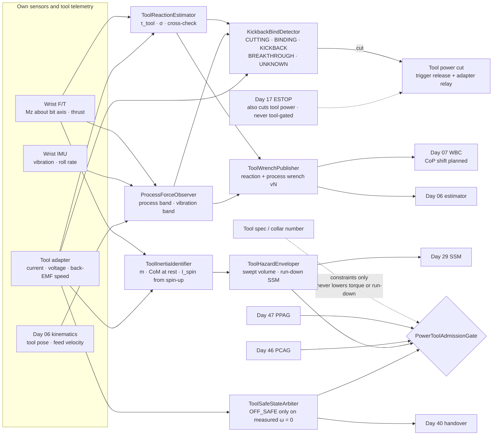
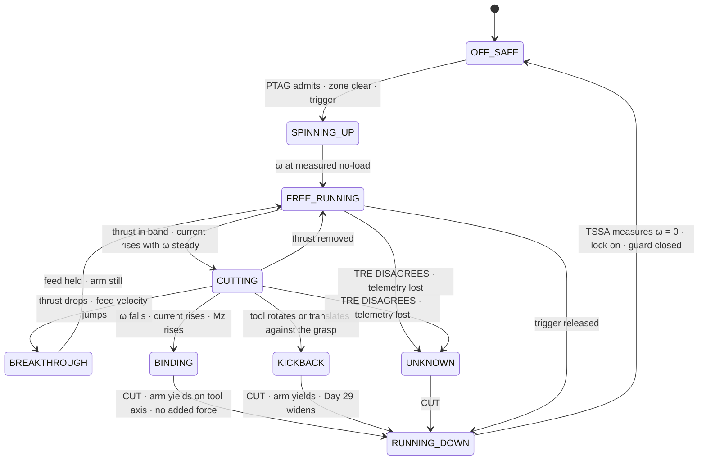
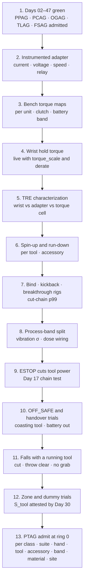

# Day 48 — Powered hand tools and sustained process forces under the push/pull and payload stacks: ToolReactionEstimator / ProcessForceObserver / KickbackBindDetector / ToolInertiaIdentifier / ToolWrenchPublisher / ToolHazardEnveloper / ToolSafeStateArbiter / PowerToolAdmissionGate under PushPullAdmissionGate + PayloadCarryAdmissionGate + OutdoorGroundAdmissionGate + TerrainLocomotionAdmissionGate + FallSafeAdmissionGate + DeliberateContactAdmissionGate + WholeBodyTouchAdmissionGate + HumanHandoverAdmissionGate + CooperativeTaskAdmissionGate + TaskCompositionAdmissionGate + FleetSkillCatalogAdmissionGate + proximity + zone attestation + supervisor + logging + canary + HIL + fleet + incident + change-management + maintenance + thermal + energy gates

![ToolReactionEstimator / ProcessForceObserver / KickbackBindDetector / ToolInertiaIdentifier / ToolWrenchPublisher / ToolHazardEnveloper / ToolSafeStateArbiter / PowerToolAdmissionGate: a 62 kg humanoid drills into a wall at hand height 1.2 m; the reaction torque about the bit axis is measured twice, by the wrist F/T and by the tool's own motor current through a bench-characterized torque map, and the two must agree; the drill's clutch is set, and measured on a torque cell, below half of what the wrist can hold, because an unclutched 60 N·m bind would twist the hand 30° in about 29 ms; thrust at 1.2 m moves the CoP back by F·h/(M·g), so a centred staggered stance allows about 101 N of thrust and breakthrough is a balance non-event; a feed-rate cap and a 10 ms breakthrough detector keep the plunge under about 2 mm; an angle grinder's spinning disc carries about 133 J and gets no PFL row at all; its separation distance comes from its measured run-down time, about 2.6 m braked and about 10.8 m unbraked; the tool is off and safe only when its spindle speed is measured at zero, the lock is on, and the guard is closed; PowerToolAdmissionGate fails closed under Day 47 PPAG and Day 46 PCAG and never raises Day 29 PFL, writes Day 05 torque_scale, gates Day 17 ESTOP, or bypasses CrossSiteZoneConfigGate](/images/day48-powered-hand-tools-process-forces.png)

[Day 05](/lessons/day-05-power-bms) owns `torque_scale` **forever**. [Day 06](/lessons/day-06-estimation-balance) owns the floating-base estimate. [Day 07](/lessons/day-07-wbc-balance) owns whole-body balance, the CoM, and the CoP. [Day 10](/lessons/day-10-upper-body-manipulation) owns arm control on the shared ceilings. [Day 17](/lessons/day-17-runtime-safety-supervisor) owns ESTOP and the kill chain. [Day 26](/lessons/day-26-actuator-wear-predictive-maintenance) owns wear and maintenance doses. [Day 27](/lessons/day-27-thermal-budgets-duty-cycle) owns thermal derates. [Day 29](/lessons/day-29-human-proximity-safety) owns person tracks, SSM, and PFL rows. [Day 30](/lessons/day-30-collaborative-workspace-zoning) owns attested zones and `CrossSiteZoneConfigGate`. [Day 40](/lessons/day-40-human-robot-handover-co-carry) owns handover and `HumanHandoverAdmissionGate`. [Day 41](/lessons/day-41-whole-body-tactile-skin-touch) owns the momentum-observer residual. [Day 42](/lessons/day-42-deliberate-whole-body-contact) owns planned contacts and their bands. [Day 43](/lessons/day-43-falls-fall-safe-contact) owns fall modes and FSAG. [Day 46](/lessons/day-46-carrying-payloads-walking) owns held payloads and PCAG. [Day 47](/lessons/day-47-pushing-pulling-heavy-objects) owns sustained external wrenches at the hands and `PushPullAdmissionGate` (PPAG).

Day 47 taught the robot to lean into something that pushes back. A powered tool is the same problem with two extra things attached: a motor in the robot's hand that can twist that hand harder than the wrist can resist, and a spinning or cutting edge that keeps going for seconds after anyone lets go of the trigger. A drill is a Day 46 payload while it's off, a Day 47 push while it's cutting, and a hazard of its own the whole time it's spinning. None of the three may be read off the box it came in.

Eight lies show up the first time a team hands a humanoid a power tool:

1. **Spec-sheet lie.** "This driver makes 45 N·m." Maybe at full charge, on a new motor, in low gear, at stall. The robot needs what it makes today, at this clutch setting, with this battery, measured.
2. **Trigger-is-off lie.** The finger came off the trigger, so the tool is off. A grinder disc at 11,000 rpm takes over a second to stop with an electric brake and six or more without one.
3. **Arm-will-hold-it lie.** "The arm is position-controlled; it won't let the drill turn." A bound bit hands the wrist the motor's full stall torque in a few milliseconds. If that's more than the wrist can hold, the wrist turns, whatever the controller wanted.
4. **Push-harder-when-it-slows lie.** The bit slowed, so feed more force. That's how a bind becomes a kickback, and it's the tool version of Day 47's stall rule.
5. **Breakthrough-is-free lie.** The bit breaks through the far side and the 100 N the robot was leaning on disappears in a millisecond. If the arm was force-controlled with no feed cap, the hand lunges, and if the CoM was forward, the robot follows it.
6. **Clean-F/T lie.** A random-orbit sander shakes the wrist at around 200 Hz. The raw F/T stream is mostly vibration. Reading process force from it without separating the bands gives a number that's neither.
7. **Robot-envelope lie, again.** Day 29's SSM numbers were for the robot. The blade is 0.3 m further out, carries more than a hundred joules, and keeps that energy through the robot's stop. No PFL row was ever written for a blade, and none can be.
8. **Hand-it-over lie.** "Pass me the drill." Handing over a tool with a charged battery, an unlocked trigger, and a bit still turning is a handover of a hazard, not a tool.

Today owns **`ToolReactionEstimator` / `ProcessForceObserver` / `KickbackBindDetector` / `ToolInertiaIdentifier` / `ToolWrenchPublisher` / `ToolHazardEnveloper` / `ToolSafeStateArbiter` / `PowerToolAdmissionGate`**. The question is: **how do you let a humanoid run drills, drivers, saws, sanders, and wiping passes, with the tool's reaction wrench and process force MEASURED from its own hand F/T and the tool's own current or speed telemetry with σ, never from a spec; detect binds and kickback as a residual with a hard stall-to-release path that cuts the tool and never adds force; identify the tool as a Day 46 payload at rest and its spinning inertia from its own spin-up; publish the reaction wrench to Day 07 the way Day 47 published a push; treat the running tool and its swept volume as a Day 29 hazard that is SSM-only with no PFL row, sized by the tool's measured run-down time; and require a measured tool-off-and-safe state before any set-down or handover — without raising Day 29 PFL, writing Day 05 `torque_scale`, gating Day 17 ESTOP, or bypassing `CrossSiteZoneConfigGate`?**

## The tool is a motor in the robot's hand, and only two witnesses get a vote

The rule everything follows from: **a powered tool is a torque source, a process force, a payload, and a stored-energy hazard at once, and each is a MEASURED quantity with σ from this robot's own sensors and the tool's own telemetry; nothing the spec sheet, the clutch number printed on the collar, or the task plan says may make the tool look weaker, slower, quicker to stop, or easier to hold than those measurements say.** A spec may add constraints (no side handle, needs two hands, no electric brake). It may never subtract newton-metres or seconds of run-down.

Three facts set the shape of the lesson.

**The tool's torque has to be smaller than the wrist's.** The motor's output torque about the bit axis comes straight back into the hand. If the tool can deliver more than the wrist can hold, the only thing between a bind and a twisted wrist is how fast the tool is cut. With an unclutched drill that stalls at 60 N·m, a wrist that holds 10 N·m, and an effective roll inertia of 0.04 kg·m² for tool, hand, and forearm, the excess torque gives

$$
\alpha = \frac{60 - 10}{0.04} = 1250\ \text{rad/s}^2, \qquad t_{30^\circ} = \sqrt{\frac{2 \cdot 0.524}{1250}} \approx 29\ \text{ms}
$$

Nobody's detection-plus-cut chain is reliably inside 29 ms with margin. So the admission rule isn't "detect fast." It's **measured tool torque at this clutch setting at most half the measured wrist hold torque, or the tool isn't admitted for one hand.**

**Process force is a Day 47 push.** Thrust $F$ at hand height $h$ moves the CoP back by $Fh/(Mg)$. Drilling a wall at $h = 1.2$ m from Day 47's centred staggered stance (±0.20 m of usable spread) allows

$$
F_{\max} = \frac{M g \cdot 0.20}{h} = \frac{608 \cdot 0.20}{1.2} \approx 101\ \text{N}
$$

and because the CoM is centred, the moment the bit breaks through is the same static non-event as Day 47's vanishing dresser.

**A spinning tool's stop time is longer than the robot's.** Day 29 sized separation from the robot's reaction and stopping time. A blade adds its own run-down time, which is usually the larger term by an order of magnitude.

| Layer | Owns | Must not own |
|-------|------|--------------|
| `ToolReactionEstimator` | Reaction wrench about the tool axis with σ, from wrist F/T cross-checked against the tool's current through a bench torque map | Torque from the spec, the collar number, or commanded trigger |
| `ProcessForceObserver` | Thrust, feed, normal and tangential process force in the process band; vibration band reported separately; breakthrough detection | Process force read from raw, unsplit F/T |
| `KickbackBindDetector` | FREE_RUNNING / CUTTING / BINDING / KICKBACK / BREAKTHROUGH / UNKNOWN from the speed, current, and wrench residuals | Adding force or trigger on a bind |
| `ToolInertiaIdentifier` | Tool mass and CoM at rest (as a Day 46 payload); spinning inertia and angular momentum from measured spin-up | Inertia or mass from the catalogue |
| `ToolWrenchPublisher` | The sustained reaction and process wrench into Days 06 and 07, versioned, with σ | Treating the workpiece as a support |
| `ToolHazardEnveloper` | Swept volume of the running tool; separation from the measured run-down time; SSM-only, no PFL row | Using the robot-only envelope; any PFL row for a running edge |
| `ToolSafeStateArbiter` | OFF_SAFE only when spindle speed is measured at zero, lock on, guard closed, and power isolated where required | Calling a tool off because the trigger was released |
| `PowerToolAdmissionGate` | Fail-closed admit per robot class, suite, hand, tool model, accessory, clutch band, material, site | `JointCommand`; Day 05; PFL; Day 17 |
| Days 05 / 06 / 07 / 17 / 26 / 27 / 29 / 30 / 40 / 41 / 42 / 46 / 47 | Torque, estimate, balance, ESTOP, wear, heat, PFL, zones, handover, residual, bands, payloads, pushes | Being outranked by "it's just a drill" |

**Core thesis:** **a humanoid only holds a tool it can out-hold; it believes the motor current and the wrist together, never the box; it cuts the tool the instant the work stops behaving and never pushes through a bind; it keeps everyone out of reach for as long as the edge is actually turning; and it calls a tool off only when it has measured it stopped.**



## Physical machine: what a running tool does to a humanoid

### Out-hold the tool, or don't hold it

The robot's wrist has a measured hold torque about its roll axis: the torque at which the joint stops holding position under Day 05's current `torque_scale` and Day 27's current derate. Call it $\tau_{\text{hold}}$. It moves with both, so the admission check reads it live. For the example robot it's 10 ± 0.5 N·m cold.

The tool's side is measured on a bench torque cell, per tool, per clutch position, per battery state. The printed collar number is an index into that table, not a torque.

| Tool and setting (bench, this unit) | Measured peak at the bit | One-hand admit at τ_hold 10 N·m | Notes |
|------|------|------|-------|
| Drill-driver, clutch 5 | 4.6 ± 0.4 N·m | Yes | Clutch slips before the wrist does |
| Drill-driver, clutch 12 | 11.8 ± 0.9 N·m | No | Exceeds hold; needs side handle and second hand |
| Drill-driver, drill mode (no clutch) | ≈ 60 N·m stall | No, ever | 29 ms to 30° of wrist roll on a bind |
| Impact driver | Low mean, large impulses | Mean and impulse rated separately | Anvil isolates most of the impulse from the hand; measure both |
| Random-orbit sander | ≈ 0.3 N·m mean | Yes | Vibration, not torque, is the limit |
| Angle grinder, 125 mm | ≈ 2 N·m running | Torque yes; hazard decides | Run-down and kickback govern, not torque |

With a side handle at radius $r = 0.25$ m and a second hand capped at 40 N, the pair holds about $10 + 0.25 \cdot 40 = 20$ N·m, so the two-hand admit is around 10 N·m. Each hand's cap is still measured, and the side handle's grip is a Day 46 grasp with its own slip observer.

### Thrust is balance, and breakthrough is a dropped load

Drilling, driving, and sanding all push. Day 47's numbers carry over: about 101 N of thrust at $h = 1.2$ m and about 135 N at $h = 0.9$ m from a centred staggered stance. Day 45's friction cap still applies, so the robot doesn't drill into a wall while standing on wet ice.

Breakthrough is the moment the thrust vanishes. Two things have to be true for it to be harmless:

- **Balance:** the CoM is centred in the polygon, so the robot is statically balanced with zero hand force. Same rule as Day 47.
- **Arm:** the hand doesn't lunge. If the arm runs a force loop at 100 N with an effective mass of 4 kg, the hand accelerates at 25 m/s² the moment the resistance goes. With a detection time $t_d$ and a braking deceleration $a_b$, the plunge is

$$
x_{\text{plunge}} = \tfrac{1}{2} a\, t_d^2 + \frac{(a\, t_d)^2}{2 a_b}
$$

At $t_d = 10$ ms and $a_b = 50$ m/s², that's 1.25 + 0.63 ≈ 1.9 mm. At $t_d = 40$ ms it's 20 + 10 = 30 mm, which is the chuck hitting the wall or the bit going 30 mm into whatever is behind it. So the process loop runs as an admittance with a **feed-velocity cap** (a few mm/s for metal, tens of mm/s for wood) and a breakthrough detector at the process-loop rate. The cap bounds the plunge even if the detector is late.

### Spinning things carry energy and angular momentum

An angle grinder's rotor and 125 mm disc, identified as below at $I_{\text{spin}} \approx 2.0 \times 10^{-4}$ kg·m², running at 11,000 rpm ($\omega \approx 1152$ rad/s), hold

$$
L = I\omega \approx 0.23\ \text{N·m·s}, \qquad E = \tfrac{1}{2} I \omega^2 \approx 133\ \text{J}
$$

Three consequences:

- **Spin-up reaction.** Reaching full speed in 0.3 s hands the wrist about $0.23 / 0.3 \approx 0.77$ N·m, opposite the spin. Small, but Day 07 should expect it.
- **Gyroscopic torque.** Rotating the wrist at 2 rad/s about an axis perpendicular to the spindle produces $L \cdot \Omega \approx 0.46$ N·m that the arm didn't command, at right angles to the motion. Tool reorientation while spinning is rate-limited, and the torque is published, not discovered.
- **Run-down.** 133 J doesn't go away when the trigger does. It goes away at the rate the tool's brake, or its friction, removes it.

### The tool's stop time sets the separation

Day 29's separation distance is roughly $S = v_h\,(t_r + t_s) + C$. For a running tool, the edge is dangerous until it has stopped, so the tool's measured run-down time $t_{rd}$ joins the sum:

$$
S_{\text{tool}} = v_h\,(t_d + t_{rd}) + C
$$

With a walking approach speed $v_h = 1.6$ m/s, a cut-detection time $t_d = 0.1$ s, and an allowance $C = 0.2$ m, measured from the edge's swept volume:

| Tool (run-down measured on this unit) | $t_{rd}$ | $S_{\text{tool}}$ from the edge | Near people? |
|------|------|------|------|
| Drill-driver, small bit | 0.3 s | ≈ 0.84 m | Yes, in an attested zone |
| Random-orbit sander, unbraked pad | 3.0 s | ≈ 5.2 m | Only with a pad brake or a NO_HUMAN zone |
| Angle grinder, electric brake | 1.4 s | ≈ 2.6 m | Only in a Day 30 zone with that radius attested |
| Angle grinder, no brake | 6.5 s | ≈ 10.8 m | No |
| Circular saw | (any) | n/a | Only in a fenced NO_HUMAN cell; kickback throws the tool, not just the blade |

That table is the whole argument for "no PFL row for a running edge." PFL bounds the force and pressure of a contact the robot can survive having. There's no admissible contact pressure for a blade, so a person reaching the edge is a failure, and the only control is keeping them away for as long as it turns.

### Vibration is a second signal, not noise to average away

A random-orbit sander at 12,000 orbits per minute shakes at 200 Hz. The wrist F/T samples at 1 kHz behind an anti-alias filter. `ProcessForceObserver` splits the stream: 0–20 Hz is process force (what Day 07 balances and the sanding pressure loop regulates), and the band around the orbit frequency is reported as an RMS acceleration and force. Two things follow:

- The process-force σ inflates with vibration: $\sigma_F^2 = \sigma_0^2 + (k_v\, a_{\text{rms}})^2$, with $k_v$ characterized on the bench. A sanding pressure target tighter than that σ is refused.
- Vibration is a dose. The wrist's gearbox and the F/T's bond line take it, so `ProcessForceObserver` reports exposure time and RMS to Day 26's maintenance counter, which may stop the job. Day 27 sees the motor heat from holding the tool against vibration.

### Wiping is a process force with no motor

Wiping a table is today's gentle case: a normal force of 15 ± 1.5 N held by an admittance loop, a measured tangential force (9 N here gives an effective μ ≈ 0.6), and no stored energy. It's a Day 42 planned contact with a band, and the hand's ordinary Day 29 PFL row applies because no tool edge is involved. It's in today's lesson because it uses the same process-band machinery and the same rule: the force is what the wrist measured, not what the wiping policy asked for.

## ToolReactionEstimator: the wrist and the motor must agree

Two independent witnesses measure the torque about the tool axis:

1. **Wrist F/T**, rotated into the tool frame using the grasp pose from Day 46's hold observer. Gives $M_z$ with its characterized σ.
2. **Tool telemetry.** Most hand tools don't publish torque, so the robot's tool interface is an **instrumented battery adapter** that measures current, voltage, and (from back-EMF or ripple frequency) motor speed. A bench map per tool unit turns those into output torque:

$$
\tau_{\text{out}} \approx k_t\, N\, \eta\, (I - I_0)
$$

with $k_t$, gear ratio $N$, efficiency $\eta$, and no-load current $I_0$ all fitted on the torque cell, per gear and per battery band. The σ comes from the fit's residuals, and it's usually larger than the wrist's.

`ToolReactionEstimator` publishes `AGREES` when the two are inside their combined kσ, `DISAGREES` otherwise. A disagreement means something else is carrying torque: the bit is touching a second surface, the grasp is slipping in the hand, the side handle is loose, or the bench map is stale. Disagreement cuts the trigger, holds the arm, and asks Day 41's residual where the extra contact is. It never averages the two.

The tool's commanded trigger position is never a torque. Neither is the collar number. A tool with no adapter, no telemetry, and only the wrist as a witness is admitted at most for single-witness modes (wiping, sanding at low pressure), never for drilling or driving.

## ProcessForceObserver: the work, separated from the shaking

`ProcessForceObserver` owns the process wrench in the tool frame: thrust along the axis, lateral force, and for sanders and wipes the normal and tangential components. It runs the band split above, applies Day 46's tool payload model to remove the tool's own weight and the spin-up and gyroscopic terms from `ToolInertiaIdentifier`, and publishes the remainder with σ.

It also owns **breakthrough detection**: thrust falling by more than a fraction of its running value inside one process-loop window while feed velocity rises. The detector's job is to zero the feed command and hold position. It doesn't decide whether to stop the motor; `KickbackBindDetector` does that.

## KickbackBindDetector: when the work stops behaving, cut it



The signals, all from the two witnesses and the adapter:

- **BINDING**: motor speed falling while current and wrist $M_z$ rise together, faster than the material's characterized cutting curve. For a clutched driver, the clutch's ratchet signature (periodic torque drops at a known frequency) is a bind that the clutch is already handling; the detector still cuts, because the screw is done or the bit is stuck.
- **KICKBACK**: the tool moving against the grasp: wrist IMU roll rate or translation along the reverse feed direction beyond its band, or the Day 46 hold observer reporting slip in the hand.
- **UNKNOWN**: telemetry lost, witnesses disagreeing, or any state the detector can't classify. Treated as a bind.

The response to all three is the same and it's **hard**: release the trigger, open the adapter's power relay, zero the feed, and let the arm yield along the tool axis inside a bounded rotation rather than fight the motor. The arm yielding is deliberate. A stiff arm turns a bind into a wrench on the wrist gearbox and the robot's balance; a compliant axis lets the clutch, or the cut, do its job. **Nothing in the stall-to-release path can add force, add trigger, or retry automatically.** A retry is a new task step, from OFF_SAFE, after perception has looked at the bit.

The cut chain timing is measured on the bench: from a bind induced on an instrumented brake to the adapter relay opening. Its p99 is what goes into the separation table and the admission check.

## ToolInertiaIdentifier: weigh it off, spin it up

At rest, the tool is a Day 46 payload: `PayloadInertiaIdentifier` gets mass, CoM, and inertia from a slow wrist excitation with the motor off. A drill with a battery is 1.8 ± 0.05 kg with its CoM 60 mm forward of the grip and below the bit axis; that's what Day 07 and Day 46's loaded bounds use.

Running, the spinning parts add angular momentum. `ToolInertiaIdentifier` measures it from the spin-up itself. The wrist sees the reaction torque during spin-up, and the adapter sees the speed:

$$
I_{\text{spin}} \approx \frac{\int \tau_{\text{reaction}}\, dt}{\omega_{\text{final}}}
$$

That's done once per tool and accessory pair (a different disc is a different inertia) with the tool held clear of everything, and checked against every later spin-up. A spin-up whose integral is off by more than kσ means a different accessory was mounted, and the tool drops back to identification. The same measurement, run in reverse during the first trigger release, gives the run-down time $t_{rd}$ that `ToolHazardEnveloper` uses.

## ToolWrenchPublisher: the motor's torque goes into the model first

`ToolWrenchPublisher` is the sole writer of the tool's sustained wrench into Days 06 and 07, the same way Day 47's `ExternalWrenchPublisher` owns a push. It publishes the process wrench, the reaction torque, and the gyroscopic term as one versioned external wrench at the tool frame, with feed-forward before the thrust ramps and before spin-up. It clears the wrench only when the wrist F/T confirms the tool is free and unloaded.

The workpiece is never a support. Leaning on a wall through a drill bit is Day 47's handle-as-support lie with a hole in it: when the bit breaks through, the support goes away.

## ToolHazardEnveloper: the running edge is SSM-only

`ToolHazardEnveloper` builds the hazard Day 29 must keep people out of:

- **Swept volume**: the accessory's envelope (disc radius, blade length, bit length, sander pad) swept along the planned tool path plus the kickback travel measured on the bench for this tool class.
- **Separation**: $S_{\text{tool}}$ from the measured run-down time and the cut-chain p99, measured from the swept volume's surface, not the robot's.
- **Duration**: the hazard lives from SPINNING_UP until `ToolSafeStateArbiter` says OFF_SAFE. Releasing the trigger doesn't shrink it.

It hands Day 29 a hazard object with `pfl_row: none`. Day 29 treats it like any SSM-only hazard: a person track inside $S_{\text{tool}}$ triggers the cut, and a person track inside $S_{\text{tool}}$ while the tool is RUNNING_DOWN means the zone failed and Day 23's incident path opens. A heavier tool, a faster tool, or a tool without a brake raises $S_{\text{tool}}$. Nothing lowers Day 29's robot envelope.

Day 30 has to have attested a zone at least that large for the tool's swept path. `CrossSiteZoneConfigGate` decides whether that zone's radius exists at this site; `ToolHazardEnveloper` can only ask.

## ToolSafeStateArbiter: off is something you measure

OFF_SAFE needs all of these, each measured, not inferred:

1. Spindle speed at zero from the adapter's back-EMF and confirmed by the wrist IMU's vibration band going quiet.
2. Trigger lock engaged (switch state read through the adapter, or a mechanical lock confirmed by the hand's tactile sensors).
3. Guard closed for tools that have one (blade guard position from perception plus, where fitted, a guard switch).
4. For handover to a person, or for set-down where people can reach it: battery removed or the adapter relay open and confirmed.

Until then, the tool is still a running hazard. Set-down follows Day 46's release rules, with the extra condition that nothing on the tool can start. Handover goes through Day 40's `HumanHandoverAdmissionGate`, and the tool's row there requires OFF_SAFE with the battery out, presented handle-first with the edge pointing away from the receiver.

Day 17 ESTOP sits above all of this. The adapter relay is wired into Day 17's kill chain so that an ESTOP cuts tool power along with the joints. PTAG checks that wiring exists before admitting anything. It never gates ESTOP and never sits in its path.

## PowerToolAdmissionGate

`PowerToolAdmissionGate` (PTAG) admits tool modes per robot class, sensor suite hash, hand, tool model and unit, accessory, clutch band, battery band, material class, and site, under Day 47 PPAG, Day 46 PCAG, Day 45 OGAG, Day 44 TLAG, and Day 43 FSAG. It fails closed if any of these is missing:

- Bench torque map for this unit and clutch band on a torque cell; measured peak at most half the live $\tau_{\text{hold}}$ for one hand, or the two-hand rule with a side-handle grasp admitted by Day 46.
- TRE characterized: wrist and adapter witnesses against the torque cell across the band, disagreement firing on a deliberate second contact.
- PFO band split characterized per tool, with the vibration σ model and Day 26 dose counter wired.
- KBD trials: induced binds on an instrumented brake, induced kickback on a fixture, induced breakthrough on test panels; no CUTTING verdict during any of them, no force added on any of them, and the cut-chain p99 recorded.
- Spin-up and run-down measured per tool and accessory pair, and $S_{\text{tool}}$ attested as a Day 30 zone at the site.
- Adapter relay in the Day 17 kill chain, tested by ESTOP.
- OFF_SAFE detection tested, including a tool that keeps coasting after trigger release.
- FSAG admitted for falls while holding a running tool: cut first, throw the tool clear of the fall cone and away from tracked people, never grab with the tool hand.

PTAG never writes `JointCommand`, never touches Day 05 `torque_scale`, never raises a Day 29 row, never gives a running edge a PFL row, never lets the robot-only envelope stand in for the tool's swept volume, and never gates ESTOP. If the tool draws from the robot's own bus through the adapter, its load is a Day 05 consumer like any other: Day 05 can cut it, and the tool can't ask Day 05 for more.

## Data shapes

```text
ToolReaction:                                 # TRE
  tau_axis_nm, sigma
  wrist_tau_nm, wrist_sigma
  telemetry_tau_nm, telemetry_sigma   # adapter current → bench map
  torque_map_id, battery_band
  verdict                      # AGREES | DISAGREES | SINGLE_WITNESS | UNKNOWN

ProcessForce:                                 # PFO
  thrust_n, lateral_n[2], sigma[3]
  normal_n, tangential_n       # sanders and wipes
  vib_rms_mps2, vib_band_hz
  feed_velocity_mps
  breakthrough                 # true | false
  dose_s                       # to Day 26

ToolState:                                    # KBD
  verdict                      # OFF_SAFE | SPINNING_UP | FREE_RUNNING | CUTTING
                               # BINDING | KICKBACK | BREAKTHROUGH | RUNNING_DOWN | UNKNOWN
  omega_radps, current_a
  residual_nm, residual_n
  cut_issued_at, cut_chain_p99_ms

ToolInertia:                                  # TII
  mass_kg, com_m[3], inertia_rest[6], sigma   # Day 46 payload
  i_spin_kgm2, sigma
  accessory_id
  t_rundown_s, sigma           # measured, per tool + accessory
  verdict                      # IDENTIFIED | ACCESSORY_CHANGED | UNKNOWN
  spec_values                  # logged; never used to lower

ToolWrench:                                   # TWP
  version
  wrench_n_nm[6], sigma[6]     # process + reaction + gyroscopic
  attach_frame
  status                       # LIVE | HOLD | CLEARED

ToolHazard:                                   # THE
  swept_volume
  s_tool_m                     # v_h·(t_d + t_rd) + C, from the swept surface
  live_from, live_until        # SPINNING_UP … OFF_SAFE
  pfl_row: none
  day30_zone_id

ToolSafeState:                                # TSSA
  omega_zero_measured, vib_quiet
  trigger_locked, guard_closed
  power_isolated               # battery out | relay open confirmed
  verdict                      # OFF_SAFE | NOT_SAFE

PowerToolAdmission:                           # PTAG
  robot_class, sensor_suite_hash, hand
  tool_model, tool_unit, accessory_id
  clutch_band, battery_band, material_class, site
  modes_admitted[]             # DRIVE_SCREW | DRILL_WOOD | DRILL_METAL | SAND | WIPE | GRIND_FENCED
  forbid:
    torque_from_spec: true
    tool_torque_above_half_hold: true
    single_witness_for_drilling: true
    add_force_on_bind: true
    auto_retry_after_cut: true
    unsplit_ft_for_process_force: true
    workpiece_as_support: true
    robot_only_envelope: true
    pfl_for_running_edge: true
    off_from_trigger_release: true
    handover_with_battery_in: true
    raise_pfl: true
    write_torque_scale: true
    gate_estop: true
    bypass_cross_site_zone_config_gate: true

# Unchanged owners
PushPullAdmissionGate (Day 47) · PayloadCarryAdmissionGate (Day 46)
OGAG (Day 45) · TLAG (Day 44) · FSAG (Day 43) · planned-contact bands (Day 42)
skin + momentum residual (Day 41) · HumanHandoverAdmissionGate (Day 40)
CrossSiteZoneConfigGate · zones (Day 30) · tracks · SSM · PFL (Day 29)
ThermalDerate (Day 27) · wear dose (Day 26) · SupervisorState ESTOP (Day 17)
Arm control (Day 10) · WBC CoM/CoP (Day 07) · EstimatorState (Day 06)
BmsState / PowerState (Day 05): torque_scale
  accepts_requests_from_tool: false
```

## Config

A starting configuration. Every number is a policy you re-derive from your own robot, hands, tools, and materials:

```yaml
power_tools:
  reaction:
    witnesses: [wrist_ft, adapter_current_map]
    disagree_is: UNKNOWN
    unknown_action: cut
    torque_from_spec: forbidden
    torque_map: per_unit_per_clutch_per_battery_band
  hold:
    one_hand_max_fraction_of_tau_hold: 0.5
    tau_hold_source: live   # Day 05 torque_scale and Day 27 derate applied
    two_hand_requires: side_handle_grasp_admitted_by_day46
  process:
    process_band_hz: [0, 20]
    vibration_band: around_orbit_or_rotor_frequency
    sigma_inflation: bench_kv
    feed_velocity_cap_mps: { wood: 0.02, metal: 0.003 }
    breakthrough_action: zero_feed_hold_position
    dose_to: day26
  bind:
    states: [OFF_SAFE, SPINNING_UP, FREE_RUNNING, CUTTING, BINDING, KICKBACK, BREAKTHROUGH, RUNNING_DOWN, UNKNOWN]
    on_bind_kickback_unknown: [release_trigger, open_adapter_relay, zero_feed, yield_tool_axis]
    add_force_on_bind: forbidden
    auto_retry: forbidden
  inertia:
    at_rest: day46_payload_identifier
    i_spin_from: spin_up_reaction_integral
    accessory_change_detect_k_sigma: 3
    rundown_from: measured_first_release
  hazard:
    separation: v_h_times_td_plus_trd_plus_C
    v_h_mps: 1.6
    measured_from: swept_volume_surface
    pfl_for_running_edge: forbidden
    live_until: off_safe
    requires_day30_zone_radius: true
  safe_state:
    off_requires: [omega_zero_measured, vibration_quiet, trigger_locked, guard_closed]
    handover_also_requires: battery_removed
    trigger_release_alone_is_off: false
  admission:
    keyed_by: [robot_class, sensor_suite_hash, hand, tool_model, tool_unit, accessory_id, clutch_band, battery_band, material_class, site]
    requires: [day47_ppag, day46_pcag, day45_ogag, day44_tlag, day43_fsag_tool_in_hand, adapter_relay_in_day17_chain]
```

## Physical ↔ digital pairing

| Physical | Digital twin / backing |
|----------|------------------------|
| Robot picks up the drill | Day 46 PII: 1.8 ± 0.05 kg, CoM 60 mm forward; adapter enumerates tool unit and battery band |
| Clutch collar set to 5 | Bench map for this unit: 4.6 ± 0.4 N·m; live τ_hold 10 N·m; one-hand admit |
| Collar turned to drill mode | PTAG refuses one-hand; task re-planned with side handle or a different tool |
| First trigger pull, held in free air | TII spin-up integral gives I_spin; first release gives t_rd 0.3 s; THE publishes S_tool 0.84 m |
| Driving a screw | TRE: wrist 4.4 ± 0.2, adapter 4.6 ± 0.5 N·m → AGREES; clutch ratchet seen → screw seated → cut |
| Bit catches a nail in a stud | KBD BINDING in 6 ms; trigger and relay cut; arm yields 4° on tool axis; no retry |
| Wrist reads 3 N·m, adapter reads 7 N·m | TRE DISAGREES; cut; Day 41 residual finds the chuck rubbing the wall |
| Bit breaks through a 12 mm panel at 90 N | PFO breakthrough in one window; feed zeroed; plunge 1.7 mm; CoM centred, no balance event |
| Sanding a tabletop | PFO process force 25 ± 3 N with vibration σ; dose to Day 26; pressure target 25 ± 2 N refused, 25 ± 5 N admitted |
| Grinder disc swapped for a thicker one | Spin-up integral 40% high → ACCESSORY_CHANGED; re-identify; t_rd re-measured |
| Person walks toward a running grinder | Day 29 track enters S_tool 2.6 m from the disc surface; cut; RUNNING_DOWN until ω = 0 |
| "Pass me the drill" | TSSA: ω = 0, lock on, battery out → OFF_SAFE; Day 40 handover handle-first |

The pairing that matters most: **replay every tool run from the robot's own bag and show that every reaction torque came from two witnesses that agreed; that every admitted tool's measured peak was under half the live wrist hold; that every process force was read from the split band; that every bind, kickback, and UNKNOWN ended in a cut with no added force and no automatic retry; that every person track stayed outside the tool's run-down separation until the tool was measured stopped; and that every set-down and handover happened from a measured OFF_SAFE.** If the run only looks safe when you load the spec sheet's torque or the catalogue's brake time, the catalogue owns the robot.

## Bring-up sequence (before the robot runs a tool near people)



1. **Days 02–47 green,** with PPAG, PCAG, OGAG, TLAG, and FSAG admitted.
2. **Instrumented adapter** between each tool and its battery: current, voltage, speed from back-EMF, trigger and lock state where readable, and a power relay.
3. **Bench torque maps** per tool unit, clutch position, and battery band on a torque cell. File the spec discrepancies.
4. **Wrist hold torque** measured on the robot under its current `torque_scale` and thermal derate, so PTAG reads it live.
5. **TRE characterization:** wrist and adapter against the torque cell, plus a deliberate second contact to prove disagreement detection.
6. **Spin-up and run-down** per tool and accessory: $I_{\text{spin}}$, $t_{rd}$, and the spread across battery bands.
7. **Bind, kickback, and breakthrough rigs:** an instrumented brake on the spindle, a fixture that seizes the bit, test panels of each admitted material. KBD must never say CUTTING during a bind and must never add force. Record the cut-chain p99.
8. **Process-band split** per tool, with the vibration σ model and the Day 26 dose counter connected.
9. **ESTOP cuts tool power:** Day 17's chain test, with a spinning tool on the bench.
10. **OFF_SAFE and handover trials,** including a deliberately coasting tool, a trigger lock that fails to engage, and a battery that won't release.
11. **Falls with a running tool** on the gantry: the cut comes first, the tool is thrown clear of the fall cone and tracked people, and the tool hand never grabs.
12. **Zone and dummy trials:** instrumented dummies approaching the tool; confirm the cut at $S_{\text{tool}}$ and that Day 30 has that radius attested.
13. **PTAG admit at ring 0** per robot class, suite, hand, tool, accessory, clutch band, battery band, material, and site.

## Failure gallery

| Symptom | Likely cause |
|---------|--------------|
| Wrist gearbox damaged on the first stuck bit | Tool torque above wrist hold; clutch number trusted instead of measured |
| Drill chuck slams into the wall at breakthrough | Force loop with no feed-velocity cap; breakthrough detector too slow |
| Robot steps forward every time a hole goes through | CoM forward while drilling; thrust not published to Day 07 |
| Sanding pressure loop oscillates | Process force read from unsplit F/T; vibration aliased into the loop |
| Screw stripped, bit cams out, robot drives harder | Speed drop treated as "needs more force"; bind rule missing |
| Arm twists sideways when reorienting a running grinder | Gyroscopic torque not published |
| Person cut reaching for a grinder the robot had "turned off" | Off taken from trigger release; run-down not measured |
| Separation fine for the drill, too small for the sander | One run-down time for all tools; per-tool t_rd not measured |
| Handover of a drill that starts in the person's hand | Trigger lock not confirmed; battery left in |
| ESTOP stops the robot, tool keeps running in its hand | Adapter relay not in the Day 17 kill chain |
| Thicker disc mounted, run-down 40% longer, zone unchanged | Accessory change not detected from spin-up |

## Exercises

1. A wrist holds 8 ± 0.4 N·m live. A driver's bench map shows 3.8 ± 0.3 N·m at clutch 4 and 5.1 ± 0.4 N·m at clutch 6. Which clutch settings are admitted for one hand? What changes when Day 27 derates the wrist by 20%?
2. An unclutched hammer drill stalls at 45 N·m. The wrist holds 10 N·m and the effective roll inertia is 0.05 kg·m². How long until 30° of roll? What cut-chain time would you need, and why does PTAG still refuse it?
3. Drilling at 1.0 m from a centred stance with ±0.20 m spread: what's the thrust cap? With a force loop at that thrust, 4 kg effective mass, and $a_b = 40$ m/s², what's the plunge at $t_d = 15$ ms? What feed cap keeps it under 1 mm?
4. A grinder disc identifies at $I_{\text{spin}} = 3.0 \times 10^{-4}$ kg·m² at 10,000 rpm. Compute $L$, $E$, and the gyroscopic torque at a 1.5 rad/s reorientation.
5. A sander's measured run-down is 2.2 ± 0.3 s and the cut chain p99 is 80 ms. Compute $S_{\text{tool}}$ at kσ = 3 on the run-down. Is a 3.5 m attested zone enough?
6. Wrist reads 2.1 ± 0.2 N·m and the adapter map gives 4.0 ± 0.6 N·m while driving into drywall. What does TRE publish, what happens to the tool, and what is Day 41 asked?
7. Write the `PowerToolAdmission` row for sanding a tabletop in an occupied workshop. Which modes are admitted, which are forbidden, and what Day 26, Day 29, and Day 30 evidence must already exist?

## What to freeze this week

Extend [frames](/frames) and your safety config with:

- `ToolReactionEstimator`: wrist F/T cross-checked against the adapter's current through a per-unit bench torque map; disagreement is `UNKNOWN` and cuts; the spec and the collar number are never a torque.
- `ProcessForceObserver`: process band separated from the vibration band; σ inflated by measured vibration; breakthrough zeroes feed; feed-velocity cap always on; vibration dose to Day 26.
- `KickbackBindDetector`: OFF_SAFE through UNKNOWN; BINDING, KICKBACK, and UNKNOWN all cut trigger and relay, zero feed, and yield the tool axis; nothing adds force; no automatic retry.
- `ToolInertiaIdentifier`: Day 46 payload at rest; spinning inertia from the spin-up reaction integral; run-down measured; an accessory change is detected and re-identified.
- `ToolWrenchPublisher`: sole writer of the tool's process, reaction, and gyroscopic wrench into Days 06 and 07; feed-forward before thrust and spin-up; the workpiece is never a support.
- `ToolHazardEnveloper`: swept volume plus kickback travel; separation from measured run-down; live until OFF_SAFE; SSM-only with no PFL row; Day 30 must attest the radius.
- `ToolSafeStateArbiter`: OFF_SAFE only on measured zero speed, quiet vibration, lock, guard, and isolated power for handover.
- `PowerToolAdmissionGate` fail-closed under Day 47 PPAG, Day 46 PCAG, Day 45 OGAG, Day 44 TLAG, and Day 43 FSAG; keyed by robot class, suite, hand, tool unit, accessory, clutch band, battery band, material, and site; **tool torque at most half the live wrist hold for one hand; adapter relay in the Day 17 chain; no dual-write of ESTOP or `torque_scale`; no tool mode raises PFL; a faster or brakeless tool widens the separation, never shrinks the envelope.**

The lesson isn't "teach the robot to use a drill." It's that **a powered tool is a motor the robot has to out-hold, a push it has to balance, and an edge that stays dangerous until it has measurably stopped, so the robot holds only what it can overpower, believes the wrist and the motor current together, cuts the tool the moment the work stops behaving, keeps people out for as long as the edge turns, and hands nothing over until it has measured it off**, under ceilings that never move because the job needed more torque.

## Further reading

Look these up by title; they're the classic sources for today's tool, force-control, and machine-safety arguments:

- ISO 13855, *Safety of machinery — Positioning of safeguards with respect to the approach speeds of parts of the human body*, for the approach-speed separation formula.
- ISO/TS 15066, *Robots and robotic devices — Collaborative robots*, for why PFL limits exist and what they don't cover.
- IEC 62841 series, *Electric motor-operated hand-held tools*, for how tool kickback, run-down, and guards are tested.
- ISO 5349, *Mechanical vibration — Measurement and evaluation of human exposure to hand-transmitted vibration*, for how vibration dose is framed.
- N. Hogan, "Impedance control: an approach to manipulation," *ASME Journal of Dynamic Systems, Measurement, and Control*, 1985.
- J. Y. S. Luh, W. D. Fisher, and R. P. C. Paul, "Joint torque control by a direct feedback for industrial robots," *IEEE Transactions on Automatic Control*, 1983.
- Y. Altintas, *Manufacturing Automation: Metal Cutting Mechanics, Machine Tool Vibrations, and CNC Design*, Cambridge University Press, for thrust and torque in drilling.
- S. Haddadin, A. De Luca, and A. Albu-Schäffer, "Robot collisions: a survey on detection, isolation, and identification," *IEEE Transactions on Robotics*, 2017.

## Next

**Day 49+** — Bimanual tool work with a held workpiece (holding a board while sawing, a panel while driving screws, a pipe while cutting it) under the power-tool and payload stacks: the holding hand's grip force and the workpiece's motion MEASURED from its own F/T and tactile with σ, never assumed clamped; the tool hand's reaction wrench crossing the workpiece into the holding hand treated as one closed kinematic chain published to Day 07; offcut and workpiece release as a Day 46 release with a measured landing zone; fixtures and clamps as Day 42 planned contacts with their own bands; the holding hand kept outside the tool's swept volume by a margin Day 29 and today's `ToolHazardEnveloper` both sign — without raising Day 29 PFL, writing Day 05 `torque_scale`, or bypassing `CrossSiteZoneConfigGate`, under the same gates plus power-tool admission.
