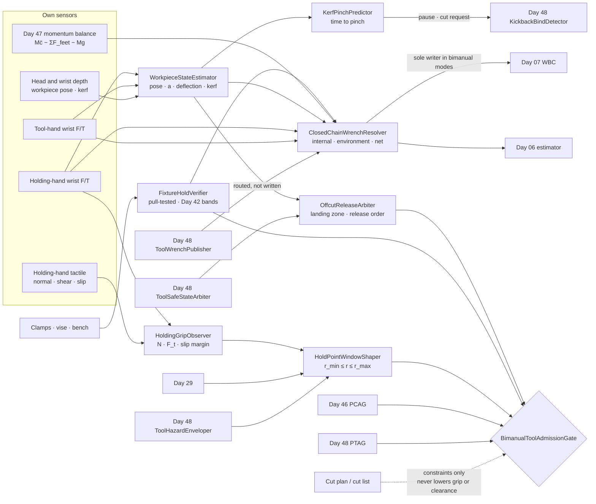
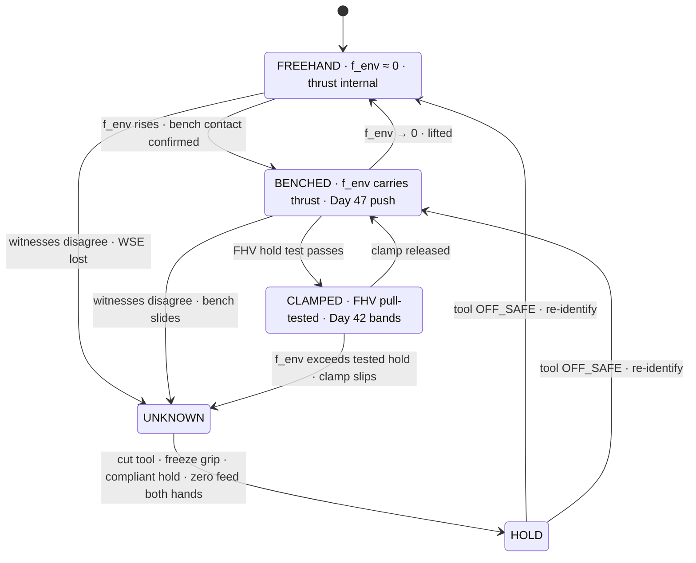
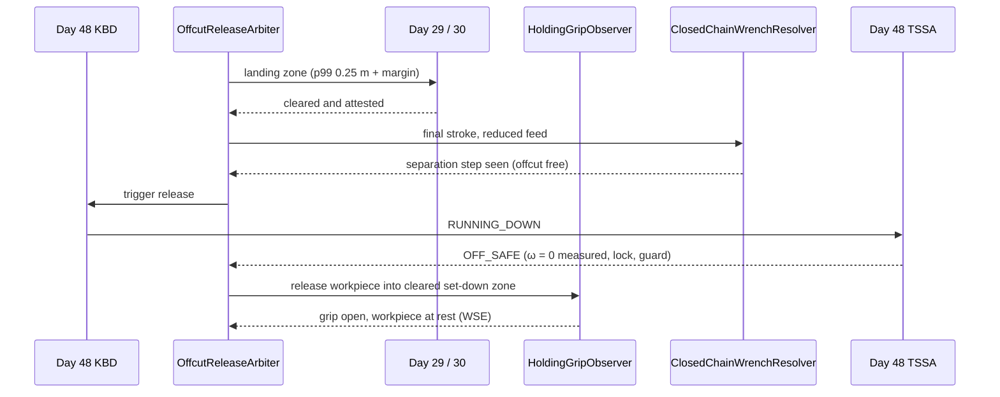
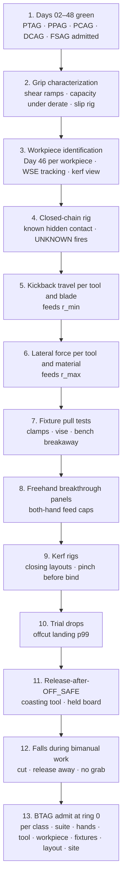

# Day 49 — Bimanual tool work with a held workpiece under the power-tool and payload stacks: HoldingGripObserver / WorkpieceStateEstimator / ClosedChainWrenchResolver / FixtureHoldVerifier / HoldPointWindowShaper / KerfPinchPredictor / OffcutReleaseArbiter / BimanualToolAdmissionGate under PowerToolAdmissionGate + PushPullAdmissionGate + PayloadCarryAdmissionGate + OutdoorGroundAdmissionGate + TerrainLocomotionAdmissionGate + FallSafeAdmissionGate + DeliberateContactAdmissionGate + WholeBodyTouchAdmissionGate + HumanHandoverAdmissionGate + CooperativeTaskAdmissionGate + TaskCompositionAdmissionGate + FleetSkillCatalogAdmissionGate + proximity + zone attestation + supervisor + logging + canary + HIL + fleet + incident + change-management + maintenance + thermal + energy gates

![HoldingGripObserver / WorkpieceStateEstimator / ClosedChainWrenchResolver / FixtureHoldVerifier / HoldPointWindowShaper / KerfPinchPredictor / OffcutReleaseArbiter / BimanualToolAdmissionGate: a 62 kg humanoid holds a plywood panel in its left hand and cuts it with a jigsaw in its right; the holding hand's grip force, slip, and the panel's motion are measured by its own wrist F/T and fingertip tactile, never assumed clamped; both wrist wrenches and the panel's measured acceleration close one force balance, which splits the tool's thrust into the part the robot's own hands absorb (internal, invisible to balance) and the part that goes to the bench (external, a Day 07 CoP shift); the holding hand must sit between a minimum distance from the blade (swept volume plus measured kickback travel plus margin, about 0.13 m) and a maximum lever distance (half the wrist's hold torque divided by the measured lateral cutting force, about 0.15 m for 6 mm plywood); 18 mm pine leaves no window, so it must be clamped and pull-tested; the kerf is watched for closing so a pinch is caught before it becomes a bind; the offcut falls into a landing zone measured from trial drops; and the tool reaches OFF_SAFE before either hand lets go](/images/day49-bimanual-tool-held-workpiece.png)

[Day 05](/lessons/day-05-power-bms) owns `torque_scale` **forever**. [Day 06](/lessons/day-06-estimation-balance) owns the floating-base estimate. [Day 07](/lessons/day-07-wbc-balance) owns whole-body balance, the CoM, and the CoP. [Day 10](/lessons/day-10-upper-body-manipulation) owns arm control on the shared ceilings. [Day 17](/lessons/day-17-runtime-safety-supervisor) owns ESTOP and the kill chain. [Day 29](/lessons/day-29-human-proximity-safety) owns person tracks, SSM, and PFL rows. [Day 30](/lessons/day-30-collaborative-workspace-zoning) owns attested zones and `CrossSiteZoneConfigGate`. [Day 41](/lessons/day-41-whole-body-tactile-skin-touch) owns the momentum-observer residual. [Day 42](/lessons/day-42-deliberate-whole-body-contact) owns planned contacts and their bands. [Day 46](/lessons/day-46-carrying-payloads-walking) owns held payloads, grasp-hold observation, release, and PCAG. [Day 47](/lessons/day-47-pushing-pulling-heavy-objects) owns sustained external wrenches and PPAG. [Day 48](/lessons/day-48-powered-hand-tools-process-forces) owns the tool: its reaction, its process force, its bind detector, its hazard envelope, its off state, and `PowerToolAdmissionGate` (PTAG).

Day 48 put a tool in one hand and pointed it at a wall. Most real work doesn't look like that. A board gets held while it's sawn, a bracket gets held while it's screwed, a pipe gets held while it's cut. Now the tool's reaction doesn't go into a wall; it goes into a piece of material that the robot's *other* hand is holding. That closes a loop: tool hand, tool, workpiece, holding hand, arm, torso, back to the tool hand. Forces can circulate around that loop without ever reaching the feet, and they can leave it the instant anything in it slips, breaks through, or falls off.

Eight lies show up the first time a team asks a humanoid to hold the work and cut it:

1. **Clamped lie.** "The left hand is holding it, so it's fixed." A hand is a friction contact with a measured normal force and a measured μ. It holds up to a number, and the saw doesn't know the number.
2. **Squeeze-harder lie.** The blade grabbed, so grip harder. That turns a bind in the tool into a wrench on both wrists and moves the workpiece into the blade, not away from it.
3. **Internal-force-is-free lie.** Pushing a drill into a panel the robot is holding freehand puts no force on the feet, so balance is unaffected. True until breakthrough or slip, when two hands that were pushing against each other suddenly push against nothing.
4. **Closer-is-steadier lie.** Holding the board right next to the cut gives the stiffest hold. It also puts the hand inside the blade's kickback travel.
5. **Kerf-stays-open lie.** The cut is a gap the blade sits in. Support the board in the wrong place and the gap closes on the blade, and a pinch is a bind the tool didn't cause.
6. **Offcut-just-falls lie.** The cut piece drops to the floor. It drops wherever its last contact flicks it, and it might drop onto a foot, a cable, or a person.
7. **Bench-is-ground lie.** The bench is a support. It's a Day 42 contact with its own compliance, and it slides at a force Day 47 can measure.
8. **Let-go-of-either lie.** The cut is done, so either hand can open. Releasing the workpiece while the blade is still running hands a spinning edge a free-moving board.

Today owns **`HoldingGripObserver` / `WorkpieceStateEstimator` / `ClosedChainWrenchResolver` / `FixtureHoldVerifier` / `HoldPointWindowShaper` / `KerfPinchPredictor` / `OffcutReleaseArbiter` / `BimanualToolAdmissionGate`**. The question is: **how do you let a humanoid hold a workpiece in one hand while it runs a tool with the other, with the holding grip and the workpiece's motion MEASURED from its own F/T and tactile with σ and never assumed clamped; resolve the tool's reaction into the part that circulates through the robot's own arms and the part that leaves through the bench or floor, and publish both to Day 07 as one closed chain; treat clamps, vises, and benches as Day 42 planned contacts that have been pull-tested; place the holding hand inside a window that is both outside the tool's swept volume and kickback travel and inside the wrist's lever limit; predict a closing kerf before it pinches; and release the offcut and the workpiece as Day 46 releases into measured landing zones, only after the tool is OFF_SAFE — without raising Day 29 PFL, writing Day 05 `torque_scale`, gating Day 17 ESTOP, or bypassing `CrossSiteZoneConfigGate`?**

## Two hands and a workpiece make one loop, and the loop has to balance

The rule everything follows from: **the holding hand, the workpiece, and any fixture are MEASURED contacts in a closed force loop with the tool, and the robot believes the loop only when both wrist F/T sensors, the workpiece's measured motion, and the whole-body momentum balance agree; nothing about a grasp, a clamp, a bench, or a cut plan may make the hold look stronger, the hand look further from the edge, or the offcut look more predictable than those measurements say.** A plan may add constraints (clamp this, support there, hold with the palm). It may never subtract newtons of required grip or millimetres of clearance.

Three facts set the shape of the lesson.

**The workpiece is a free body, and it tells you where the force went.** Write the forces the hands apply to the workpiece as $f_T$ (tool hand, through the tool) and $f_H$ (holding hand), the workpiece's mass as $m$, and its measured acceleration as $a$. Whatever doesn't balance went into the environment:

$$
f_{\text{env}} = m\,a - m\,g - f_T - f_H
$$

If $f_{\text{env}} \approx 0$, the workpiece is held freehand and the tool's thrust is **internal**: it circulates through the arms and torso, the CoP doesn't move, and Day 07 sees nothing. If the workpiece sits on a bench, most of the thrust is **external** and Day 07 sees a Day 47 push. The robot has to know which, from measurement, every cycle.

**The holding hand has a window, and sometimes the window is empty.** It must be far enough from the edge that a kickback doesn't reach it, and close enough that the cutting force at the edge doesn't twist the wrist past half its hold (Day 48's rule, applied to the other wrist):

$$
r_{\min} = d_{\text{kick}} + k\,\sigma_{\text{rel}} + C_{\text{hand}}, \qquad r_{\max} = \frac{\tau_{\text{hold}}}{2\,(F_{\text{lat}} + k\,\sigma_F)}
$$

For a jigsaw with 60 mm of measured kickback travel along the cut, a 3σ relative pose error of 16 mm, and a 50 mm margin, $r_{\min} \approx 0.13$ m. For 6 mm plywood with a measured lateral cutting force of 25 ± 3 N and a 10 N·m wrist, $r_{\max} = 10 / (2 \cdot 34) \approx 0.15$ m. There's a 20 mm window. For 18 mm pine at 48 ± 5 N, $r_{\max} = 10 / (2 \cdot 63) \approx 0.08$ m, which is inside $r_{\min}$. **No window means the workpiece gets clamped, not held.**

**Every release in the loop is a breakthrough.** Breakthrough, slip, the offcut separating, a clamp letting go, and a hand opening all do the same thing: a force that was balanced by something stops being balanced. Day 48 bounded one hand's plunge with a feed cap. Today there are two hands, and when an internal force lets go they move toward each other.

| Layer | Owns | Must not own |
|-------|------|--------------|
| `HoldingGripObserver` | Holding hand's normal force, tangential load, slip margin, and slip events, from wrist F/T and fingertip tactile, with σ | Treating a closed hand as a clamp |
| `WorkpieceStateEstimator` | Workpiece pose, velocity, acceleration, deflection, and kerf width with σ, from vision and both hands' kinematics | Workpiece mass or stiffness from the cut list |
| `ClosedChainWrenchResolver` | The split into internal, environment, and net wrench; the single writer of the bimanual wrench set into Days 06 and 07 | Letting Day 48's `ToolWrenchPublisher` and itself both write Day 07 |
| `FixtureHoldVerifier` | Clamps, vises, and bench contacts as Day 42 planned contacts, each with a measured pull-test hold and band | Calling something clamped because a clamp is on it |
| `HoldPointWindowShaper` | The holding hand's admissible region between edge clearance and lever limit, signed by Day 29 and `ToolHazardEnveloper` | Shrinking clearance to fit the hand in |
| `KerfPinchPredictor` | Kerf opening or closing from support layout and measured deflection; time-to-pinch; pause or cut requests to Day 48 | Overriding or delaying Day 48's `KickbackBindDetector` |
| `OffcutReleaseArbiter` | Offcut separation and workpiece release as Day 46 releases into measured landing zones; release order after OFF_SAFE | Letting anything drop into an uncleared zone |
| `BimanualToolAdmissionGate` | Fail-closed admit per robot class, suite, hands, tool, workpiece class, fixture, support layout, site | `JointCommand`; Day 05; PFL; Day 17 |
| Days 05 / 06 / 07 / 17 / 29 / 30 / 41 / 42 / 46 / 47 / 48 | Torque, estimate, balance, ESTOP, PFL, zones, residual, bands, payloads, pushes, tools | Being outranked by "it's just holding a board" |

**Core thesis:** **a humanoid holds the work only as hard as it has measured it can, believes the loop only when both wrists and the workpiece agree, keeps the holding hand where the blade can't reach it and the cut can't twist it, clamps whatever doesn't fit that window, and lets go of nothing until the tool has measurably stopped.**



## Physical machine: what holding the work does to a humanoid

### A hand is a friction contact with a number

A holding grip on a flat board is a pinch: fingers on one face, thumb or palm on the other, normal force $N$ on each. The tangential load it can resist before slipping is $2\mu N$ when both faces carry it. The robot doesn't know $\mu$ from the material name; it measures it with a slow shear ramp on this board, this face, this glove or pad state, and admits a lower bound:

$$
\mu_{\text{adm}} = \hat\mu - 3\sigma_\mu = 0.50 - 3(0.05) = 0.35
$$

The grip normal force required to hold a measured tangential load $F_t$ with a margin $k_s = 1.5$ is

$$
N_{\text{req}} = \frac{k_s\, F_t}{2\,\mu_{\text{adm}}}
$$

For 6 mm plywood under the jigsaw, $F_t = 25 + 3(3) = 34$ N, so $N_{\text{req}} \approx 73$ N. The example hand closes to 150 ± 8 N measured, with Day 27's thermal derate applied live. That's admitted. For the pine case at 63 N, $N_{\text{req}} = 135$ N: inside the hand, but the lever limit already killed it.

Rotation is a different number. A pinch's resistance to *twisting* in the plane of the board comes from the small contact patches, about $\tfrac{2}{3}\mu N a$ per face for a patch of radius $a$. With $a = 10$ mm and $N = 100$ N, that's $2 \cdot \tfrac{2}{3} \cdot 0.35 \cdot 100 \cdot 0.01 \approx 0.47$ N·m. A driver making 4.6 N·m will spin a pinched panel. What actually resists a screw's reaction is the hand's tangential force at a lever arm, with the bit acting as the pivot:

$$
F_{\text{hand}} = \frac{\tau_{\text{tool}}}{d}
$$

At $d = 0.30$ m, that's about 15 N, well inside $2\mu_{\text{adm}}N = 70$ N. At $d = 0.05$ m it's 92 N and the panel turns in the hand. For screws, holding far from the screw is better for both the grip and the hazard. For saws, the two pull in opposite directions, which is where the window comes from.

### Freehand thrust is internal, until it isn't

Drilling a panel the robot holds in its other hand at chest height: the tool hand pushes 60 N into the panel, the holding hand pushes 60 N back. The net wrench on the robot is zero. The CoP doesn't move and Day 07 has nothing to do. That's real, and it's useful: freehand work doesn't spend Day 47's brake reserve.

But the 60 N is still there. Both wrists carry it, the holding grip carries it as normal force, and the torso carries the couple between the two shoulders. At breakthrough, the bit stops resisting and both hands are pushing toward each other through nothing. With 4 kg effective mass per hand, each accelerates at 15 m/s². Using Day 48's plunge expression with a 10 ms detection time and a 50 m/s² brake:

$$
x_{\text{per hand}} = \tfrac{1}{2}(15)(0.01)^2 + \frac{(15 \cdot 0.01)^2}{2 \cdot 50} \approx 0.75 + 0.23 \approx 1.0\ \text{mm}
$$

and the hands close by about 2 mm. At 40 ms detection, each moves about 12 + 4 = 16 mm, and the panel meets the chuck about 32 mm sooner than planned. So the breakthrough detector zeroes **both** hands' feed, and both hands carry a feed-velocity cap, not just the tool hand.

A slip in the holding hand does the same thing in the other direction: the tool hand's thrust suddenly has no reaction, which is a breakthrough at the tool hand with the workpiece coming with it.

### A bench takes the thrust, and moves the CoP

Put the same panel flat on a bench and drill down through it. Now $f_{\text{env}}$ carries the thrust. The robot pushes on the bench through the panel, and the reaction comes back through the feet: a Day 47 push, with the CoP shift $F h / (M g)$ that Day 47 and Day 48 already budgeted. The holding hand now mostly stops the panel sliding; its load is the bit's lateral and torque reaction, not the thrust.

The bench is not ground. A 30 kg bench with a measured floor friction of 0.4 slides at about $0.4 \cdot 30 \cdot 9.81 \approx 118$ N, and less if the robot's push has a horizontal component. `FixtureHoldVerifier` treats the bench like any Day 47 object: its breakaway is measured, and the process force has to stay under half of it.

### The window between the blade and the lever

The two bounds from the opening have different owners. $r_{\min}$ is a hazard bound: Day 48's `ToolHazardEnveloper` gives the swept volume and the kickback travel measured on the bench rig for this tool and blade, Day 29 owns the margin philosophy, and the relative pose σ comes from the robot's own kinematics plus the tool path's tracking error. $r_{\max}$ is a strength bound from the holding wrist, read live with Day 05's `torque_scale` and Day 27's derate applied.

| Tool, material (measured on this robot) | $F_{\text{lat}}$ | $r_{\min}$ | $r_{\max}$ | Verdict |
|------|------|------|------|------|
| Driver, screws into 12 mm ply | screw torque 4.6 N·m (pivot case) | 0.10 m | lever helps; grip limits at $d \ge 0.10$ m | Hold far, $d$ 0.25–0.35 m |
| Jigsaw, 6 mm ply | 25 ± 3 N | 0.13 m | 0.15 m | 20 mm window; admit |
| Jigsaw, 18 mm pine | 48 ± 5 N | 0.13 m | 0.08 m | Empty; clamp required |
| Hacksaw, 22 mm copper pipe | 35 ± 4 N | 0.11 m | 0.106 m | Empty; vise required |
| Reciprocating saw, anything | ≥ 80 N with impulses | ≥ 0.20 m | ≤ 0.06 m | Never freehand; fixture only |
| Angle grinder, anything | n/a | Day 48's 2.6 m person zone; hand ≥ 0.25 m | n/a | Never freehand; vise only |

When Day 27 derates the wrist by 20% mid-task, $r_{\max}$ drops by 20% with it. The 6 mm plywood window goes from 20 mm to empty. `HoldPointWindowShaper` re-reads $\tau_{\text{hold}}$ every cycle and asks Day 48 to stop the cut when the window closes. It never moves $r_{\min}$ to make room.

### The kerf can close on the blade

A board supported at both ends and cut in the middle sags into the cut, and the kerf closes from the top. A board clamped at one end with the offcut overhanging sags away, and the kerf opens. A pinch looks to Day 48 like a bind: blade speed falls, current rises. By the time it looks like that, it's already happening.

`WorkpieceStateEstimator` measures the kerf directly where depth cameras can see it, and indirectly from the workpiece's rotation about the cut: a rotation $\theta$ at the top of a board of thickness $t$ changes the kerf by about $\theta t$. With a 2.5 mm kerf and a 1.5 mm blade, there's 1.0 mm of margin. If the kerf is closing at a measured 0.4 mm/s, there are 2.5 seconds left.

### The offcut is a payload that releases itself

Whatever the cut separates falls, swings, or springs. A 0.35 kg offcut falling from a 0.9 m bench carries $0.35 \cdot 9.81 \cdot 0.9 \approx 3.1$ J at the floor, and in 20 trial cuts on this setup it landed within 0.25 m (p99) of the point below its last contact. That measured spread, not the drop point, is the landing zone.

If the holding hand is on the offcut side, separation is a step in its load: the offcut's full weight plus whatever internal force it was carrying arrives in one cycle. That's a Day 46 load step, fed forward to Day 07, with the grip already at the force the full weight needs.

## HoldingGripObserver: the hold is a measurement, not a posture

`HoldingGripObserver` (HGO) extends Day 46's `GraspHoldObserver` to a grip that is resisting process forces rather than gravity alone. It publishes:

- **Normal force** $N$ from fingertip tactile, cross-checked against the hand's motor currents.
- **Tangential load** $F_t$ from the holding wrist's F/T, in the contact frame.
- **Slip margin** $1 - F_t / (2\mu_{\text{adm}} N)$, and incipient slip from the tactile shear pattern (the outer ring of a contact patch slipping before the centre does).
- **Slip events** from tactile and from relative motion between the hand and the workpiece measured by `WorkpieceStateEstimator`.

When Day 48's `KickbackBindDetector` cuts the tool, HGO's response is fixed and it isn't "grip harder." The holding hand **freezes its grip force at the current measured value and switches its arm to a compliant hold** along the tool's reaction direction. Squeezing harder moves fingers, which moves the workpiece, which moves it into or along the blade. Yanking the workpiece away pulls a bound blade with it. The compliant hold lets the reaction die out through the arm instead of through the board.

A slip margin under 0.2 pauses the feed. A measured slip cuts the tool. Neither one raises grip force automatically; a grip change is a new task step after the tool is OFF_SAFE.

## WorkpieceStateEstimator: the board's motion has its own witness

`WorkpieceStateEstimator` (WSE) tracks the workpiece as a rigid body with a compliance term:

- **Pose and motion** from head and wrist depth, fused with both hands' forward kinematics wherever HGO says the grip isn't slipping. Acceleration comes from the fused track, with σ, because the closed-chain balance needs it.
- **Mass and CoM** from a Day 46 identification with the holding hand alone before the tool touches it. Never from the cut list's material and dimensions, which only set a plausibility band.
- **Deflection** from the depth view of the free span, giving the kerf rotation and the sag.
- **Kerf width** where visible, with the blade's measured thickness as the floor.

A board the cameras can't see (behind the tool, in sawdust) has its σ inflated from the last seen state at the rate its measured motion allows. When σ on the kerf exceeds the margin, `KerfPinchPredictor` treats the kerf as closing.

## ClosedChainWrenchResolver: one loop, one writer

`ClosedChainWrenchResolver` (CCWR) solves the workpiece's force balance from three witnesses: the two wrist F/Ts and WSE's acceleration. It splits the result three ways:

- **Environment wrench** $f_{\text{env}}$: what goes into the bench, vise, or floor. That's an external force on the robot; Day 07 must plan for its reaction.
- **Internal force** along the line between the two grasps: $f_{\text{int}} = \tfrac{1}{2}(f_H - f_T)\cdot \hat u$ when the environment carries nothing, with $\hat u$ from tool hand to holding hand. It doesn't move the CoP, but it loads both wrists and it is stored energy that releases at breakthrough or slip.
- **Net wrench on the robot**, cross-checked against Day 47's momentum balance $M\ddot c - \sum F_{\text{feet}} - Mg$.



If the two wrists plus the workpiece's motion don't add up to the momentum balance inside kσ, something else is touching the loop: the workpiece is resting on the robot's thigh, the bench is sliding, a clamp is slipping, or a person is holding the other end. CCWR publishes `UNKNOWN`, Day 48 cuts the tool, HGO freezes the grip, and Day 41's residual is asked where the extra contact is.

**Single writer.** In bimanual modes, Day 48's `ToolWrenchPublisher` routes its reaction, process, and gyroscopic wrench into CCWR instead of writing Day 07 directly. CCWR writes one versioned wrench set (one per hand, plus the internal-force term) into Days 06 and 07. There's never a cycle in which both write. Feed-forward goes in before the feed ramps, and each internal force is also published as a **pending release**: the step Day 07 must absorb if it lets go, so a breakthrough is planned for rather than discovered.

## FixtureHoldVerifier: clamped is a test result

A clamp on a board is a posture. A clamp that held 1.5 times the expected process force in every direction the process can push, without the board moving more than 0.2 mm, is a measurement. `FixtureHoldVerifier` (FHV) only knows the second kind.

For each clamp, vise, or bench stop, FHV registers a Day 42 planned contact with a band, then runs a pull test: the holding hand applies a slow ramp to $k_t F_{\text{process}}$ (with $k_t = 1.5$) along each process direction while WSE watches the workpiece. The verdict is `HOLD_TESTED` at a force, with the measured displacement and stiffness, or `FAILED`. A bench gets the same test as a Day 47 object, giving its breakaway force.

During the cut, CCWR's $f_{\text{env}}$ must stay inside each fixture's tested band. A fixture loaded past what it was tested to is `UNKNOWN`, not "probably fine." Re-clamping, moving a clamp, or changing support invalidates the test.

## HoldPointWindowShaper: two owners sign the hand's position

`HoldPointWindowShaper` (HPWS) computes the region on the workpiece where the holding hand may be:

- **Outside** the tool's swept volume plus kickback travel plus margin, as a surface on the workpiece, with both Day 48's `ToolHazardEnveloper` and Day 29 signing the margin. This is the hand's equivalent of Day 48's person separation, but the approach speed is the tool's kickback, not a walking person's.
- **Inside** the lever limit from the live wrist hold and the measured lateral force with σ.
- **On a surface** where HGO can reach $N_{\text{req}}$ with the hand's measured capacity.

The cut path is checked against the window along its whole length, because the distance from hand to blade changes as the cut advances. A cut that passes within $r_{\min}$ of the grip at any point is refused, or re-planned with a re-grip between cuts (from OFF_SAFE). An empty window returns `CLAMP_REQUIRED`, and the task goes to FHV.

The holding hand never gets a PFL row against the blade. A robot's own hand meeting a running edge is the same failure as a person's hand meeting it, and it's controlled the same way: by distance for as long as the edge turns.

## KerfPinchPredictor: catch the pinch before it's a bind

`KerfPinchPredictor` (KPP) has one job: say whether the kerf is opening or closing, and how long until it pinches.

- Before the cut, it reads the support layout from FHV and WSE. Supports on both sides of the cut predict closing; an overhanging offcut predicts opening. Closing layouts are refused unless the offcut side is supported to hold the kerf open (a wedge, a second support at the same height, or the holding hand lifting slightly at a measured force).
- During the cut, it fits the kerf's rate from WSE's deflection and direct measurement, and computes time-to-pinch with σ.
- Time-to-pinch under 1 s pauses the feed. Under 0.3 s, or kerf σ larger than its margin, asks Day 48 to cut the tool.

KPP only ever adds caution. It can pause feed or request a cut. It can never delay, override, or veto Day 48's `KickbackBindDetector`, which still cuts on its own signals whatever KPP believes.

## OffcutReleaseArbiter: nothing falls into an uncleared zone

`OffcutReleaseArbiter` (ORA) treats every separation as a Day 46 release:

- **Offcut landing zone** from trial drops on this setup: the p99 spread around the projected point (0.25 m here), plus Day 46's margin. Day 29 and Day 30 must clear it before the final stroke, and it stays live until WSE sees the offcut at rest. If the holding hand is on the offcut, ORA decides whether it catches (load step fed forward to Day 07, grip pre-set for the full weight) or releases into the zone after the tool is OFF_SAFE.
- **Release order.** The workpiece is released only after Day 48's `ToolSafeStateArbiter` reports OFF_SAFE. Before that, the holding hand keeps the board still, because a running blade against a loose board is how a board gets thrown. Then the holding hand releases into a cleared set-down zone, and the tool is set down or handed over under Day 48's rules.
- **Final stroke.** The last 10 mm of a cut is run at reduced feed, with KPP watching for the offcut hinging closed and CCWR watching for the internal force stepping.



## BimanualToolAdmissionGate

`BimanualToolAdmissionGate` (BTAG) admits bimanual modes per robot class, sensor suite hash, tool hand, holding hand, tool unit and accessory (Day 48's key), workpiece class, fixture set, support layout, and site, under Day 48 PTAG, Day 47 PPAG, Day 46 PCAG, Day 42 DCAG, and Day 43 FSAG. It fails closed if any of these is missing:

- HGO characterized per hand and contact surface: $\hat\mu$ with σ from shear ramps, the hand's normal-force capacity under live derate, and incipient-slip detection proven on a slip rig.
- WSE characterized per workpiece class, with the Day 46 identification run on every workpiece before the tool starts.
- CCWR three-witness closure proven on a rig with a known hidden third contact; `UNKNOWN` fires on it.
- FHV pull tests for every fixture in the layout, at $1.5\times$ process force along each process direction.
- HPWS window non-empty along the whole cut path, signed by Day 48 THE and Day 29; or `CLAMP_REQUIRED` satisfied by FHV.
- KPP support layout admitted (no closing layout without a kerf support), and pinch detection tested on deliberately closing setups.
- ORA landing zone measured by trial drops and attested by Day 30; release-after-OFF_SAFE tested with a deliberately coasting tool.
- Both hands' feed caps and breakthrough-zeroing tested on freehand breakthrough panels.
- FSAG admitted for falls during bimanual work: cut first, release the workpiece away from the fall cone, throw the tool clear, never grab with either hand.

BTAG never writes `JointCommand`, never touches Day 05 `torque_scale`, never raises a Day 29 row, never gives the holding hand a PFL row against a running edge, never lets a cut plan stand in for a pull test, and never gates ESTOP. Day 17's ESTOP cuts tool power through Day 48's adapter relay and freezes both hands with the rest of the robot.

## Data shapes

```text
HoldingGrip:                                  # HGO
  hand
  normal_n, sigma
  tangential_n[2], sigma[2]
  mu_hat, mu_sigma, mu_adm
  slip_margin                  # 1 − F_t / (2 μ_adm N)
  incipient_slip               # tactile shear pattern
  verdict                      # HOLDING | MARGIN_LOW | SLIPPING | UNKNOWN
  on_tool_cut: FREEZE_GRIP_COMPLIANT_HOLD

WorkpieceState:                               # WSE
  pose, twist, accel, sigma
  mass_kg, com_m[3], sigma     # Day 46 identification, holding hand only
  deflection_rad, sigma
  kerf_mm, kerf_rate_mmps, sigma
  cut_list_values              # plausibility only; never used

ClosedChainWrench:                            # CCWR
  version
  f_tool_hand[6], f_hold_hand[6], sigma
  f_env[6], sigma
  f_internal_n, sigma          # along grasp line
  pending_release[6]           # step Day 07 absorbs if the loop opens
  momentum_check               # AGREES | DISAGREES
  mode                         # FREEHAND | BENCHED | CLAMPED | UNKNOWN | HOLD
  sole_writer_to_day07: true

FixtureHold:                                  # FHV
  fixture_id, day42_contact_id
  test_force_n[dirs], displacement_mm, stiffness
  band
  verdict                      # HOLD_TESTED | FAILED | INVALIDATED

HoldWindow:                                   # HPWS
  r_min_m                      # d_kick + kσ_rel + C_hand (THE + Day 29 signed)
  r_max_m                      # τ_hold_live / (2 (F_lat + kσ_F))
  grip_feasible                # N_req ≤ hand capacity
  path_checked: whole_cut
  verdict                      # WINDOW | CLAMP_REQUIRED | REFUSED

KerfState:                                    # KPP
  layout_prediction            # OPENING | CLOSING | NEUTRAL
  margin_mm, rate_mmps
  time_to_pinch_s, sigma
  request                      # NONE | PAUSE_FEED | CUT_TOOL

OffcutRelease:                                # ORA
  landing_zone_center, radius_p99_m
  day30_zone_id, cleared
  holding_side                 # KEEPER | OFFCUT
  catch_or_drop
  release_after_off_safe: true

BimanualToolAdmission:                        # BTAG
  robot_class, sensor_suite_hash
  tool_hand, holding_hand, tool_unit, accessory_id
  workpiece_class, fixture_set, support_layout, site
  modes_admitted[]             # DRIVE_HELD_PANEL | DRILL_HELD_PANEL | JIGSAW_HELD_THIN
                               # SAW_CLAMPED | CUT_PIPE_IN_VISE
  forbid:
    hand_as_clamp: true
    squeeze_on_bind: true
    internal_force_unpublished: true
    clearance_shrunk_to_fit: true
    closing_kerf_unsupported: true
    drop_into_uncleared_zone: true
    bench_as_ground: true
    release_before_off_safe: true
    dual_write_day07: true
    pfl_for_hand_near_edge: true
    raise_pfl: true
    write_torque_scale: true
    gate_estop: true
    bypass_cross_site_zone_config_gate: true

# Unchanged owners
PowerToolAdmissionGate · TRE · PFO · KBD · TII · THE · TSSA (Day 48)
PushPullAdmissionGate (Day 47) · PayloadCarryAdmissionGate · GraspHoldObserver (Day 46)
FSAG (Day 43) · planned-contact bands (Day 42) · momentum residual (Day 41)
CrossSiteZoneConfigGate · zones (Day 30) · tracks · SSM · PFL (Day 29)
ThermalDerate (Day 27) · SupervisorState ESTOP (Day 17)
Arm control (Day 10) · WBC CoM/CoP (Day 07) · EstimatorState (Day 06)
BmsState / PowerState (Day 05): torque_scale
  accepts_requests_from_bimanual: false
```

## Config

A starting configuration. Every number is a policy you re-derive from your own robot, hands, tools, workpieces, and fixtures:

```yaml
bimanual_tool:
  grip:
    mu_source: shear_ramp_per_surface
    mu_adm: mu_hat_minus_3_sigma
    grip_margin_k: 1.5
    slip_margin_pause: 0.2
    slip_event_action: cut_tool
    on_tool_cut: freeze_grip_compliant_hold
    auto_regrip: forbidden
  workpiece:
    mass_from: day46_identification_holding_hand
    cut_list: plausibility_only
    occluded_sigma_growth: from_measured_motion
  closed_chain:
    witnesses: [tool_wrist_ft, hold_wrist_ft, workpiece_accel, day47_momentum]
    disagree_is: UNKNOWN
    unknown_action: [cut_tool, freeze_grip, zero_feed_both_hands]
    sole_writer_day07: true
    publish_internal_force: true
    publish_pending_release: true
    feed_cap_both_hands: true
  fixtures:
    pull_test_factor: 1.5
    max_displacement_mm: 0.2
    bench_breakaway_from: day47_object_identifier
    process_force_max_fraction_of_breakaway: 0.5
    any_change_invalidates: true
  hold_window:
    r_min: kickback_travel_plus_k_sigma_plus_margin
    c_hand_m: 0.05
    r_max: tau_hold_live_over_2_F_lat_upper
    check_along: whole_cut_path
    signers: [day48_tool_hazard_enveloper, day29]
    empty_window: clamp_required
  kerf:
    closing_layout_requires: kerf_support
    pause_feed_time_to_pinch_s: 1.0
    cut_tool_time_to_pinch_s: 0.3
    may_override_kbd: false
  release:
    landing_zone: trial_drop_p99_plus_margin
    zone_cleared_by: [day29, day30]
    final_stroke_mm: 10
    final_stroke_feed_fraction: 0.3
    workpiece_release_requires: tool_off_safe
  admission:
    keyed_by: [robot_class, sensor_suite_hash, tool_hand, holding_hand, tool_unit, accessory_id, workpiece_class, fixture_set, support_layout, site]
    requires: [day48_ptag, day47_ppag, day46_pcag, day42_dcag, day43_fsag_bimanual]
```

## Physical ↔ digital pairing

| Physical | Digital twin / backing |
|----------|------------------------|
| Robot picks up a 6 mm plywood panel with its left hand | Day 46 identification: 0.9 ± 0.03 kg; HGO shear ramp gives μ̂ 0.50 ± 0.05, μ_adm 0.35 |
| Jigsaw cut planned 0.14 m from the grip | HPWS: r_min 0.13 m, r_max 0.15 m, path checked end to end → WINDOW |
| Same cut on 18 mm pine | HPWS r_max 0.08 m → CLAMP_REQUIRED; task re-planned through FHV |
| Two clamps fit to the bench | FHV pull test 1.5 × 63 N each direction, 0.12 mm displacement → HOLD_TESTED |
| Drilling a held panel freehand | CCWR FREEHAND: f_env ≈ 0, internal 60 N published with pending release; CoP unchanged |
| Bit breaks through the held panel | Both feeds zeroed in one window; hands close 2.1 mm; no balance event |
| Wrists and panel motion don't match momentum balance | CCWR UNKNOWN; cut; grip frozen; Day 41 finds the panel resting on the thigh |
| Board supported both sides, cut in the middle | KPP layout CLOSING → refused; wedge added → OPENING admitted |
| Kerf closing at 0.4 mm/s on an unexpected knot | Time-to-pinch 0.9 s → feed paused; KBD never sees a bind |
| Jigsaw blade grabs | KBD BINDING → cut; HGO freezes grip at 74 N, holding arm goes compliant; board moves 1.5 mm, not into the blade |
| Day 27 derates the left wrist 20% mid-cut | r_max falls to 0.12 m, under r_min → window closes → cut stopped at the next safe point |
| Offcut separates | ORA zone already cleared; offcut lands 0.18 m from projection; tool → OFF_SAFE; then workpiece released |

The pairing that matters most: **replay every bimanual run from the robot's own bag and show that every grip held a load inside its measured $2\mu_{\text{adm}}N$; that the loop closed on three witnesses or ended in a cut; that every internal force was published with its pending release before the feed ramped; that the holding hand stayed inside a non-empty window for the whole cut path; that every fixture was loaded only to what it was pull-tested at; that no kerf closed on a blade without a pause first; and that nothing was released before the tool was measured OFF_SAFE, and nothing fell outside a cleared zone.** If the run only looks safe when you assume the left hand is a vise, the vise was imaginary.

## Bring-up sequence (before the robot holds what it cuts)



1. **Days 02–48 green,** with PTAG, PPAG, PCAG, DCAG, and FSAG admitted.
2. **Grip characterization** per hand and contact surface: shear ramps for $\hat\mu$ and σ, normal-force capacity under live derate, and a slip rig that proves incipient-slip detection fires before gross slip.
3. **Workpiece identification** for each workpiece class: Day 46 mass and CoM by the holding hand alone; WSE tracking; kerf visibility from the robot's own cameras.
4. **Closed-chain rig:** a workpiece with a hidden third contact on a load cell. CCWR must report `UNKNOWN`, never quietly absorb it.
5. **Kickback travel** per tool and blade on Day 48's rigs, measured along and across the cut line. This sets $r_{\min}$.
6. **Lateral cutting force** per tool and material on test boards, with σ. This sets $r_{\max}$.
7. **Fixture pull tests** for every clamp, vise, and bench at the site, including bench breakaway.
8. **Freehand breakthrough panels:** confirm both hands' feeds zero and the closing distance stays under its budget.
9. **Kerf rigs:** deliberately closing layouts and knots. KPP must pause before Day 48 sees a bind, and Day 48 must still cut on its own if KPP is disabled.
10. **Trial drops** per offcut class and bench height for the landing-zone p99.
11. **Release-after-OFF_SAFE trials** with a deliberately coasting tool: the holding hand must not open until TSSA says OFF_SAFE.
12. **Falls during bimanual work** on the gantry: cut first, release the workpiece away from the fall cone, throw the tool clear, and grab nothing.
13. **BTAG admit at ring 0** per robot class, suite, hands, tool, workpiece class, fixture set, support layout, and site.

## Failure gallery

| Symptom | Likely cause |
|---------|--------------|
| Board walks out of the left hand during a jigsaw cut | Grip force from a posture, not $N_{\text{req}}$; μ from the material name |
| Panel spins in the pinch while driving a screw | Hand too close to the screw; relying on torsional pinch instead of a lever arm |
| Hands slam together when the bit goes through a held panel | Internal force not published; only the tool hand's feed capped |
| Robot steps backward every time it drills on the bench | Bench thrust treated as internal; f_env not sent to Day 07 |
| Holding fingers nicked on a jigsaw kickback | $r_{\min}$ from blade length only; kickback travel not measured |
| Holding wrist overloads late in a long cut | $r_{\max}$ computed once; Day 27 derate not re-read |
| Blade pinches halfway through every crosscut | Board supported on both sides of the cut; KPP layout check missing |
| Clamped board shifts on the first stroke | Clamp on but never pull-tested; tested in one direction only |
| Whole bench slides toward the wall | Bench treated as ground; breakaway not measured |
| Offcut lands on the robot's foot | Landing zone from the drop point, not trial spread |
| Board thrown when the left hand opens | Workpiece released while the blade was RUNNING_DOWN |
| Day 07 sees two different tool wrenches in one cycle | Day 48 TWP and CCWR both writing; single-writer routing missing |

## Exercises

1. A holding pinch measures $\hat\mu = 0.45 \pm 0.04$. The process tangential load is 30 ± 4 N. Compute $\mu_{\text{adm}}$ and $N_{\text{req}}$ with $k_s = 1.5$. Is a hand with 120 ± 6 N capacity admitted after a 20% thermal derate?
2. A driver makes 3.8 N·m into a held panel. Where must the holding hand be for its tangential load to stay under half of $2\mu_{\text{adm}}N$ with $\mu_{\text{adm}} = 0.35$ and $N = 90$ N? Why doesn't the pinch's torsional capacity help?
3. A jigsaw's kickback travel is 70 mm, relative pose 3σ is 15 mm, and $C_{\text{hand}} = 50$ mm. The wrist holds 12 N·m. Above what lateral force (with its 3σ) does the window close?
4. Drilling a held panel freehand at 50 N of thrust, with 3.5 kg effective mass per hand and a 60 m/s² brake, what's the closing distance between the hands at 10 ms and at 30 ms detection? What feed cap keeps it under 1 mm?
5. A 30 kg bench on a floor with $\mu = 0.35$. What's its breakaway, and what's the largest horizontal process force BTAG admits on it?
6. A kerf has 0.8 mm of margin and is closing at 0.5 mm/s with σ 0.1 mm/s. When does KPP pause, and when does it ask for a cut? What does Day 48 do if KPP is wrong?
7. Write the `BimanualToolAdmission` row for cutting 22 mm copper pipe with a hacksaw. Which mode is admitted, what fixture evidence must exist, and why is freehand refused?

## What to freeze this week

Extend [frames](/frames) and your safety config with:

- `HoldingGripObserver`: grip normal force, tangential load, and slip margin measured from tactile and wrist F/T; $\mu_{\text{adm}}$ from shear ramps; on a tool cut, freeze grip and go compliant, never squeeze; no automatic re-grip.
- `WorkpieceStateEstimator`: pose, acceleration, deflection, and kerf with σ from the robot's own cameras and both hands; mass from Day 46 identification; the cut list is plausibility only.
- `ClosedChainWrenchResolver`: three-witness closure plus momentum balance; internal, environment, and net wrench split; internal force and pending release published; sole writer to Day 07 in bimanual modes.
- `FixtureHoldVerifier`: clamps, vises, and benches as Day 42 contacts with pull-tested holds at 1.5× process force; any change invalidates.
- `HoldPointWindowShaper`: $r_{\min}$ from kickback travel, signed by Day 48 THE and Day 29; $r_{\max}$ from the live wrist hold; checked along the whole path; empty window means clamp.
- `KerfPinchPredictor`: closing layouts refused without kerf support; pause and cut on time-to-pinch; never overrides Day 48 KBD.
- `OffcutReleaseArbiter`: landing zones from trial-drop p99, cleared by Day 29 and Day 30; nothing released before OFF_SAFE.
- `BimanualToolAdmissionGate` fail-closed under Day 48 PTAG, Day 47 PPAG, Day 46 PCAG, Day 42 DCAG, and Day 43 FSAG; keyed by robot class, suite, both hands, tool unit, accessory, workpiece class, fixtures, support layout, and site; **no hand is a clamp; the holding hand gets no PFL row against an edge; no dual-write of Day 07, ESTOP, or `torque_scale`; a derate closes the window, it never moves the blade.**

The lesson isn't "teach the robot to use both hands." It's that **holding the work closes a loop through the robot's own body, so the robot measures how hard it is actually holding, knows which forces stay in its arms and which go to its feet, keeps its own hand out of the blade's reach while staying inside its wrist's strength, clamps whatever doesn't fit that window, watches the cut for a pinch before it binds, and lets go of nothing until the tool has measurably stopped**, under ceilings that never move because the board needed holding.

## Further reading

Look these up by title; they're the classic sources for today's grasp, closed-chain, and machining arguments:

- R. M. Murray, Z. Li, and S. S. Sastry, *A Mathematical Introduction to Robotic Manipulation*, CRC Press, 1994, chapters on multifingered hands and grasp constraints.
- M. Uchiyama and P. Dauchez, "Symmetric kinematic formulation and non-master/slave coordinated control of two-arm robots," *Advanced Robotics*, 1993, for the internal/external force split.
- F. Caccavale and M. Uchiyama, "Cooperative manipulation," in *Springer Handbook of Robotics*, for dual-arm closed chains.
- R. D. Howe and M. R. Cutkosky, "Practical force-motion models for sliding manipulation," *International Journal of Robotics Research*, 1996, for patch friction and torsional limits.
- M. R. Tremblay and M. R. Cutkosky, "Estimating friction using incipient slip sensing during a manipulation task," *IEEE ICRA*, 1993.
- IEC 62841 series, *Electric motor-operated hand-held tools*, for jigsaw and reciprocating-saw kickback and guard tests.
- ISO 13855, for the separation logic carried over from Day 48.

## Next

**Day 50+** — Overhead and awkward-posture tool work (drilling into a ceiling, working above shoulder height, kneeling or on a step platform) under the bimanual and power-tool stacks: reaction and thrust above the head MEASURED and published as a Day 47 pull-down with the CoP budget re-derived for the raised arm; the wrist hold re-read in the overhead posture with its own derate; debris, dust, and dropped-tool zones below the work cleared by Day 29 and Day 30; kneeling and step platforms as Day 42 planned contacts with pull-tested bands and Day 44 terrain rules; the Day 43 fall cone re-derived with a tool in hand and a raised CoM — without raising Day 29 PFL, writing Day 05 `torque_scale`, or bypassing `CrossSiteZoneConfigGate`, under the same gates plus bimanual tool admission.
