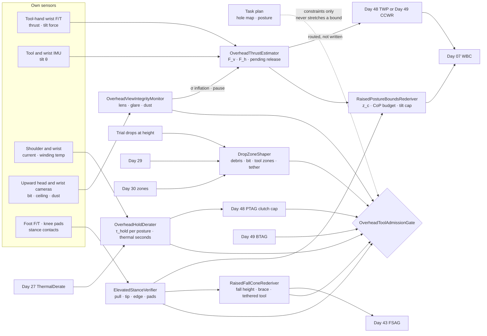
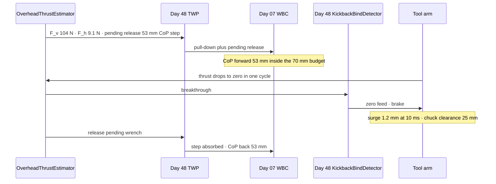
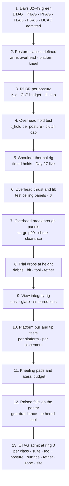

# Day 50 — Overhead and awkward-posture tool work under the bimanual and power-tool stacks: OverheadThrustEstimator / RaisedPostureBoundsRederiver / OverheadHoldDerater / DropZoneShaper / OverheadViewIntegrityMonitor / ElevatedStanceVerifier / RaisedFallConeRederiver / OverheadToolAdmissionGate under BimanualToolAdmissionGate + PowerToolAdmissionGate + PushPullAdmissionGate + PayloadCarryAdmissionGate + OutdoorGroundAdmissionGate + TerrainLocomotionAdmissionGate + FallSafeAdmissionGate + DeliberateContactAdmissionGate + WholeBodyTouchAdmissionGate + HumanHandoverAdmissionGate + CooperativeTaskAdmissionGate + TaskCompositionAdmissionGate + FleetSkillCatalogAdmissionGate + proximity + zone attestation + supervisor + logging + canary + HIL + fleet + incident + change-management + maintenance + thermal + energy gates

![OverheadThrustEstimator / RaisedPostureBoundsRederiver / OverheadHoldDerater / DropZoneShaper / OverheadViewIntegrityMonitor / ElevatedStanceVerifier / RaisedFallConeRederiver / OverheadToolAdmissionGate: a 62 kg humanoid stands on a 0.35 m step platform with a guardrail and drills a pilot hole into a ceiling at 2.4 m; the upward thrust of 80 ± 8 N comes back down through the robot as a pull-down that adds normal force at the feet, while a 5° tool tilt gives a 9 N sideways force on a 1.95 m lever, so the measured CoP shift is about 53 mm and almost half of it comes from the tilt; the shoulder holding the drill overhead runs at 38 N·m against a 30 N·m continuous rating, which gives about 290 s before its thermal limit; the wrist hold measured overhead is 7.5 N·m, not the 10 N·m measured at chest height, so the drill's clutch is set lower; a 1.4 m drop zone below the work is cleared and attested before the feed starts, because a dropped 1.8 kg drill takes 0.68 s to fall and carries about 41 J; the tool is tethered to the platform rail, not to the robot; the upward-looking camera is watched for dust and glare; and the fall cone on the platform is re-derived with a 1.36 m CoM height and the guardrail as the brace contact](/images/day50-overhead-awkward-posture-tool-work.png)

[Day 05](/lessons/day-05-power-bms) owns `torque_scale` **forever**. [Day 06](/lessons/day-06-estimation-balance) owns the floating-base estimate. [Day 07](/lessons/day-07-wbc-balance) owns whole-body balance, the CoM, and the CoP. [Day 10](/lessons/day-10-upper-body-manipulation) owns arm control on the shared ceilings. [Day 17](/lessons/day-17-runtime-safety-supervisor) owns ESTOP and the kill chain. [Day 27](/lessons/day-27-thermal-budgets-duty-cycle) owns thermal derates. [Day 29](/lessons/day-29-human-proximity-safety) owns person tracks, SSM, and PFL rows. [Day 30](/lessons/day-30-collaborative-workspace-zoning) owns attested zones and `CrossSiteZoneConfigGate`. [Day 42](/lessons/day-42-deliberate-whole-body-contact) owns planned contacts and their bands. [Day 43](/lessons/day-43-falls-fall-safe-contact) owns falls, the fall cone, and FSAG. [Day 44](/lessons/day-44-stairs-ramps-uneven-terrain) owns terrain, footholds, and step-up rules. [Day 46](/lessons/day-46-carrying-payloads-walking) owns held payloads and release. [Day 47](/lessons/day-47-pushing-pulling-heavy-objects) owns sustained external wrenches. [Day 48](/lessons/day-48-powered-hand-tools-process-forces) owns the tool and PTAG. [Day 49](/lessons/day-49-bimanual-tool-held-workpiece) owns the held workpiece, the closed chain, and BTAG.

Days 48 and 49 put the tool in front of the robot, at chest height, with both feet on the floor. A lot of real work isn't there. Anchors go into ceilings, light fittings go up on brackets, cable trays get drilled above head height, and pipes under a sink get cut by someone kneeling on the floor. Each of those postures changes three things at once: where the tool's reaction goes, what the arm can hold, and what happens to everything below the work if something lets go.

Eight lies show up the first time a team asks a humanoid to work over its head:

1. **Ceiling-is-a-wall lie.** "It's Day 48 rotated 90°." Upward thrust comes back through the feet as extra normal force, but any tilt puts a sideways force on a lever that's two metres long, and that sideways part is what moves the CoP.
2. **Pull-down-is-free lie.** The ceiling pushes the robot down, which only presses the feet harder into the floor, so it's stabilizing. True until breakthrough, when all of it leaves in one cycle and the arm surges up toward the ceiling.
3. **Same-wrist lie.** The wrist hold measured at chest height is the hold overhead. Overhead, the forearm sits near its pronation limit and the drill's reaction torque acts in a different plane. The number is different, so it gets measured again.
4. **Arms-up-is-free lie.** Raising the arms is just kinematics. It raises the CoM by about 9 cm, and holding a drill overhead runs the shoulder above its continuous rating. The shoulder has a measured time limit.
5. **Nothing-below lie.** The space under the work is empty. It holds the robot's own head and cameras, and anyone who walks in. A dropped drill reaches the floor in 0.68 s, faster than SSM can respond.
6. **Clear-view lie.** The cameras see the bit as well looking up as looking forward. Looking up, they get dust falling onto the lens and ceiling lights in the frame.
7. **Platform-is-floor lie.** A step platform is ground. It's a Day 42 contact with edges, a tipping moment, and a breakaway force, and a step onto it is a Day 44 step.
8. **Throw-it-clear lie.** In a fall, throw the tool clear, as Day 49 does. From a platform, a thrown tool lands outside every measured zone. Overhead, the tool hangs on a tether anchored to the platform.

Today owns **`OverheadThrustEstimator` / `RaisedPostureBoundsRederiver` / `OverheadHoldDerater` / `DropZoneShaper` / `OverheadViewIntegrityMonitor` / `ElevatedStanceVerifier` / `RaisedFallConeRederiver` / `OverheadToolAdmissionGate`**. The question is: **how do you let a humanoid run a tool above its shoulders, from a step platform, or kneeling, with the overhead thrust and its tilt MEASURED from the robot's own wrist F/T and IMU with σ and routed to Day 07 as a pull-down with its pending release; re-derive the CoM, CoP, and capture bounds for the raised posture; re-measure the wrist hold and budget the shoulder's heat in that posture; clear and attest the drop zone below the work before the feed starts; watch the upward view for dust and glare; treat platforms and kneeling as Day 42 contacts under Day 44 step rules; and re-derive the Day 43 fall cone with a tool in hand and a raised CoM — without raising Day 29 PFL, writing Day 05 `torque_scale`, gating Day 17 ESTOP, or bypassing `CrossSiteZoneConfigGate`?**

## Overhead, every force has a longer lever and every drop has a longer fall

The rule everything follows from: **the overhead posture is a different machine from the chest-height one, and the robot gets its numbers for it by measuring in that posture: thrust and tilt from the tool wrist, hold torque from a posture-specific hold test, shoulder heat from Day 27, stance from the platform's own pull and tip tests, drop spread from trial drops at that height. No number measured at chest height, on the floor, or on a different platform may be reused overhead without being measured again.** A plan may add constraints (a tether, a dust shroud, a guardrail brace). It may never stretch a bound measured somewhere else.

Three facts set the shape of the lesson.

**Overhead thrust splits into a part the feet like and a part they don't.** For a vertical thrust $F_v$ at horizontal offset $x_h$ from the ankle, a tilt $\theta$ that gives a sideways force $F_h = F_v \tan\theta$ at height $h$ above the stance surface, and robot weight $W = M g$:

$$
\Delta x_{\text{CoP}} = \frac{F_v\, x_h + F_h\, h}{W + F_v}
$$

With $W = 63.8 \cdot 9.81 \approx 626$ N (robot plus drill), $F_v = 80 + 3(8) = 104$ N, $x_h = 0.20$ m, $h = 1.95$ m, and a 5° measured tilt, $F_h \approx 9.1$ N and $\Delta x \approx (20.8 + 17.7)/730 \approx 53$ mm. Almost half of that comes from 5° of tilt. At 10°, $\Delta x \approx 77$ mm. Overhead, **the tilt cap is a balance limit**, not a hole-quality setting.

**The drop is faster than any reaction.** Something dropped from height $h$ lands in $t = \sqrt{2h/g}$, carrying $E = m g h$. A 1.8 kg drill from 2.3 m reaches the floor in 0.68 s carrying about 41 J. A Day 29 person track can't turn that into a stop, because the drill is already falling. So the zone below the work is cleared and attested **before** the feed starts, and the tool is tethered.

**The robot stands inside its own drop zone.** Its head is under its hands. Whatever falls, debris, a bit, or the drill, falls toward its cameras first.

| Layer | Owns | Must not own |
|-------|------|--------------|
| `OverheadThrustEstimator` | Overhead thrust, tilt, and the vertical/horizontal split with σ from the tool wrist F/T and IMU; pending release at breakthrough; chuck-to-ceiling clearance | Writing Day 07 directly (it feeds Day 48 TWP or Day 49 CCWR) |
| `RaisedPostureBoundsRederiver` | CoM height, CoP budget, capture bound, and tilt cap for the raised posture and the stance surface in use | Reusing standing-on-the-floor bounds overhead |
| `OverheadHoldDerater` | Wrist hold measured per posture, tool torque cap at half of it, and the shoulder's thermal time budget from Day 27 | Raising any joint limit, or Day 05 `torque_scale` |
| `DropZoneShaper` | Drop zones for debris, bits, and the tool from trial drops at height; tether requirement; Day 29 and Day 30 clearance before the feed | Shrinking a zone because nobody is nearby right now |
| `OverheadViewIntegrityMonitor` | Lens contamination, glare, and dust density on the upward views; σ inflation; pause on lost view | Letting the plan's hole position stand in for a seen bit |
| `ElevatedStanceVerifier` | Platforms, ladders, and kneeling as Day 42 contacts: pull tests, tip tests, edge distances, knee-pad bands; Day 44 step rules | Treating a platform top as floor |
| `RaisedFallConeRederiver` | Fall height, impact energy, brace contacts, and the tool's tethered release for raised postures, into Day 43 | Throwing a tool clear from height |
| `OverheadToolAdmissionGate` | Fail-closed admit per robot class, suite, tool, posture class, stance surface, tether, drop zone, site | `JointCommand`; Day 05; PFL; Day 17 |
| Days 05 / 07 / 17 / 27 / 29 / 30 / 42 / 43 / 44 / 48 / 49 | Torque, balance, ESTOP, heat, PFL, zones, bands, falls, terrain, tools, closed chain | Being outranked by "it's only one hole in the ceiling" |

**Core thesis:** **a humanoid works overhead only on numbers it measured overhead: it caps the tilt because tilt is what moves its CoP, budgets the shoulder in seconds, holds the tool to half the hold it measured in that posture, clears the space below before it starts because nothing falls slowly enough to dodge, stands only on platforms it has pull-tested and tip-tested, and falls toward a brace with its tool hanging on a tether.**



## Physical machine: what working overhead does to a humanoid

### Raising the arms moves the CoM up

The example robot hangs its arms at its sides with the CoM at 0.92 m. Each arm is 3.5 kg, with its CoM moving from about 1.15 m to about 1.70 m when it goes overhead. The 1.8 kg drill moves from hip height to about 2.05 m. The CoM shift is

$$
\Delta z_c = \frac{2 \cdot 3.5 \cdot 0.55 + 1.8 \cdot 1.15}{63.8} \approx 0.093\ \text{m}
$$

so $z_c$ goes from 0.92 to about 1.01 m above the stance surface. The pendulum constant $\omega = \sqrt{g/z_c}$ drops from 3.27 to 3.12 s⁻¹, and the capture-point offset $v/\omega$ for the same velocity grows by about 5%. That's small on its own. It matters because it stacks with everything else in this lesson, and because the fall height adds the platform's height on top of it.

### The pull-down, and the step when it leaves

Drilling up into a timber ceiling joist with a 6 mm pilot bit, this robot measured 80 ± 8 N of thrust on its own wrist F/T. Every newton the hand pushes up on the ceiling, the ceiling pushes back down through the arm, torso, and legs. The feet see $W + F_v$. More normal force means a little more friction margin, and that's the part of the pull-down-is-free lie that's true.

The part that's false: the CoP moves forward by the $F_v x_h$ term and the tilt term, and at breakthrough both come back in one cycle. The 104 N upper bound times 0.20 m is 20.8 N·m, or 28 mm of the shift. The 5° tilt adds about 24 mm more. When the bit goes through, the whole 53 mm steps back at once. `OverheadThrustEstimator` publishes that step as the pending release, exactly as Day 49's internal force did, so Day 07 has the reaction planned before the feed ramps.

The arm surges at breakthrough, too. With 5.8 kg effective mass along the thrust axis (arm plus drill), the 104 N becomes about 18 m/s² of upward acceleration. Using Day 48's plunge expression with a 50 m/s² brake:

$$
x_{\text{surge}} = \tfrac{1}{2} a\, t_d^2 + \frac{(a\, t_d)^2}{2\, a_b}
$$

At $t_d = 10$ ms that's about 1.2 mm. At 40 ms it's about 19 mm. Overhead, the surge goes toward the ceiling, and the chuck hits it if the bit's exposed length beyond the planned depth is less than the surge. `OverheadThrustEstimator` checks **chuck-to-ceiling clearance ≥ measured surge p99 + 10 mm** and refuses holes where the depth stop doesn't leave it.

### The tilt has a two-metre lever

The table shows the same 104 N of thrust at different measured tilts, with the robot on a 0.35 m platform and the bit 1.95 m above the platform top:

| Measured tilt θ | $F_h$ | $F_h h$ | $\Delta x_{\text{CoP}}$ | Within 70 mm budget? |
|------|------|------|------|------|
| 0° | 0 N | 0 N·m | 28 mm | Yes |
| 3° | 5.5 N | 10.6 N·m | 43 mm | Yes |
| 5° | 9.1 N | 17.7 N·m | 53 mm | Yes |
| 8° | 14.6 N | 28.5 N·m | 67 mm | Marginal |
| 10° | 18.3 N | 35.7 N·m | 77 mm | No |

At chest height in Day 48, the same 5° added a few millimetres. Overhead, it costs almost as much as the thrust. `RaisedPostureBoundsRederiver` turns the CoP budget into a tilt cap, and the cap uses the **measured** tilt from the tool IMU and wrist F/T with its 3σ, not the commanded tool orientation.

### The wrist and the shoulder are different joints overhead

Day 48's rule was: tool torque at most half the wrist's hold. The hold is a property of the posture, not of the wrist. At chest height, this robot's tool wrist held 10 N·m against a bind torque about the drill axis. Overhead, the drill axis is vertical, the reaction torque turns the forearm about its own long axis, and the forearm is near its pronation limit, with less travel to absorb a kickback before the joint hits its stop. A posture-specific hold test measured **7.5 N·m**. The clutch cap goes from 5.0 to 3.75 N·m. A drill admitted at chest height with a 4.5 N·m clutch setting is refused overhead until the clutch is set lower.

The shoulder is a heat problem. Holding the drill overhead while pushing 80 N, the shoulder flexion joint measured 38 N·m of sustained torque against a 30 N·m continuous rating. With a thermal time constant of 300 s and the winding starting at ambient, the time to the limit is

$$
t_{\text{lim}} = \tau_{\text{th}} \ln\!\frac{r^2}{r^2 - 1}, \qquad r = \frac{38}{30} = 1.27 \;\Rightarrow\; t_{\text{lim}} \approx 300 \cdot 0.98 \approx 290\ \text{s}
$$

That's about 14 twenty-second holes, from cold. From a warm start the budget is shorter, which is why `OverheadHoldDerater` reads Day 27's live winding estimate and not the formula's ambient assumption. The budget spends seconds per hole and refunds them during measured rest with the arm lowered. When it reaches the reserve, the feed stops at the next safe point and the arm comes down. Day 27 derates the joint the way it always has, and the derate shrinks $\tau_{\text{hold}}$, which lowers the clutch cap, which may refuse the next hole.

### Nothing falls slowly

| What falls (measured in trial drops at 2.3 m) | Mass | Energy at floor | Fall time | p99 landing spread |
|------|------|------|------|------|
| Drill, from an opened hand | 1.8 kg | 41 J | 0.68 s | 0.6 m (bounces) |
| Drill bit, snapped | 0.03 kg | 0.7 J | 0.68 s | 0.5 m |
| Timber debris and dust | small | small | longer | 0.9 m, drifts with airflow |
| Drill on a 0.8 m tether anchored on the rail | 1.8 kg | arrested | n/a | swing radius 0.8 m around the anchor |

41 J on a head is far beyond anything a Day 29 PFL row would sign. Nothing in the reaction chain helps once a drill is falling. `DropZoneShaper` makes the zone a precondition: debris zone radius = trial p99 + 0.5 m margin (1.4 m here), cleared by Day 29 and attested by Day 30 before the feed starts. A person entering that zone stops the feed. That doesn't catch anything already falling. It removes the next reason for something to fall while someone is underneath.

The tether is mandatory overhead, and its anchor matters. A tether clipped to the robot's own wrist turns a dropped drill into a pendulum hanging off the arm, and a falling robot takes the drill down with it. A tether anchored to the platform's guardrail keeps the tool's swing inside a measured radius around a fixed point that doesn't fall with the robot.

### The view looking up

Looking up changes what the cameras see. Dust falls onto the lens. Ceiling lights put glare in the frame. The bit's position against a plain white ceiling has less texture to track. `OverheadViewIntegrityMonitor` measures:

- **Lens contamination** from the contrast and sharpness of a fixed reference region on the robot's own wrist in the head camera's view.
- **Glare** from the fraction of saturated pixels near the bit.
- **Dust density** from frame-to-frame particle detections in the volume between the bit and the lens.

Any of these inflates σ on the bit's tracked pose. When the 3σ relative pose error exceeds the tilt-cap margin or the hole-position tolerance, the feed pauses. A dust shroud with extraction is the plan-side constraint that keeps the view usable. The plan may add it. It can't stand in for measuring the view.

### Platforms, ladders, and kneeling are contacts with edges

The ceiling is at 2.4 m, and standing on the floor the robot reaches about 2.05 m with the drill. It needs a step platform. The example platform is 0.35 m high, 0.45 × 0.60 m on top, 8 kg, with a guardrail on three sides.

**Tipping.** The sideways force acts 1.95 + 0.35 = 2.30 m above the floor, so 9.1 N tries to tip the platform with 20.9 N·m. What resists is the total weight on the platform, 626 + 78 + 104 ≈ 808 N, times the distance from the CoP to the platform's tipping edge. At 0.05 m that's 40 N·m, under 2× margin. At 0.10 m it's 81 N·m. `ElevatedStanceVerifier` requires **restoring ≥ 2× tipping** at the measured CoP, and tests each platform's tip edges with a measured pull at height before admitting it. A platform's spec sheet gives a load rating, not a tip edge for this robot's thrust.

**Sliding.** The platform is a Day 47 object on the floor. Its breakaway is measured, and $F_h$ has to stay under half of it.

**Stepping.** Getting onto the platform is a Day 44 step-up onto a measured tread, and getting off is a step-down. Neither happens with a running tool or an arm overhead: the tool goes OFF_SAFE and holstered, the arms come down, and Day 44 runs its normal step.

**Kneeling** for work under a sink or along a skirting board is the other awkward posture. The support polygon is knees plus toes: long front to back, narrow side to side. The CoM drops to about 0.55 m, which makes balance easier and fall energy lower. But a kneeling robot can't take a capture step. Knee pads are Day 42 planned contacts with measured stiffness bands, and their pressure is read from the pad sensors, not assumed from the posture. Kneeling work is admitted only with a lateral force budget that fits inside the narrow side-to-side polygon, measured the same way the tilt table above was.

### Falling from a platform

On the platform, the CoM is 1.01 + 0.35 = 1.36 m above the floor. That's 35% more potential energy than standing on the floor, and Day 43's `ImpactEnergyGovernor` needs a new budget for it. Two Day 43 assumptions fail overhead:

- **The arms aren't free.** Bringing the arms down from overhead to a bracing position takes about 0.6 s on this robot, longer than most of a fall. A brace has to be a contact that's already there or one step away. On the platform, that's the guardrail, held by the free hand as a Day 42 planned contact with a tested band.
- **Throw-clear doesn't apply.** Day 49 threw the tool clear of the fall cone. From 2 m, a thrown drill lands outside any measured zone. Overhead, the tool is cut, the hand opens, and the tool hangs on its rail-anchored tether, whose swing radius `RaisedFallConeRederiver` keeps out of the fall cone.

## OverheadThrustEstimator: thrust and tilt are measured in the posture

`OverheadThrustEstimator` (OTE) extends Day 48's `ToolReactionEstimator` for raised postures:

- **Vertical and horizontal thrust** from the tool wrist F/T, resolved into the world frame with Day 06's estimate, with σ.
- **Tilt** from the tool's IMU and the wrist kinematics, cross-checked; disagreement beyond 2° inflates σ to the larger value.
- **Pending release**: the CoP step and the arm surge Day 07 must absorb at breakthrough, published before the feed ramps.
- **Chuck-to-ceiling clearance** against the measured surge p99.

OTE doesn't write Day 07. In single-tool modes it feeds Day 48's `ToolWrenchPublisher`. In bimanual modes it feeds Day 49's `ClosedChainWrenchResolver`, which stays the only writer.

## RaisedPostureBoundsRederiver: the floor's bounds don't go up the ladder

`RaisedPostureBoundsRederiver` (RPBR) re-derives Day 07's bounds for the posture and stance surface in use: $z_c$ from the measured arm and tool configuration, the CoP budget from the measured stance polygon (feet on a platform top, or knees and toes), the capture bound with no capture step on a platform or kneeling, and the **tilt cap** from the CoP budget. It publishes them per posture class, and a posture change means new bounds before the next feed ramps.

## OverheadHoldDerater: the hold and the heat belong to the posture

`OverheadHoldDerater` (OHD) keeps a table of measured hold torque per posture class and tool axis. It sets Day 48's tool torque cap to half of that hold, re-read every cycle with Day 27's derate applied. It also keeps the shoulder's thermal time budget in seconds, from Day 27's live winding estimate. It never touches a joint limit or Day 05 `torque_scale`. When the budget runs out, the arm comes down. It doesn't push on with less margin.

## DropZoneShaper: clear the space below first

`DropZoneShaper` (DZS) builds three zones below the work from trial drops at the working height: debris, bit, and tool. It requires a tether rated for the tool's measured drop energy, anchored on a fixed structure, with its swing radius measured. It asks Day 29 for an empty zone and Day 30 for an attested one before the feed starts, and it keeps the robot's own head offset at least 0.15 m from the bit's plumb line, so debris falls past the lens and not into it.

## OverheadViewIntegrityMonitor: a dusty view is a measurement too

`OverheadViewIntegrityMonitor` (OVIM) scores the upward views for lens contamination, glare, and dust, inflates σ on everything tracked through them, and pauses the feed when the bit's relative pose can't be held inside the tilt and position margins. A paused view clears only when the measured score recovers, after a lens wipe or after the dust settles. A timer doesn't clear it.

## ElevatedStanceVerifier: a platform is a test result

`ElevatedStanceVerifier` (ESV) admits each stance surface as a Day 42 contact: platforms by pull test and tip test at the working height, edge distance from the measured CoP, and Day 47 breakaway. Kneeling by knee-pad bands and a lateral force budget. Any change to the platform, its placement, or the floor under it invalidates the test.

## RaisedFallConeRederiver: falling from higher, with a tool

`RaisedFallConeRederiver` (RFCR) hands Day 43 the fall height above the landing surface, the brace contacts that are actually available (guardrail, wall, platform), the time the arms need to reach them, and the tethered tool's swing radius. FSAG stays the owner. RFCR only supplies the measured inputs that change when the robot is raised.



## OverheadToolAdmissionGate

`OverheadToolAdmissionGate` (OTAG) admits overhead and awkward-posture modes per robot class, sensor suite hash, tool unit and accessory, posture class, stance surface, tether and anchor, drop zone, and site, under Day 49 BTAG, Day 48 PTAG, Day 47 PPAG, Day 44 TLAG, Day 43 FSAG, and Day 42 DCAG. It fails closed if any of these is missing:

- OTE thrust and tilt characterized in the posture, with breakthrough surge p99 measured on overhead breakthrough panels.
- RPBR bounds and the tilt cap derived for this posture and stance surface.
- OHD hold test in the posture, and a shoulder thermal budget proven on a timed hold rig with Day 27 live.
- DZS trial drops at this height for debris, bit, and tool; tether drop-tested; zone attested by Day 30.
- OVIM scoring proven against deliberate dust, glare, and smeared lenses.
- ESV pull and tip tests for this platform in this placement, or knee-pad bands for kneeling.
- RFCR inputs accepted by FSAG, with the brace contact tested and the tether swing outside the fall cone.

OTAG never writes `JointCommand`, never touches Day 05 `torque_scale`, never raises a Day 29 row, never lets a plan's tilt or hole position stand in for a measured one, never shrinks a drop zone because the room is empty right now, and never gates ESTOP. Day 17's ESTOP cuts tool power through Day 48's adapter relay. The tool stays on its tether, and the robot freezes holding the guardrail.

## Data shapes

```text
OverheadThrust:                               # OTE
  f_vertical_n, sigma
  f_horizontal_n, sigma
  tilt_deg, sigma               # IMU and kinematics; disagreement inflates
  lever_height_m                # bit above stance surface
  pending_release:
    cop_step_m
    surge_p99_mm
  chuck_clearance_mm
  writes_day07: false           # routed via Day 48 TWP or Day 49 CCWR

RaisedPostureBounds:                          # RPBR
  posture_class                 # STAND_FLOOR | STAND_PLATFORM | ARMS_OVERHEAD | KNEEL
  z_c_m, sigma
  cop_budget_m[2]
  capture_step_available
  tilt_cap_deg                  # from CoP budget, measured tilt + 3σ

OverheadHold:                                 # OHD
  posture_class, tool_axis
  tau_hold_nm                   # posture-specific hold test, derate applied
  tool_torque_cap_nm            # tau_hold / 2
  shoulder_thermal_budget_s
  reserve_s
  verdict                       # OK | ARM_DOWN | REFUSED

DropZone:                                     # DZS
  height_m
  zones: [debris, bit, tool]
  radius_p99_m[3], margin_m
  tether_id, anchor_id, swing_radius_m
  day29_empty, day30_zone_id
  head_offset_from_plumb_m

ViewIntegrity:                                # OVIM
  lens_score, glare_fraction, dust_density
  sigma_inflation
  verdict                       # CLEAR | DEGRADED | PAUSED

ElevatedStance:                               # ESV
  surface_id, day42_contact_id
  pull_test_n, tip_test_n_at_m
  edge_distance_m, restoring_ratio
  breakaway_n
  knee_pad_bands                # kneel only
  verdict                       # TESTED | FAILED | INVALIDATED

RaisedFallCone:                               # RFCR
  fall_height_m
  impact_energy_j
  brace_contacts[], arm_time_to_brace_s
  tool_release: TETHER_HANG
  tether_swing_outside_cone

OverheadToolAdmission:                        # OTAG
  robot_class, sensor_suite_hash
  tool_unit, accessory_id
  posture_class, stance_surface, tether_anchor, drop_zone, site
  modes_admitted[]              # DRILL_CEILING_PILOT | DRIVE_OVERHEAD_BRACKET
                                # DRILL_ABOVE_SHOULDER | CUT_KNEELING_CLAMPED
  forbid:
    chest_height_numbers_overhead: true
    commanded_tilt_as_measured: true
    unpublished_pull_down: true
    shoulder_past_thermal_budget: true
    untethered_overhead_tool: true
    tether_on_robot: true
    feed_before_zone_cleared: true
    platform_as_floor: true
    step_with_running_tool: true
    throw_clear_from_height: true
    dual_write_day07: true
    raise_pfl: true
    write_torque_scale: true
    gate_estop: true
    bypass_cross_site_zone_config_gate: true

# Unchanged owners
BimanualToolAdmissionGate · CCWR (Day 49)
PowerToolAdmissionGate · TRE · KBD · TWP · TSSA (Day 48)
PushPullAdmissionGate (Day 47) · PayloadCarryAdmissionGate (Day 46)
TerrainLocomotionAdmissionGate (Day 44) · FSAG · ImpactEnergyGovernor (Day 43)
planned-contact bands (Day 42) · CrossSiteZoneConfigGate · zones (Day 30)
tracks · SSM · PFL (Day 29) · ThermalDerate (Day 27) · SupervisorState ESTOP (Day 17)
WBC CoM/CoP (Day 07) · EstimatorState (Day 06)
BmsState / PowerState (Day 05): torque_scale
  accepts_requests_from_overhead: false
```

## Config

A starting configuration. Every number is a policy you re-derive from your own robot, tools, platforms, and sites:

```yaml
overhead_tool:
  thrust:
    sigma_k: 3
    tilt_sources: [tool_imu, wrist_kinematics]
    tilt_disagree_deg: 2.0
    publish_pending_release: true
    chuck_clearance: surge_p99_plus_10mm
    writes_day07: false
  bounds:
    rederive_per: [posture_class, stance_surface]
    tilt_cap_from: cop_budget_with_measured_tilt_plus_3_sigma
    capture_step_on_platform: false
  hold:
    tau_hold_from: posture_specific_hold_test
    tool_torque_cap: half_tau_hold_live
    shoulder_budget_from: day27_live_winding
    reserve_s: 30
    on_budget_exhausted: arm_down_at_next_safe_point
  drop_zone:
    from: trial_drops_at_working_height
    margin_m: 0.5
    tether_required: true
    tether_anchor: fixed_structure_not_robot
    cleared_by: [day29, day30]
    clear_before: feed_start
    entry_action: stop_feed
    head_offset_from_plumb_m: 0.15
  view:
    metrics: [lens_contrast, glare_fraction, dust_density]
    pause_when: rel_pose_3sigma_exceeds_margin
    clear_when: measured_score_recovers
    dust_shroud: plan_constraint_only
  stance:
    platform_tests: [pull, tip_at_height, day47_breakaway]
    restoring_ratio_min: 2.0
    step_requires: [tool_off_safe, tool_holstered, arms_down]
    kneel: [knee_pad_bands, lateral_force_budget]
    any_change_invalidates: true
  fall:
    fall_height_from: stance_surface_plus_z_c
    brace: tested_contact_within_reach
    tool_release: tether_hang
    throw_clear_from_height: forbidden
  admission:
    keyed_by: [robot_class, sensor_suite_hash, tool_unit, accessory_id, posture_class, stance_surface, tether_anchor, drop_zone, site]
    requires: [day49_btag, day48_ptag, day47_ppag, day44_tlag, day43_fsag_raised, day42_dcag]
```

## Physical ↔ digital pairing

| Physical | Digital twin / backing |
|----------|------------------------|
| Robot steps onto a 0.35 m platform with the drill holstered | Day 44 step-up; ESV tip test: restoring 3.9× at a 0.10 m edge distance → TESTED |
| Arms go overhead with the drill | RPBR: z_c 0.92 → 1.01 m; no capture step; CoP budget 70 mm; tilt cap 8.5° on tilt + 3σ |
| Drill tilts 4° on a sloped joist face | OTE measures 4.3 ± 0.6°, so 6.1° with 3σ; CoP 50 mm; admitted |
| Same hole at a measured 9° | Tilt plus 3σ over the cap → refused; plan re-poses the wrist |
| Clutch left at the chest-height setting of 4.5 N·m | OHD overhead hold 7.5 N·m, cap 3.75 N·m → PTAG refuses until reset |
| Ninth hole on a warm shoulder | OHD budget at reserve → arm down after this hole; 120 s rest refunded |
| Bit breaks through | Feed zeroed in 10 ms; surge 1.1 mm; CoP steps back 50 mm as published |
| A person walks toward the area under the work | Day 29 track enters the 1.4 m zone → feed stops; drill stays on its tether |
| Dust settles on the head camera | OVIM lens score falls; σ inflates; feed pauses; wipe; score recovers |
| Robot kneels to cut a pipe under a sink | ESV knee-pad bands TESTED; lateral budget 25 N; pipe clamped per Day 49 |
| Foot slips on the platform top | Day 43 commit; tool cut; hand opens; drill hangs on its rail tether; free hand already on the guardrail |

The pairing that matters most: **replay every overhead run from the robot's own bag and show that every number used overhead was measured overhead; that the measured tilt plus its 3σ stayed under the cap; that every pull-down was published with its pending release before the feed ramped; that the shoulder never ran past its thermal budget; that the drop zone was empty and attested before every feed started; that the tool was tethered to something that couldn't fall with the robot; and that the robot never stepped on or off with a running tool.** If the run only looks safe with chest-height numbers, it was never measured overhead.

## Bring-up sequence (before the robot drills a ceiling)



1. **Days 02–49 green,** with BTAG, PTAG, PPAG, TLAG, FSAG, and DCAG admitted.
2. **Posture classes** defined and measured: arms overhead on the floor, on a platform, above-shoulder reach, and kneeling.
3. **RPBR per posture:** CoM from measured joint configurations with the tool, CoP budget from the measured polygon, tilt cap from the budget.
4. **Overhead hold test** per posture and tool axis on Day 48's bind rig, mounted overhead. This sets the clutch cap.
5. **Shoulder thermal rig:** timed overhead holds at measured thrust, with Day 27 live, from cold and from warm.
6. **Overhead thrust and tilt** on test ceiling panels of each material, with σ, and IMU against kinematics.
7. **Overhead breakthrough panels:** surge p99 at the detection time you actually achieve, and chuck clearance.
8. **Trial drops at working height** for debris, bits, and the tool, plus tether drop tests.
9. **View integrity rig:** deliberate dust, glare sources, and smeared lenses. OVIM must pause before the tracked pose error leaves its margin.
10. **Platform pull and tip tests** for every platform at every placement, plus Day 47 breakaway.
11. **Kneeling:** knee-pad bands and the lateral force budget.
12. **Raised falls on the gantry:** slip on the platform top, brace on the guardrail, tool hangs on its tether outside the cone.
13. **OTAG admit at ring 0** per robot class, suite, tool, posture class, stance surface, tether, drop zone, and site.

## Failure gallery

| Symptom | Likely cause |
|---------|--------------|
| Robot rocks forward on every ceiling hole | Tilt from the commanded orientation; measured tilt over the cap |
| Robot lurches backward when the bit breaks through | Pull-down published without its pending release |
| Chuck slams into the ceiling at breakthrough | Depth stop set without the measured surge p99 |
| Drill twists out of the wrist on a bind overhead | Clutch cap from the chest-height hold |
| Shoulder trips its thermal derate halfway through a row of holes | Budget from ambient, not Day 27's live winding |
| Bit fragment hits a worker sweeping underneath | Zone cleared once at the start; entry didn't stop the feed |
| Dropped drill swings into the robot's own head | Tether clipped to the robot's wrist, not the rail |
| Hole drifts 20 mm off the mark | Lens dust; OVIM not inflating σ, plan position trusted |
| Platform tips sideways under a tilted hole | No tip test; CoP too close to the edge |
| Robot steps off the platform with the drill still spinning down | Step admitted before TSSA OFF_SAFE and holster |
| Thrown drill lands outside the zone during a fall drill | Day 49's throw-clear reused from height |

## Exercises

1. A robot plus tool weighs 640 N. Thrust is 90 ± 10 N at $x_h = 0.18$ m, with the bit 1.9 m above the stance surface. With a 65 mm CoP budget, what's the largest measured tilt (with a 3σ of 1.5°) OTAG admits?
2. Effective mass along the thrust axis is 6.2 kg. What surge do you get at 15 ms and at 35 ms detection with a 50 m/s² brake? What bit exposure beyond the depth stop does each one need?
3. A wrist holds 11 N·m at chest height and 8.0 N·m overhead, and Day 27 derates it by 15% mid-task. What's the clutch cap before and after the derate?
4. A shoulder runs at 34 N·m against a 28 N·m continuous rating with $\tau_{\text{th}} = 240$ s. How long until its thermal limit from cold? How many 25 s holes fit with a 30 s reserve?
5. A 2.2 kg driver drops from 2.6 m. Compute the fall time and energy. Trial drops give a 0.7 m p99; what zone radius does DZS publish with a 0.5 m margin?
6. A 0.40 m-wide platform carries 820 N total, and the sideways force is 12 N at 2.4 m above the floor. How far from the tipping edge must the CoP stay for a 2× restoring ratio?
7. Write the `OverheadToolAdmission` row for driving four screws into a ceiling bracket from a platform. Which tests must exist, and why is a tether on the robot's wrist refused?

## What to freeze this week

Extend [frames](/frames) and your safety config with:

- `OverheadThrustEstimator`: vertical and horizontal thrust and measured tilt with σ; pending release and surge published before the feed; chuck clearance ≥ surge p99 + 10 mm; routed through Day 48 TWP or Day 49 CCWR, never written to Day 07 directly.
- `RaisedPostureBoundsRederiver`: bounds per posture and stance surface; tilt cap from the CoP budget using measured tilt + 3σ; no capture step on a platform or kneeling.
- `OverheadHoldDerater`: hold measured per posture; clutch cap at half of it, re-read live; shoulder budget in seconds from Day 27; arm down when it's spent.
- `DropZoneShaper`: zones from trial drops at height; tether mandatory and anchored off the robot; Day 29 empty and Day 30 attested before the feed; entry stops the feed.
- `OverheadViewIntegrityMonitor`: lens, glare, and dust scored; σ inflated; pause until the score recovers.
- `ElevatedStanceVerifier`: platforms pull-tested and tip-tested at height with restoring ≥ 2×; steps only with the tool off and holstered; kneeling on tested pad bands.
- `RaisedFallConeRederiver`: fall height from the stance surface; brace contacts already in reach; tethered hang, never throw-clear from height.
- `OverheadToolAdmissionGate` fail-closed under Day 49 BTAG, Day 48 PTAG, Day 47 PPAG, Day 44 TLAG, Day 43 FSAG, and Day 42 DCAG; keyed by robot class, suite, tool, posture, stance surface, tether, drop zone, and site; **no chest-height number overhead, no feed before the zone is clear, no tether on the robot, no dual-write of Day 07, ESTOP, or `torque_scale`; a hot shoulder brings the arm down, it never raises a limit.**

The lesson isn't "teach the robot to reach the ceiling." It's that **working overhead changes the machine: the robot measures its numbers in that posture, caps tilt because tilt is what moves its CoP, budgets its shoulder in seconds, clears the space below before it starts because nothing falls slowly enough to dodge, trusts only the platforms it has tested, and falls toward a brace with its tool on a tether**, under ceilings that never move because the hole was overhead.

## Further reading

Look these up by title; they're the classic sources for today's posture, balance, and drop-zone arguments:

- S. Kajita et al., *Introduction to Humanoid Robotics*, Springer, 2014, chapters on ZMP and the linear inverted pendulum, for the CoP shift with raised CoM.
- J. Pratt et al., "Capture Point: A Step toward Humanoid Push Recovery," *IEEE-RAS Humanoids*, 2006.
- ANSI/ISEA 121, *Dropped Object Prevention Solutions*, for tool tethers, anchor points, and drop testing.
- ANSI A14 / EN 131 series, for ladder and step-platform stability and testing.
- NIOSH research on overhead drilling and shoulder load, for why sustained overhead work is a duty-cycle problem.
- IEC 62841 series, *Electric motor-operated hand-held tools*, for drill clutch and kickback tests.
- ISO 13855, for the separation logic carried over from Day 48.

## Next

**Day 51+** — Working on ladders and elevated work platforms under the overhead stack: three-point contact as a measured Day 42 contact set rather than a rule of thumb; ladder angle, foot slide, and top-rest contact measured by the robot's own sensors before climbing; climbing as a Day 44 gait with hands as load-bearing contacts and their grip measured as Day 46 holds; one-hand work on a ladder with the free hand's brace load budgeted; mobile elevating platforms as a moving stance surface whose motion is witnessed by the robot, not the platform's controller; the Day 43 fall cone re-derived with fall-arrest anchors — without raising Day 29 PFL, writing Day 05 `torque_scale`, or bypassing `CrossSiteZoneConfigGate`, under the same gates plus overhead tool admission.
