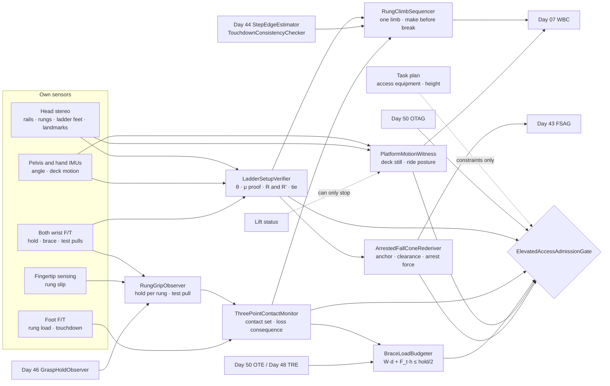
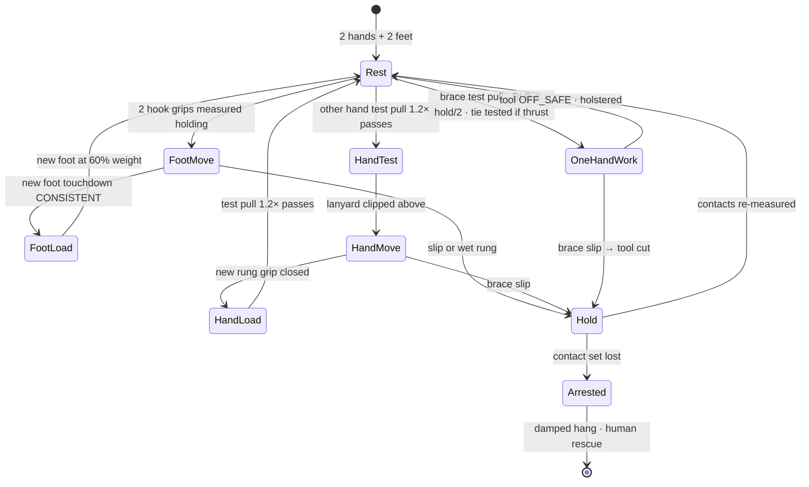
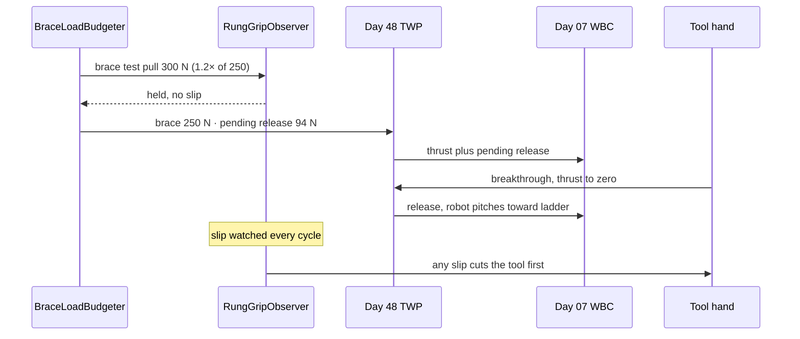
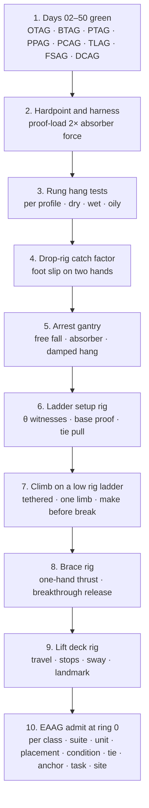

# Day 51 — Working on ladders and elevated work platforms under the overhead stack: LadderSetupVerifier / ThreePointContactMonitor / RungClimbSequencer / RungGripObserver / BraceLoadBudgeter / PlatformMotionWitness / ArrestedFallConeRederiver / ElevatedAccessAdmissionGate under OverheadToolAdmissionGate + BimanualToolAdmissionGate + PowerToolAdmissionGate + PushPullAdmissionGate + PayloadCarryAdmissionGate + OutdoorGroundAdmissionGate + TerrainLocomotionAdmissionGate + FallSafeAdmissionGate + DeliberateContactAdmissionGate + WholeBodyTouchAdmissionGate + HumanHandoverAdmissionGate + CooperativeTaskAdmissionGate + TaskCompositionAdmissionGate + FleetSkillCatalogAdmissionGate + proximity + zone attestation + supervisor + logging + canary + HIL + fleet + incident + change-management + maintenance + thermal + energy gates

![LadderSetupVerifier / ThreePointContactMonitor / RungClimbSequencer / RungGripObserver / BraceLoadBudgeter / PlatformMotionWitness / ArrestedFallConeRederiver / ElevatedAccessAdmissionGate: a 63.8 kg humanoid climbs a 4.0 m leaning ladder whose angle it measured at 75.5°, which needs a foot friction of only 0.113 while 65° would need 0.244, more than the 0.23 the site's floor proves at 3σ; pushing a drill into the wall at 78 N from the ladder takes the top-rest reaction from 84 N to 7 N, so tool thrust from a ladder needs a tie; the robot climbs one limb at a time, moving a foot only while both hands hold rungs, because two hands hold 1040 N against an 814 N foot-slip catch while wet rungs give only 780 N; the brace hand carries 250 N during one-hand work against a 260 N budget; on a scissor lift the robot rides with both hands on the guardrail because a 2.0 m/s² stop moves its CoP 188 mm; and a fall from the ladder is caught by a lanyard on an anchor above, with 0.11 m of deceleration at about 5.4 g and 2.5 m of clearance needed below the anchor, because a landed fall from the ladder would carry 3.8 times the energy of a fall from standing](/images/day51-ladders-elevated-work-platforms.png)

[Day 05](/lessons/day-05-power-bms) owns `torque_scale` **forever**. [Day 06](/lessons/day-06-estimation-balance) owns the floating-base estimate. [Day 07](/lessons/day-07-wbc-balance) owns whole-body balance, the CoM, and the CoP. [Day 17](/lessons/day-17-runtime-safety-supervisor) owns ESTOP and the kill chain. [Day 27](/lessons/day-27-thermal-budgets-duty-cycle) owns thermal derates. [Day 29](/lessons/day-29-human-proximity-safety) owns person tracks, SSM, and PFL rows. [Day 30](/lessons/day-30-collaborative-workspace-zoning) owns attested zones and `CrossSiteZoneConfigGate`. [Day 42](/lessons/day-42-deliberate-whole-body-contact) owns planned contacts and their bands. [Day 43](/lessons/day-43-falls-fall-safe-contact) owns falls, the fall cone, and FSAG. [Day 44](/lessons/day-44-stairs-ramps-uneven-terrain) owns terrain, footholds, step edges, and touchdown checks. [Day 46](/lessons/day-46-carrying-payloads-walking) owns grasp holds and release. [Day 47](/lessons/day-47-pushing-pulling-heavy-objects) owns sustained external wrenches and breakaway. [Day 48](/lessons/day-48-powered-hand-tools-process-forces) owns the tool and PTAG. [Day 50](/lessons/day-50-overhead-awkward-posture-tool-work) owns overhead postures, drop zones, tethers, and OTAG.

Day 50 put the robot on a 0.35 m step platform with a guardrail. That covers a ceiling at 2.4 m. Gutters, high shelving, light fittings in a warehouse, and a cable tray at 5 m don't come with a step platform. They come with a leaning ladder, a stepladder, a fixed ladder up the side of a tank, or a scissor lift. Each of these changes what the robot is standing on and what holds it there. On a ladder the hands carry load. On a lift the floor moves. On both, a fall is too high to land.

Eight lies show up the first time a team sends a humanoid up a ladder:

1. **Rule-of-thumb lie.** "Keep three points of contact." Counting limbs on rungs says nothing about whether those contacts can hold the robot. Three-point contact is a measured Day 42 contact set, with a band on every contact and a known answer to what happens when each one lets go.
2. **Set-it-at-75 lie.** The ladder was set up at the right angle because the label says 4:1 and someone set it up. The robot measures the angle, the foot friction, and the top rest itself, because 10° flatter more than doubles the friction the feet need.
3. **Rungs-are-stairs lie.** Climbing is Day 44 on a steeper stair. Rungs are 32 mm round bars, the hands carry load, and the CoM hangs behind the contact line, not above it.
4. **Grip-is-a-grip lie.** A hand on a rung holds what the hand's spec says. The hold is measured per rung profile and condition, and a wet rung holds 25% less.
5. **Free-hand lie.** In one-hand work, the hand that isn't holding the tool is idle. It's the brace, carrying 250 N, and it's the only thing stopping the robot from rotating backward off the rungs.
6. **Lift-says-stopped lie.** The lift's controller says the platform is stopped, so it is. The robot witnesses the deck's motion with its own IMU and cameras, and the lift's status can only stop the robot, never start it.
7. **Footing-buddy lie.** Someone can stand at the bottom and hold the ladder. A person at the foot is inside the drop zone and the fall cone. Ladders are secured mechanically.
8. **Land-it lie.** Day 43 picks a landing for any fall. From a ladder, CoM height is 3.5 m and the energy is 3.8× a fall from standing. That fall isn't a landing problem. It's an anchor problem.

Today owns **`LadderSetupVerifier` / `ThreePointContactMonitor` / `RungClimbSequencer` / `RungGripObserver` / `BraceLoadBudgeter` / `PlatformMotionWitness` / `ArrestedFallConeRederiver` / `ElevatedAccessAdmissionGate`**. The question is: **how do you let a humanoid climb a ladder, work from it with one hand, and ride and work on a mobile elevating work platform, with the ladder angle, foot friction, top rest, and tie MEASURED by the robot before it climbs; three-point contact kept as a measured Day 42 contact set; climbing run as a Day 44 gait whose hands are load-bearing Day 46 holds tested before each weight transfer; the brace hand's load budgeted against its measured hold; the platform's motion witnessed by the robot rather than reported by the lift; and the Day 43 fall cone re-derived around a fall-arrest anchor — without raising Day 29 PFL, writing Day 05 `torque_scale`, gating Day 17 ESTOP, or bypassing `CrossSiteZoneConfigGate`?**

## Above the platform, the hands hold the robot up and the floor stops being the floor

The rule everything follows from: **off a floor, every contact that holds the robot up is a measured contact with a band, tested at load before the robot trusts it with its weight, and every surface the robot stands on is measured for where it is and how it moves, by the robot, before and during use. The ladder's label, the lift's status, a setup crew's say-so, and a person holding the bottom are never inputs that admit anything.** A plan may add constraints (a tie, a stabilizer, a lanyard, a lower working height). It may never stand in for a measurement.

Three facts set the shape of the lesson.

**A leaning ladder is held by two forces the robot can't see directly.** With the robot's CoM at horizontal distance $x_r$ from the ladder feet, the ladder's own weight $w$ at $x_l$, ladder length $L$ at angle $\theta$, and a frictionless top rest, the top-rest reaction $R$ and the friction the feet need are

$$
R = \frac{W x_r + w\, x_l}{L \sin\theta}, \qquad \mu_{\text{req}} = \frac{R}{W + w}
$$

For this robot (626 N with a holstered drill) at a stance rung 2.7 m up a 4.0 m, 12 kg ladder, with its CoM 0.25 m behind the rung line, $\mu_{\text{req}}$ is 0.113 at 75.5° and 0.244 at 65°. Flatter needs more friction. Steeper leaves less top-rest reaction to lose.

**Pushing into the wall pulls the ladder off it.** A horizontal tool thrust $F_t$ at height $h_t$ pushes the robot, and the ladder it's holding, away from the wall:

$$
R' = R - \frac{F_t\, h_t}{L \sin\theta}
$$

At 75.5°, 78 N of thrust at 3.81 m takes the top rest from 84 N to 7 N. At 80° it goes negative and the ladder tips back. Tool thrust toward the wall from a ladder that isn't tied is refused.

**A ladder fall is too high to land.** With its stance rung 2.6 m above the floor, the CoM sits at 3.53 m, and $W z$ is about 2.2 kJ against 576 J for a fall from standing. No landing Day 43 has characterized covers 3.8× the energy, so the fall cone from a ladder is built around an anchor that catches the robot.

| Layer | Owns | Must not own |
|-------|------|--------------|
| `LadderSetupVerifier` | Ladder angle from two witnesses with σ; foot friction proof-loaded at the base; top-rest reaction estimated with and without tool thrust; tie and stabilizer pull tests; lateral top budget | Accepting a label angle, a setup crew, or a person at the foot as a measurement |
| `ThreePointContactMonitor` | The live contact set on rungs and rails as Day 42 contacts with bands; which phase the climb is in; the consequence of losing each contact | Counting limbs as a substitute for measured loads |
| `RungClimbSequencer` | One limb at a time; make before break; feet move only on two measured hand holds; rungs from Day 44's step-edge estimate; touchdown checks; climb speed | Running Day 44's stair gait unchanged on rungs |
| `RungGripObserver` | Hook-grip hold per rung profile and condition from hang tests; test pull before each weight transfer; slip from wrist F/T and fingertip sensing | Raising a hold because the rung looks dry |
| `BraceLoadBudgeter` | Brace-hand load from the robot's weight offset, tool thrust, and lateral reach; budget at half the measured hold; pending release at breakthrough | Letting the tool hand's job outrank the brace hand's hold |
| `PlatformMotionWitness` | Deck motion from the robot's IMU, foot F/T, and a fixed landmark; ride posture during travel; sway after each breakthrough; feed only when the deck is witnessed still | Treating the lift's "stopped" status as permission to work |
| `ArrestedFallConeRederiver` | Anchor, lanyard, absorber, clearance below the anchor, arrest force and the hardpoint's proof load, swing offset, post-arrest hang posture, into Day 43 | Planning a landed fall from a ladder or lift basket |
| `ElevatedAccessAdmissionGate` | Fail-closed admit per robot class, suite, access equipment unit, placement, rung condition, tie, anchor, task, site | `JointCommand`; Day 05; PFL; Day 17 |
| Days 05 / 07 / 17 / 27 / 29 / 30 / 42 / 43 / 44 / 46 / 47 / 48 / 50 | Torque, balance, ESTOP, heat, PFL, zones, bands, falls, terrain, holds, breakaway, tools, overhead | Being outranked by "it's only a few rungs" |

**Core thesis:** **a humanoid goes up a ladder or a lift only on contacts it has measured: it sets its own angle from what its feet can prove, ties the top before it pushes on the wall, moves a foot only when both hands are holding more than a slip could pull, budgets the brace hand like the tool hand, rides a moving deck holding the rail and works only when its own sensors say the deck is still, and clips to an anchor because a fall from that height can't be landed.**



## Physical machine: what a ladder and a lift do to a humanoid

### Setting up a leaning ladder: two ways to lose it

The example ladder is a 4.0 m aluminium extension ladder, 12 kg, with 32 mm round rungs at 0.30 m spacing and rubber feet. The robot stands on the rung 2.7 m along the rails, with its CoM 0.25 m behind the rung line, and its hands near the top. The site floor is sealed concrete. A base pull test measured its friction with these feet at $\mu = 0.35 \pm 0.04$, so the 3σ low value is 0.23. With a 1.5× margin, the feet can be asked for at most 0.153.

| Measured angle θ | Top rest $R$ | $\mu_{\text{req}}$ | Feet OK at 0.153? | $R'$ with 78 N into the wall | Verdict |
|------|------|------|------|------|------|
| 80° | 45 N | 0.061 | Yes | −31 N (top lifts) | Climb only; tool thrust refused even tied, too steep |
| 75.5° | 84 N | 0.113 | Yes | 7 N | Climb and one-hand work; thrust only with a tested tie |
| 70° | 134 N | 0.180 | No | 56 N | Refused: feet can't prove it |
| 65° | 181 N | 0.244 | No | 103 N | Refused |

Both columns matter. Flatter ladders slide at the feet. Steeper ladders have less top-rest reaction, so a push into the wall takes it to zero and the ladder rotates away from the wall with the robot on it. The 4:1 rule (about 76°) sits in a narrow band where both are fine for climbing and neither is fine for pushing. `LadderSetupVerifier` turns that into numbers per ladder, per placement, per floor.

**The angle has two witnesses.** Head stereo fits both rails and gives θ with σ ≈ 0.5°. The robot also touches each rail at two heights with a hand and reads the angle from wrist kinematics and the hand IMU, with σ ≈ 0.3°. If the two disagree by more than 1°, σ inflates to cover both. The angle is re-measured with the robot on the first rung, because a soft floor or a sagging extension changes it under load.

**The feet are proof-loaded, not estimated.** The robot stands on the bottom rung and pulls the ladder base horizontally with a measured wrist force up to 1.5× the friction the work will need, while head stereo watches markers on the ladder feet. More than 2 mm of slide fails the test. A proof load is a lower bound you've actually seen. The friction table is what you use to plan, and the proof load is what you use to admit.

**The top rest is estimated and then watched.** The robot can't put a force sensor on the wall, so $R$ is a model output, with σ from the measured angle, the robot's measured mass and CoM, and the ladder's weighed mass. Vision on the top of the rails watches for movement while the robot climbs. For tool work, a tie at the top (or a stand-off with a strap) is pull-tested to 2× the thrust's contribution, $2 F_t h_t / (L \sin\theta) \approx 154$ N here, and then the top rest no longer depends on the estimate.

**Sideways is the quiet failure.** The top rest's sideways friction is about 0.3 × 84 ≈ 25 N. A robot that leans out to reach a fitting puts a sideways force on the top and the ladder swings around one foot. With a 2× margin, the lateral budget at the top is 12 N, and with 78 N of thrust it falls to about 1 N. That's why the reach rule is a measured CoM band between the rails, not "don't lean too far."

### Three-point contact is a contact set

Three points of contact is a rule for people, and it works for people because their hands can hang their weight. A robot has to check that. On a ladder, the CoM sits behind the rung line, so the robot is always rotating backward about its feet. Only the hands stop that rotation.

The example robot's measured holds on this ladder's rungs:

| Contact | Measured hold (3σ low) | Notes |
|------|------|------|
| Hand, hook grip on a dry 32 mm round rung | 520 N pull-down | Hang test, per hand |
| Hand, same rung wet | 390 N | 25% less |
| Hand, sliding grip on the rail | 220 N | A Day 44 rail recipe: slides, doesn't hang |
| Foot, midfoot on the rung | 900 N vertical | Line contact; almost no ankle moment |

A foot slipping off a rung while the robot hangs on two hands was measured on a drop rig at a catch peak of 1.3 W, or 814 N.

| Phase | Contacts holding | Single loss | Result |
|------|------|------|------|
| Rest | 2 hands + 2 feet | Any one | Held |
| Moving a foot | 2 hands + 1 foot | Stance foot slips | Two dry hook grips hold 1040 N against 814 N, a ratio of 1.28 |
| Moving a foot, wet rungs | 2 hands + 1 foot | Stance foot slips | 780 N against 814 N: not held. Refused |
| Moving a hand | 1 hand + 2 feet | The holding hand | Rotation of 626 × 0.25 ≈ 157 N·m about the feet with nothing to stop it. The lanyard catches it |

So the real rule is not "three of four limbs on the ladder." It's: **a foot moves only while two hook grips are measured holding, a hand moves only after the other hand passes a test pull, rails count as support only within their sliding band, and the one phase with an unrecoverable loss (one hand holding) is short, test-pulled first, and protected by the lanyard.** On wet rungs, the robot doesn't climb.

### Climbing is a gait with load-bearing hands

`RungClimbSequencer` reuses Day 44's pieces where they fit and changes what doesn't:

- **Rungs come from Day 44's `StepEdgeEstimator`**, measured with σ, not from the ladder's nominal 0.30 m pitch. The first three rungs calibrate the pitch, and each touchdown is checked by Day 44's `TouchdownConsistencyChecker` as usual.
- **Make before break.** A new foot takes 60% of body weight and passes a CONSISTENT touchdown before the old foot lifts. A new hand passes a test pull at 1.2× the load it's about to take before the other hand lets go.
- **One limb at a time,** in the order foot, foot, hand, hand, about 1.2 s per limb. That's about 4.8 s per rung and 0.06 m/s vertically. Speed doesn't buy anything here, and every phase with one limb moving gets shorter when the limb moves faster, so the gain goes into limb speed, not overlap.
- **Hands on rungs, not rails,** whenever a foot is moving, because only the rung hook grip holds 520 N.
- **Nothing in the hands.** The tool climbs holstered, or goes up on a hoist line after the robot is tied in, as a Day 46 payload into a cleared drop zone.
- **Facing the ladder, going down too.** Descent is the same sequence in reverse, with the foot searching for the rung below by Day 44's bounded late search and stopping at the last good foothold on a miss.

### One-hand work: the brace hand

At the work height, the robot holds a rung with one hand and runs the drill with the other. The brace hand carries the backward rotation from the CoM offset and the reaction from the tool. With the brace 1.0 m above the stance rung and the tool 1.2 m above it:

$$
F_b = \frac{W d + F_t h_t'}{h_b} = \frac{626 \cdot 0.25 + 78 \cdot 1.2}{1.0} \approx 250\ \text{N}
$$

The budget is half the measured hold, 260 N. A 60 ± 6 N pilot hole (78 N at 3σ) fits with 10 N to spare. Day 50's 80 ± 8 N ceiling hole (104 N at 3σ) would need 281 N and is refused from a ladder. At breakthrough, the brace load drops by 94 N in one cycle and the robot pitches toward the ladder. `BraceLoadBudgeter` publishes that step as a pending release through Day 48's `ToolWrenchPublisher`, exactly as Day 50's overhead pull-down was.

The brace is also the contact whose loss is unrecoverable, so it gets a test pull at 1.2× its budget before the tool spins up, its slip is watched by `RungGripObserver` on every cycle, and any slip cuts the tool before anything else happens.

### A scissor lift is a floor that moves

The example lift raises its deck to 6.0 m, inside a guardrail. The deck is Day 50's step platform with two additions: it travels, and it sways.

**Travel.** On this lift, a normal stop measured 0.8 m/s² and an emergency stop 2.0 m/s². Standing free with arms down ($z_c = 0.92$ m), the CoP shifts by $z_c a / g$, 75 mm at a normal stop and 188 mm at an emergency stop. The deck's standing CoP budget is 70 mm. So the robot never stands free while the deck moves. It rides with both hands on the guardrail as Day 42 contacts, which need 128 N between them at an emergency stop, and the tool is OFF_SAFE and holstered.

**Sway.** At 6 m, the deck's lateral stiffness measured 6 kN/m with about 400 kg moving. A 78 N thrust deflects it 13 mm. The natural frequency is $\omega_n = \sqrt{k/m} \approx 3.9$ rad/s, or 0.62 Hz. With a measured damping ratio of 0.03, a 13 mm release at breakthrough takes

$$
t = \frac{\ln(13/1)}{\zeta\, \omega_n} \approx 22\ \text{s}
$$

to decay to 1 mm. The next hole waits for the deck, not the clock.

**Who says it's still.** The lift's controller reports drive and lift status. The robot's own pelvis IMU, foot F/T, and a fixed landmark on the building in its head camera say whether the deck is moving relative to the structure. `PlatformMotionWitness` takes the lift's status only as a reason to stop: lift says moving, robot stops; lift says stopped but the robot witnesses motion, robot stops too. The feed starts only when the robot's own witness says the deck has been still for long enough, measured against the hole's tolerance.

### Securing the ladder, and why nobody holds the bottom

People "foot" ladders all the time. For a robot, a person at the foot is inside the drop zone from Day 50 and inside the fall cone. Day 29 would have to admit a person within reach of a falling 64 kg machine, and no PFL row covers that. So ladders are secured mechanically: a tie at the top, a stabilizer bar against the wall, or a base anchor, each pull-tested in its placement. A Day 29 track inside the ladder's drop zone stops the climb the same way it stops a feed.

### Falling from a ladder is an anchor problem

From a ladder, Day 43's landing doesn't exist. The robot clips a lanyard to an anchor at or above its harness hardpoint before leaving the floor. The example uses a 0.6 m lanyard with an energy absorber that deploys at about 4 kN:

- **Free fall** of 0.6 m gives 3.4 m/s at the moment the lanyard goes taut.
- **Deceleration distance** from the energy balance $W(h_{ff} + d) = F d$ is $d = W h_{ff}/(F - W) \approx 0.11$ m.
- **Arrest deceleration** is $(F - W)/m \approx 53$ m/s², about 5.4 g. The torso hardpoint and its mounting are proof-loaded to 2× the absorber's force, 8 kN.
- **Clearance below the anchor** is lanyard + deceleration + hardpoint-to-feet + margin, 0.6 + 0.11 + 1.3 + 0.5 ≈ 2.5 m. If the floor is closer than that, an arrest ends on the floor, and the only allowed setup is restraint: a lanyard short enough that the robot can't reach the edge at all.
- **Swing.** An anchor offset from plumb turns an arrest into a pendulum into the ladder or wall. The anchor must sit within 0.3 m of the robot's plumb line.
- **After the arrest,** the robot is hanging. Day 43 has no characterized posture for that, so `ArrestedFallConeRederiver` defines one: joints damped and still, a hand on a rung only if one is already in reach, and no self-rescue by climbing the lanyard. Recovery is a human rescue with the robot in a safe state.

On a lift, the anchor point in the basket and a restraint lanyard short enough to keep the CoM inside the guardrail make a fall impossible rather than survivable, and that's the setup to prefer.

## LadderSetupVerifier: the ladder is a test result

`LadderSetupVerifier` (LSV) measures θ from stereo and from touching the rails, re-measures it with the robot on the first rung, proof-loads the feet at the base to 1.5× the needed friction, estimates $R$ and $R'$ with σ, pull-tests any tie or stabilizer, and publishes the lateral top budget. Moving the ladder, extending it, a change of floor, or a change of top surface invalidates the test.

## ThreePointContactMonitor: count loads, not limbs

`ThreePointContactMonitor` (TPCM) keeps the live contact set: each hand and foot with its Day 42 contact id, measured load, band, and the consequence of losing it, computed from the measured holds and the drop-rig catch factor. It publishes the climb phase and refuses any transition that would leave the robot on a contact set that can't survive the loss it's designed for.

## RungClimbSequencer: one limb, make before break

`RungClimbSequencer` (RCS) runs the foot, foot, hand, hand cycle with Day 44's rung edges and touchdown checks, the 60% foot preload and 1.2× hand test pull, hands on rungs while feet move, and nothing held in the hands. It owns climb speed. It never runs Day 44's stair gait on a ladder.

## RungGripObserver: a hold per rung

`RungGripObserver` (RGO) extends Day 46's `GraspHoldObserver` with hang-tested holds per rung profile (round, square, D-shaped, fibreglass) and condition (dry, wet, oily, iced), slip detection from wrist F/T and fingertip sensing, and the test pull before each weight transfer. A rung's condition is measured from fingertip friction on the first touch, and a lower reading takes effect at once.

## BraceLoadBudgeter: the brace is a tool too

`BraceLoadBudgeter` (BLB) computes the brace load from the measured CoM offset, the measured tool thrust with its 3σ, and any lateral reach, keeps it under half the brace's measured hold, and publishes the breakthrough release. It refuses a hole before the tool spins up, never during it.



## PlatformMotionWitness: the deck is still when the robot says so

`PlatformMotionWitness` (PMW) fuses the pelvis IMU, foot F/T, and a fixed landmark into deck motion relative to the structure. It puts the robot in ride posture, both hands on the guardrail and tool holstered, whenever the deck travels or the lift reports motion. It reports sway after each release and admits the next feed only when witnessed motion stays under the hole tolerance for the measured settle time.

## ArrestedFallConeRederiver: the anchor is the landing

`ArrestedFallConeRederiver` (AFCR) hands Day 43 the anchor position, lanyard and absorber, free-fall and deceleration distances, the clearance below the anchor, the arrest force against the hardpoint's proof load, the swing offset, and the post-arrest hang posture. When clearance is short, it allows only restraint. FSAG stays the owner.



## ElevatedAccessAdmissionGate

`ElevatedAccessAdmissionGate` (EAAG) admits ladder and lift modes per robot class, sensor suite hash, access equipment unit, placement, rung condition, tie or stabilizer, anchor and lanyard, task, and site, under Day 50 OTAG, Day 49 BTAG, Day 48 PTAG, Day 47 PPAG, Day 46 PCAG, Day 44 TLAG, Day 43 FSAG, and Day 42 DCAG. It fails closed if any of these is missing:

- LSV angle from both witnesses, re-measured under load; feet proof-loaded; tie pull-tested for any thrust toward the wall.
- RGO hang tests for this rung profile and condition; drop-rig catch factor for this robot class.
- TPCM showing every foot move covered by two hook grips with ratio ≥ 1.25.
- BLB within half the brace hold for this task's measured thrust.
- PMW validated against deliberate deck travel, stops, and released thrust on this lift model, and ride posture tested at emergency-stop deceleration.
- AFCR anchor, lanyard, absorber, and clearance accepted by FSAG, with the hardpoint proof-loaded and the hang posture tested on a gantry.
- Day 29 drop zone empty and Day 30 zone attested around the ladder foot or under the deck.

EAAG never writes `JointCommand`, never touches Day 05 `torque_scale`, never raises a Day 29 row, never accepts a label angle, a lift status, or a person at the foot as a measurement, and never gates ESTOP. Day 17's ESTOP cuts tool power through Day 48's relay. On a ladder, ESTOP freezes the robot with its current grips held closed and its joints holding position, never limp, because limp on a ladder is a fall.

## Data shapes

```text
LadderSetup:                                  # LSV
  ladder_id, placement_id, floor_id
  theta_deg, sigma               # stereo + touch; disagreement inflates
  theta_loaded_deg               # robot on first rung
  mu_proof                       # base pull at 1.5× needed, slide ≤ 2 mm
  top_rest_n, sigma              # R, estimated
  top_rest_with_thrust_n         # R′ at the task's 3σ thrust
  tie_id, tie_pull_test_n
  lateral_top_budget_n
  verdict                        # TESTED | FAILED | INVALIDATED

ContactSet:                                   # TPCM
  phase                          # REST | FOOT_MOVE | HAND_TEST | HAND_MOVE | ONE_HAND_WORK | HOLD | ARRESTED
  contacts: [limb, day42_contact_id, load_n, band_n, kind]  # HOOK_RUNG | SLIDE_RAIL | FOOT_RUNG
  single_loss: [limb, survivable, ratio]
  catch_factor

ClimbStep:                                    # RCS
  rung_index, rung_edge_from_day44, sigma
  limb, preload_fraction, test_pull_n
  touchdown                      # Day 44 verdict
  hands_on_rungs_while_foot_moves: true

RungGrip:                                     # RGO
  rung_profile, condition        # DRY | WET | OILY | ICED | UNKNOWN
  hold_n_3sigma_low
  slip_state                     # STICK | CREEP | SLIP

BraceLoad:                                    # BLB
  com_offset_m, tool_thrust_n_3sigma, tool_height_m, brace_height_m
  brace_load_n, budget_n         # hold / 2
  pending_release_n
  verdict                        # ADMIT | REFUSE

DeckMotion:                                   # PMW
  deck_accel_mps2, deck_vel_mps, sway_mm
  landmark_id
  lift_status                    # advisory, stop-only
  posture                        # RIDE | WORK
  still_for_s, settle_required_s

ArrestedFallCone:                             # AFCR
  anchor_id, anchor_offset_from_plumb_m
  lanyard_m, absorber_deploy_n
  free_fall_m, decel_m
  clearance_below_anchor_m, clearance_available_m
  mode                           # ARREST | RESTRAINT
  hardpoint_proof_n
  hang_posture_tested

ElevatedAccessAdmission:                      # EAAG
  robot_class, sensor_suite_hash
  equipment_unit, placement, rung_condition, tie, anchor, task, site
  modes_admitted[]               # CLIMB_LEANING | CLIMB_FIXED_RAIL_ARREST | ONE_HAND_LADDER_PILOT
                                 # MEWP_RIDE | MEWP_OVERHEAD_TOOL
  forbid:
    label_angle_as_measured: true
    person_footing_ladder: true
    foot_move_without_two_hook_grips: true
    climb_wet_rungs: true
    tool_in_hand_while_climbing: true
    thrust_toward_wall_untied: true
    brace_over_half_hold: true
    work_during_deck_travel: true
    lift_status_as_still: true
    landed_fall_from_ladder: true
    anchor_off_plumb: true
    limp_on_estop_at_height: true
    raise_pfl: true
    write_torque_scale: true
    gate_estop: true
    bypass_cross_site_zone_config_gate: true

# Unchanged owners
OverheadToolAdmissionGate · DZS · tether rules (Day 50)
BimanualToolAdmissionGate (Day 49) · PowerToolAdmissionGate · TWP (Day 48)
PushPullAdmissionGate · breakaway (Day 47) · GraspHoldObserver · PCAG (Day 46)
TerrainLocomotionAdmissionGate · StepEdgeEstimator · TouchdownConsistencyChecker (Day 44)
FSAG · ImpactEnergyGovernor (Day 43) · planned-contact bands (Day 42)
CrossSiteZoneConfigGate · zones (Day 30) · tracks · SSM · PFL (Day 29)
ThermalDerate (Day 27) · SupervisorState ESTOP (Day 17)
WBC CoM/CoP (Day 07) · EstimatorState (Day 06)
BmsState / PowerState (Day 05): torque_scale
  accepts_requests_from_elevated_access: false
```

## Config

A starting configuration. Every number is a policy you re-derive from your own robot, ladders, lifts, and sites:

```yaml
elevated_access:
  ladder_setup:
    theta_witnesses: [head_stereo_rails, hand_touch_two_heights]
    theta_disagree_deg: 1.0
    remeasure_on_first_rung: true
    foot_proof: base_pull_1p5x_needed_slide_le_2mm
    friction_margin: 1.5
    top_rest_min_fraction_with_thrust: 0.5
    thrust_toward_wall_requires: tie_pull_tested_2x
    lateral_top_margin: 2.0
    footing_by_person: forbidden
    any_change_invalidates: true
  contacts:
    foot_move_requires: two_hook_grips
    two_hand_catch_ratio_min: 1.25
    catch_factor_from: drop_rig_per_robot_class
    rail_grip: sliding_band_only
    wet_rungs: refuse_climb
  climb:
    order: [foot, foot, hand, hand]
    foot_preload_fraction: 0.6
    hand_test_pull: 1.2x_next_load
    rung_edges_from: day44_step_edge_estimator
    hands_empty: true
    tool_up_by: hoist_line_after_tie_in
  brace:
    budget: half_measured_hold
    thrust_from: day50_ote_or_day48_tre_3sigma
    test_pull_before_spin_up: 1.2x_budget
    publish_pending_release: true
    slip_action: cut_tool_first
  deck:
    witnesses: [pelvis_imu, foot_ft, fixed_landmark]
    lift_status: stop_only
    travel_posture: ride_both_hands_on_guardrail
    feed_when: witnessed_still_for_settle_time
  fall:
    ladder_landing: forbidden
    anchor_offset_max_m: 0.3
    clearance: lanyard_plus_decel_plus_hardpoint_to_feet_plus_0p5
    if_clearance_short: restraint_only
    hardpoint_proof: 2x_absorber_force
    post_arrest: damped_hang_no_self_rescue
    estop_at_height: hold_grips_hold_position
  admission:
    keyed_by: [robot_class, sensor_suite_hash, equipment_unit, placement, rung_condition, tie, anchor, task, site]
    requires: [day50_otag, day49_btag, day48_ptag, day47_ppag, day46_pcag, day44_tlag, day43_fsag_arrested, day42_dcag]
```

## Physical ↔ digital pairing

| Physical | Digital twin / backing |
|----------|------------------------|
| Crew leans the ladder "about right" | LSV stereo 71.8 ± 0.5°, touch 72.1 ± 0.3° → μ_req ≈ 0.157 > 0.153 → refused; ladder reset to 75.4° |
| Robot pulls the ladder base at 126 N while standing on the first rung | Feet slide 0.6 mm → proof passes; θ under load 75.3° |
| Robot reaches the stance rung | TPCM: 2 hook grips + 2 feet; CoM 0.25 m behind the rung line |
| Right foot lifts for the next rung | Two dry hook grips 1040 N vs 814 N catch → ratio 1.28 → admitted |
| Rain starts mid-climb | RGO fingertip friction drops → WET → hold 390 N → foot moves refused; robot holds, then climbs down with hands on rungs |
| Robot drills a 60 N pilot hole into the wall, ladder untied | LSV R′ 7 N < 42 N → refused before spin-up |
| Same hole with a pull-tested tie | BLB 250 N ≤ 260 N → admitted; brace test pull 300 N passes |
| Bit breaks through | Brace load drops 94 N as published; robot pitches toward the ladder inside its band |
| A person walks up to hold the ladder foot | Day 29 track enters the drop zone → tool cut, climb holds |
| Lift drives to the next bay | PMW ride posture; emergency stop at 2.0 m/s² needs 128 N on the rail |
| Lift reports stopped, deck still swaying 8 mm | PMW witnessed motion over tolerance → feed waits ≈ 22 s |
| Foot slips on the stance rung during one-hand work | Tool cut; grips held; lanyard arrests at ≈ 5.4 g; damped hang |

The pairing that matters most: **replay every climb and every elevated task from the robot's own bag and show that the ladder angle and foot friction were measured, not declared; that no foot moved without two measured hook grips; that no thrust went toward the wall from an untied ladder; that the brace load stayed under half its hold; that no feed started while the deck was witnessed moving; and that the robot was clipped to an anchor with enough clearance below it from the moment its feet left the floor.** If the run only looks safe with the label's angle or the lift's status, nobody measured it.

## Bring-up sequence (before the robot climbs a real ladder)



1. **Days 02–50 green,** with OTAG, BTAG, PTAG, PPAG, PCAG, TLAG, FSAG, and DCAG admitted.
2. **Hardpoint and harness:** proof-load the torso hardpoint and its mounting to 2× the absorber's deploy force, and log the frame strain.
3. **Rung hang tests** per rung profile and condition, per hand, with 3σ low values.
4. **Drop-rig catch factor:** foot slips on two hands, measured peak against body weight.
5. **Arrest gantry:** real free falls on the chosen lanyard and absorber into a damped hang, with joints and IMU logged through the 5 g transient.
6. **Ladder setup rig:** both angle witnesses against a surveyed ladder, base proof loads on each floor type, tie pull tests.
7. **Climb on a low rig ladder** (three rungs, overhead gantry tether) until every phase transition and refusal fires on cue.
8. **Brace rig:** one-hand thrust at the budget edge, breakthrough releases, deliberate brace slips that cut the tool.
9. **Lift deck rig:** travel, normal and emergency stops, released thrust, and the landmark witness against the lift's status.
10. **EAAG admit at ring 0** per robot class, suite, equipment unit, placement, rung condition, tie, anchor, task, and site.

## Failure gallery

| Symptom | Likely cause |
|---------|--------------|
| Ladder feet skid on the first loaded rung | Angle from the label; feet never proof-loaded |
| Ladder top swings sideways during a reach | CoM band between the rails not enforced; lateral top budget ignored |
| Ladder rotates off the wall during a drill push | Thrust toward the wall from an untied ladder; R′ not computed |
| Robot drops onto its hands and one grip opens | Foot moved with a hand on a rail; only one hook grip holding |
| Robot slips on the way down after rain | Rung condition not re-measured; dry hold used on wet rungs |
| Brace hand slides during a hole | Thrust from the chest-height estimate; BLB budget over half hold |
| Holes on the lift land 10 mm apart | Feed started on the lift's "stopped" before sway settled |
| Robot staggers into the guardrail when the lift brakes | Free-standing during travel; no ride posture |
| Arrested robot hits the floor | Clearance below the anchor shorter than lanyard + decel + hardpoint-to-feet |
| Arrested robot swings into the ladder | Anchor off plumb |
| Robot goes limp on ESTOP at height | Day 17 safe state reused from the floor without the hold-position rule |

## Exercises

1. A 3.6 m, 10 kg ladder, robot 610 N with its CoM 0.22 m behind a stance rung 2.4 m along the rails. Compute $\mu_{\text{req}}$ at 72° and 76°. The floor proves 0.21 at 3σ; with a 1.5× margin, which angle does LSV admit?
2. At 76°, what horizontal thrust at 1.1 m above the stance rung takes $R'$ below half of $R$? What tie proof load does LSV require for that thrust?
3. A robot's dry hook grip is 480 N (3σ low) per hand, and its drop-rig catch factor is 1.35. Is a foot move admitted with two hook grips at a body weight of 600 N? On wet rungs at 75%?
4. CoM offset 0.28 m, brace 0.9 m above the stance rung, tool 1.3 m above it, hold 540 N. What's the largest 3σ thrust BLB admits?
5. A deck has 5 kN/m lateral stiffness, 450 kg moving, and damping ratio 0.04. Compute the deflection under 70 N, the natural frequency, and the settle time from that deflection to 1 mm.
6. A 0.9 m lanyard with a 4.5 kN absorber, robot mass 66 kg, hardpoint 1.25 m above the feet. Compute the deceleration distance, the arrest g, and the clearance needed below the anchor with a 0.5 m margin. Is arrest allowed from a deck 2.8 m above the floor?
7. Write the `ElevatedAccessAdmission` row for replacing a light fitting from a tied leaning ladder. Which tests must exist, and why is a person footing the ladder refused?

## What to freeze this week

Extend [frames](/frames) and your safety config with:

- `LadderSetupVerifier`: angle from two witnesses and re-measured under load; feet proof-loaded at 1.5× the needed friction; top rest estimated with and without thrust; tie pull-tested at 2× before any thrust toward the wall; any change invalidates.
- `ThreePointContactMonitor`: contacts as Day 42 bands with a loss consequence each; foot moves only on two hook grips at ratio ≥ 1.25; no climb on wet rungs.
- `RungClimbSequencer`: one limb at a time, make before break, Day 44 rung edges and touchdown checks, hands empty.
- `RungGripObserver`: holds per rung profile and condition from hang tests; test pull before each transfer; condition lowered at first touch.
- `BraceLoadBudgeter`: brace under half its measured hold at 3σ thrust; release published; brace slip cuts the tool.
- `PlatformMotionWitness`: deck motion from the robot's own sensors; lift status stop-only; ride posture in travel; feed after witnessed settle.
- `ArrestedFallConeRederiver`: anchor within 0.3 m of plumb; clearance checked or restraint only; hardpoint proof-loaded at 2×; damped hang, no self-rescue.
- `ElevatedAccessAdmissionGate` fail-closed under Day 50 OTAG and the stack below it; keyed by robot class, suite, equipment unit, placement, rung condition, tie, anchor, task, and site; **no label angle, no lift status, no person at the foot, no landed fall from a ladder, no limp ESTOP at height, no dual-write of Day 07, ESTOP, or `torque_scale`.**

The lesson isn't "teach the robot to climb." It's that **off the floor, the robot's hands and its anchor are what hold it up: it measures the ladder before trusting it, ties the top before it pushes, moves a foot only when two grips can catch a slip, budgets the brace hand like the tool, works on a lift only when it has seen the deck stop, and clips in because nothing at that height can be landed**, under ceilings that never move because the work was up a ladder.

## Further reading

Look these up by title; they're the standard sources for today's ladder, lift, and fall-arrest arguments:

- M. Vaillant et al., "Multi-contact vertical ladder climbing with an HRP-2 humanoid," *Autonomous Robots*, 2016.
- J. Pratt et al., "Capture Point: A Step toward Humanoid Push Recovery," *IEEE-RAS Humanoids*, 2006, for why a ladder takes the capture step away.
- ANSI A14.1 / A14.2 and the EN 131 series, for portable ladder design, rung profiles, and stability tests.
- OSHA 29 CFR 1926.1053, *Ladders*, and the UK HSE leaflet INDG455, *Safe use of ladders and stepladders*, for setup angle, securing, and three-point contact as practised by people.
- ANSI/SAIA A92 series and ISO 16368, for mobile elevating work platform stability, travel, and guardrails.
- ANSI/ASSP Z359 fall protection code, for anchors, energy absorbers, arrest forces, clearance, and rescue after arrest.

## Next

**Day 52+** — Confined spaces and crawl spaces under the elevated-access stack: attics, crawl spaces, under-floor voids, and ducts where the robot moves on knees, elbows, and its back with contact everywhere as Day 42 bands; clearance measured around the whole body rather than the feet; heat, dust, and air quality budgeted against Day 27 and the sensor suite; a measured egress path kept open at every step; comms and localization loss treated as a stop, not a guess; and rescue planned before entry — without raising Day 29 PFL, writing Day 05 `torque_scale`, or bypassing `CrossSiteZoneConfigGate`, under the same gates plus elevated-access admission.
