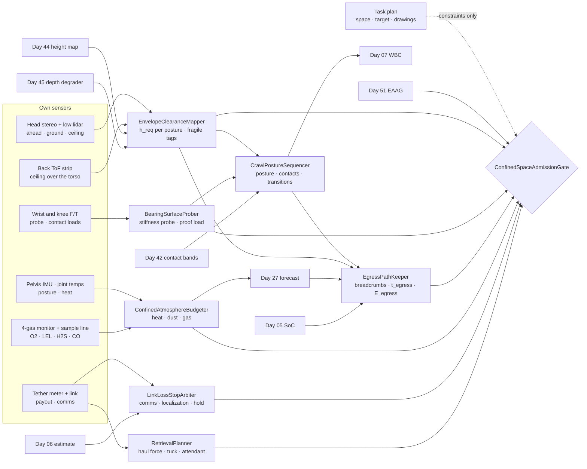
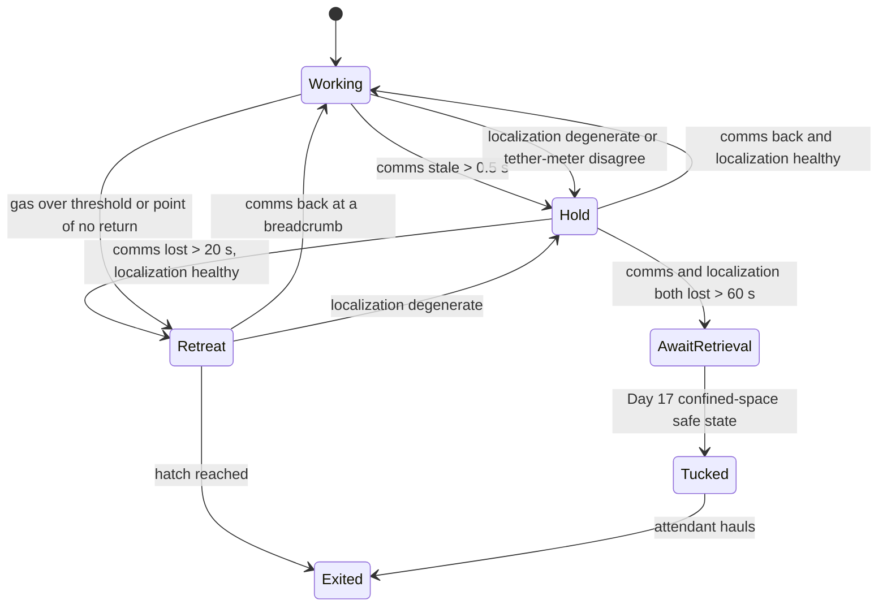
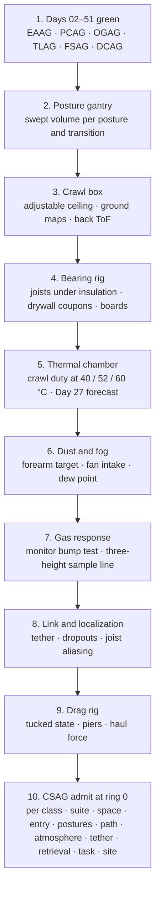

# Day 52 — Confined spaces and crawl spaces under the elevated-access stack: EnvelopeClearanceMapper / CrawlPostureSequencer / BearingSurfaceProber / EgressPathKeeper / ConfinedAtmosphereBudgeter / LinkLossStopArbiter / RetrievalPlanner / ConfinedSpaceAdmissionGate under ElevatedAccessAdmissionGate + OverheadToolAdmissionGate + BimanualToolAdmissionGate + PowerToolAdmissionGate + PushPullAdmissionGate + PayloadCarryAdmissionGate + OutdoorGroundAdmissionGate + TerrainLocomotionAdmissionGate + FallSafeAdmissionGate + DeliberateContactAdmissionGate + WholeBodyTouchAdmissionGate + HumanHandoverAdmissionGate + CooperativeTaskAdmissionGate + TaskCompositionAdmissionGate + FleetSkillCatalogAdmissionGate + proximity + zone attestation + supervisor + logging + canary + HIL + fleet + incident + change-management + maintenance + thermal + energy gates

![EnvelopeClearanceMapper / CrawlPostureSequencer / BearingSurfaceProber / EgressPathKeeper / ConfinedAtmosphereBudgeter / LinkLossStopArbiter / RetrievalPlanner / ConfinedSpaceAdmissionGate: a 63.8 kg humanoid crawls on forearms and knees through a 0.55 m crawl space, which its 0.46 m posture clears by 6 mm once gait bob, 3σ map error, and margin are added; under a duct at 0.41 m it drops to a prone crawl; in an attic it probes through blown insulation at 40 N to find a joist before kneeling, because the drywall between joists punched at 210 N and a knee carries 286 N; at 52 °C the shoulder's continuous torque falls to 85%, so the work window is what is left after reserving 1.5 times the measured time to crawl back out; a tether carries comms and a haul line, and a limp-tucked robot drags out with 501 N at the hatch after one 90° wrap around a pier; nobody crawls in after it](/images/day52-confined-crawl-spaces.png)

[Day 05](/lessons/day-05-power-bms) owns `torque_scale` and state of charge **forever**. [Day 06](/lessons/day-06-estimation-balance) owns the floating-base estimate. [Day 07](/lessons/day-07-wbc-balance) owns whole-body balance. [Day 17](/lessons/day-17-runtime-safety-supervisor) owns ESTOP, safe states, and the kill chain. [Day 27](/lessons/day-27-thermal-budgets-duty-cycle) owns thermal derates and their forecast. [Day 29](/lessons/day-29-human-proximity-safety) owns person tracks, SSM, and PFL rows. [Day 30](/lessons/day-30-collaborative-workspace-zoning) owns attested zones and `CrossSiteZoneConfigGate`. [Day 42](/lessons/day-42-deliberate-whole-body-contact) owns planned contacts and their bands. [Day 43](/lessons/day-43-falls-fall-safe-contact) owns falls and FSAG. [Day 44](/lessons/day-44-stairs-ramps-uneven-terrain) owns the height map, footholds, and touchdown checks. [Day 45](/lessons/day-45-outdoor-deformable-ground) owns ground compliance and depth degradation. [Day 46](/lessons/day-46-carrying-payloads-walking) owns payloads. [Day 51](/lessons/day-51-ladders-elevated-work-platforms) owns ladders, the torso hardpoint, and EAAG.

Day 51 took the robot up. Today takes it under and in: the crawl space under a house, the attic above a ceiling, the void under a raised floor, a plenum above a drop ceiling, a wide duct. Work there is real and unpleasant — finding a leak, tracing a cable, checking insulation, reading a meter — and it's exactly the work people would gladly hand to a robot. It's also where every assumption from the floor breaks at once. The robot can't stand. Its knees, elbows, forearms, and back carry load. The thing under it may not hold. It's hot or wet or dusty. The radio fades behind joists and ducts. And if it gets stuck, nobody can easily reach it.

Eight lies show up the first time a team sends a humanoid into a crawl space:

1. **Hatch lie.** "It fits through the hatch, so it fits in the space." The hatch is the one place the clearance was measured. A duct 3 m in is lower.
2. **Drawing lie.** "The crawl space is 24 inches." That's the design height to the joists. Ducts, drain lines, beams, and sagging insulation take it to 16 in places, and the dirt isn't flat.
3. **Insulation-is-floor lie.** An attic covered in blown insulation looks like a floor. Under it are 38 mm joists 406 mm apart and a ceiling that holds paint, not a knee.
4. **Hands-and-feet lie.** Contacts are where the hands and feet are. Crawling puts the knees, forearms, hips, chest, and back on the ground or against the structure, and each one is a Day 42 contact with a band.
5. **Turn-around-later lie.** The robot will turn around when it's done. In a 0.55 m space, turning a 1.2 m body needs a 1.4 m clear circle, which may exist only at the hatch.
6. **Warm-attic lie.** It's warm, so the robot works a bit slower. At 52 °C the actuators have 15% less continuous torque, and the way out costs the same torque as the way in.
7. **Signal-comes-back lie.** If the radio drops, keep going and it'll reconnect. Behind a steel duct it doesn't, and a robot doing anything without supervision in a space nobody can see into is guessing.
8. **Someone-crawls-in lie.** If the robot gets stuck, someone crawls in and pulls it out. That puts a person in a confined space, in the atmosphere the robot was sent in to avoid, next to a 64 kg machine.

Today owns **`EnvelopeClearanceMapper` / `CrawlPostureSequencer` / `BearingSurfaceProber` / `EgressPathKeeper` / `ConfinedAtmosphereBudgeter` / `LinkLossStopArbiter` / `RetrievalPlanner` / `ConfinedSpaceAdmissionGate`**. The question is: **how do you let a humanoid enter and work in an attic, crawl space, or void, with clearance MEASURED around its whole swept body rather than under its feet; its knees, forearms, chest, and back scheduled as Day 42 contacts on surfaces it has PROBED before loading; a measured way out kept open, timed, and paid for at every step; heat, dust, and gas budgeted against Day 27, the sensor suite, and the robot as an ignition source; comms or localization loss treated as a stop; and a retrieval that needs no person to enter planned and tested before it goes in — without raising Day 29 PFL, writing Day 05 `torque_scale`, gating Day 17 ESTOP, or bypassing `CrossSiteZoneConfigGate`?**

## Inside, the whole body is the foot and the way out is part of the task

The rule everything follows from: **in a confined space, every part of the robot is a contact or a clearance, every surface it loads has been probed at the load it will carry, and no step is taken unless the robot can still get out from where that step leaves it — with the heat, energy, and sensor quality it will have then, not now. Drawings, the homeowner's description, the hatch size, and "someone can go in after it" are never inputs that admit anything.** A plan may add constraints (crawl boards, a lower posture, a shorter reach, a tether). It may never stand in for a measurement.

Three facts set the shape of the lesson.

**Clearance is a swept volume, not a height.** For a posture of height $h_p$, the space needed above the ground is

$$
h_{\text{req}} = h_p + b + 3\sigma_{\text{map}} + m
$$

where $b$ is the gait's vertical bob, $\sigma_{\text{map}}$ is the height map's error for the ceiling *and* the ground, and $m$ is a fixed margin. For the example robot in a forearm crawl, $0.46 + 0.03 + 0.024 + 0.03 = 0.544$ m. A clean 0.55 m crawl space admits it by 6 mm. The same space full of dust, where $\sigma$ grows from 8 to 20 mm, needs 0.58 m and admits only the prone crawl.

**The ground may not be ground.** In the forearm crawl the knees carry

$$
F_{\text{knees}} = W\,\frac{x_c}{x_k} = 626 \cdot \frac{0.32}{0.70} \approx 286\ \text{N}
$$

and while one knee moves the other carries nearly all of it. The example site's 12.7 mm ceiling drywall, coupon-tested between joists, punched at 210 N (3σ low). A knee that misses a joist goes through the ceiling of the room below.

**The way out has a price that rises while you're inside.** Reverse crawling is slower than forward crawling, and heat, dust, and battery all get worse with time. The robot keeps going only while

$$
t_{\text{thermal}} \ge 1.5\, t_{\text{egress}}, \qquad E_{\text{avail}} \ge 1.5\, E_{\text{egress}}
$$

with both egress terms computed for the posture the *current* sensor quality would force on the way back.

| Layer | Owns | Must not own |
|-------|------|--------------|
| `EnvelopeClearanceMapper` | Ceiling and ground maps of the space with σ; the robot's swept volume per posture and per transition; clearance verdict per path cell; fragile objects (pipes, wiring, ducts) tagged with contact caps | Accepting a drawing height, the hatch size, or a ceiling the robot hasn't scanned |
| `CrawlPostureSequencer` | Posture choice from clearance; forearm, knee, chest, hip, and back contacts as Day 42 bands; one contact moved at a time; transitions only where their swept volume fits | Running Day 44's walking gait, or a transition that needs more room than either posture |
| `BearingSurfaceProber` | Probe stiffness before every new contact patch on an unknown surface; proof load at 1.5× the contact's load; joist finding under insulation; crawl-board placement and proof | Loading a surface because it looks like floor |
| `EgressPathKeeper` | Breadcrumb path of proven cells with posture and speed; turn-around spots; egress time and energy from here; point of no return | Planning the way out after the work is done |
| `ConfinedAtmosphereBudgeter` | Ambient heat into the Day 27 forecast; dust into depth σ and fan intake; O2, LEL, H2S, CO at three heights before and during entry; humidity and condensation on optics | Raising a derate, or treating the robot as intrinsically safe |
| `LinkLossStopArbiter` | Comms health over radio and tether; localization health including periodic-structure aliasing; the stop, the hold posture, and the only retreat allowed | Continuing on a stale command or a guessed pose |
| `RetrievalPlanner` | Haul force with drag and wraps; tether and haul line rating; the tucked retrieval posture tested on a drag rig; the attendant at the opening | Any plan in which a person enters to recover the robot |
| `ConfinedSpaceAdmissionGate` | Fail-closed admit per robot class, suite, space, entry point, posture set, path, atmosphere, tether, retrieval, task, site | `JointCommand`; Day 05; PFL; Day 17 |
| Days 05 / 07 / 17 / 27 / 29 / 30 / 42 / 43 / 44 / 45 / 46 / 51 | Torque and charge, balance, ESTOP, heat, PFL, zones, bands, falls, height map, compliance, payloads, ladders | Being outranked by "it's only a few metres in" |

**Core thesis:** **a humanoid goes into a confined space only on what it has measured: it fits its whole swept body to the space it scanned, probes the ground before every knee, keeps a proven way out timed and paid for at every step, budgets heat and dust against the trip back, stops the moment it can't hear or can't place itself, and carries its own rescue in on a tether, because nobody should have to crawl in after it.**



## Physical machine: what a confined space does to a humanoid

Two example sites run through the lesson:

- **Site A, crawl space.** Dirt under a 0.15 mm vapor barrier, 0.55 m to the joists (0.53 m minimum after the ground's humps), a 0.6 × 0.5 m access hatch in the foundation wall, block piers on a 2.4 m grid, a supply duct dropping clearance to 0.41 m for 1.2 m, a drain line, and a target 9 m in: a suspected leak at a shower drain. It's 16 °C and 92% RH. The house has a propane water heater.
- **Site B, attic.** A 0.56 × 0.76 m ceiling hatch, 2×6 ceiling joists (38 × 140 mm) at 406 mm centers under 250 mm of blown cellulose, 12.7 mm drywall ceiling below, roof trusses overhead, 1.9 m at the ridge falling to nothing at the eaves. Target: a junction box 6 m from the hatch. On the test afternoon it's 52 °C.

### The robot folded down: postures and what they need

The example robot's crawl postures, measured with its back ToF strip and a surveyed gantry:

| Posture | Height $h_p$ | Body length | Bob $b$ | Speed fwd / rev | Load-bearing contacts |
|------|------|------|------|------|------|
| Hands and knees | 0.66 m | 1.05 m | 0.04 m | 0.15 / 0.08 m/s | 2 hands, 2 knees |
| Forearms and knees | 0.46 m | 1.20 m | 0.03 m | 0.12 / 0.05 m/s | 2 forearms, 2 knees |
| Prone crawl | 0.27 m | 1.55 m | 0.02 m | 0.04 / 0.03 m/s | chest and hip pads, forearms, knees |
| Supine (work on back) | 0.30 m | 1.55 m | — | slide only | back and hip pads, heels |

With $\sigma_{\text{map}}$ = 8 mm (clean) or 20 mm (dusty) and $m$ = 0.03 m:

| Posture | $h_{\text{req}}$ clean | $h_{\text{req}}$ dusty | Site A 0.53–0.55 m | Under the duct, 0.41 m |
|------|------|------|------|------|
| Hands and knees | 0.754 m | 0.790 m | No | No |
| Forearms and knees | 0.544 m | 0.580 m | Clean only, where ≥ 0.544 m | No |
| Prone | 0.344 m | 0.380 m | Yes | Yes |
| Supine | 0.354 m | 0.390 m | Yes | Yes |

Three things in that table matter more than the numbers.

**The ceiling is measured as carefully as the ground.** On Day 44 the robot cared about the ground. Here, the joists, ducts, and pipes over its back are the obstacle. The head camera sees ahead, but once the torso is under something, only the back ToF strip and the map remember it. `EnvelopeClearanceMapper` keeps one map for the ground and one for the ceiling, both with σ, and a cell is clear only if their difference beats $h_{\text{req}}$.

**Transitions need more room than postures.** Going from prone back up to forearms and knees lifts the hips through 0.47 m before the knees come under. It's slow and static, so there's no bob, but it still needs 0.47 + 0.024 + 0.03 = 0.524 m clean. The robot can drop into a prone crawl under a 0.41 m duct anywhere, but it can only rise again where the map shows that much. If that spot isn't on the far side of the duct, the robot does the rest of the path prone, and `EgressPathKeeper` prices the trip at prone speed.

**Turning around is a place, not a move.** A forearm-crawl turn sweeps a circle of about body length plus 0.1 m each side: 1.4 m across. In Site A, that circle exists at the hatch and in two pier bays. Everywhere else, the way out is backwards, at less than half the speed, with the rear-facing pelvis camera as the only eye on where it's going.

### The ground: dirt, vapor barrier, joists, and a ceiling that isn't a floor

In the forearm crawl, the CoM sits 0.32 m behind the forearm line, which is 0.70 m from the knee line. The forearms carry about 340 N and the knees 286 N. Moving a knee shifts almost all 286 N onto the other one.

**Site A's dirt** is Day 45's deformable ground, measured the same way: each new forearm and knee patch loads at 1.5× and watches sinkage. The vapor barrier adds a hazard of its own — it tears and bunches under a dragged knee, and a bunched sheet under a knee is a low-friction pivot. The knee lifts and places; it doesn't skid.

**Site B's attic** is the hard one. The insulation is above the joist tops by 110 mm. Vision sees cellulose. The joists are somewhere under it, and between them is drywall that punched at 210 N. The 286 N knee has to land on a 38 mm joist, centered within ±12 mm so the 60 mm knee pad's load stays over the wood.

**Finding the joist is a stiffness measurement.** `BearingSurfaceProber` pushes a fingertip probe down through the insulation until it touches something, then presses to 40 N and reads the deflection from wrist kinematics and F/T:

| Under the probe | Deflection at 40 N | Verdict |
|------|------|------|
| Joist top | 0.1 mm | Joist, centerline from a sideways sweep at 10 mm steps |
| Drywall mid-bay | 1.8 mm | Not a contact. Never loaded past 40 N |
| Drywall next to a joist | 0.4–0.9 mm | Ambiguous: sweep again |
| Wiring or a pipe | Lateral slip, F/T shear | Fragile: tagged, 30 N cap, routed around |

40 N is well under 210 N, so the probe itself can't break the ceiling. Once a joist is found, the hand proof-loads it at 1.5× the knee's load, 430 N, by shifting weight onto that hand while the other contacts hold. The 406 mm spacing, once two joists are found, predicts the next one, but the prediction only tells the probe where to start. Every new contact patch is probed.

**Crawl boards beat probing.** A 0.3 × 1.2 m plywood board spans three joists and spreads a knee's load across all of them. The robot carries boards in as a Day 46 payload, places each one across probed joists, proof-loads it, and crawls on it. Probing is how the first board goes down. Boards are how the attic gets crawled. A plan that says "attic, no boards" is admitted only for short paths, and only on probed joists.

### The way out: breadcrumbs and a point of no return

`EgressPathKeeper` records every cell the robot actually crossed: its clearance, the posture used, where transitions happened, and how long it took. Going back over a proven cell needs no new probing or clearance scan beyond a check that nothing changed. That's the only reason egress is plannable.

For Site A, clean:

| Segment back to the hatch | Posture | Reverse speed | Time |
|------|------|------|------|
| 3.6 m target to duct | Forearms and knees | 0.05 m/s | 72 s |
| Drop to prone at the duct | — | — | 20 s |
| 1.2 m under the duct | Prone | 0.03 m/s | 40 s |
| Rise transition after the duct | — | — | 20 s |
| 4.2 m duct to hatch bay | Forearms and knees | 0.05 m/s | 84 s |
| Turn and exit through the hatch | — | — | 60 s |
| **Total** | | | **≈ 296 s, about 5 min** |

If dust raises σ to 20 mm, forearms and knees are no longer admitted anywhere in Site A, so the whole 9 m goes back prone at 0.03 m/s: 300 s, plus the hatch, about 6 min. That's the point of computing egress for the posture the *current* sensor quality would allow. Dust that showed up during the work changes the price of leaving.

### Heat, dust, gas, and damp: what the space does to the machine

**Heat.** Day 27 owns the derate. For a winding limit of 120 °C, the continuous torque at ambient $T_a$ scales like

$$
\frac{\tau_{\text{cont}}(T_a)}{\tau_{\text{cont}}(25\,^\circ\text{C})} = \sqrt{\frac{120 - T_a}{120 - 25}}
$$

which is 0.92 at 40 °C, 0.85 at 52 °C, and 0.79 at 60 °C. In the forearm crawl, the shoulders run at 71% of their 25 °C continuous rating, so at 52 °C there's 14% left. `ConfinedAtmosphereBudgeter` doesn't compute the derate. It hands Day 27 the measured ambient, the crawl duty, and the fan intake's condition, and Day 27 answers with a time to derate. For Site B at 52 °C that answer was 38 min. The egress reserve is 1.5 × 6 min = 9 min, entry took 5 min, so the work window is 24 min, and it shrinks live as the joint temperatures come in.

**Dust.** Cellulose and fiberglass coat lenses and clog fan intakes. The first shows up as depth σ, which Day 45's degrader already reports; the robot checks it against a fixed target on its own forearm, whose geometry it knows exactly, so "the image looks fine" never decides it. The second shows up as fan pressure drop, which goes to Day 27 because less airflow means less cooling.

**Damp.** Site A at 92% RH and 16 °C means a robot coming from a 22 °C house fogs its optics on entry. Lenses are pre-warmed above the space's dew point before entry, and σ is checked at the hatch before the first metre.

**Gas.** A crawl space with a propane appliance or a sewer line can hold gas that people can't smell and the robot can ignite. The example robot isn't certified intrinsically safe, so it's an ignition source in any flammable atmosphere. Before entry, a sample line pushed in through the hatch reads O2, LEL, H2S, and CO at three heights: the floor (propane is heavier than air and pools there), mid-height, and the joists (methane rises). The robot's own monitor keeps reading on the way in.

| Reading | Entry refused at | Why that threshold |
|------|------|------|
| LEL (combustible gas) | ≥ 5% | Half the 10% people work to, because the robot is a non-rated ignition source |
| O2 | below 19.5% or above 23.5% | Doesn't hurt the robot, but makes the attendant and any human help unsafe, and high O2 raises fire risk |
| H2S | ≥ 10 ppm | Same: the people outside |
| CO | ≥ 35 ppm | Same |

Any reading above the refusal threshold during work is an immediate retreat along the breadcrumbs, with tools off.

### Comms and position: what goes dark

The radio comes from the house. Joists, ducts, foil-backed insulation, and the foundation wall all cut it. In Site A, signal fell below usable 4 m past the hatch behind the steel duct. So the example robot goes in on a tether: a fiber pair for comms, a 6 mm haul line, and a tether meter at the hatch that counts the length paid out.

Localization fails differently. An attic is about the worst structure scan matching can see: joists every 406 mm, all identical. A lidar match can lock one bay off and look perfectly confident. `LinkLossStopArbiter` watches the scan-match degeneracy along the joist direction, not just the covariance, and cross-checks pose against the tether meter: the path length from the hatch can't be shorter than the tether paid out minus its slack.

### Retrieval: the robot carries its own rescue in

If the robot stops for good, it has to come out without a person going in. `RetrievalPlanner` computes the haul force before entry. A tucked robot dragged on the vapor barrier, with a measured μ of 0.5, needs 0.5 × 626 = 313 N. The line wraps 90° around a pier on the way out. With μ = 0.3 between line and block, the capstan equation gives

$$
T_{\text{hatch}} = T_{\text{robot}}\, e^{\mu \theta} = 313 \cdot e^{0.3 \cdot \pi/2} \approx 501\ \text{N}
$$

With a 1.5× allowance for snags, the design haul is 752 N. The haul line and the hatch winch are rated for at least 2× that, 1.5 kN, and the line attaches to the Day 51 torso hardpoint, which is already proof-loaded to 8 kN.

**The tucked posture is what makes dragging possible.** Day 17 owns the safe states. A limp robot in a crawl space sprawls: an elbow hooks a pipe, a hand drops behind a pier. So the example robot's Day 17 profile has a characterized confined-space safe state: arms folded under the chest, knees drawn up, joints damped, nothing sticking out past the shoulder width. `RetrievalPlanner` doesn't own that state. It verifies that the robot class has it, that it was tested on a drag rig with this space's obstacles, and that it's the state Day 17 uses when admitted to this space.

**The attendant stays outside.** A person at the hatch watches the tether, holds the remote stop that Day 17 already accepts, and runs the winch. That person never enters. If the atmosphere or the geometry would make entry unsafe for a person, that's the reason the robot went in, and it's also the reason nobody follows it.

## EnvelopeClearanceMapper: fit the swept body, not the feet

ECM builds the ground and ceiling maps from head stereo and the low lidar ahead, and the back ToF strip overhead. Each cell carries clearance with σ from both maps. For each posture and each transition in `CrawlPostureSequencer`'s set, ECM stores the swept volume measured on the gantry: not a box, but the envelope of every link through a gait cycle, including the knee rising to clear the next patch. A cell is admitted for a posture when the swept volume plus 3σ plus margin fits under the ceiling and above the ground. Fragile objects — wiring, PEX, drain lines, flex ducts — are tagged with Day 42 contact caps of 30 N, and the path keeps the swept body off them where it can.

## CrawlPostureSequencer: one contact at a time, low enough to fit

CPS is Day 51's `RungClimbSequencer` lying down. Every load-bearing patch is a Day 42 contact with a band. One contact moves at a time; the next patch is probed by BSP and preloaded to 60% before the old one lifts. Posture is the highest that ECM admits for the next cells *and* for the egress path, because a robot that can only get back prone should be crawling prone now if dust is rising. Transitions happen only in cells ECM admitted for the transition's swept volume. Supine work — looking up at a drain from underneath — is admitted only for a fixed slide distance, with the turn-over transition checked both ways.

## BearingSurfaceProber: nothing is ground until it's been pushed

BSP owns the 40 N stiffness probe, the sideways sweep for a joist centerline, the 1.5× proof load, and crawl-board placement and proof. On dirt it hands patches to Day 45's compliance estimator. On anything else, a patch that hasn't been probed isn't a contact. A probe that finds wiring or pipe tags it fragile for ECM. A proof load that sees sudden deflection stops, unloads, and marks the bay, because a cracking sound in an attic is the ceiling below.

## EgressPathKeeper: the way out is computed before each step

EPK holds the breadcrumbs and, before each step, computes the egress time and energy from where the step would leave the robot, using the posture today's σ would force. Day 27 supplies the thermal time remaining and Day 05 the energy available. If the step would leave either below 1.5× egress, the step is refused and the robot turns back. That's the point of no return, and it moves as conditions change. EPK never asks Day 27 to raise a derate or Day 05 to release reserve.

## ConfinedAtmosphereBudgeter: the space as a load on the machine

CAB reads ambient temperature and humidity, the dust check against the forearm target, the fan intake's pressure drop, and the gas monitor. It forwards heat and airflow to Day 27, σ to Day 45's degrader and ECM, and gas readings to CSAG with fixed refusal thresholds. It never raises a derate, never calls the robot intrinsically safe, and treats a gas monitor fault as a gas reading over the threshold.

## LinkLossStopArbiter: stop when you can't hear or can't place yourself



**Hold** means all four contacts down in the lowest admitted posture, tools off, joints holding. **Retreat** is the only autonomous motion allowed without comms: backwards over proven breadcrumbs, no new cells, no probing, nothing that wasn't already admitted on the way in. Without trustworthy localization, the robot can't know it's on the breadcrumbs, so it holds. The 0.5 s, 20 s, and 60 s timers are examples; yours come from your link's measured dropout statistics.

## RetrievalPlanner: a rescue that needs nobody to enter

RP computes the haul force from measured drag and the line's wraps, checks the line and winch ratings at 2× the design haul, confirms the hardpoint proof from Day 51, confirms the tucked safe state was drag-tested in obstacles like this space's, and confirms an attendant at the opening holds the remote stop. A space whose geometry makes the tucked robot snag on the drag rig — a 90° turn into a 0.5 m gap, say — isn't admitted at all, because no plan gets the robot out of it.

## ConfinedSpaceAdmissionGate

`ConfinedSpaceAdmissionGate` (CSAG) admits confined-space modes per robot class, sensor suite hash, space, entry point, posture set, path, atmosphere, tether, retrieval plan, task, and site, under Day 51 EAAG (the hatch to an attic is usually a ladder), Day 46 PCAG for carried boards and tools, Day 45 OGAG, Day 44 TLAG, Day 43 FSAG, and Day 42 DCAG. It fails closed if any of these is missing:

- ECM ceiling and ground maps over the planned path, with every cell admitted for the posture and every transition cell admitted for its swept volume.
- BSP probe and proof records for every contact patch on a non-dirt surface, or crawl boards proof-loaded across probed joists.
- EPK egress time and energy below the reserve at every step of the plan, for the posture worst-case dust would force.
- CAB pre-entry gas readings at three heights below every threshold, optics above dew point, and a Day 27 thermal window longer than entry + work + 1.5× egress.
- LLSA tether link tested at the farthest planned point, and localization tested against the tether meter in this space's structure.
- RP haul force, line and winch rating, tucked safe state drag-tested, attendant present.
- Day 29: no person inside the space while the robot is. Day 30: the space and the hatch attested as a zone.

CSAG never writes `JointCommand`, never touches Day 05 `torque_scale` or reserve, never raises a Day 29 row, never accepts a drawing, a hatch size, or a person going in as a measurement, and never gates ESTOP. Day 17's ESTOP inside a confined space goes to the confined-space safe state, not limp, because a sprawled robot can't be hauled out.

## Data shapes

```text
ClearanceCell:                                # ECM
  cell_id, ground_z, ceiling_z, sigma_ground, sigma_ceiling
  clearance_m, clearance_3sigma_low_m
  admitted_postures[]            # HANDS_KNEES | FOREARMS_KNEES | PRONE | SUPINE
  admitted_transitions[]         # PRONE_TO_FOREARMS | ... | TURN_FOREARMS
  fragile: [object_id, kind, contact_cap_n]   # WIRE | PEX | DRAIN | FLEX_DUCT

CrawlStep:                                    # CPS
  posture, limb_or_pad, patch_id
  day42_contact_id, load_n, band_n
  preload_fraction, probe_ref
  transition                     # NONE | name, cell_id

BearingProbe:                                 # BSP
  patch_id, surface_guess        # DIRT | JOIST | DRYWALL | BOARD | DECK | UNKNOWN
  probe_force_n, deflection_mm, shear_n
  joist_centerline_offset_mm
  proof_load_n, proof_passed
  verdict                        # BEARING | NOT_BEARING | FRAGILE | AMBIGUOUS

EgressState:                                  # EPK
  breadcrumbs: [cell_id, posture, t_s]
  egress_posture_under_current_sigma
  t_egress_s, e_egress_wh
  t_thermal_remaining_s          # from Day 27
  e_available_wh                 # from Day 05
  margin_ok                      # both ≥ 1.5×
  turnaround_cells[]

Atmosphere:                                   # CAB
  ambient_c, rh_pct, dew_point_c, optics_c
  depth_sigma_mm, forearm_target_check
  fan_dp_pa
  gas: [height, o2_pct, lel_pct, h2s_ppm, co_ppm]
  monitor_ok
  verdict                        # OK | RETREAT | REFUSE

LinkState:                                    # LLSA
  comms_age_s, path                # RADIO | TETHER
  loc_degeneracy_axis, loc_eig_min
  tether_out_m, path_len_m
  state                          # WORKING | HOLD | RETREAT | AWAIT_RETRIEVAL | TUCKED | EXITED

RetrievalPlan:                                # RP
  drag_mu, wraps: [angle_rad, mu]
  haul_n, design_haul_n
  line_rating_n, winch_rating_n
  hardpoint_proof_n              # Day 51
  tucked_state_drag_tested
  attendant_id, remote_stop_tested

ConfinedSpaceAdmission:                       # CSAG
  robot_class, sensor_suite_hash
  space_id, entry_point, posture_set, path_id, atmosphere_ref, tether_id, retrieval_ref, task, site
  modes_admitted[]               # CRAWLSPACE_FOREARM | CRAWLSPACE_PRONE_PASS | ATTIC_BOARDED
                                 # ATTIC_JOIST_SHORT | SUPINE_INSPECT_SHORT
  forbid:
    drawing_height_as_clearance: true
    unprobed_contact_patch: true
    load_drywall: true
    transition_without_swept_clearance: true
    step_past_point_of_no_return: true
    egress_priced_at_entry_sigma: true
    entry_with_lel_ge_5pct: true
    untethered_beyond_radio: true
    move_on_stale_command: true
    retreat_off_breadcrumbs: true
    person_enters_for_retrieval: true
    person_inside_with_robot: true
    limp_on_estop_in_space: true
    raise_pfl: true
    write_torque_scale: true
    gate_estop: true
    bypass_cross_site_zone_config_gate: true

# Unchanged owners
ElevatedAccessAdmissionGate · torso hardpoint (Day 51)
PayloadCarryAdmissionGate (Day 46) · GroundComplianceEstimator · WeatherDepthDegrader (Day 45)
TerrainLocomotionAdmissionGate · height map (Day 44)
FSAG (Day 43) · planned-contact bands (Day 42)
CrossSiteZoneConfigGate · zones (Day 30) · tracks · SSM · PFL (Day 29)
ThermalDerate · forecast (Day 27) · SupervisorState ESTOP · safe states (Day 17)
WBC (Day 07) · EstimatorState (Day 06)
BmsState / PowerState (Day 05): torque_scale, reserve
  accepts_requests_from_confined_space: false
```

## Config

A starting configuration. Every number is a policy you re-derive from your own robot, spaces, and sites:

```yaml
confined_space:
  clearance:
    maps: [ground, ceiling]
    ceiling_sensors: [head_stereo, low_lidar, back_tof_strip]
    margin_m: 0.03
    sigma_multiple: 3
    swept_volume_from: gantry_per_posture_and_transition
    fragile_contact_cap_n: 30
    drawings: constraints_only
  posture:
    order_preference: [hands_knees, forearms_knees, prone]
    choose_for: next_cells_and_egress_path
    one_contact_at_a_time: true
    preload_fraction: 0.6
    supine_slide_max_m: 1.0
  bearing:
    probe_force_n: 40
    joist_stiff_deflection_mm_max: 0.4
    joist_center_tolerance_mm: 12
    proof_load: 1.5x_contact_load
    drywall: never_load
    attic_default: crawl_boards
    sudden_deflection: stop_unload_mark
  egress:
    reserve_factor: 1.5
    posture_for_pricing: worst_allowed_by_current_sigma
    terms: [thermal_from_day27, energy_from_day05]
    turnaround_disk_m: body_length_plus_0p2
  atmosphere:
    gas_heights: [floor, mid, ceiling]
    refuse: {lel_pct: 5, o2_low_pct: 19.5, o2_high_pct: 23.5, h2s_ppm: 10, co_ppm: 35}
    monitor_fault: treat_as_over_threshold
    optics_above_dew_point_c: 3
    dust_check: forearm_reference_target
  link:
    tether_beyond_radio: required
    hold_after_stale_s: 0.5
    retreat_after_lost_s: 20
    await_retrieval_after_s: 60
    retreat: breadcrumbs_only
    loc_check: [degeneracy_along_structure, tether_meter]
  retrieval:
    haul: drag_mu_times_w_times_capstan_wraps
    snag_allowance: 1.5
    rating_factor: 2.0
    attach: day51_torso_hardpoint
    safe_state: day17_confined_tuck_drag_tested
    attendant: outside_with_remote_stop
    human_entry: forbidden
  admission:
    keyed_by: [robot_class, sensor_suite_hash, space, entry_point, posture_set, path, atmosphere, tether, retrieval, task, site]
    requires: [day51_eaag_if_hatch_by_ladder, day46_pcag, day45_ogag, day44_tlag, day43_fsag, day42_dcag]
```

## Physical ↔ digital pairing

| Physical | Digital twin / backing |
|----------|------------------------|
| Homeowner says the crawl space is 24 inches | Plan constraint only; ECM scan: 0.53–0.55 m, duct at 0.41 m |
| Robot enters through the hatch on forearms and knees | ECM cells ≥ 0.544 m admitted for FOREARMS_KNEES; optics at 21 °C, dew point 14.7 °C |
| Duct ahead at 0.41 m | CPS drops to PRONE; rise transition admitted only in the cell 0.3 m past the duct, measured at 0.53 m against 0.524 m needed |
| Vapor barrier bunches under a knee | Knee patch preload sees slip; knee lifts and re-places, no skid |
| Radio drops behind the duct | Tether carries comms; LLSA stays WORKING |
| Robot reaches the drain, 9 m in | EPK: egress ≈ 296 s, thermal and energy both well over 1.5× |
| Robot brushes the drain line | ECM fragile tag: contact force capped at 30 N, forearm rerouted |
| Gas monitor ticks to 6% LEL near the water heater | CAB → RETREAT; tools off; breadcrumbs back; entry closed |
| Attic: robot kneels where the knee "looks" on a joist | BSP probe: 1.8 mm at 40 N → drywall → refused; sweep finds joist 140 mm left |
| Robot lays a crawl board across three probed joists | BSP proof 430 N passes; board cells admitted |
| Attic at 52 °C, 18 min in | Day 27 time to derate now 19 min; EPK needs 9 min; work continues 10 min more |
| Lidar locks one joist bay off | LLSA degeneracy along joists + tether meter disagree by 0.4 m → HOLD |
| Tether fiber fails and radio is dead | HOLD → 20 s → RETREAT on breadcrumbs (localization healthy) → comms back at the hatch bay |
| Robot wedges and won't respond | AWAIT_RETRIEVAL → Day 17 tuck → attendant hauls at ≈ 500 N |

The pairing that matters most: **replay every confined-space run from the robot's own bag and show that every cell it crossed was admitted for its swept body; every patch it loaded was probed; at every step the way out was priced for the posture the sensors would allow and paid for with heat and charge to spare; every gas reading was below the line; no motion happened on a stale command or a guessed pose; and if it had stopped anywhere, a person outside could have hauled it out.** If the run only looks safe with the drawing's height or the homeowner's word, nobody measured it.

## Bring-up sequence (before the robot enters a real crawl space)



1. **Days 02–51 green,** with EAAG, PCAG, OGAG, TLAG, FSAG, and DCAG admitted.
2. **Posture gantry:** measure each posture's and each transition's swept volume on a surveyed gantry, including knee lift and gait bob.
3. **Crawl box:** a tunnel with an adjustable ceiling, ducts, and pipes, where ECM's maps are scored against the survey and every refusal fires on cue.
4. **Bearing rig:** joists under real insulation, drywall coupons punched to find the 3σ low, probe discrimination scored blind, board proofs.
5. **Thermal chamber:** crawl duty at 40, 52, and 60 °C until Day 27's forecast matches measured winding temperatures.
6. **Dust and fog:** forearm-target σ checks under cellulose dust, fan intake ΔP, and fogging from a cold-to-damp transition.
7. **Gas response:** bump-test the monitor, time the sample line, and verify every threshold triggers RETREAT.
8. **Link and localization:** tether at full length, forced dropouts, and lidar in a periodic joist mockup against the tether meter.
9. **Drag rig:** the tucked safe state hauled past piers and pipes, with measured haul forces against the plan.
10. **CSAG admit at ring 0** per robot class, suite, space, entry point, posture set, path, atmosphere, tether, retrieval plan, task, and site.

## Failure gallery

| Symptom | Likely cause |
|---------|--------------|
| Robot wedges under a duct 3 m in | Clearance from the drawing; ceiling over the torso never scanned |
| Robot can't get back up after passing under a pipe | Transition swept volume not checked; rise needs 0.524 m |
| A knee comes through the bedroom ceiling | Patch loaded without a probe; insulation taken as floor |
| Robot runs out of torque halfway back | Egress priced at entry; Day 27 window not reserved for the trip out |
| Robot crawls back slowly into a derate | Dust raised σ, egress forced prone, EPK priced it forearm |
| Lenses fog on entry and the map goes wild | Optics below dew point; σ not checked at the hatch |
| Robot keeps crawling after the radio drops | Moving on a stale command; no tether |
| Robot ends up one joist bay from where it thinks | Scan-match aliasing along periodic joists; no tether-meter check |
| Haul line won't move the robot | Limp sprawl hooked a pier; no tucked safe state, or wraps not counted |
| A technician crawls in to free it | Retrieval plan depended on a person entering |
| Spark in a crawl space with propane | No floor-level gas reading before entry |

## Exercises

1. A posture is 0.42 m high with 0.025 m bob. With σ = 12 mm and a 0.03 m margin, what's $h_{\text{req}}$? Does a 0.50 m space admit it? What σ would make it fail?
2. In the forearm crawl, the CoM is 0.30 m behind the forearm line and the knee line is 0.72 m back, with W = 610 N. What does one knee carry while the other moves? If drywall punches at 230 N (3σ low), what proof load does BSP apply to a joist?
3. Site A's path is 7 m forearm crawl and 2 m prone, with two transitions at 20 s each and a 60 s hatch exit. Compute egress time clean, and with dust that forbids forearm crawling.
4. At 48 °C, with a 120 °C winding limit, what fraction of continuous torque is left? If the shoulder duty is 0.78 of the 25 °C rating, is the crawl admitted at all?
5. The forecast gives 30 min to derate. Entry took 6 min, egress is 7 min. How long can the robot work with a 1.5× reserve?
6. A drag μ of 0.55 on a 620 N robot, two 90° wraps with μ = 0.25. Compute the haul at the hatch and the line rating with a 1.5× snag allowance and 2× rating factor.
7. Write the `ConfinedSpaceAdmission` row for inspecting an attic junction box 6 m from the hatch at 45 °C. Which tests must exist, and why is "someone can go up and get it" refused as a retrieval plan?

## What to freeze this week

Extend [frames](/frames) and your safety config with:

- `EnvelopeClearanceMapper`: ground and ceiling maps with σ; swept volume per posture and transition from a gantry; cells admitted at 3σ plus margin; fragile objects capped at 30 N; drawings are constraints only.
- `CrawlPostureSequencer`: knees, forearms, chest, hips, and back as Day 42 contacts; one moved at a time with preload; posture chosen for the next cells and the egress path; transitions only where their swept volume fits.
- `BearingSurfaceProber`: 40 N stiffness probe before every new patch; joist centerline within ±12 mm; proof load at 1.5×; drywall never loaded; crawl boards by default in attics.
- `EgressPathKeeper`: breadcrumbs of proven cells; egress time and energy at the posture the current σ forces; no step past 1.5× reserve on Day 27 heat or Day 05 charge.
- `ConfinedAtmosphereBudgeter`: heat and airflow to Day 27; dust to σ via the forearm target; gas at three heights before entry and continuously; LEL refusal at 5% because the robot is an ignition source; monitor faults count as gas.
- `LinkLossStopArbiter`: hold on stale comms; retreat only along breadcrumbs and only with healthy localization; degeneracy and tether-meter checks; await retrieval when both are gone.
- `RetrievalPlanner`: haul from measured drag and capstan wraps; line and winch at 2× design haul; Day 51 hardpoint; Day 17 tucked safe state drag-tested; attendant outside; no human entry.
- `ConfinedSpaceAdmissionGate` fail-closed under Day 51 EAAG and the stack below it; keyed by robot class, suite, space, entry point, posture set, path, atmosphere, tether, retrieval plan, task, and site; **no drawing height, no unprobed patch, no step past the point of no return, no untethered work beyond the radio, no motion on a stale command, no limp ESTOP inside, no person going in after it, no dual-write of Day 07, ESTOP, or `torque_scale`.**

The lesson isn't "teach the robot to crawl." It's that **in a confined space the robot's whole body is in contact and the exit is part of every step: it fits its swept body to the space it scanned, pushes on the ground before trusting it, prices the trip out with the heat and dust it will have then, stops when it can't hear or place itself, and brings its rescue in on a line**, under ceilings that never move because the work was out of sight.

## Further reading

Look these up by title; they're the standard sources for today's confined-space, crawling, and retrieval arguments:

- OSHA 29 CFR 1910.146, *Permit-required confined spaces*, and 29 CFR 1926 Subpart AA, for atmosphere testing, attendants, and non-entry rescue as practised by people.
- UK HSE L101, *Safe work in confined spaces*, for the "avoid entry" hierarchy and rescue planning before entry.
- IEC 60079 series, for explosive atmospheres and why an unrated machine is an ignition source.
- K. Kojima et al., "Development of life-sized high-power humanoid robot JAXON for real-world use," *IEEE-RAS Humanoids*, 2015, and the DARPA Robotics Challenge reports, for humanoid multi-contact postures in cluttered spaces.
- F. Kanehiro et al., "Locomotion planning of humanoid robots to pass through narrow spaces," *IEEE ICRA*, 2004, for HRP-2 choosing lower postures, including crawling, from measured clearance.
- R. Murphy, *Disaster Robotics*, MIT Press, 2014, for tethers, comms loss, and getting robots back out of voids.

## Next

**Day 53+** — Water, wet floors, and spills under the confined-space stack: standing water, slick tile, and leaks the robot walks into or is sent to find; friction measured per wetted surface and never assumed from a dry map; ingress protection budgeted per joint and connector with measured depth and splash; electrical hazards from water near live circuits treated as a zone; slip recovery and fall cones re-derived on wet surfaces; and cleanup and drying before the robot returns to dry duty — without raising Day 29 PFL, writing Day 05 `torque_scale`, or bypassing `CrossSiteZoneConfigGate`, under the same gates plus confined-space admission.
