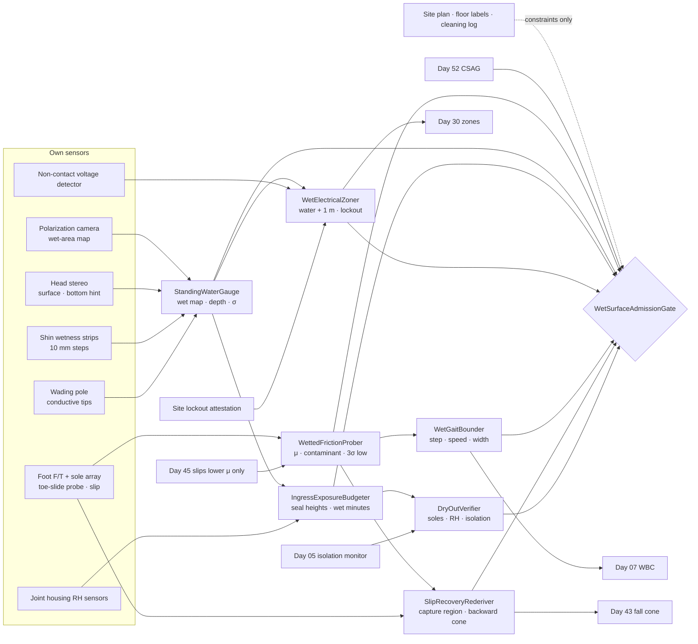
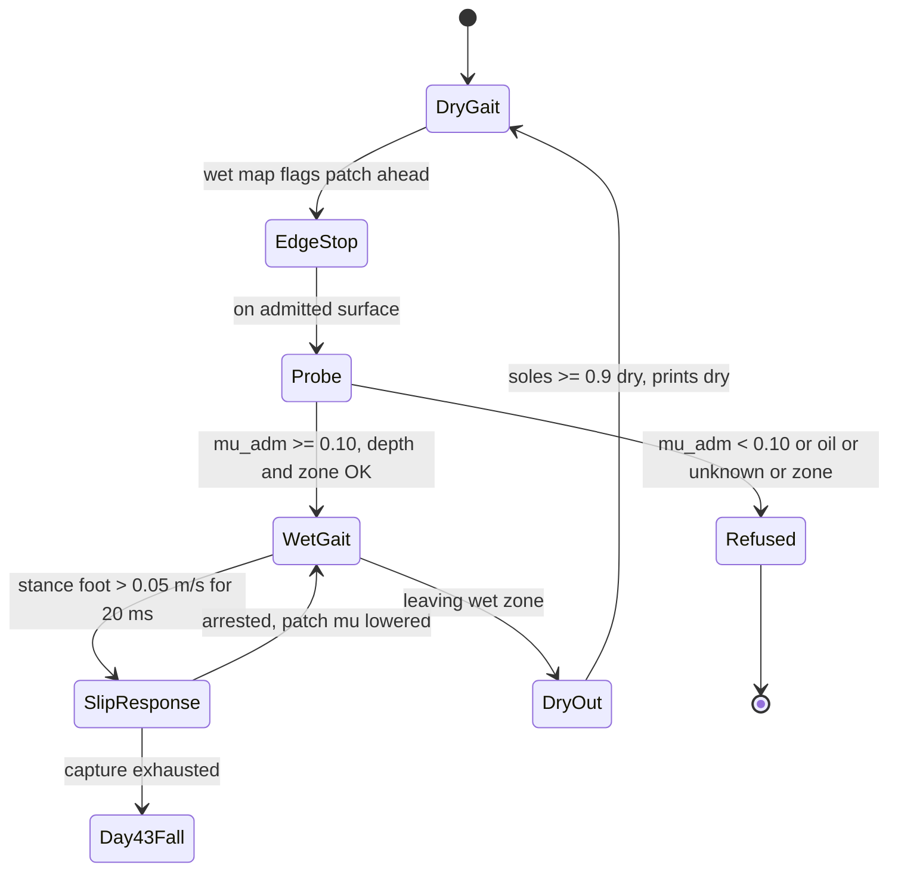
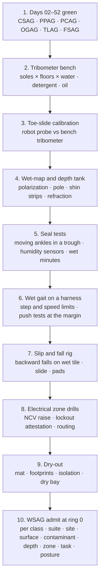

# Day 53 — Water, wet floors, and spills under the confined-space stack: WettedFrictionProber / StandingWaterGauge / IngressExposureBudgeter / WetElectricalZoner / WetGaitBounder / SlipRecoveryRederiver / DryOutVerifier / WetSurfaceAdmissionGate under ConfinedSpaceAdmissionGate + ElevatedAccessAdmissionGate + OverheadToolAdmissionGate + BimanualToolAdmissionGate + PowerToolAdmissionGate + PushPullAdmissionGate + PayloadCarryAdmissionGate + OutdoorGroundAdmissionGate + TerrainLocomotionAdmissionGate + FallSafeAdmissionGate + DeliberateContactAdmissionGate + WholeBodyTouchAdmissionGate + HumanHandoverAdmissionGate + CooperativeTaskAdmissionGate + TaskCompositionAdmissionGate + FleetSkillCatalogAdmissionGate + proximity + zone attestation + supervisor + logging + canary + HIL + fleet + incident + change-management + maintenance + thermal + energy gates

![WettedFrictionProber / StandingWaterGauge / IngressExposureBudgeter / WetElectricalZoner / WetGaitBounder / SlipRecoveryRederiver / DryOutVerifier / WetSurfaceAdmissionGate: a 63.8 kg humanoid meets a wet tile floor; a toe-slide probe reads friction 0.24 with water and 0.09 with soap against 0.62 dry; the admitted friction is the 3-sigma low divided by 1.5, so wet tile admits 0.12, which caps the step at 0.22 m and the walking speed at 0.25 m/s because one capture step can only absorb 0.36 m/s; a 60 mm puddle looks 45 mm deep to stereo because water bends light by 1.33, so depth comes from a wading pole; the moving ankle seal was tested to 0.10 m, so only 44 mm of standing water is admitted; an extension cord in the puddle makes the water plus 1 m a no-entry zone until lockout is attested; slips throw the robot backward, so the fall cone flips behind it and grows by a 0.25 m slide; on the way out, soles are dried on a mat until a toe-slide reads 90% of dry](/images/day53-water-wet-floors-spills.png)

[Day 05](/lessons/day-05-power-bms) owns `torque_scale`, state of charge, and the pack's isolation monitor **forever**. [Day 06](/lessons/day-06-estimation-balance) owns the floating-base estimate. [Day 07](/lessons/day-07-wbc-balance) owns whole-body balance. [Day 17](/lessons/day-17-runtime-safety-supervisor) owns ESTOP and safe states. [Day 27](/lessons/day-27-thermal-budgets-duty-cycle) owns thermal derates. [Day 29](/lessons/day-29-human-proximity-safety) owns person tracks, SSM, and PFL rows. [Day 30](/lessons/day-30-collaborative-workspace-zoning) owns attested zones and `CrossSiteZoneConfigGate`. [Day 43](/lessons/day-43-falls-fall-safe-contact) owns falls and FSAG. [Day 44](/lessons/day-44-stairs-ramps-uneven-terrain) owns the height map and touchdown checks. [Day 45](/lessons/day-45-outdoor-deformable-ground) owns ground friction and compliance outdoors and the rule that slips only ever lower admitted friction. [Day 52](/lessons/day-52-confined-crawl-spaces) owns confined spaces and CSAG.

Day 45 took the robot onto wet grass and mud, where the ground was soft and friction was something the feet learned step by step. Today is indoor water: the spill in a warehouse aisle, the mopped hospital corridor, the burst pipe in a basement, the leak the robot was sent into a crawl space to find. Indoor floors are hard, so the feet don't sink and the floor looks familiar. That's exactly what makes it dangerous. The same tile that gave the gait plenty of grip yesterday gives it a fifth of that today, and nothing in the camera image says so. Water also brings two hazards outdoor mud didn't: it gets inside the machine, and it conducts.

Eight lies show up the first time a team sends a humanoid across a wet floor:

1. **Dry-map lie.** "This aisle is sealed concrete, friction 0.6." That was the floor yesterday. Friction belongs to the floor *plus whatever is on it*, measured today.
2. **Looks-dry lie.** "The camera doesn't see water, so it's dry." A 0.2 mm film of clear water on gray tile is invisible to plain stereo. It's still enough to cut friction by more than half.
3. **Shallow-bottom lie.** "Stereo sees the bottom of the puddle, so we know the depth." Water bends light. The bottom looks 25% shallower than it is.
4. **IP67 lie.** "The ankles are IP67, so it can wade." IP67 is a static test on new seals in still fresh water for 30 minutes. A moving joint, a worn seal, and dirty water aren't that test.
5. **Slow-down lie.** "Just walk slower on wet floors." Speed alone doesn't fix it. Step length sets the friction each step needs, and what limits speed is whether one step can still catch a push.
6. **Catch-yourself lie.** "If it slips, it'll take a recovery step." The recovery step needs friction too. On wet tile the region a foot can land in and stop the robot shrinks to about a tenth of a metre.
7. **Breaker lie.** "The power's probably off down there." A puddle with an extension cord in it is live until somebody proves it isn't.
8. **Wipe-and-go lie.** "The robot looks dry, send it back to the dry aisle." Its wet soles leave a slip trail for people, and water inside an ankle housing doesn't show on the outside.

Today owns **`WettedFrictionProber` / `StandingWaterGauge` / `IngressExposureBudgeter` / `WetElectricalZoner` / `WetGaitBounder` / `SlipRecoveryRederiver` / `DryOutVerifier` / `WetSurfaceAdmissionGate`**. The question is: **how do you let a humanoid walk, stand, work, and crawl on wet floors and through standing water, with friction MEASURED on each wetted surface today and never read from a dry map or a label; water depth measured by contact, not by a camera looking through it; every joint and connector given an ingress budget from its own tests; water near circuits not proven dead treated as a no-entry zone; gait and capture bounded by the friction that's actually there; slip falls re-derived for the direction they actually go; and the robot dried and checked before it returns to dry duty — without raising Day 29 PFL, writing Day 05 `torque_scale`, gating Day 17 ESTOP, or bypassing `CrossSiteZoneConfigGate`?**

## Water changes three things: grip, the inside of the machine, and what's live

The rule everything follows from: **on a wet floor, friction is a measurement of this surface with this contaminant today, depth is a measurement by contact, every sealed part has a budget from its own test, and any water that might touch a live circuit is a zone, not a puddle. A floor label, a dry map, a camera's "looks dry," an IP code, and "the breaker's probably off" are never inputs that admit anything.** They may add constraints. They may never raise a limit.

Three facts set the shape of the lesson.

**The friction a step needs comes from its length.** At heel strike, the linear inverted pendulum puts the foot about half a step ahead of the CoM, so the ratio of horizontal to vertical ground force is about

$$
\mu_{\text{req}} \approx \frac{s}{2\,z_c}
$$

For the example robot with $z_c$ = 0.92 m, a dry-floor step of 0.35 m needs 0.19. On wet glazed tile, measured today at 0.24 with a 3σ low of 0.18, the admitted friction is $0.18 / 1.5 = 0.12$, so the step has to shrink to $2 \cdot 0.92 \cdot 0.12 = 0.22$ m.

**The friction a recovery step needs sets the speed.** A capture step lands at the capture point, $v/\omega$ ahead of the CoM, with $\omega = \sqrt{g/z_c}$ = 3.27 s⁻¹. At touchdown that foot needs $\mu \ge (v/\omega)/z_c$, so the largest velocity one step can stop is

$$
v_{\text{capture}} = \mu_{\text{adm}} \sqrt{g\,z_c} = 0.12 \cdot 3.00 = 0.36\ \text{m/s}
$$

On dry tile the same formula gives 1.06 m/s. On wet tile, walking at 0.36 m/s would leave nothing for a bump, so the example site walks at 0.25 m/s and keeps 0.11 m/s, about 7 N·s of impulse, in hand for a push.

**What the camera sees through water is wrong by a known factor.** A flat bottom seen from above through still water appears at

$$
d_{\text{apparent}} = \frac{d}{n_{\text{water}}} = \frac{d}{1.33}
$$

so a 60 mm puddle looks 45 mm deep, and the moving ankle seal the example robot was tested to only allows 44 mm. The camera would admit a puddle the seals can't take.

| Layer | Owns | Must not own |
|-------|------|--------------|
| `WettedFrictionProber` | Toe-slide friction measurement per wetted surface and contaminant; contaminant class; 3σ low; the admitted μ at 1.5× margin | Friction from a floor label, a dry map, or yesterday's run |
| `StandingWaterGauge` | Wet-area map from the polarization camera; depth by wading pole and shin wetness strips; refraction-aware stereo as a hint only; σ | Depth from stereo looking through the water |
| `IngressExposureBudgeter` | Per-joint and per-connector sealing heights and test conditions; moving vs static limits; cumulative wet minutes per seal; internal humidity | Treating an IP code as permission to wade |
| `WetElectricalZoner` | Water bodies touching or near circuits not proven dead; zone = water plus 1 m; lockout attestation from the site; voltage detector as a raise-only hint | Declaring anything dead from its own detector |
| `WetGaitBounder` | Step length, speed, turn rate, and stance width from admitted μ and the capture budget; refusal below the μ floor | Running Day 44's dry gait parameters on a wet floor |
| `SlipRecoveryRederiver` | Slip detection from stance-foot velocity; the friction-limited capture region; the backward slip fall cone with post-impact slide, handed to Day 43 | Commanding a fall or picking pads; Day 43 owns falls |
| `DryOutVerifier` | Sole drying until friction is back; footprint check; internal humidity and Day 05 isolation reading back in band before dry duty | Clearing a robot because it looks dry |
| `WetSurfaceAdmissionGate` | Fail-closed admit per robot class, suite, site, surface, contaminant, depth, electrical zone, task, posture | `JointCommand`; Day 05; PFL; Day 17 |
| Days 05 / 07 / 17 / 27 / 29 / 30 / 43 / 44 / 45 / 52 | Charge and isolation, balance, ESTOP, heat, PFL, zones, falls, height map, outdoor ground, confined spaces | Being outranked by "it's just a puddle" |

**Core thesis:** **a humanoid walks into water only on what it has measured: it slides a toe to learn today's friction and shortens its steps to fit, slows until one step can still catch a push, measures depth with a pole instead of a camera, keeps every seal inside its own tested limit, stays out of any water that might be live, expects slips to throw it backward, and doesn't go back to dry floors until its soles grip and its insides are dry.**



## Physical machine: what water does to a humanoid

Two example sites run through the lesson:

- **Site C, warehouse aisle.** Sealed concrete with a 2 m² spill of clear liquid across the aisle, a 1.2 × 1.2 m stretch of glazed ceramic tile at the break-room door that was mopped ten minutes ago, and a pallet wrapper whose extension cord runs through the edge of the spill. People walk the aisle.
- **Site D, basement after a pipe burst.** Concrete floor with standing water 30–60 mm deep, a floor drain, a utility panel on the far wall, a sump pump plugged into a wall outlet 0.3 m above the floor, and the access to Day 52's Site A crawl space, where the vapor barrier is now wet. The task: find the leak and close a valve.

### Friction: a measurement of floor plus contaminant

`WettedFrictionProber` measures friction the way a floor-safety tribometer does, with the robot's own foot. Standing on a surface already admitted (dry floor, or the previous measured patch), with a hand on a rail or both feet planted where needed, the robot puts the probe foot's toe on the new surface, loads it to 150 N, and ramps a sideways shear at 5 N/s until the sole array and F/T see the toe move 2 mm. The ratio at that moment is a static friction reading. It does this five times at different spots in the patch, because water films aren't uniform.

Measured at the example sites with the example robot's soles:

| Surface + contaminant | Mean μ | σ | 3σ low | Admitted $\mu_{\text{adm}}$ (÷1.5) |
|------|------|------|------|------|
| Glazed tile, dry | 0.62 | 0.03 | 0.53 | 0.35 |
| Glazed tile, clean water film | 0.24 | 0.02 | 0.18 | 0.12 |
| Glazed tile, mopped with detergent | 0.09 | 0.02 | 0.03 | 0.02 → refused |
| Sealed concrete, dry | 0.66 | 0.04 | 0.54 | 0.36 |
| Sealed concrete, water | 0.41 | 0.03 | 0.32 | 0.21 |
| Concrete under 40 mm standing water | 0.44 | 0.04 | 0.32 | 0.21 |
| Sealed concrete, hydraulic oil | 0.06 | 0.02 | 0.00 | refused |
| Wet vapor barrier (Day 52 knee pad) | 0.21 | 0.04 | 0.09 | 0.06 → crawl only with boards |

Three things in that table matter more than the numbers.

**The contaminant matters more than the floor.** Clean water cuts glazed tile to 40% of dry. Detergent cuts it to 15%. Oil makes it nearly zero. `WettedFrictionProber` classifies the contaminant from the probe itself: water gives a steady reading; soap gives a low reading that drops further with each probe as the film spreads; oil gives a low reading and leaves a residue the polarization camera sees on the sole. Anything it can't classify is treated as oil.

**Standing water can be better than a thin film.** Under 40 mm of water on concrete, the foot pushes the water out of the way and the sole's grooves drain the rest, so friction is close to the wet-film value. The worst case is a thin film on a smooth floor, where the water can't escape fast enough and the sole partly rides on it. The sole's tread is a physical design choice: grooves 3 mm deep and 4 mm apart are what made the 0.24 on wet tile possible. A worn sole gets re-probed, and the probe catches it before a slip does.

**Day 45's rule still holds.** A slip detected during walking only ever lowers the admitted μ for that patch. A good probe reading can't raise μ above what a slip has already shown.

### Depth: by contact, never through the water

`StandingWaterGauge` builds the wet map in two stages.

**Where is it wet?** Light reflecting off a water surface is strongly polarized, and a dry floor's reflection isn't. A polarization camera sees wet areas, including thin films that plain stereo can't, as patches with a high degree of linear polarization. That map has σ too: glossy dry floors give false positives, and a ceiling light reflecting off a glossy floor looks wet. A false wet is harmless (it triggers a probe). A false dry is the dangerous one, so the gauge never marks a patch dry that the polarization map flagged until a probe says so.

**How deep is it?** Stereo looking into still water sees the bottom at $d/1.33$, the surface barely at all, and anything with ripples as noise. So depth comes from contact:

- A **wading pole** held in one hand, with conductive tips every 10 mm, is pushed down until its end touches the bottom. The highest wet tip gives depth to ±5 mm. It also finds holes, drains with missing covers, and steps, which the camera can't see under murky water.
- **Shin wetness strips** at 10 mm steps confirm depth at every stance foot and catch rises nobody planned for.

At Site D the pole read 30 mm near the stairs and 60 mm near the drain, where the floor slopes toward it. Stereo had said 23 and 45.

### Ingress: every seal has its own test

The example robot's sealing map, from its own tests:

| Part | Top above the sole | Rating | Robot's own test, moving | Admitted wading depth |
|------|------|------|------|------|
| Foot and sole array | 0.06 m | IP67 | 0.10 m, 30 min | (covered by ankle) |
| Ankle actuators, shaft lip seal | 0.12 m | IP67 static | **0.10 m, 30 min, cycling** | **0.044 m** |
| Ankle encoder connector, shin cable gland | 0.18 m | IP65 | jets, no immersion | splash only |
| Knee actuators | 0.48 m | IP54 | splash only | never wet |
| Battery pack | 0.95 m | IP54 | splash only | never wet |

The admitted depth comes from the lowest moving limit:

$$
d_{\max} = h_{\text{seal,moving}} - h_{\text{splash}} - 3\sigma_d - m = 0.10 - 0.018 - 0.015 - 0.020 \approx 0.047 \ \text{m}
$$

with splash rise measured at 18 mm for a 0.25 m/s wading step and σ of the pole at 5 mm. The example config rounds down to 44 mm to cover the slope between pole readings. That admits Site D near the stairs and refuses it near the drain.

**IP codes are a starting point, not a budget.** IEC 60529's IPX7 test is a static enclosure in still fresh water, 1 m deep, for 30 minutes. A lip seal on a shaft that's turning pumps water past it at much lower depths, which is why the example robot's own test is at 0.10 m while cycling. Basement water also carries grit and detergent, which wear seals. `IngressExposureBudgeter` keeps a cumulative wet-minutes count per seal since its last inspection, 120 min for the ankle seals, and housing humidity sensors inside each ankle catch the leak the count missed: any rise of 10% RH over the dry baseline ends wet duty and starts a dry-out.

### Electricity: water near anything not proven dead is a zone

The example robot has an aluminum frame, a 48 V pack, and feet that are rubber when dry and wet rubber now. It isn't an insulated tool. A sump pump plugged in 0.3 m above water, an extension cord in a spill, or a panel with water under it can put the water itself at a voltage.

`WetElectricalZoner` treats every water body that touches, or comes within 1 m of, a circuit not proven dead as a no-entry zone: the water plus 1 m. It reports the zone to Day 30 as a no-robot area. Two things are never inputs that clear it:

- **The robot's non-contact voltage detector.** It can raise a zone ("this cord is live"), but it can't clear one. These detectors miss shielded cables, DC, and a neutral that's carrying current. Raise-only, the same rule as Day 45's weather forecast.
- **"The breaker tripped."** A tripped GFCI on one circuit says nothing about the outlet next to it.

The zone clears only on a lockout attestation from the site: an authorized person de-energized and locked out the named circuits, and that record is attested into the Day 30 zone config. At Site C, the pallet wrapper's cord made the spill plus 1 m a zone until the supervisor unplugged it and the attestation came in. At Site D, the sump pump is on and is needed, so the robot's path is routed to stay more than 1 m from any water that reaches its outlet, which means approaching the valve from the stairs side only.

### Gait on a wet floor: short steps, slow enough to catch a push

`WetGaitBounder` turns admitted μ into gait limits:

| Surface | $\mu_{\text{adm}}$ | Max step $2 z_c \mu_{\text{adm}}$ | One-step capture $v$ | Admitted speed | Push margin |
|------|------|------|------|------|------|
| Glazed tile, dry | 0.35 | 0.45 m (kinematic) | 1.06 m/s | 0.63 m/s | 0.43 m/s |
| Sealed concrete, wet | 0.21 | 0.39 m | 0.63 m/s | 0.45 m/s | 0.18 m/s |
| Glazed tile, water film | 0.12 | 0.22 m | 0.36 m/s | 0.25 m/s | 0.11 m/s |
| Below $\mu_{\text{adm}}$ = 0.10 | — | — | — | refused | — |

The floor of 0.10 exists because the robot needs friction for more than walking: turning in place, standing sway, and the hand forces of any task all load the feet sideways. Turn rate is capped so the yaw torque at the stance foot stays inside the same μ, and stance width grows by 40 mm so lateral sway needs less ankle torque. Every task the robot does while standing on that floor — closing a valve, pulling a mop, pushing a cart from Day 47 — gets its horizontal force capped at $\mu_{\text{adm}} W$ minus what the gait is using. On wet tile that's at most 75 N before the gait takes its share, about a third of what the same formula gives dry.

The robot never crosses a wet patch it hasn't probed. When the wet map shows a patch ahead, the robot stops at its edge, probes, and only then plans the steps across.

### Slips: detection, a smaller capture region, and a fall that goes backward

`SlipRecoveryRederiver` watches the stance foot. Its velocity from leg kinematics and the pelvis IMU should be zero. A stance-foot speed over 0.05 m/s for 20 ms is a slip. The response is never "push harder": more horizontal force is exactly what the floor can't take. It lowers the CoM by 30 mm to shorten the lever, brings the swing foot down early under the CoM, and drops the admitted μ for that patch per Day 45.

**The capture region shrinks.** A capture step can land only where its own friction holds, within $\mu_{\text{adm}} z_c$ of the CoM: 0.11 m on wet tile, against 0.33 m on dry. That's why the push margin in the table is so small, and why it, not the gait, sets the speed.

**Slip falls go the other way.** Day 43's fall cone was derived for trips and pushes, which throw the robot forward or sideways onto knees and forearms. A heel that slides forward at heel strike throws the robot backward, onto its back and its battery pack. `SlipRecoveryRederiver` hands Day 43 a re-derived cone for wet modes: behind the robot, onto the rear pads, with the slide after impact added. With the rear pads at μ = 0.30 on wet tile and 1.2 m/s of horizontal speed at impact,

$$
x_{\text{slide}} = \frac{v^2}{2\,\mu_{\text{pad}}\,g} = \frac{1.2^2}{2 \cdot 0.30 \cdot 9.81} \approx 0.25\ \text{m}
$$

The cone must be clear of people (Day 29), of any electrical zone, and of water deeper than the battery pack's splash rating would tolerate for a robot lying on its back: at Site D, the 60 mm water near the drain is refused for this reason too. Day 43 still owns the fall, the pads, and the getting-up. Getting up on wet tile is its own mode: knees and hands both need friction, so it's done on a dry mat if one can be reached, or not attempted until the floor is dried around the robot.

### Leaving the water: soles, footprints, and the inside of the ankle

`DryOutVerifier` runs before the robot steps from wet floor onto dry floor, and again before it returns to dry duty.

**Soles.** The robot walks onto an absorbent mat at the wet zone's edge and steps in place until a toe-slide on a reference dry tile next to the mat reads at least 90% of the sole's dry baseline: $0.9 \times 0.62 = 0.56$. On a detergent spill that took the example robot 14 steps and a wipe. The robot's rear-facing camera checks the next three footprints on dry floor with the polarization map; any visible wet print sends it back to the mat. Wet footprints are a slip hazard for people, so this is a Day 29 matter as well as a robot matter.

**Inside.** Before dry duty, every joint housing's humidity has to be back within 5% RH of its dry baseline, and Day 05's isolation monitor between the high-voltage bus and the chassis has to be back in its dry band (the example robot's dry band is above 2 MΩ, and a wet ankle connector once pulled it to 400 kΩ). If either isn't, the robot goes to a ventilated bay and holds low-duty joint heating under Day 27's limits until both are. Every wet run is logged against each seal's wet-minute budget, and seals that run out are inspected before the next wet mode.

## WettedFrictionProber: friction is a reading, not a property

WFP runs the toe-slide probe on every new wetted patch, five readings per patch, and classifies the contaminant from the readings' trend and the sole's residue. It reports mean, σ, 3σ low, and $\mu_{\text{adm}}$ at 1.5× margin. It takes slips from Day 45's rule as lower-only. It never reads a floor label, a dry map, or a cleaning schedule as friction, and anything it can't classify is oil.

## StandingWaterGauge: see where it's wet, touch to find how deep

SWG keeps the polarization wet map with σ, never marks a flagged patch dry without a probe, and measures depth with the wading pole and shin strips. Stereo's bottom estimate is used only as a hint for where to pole next, corrected by 1.33, and never as a depth that admits wading. Murky water, holes, and missing drain covers are found by the pole or not at all.

## IngressExposureBudgeter: the lowest moving seal sets the depth

IEB holds each part's sealing height and the conditions of the robot's own test. It computes the admitted wading depth from the lowest moving limit minus splash, 3σ of depth, and margin; counts wet minutes per seal; and ends wet duty on any housing humidity rise. It never upgrades a static IP code into a moving limit.

## WetElectricalZoner: live until proven dead

WEZ marks water touching or within 1 m of any circuit not proven dead as a no-entry zone and hands it to Day 30. Its own voltage detector only raises zones. Zones clear only on a site lockout attestation for the named circuits. Paths that have to pass near a needed live circuit are routed to keep the whole fall cone more than 1 m from that circuit's water.

## WetGaitBounder and SlipRecoveryRederiver: fit the gait to the grip



WGB sets step length, speed, turn rate, stance width, and task-force caps from $\mu_{\text{adm}}$ and the push margin, and refuses walking below 0.10. SRR detects slips from stance-foot velocity, lowers the CoM, places the swing foot early, lowers μ for the patch, and hands Day 43 the backward cone with slide. Neither writes `torque_scale`, and neither commands a fall.

## DryOutVerifier: dry is a measurement too

DOV clears soles by toe-slide against the dry baseline, checks footprints, and clears the inside by housing humidity and Day 05's isolation reading. It reads the isolation monitor; it never changes Day 05's thresholds.

## WetSurfaceAdmissionGate

`WetSurfaceAdmissionGate` (WSAG) admits wet modes per robot class, sensor suite hash, site, surface, contaminant, depth, electrical zone, task, and posture, under Day 52 CSAG (a flooded crawl space is both), Day 47 PPAG and Day 46 PCAG for anything pushed or carried, Day 45 OGAG, Day 44 TLAG, and Day 43 FSAG. It fails closed if any of these is missing:

- WFP probe records for every wetted patch on the path, with $\mu_{\text{adm}} \ge 0.10$ and a classified contaminant.
- SWG wet map over the path and pole depths for every patch with standing water.
- IEB depth below the lowest moving seal limit, wet minutes left on every seal, and housing humidity at baseline at entry.
- WEZ: no path cell and no fall-cone cell inside an electrical zone; lockout attestations for every zone that was cleared.
- WGB gait limits for each patch, with a positive push margin.
- SRR's backward cone with slide, accepted by Day 43 and clear of people, zones, and deep water.
- DOV mat and reference tile at the exit, and a dry-out bay for after.
- Day 29: the wet zone marked for people, and robot speed near people still set by SSM, never raised because the robot is slower.

WSAG never writes `JointCommand`, never touches Day 05 `torque_scale` or the isolation threshold, never raises a Day 29 row, never accepts a floor label, a camera's "dry," an IP code, or "the breaker tripped" as a measurement, and never gates ESTOP. Day 17's ESTOP on a wet floor goes to the crouched stand Day 43 already owns for low friction, not a locked-knee stand, because a stiff robot on a wet floor slides as one piece.

## Data shapes

```text
FrictionProbe:                                # WFP
  patch_id, surface_guess        # TILE_GLAZED | CONCRETE_SEALED | VAPOR_BARRIER | UNKNOWN
  normal_n, shear_ramp_n_per_s, slip_disp_mm
  readings[], mean, sigma, low_3sigma
  contaminant                    # NONE | WATER | DETERGENT | OIL | UNKNOWN(=OIL)
  mu_adm, slip_lowered_from_day45

WaterPatch:                                   # SWG
  patch_id, polarization_dolp, wet_flag, wet_sigma
  pole_depths_mm[], shin_strip_depth_mm, depth_sigma_mm
  stereo_hint_mm, refraction_corrected_mm   # hint only
  hazards[]                      # HOLE | OPEN_DRAIN | STEP | DEBRIS

IngressBudget:                                # IEB
  part_id, top_above_sole_m, ip_code
  own_test: {depth_m, minutes, moving}
  splash_m, d_max_m
  wet_minutes_used, wet_minutes_budget
  housing_rh_pct, housing_rh_baseline_pct

ElectricalZone:                               # WEZ
  zone_id, water_patch_ids[], circuits[], buffer_m
  ncv_hits[]                     # raise only
  lockout_attestation_ref        # site, person, circuits, time
  state                          # LIVE_ASSUMED | LIVE_DETECTED | DEAD_ATTESTED

WetGaitLimits:                                # WGB
  patch_id, mu_adm, step_max_m, v_capture_mps
  v_admit_mps, push_margin_mps
  turn_rate_max, stance_width_add_m
  task_hforce_cap_n

SlipEvent:                                    # SRR
  t, foot, stance_speed_mps, duration_ms
  response                       # LOWER_COM | EARLY_STEP | DAY43_FALL
  patch_mu_lowered_to
  wet_fall_cone: {direction: REAR, slide_m, clear_people, clear_zones, clear_deep_water}

DryOut:                                       # DOV
  sole_mu_ref, sole_mu_baseline, ratio
  footprints_checked, wet_prints
  housing_rh_ok[], isolation_mohm   # read from Day 05
  verdict                        # DRY_DUTY_OK | DRY_BAY | INSPECT_SEALS

WetSurfaceAdmission:                          # WSAG
  robot_class, sensor_suite_hash
  site, surface, contaminant, depth_ref, electrical_zone_refs, task, posture
  modes_admitted[]               # WET_FILM_WALK | WADE_SHALLOW | WET_STAND_TASK
                                 # WET_CRAWL_BOARDED | SPILL_EDGE_PROBE
  forbid:
    friction_from_label_or_dry_map: true
    unprobed_wet_patch: true
    unknown_contaminant_as_water: true
    depth_from_stereo: true
    ip_code_as_wading_limit: true
    wade_above_moving_seal_limit: true
    enter_live_assumed_zone: true
    clear_zone_by_own_detector: true
    dry_gait_on_wet: true
    zero_push_margin: true
    forward_only_fall_cone_on_wet: true
    dry_duty_with_wet_soles: true
    dry_duty_with_wet_housing: true
    raise_pfl: true
    write_torque_scale: true
    gate_estop: true
    bypass_cross_site_zone_config_gate: true

# Unchanged owners
ConfinedSpaceAdmissionGate (Day 52) · ElevatedAccessAdmissionGate (Day 51)
PushPullAdmissionGate (Day 47) · PayloadCarryAdmissionGate (Day 46)
GroundComplianceEstimator · slips-lower-only (Day 45)
TerrainLocomotionAdmissionGate · height map (Day 44) · FSAG · fall cone (Day 43)
CrossSiteZoneConfigGate · zones (Day 30) · tracks · SSM · PFL (Day 29)
ThermalDerate (Day 27) · SupervisorState ESTOP · safe states (Day 17)
WBC (Day 07) · EstimatorState (Day 06)
BmsState / PowerState (Day 05): torque_scale, reserve, isolation monitor
  accepts_requests_from_wet_surface: false
```

## Config

A starting configuration. Every number is a policy you re-derive from your own robot, soles, and sites:

```yaml
wet_surface:
  friction:
    probe: toe_slide
    normal_n: 150
    shear_ramp_n_per_s: 5
    slip_disp_mm: 2
    readings_per_patch: 5
    margin_divisor: 1.5
    mu_adm_floor: 0.10
    unknown_contaminant: treat_as_oil
    slips: lower_only_day45
    labels_and_maps: constraints_only
  water:
    wet_map: polarization_camera
    false_dry: never_without_probe
    depth: [wading_pole_10mm_tips, shin_strips_10mm]
    stereo_depth: hint_only_refraction_1p33
  ingress:
    limit_from: lowest_moving_seal_own_test
    ankle_moving_limit_m: 0.10
    splash_m_at_0p25mps: 0.018
    depth_sigma_multiple: 3
    margin_m: 0.02
    wade_max_m: 0.044
    wet_minutes_budget_per_seal: 120
    housing_rh_rise_stop_pct: 10
  electrical:
    zone: water_touching_or_within_1m_of_unproven_circuit
    buffer_m: 1.0
    ncv: raise_only
    clear_only_on: site_lockout_attestation
    fall_cone_must_clear: true
  gait:
    step_max: 2_zc_mu_adm
    speed: capture_minus_push_margin
    push_margin_mps_min: 0.10
    stance_width_add_m: 0.04
    task_hforce_cap: mu_adm_W_minus_gait
    stop_at_wet_edge_and_probe: true
  slip:
    detect_stance_speed_mps: 0.05
    detect_duration_ms: 20
    response: [lower_com_30mm, early_swing_down, lower_patch_mu]
    wet_fall_cone: rear_plus_slide
    rear_pad_mu_wet: 0.30
  dry_out:
    sole_ratio_min: 0.9
    footprint_check_steps: 3
    housing_rh_within_pct: 5
    isolation: day05_dry_band
    bay: ventilated_low_duty_heat_day27
  admission:
    keyed_by: [robot_class, sensor_suite_hash, site, surface, contaminant, depth, electrical_zone, task, posture]
    requires: [day52_csag_if_confined, day47_ppag, day46_pcag, day45_ogag, day44_tlag, day43_fsag]
```

## Physical ↔ digital pairing

| Physical | Digital twin / backing |
|----------|------------------------|
| Facilities map says the aisle is sealed concrete, μ 0.6 | Plan constraint only; WFP probe required |
| Robot walks up to a gray floor that looks dry | Polarization map flags a film; robot stops at the edge |
| Toe-slide on the mopped tile reads 0.11, 0.09, 0.08... | WFP: falling trend, DETERGENT; $\mu_{\text{adm}}$ 0.02 → refused; route around |
| Clear spill on sealed concrete | WFP: WATER, $\mu_{\text{adm}}$ 0.21; WGB: step 0.39 m, 0.45 m/s |
| Extension cord runs through the spill | WEZ: spill + 1 m LIVE_ASSUMED → Day 30 no-robot zone |
| Supervisor unplugs the wrapper | Lockout attestation → DEAD_ATTESTED; zone clears |
| Basement puddle looks 45 mm deep on stereo | SWG pole: 60 mm; IEB d_max 44 mm → refused near the drain |
| Robot wades 30 mm water near the stairs | IEB: under the moving ankle limit; wet minutes counting |
| Sump pump on, outlet 0.3 m above water | WEZ: path and fall cone kept > 1 m from that water |
| Heel slides 30 mm on the tile film | SRR: slip at 0.07 m/s, lower CoM, early step; patch μ lowered |
| Robot reaches the valve and closes it | Task hand force capped at $\mu_{\text{adm}} W$ minus gait |
| Right ankle housing RH rises 12% | IEB: end wet duty; DOV → dry bay |
| Robot steps off the wet zone | DOV: mat, toe-slide 0.57 ≥ 0.56, three dry prints |
| Isolation monitor reads 400 kΩ | DOV: not in Day 05's dry band → dry bay, then re-check |

The pairing that matters most: **replay every wet run from the robot's own bag and show that every wetted patch it stood on was probed today, every depth it waded was touched, every seal stayed under its own moving limit, no step and no fall cone ever entered water that might be live, every step was short enough for the friction and slow enough that one step could still catch a push, and it went back to dry floors with soles that grip and housings that are dry.** If the run only looks safe with the floor label or a camera's "dry," nobody measured it.

## Bring-up sequence (before the robot walks on a real wet floor)



1. **Days 02–52 green,** with CSAG, PPAG, PCAG, OGAG, TLAG, and FSAG admitted.
2. **Tribometer bench:** the robot's soles against each site floor with clean water, detergent, and oil, on a reference tribometer.
3. **Toe-slide calibration:** the robot's own probe against the bench on the same coupons, until its 3σ low is never above the bench's.
4. **Wet-map and depth tank:** polarization flags on films down to 0.1 mm, pole and shin strips against a surveyed bottom, stereo shown wrong by 1.33.
5. **Seal tests:** ankles cycling in a trough at increasing depth until the first humidity rise; set the moving limit below it.
6. **Wet gait on a harness:** WGB limits on wet tile, with measured pushes at the push margin.
7. **Slip and fall rig:** induced heel slips, backward falls onto rear pads on wet tile, slide measured against the cone.
8. **Electrical zone drills:** dummy live cords in water, NCV raise-only checks, lockout attestation flow, and path and cone routing.
9. **Dry-out:** soles from each contaminant back to 90%, footprint checks, and isolation recovery in the bay.
10. **WSAG admit at ring 0** per robot class, suite, site, surface, contaminant, depth, electrical zone, task, and posture.

## Failure gallery

| Symptom | Likely cause |
|---------|--------------|
| Robot slips on a floor that "was concrete" | Friction from the facilities map; no probe today |
| Robot walks onto a film nobody saw | Plain stereo only; no polarization wet map |
| Robot slips on mopped tile it probed as water | Contaminant not classified; detergent trend ignored |
| Ankle housing fogs inside after wading | Depth from stereo (÷1.33), or IP67 used as a moving limit |
| Robot falls after a light bump on wet tile | Speed set by the gait, not the capture budget; zero push margin |
| Robot falls backward onto its pack in water | Forward-only fall cone on a wet floor |
| Robot walks into a spill with a live cord | Zone cleared by its own detector or "the breaker tripped" |
| A person slips in the dry aisle after the robot | Wet soles; no mat, no footprint check |
| Isolation fault on the next dry shift | Housing humidity and Day 05 isolation not checked before dry duty |
| Robot can't close a valve without sliding | Task force not capped at $\mu_{\text{adm}} W$ minus gait |

## Exercises

1. With $z_c$ = 0.90 m and a probe giving mean 0.28, σ 0.025 on wet tile, what's $\mu_{\text{adm}}$, the max step, and the one-step capture speed? What speed leaves a 0.10 m/s push margin?
2. A puddle looks 36 mm deep on stereo. What's its real depth? Is it admitted with a 0.10 m moving seal limit, 20 mm splash, 5 mm pole σ, and 20 mm margin?
3. Rear pads at μ 0.25 on wet tile, 1.4 m/s at impact. How far does the robot slide? What does that do to the fall cone near a live outlet 1.5 m behind it?
4. A robot weighing 640 N walks on wet concrete with $\mu_{\text{adm}}$ 0.21 and its gait uses 0.12 W of horizontal force. What's the largest horizontal force it can put on a valve wheel?
5. Five toe-slide readings come back 0.14, 0.12, 0.10, 0.09, 0.08. What should WFP conclude, and why isn't the mean the right number?
6. Write the `WetSurfaceAdmission` row for closing a basement valve in 30 mm of water with a sump pump running. Which zones, depths, and tests must exist, and why is "the pump has a GFCI" refused?

## What to freeze this week

Extend [frames](/frames) and your safety config with:

- `WettedFrictionProber`: toe-slide probe on every wetted patch; contaminant from the readings' trend and residue; unknown is oil; $\mu_{\text{adm}}$ = 3σ low ÷ 1.5; slips lower only.
- `StandingWaterGauge`: polarization wet map; no false dry without a probe; depth by pole and shin strips; stereo depth only as a hint, corrected by 1.33.
- `IngressExposureBudgeter`: lowest moving seal limit from the robot's own test, minus splash, 3σ, and margin; wet minutes per seal; housing humidity ends wet duty.
- `WetElectricalZoner`: water touching or within 1 m of an unproven circuit is a no-entry zone; detector raises only; clears only on lockout attestation; fall cones stay out too.
- `WetGaitBounder`: step ≤ $2 z_c \mu_{\text{adm}}$; speed ≤ capture minus push margin; refusal below 0.10; task forces capped by the remaining friction.
- `SlipRecoveryRederiver`: stance-foot slip detection; lower CoM and early step, never more force; backward fall cone with slide to Day 43.
- `DryOutVerifier`: soles to 90% of dry by toe-slide, footprints checked, housing humidity and Day 05 isolation back in band before dry duty.
- `WetSurfaceAdmissionGate` fail-closed under Day 52 CSAG and the stack below it; keyed by robot class, suite, site, surface, contaminant, depth, electrical zone, task, and posture; **no friction from a label, no depth from a camera, no IP code as a wading limit, no entry into water that might be live, no dry gait on a wet floor, no forward-only fall cone, no wet soles on dry floor, no dual-write of Day 07, ESTOP, or `torque_scale`.**

The lesson isn't "teach the robot to walk carefully." It's that **water changes the floor, the inside of the machine, and what's live, and none of those changes show up in a picture: the robot slides a toe to learn the grip and steps to fit it, touches the bottom to learn the depth, keeps every seal inside its own test, stays out of water nobody proved dead, plans for the fall that actually happens on a wet floor, and dries out before it walks where people walk**, under ceilings that never move because the floor got wet.

## Further reading

Look these up by title; they're the standard sources for today's friction, ingress, and wet-floor arguments:

- ANSI A326.3, *Test method for measuring dynamic coefficient of friction of hard surface flooring materials*, and the BOT-3000E tribometer it's built around, for how floor friction is measured wet.
- R. Grönqvist et al., "Measurement of slipperiness: fundamental concepts and definitions," *Ergonomics*, 2001, and W.-R. Chang et al., "The role of friction in the measurement of slipperiness," *Ergonomics*, 2001, for required vs available friction in walking.
- M. S. Redfern et al., "Biomechanics of slips," *Ergonomics*, 2001, for why slips throw people backward and what the heel does at strike.
- IEC 60529, *Degrees of protection provided by enclosures (IP Code)*, for what IPX5, IPX7, and IP67 actually test.
- J. Pratt et al., "Capture point: a step toward humanoid push recovery," *IEEE-RAS Humanoids*, 2006, for the capture point used here with a friction limit added.
- OSHA 29 CFR 1910.147, *The control of hazardous energy (lockout/tagout)*, and NFPA 70E, for why "proven dead" means an attested lockout.

## Next

**Day 54+** — Doors, gates, and thresholds under the wet-surface stack: hinged, sliding, self-closing, fire, and push-bar doors the robot has to open and pass through; door mass, closer force, and latch type measured by the hand, never assumed from the door's look; body pass-through with the door's swing as a moving obstacle; thresholds, raised sills, and wet mats as Day 44 footholds; people on the other side of an opaque door treated as present until seen; and fire doors that must close behind it — without raising Day 29 PFL, writing Day 05 `torque_scale`, or bypassing `CrossSiteZoneConfigGate`, under the same gates plus wet-surface admission.
