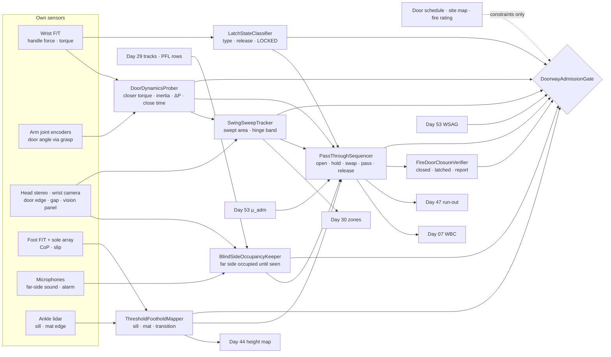
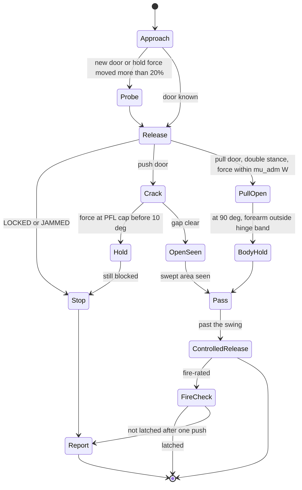
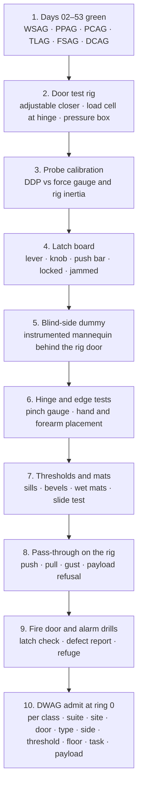

# Day 54 — Doors, gates, and thresholds under the wet-surface stack: DoorDynamicsProber / LatchStateClassifier / BlindSideOccupancyKeeper / SwingSweepTracker / ThresholdFootholdMapper / PassThroughSequencer / FireDoorClosureVerifier / DoorwayAdmissionGate under WetSurfaceAdmissionGate + ConfinedSpaceAdmissionGate + ElevatedAccessAdmissionGate + OverheadToolAdmissionGate + BimanualToolAdmissionGate + PowerToolAdmissionGate + PushPullAdmissionGate + PayloadCarryAdmissionGate + OutdoorGroundAdmissionGate + TerrainLocomotionAdmissionGate + FallSafeAdmissionGate + DeliberateContactAdmissionGate + WholeBodyTouchAdmissionGate + HumanHandoverAdmissionGate + CooperativeTaskAdmissionGate + TaskCompositionAdmissionGate + FleetSkillCatalogAdmissionGate + proximity + zone attestation + supervisor + logging + canary + HIL + fleet + incident + change-management + maintenance + thermal + energy gates

![DoorDynamicsProber / LatchStateClassifier / BlindSideOccupancyKeeper / SwingSweepTracker / ThresholdFootholdMapper / PassThroughSequencer / FireDoorClosureVerifier / DoorwayAdmissionGate: a 63.8 kg humanoid meets a 50 kg fire door; a slow hand pull measures 32 N·m of closer torque and 13.8 kg·m² of inertia; the robot can pull 150 N with its arm, but on wet tile the floor only lets it push or pull 75 N, so a pressurized stairwell door needing 72 N is refused there; the far side of an opaque door is treated as occupied, so the door is cracked 10 degrees at 0.10 m/s with the push force above the closer capped by the Day 29 contact row; the swing arc is a moving obstacle and nothing of the robot goes within 0.15 m of the hinge line, where the closer squeezes with about 1600 N; a 32 mm exterior sill and a wet mat are Day 44 footholds stepped over with 61 mm toe clearance; the fire door must close and latch behind the robot, checked by a 10 N tug](/images/day54-doors-gates-thresholds.png)

[Day 05](/lessons/day-05-power-bms) owns `torque_scale` and state of charge **forever**. [Day 07](/lessons/day-07-wbc-balance) owns whole-body balance. [Day 17](/lessons/day-17-runtime-safety-supervisor) owns ESTOP and safe states. [Day 29](/lessons/day-29-human-proximity-safety) owns person tracks, SSM, and PFL rows. [Day 30](/lessons/day-30-collaborative-workspace-zoning) owns attested zones and `CrossSiteZoneConfigGate`. [Day 42](/lessons/day-42-deliberate-whole-body-contact) owns deliberate body contact. [Day 43](/lessons/day-43-falls-fall-safe-contact) owns falls and FSAG. [Day 44](/lessons/day-44-stairs-ramps-uneven-terrain) owns the height map and touchdown checks. [Day 46](/lessons/day-46-carrying-payloads-walking) owns what the hands carry. [Day 47](/lessons/day-47-pushing-pulling-heavy-objects) owns pushing and pulling heavy objects and run-out on release. [Day 53](/lessons/day-53-water-wet-floors-spills) owns wet floors, measured friction, and WSAG.

A door is the most ordinary object in a building and one of the hardest things a humanoid does in it. In a single pass the robot has to pull or push a heavy panel that fights back through a spring, work a latch whose type it has to discover, step over a sill it can barely see, move its body through a gap that's narrowing behind it, and do all of that without knowing who's on the other side. Then, for a fire door, it has to make sure the door shuts properly once it's gone. Every one of the earlier days shows up here: Day 47's pulling, Day 53's friction, Day 44's footholds, Day 42's body contact, and Day 29's people.

Eight lies show up the first time a team sends a humanoid through a real building's doors:

1. **Looks-light lie.** "It's an interior door, it's light." A steel fire door weighs 50 kg or more, and the closer spring matters more than the mass. Both are measured by the hand, never guessed from the paint.
2. **Strong-arm lie.** "The arm can pull 150 N, so any door is fine." The arm isn't the limit. The floor is. A robot can only pull as hard as its feet can push back, and on wet tile that's half of what the arm can do.
3. **Stuck-not-locked lie.** "It didn't open; pull harder." A door that doesn't move under the force it needed yesterday is locked, jammed, or held by someone. All three mean stop.
4. **Empty-hall lie.** "Nobody's on the other side." Behind an opaque door, a person is present until the robot has seen that space.
5. **Open-is-a-wall lie.** "Once it's open, the door is just a wall." It's a 50 kg panel on a spring that starts closing the moment it's let go, and its hinge side is a crusher.
6. **Flat-doorway lie.** "Doorways are flat." Exterior sills, floor transitions, and entrance mats are steps, and the mat can slide.
7. **Auto-door lie.** "The automatic door will see the robot." Its presence sensor was tuned for people, not for a robot's legs at a robot's speed.
8. **Prop-it lie.** "Wedge the fire door so the robot can get through." A fire door's whole job is to be shut. The robot leaves it closed and latched or reports that it isn't.

Today owns **`DoorDynamicsProber` / `LatchStateClassifier` / `BlindSideOccupancyKeeper` / `SwingSweepTracker` / `ThresholdFootholdMapper` / `PassThroughSequencer` / `FireDoorClosureVerifier` / `DoorwayAdmissionGate`**. The question is: **how do you let a humanoid open and pass through hinged, self-closing, fire, push-bar, and automatic doors, with the door's closer torque, inertia, and latch MEASURED by the hand and never assumed from its look; every door force bounded by the floor's admitted friction and the robot's balance, not the arm's strength; locked doors treated as a stop, not a harder pull; the far side of an opaque door treated as occupied until seen; the swing as a moving obstacle with a no-go band at the hinge; sills and mats as Day 44 footholds; and fire doors closed and latched behind it — without raising Day 29 PFL, writing Day 05 `torque_scale`, gating Day 17 ESTOP, or bypassing `CrossSiteZoneConfigGate`?**

## A door is a spring-loaded pendulum with an unknown room behind it

The rule everything follows from: **a door's closer torque, inertia, latch, and threshold are measurements taken by this robot today; the force the robot may put on a door is set by the floor it stands on and its balance; the far side is occupied until seen; and a fire door is a door that must end up latched. A door schedule, a "standard interior door," the arm's torque rating, an empty hallway on yesterday's map, and an automatic door's sensor are never inputs that admit anything.** They may add constraints. They may never raise a limit.

Three facts set the shape of the lesson.

**A door is a rigid panel rotating about its hinge.** For a uniform leaf of mass $m$ and width $w$:

$$
I = \frac{m\,w^2}{3}, \qquad F_{\text{handle}} = \frac{\tau_{\text{closer}}(\theta) + \tau_{\Delta P} + I\,\alpha}{r_h}
$$

For a 50 kg, 0.91 m fire door, $I$ = 13.8 kg·m². With the handle at $r_h$ = 0.84 m and a closer holding 32 N·m at 30°, just holding the door open takes 38 N. The closer usually matters more than the mass.

**The floor sets the pull, not the arm.** Every newton the hand puts on the door comes back through the feet as horizontal ground force. Day 53 gave the cap: in double stance the robot may apply at most $\mu_{\text{adm}} W$ horizontally, and while stepping it gets only what the gait leaves over. For the example robot ($W$ = 626 N):

$$
F_{\text{door}} \le \mu_{\text{adm}}\,W = 0.12 \times 626 = 75\ \text{N on wet tile}, \qquad 0.35 \times 626 = 219\ \text{N on dry tile}
$$

**The hinge side is a crusher.** The same 32 N·m of closer torque acting on something caught 20 mm from the hinge line squeezes it with $32 / 0.02$ = 1600 N. No finger, cable, or wrist goes there.

| Layer | Owns | Must not own |
|-------|------|--------------|
| `DoorDynamicsProber` | Closer torque vs angle, inertia, breakaway force, pressure push, closing time, measured by a slow hand pull | Door properties from a schedule, a look, or "standard door" |
| `LatchStateClassifier` | Latch type (lever, knob, push bar, pull, magnetic, none), release torque, latched / unlatched / locked / jammed | Forcing a door that didn't release |
| `BlindSideOccupancyKeeper` | Far-side swept area as occupied until seen; crack-open speed and force caps; vision panel and gap views | Declaring a far side empty from the near side or an old map |
| `SwingSweepTracker` | Door angle and predicted closing; swept area as a moving obstacle; the hinge no-go band | Treating an open door as a static wall |
| `ThresholdFootholdMapper` | Sills, floor transitions, ramps, and mats as Day 44 cells with height, depth, σ, and friction; mat slide test | Calling a doorway flat floor |
| `PassThroughSequencer` | Open, hold, hand-to-body hold swap, pass, controlled release, in double stance where the floor requires | Pulling while stepping on wet floor; leaving a door to slam |
| `FireDoorClosureVerifier` | Fire-rated doors closed and latched behind; latch check; defect reports; alarm behavior | Propping, wedging, or holding fire doors open |
| `DoorwayAdmissionGate` | Fail-closed admit per robot class, suite, site, door, door type, side, threshold, floor, task, payload | `JointCommand`; Day 05; PFL; Day 17 |
| Days 05 / 07 / 17 / 29 / 30 / 42 / 43 / 44 / 46 / 47 / 53 | Charge, balance, ESTOP, people, zones, body contact, falls, height map, payloads, push/pull, wet floors | Being outranked by "it's just a door" |

**Core thesis:** **a humanoid passes a door only on what it has measured: it pulls slowly once to learn the closer and the mass, keeps every door force inside what its feet and balance allow, stops at a latch that won't release, opens slowly into a space it can't see, keeps out of the swing and away from the hinge, steps over the sill it measured, and leaves fire doors latched behind it.**



## Physical machine: what a door does to a humanoid

Three example doors run through the lesson:

- **Site E, hospital corridor fire door.** A single steel leaf, 0.91 × 2.13 m, rated 90 minutes, with a lever latch, a surface closer, and a 13 mm beveled threshold. It's a push door going out of the ward and a pull door coming back. There's a narrow wired-glass vision panel at head height. The corridor floor is glazed tile that's mopped twice a day. Nurses, carts, and patients come through constantly.
- **Site F, warehouse exterior door.** A steel door opening outward to the loading yard, pull to enter from outside. Heavy closer, a 32 mm high, 120 mm deep aluminum sill, a 12 mm rubber-backed entrance mat inside that's wet on rainy days, and wind on the outside.
- **Site G, pressurized stairwell door.** The same leaf as Site E, but the stairwell is held at 25 Pa above the corridor so smoke stays out in a fire. The robot pulls it toward itself to enter the stairwell, against the pressure.

### Closer and inertia: measured by one slow pull

`DoorDynamicsProber` measures a door the way a door technician does, with a force gauge on the handle, except the gauge is the wrist F/T and the protractor is the arm's own encoders through the grasp. On the first visit to a door, standing in double stance on an admitted floor, the robot releases the latch and pulls (or pushes) the door open at a slow constant 0.1 rad/s from 0° to 90°, then lets it close against its hand at the same speed. Then it does one step in force: it raises the handle force by a fixed amount and reads the angular acceleration.

At slow constant speed the inertia term is near zero, so the handle force times $r_h$ is the closer torque at each angle, plus hinge friction. The difference between opening and closing curves is the closer's hysteresis (closers resist opening harder than they push closing). The force step gives the inertia:

$$
I = \frac{F_{\text{step}}\,r_h - \tau_{\text{closer}}(\theta)}{\alpha}
$$

Site E: holding at 30° took 38 N, so $\tau_{\text{closer}}$ = 32 N·m. Stepping to 60 N gave α = 1.33 rad/s², so $I = (50.4 - 32)/1.33$ = 13.8 kg·m², which is a 50 kg leaf. Measured at the example sites:

| Door | Release | Breakaway at handle | Hold at 30° | $I$ (kg·m²) | Extra | Close 90°→12° |
|------|------|------|------|------|------|------|
| Site E fire door | Lever, 1.6 N·m | 41 N | 38 N | 13.8 | — | 6.1 s |
| Site F exterior | Lever, 2.1 N·m | 70 N | 64 N | 17.2 | wind gusts measured to +20 N | 4.2 s calm, 1.6 s in a gust |
| Site G stairwell | Lever, 1.6 N·m | 68 N | 64 N | 13.8 | 25 Pa → +26 N at handle | 5.8 s |

The extra at Site G is plain pressure times area: $\Delta P \cdot A$ = 25 Pa × 1.94 m² = 48.5 N on the leaf, acting at its middle, 0.455 m from the hinge, which is 22 N·m, or 26 N at the handle. The robot doesn't compute that from a design value. It measures the breakaway, and the pressure is simply in it. It does note the pressure separately, because it changes when a fan starts or another stairwell door opens.

Closing time is measured by letting the door close from 90° with the hand following it at zero force. Accessibility codes in many places require at least 5 s from 90° to 12°; Site F's door in calm air met that and in a gust didn't. The robot plans with the fastest close it has measured, never the calm one.

### Force: the feet decide how hard the hand can pull

The handle force needed to open a door at a steady, slow acceleration of 0.5 rad/s² is the hold force plus $I\alpha/r_h$:

| Door | Steady | + inertia | + gust / ΔP | × 1.2 margin | Floor | $\mu_{\text{adm}} W$ | Result |
|------|------|------|------|------|------|------|------|
| Site E, pull | 38 N | +8 N | — | 55 N | Wet tile 0.12 | 75 N | Admitted, double stance only |
| Site F, pull from outside | 64 N | +10 N | +20 N | 113 N | Wet mat 0.20 | 125 N | Admitted, double stance only, tight |
| Site G, pull into stairwell | 38 N | +8 N | +26 N | 87 N | Wet tile 0.12 | 75 N | **Refused** until the tile is dry |
| Site G, same door | 38 N | +8 N | +26 N | 87 N | Dry tile 0.35 | 219 N | Admitted |

The Site G row is the lesson in one line: a door the arm pulls without effort is refused because the floor was mopped ten minutes ago. Pulling while stepping is refused on any wet floor, because Day 53's gait already uses almost all of the friction at heel strike.

Balance is the second limit. A pull at handle height $h$ shifts the CoP toward the door by about $F h / W$. Site F's 113 N at 1.0 m shifts it 0.18 m, so the robot pulls from a staggered stance with the rear foot back, which gives about 0.35 m of fore-aft support polygon. And the moment the door frees itself (latch releases late, wind drops, someone on the other side pushes), the pulled force disappears and the robot is leaning on nothing. That's Day 47's run-out: `PassThroughSequencer` publishes every door pull as a pending release to Day 47's `RunOutReleaseArbiter` with the force it's carrying.

### Latches: discover the type, and stop when it won't release

`LatchStateClassifier` finds the latch by looking at the hardware and confirms it by touch: a lever rotates about its own axis and needs a small torque; a knob needs the same torque but a full grasp; a push bar needs a press across the door; a pull handle has no latch at all; a magnetic lock has no visible hardware and needs a site-issued release. The first time at a door it records the release torque and the angle at which the bolt clears.

Then it classifies every later attempt:

- **Unlatched:** the handle reaches its recorded release angle and the door moves at no more than 1.2× its recorded breakaway force.
- **Locked:** the handle stops short of its release angle at 2× its recorded release torque. Stop. Never more torque.
- **Jammed or held:** the handle releases but the door doesn't move at 1.2× breakaway. Stop. Something is wrong with the door, the floor under it, or someone is holding it.

Locked, jammed, and held all end the same way: the robot lets go, steps out of the swing, and reports. It never escalates force on a door that didn't do what it did yesterday, because the honest explanations for "harder than last time" include a person leaning on the other side and a frame that's twisted in a fire.

Push bars on exit doors often carry an alarm or a delayed-egress lock that sounds and starts a 15-second countdown. Pressing one is a site event, not a door operation. The robot uses an exit door with panic hardware only when the route attests that it's not alarmed.

### The far side: occupied until seen

Pushing a door open sweeps its leading edge through space the robot can't see. A person walking up to the same door from the other side is the most common way doors hurt people. `BlindSideOccupancyKeeper` treats the far-side swept area, a quarter disc of radius 0.91 m, as occupied until the robot has seen it.

It looks first through whatever it can: a vision panel (Site E's wired glass gives a narrow, distorted view and counts only for the part of the swept area it actually shows), the gap under the door for feet, and sound. Then it cracks the door: it opens to 10°, which moves the edge 0.16 m, at an edge speed of at most 0.10 m/s. At that speed the door carries $\frac{1}{2} I \omega^2$ = 0.08 J, nothing a person feels as more than a nudge. During the crack, the push force above what the closer needs is capped so the door edge can't press on a person harder than Day 29's contact row for the hand and arm:

$$
F_{\text{handle}} \le \frac{\tau_{\text{closer}}(\theta)}{r_h} + F_{\text{PFL}}\,\frac{r_e}{r_h}
$$

where $r_e$ is the edge radius. If the door stops before 10° with force at that cap, there's something there: the robot holds, then backs the door off. Once the gap is open, the wrist camera looks through it and the swept area is updated from what's actually visible. The door opens further only over area that's been seen.

Pull doors are the mirror case: the door swings toward the robot, and the danger is someone on the far side pushing at the same moment. The robot pulls from the latch side, outside its own swing arc, so a door pushed hard from the other side swings past it rather than into it.

### The swing: a moving obstacle with a crusher at one end

`SwingSweepTracker` tracks the door angle from the grasp while the robot holds the door and from the head camera when it doesn't, and predicts its close from the measured closer curve and the fastest measured close time. The door's swept area is a moving obstacle published to the planner, and the area the door will sweep in the next 2 s is published as a short-lived no-robot zone to Day 30.

Two bands are fixed:

- **Hinge band.** Nothing of the robot comes within 0.15 m of the hinge line on either side. The 1600 N figure above is why. The robot's forearm braced on the door face near the hinge is still in the hinge band.
- **Leading edge.** No link goes between the door's leading edge and the frame on the latch side while the door can close. A hand on the handle is fine; a hand curled around the edge isn't.

At Site F in a gust, the door closed from 90° in 1.6 s, an average edge speed of 0.77 m/s and about 6 J at the edge. That's enough to knock the robot's arm out of the planned pose and to throw a lightly held payload. The robot plans Site F with the gust close time and holds the door with its body, not just its hand, whenever the wind is above the threshold where gusts were measured.

### Thresholds and mats: Day 44 footholds in a doorway

`ThresholdFootholdMapper` treats a doorway as a short stretch of uneven terrain and writes it into Day 44's height map with σ, the same way stairs are:

| Doorway | Feature | Measured | Plan |
|------|------|------|------|
| Site E | Beveled threshold | 13 mm, 1:2 bevel | Walk over; tile friction from Day 53 on both sides |
| Site F | Aluminum sill | 32 mm high, 120 mm deep | Step **over**; sill is shorter than the 0.24 m foot, never a foothold |
| Site F | Entrance mat | 12 mm, curled edge 8 mm, wet | Step over the curled edge; mat friction top and underneath |
| Site G | Floor change tile → painted concrete | Flush | Re-probe friction; stairwell concrete often dusty |

Toe clearance over the Site F sill follows the same pattern as Day 44's stair edges: obstacle height plus 3σ of the height estimate plus a 20 mm margin, so $32 + 3 \times 3 + 20$ = 61 mm. The ankle lidar re-measures the sill at every approach, because sills get bent and mats get moved.

The mat is two friction measurements. Day 53's toe-slide probe gives the friction between the sole and the mat's top. Then a mat slide test: the robot loads one foot on the mat to 300 N and pushes it sideways, watching the mat edge with the camera. Site F's wet rubber-backed mat moved at 90 N of shear on the wet concrete underneath, which is 0.30, and with the 3σ low and 1.5 margin its admitted friction came out at 0.20. A mat's admitted friction is the lower of its top and its underside. A mat that moves under the probe isn't a foothold at all.

### Passing through: open, hold, swap, pass, release

`PassThroughSequencer` owns the order. With the example robot's shoulders 0.48 m wide and a clear opening of 0.81 m at 90°, there's 0.165 m of lateral margin on each side, minus about ±0.04 m of lateral foot-placement tracking error. Enough for walking straight, not for walking while turning.

For a **pull door**, the robot opens to 90° from a staggered stance on the latch side, then steps into the opening and swaps the hold from its hand to its forearm braced flat on the door face, outside the hinge band, as a Day 42 deliberate contact with its own force limit. It walks through with the door resting on the forearm, then releases by following the door closed with the hand for the first 30° so the closer takes over smoothly, instead of letting it swing from 90°.

For a **push door**, the robot cracks it as above, opens to 90° as the swept area is seen, walks through with its hand on the push plate or the door face, and releases the same way from the other side.

Carrying something changes the answer. A Day 46 payload that needs both hands can't go through a manual self-closing door alone: the robot either waits for an automatic opener, gets a person or a second robot to hold it under Day 39/40 rules, or sets the payload down, opens, and carries it through in two trips. It never holds a door with the payload.

### Automatic doors: measure them like any other door

Sliding and swinging automatic doors have their own presence sensors, tuned for people. A robot's thin legs or a low payload may not trigger them, and an automatic swing door's safety sensor may not see a robot standing in its swing path. The robot measures each automatic door on bring-up the way it measures a closer: how long it stays open after the robot was last detected, at which positions the robot is detected at all, and whether it reopens when the robot stands in the threshold. It passes only when the door is fully open and the measured remaining open time is at least twice its pass time. It never stops in the threshold. If the door starts closing while the robot is in it, it continues through at its current speed if past the midpoint and backs out otherwise.

### Fire doors: closed and latched behind

A fire door only works shut and latched. `FireDoorClosureVerifier` takes over after every pass through a door marked fire-rated in the site's Day 30 attestation (and treats any door with a fire label it sees as rated, even if the map says otherwise). It watches the door close and checks that it latched: the wrist camera sees the edge flush in the frame, and a 10 N tug on the handle without turning it moves the door less than 2 mm. The door has twice its measured close time to latch. If it doesn't, the robot gives it one gentle push with the hand at closing speed. If it still doesn't latch, the robot reports a fire-door defect to the site with the door ID and a photo. It never wedges, props, or holds a fire door open longer than its own pass takes.

Fire doors held open by magnetic devices release when the alarm sounds. On a site fire alarm, the robot stops door tasks, clears every door swing arc and egress width, and moves to its Day 30 refuge spot. It doesn't pass through fire doors during an alarm unless the site's plan sends it, and it never stands in the swing of a held-open fire door at any time.

## DoorDynamicsProber: the door's numbers come from the hand

DDP runs the slow pull and the force step on every new door, and a short hold check (force at 30°) on every visit after that. A hold force that has moved more than 20% from the recorded value means re-probe, because closers get adjusted, hinges wear, and pressure fans switch on. It reports closer torque against angle, inertia, breakaway, pressure push, and the fastest close time measured. It never reads a door schedule or a "standard door" weight as a measurement.

## LatchStateClassifier: a door that doesn't release is a stop

LSC records latch type, release torque, and release angle on first contact, and classifies every attempt as unlatched, locked, or jammed/held against those records. Locked and jammed both end in let go, step out, and report. It never escalates torque or force past its fixed multiples.

## BlindSideOccupancyKeeper: open slowly into what you can't see

BSOK keeps the far-side swept area occupied until it's been seen, uses vision panels and door gaps only for the area they actually show, and caps crack speed at 0.10 m/s edge and push force above the closer at Day 29's contact row. It reads Day 29's rows; it never raises one, and a door edge pressing on a person is the robot pressing on a person.

## SwingSweepTracker: the door is moving even when nobody touches it

SST publishes the door's swept area and its 2 s predicted sweep as a moving obstacle and a short-lived zone, and enforces the hinge band and the leading-edge rule. It predicts with the fastest measured close.

## ThresholdFootholdMapper and PassThroughSequencer: step over it, then walk through it



TFM writes sills, mats, and floor changes into Day 44's height map with σ and friction, and runs the mat slide test. PTS sequences the pass: pulls only in double stance on wet floor, hand-to-forearm hold swap outside the hinge band, controlled release over the first 30° of the close, and every door pull published to Day 47 as a pending release.

## FireDoorClosureVerifier: a fire door's last state is latched

FDCV checks latch after every pass through a fire-rated door, allows one gentle push, then reports. It never props, wedges, or holds a fire door, and on a fire alarm it sends the robot to its refuge spot out of every swing and egress path.

## DoorwayAdmissionGate

`DoorwayAdmissionGate` (DWAG) admits door modes per robot class, sensor suite hash, site, door ID, door type, side, threshold, floor, task, and payload, under Day 53 WSAG (most doors meet a mat or a mopped floor), Day 47 PPAG for the pull, Day 46 PCAG for anything carried, Day 44 TLAG for the threshold, Day 43 FSAG, and Day 42 DCAG for the forearm hold. Every row needs:

- DDP records for the door with a hold check from this visit within 20% of the record.
- LSC latch type, release torque, and release angle on record.
- Required door force × 1.2 within $\mu_{\text{adm}} W$ for the floor at the pull stance, and the CoP shift inside the staggered stance polygon.
- BSOK crack parameters for push doors, with the Day 29 row used for the cap.
- SST hinge band and leading-edge rule active; close time from the fastest measurement.
- TFM cells for every threshold feature and mat, with mats slide-tested.
- PTS hold plan with no payload in the holding hand.
- FDCV active for every fire-rated door.
- Day 30: door swings marked in the site plan and the refuge spot set for alarms.

DWAG never writes `JointCommand`, never touches Day 05 `torque_scale`, never raises a Day 29 row, never accepts a door schedule, a look, or the arm's rating as a door force, never escalates force on a locked or jammed door, never presses an alarmed push bar, never props a fire door, and never gates ESTOP. Day 17's ESTOP while holding a door is: release the hand grasp, keep the arm where it is, and let the door close against the arm rather than pull it into the hinge band.

## Data shapes

```text
DoorRecord:                                   # DDP
  door_id, site, leaf_w_m, leaf_h_m, handle_r_m, swing   # PUSH | PULL from this side
  closer_tau_open_nm[angle], closer_tau_close_nm[angle]
  inertia_kgm2, mass_est_kg, breakaway_n
  delta_p_push_n, close_time_s_fastest, close_time_s_calm
  probed_at, hold30_n_recorded, hold30_n_this_visit

LatchRecord:                                  # LSC
  door_id, type                  # LEVER | KNOB | PUSH_BAR | PULL | MAGNETIC | NONE
  release_torque_nm, release_angle_deg, alarmed, delayed_egress
  state                          # UNLATCHED | LOCKED | JAMMED_OR_HELD | UNKNOWN(=LOCKED)

BlindSide:                                    # BSOK
  door_id, swept_cells[], seen_cells[], vision_panel_cells[]
  crack_angle_deg, crack_edge_mps, pfl_row_id, handle_force_cap_n
  blocked_at_deg

Sweep:                                        # SST
  door_id, angle_deg, angle_sigma_deg, omega_rad_s
  predicted_sweep_2s_cells[], hinge_band_m, leading_edge_rule

DoorwayCell:                                  # TFM
  cell_id, kind                  # SILL | BEVEL | MAT | TRANSITION | RAMP
  height_mm, depth_mm, sigma_mm, foothold_allowed
  mu_top, mu_under, mu_adm, mat_slide_shear_n

PassPlan:                                     # PTS
  door_id, stance, floor_mu_adm, force_req_n, force_cap_n, cop_shift_m
  hold                           # HAND | FOREARM_DAY42
  payload_in_hand, release_follow_deg, day47_pending_release_n

FireCheck:                                    # FDCV
  door_id, fire_rated, closed_at_s, flush, tug_10n_disp_mm
  latched, push_attempted, defect_report_id

DoorwayAdmission:                             # DWAG
  robot_class, suite_hash, site, door_id, door_type, side, threshold, floor, task, payload
  ring, refusals[]
  forbidden:
    door_force_from_schedule: true
    door_force_from_arm_rating: true
    pull_while_stepping_on_wet: true
    escalate_on_locked: true
    open_unseen_fast: true
    link_in_hinge_band: true
    press_alarmed_push_bar: true
    prop_fire_door: true
    raise_pfl: true
    write_torque_scale: true
    gate_estop: true
    bypass_cross_site_zone_config_gate: true

# Unchanged owners
WetSurfaceAdmissionGate · mu_adm (Day 53) · ConfinedSpaceAdmissionGate (Day 52)
PushPullAdmissionGate · RunOutReleaseArbiter (Day 47) · PayloadCarryAdmissionGate (Day 46)
TerrainLocomotionAdmissionGate · height map (Day 44) · FSAG · fall cone (Day 43)
DeliberateContactAdmissionGate (Day 42)
CrossSiteZoneConfigGate · zones (Day 30) · tracks · SSM · PFL (Day 29)
SupervisorState ESTOP · safe states (Day 17) · WBC (Day 07)
BmsState / PowerState (Day 05): torque_scale, reserve
  accepts_requests_from_doorway: false
```

## Config

A starting configuration. Every number is a policy you re-derive from your own robot, hands, and buildings:

```yaml
doorway:
  probe:
    open_speed_rad_s: 0.1
    force_step_n: 20
    reprobe_if_hold30_moves_pct: 20
    close_time: fastest_measured
    schedules_and_labels: constraints_only
  force:
    accel_rad_s2: 0.5
    margin: 1.2
    cap: mu_adm_W_double_stance
    pull_while_stepping_on_wet: refused
    stance: staggered
    run_out: day47_pending_release
  latch:
    locked_if_release_torque_x: 2.0
    jammed_if_breakaway_x: 1.2
    on_locked_or_jammed: [let_go, step_out, report]
    alarmed_push_bar: refused_unless_route_attests
  blind_side:
    far_side: occupied_until_seen
    crack_deg: 10
    crack_edge_mps_max: 0.10
    force_above_closer: day29_pfl_row_hand_arm
    vision_panel: counts_only_visible_cells
  sweep:
    publish_horizon_s: 2.0
    hinge_band_m: 0.15
    leading_edge_rule: no_link_between_edge_and_frame
    gust_hold: forearm
  threshold:
    toe_clearance: height_plus_3sigma_plus_20mm
    sill_as_foothold_if_depth_ge_foot: false
    mat_slide_test_n: 300
    mat_mu_adm: min_top_under
  pass:
    lateral_margin_min_m: 0.12
    hold_swap: forearm_day42_outside_hinge_band
    release_follow_deg: 30
    payload_needs_both_hands: [auto_opener, helper_day39_40, two_trips]
  automatic:
    measure: [open_after_last_detect_s, detection_positions, reopen_in_threshold]
    pass_if: remaining_open_ge_2x_pass_time
    stop_in_threshold: never
  fire:
    latch_check: [flush_edge, tug_10n_disp_lt_2mm]
    latch_wait: 2x_close_time
    pushes_allowed: 1
    not_latched: report_defect
    prop_or_hold: never
    alarm: [stop_door_tasks, clear_swings_and_egress, day30_refuge]
  admission:
    keyed_by: [robot_class, sensor_suite_hash, site, door_id, door_type, side, threshold, floor, task, payload]
    requires: [day53_wsag, day47_ppag, day46_pcag, day44_tlag, day43_fsag, day42_dcag]
```

## Physical ↔ digital pairing

| Physical | Digital twin / backing |
|----------|------------------------|
| Door schedule says "interior door, standard closer" | Constraint only; DDP probe required |
| Robot pulls Site E slowly from 0° to 90° | DDP: closer 32 N·m at 30°, close 6.1 s |
| Force step from 38 N to 60 N | DDP: α 1.33 rad/s² → $I$ 13.8 kg·m², ~50 kg |
| Lever stops at 2× release torque | LSC: LOCKED → let go, step out, report |
| Site E corridor floor just mopped | Day 53 μ_adm 0.12 → door cap 75 N; Site E pull 55 N admitted |
| Site G stairwell needs 87 N with margin | DWAG: refused on wet tile; admitted once tile is dry |
| Robot pushes the ward door out into the corridor | BSOK: crack to 10° at 0.10 m/s; force above closer at Day 29 cap |
| Door stops at 6° with force at the cap | BSOK: blocked → hold, back off; someone is there |
| Nurse appears in the gap | Day 29 track; robot waits outside the swing |
| Robot holds door with forearm while passing | PTS: Day 42 contact, forearm 0.30 m from hinge line |
| Wrist drifts toward the hinge | SST: hinge band violation → stop motion, re-plan hold |
| Gust slams Site F door in 1.6 s | SST: gust close time; forearm hold required above threshold |
| Wet mat slides at 90 N | TFM: mat μ_adm 0.20, curled edge stepped over |
| 32 mm sill at Site F | TFM: step over at 61 mm toe clearance; sill not a foothold |
| Site E door closes behind robot, edge not flush | FDCV: one push; still open → fire-door defect report |
| Fire alarm sounds | FDCV: stop, clear swings and egress, Day 30 refuge spot |

The pairing that matters most: **replay every door pass from the robot's own bag and show that the door was probed or hold-checked that visit, every pull stayed inside the floor's friction and the stance's balance, no locked door was forced, every push door opened slowly into seen space, no link entered the hinge band, every sill was stepped over with measured clearance, and every fire door ended latched or reported.**

## Bring-up sequence (before the robot opens a real door with people around)



1. **Days 02–53 green,** with WSAG, PPAG, PCAG, TLAG, FSAG, and DCAG admitted.
2. **Door test rig:** a real steel leaf on a frame with an adjustable closer, a load cell at the hinge, and a sealed box behind it to add pressure.
3. **Probe calibration:** DDP's closer curve and inertia against a hand force gauge and the rig's known inertia, until DDP's force is never under the gauge's.
4. **Latch board:** each latch type, locked and unlocked, and a door jammed by a wedge on the far side; LSC must stop on every locked and jammed case.
5. **Blind-side dummy:** an instrumented mannequin at different spots in the far swept area; the edge contact force must stay under the Day 29 row every time.
6. **Hinge and edge tests:** a pinch gauge in the hinge gap and between the edge and frame; replay every hold plan and show no link enters either.
7. **Thresholds and mats:** sills at 13, 25, and 40 mm, bevels, dry and wet mats on dry and wet floors, mats that slide.
8. **Pass-through on the rig:** push and pull doors, with a fan for gusts, and a payload that must be refused.
9. **Fire door and alarm drills:** doors that don't latch, the one-push rule, the defect report, and the alarm route to the refuge spot.
10. **DWAG admit at ring 0** per robot class, suite, site, door, door type, side, threshold, floor, task, and payload.

## Failure gallery

| Symptom | Likely cause |
|---------|--------------|
| Robot slides backward pulling a door on mopped tile | Door force capped by the arm, not $\mu_{\text{adm}} W$ |
| Robot falls backward when the door suddenly frees | Door pull not published to Day 47 as a pending release |
| Bent lever on a locked office door | No 2× release-torque stop; force escalated |
| Door edge hits a person in the corridor | Push door opened at full speed into unseen space |
| Robot fingers damaged at the hinge | Hand placement planned without the hinge band |
| Arm knocked out of pose by a closing door | Closing time from the calm measurement; gust ignored |
| Toe catches the exterior sill | Sill from the map, not re-measured; clearance without 3σ |
| Robot slips on the entrance mat | Mat top probed, underside never slide-tested |
| Automatic door closes on the robot's legs | Door's sensor trusted; open time never measured for the robot |
| Fire door left ajar after the robot passes | No latch check; door closed "by itself" assumed |

## Exercises

1. A door holds 45 N at 30° with the handle at 0.82 m. A step to 65 N gives 1.1 rad/s². What are the closer torque, the inertia, and the leaf mass if it's 0.86 m wide?
2. The robot weighs 600 N and stands on wet concrete with $\mu_{\text{adm}}$ 0.21. The door needs 52 N steady, 9 N to accelerate, and 18 N for pressure. With a 1.2 margin, is it admitted? What if the robot has to step during the pull?
3. A stairwell is at 38 Pa across a 0.91 × 2.13 m leaf with the handle at 0.84 m. How much handle force does the pressure add?
4. Site E's closer is 32 N·m at 10°, the edge radius is 0.88 m, and the Day 29 row for the arm is your own number $F_{\text{PFL}}$. Write the handle-force cap during the crack. Why does the closer term belong in it?
5. A 40 mm sill is 150 mm deep and the height estimate has σ 4 mm. What toe clearance does the step need? Can the sill be a foothold for a 0.24 m foot?
6. Write the `DoorwayAdmission` row for carrying a 12 kg box from the loading yard through Site F's door in the rain. Which rows refuse it, and what are the three ways to get the box inside?

## What to freeze this week

Extend [frames](/frames) and your safety config with:

- `DoorDynamicsProber`: slow pull and force step on every new door; closer curve, inertia, breakaway, pressure, fastest close; hold check every visit with re-probe at 20% drift.
- `LatchStateClassifier`: latch type and release on record; LOCKED at 2× release torque, JAMMED at 1.2× breakaway; both end in let go, step out, report.
- `BlindSideOccupancyKeeper`: far side occupied until seen; crack to 10° at 0.10 m/s; force above closer capped by the Day 29 row.
- `SwingSweepTracker`: door swept area and 2 s prediction as a moving obstacle; 0.15 m hinge band; leading-edge rule; fastest close.
- `ThresholdFootholdMapper`: sills, mats, and transitions into Day 44 with σ; toe clearance height + 3σ + 20 mm; mats slide-tested and admitted at the lower of top and underside.
- `PassThroughSequencer`: door force × 1.2 within $\mu_{\text{adm}} W$; double stance on wet floors; forearm hold outside the hinge band; controlled release; Day 47 pending release.
- `FireDoorClosureVerifier`: flush edge and 10 N tug; one push; defect report; never prop; alarm sends the robot to its refuge spot.
- `DoorwayAdmissionGate` fail-closed under Day 53 WSAG and the stack below it; keyed by robot class, suite, site, door, type, side, threshold, floor, task, and payload; **no door force from a schedule or the arm's rating, no harder pull on a locked door, no fast push into unseen space, no link in the hinge band, no unmeasured sill, no alarmed push bar, no propped fire door, no dual-write of Day 07, ESTOP, or `torque_scale`.**

The lesson isn't "teach the robot to use a door handle." It's that **a door is a spring-loaded panel with someone possibly behind it, and the robot's real limits are its feet, its balance, and what it can see: it measures the door by hand, pulls only as hard as the floor allows, stops at a latch that won't give, opens slowly into the unknown, keeps away from the hinge, steps over what it measured, and leaves every fire door latched.**

## Further reading

Look these up by title; they're the standard sources for today's door, threshold, and fire-door arguments:

- ICC A117.1 and the 2010 ADA Standards for Accessible Design, section 404, for door opening force, closing speed, thresholds, and clear width.
- NFPA 101, *Life Safety Code*, door opening force limits, and NFPA 80, *Standard for Fire Doors and Other Opening Protectives*, for why fire doors must self-close and latch.
- NFPA 92, *Standard for Smoke Control Systems*, for stairwell pressurization and the door-force limit it sets.
- EN 1154, *Building hardware — Controlled door closing devices*, for closer sizes and closing moments.
- ANSI/BHMA A156.10, *Power Operated Pedestrian Doors*, for how automatic door sensors and safety zones are specified.
- W. Meeussen et al., "Autonomous door opening and plugging in with a personal robot," *IEEE ICRA*, 2010, and the DARPA Robotics Challenge door task reports, for how robots have opened doors before.

## Next

**Day 55+** — Elevators and lifts under the doorway stack: calling and riding passenger and freight elevators; elevator doors as automatic doors whose sensors may not see the robot; the gap and level difference at the sill measured every stop; riding with people under Day 29 in a closed box; car acceleration as a disturbance to balance; floor arrival verified by the robot rather than the display; and what the robot does when the car stops between floors or the fire service mode recalls it — without raising Day 29 PFL, writing Day 05 `torque_scale`, or bypassing `CrossSiteZoneConfigGate`, under the same gates plus doorway admission.
