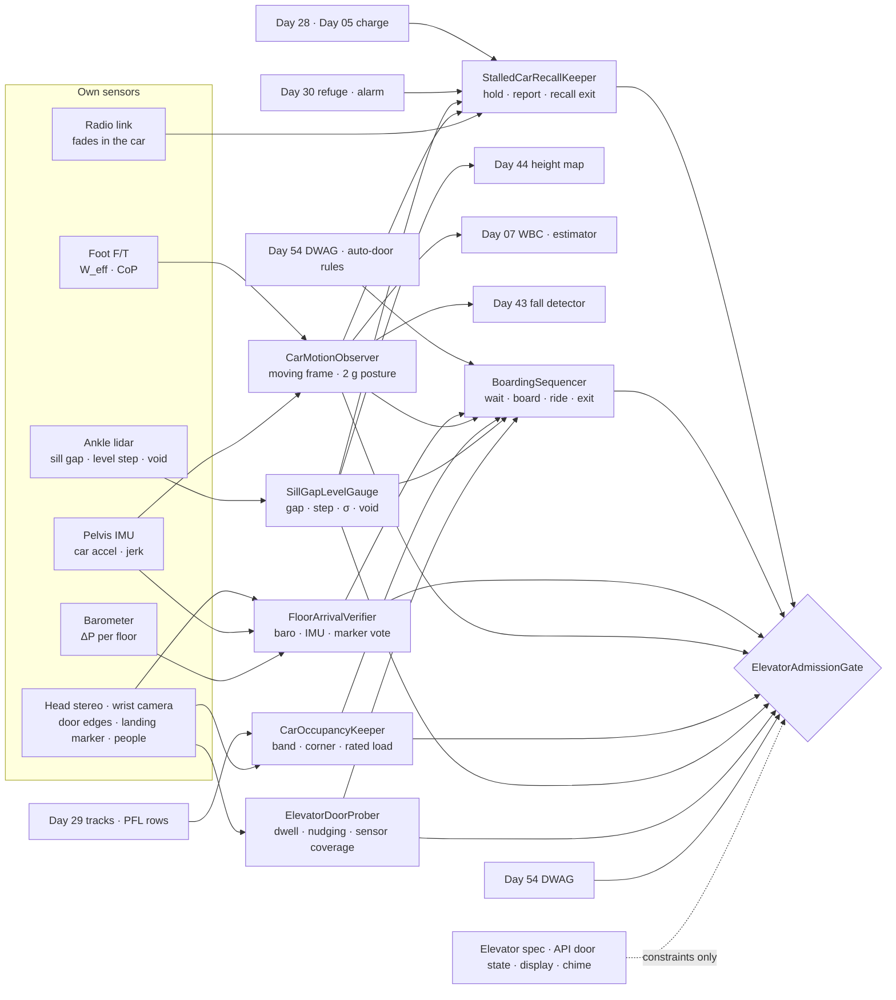
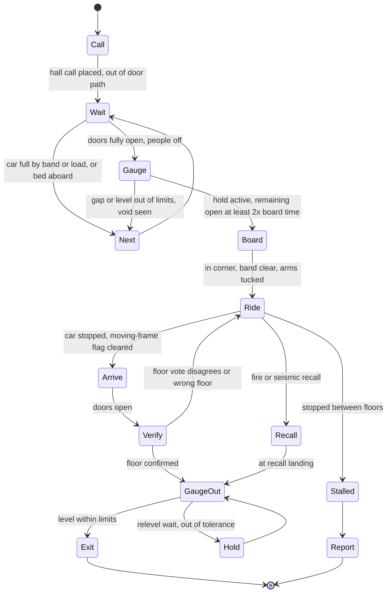
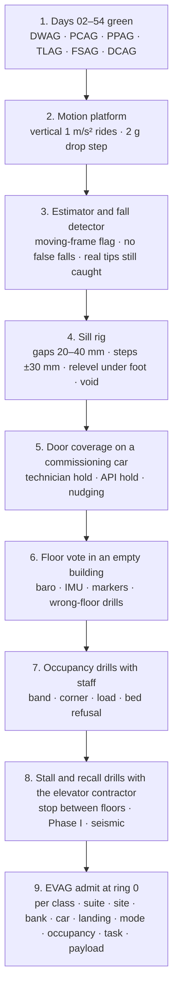

# Day 55 — Elevators and lifts under the doorway stack: ElevatorDoorProber / SillGapLevelGauge / CarOccupancyKeeper / CarMotionObserver / FloorArrivalVerifier / BoardingSequencer / StalledCarRecallKeeper / ElevatorAdmissionGate under DoorwayAdmissionGate + WetSurfaceAdmissionGate + ConfinedSpaceAdmissionGate + ElevatedAccessAdmissionGate + OverheadToolAdmissionGate + BimanualToolAdmissionGate + PowerToolAdmissionGate + PushPullAdmissionGate + PayloadCarryAdmissionGate + OutdoorGroundAdmissionGate + TerrainLocomotionAdmissionGate + FallSafeAdmissionGate + DeliberateContactAdmissionGate + WholeBodyTouchAdmissionGate + HumanHandoverAdmissionGate + CooperativeTaskAdmissionGate + TaskCompositionAdmissionGate + FleetSkillCatalogAdmissionGate + proximity + zone attestation + supervisor + logging + canary + HIL + fleet + incident + change-management + maintenance + thermal + energy gates

![ElevatorDoorProber / SillGapLevelGauge / CarOccupancyKeeper / CarMotionObserver / FloorArrivalVerifier / BoardingSequencer / StalledCarRecallKeeper / ElevatorAdmissionGate: a 63.8 kg humanoid rides an office passenger elevator; the door's light curtain is mapped against the robot's own shins, forearms, and payload, and the robot never holds a door with its body; at every stop the ankle lidar measures the 28 mm sill gap and the level step between car and landing before a foot moves; in the closed car the robot rides in a rear corner with a Day 29 clearance band, arms tucked, near-straight knees sized for a 2 g safety-gear stop; the car's 1.0 m/s² acceleration is published as a moving frame so the fall detector doesn't fire; floor arrival is a vote of barometer (46 Pa per 3.9 m floor), IMU ride integral, and a landing marker, never the display; stuck between floors it holds and reports and never pries a door; on fire recall it exits at the recall landing and doesn't call a car again](/images/day55-elevators-lifts.png)

[Day 05](/lessons/day-05-power-bms) owns `torque_scale` and state of charge **forever**. [Day 07](/lessons/day-07-wbc-balance) owns whole-body balance. [Day 17](/lessons/day-17-runtime-safety-supervisor) owns ESTOP and safe states. [Day 28](/lessons/day-28-energy-budgets-mission-planning) owns energy budgets. [Day 29](/lessons/day-29-human-proximity-safety) owns person tracks, SSM, and PFL rows. [Day 30](/lessons/day-30-collaborative-workspace-zoning) owns attested zones, refuge spots, and `CrossSiteZoneConfigGate`. [Day 42](/lessons/day-42-deliberate-whole-body-contact) owns deliberate body contact. [Day 43](/lessons/day-43-falls-fall-safe-contact) owns falls and FSAG. [Day 44](/lessons/day-44-stairs-ramps-uneven-terrain) owns the height map and touchdown checks. [Day 46](/lessons/day-46-carrying-payloads-walking) owns what the hands carry. [Day 52](/lessons/day-52-confined-crawl-spaces) owns link-loss holds. [Day 53](/lessons/day-53-water-wet-floors-spills) owns wet floors. [Day 54](/lessons/day-54-doors-gates-thresholds) owns doors, automatic doors, fire doors, and DWAG.

An elevator looks like the easy way between floors: no stairs, no fall cone, a button and a ride. For a humanoid it's the opposite. It has to cross a gap over a shaft at a step whose height changes every stop, get through an automatic door whose safety sensor was tuned for people, stand in a closed metal box with strangers where nobody can step away from it, ride a floor that accelerates under its feet, and then decide for itself which floor it's actually on. If the car stops between floors or the building goes into fire recall, every instinct a person has ("pry the door," "take the elevator, it's faster") is the wrong one. Yesterday's automatic-door rule, Day 44's footholds, Day 29's people, and Day 52's link-loss hold all come together inside one small car.

Eight lies show up the first time a team sends a humanoid into a real building's elevators:

1. **Door-sees-me lie.** "The elevator door will reopen if the robot's in the way." The reopening device covers the heights and widths its maker chose. Whether it sees a robot shin, a forearm reaching across, or a low cart is measured per car.
2. **Hold-it-with-your-arm lie.** "Stick an arm in the gap to keep the door open." An arm can sit between light-curtain beams, and a door held too long goes into nudging and closes anyway.
3. **Flush-floor lie.** "The car stops level with the floor." Rope stretch, hydraulic drift, and releveling move the car sill every stop. The step is measured, not assumed.
4. **One-more lie.** "There's room for one more." In a closed car Day 29 can't separate the robot from anyone by moving away. Room is a clearance band and a rated load, not a gap in the crowd.
5. **Still-floor lie.** "Standing in a car is standing still." The floor accelerates at 1 m/s² and a safety-gear stop can double the robot's effective weight. A naive fall detector reads an ordinary ride as a fall.
6. **Display lie.** "The display says 7, so this is 7." Cars skip floors, open at the wrong landing in service modes, and displays fail. The robot verifies its floor itself.
7. **Pry-it-open lie.** "If it stops between floors, open the doors and climb out." That's how people fall down shafts. The robot holds, reports, and waits for the mechanic.
8. **Ride-it-out lie.** "In a fire, the elevator is the fastest way out." Elevators recall to a landing and stop serving the public. The robot gets off where the recall puts it and never calls a car during an alarm unless the site plan names an evacuation elevator.

Today owns **`ElevatorDoorProber` / `SillGapLevelGauge` / `CarOccupancyKeeper` / `CarMotionObserver` / `FloorArrivalVerifier` / `BoardingSequencer` / `StalledCarRecallKeeper` / `ElevatorAdmissionGate`**. The question is: **how do you let a humanoid call and ride passenger, bed, and freight elevators, with each car's door timing and reopening-sensor coverage MEASURED against the robot's own body and never trusted from a spec; the sill gap and the car-to-landing level measured at every stop before a foot moves; riding with people in a closed car under Day 29 with a clearance band and a rated-load budget; the car's acceleration published as a moving frame and the ride posture sized for a safety-gear stop; floor arrival verified by the robot's own vote, never the display; and stalled cars and fire-service recall handled by holding, reporting, and exiting only where the building puts it — without raising Day 29 PFL, writing Day 05 `torque_scale`, gating Day 17 ESTOP, or bypassing `CrossSiteZoneConfigGate`?**

## An elevator is an automatic door on a moving room over a shaft

The rule everything follows from: **the door's open time and what its sensor sees, the gap and step at the sill, the room left in the car, the car's motion, and the floor the car stopped at are all measurements this robot takes on this ride. A building's elevator spec, a manufacturer API's door state, the floor display, the chime, and "it's always level here" are never inputs that admit anything.** They may add constraints. They may never raise a limit.

Three facts set the shape of the lesson.

**The car floor is an accelerating frame.** Standing in a car accelerating vertically at $a$, the robot's feet carry its effective weight:

$$
W_{\text{eff}} = W\left(1 + \frac{a}{g}\right)
$$

For the example robot ($W$ = 626 N) in a car starting up at 1.0 m/s², that's 690 N; stopping from the same trip it's 562 N. A progressive safety gear catching an overspeeding car is allowed to decelerate it at an average of up to 1 g, which makes $W_{\text{eff}}$ about 1250 N for a fraction of a second. Every knee, ankle, and wrist load in the car scales with it.

**Air pressure tells height.** Near the ground, pressure falls by about $\rho g$ per meter:

$$
\frac{dP}{dz} \approx -\rho\,g = -1.2 \times 9.81 \approx -11.8\ \text{Pa/m}, \qquad 3.9\ \text{m floor} \rightarrow 46\ \text{Pa}
$$

That's a strong signal for a good barometer, as long as the robot reads it after the doors open and the car has settled to the landing's pressure, not during a fast ride when the shaft's piston effect pushes the reading around.

**The sill is a step across a gap that moves.** Between the car sill and the landing sill there's a running clearance, and the car stops within a leveling tolerance that's set for people. US accessibility rules call for a gap of no more than 32 mm and stopping within 13 mm of level across the load range. Those are what a working car should do. What the robot steps on is what its lidar sees today.

| Layer | Owns | Must not own |
|-------|------|--------------|
| `ElevatorDoorProber` | Per car and landing: dwell after hall and car calls, door close speed, nudging timeout, reopening-sensor coverage mapped against the robot's own links and payloads | Door behavior from the spec or the API; holding a door with the body |
| `SillGapLevelGauge` | Sill gap width, car-to-landing level step, σ, sill groove and void check, at every stop and before every step | A level floor from the map or "it stopped" |
| `CarOccupancyKeeper` | People in the car as Day 29 tracks; robot's corner and clearance band; rated-load budget with robot and payload; boarding refusal | Fitting into a car by being close to people |
| `CarMotionObserver` | Car acceleration and jerk from IMU and foot F/T; moving-frame flag to the estimator and fall detector; ride posture load at 2 g | Treating the car as fixed ground, or a ride as a fall |
| `FloorArrivalVerifier` | Floor index from barometer, IMU ride integral, and landing marker; disagreement means stay | The display, the chime, or the API's floor as the floor |
| `BoardingSequencer` | Call, wait out of the door path, let people off, board under a measured hold, ride, exit; payload and cart handling | Racing a closing door; standing in the threshold |
| `StalledCarRecallKeeper` | Stopped between floors, out-of-level opening, fire recall, seismic or out-of-service modes; charge reserve for a stall | Prying doors, climbing out, calling a car in an alarm |
| `ElevatorAdmissionGate` | Fail-closed admit per robot class, suite, site, bank, car, landing, mode, occupancy, task, payload | `JointCommand`; Day 05; PFL; Day 17 |
| Days 05 / 07 / 17 / 28 / 29 / 30 / 42 / 43 / 44 / 46 / 52 / 54 | Charge, balance, ESTOP, energy, people, zones, contact, falls, height map, payloads, link loss, doors | Being outranked by "it's just a ride" |

**Core thesis:** **a humanoid rides an elevator only on what it has measured: it learns what each car's door sees and how long it stays open, never holds a door with its body, measures the gap and the step at every stop, boards only when it can keep a clearance band and stay inside the load, rides in a posture sized for an emergency stop while telling its own estimator that the floor is moving, confirms its floor itself, and when the car stalls or recalls it holds, reports, and gets off only where the building puts it.**



## Physical machine: what an elevator does to a humanoid

Three example cars run through the lesson:

- **Site H, office tower passenger car.** Traction elevator, rated 1134 kg, car floor 2.03 × 1.65 m (3.35 m²), center-opening doors with 1.07 m clear width, 2.5 m/s, accelerating at 1.0 m/s². Floor-to-floor 3.9 m. Full-height light curtain on the car door. Morning rush puts ten people in the car.
- **Site E, hospital bed elevator.** Traction, rated 2268 kg, car 1.80 × 2.90 m, side-opening 1.37 m door, 1.0 m/s. Beds with patients, carts, and staff. Older reopening device: two photo-eye beams at about 125 mm and 735 mm above the floor plus a mechanical safety edge.
- **Site F, warehouse freight elevator.** Hydraulic, 0.5 m/s, vertical bi-parting hoistway doors operated by hand and a car gate that must be closed before the car moves. 38 mm sill gap. The car drifts down slowly as the oil cools and relevels itself.

### Doors: measure what the curtain sees, and never hold one with the body

An elevator door is Day 54's automatic door with two differences that matter. It closes on a timer whether or not anyone wants it to, and when it's held open too long it switches to **nudging**: it closes slowly with a buzzer and stops honoring the light curtain. Codes cap the force to stop a closing door at roughly 135 N (ASME A17.1) to 150 N (EN 81-20). That's a limit that keeps a person's arm from being crushed, not a promise that the door stops for a robot.

`ElevatorDoorProber` measures each car and landing pair on bring-up and re-checks one item every visit. With the doors held open by a technician (or by the site API during commissioning), the robot presents its own parts in the door plane one at a time and watches the door's open-indicator: a shin at 125 mm, a foot at 30 mm, a forearm reaching across at 1.1 m, a held payload at 0.9 m, and a cart's front edge at 0.2 m. Then the door is let close at its normal speed and the robot times the dwell, the close, and the nudging timeout. It never measures closing force with its body; that's a technician's door-force gauge in bring-up.

| Car | Hall-call dwell | Car-call dwell | Close time | Nudging after | Robot shin 125 mm | Forearm 1.1 m | Foot 30 mm | Cart edge 0.2 m |
|------|------|------|------|------|------|------|------|------|
| Site H | 4.0 s | 3.0 s | 2.6 s | 20 s | Seen | Seen | **Not seen** | Seen |
| Site E | 6.0 s | 4.0 s | 4.1 s | 30 s | Seen (beam) | **Not seen** (between beams) | **Not seen** | Seen (beam) |
| Site F | Manual | Manual | — | — | Car gate interlock | — | — | — |

Site E is the reason for the hold-it-with-your-arm lie. A forearm at 1.1 m sits between the 735 mm beam and the top of the door, so the door would close on it and rely on the safety edge's contact. The rule follows directly: **the robot holds an elevator door only by the door-open button, the hall call button, or an attested API hold, never with a link in the door plane.** Nothing of the robot stands in the threshold while the door can move, the same as Day 54's automatic doors.

The time to board sets the rest. At Site H the robot waits 0.6 m to the side of the door edge and 0.4 m back, out of the stream of people getting off. From there to its rear corner is about 1.6 m at 0.45 m/s plus a 0.5 s pause to look at the sill: 4.1 s. With a 4.0 s dwell, which has partly run out by the time the last person steps off, it can't board on the dwell alone. It boards only with a measured hold and a remaining open time of at least twice its board time, so 8.2 s at Site H. A press of the hall button or an API hold gets that; if neither is available, it takes the next car.

### Sill gap and level: a step across a slot, measured every stop

`SillGapLevelGauge` looks down with the ankle lidar and the head stereo the moment the doors are open, before anything moves. It measures three things on the strip between the two sills: the gap width, the height of the landing sill relative to the car sill, and whether there's a floor below the gap at the expected depth or a shaft.

| Stop | Gap | Level (landing − car) | σ | Plan |
|------|------|------|------|------|
| Site H, lobby, empty car | 28 mm | +4 mm | 2 mm | Walk across; gap is a no-foothold strip |
| Site H, 7th floor, ten people | 28 mm | −11 mm | 2 mm | Step down 11 mm; toe and heel clear of gap |
| Site E, bed loaded, ropes stretched | 30 mm | +17 mm | 3 mm | Wait 5 s for relevel, re-measure → +6 mm, cross |
| Site F, freight, oil cooled 20 min | 38 mm | +24 mm | 3 mm | Relevel requested; refuse step until under 15 mm |
| Doors open between floors | — | +1.1 m, void seen | — | **Never exit**; StalledCarRecallKeeper |

The level changes because the car is hanging on steel ropes or sitting on oil. On a traction car with long ropes, a load stretches them by $\delta = F L / (n E A)$; for six 10 mm ropes ($A \approx$ 40 mm² of steel each, $E \approx$ 100 GPa) at the bottom of a 60 m shaft, the robot stepping in sinks the car about 1.6 mm, and a 400 kg bed with staff sinks it about 10 mm. Hydraulic cars drift as the oil cools and leaks back. Both are why the car relevels and why yesterday's flush landing says nothing about today.

The gap goes into Day 44's height map as a strip of no-foothold cells widened by 3σ on each side. A level step is a Day 44 step with the same toe clearance rule as Day 54's sills: step height plus 3σ plus 20 mm. Site E's 17 mm before relevel would need $17 + 9 + 20$ = 46 mm, which the robot can do, but a car that's more than 13 mm out of level is out of its own tolerance and may be about to relevel under the robot's foot. So the rule is: above 13 mm, wait for a relevel and measure again; above 25 mm, don't step and report the car; any void below the gap, don't step at all.

Carts care more than feet. A 75 mm caster in a 38 mm gap drops by $r - \sqrt{r^2 - (g/2)^2}$ = 5 mm, and if the landing is 15 mm up, the caster now faces a 20 mm step from inside a slot. Day 47's push into that is a stall waiting to happen, so carts cross only when the level is within 6 mm and the robot pushes them square to the sill.

### People in a closed car: a clearance band and a load budget

Day 29 keeps people safe from a moving robot mostly by separation: slow down and keep distance. A closed car takes the distance away. `CarOccupancyKeeper` treats every person in the car as a Day 29 track, and since SSM has no room to work, the robot rides as a stationary object: it parks in a rear corner away from the operating panel, faces the door, tucks its arms against its torso, and moves no link during the ride except Day 07's balance corrections. Any motion it needs (a hand on the rail, a step back to make room) is a PFL-limited motion under Day 29's row for that body part.

It boards only if, after boarding, it keeps a 0.3 m band clear on its two open sides and everyone else still has room. Site H's numbers:

$$
A_{\text{robot+band}} = (0.50 + 0.30)(0.35 + 0.30) = 0.52\ \text{m}^2, \qquad n_{\max} = \left\lfloor \frac{3.35 - 0.52}{0.5} \right\rfloor = 5
$$

with 0.5 m² per person as the site's chosen comfort density. The rated-load check runs in parallel, with 75 kg per person and the robot plus payload counted honestly:

$$
75\,n + 63.8 + m_{\text{payload}} \le 0.8 \times 1134 = 907\ \text{kg} \quad\Rightarrow\quad n \le 11 \text{ with an 8 kg payload}
$$

The area rule is tighter, so during Site H's morning rush the robot lets full cars go. At Site E it never shares a car with a patient bed; it waits for the next car or the service car the site names. When people board after it, it doesn't move toward them; if the band closes because someone stands in it, that's fine (they chose to), but the robot stays still and says that it's a robot staying still.

### Car motion: an accelerating floor and an estimator that must know

`CarMotionObserver` sees the car through two sensors that agree. The IMU's vertical specific force reads $g + a$, and the sum of the foot F/T normal forces reads $m(g + a)$. When both move together, all feet are loaded, the CoP is near the middle of the polygon, and the angular rates are small, that's the car, not the robot.

| Event | Vertical $a$ | $W_{\text{eff}}$ | Knee torque in ride posture (each) |
|------|------|------|------|
| Standing still | 0 | 626 N | 16 N·m |
| Site H start up | +1.0 m/s² | 690 N | 17 N·m |
| Site H stop going up | −1.0 m/s² | 562 N | 14 N·m |
| Safety-gear stop (design case) | +9.8 m/s² average | 1252 N | 31 N·m |
| Same stop, deep crouch | +9.8 m/s² | 1252 N | 113 N·m |

The ride posture is near-straight knees at about 15° of flexion, feet at hip width with one slightly back, so the knee carries about 0.05 m of lever. That keeps the 2 g case at twice the static knee torque, well inside what Day 05 leaves the knee. The deep crouch that looks "stable" puts the knee lever at about 0.18 m and doubles to 113 N·m, which is too close to the limit to ride in. A hand resting on the handrail as a Day 42 contact helps with horizontal jolts; it isn't a grip that holds the robot up.

The estimator problem is subtler and bites first. A fall detector that integrates IMU vertical velocity and compares it with leg kinematics sees the robot "dropping" at 1 m/s² while its legs say it's standing still. In a car full of people, a spurious Day 43 fall response, arms out and knees folding, is the most dangerous thing the robot could do. So CMO publishes a **moving-frame flag** while the car moves: the estimator attributes vertical acceleration to the frame, the fall detector suspends its vertical-velocity term, and keeps its CoP-edge and angular-rate terms, which still catch a real tip. Localization also switches frames: the map can't see the car walls as anywhere it knows, so global pose is frozen at the hall landing and the robot localizes inside the car frame until FAV confirms the new floor.

Payloads ride on the floor or in a braked cart against the wall, not in the hands, unless Day 46's grip margin is at least twice the static load. An 8 kg box is 78 N in the hands standing still and 157 N in a safety-gear stop. Nothing is pushed, pulled, or carried across the car while it moves.

### Floor arrival: the robot's vote, not the display

`FloorArrivalVerifier` decides which floor this is from three independent sources:

1. **Barometer.** Read after the doors open and the reading has settled for 2 s, so the car air has mixed with the landing's. At Site H the lobby-to-arrival difference was −323 Pa, which is 27.4 m, or 7.0 floors at 3.9 m.
2. **IMU ride integral.** Vertical specific force minus the gravity measured while the car stood still with the doors closed, integrated twice, with zero velocity forced at the start and the end of the ride. That gave 27.1 m, 6.95 floors.
3. **Landing marker.** The floor number painted on the landing jamb or an attested fiducial, read by the head camera once the doors open: "7".

All three must agree within ±0.3 floor. Display, chime, voice announcement, and the API's floor report are constraints: if they disagree with the vote, that's logged as a building fault, and the vote wins. If the vote doesn't agree with itself, the robot doesn't get off. It lets the doors close, presses its floor again, and reports. Floors with unusual heights (lobbies, mechanical floors) come from the Day 30 site record of floor elevations, not from a fixed 3.9 m.

### Boarding and riding: the whole ride as one sequence



`BoardingSequencer` owns the order. It places the hall call by pressing the button with a Day 42 deliberate contact under 10 N (or by the API), then waits out of the door path. It lets everyone off first. It boards only when the doors are fully open, SGLG has passed the sill, CMO's posture is ready, COK has a corner and a band, and EDP's measured hold leaves at least twice its board time. It crosses the sill square, never turning on the gap strip. In the car it presses its floor with the same deliberate contact, or asks someone near the panel, and goes to its corner. At each stop it lets the people in front get off first and exits last unless it's alone.

Freight elevators reuse Day 54's door machinery with a vertical axis. The bi-parting doors are counterbalanced panels with a strap; the robot probes the pull force like a closer, keeps every link out from under the descending upper panel, and closes the car gate before pressing a button, since the interlock won't let the car move otherwise. It loads a cart only when the car is level within 6 mm and stays out of the gap between the cart and the car wall.

Escalators and moving walks are refused in this curriculum. A moving step with a comb plate at each end is a different machine, and the robot uses the elevator or the stairs.

### Stalls, recalls, and other modes

`StalledCarRecallKeeper` handles every way a ride stops being normal.

**Stopped between floors.** The car stops, the moving-frame flag clears, and FAV's integral says the car is between landings. The robot stays in its ride posture and reports over its own link with the IMU and baro height. A car is a metal box and the radio often fades; on a stale link it holds still, the same as Day 52. It presses the car's alarm button only if no person in the car already has, so the building's rescue process starts once. It never pries a car door, never steps out of a door that opens with a void or a step above 25 mm, and never accepts help from untrained people to climb out. Opening between floors is why people fall down hoistways. Elevator mechanics release trapped passengers.

The robot plans for a stall before it boards. Day 28 puts the example robot's standing at 200 W, so a 1 h stall plus the walk to a charger at 60 Wh, with a 1.5 margin, is:

$$
E_{\text{stall}} = 1.5\,(200\ \text{W} \times 1\ \text{h} + 60\ \text{Wh}) = 390\ \text{Wh}
$$

If Day 05 shows less than that above its own reserve, the robot doesn't board; it takes the stairs if Day 44 admits them, or waits to charge. If a stall runs long and the robot is alone, it lowers to a kneeling safe state from Day 17 that holds with brakes and little power. With people in the car, it stays standing in the corner and keeps them company by saying what it's doing.

**Fire recall.** When a lobby or shaft smoke detector trips, the cars go into firefighters' emergency operation: Phase I sends every car nonstop to a designated landing (or an alternate one if that floor has the fire), opens the doors, and takes the car out of public service. A robot in a recalled car rides to that landing, checks the level, gets off after the people, and follows Day 30's alarm plan to its refuge spot. A robot outside a car never calls one during an alarm. The only exception is an occupant evacuation elevator system that the site plan names and that the building itself is running; then the robot waits its turn behind every person. Phase II, firefighters operating the car with a key, is never a ride for the robot.

**Seismic, independent service, and out-of-service.** Seismic operation stops cars at the nearest floor and opens them; the robot exits the same way it does on recall. A car in independent service (a key for moving furniture, a hospital code team) isn't answering calls and the robot doesn't board it unless its operator asks. An out-of-service car with open doors is a hazard, not a car: the robot never enters a car whose doors open without a call, and treats an open hoistway door without a car behind it as a hole in Day 44's map.

## ElevatorDoorProber: what the door sees, measured with the robot's own body

EDP maps each car's reopening-sensor coverage against the robot's shins, feet, forearms, payloads, and carts, times dwell, close, and nudging, and re-checks the hall-call dwell every visit. A dwell more than 20% off the record means re-probe. It never uses the body to hold a door and never measures closing force by being closed on.

## SillGapLevelGauge: the step at every stop

SGLG measures gap, level, σ, and the void check every time the doors open, and again before each foot crosses. Above 13 mm it waits for a relevel; above 25 mm it refuses and reports; a void is a stop. The gap is a no-foothold strip in Day 44.

## CarOccupancyKeeper: room means a band and a load, not a gap

COK tracks everyone in the car through Day 29, picks the corner, keeps the 0.3 m band on boarding, budgets rated load at 80% with the robot and payload counted, and refuses full cars and cars with patient beds. It reads Day 29's rows; it never raises one.

## CarMotionObserver: tell the estimator the floor is moving

CMO confirms car motion from the IMU and the foot normal forces together, publishes the moving-frame flag to Day 07's estimator and Day 43's fall detector, and sizes the ride posture so a 2 g stop stays inside the joint limits that Day 05 leaves.

## FloorArrivalVerifier: three sources, one floor

FAV requires the barometer, the IMU ride integral, and the landing marker to agree within ±0.3 floor before the robot exits. Display, chime, and API are constraints only.

## BoardingSequencer and StalledCarRecallKeeper

BS sequences call, wait, board, ride, and exit under EDP, SGLG, COK, CMO, and FAV, and hands every abnormal stop to SCRK. SCRK holds, reports, never pries, exits only at a level landing the building opened, budgets charge for a stall before boarding, and follows recall to the Day 30 refuge.

## ElevatorAdmissionGate

`ElevatorAdmissionGate` (EVAG) admits elevator modes per robot class, sensor suite hash, site, bank, car, landing, mode (normal, independent, recall, seismic), occupancy, task, and payload, under Day 54 DWAG (every elevator door is an automatic door first), Day 46 PCAG for anything carried, Day 47 PPAG for carts, Day 44 TLAG for the sill step, Day 43 FSAG, and Day 42 DCAG for buttons and the handrail. Every row needs:

- EDP coverage map for this car and landing with the robot's links and payloads; dwell checked this visit within 20%.
- A hold method that isn't a body part: door-open button, hall button, or attested API.
- SGLG thresholds active: relevel wait above 13 mm, refuse above 25 mm, void is a stop; carts within 6 mm.
- COK band and rated-load budget, and a bed-sharing refusal where the site has beds.
- CMO moving-frame flag wired to the estimator and fall detector, and a ride posture shown to hold a 2 g step on the rig.
- FAV floor elevations from the Day 30 site record and a marker on every landing the robot uses.
- SCRK charge reserve for a 1 h stall, alarm-button rule, no-pry rule, and recall landing in the Day 30 plan.
- Day 52 link-loss hold active inside the car.

EVAG never writes `JointCommand`, never touches Day 05 `torque_scale`, never raises a Day 29 row, never accepts the spec, the API, or the display as a measurement, never holds a door with a link, never exits over a void, never pries a door, never calls a car during an alarm, and never gates ESTOP. Day 17's ESTOP in a moving car is: hold the ride posture with brakes, arms tucked, and don't fold into a fall pose; a robot that collapses onto people in a closed car is worse than one that stands still.

## Data shapes

```text
CarDoorRecord:                                # EDP
  site, bank, car_id, landing, door_type      # CENTER | SIDE | VERTICAL_FREIGHT
  dwell_hall_s, dwell_car_s, close_s, nudging_after_s
  coverage[link_or_payload, height_mm] -> SEEN | NOT_SEEN
  hold_methods[]                 # DOOR_OPEN_BUTTON | HALL_BUTTON | API_ATTESTED
  probed_at, dwell_this_visit_s

SillReading:                                  # SGLG
  car_id, landing, t, gap_mm, level_mm, sigma_mm, void_below
  verdict                        # CROSS | WAIT_RELEVEL | REFUSE | NEVER_EXIT

CarOccupancy:                                 # COK
  car_id, tracks[], persons_n, beds_n, robot_corner, band_m, band_clear
  load_budget_kg, load_est_kg, rated_kg, verdict

CarMotion:                                    # CMO
  a_vert_mps2, jerk_mps3, w_eff_n, sum_fz_n, cop_offset_m, ang_rate_rps
  moving_frame, posture_id, knee_tau_static_nm, knee_tau_2g_nm

FloorVote:                                    # FAV
  start_floor, baro_dp_pa, baro_floor, imu_dz_m, imu_floor, marker_floor
  display_floor, api_floor, agree, floor

RidePlan:                                     # BS
  call_method, wait_pose, board_time_s, hold_remaining_s
  payload_stowage                # FLOOR | CART_BRAKED | HANDS_2X_MARGIN
  exit_order

StallState:                                   # SCRK
  mode                           # NORMAL | STALLED | RECALL_PHASE1 | SEISMIC | INDEPENDENT | OOS
  height_m, link_ok, alarm_pressed_by, e_stall_wh, soc_reserve_ok
  recall_landing, refuge_spot

ElevatorAdmission:                            # EVAG
  robot_class, suite_hash, site, bank, car_id, landing, mode, occupancy, task, payload
  ring, refusals[]
  forbidden:
    door_behavior_from_spec_or_api: true
    hold_door_with_link: true
    stand_in_threshold: true
    exit_without_sill_reading: true
    exit_over_void: true
    board_without_band_or_load: true
    share_car_with_bed: true
    payload_in_hands_without_2x: true
    floor_from_display: true
    pry_door: true
    call_car_in_alarm: true
    raise_pfl: true
    write_torque_scale: true
    gate_estop: true
    bypass_cross_site_zone_config_gate: true

# Unchanged owners
DoorwayAdmissionGate · auto-door rules (Day 54) · WetSurfaceAdmissionGate (Day 53)
LinkLossStopArbiter (Day 52) · PushPullAdmissionGate (Day 47) · PayloadCarryAdmissionGate (Day 46)
TerrainLocomotionAdmissionGate · height map (Day 44) · FSAG · fall detector (Day 43)
DeliberateContactAdmissionGate (Day 42)
CrossSiteZoneConfigGate · zones · refuge (Day 30) · tracks · SSM · PFL (Day 29)
Energy budgets (Day 28) · SupervisorState ESTOP · safe states (Day 17) · WBC (Day 07)
BmsState / PowerState (Day 05): torque_scale, reserve
  accepts_requests_from_elevator: false
```

## Config

A starting configuration. Every number is a policy you re-derive from your own robot and buildings:

```yaml
elevator:
  door:
    coverage_probe: [foot_30mm, shin_125mm, payload_900mm, forearm_1100mm, cart_200mm]
    reprobe_if_dwell_moves_pct: 20
    hold_with: [door_open_button, hall_button, api_attested]
    hold_with_link: never
    stand_in_threshold: never
    board_if_remaining_open_ge: 2x_board_time
    spec_and_api: constraints_only
  sill:
    measure: every_stop_and_before_each_step
    gap: no_foothold_strip_plus_3sigma
    toe_clearance: step_plus_3sigma_plus_20mm
    relevel_wait_above_mm: 13
    relevel_wait_s: 5
    refuse_above_mm: 25
    void_below: never_exit
    cart_level_max_mm: 6
  occupancy:
    corner: rear_away_from_panel
    band_m: 0.30
    area_per_person_m2: 0.5
    person_kg: 75
    load_budget_frac_rated: 0.8
    share_with_bed: never
    in_ride_motion: day29_pfl_only
  motion:
    confirm: [imu_specific_force, sum_foot_fz]
    moving_frame_flag: [estimator, fall_detector_vertical_term_off, localization_car_frame]
    ride_posture: knee_15deg_hip_width_staggered
    design_case_g: 2.0
    handrail: day42_contact_not_support
    payload: [floor, cart_braked, hands_if_grip_ge_2x]
  floor:
    vote: [baro_after_2s_settle, imu_zero_velocity_endpoints, landing_marker]
    agree_within_floors: 0.3
    elevations: day30_site_record
    display_chime_api: constraints_only
    on_disagree: stay_and_report
  stall:
    hold: ride_posture
    link_stale: day52_hold
    alarm_button: only_if_no_person_pressed
    pry_or_climb: never
    e_stall: 1.5x_(standing_w_x_1h_plus_walk_to_charger)
    long_stall_alone: day17_kneel_safe_state
  recall:
    phase1_in_car: ride_to_landing_exit_after_people_day30_refuge
    phase1_outside: never_call
    occupant_evacuation_elevator: only_if_site_plan_and_after_people
    phase2: never
    seismic: exit_at_nearest_level_landing
    independent_or_oos: do_not_board
  escalators: refused
  admission:
    keyed_by: [robot_class, sensor_suite_hash, site, bank, car_id, landing, mode, occupancy, task, payload]
    requires: [day54_dwag, day46_pcag, day47_ppag, day44_tlag, day43_fsag, day42_dcag]
```

## Physical ↔ digital pairing

| Physical | Digital twin / backing |
|----------|------------------------|
| Building spec says "full-height light curtain" | Constraint only; EDP coverage map required |
| Robot holds its forearm in Site E's door plane at 1.1 m | EDP: NOT_SEEN → body holds banned for this car |
| Hall button pressed again, doors stay open | BS: hold remaining 9 s ≥ 2 × 4.1 s → board |
| Doors open at 7, ankle lidar sees −11 mm, 28 mm gap | SGLG: step down, gap strip no-foothold, CROSS |
| Bed rolls off at Site E, car sits 17 mm proud | SGLG: WAIT_RELEVEL, re-measure +6 mm, CROSS |
| Morning rush car with eight people | COK: area rule n ≤ 5 → let it go |
| Car starts up at 1.0 m/s² | CMO: Σ F_z 690 N agrees with IMU → moving frame, fall detector vertical term off |
| Rig drops the robot's platform at 2 g | CMO: ride posture knee 31 N·m, holds |
| Display shows 8, vote says 7 | FAV: floor 7, display fault logged |
| Baro says 6, IMU says 7 | FAV: disagree → stay, ride again, report |
| Car stops at 16.2 m, link fades | SCRK: STALLED, Day 52 hold, alarm if nobody pressed it |
| Doors forced open by a passenger, void below | SGLG: void → NEVER_EXIT |
| Fire alarm while waiting in the lobby | SCRK: never call; Day 30 refuge |
| Fire alarm while riding | SCRK: Phase I to recall landing, exit after people |

The pairing that matters most: **replay every ride from the robot's own bag and show that the door was held by a button or the API and never a link, the sill was read before every step, the robot boarded with its band and load budget, the moving-frame flag was up for the whole motion and no fall response fired, the floor vote agreed before it got off, and every stall or recall ended with the robot holding or exiting at a level landing the building opened.**

## Bring-up sequence (before the robot rides a real elevator with people)



1. **Days 02–54 green,** with DWAG, PCAG, PPAG, TLAG, FSAG, and DCAG admitted.
2. **Motion platform:** a vertical lift table that reproduces 1.0 m/s² starts and stops and a 2 g step, with the robot in its ride posture.
3. **Estimator and fall detector:** a hundred platform rides with zero fall responses, then real pushes and tips on the moving platform that must still be caught.
4. **Sill rig:** a two-level floor with an adjustable gap and step, a section that moves under the foot to imitate a relevel, and a gap with no floor below it.
5. **Door coverage on a commissioning car:** with the elevator contractor present, map every car the robot will use against its links and payloads; test API holds and nudging.
6. **Floor vote in an empty building:** rides at night, every floor, with wrong-floor and skipped-floor drills set up by the contractor.
7. **Occupancy drills with staff:** volunteers fill the car to test the band, the corner, the load check, and the bed refusal.
8. **Stall and recall drills:** the contractor stops the car between floors, triggers Phase I and seismic operation; the robot must hold, report, and exit only at the recall landing.
9. **EVAG admit at ring 0** per robot class, suite, site, bank, car, landing, mode, occupancy, task, and payload.

## Failure gallery

| Symptom | Likely cause |
|---------|--------------|
| Door closes on the robot's forearm | Body used to hold a door; coverage never mapped for that car |
| Door buzzes and closes slowly with the robot half in | Held past the nudging timeout; board time not checked against hold |
| Robot trips stepping out | Level taken from the map; sill not read at this stop |
| Robot steps out as the car relevels under it | Stepped while out of tolerance instead of waiting |
| Passengers pressed against the wall by the robot | Boarded without a band; "room for one more" |
| Robot folds into a fall pose during a normal ride | No moving-frame flag; fall detector's vertical term live in the car |
| Knee faults during an emergency stop | Rode in a deep crouch; 2 g case never checked |
| Robot gets off on the wrong floor | Display or chime trusted; no floor vote |
| Robot steps toward a door opened between floors | No void check; stall treated as arrival |
| Robot rides to the fire floor during an alarm | Called a car in an alarm; recall ignored |

## Exercises

1. A car accelerates upward at 1.2 m/s². What's the example robot's effective weight? In a ride posture with a 0.06 m knee lever and the weight split evenly, what does each knee carry in that start and in a 2 g stop?
2. A building's floors are 4.2 m. After a ride the settled barometer difference is −445 Pa. How many floors did the car travel? The IMU integral says 35.9 m. Does the vote agree within ±0.3 floor?
3. A car is rated 1600 kg with a 4.0 m² floor. With the robot carrying a 12 kg payload, a 0.3 m band, 0.5 m² per person, and an 80% load budget, how many people can already be in the car when the robot boards? Which limit binds?
4. Hall-call dwell is 5.0 s and the robot's board time is 4.6 s. The site API can hold the door for 12 s. Is boarding admitted with and without the API?
5. Six 12 mm ropes (about 58 mm² of steel each, $E \approx$ 100 GPa) hang 80 m to the car. How much does the car sink when a 250 kg cart and the robot board? Is that inside the 13 mm tolerance?
6. Write the `ElevatorAdmission` row for carrying a 6 kg sample case from the 3rd floor lab to the 9th floor at Site E during visiting hours. Which rows can refuse it, and what does the robot do if the fire alarm sounds while it's in the car between the 6th and 7th floors?

## What to freeze this week

Extend [frames](/frames) and your safety config with:

- `ElevatorDoorProber`: coverage map of each car's reopening device against the robot's feet, shins, forearms, payloads, and carts; dwell, close, and nudging timed; dwell re-checked every visit, re-probe at 20% drift.
- `SillGapLevelGauge`: gap, level, σ, and void at every stop and before every step; relevel wait above 13 mm, refuse above 25 mm, never exit over a void; carts within 6 mm.
- `CarOccupancyKeeper`: Day 29 tracks in the car; rear corner, 0.3 m band, 0.5 m² per person; rated load at 80% with robot and payload; never share with a bed.
- `CarMotionObserver`: car motion confirmed from IMU and foot forces; moving-frame flag to the estimator, fall detector, and localization; ride posture shown to hold 2 g.
- `FloorArrivalVerifier`: barometer, IMU ride integral, and landing marker agree within ±0.3 floor; display, chime, and API are constraints.
- `BoardingSequencer`: hold by button or API only, remaining open time at least 2× board time; people off first, robot boards last and exits last; payload on the floor or a braked cart.
- `StalledCarRecallKeeper`: hold and report on a stall, Day 52 link-loss hold, alarm button once, never pry or climb; 1.5× stall energy before boarding; Phase I exits at the recall landing; never call a car in an alarm.
- `ElevatorAdmissionGate` fail-closed under Day 54 DWAG and the stack below it; keyed by robot class, suite, site, bank, car, landing, mode, occupancy, task, and payload; **no door behavior from a spec or API, no link holding a door, no step without a sill reading, no exit over a void, no boarding without a band and load budget, no car shared with a bed, no floor from the display, no pried door, no car called in an alarm, no dual-write of Day 07, ESTOP, or `torque_scale`.**

The lesson isn't "teach the robot to press a button." It's that **an elevator is an automatic door on a moving room over a shaft, shared with people who can't step away: the robot measures what the door sees and never holds it with its body, reads the step at every stop, takes a car only when it can keep its distance and the load, rides in a posture built for the worst stop while telling its own estimator the floor is moving, decides its floor itself, and when the car stalls or the building recalls it, it waits and gets off only where the building opens a level door.**

## Further reading

Look these up by title; they're the standard sources for today's door, leveling, motion, and recall arguments:

- ASME A17.1/CSA B44, *Safety Code for Elevators and Escalators*, for door closing force and energy, nudging, leveling, safety gear, and firefighters' emergency operation (Phase I and Phase II).
- EN 81-20 and EN 81-50 (adopted internationally as ISO 8100-1 and ISO 8100-2), for lift construction, door forces, and safety-gear deceleration limits.
- EN 81-72, *Firefighters lifts*, and EN 81-73, *Behaviour of lifts in the event of fire*.
- The 2010 ADA Standards for Accessible Design, section 407, for reopening-device heights, door timing, leveling tolerance, and platform-to-hoistway clearance.
- The International Building Code and NFPA 101 sections on occupant evacuation elevators, for when an elevator may be used to leave a building in a fire.
- E. Klingbeil, B. Carpenter, O. Russakovsky, and A. Y. Ng, "Autonomous operation of novel elevators for robot navigation," *IEEE ICRA*, 2010, for how robots have found and pressed elevator buttons before.

## Next

**Day 56+** — Crowded corridors and shared walkways under the elevator stack: moving through hallways, lobbies, and queues full of people; passing and yielding in a narrow corridor; crowd density measured from the robot's own tracks; joining and leaving a queue; walking with a stream instead of across it; carts, wheelchairs, and children as tracks with their own rules; and when a corridor is too full to enter at all — without raising Day 29 PFL, writing Day 05 `torque_scale`, or bypassing `CrossSiteZoneConfigGate`, under the same gates plus elevator admission.
