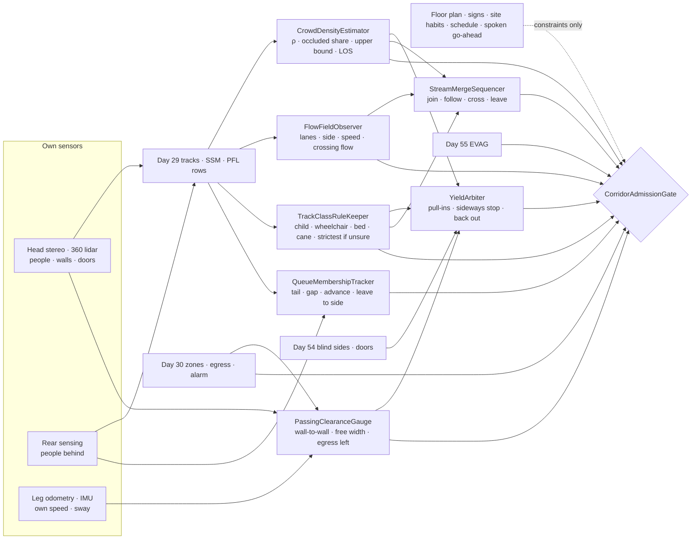
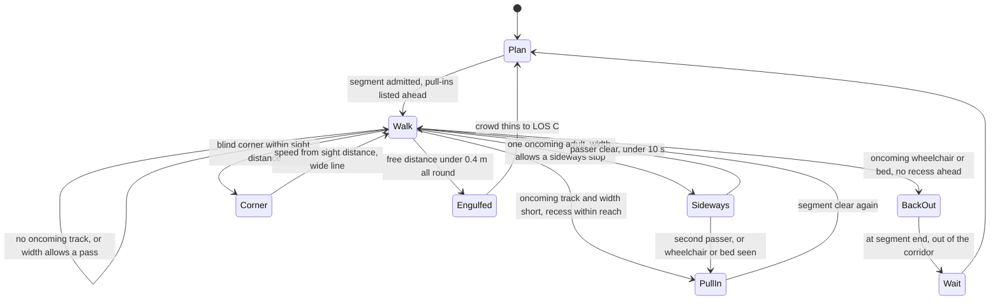
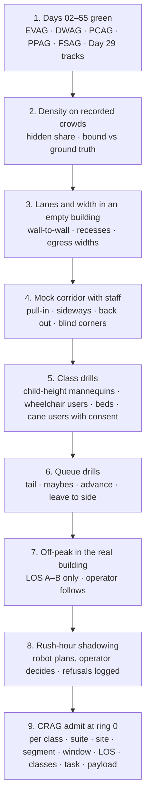

# Day 56 — Crowded corridors and shared walkways under the elevator stack: CrowdDensityEstimator / FlowFieldObserver / PassingClearanceGauge / YieldArbiter / QueueMembershipTracker / TrackClassRuleKeeper / StreamMergeSequencer / CorridorAdmissionGate under ElevatorAdmissionGate + DoorwayAdmissionGate + WetSurfaceAdmissionGate + ConfinedSpaceAdmissionGate + ElevatedAccessAdmissionGate + OverheadToolAdmissionGate + BimanualToolAdmissionGate + PowerToolAdmissionGate + PushPullAdmissionGate + PayloadCarryAdmissionGate + OutdoorGroundAdmissionGate + TerrainLocomotionAdmissionGate + FallSafeAdmissionGate + DeliberateContactAdmissionGate + WholeBodyTouchAdmissionGate + HumanHandoverAdmissionGate + CooperativeTaskAdmissionGate + TaskCompositionAdmissionGate + FleetSkillCatalogAdmissionGate + proximity + zone attestation + supervisor + logging + canary + HIL + fleet + incident + change-management + maintenance + thermal + energy gates

![CrowdDensityEstimator / FlowFieldObserver / PassingClearanceGauge / YieldArbiter / QueueMembershipTracker / TrackClassRuleKeeper / StreamMergeSequencer / CorridorAdmissionGate: a 63.8 kg humanoid in an office lobby at 08:45 counts 29 tracks in the 38 m² it can see, with 37% of the area hidden behind the front row, so it uses the upper bound (0.91 m² per person, the edge of level of service E) and doesn't enter; in a 1.52 m corridor it can't pass a person in motion, so it stops sideways against the wall for one passer or backs into a door recess, and it reaches a recess before any wheelchair arrives; lanes and the keep-right habit are measured from 30 s of tracks, the robot walks the slow lane next to the wall in the stream's direction and never against it, and crossing a 0.3 person/s lane costs about 31 s of waiting for an 8.5 s gap; a queue is a chain of slow tracks pointed at a service point, joined only behind the tail with a 0.6 m gap; children, wheelchairs, beds, and people with canes or guide dogs each tighten the rules, and an unsure classification takes the strictest class](/images/day56-crowded-corridors-walkways.png)

[Day 05](/lessons/day-05-power-bms) owns `torque_scale` and state of charge **forever**. [Day 07](/lessons/day-07-wbc-balance) owns whole-body balance. [Day 17](/lessons/day-17-runtime-safety-supervisor) owns ESTOP and safe states. [Day 29](/lessons/day-29-human-proximity-safety) owns person tracks, speed and separation monitoring (SSM), and PFL rows. [Day 30](/lessons/day-30-collaborative-workspace-zoning) owns attested zones, refuge spots, alarm plans, and `CrossSiteZoneConfigGate`. [Day 42](/lessons/day-42-deliberate-whole-body-contact) owns deliberate body contact. [Day 43](/lessons/day-43-falls-fall-safe-contact) owns falls and FSAG. [Day 44](/lessons/day-44-stairs-ramps-uneven-terrain) owns the height map. [Day 46](/lessons/day-46-carrying-payloads-walking) owns what the hands carry. [Day 47](/lessons/day-47-pushing-pulling-heavy-objects) owns carts. [Day 54](/lessons/day-54-doors-gates-thresholds) owns doors and blind sides. [Day 55](/lessons/day-55-elevators-lifts) owns elevators and EVAG.

Yesterday the robot learned to ride an elevator with people who couldn't step away from it. Today it gets off into the building's busiest place: the corridor outside the elevator bank at 08:45, the hospital hallway at shift change, the line for the badge gate. Nothing here is exotic. People pass each other in hallways all day without thinking, using rules nobody wrote down: keep right (or left), turn your shoulder, step into a doorway, wait your turn. A humanoid is wider than it looks, slower than the stream, can't turn its shoulder the way a person does, and can't read a glance. Day 29 keeps it from hitting anyone; today is about not being the obstacle everyone has to walk around, and about knowing when a corridor is too full for a robot at all.

Eight lies show up the first time a team sends a humanoid down a busy hallway:

1. **Empty-map lie.** "The map says the corridor is 1.5 m wide and clear." The map has no people in it. Free width is the wall-to-wall width minus everyone in it right now, measured from tracks.
2. **Head-count lie.** "The camera sees twelve people, so it's not crowded." The front row hides the rest. Density is what's visible over the area that's visible, with an honest bound for what's hidden.
3. **They'll-move lie.** "People will step aside for the robot." Most will, some won't, and the ones who can't (a wheelchair, a bed, a child holding a hand) are exactly the ones that matter. The robot yields.
4. **Keep-right lie.** "Everybody keeps right." Sites differ, and hospitals have their own habits. Which side the stream uses is measured on this corridor, today.
5. **Shortcut lie.** "Cut straight across the lobby." Crossing a stream means waiting for a gap long enough to cross at robot speed, and that gap is rare. Walking with the stream to the next junction is usually faster and always safer.
6. **Line-is-obvious lie.** "The queue is right there." A queue is a guess from tracks: who's waiting, where the tail is, whether that person by the wall is in it. Wrong guesses mean cutting in.
7. **Everyone's-an-adult lie.** "A track is a track." Children dart, wheelchairs can't sidestep, beds can't stop, and someone with a white cane can't see the robot. Each has its own rules.
8. **Squeeze-through lie.** "There's a gap, go." A gap the robot fits through is not a corridor it should enter. Past a certain density, the right move is not to go in.

Today owns **`CrowdDensityEstimator` / `FlowFieldObserver` / `PassingClearanceGauge` / `YieldArbiter` / `QueueMembershipTracker` / `TrackClassRuleKeeper` / `StreamMergeSequencer` / `CorridorAdmissionGate`**. The question is: **how do you let a humanoid move through corridors, lobbies, and queues shared with people, with crowd density MEASURED from the robot's own tracks and an honest bound for what it can't see; lanes and passing habits measured per corridor; passing done only where a measured width allows it and yielding done early, at a place the robot picked before it needed one; queues joined behind the tail and left to the side; children, wheelchairs, beds, carts, and people with canes or guide dogs handled by their own stricter rules; walking with streams instead of across them; and corridors that are too full refused outright — without raising Day 29 PFL, writing Day 05 `torque_scale`, gating Day 17 ESTOP, or bypassing `CrossSiteZoneConfigGate`?**

## A corridor is a shared resource the robot is worst at sharing

The rule everything follows from: **free width, density, lanes, queue membership, and the class of every nearby track are measurements this robot takes on this corridor right now. The floor plan, the corridor's posted width, a site's "people keep right here," a schedule saying the lobby is quiet at 10:00, and a person's spoken "go ahead" are never inputs that admit anything.** They may add constraints. They may never raise a limit.

Three facts set the shape of the lesson.

**Separation sets the speed, and corridors take separation away.** Day 29's protective separation distance for a robot moving at $v_r$ toward a person who may walk at $v_h$ = 1.6 m/s (the ISO 13855 walking speed), with reaction time $T_r$ = 0.1 s, braking at $a$ = 1.0 m/s², and a 0.1 m measurement allowance $C$, is:

$$
S_p(v_r) = v_h\left(T_r + \frac{v_r}{a}\right) + v_r T_r + \frac{v_r^2}{2a} + C
$$

Solve it the other way and the free distance $d$ to the nearest track sets the robot's top speed. At $d$ = 2.0 m it's 0.82 m/s; at 1.0 m, 0.39 m/s; at 0.6 m, 0.19 m/s; at 0.4 m, 0.08 m/s, which is standing still. A corridor full of people walking at 1.2 m/s puts the robot in the bottom half of that table all the time. It's going to be the slowest thing in the hall.

**Pedestrian flow has a speed–density curve.** Weidmann's fit for people walking in one direction is

$$
v(\rho) = 1.34\left[1 - e^{-1.913\,(1/\rho - 1/5.4)}\right]\ \text{m/s}, \qquad J = \rho\,v\ \text{persons/(m·s)}
$$

At 0.43 persons/m² people walk at 1.32 m/s; at 0.76 persons/m², 1.18 m/s; at 2 persons/m², 0.61 m/s. A robot capped at 0.6 m/s only matches the stream when the stream is already jammed. Everywhere else it's a slow obstacle people have to pass.

**Fruin's levels of service** grade walkways by area per person: A at 3.3 m² or more, B from 2.3 to 3.3, C from 1.4 to 2.3, D from 0.9 to 1.4, E from 0.5 to 0.9, and F below 0.5. They were written for people. This lesson uses them as the robot's admission scale, one grade stricter than a person would need, because the robot can't squeeze, turn its shoulder, or apologize with a glance.

| Layer | Owns | Must not own |
|-------|------|--------------|
| `CrowdDensityEstimator` | Density per corridor cell from the robot's own tracks; visible area; occluded fraction; upper bound; level of service | Density from a head count, a schedule, or a site sensor alone |
| `FlowFieldObserver` | Lanes, their direction and speed, and the side each direction uses, from 30 s of tracks; counterflow and crossing flow | "Keep right" from a sign or a site profile |
| `PassingClearanceGauge` | Wall-to-wall width from the robot's own ranging; free width with tracks in it; required passing width per track class; egress width left when stopped | Width from the floor plan |
| `YieldArbiter` | Who yields where: pull-in spots ahead, sideways stops for one passer, backing out, blind-corner speed | Expecting people to yield to the robot |
| `QueueMembershipTracker` | Queue detection, tail, gap, advance, ambiguous members, leaving to the side | Joining by edging in; stepping back without a rear check |
| `TrackClassRuleKeeper` | Class of each track (adult, runner, child, wheelchair, bed or cart, cane or guide dog) with uncertainty; per-class bands and yields; strictest class when unsure | Raising any Day 29 row; identifying anyone |
| `StreamMergeSequencer` | Join, follow, and leave a stream; slow lane by the wall; gap acceptance for crossing; deceleration others can follow | Walking against a lane; stopping in the middle of a stream |
| `CorridorAdmissionGate` | Fail-closed admit per robot class, suite, site, corridor segment, time window, measured level of service, track classes, task, payload | `JointCommand`; Day 05; PFL; Day 17 |
| Days 05 / 07 / 17 / 29 / 30 / 42 / 43 / 46 / 47 / 54 / 55 | Charge, balance, ESTOP, people, zones and egress, contact, falls, payloads, carts, doors, elevators | Being outranked by "it's just a hallway" |

**Core thesis:** **a humanoid shares a corridor only on what it has measured: it knows how full the hall is, including the part it can't see, which way each lane flows, and how wide the free space really is; it yields early and somewhere it chose in advance; it joins lines at the back and leaves them to the side; it gives children, wheelchairs, beds, and people who can't see it more room than anyone; it walks with the stream instead of across it; and when a corridor is too full, it waits outside.**



## Physical machine: what a crowd does to a humanoid

The example robot is the same 63.8 kg humanoid: 0.50 m across the shoulders with arms tucked, 0.35 m chest to back, about ±0.03 m of side-to-side sway at walking speed, and a corridor speed cap of 0.6 m/s set by Day 29. Three places run through the lesson:

- **Site H, office tower.** The elevator lobby on floor 7 is about 8 × 7.5 m, opening into a 1.52 m corridor 24 m long, with office doors recessed 0.2 m every 6 m and a blind corner at the far end. At 08:45 the lobby fills with people coming off elevators and heading to the coffee counter and the badge gate.
- **Site E, hospital.** A 2.44 m main corridor carries beds, wheelchairs, carts, staff, and visitors; side corridors are 1.22 m. Shift change at 07:00 and 19:00 doubles the traffic.
- **Site W, warehouse break area.** A 3 m aisle between the floor and the break room where people queue at a time clock at shift start.

### Density: count what you see, bound what you don't

`CrowdDensityEstimator` divides the floor ahead into 1 m cells and works only from Day 29's tracks. For each look it knows the area its sensors actually covered and the area hidden behind people. A head count over the whole room is the head-count lie: the person at the front hides a cone behind them, and in a crowd most of the room sits in those cones.

At Site H at 08:45 the robot steps off the elevator and looks into the lobby. It sees 38 m² of floor and 29 tracks in it, and 37% of the lobby region it cares about is hidden:

$$
\hat\rho = \frac{29}{38} = 0.76\ \text{persons/m}^2 \;\Rightarrow\; 1.31\ \text{m}^2/\text{person (LOS D)}
$$

Counts in an area behave roughly like Poisson counts, so 29 seen means the true count in that area could be as high as about 41.7 (the 97.5% upper bound). With more than 30% of the region hidden, CDE uses that bound:

$$
\rho_{\text{up}} = \frac{41.7}{38} = 1.10\ \text{persons/m}^2 \;\Rightarrow\; 0.91\ \text{m}^2/\text{person}
$$

That's the bottom edge of D, a hair from E. The hidden part is assumed at least as full as the visible part, never emptier. CDE publishes per cell: count, visible area, hidden share, point estimate, upper bound, and the level of service it implies. A site's people-counter at the lobby door is a constraint: if it says the lobby is fuller than CDE does, CDE takes the higher number; if it says emptier, nothing changes.

| Level (area per person) | People walk at | Robot may |
|------|------|------|
| A–B (2.3 m² or more) | about 1.3 m/s, free | Walk, pass where PCG allows, cross a stream at a measured gap |
| C (1.4–2.3 m²) | 1.2–1.3 m/s | Walk with the stream in the slow lane only; no crossing, no passing |
| D (0.9–1.4 m²) | 1.0–1.2 m/s | Don't enter; if already in, keep to the wall and leave at the next exit |
| E–F (under 0.9 m²) | 1.0 m/s and below, stop-and-go | Don't enter; if engulfed, become a still object (below) |

The table is one grade stricter than a person needs, and the robot's own footprint counts. Stepping into a 20 m² cell holding 13 people takes it from 1.54 to 1.43 m² per person: still C, but barely. CDE checks the density after the robot is added, not before.

### Lanes: which way the stream really goes

`FlowFieldObserver` cuts the corridor across its width into 0.4 m strips and keeps 30 s of track velocities in each strip. That gives each strip a direction, a speed, a flow in persons per second, and a spread. Bidirectional corridors sort themselves into lanes without anyone asking, and which side each direction takes depends on the country, the building, and sometimes the time of day.

At Site H the corridor's 30 s window at 08:50 showed 31 eastbound tracks, 24 of them (77%) in the south half, and 9 westbound, 7 of them in the north half: keep-right, as expected for the US. At Site E's main corridor the same measurement showed staff walking down the middle in both directions and beds hugging the east wall regardless of direction, because the bed elevators are on that side. A site profile saying "keep right" would have put the robot in the bed lane. FFO publishes what it saw, and the robot joins the lane whose direction matches its own. When FFO's window has fewer than 10 tracks, it says "no lane known" and the robot keeps to the wall on the side the site profile names, which is the only time the profile counts.

### Width: what's left between the walls and the people

`PassingClearanceGauge` measures wall to wall with the robot's own lidar every meter, because corridors carry things the floor plan doesn't: a cart parked outside a room, a fire extinguisher cabinet, a bench. Then it works out how much width a pass needs:

$$
W_{\text{pass}} = \underbrace{0.56}_{\text{robot + sway}} + \underbrace{0.10}_{\text{robot to wall}} + \underbrace{0.30}_{\text{Day 29 band}} + \underbrace{w_p}_{\text{other}} + \underbrace{c_p}_{\text{their wall shy}}
$$

with the person's width $w_p$ = 0.61 m (Fruin's body ellipse) and a shy distance of $c_p$ = 0.15 m from the wall, since people don't walk with a shoulder on the wall. For an adult that's 1.72 m. For a wheelchair, 0.76 m wide with 0.10 m to the wall, it's 1.82 m. For a hospital bed, 0.99 m with a staff member at the head, the pass needs about 2.3 m.

| Corridor | Measured | Adult passing in motion | Wheelchair passing | Robot stopped sideways, adult passes |
|------|------|------|------|------|
| Site E main | 2.44 m | Yes (1.72) | Yes (1.82) | Not needed |
| Site H corridor | 1.52 m | **No** | **No** | Yes: 1.52 − 0.45 = 1.07 left, band 0.31 |
| Site E side | 1.22 m | **No** | **No** | **No**: 0.77 left, band 0.01 |

The last column is the robot's version of turning a shoulder. Stopped, arms tucked, rotated so its 0.35 m depth faces the corridor instead of its 0.50 m width, flat against the wall at 0.10 m, it takes 0.45 m. At 1.52 m that leaves an adult their 0.76 m and a 0.31 m band: enough, just. At 1.22 m it isn't, so in Site E's side corridors the robot never meets anyone halfway; it enters only when the whole segment is empty and nothing is coming, and otherwise waits at the end.

PCG has one more job: **egress width**. A corridor's required exit width (44 in, 1.12 m, for many US corridors under the building code) belongs to the building's alarm plan in Day 30. A robot stopped sideways in Site H's corridor leaves 1.07 m, which is under that. So the sideways stop is a momentary yield for one passer, capped at 10 s, never a place to wait. Any wait longer than that happens in a recess, a doorway alcove the site has attested, or outside the corridor. During an alarm, the robot doesn't stop in an egress corridor at all except at a Day 30 refuge spot.

### Yielding: decide where before you need to

`YieldArbiter` turns PCG's table into a plan. The rule is that **the robot yields, early, at a place it picked before anyone arrived.** People in a corridor read each other's intentions from about 5–10 m away. A robot that waits until it's 2 m from someone to decide forces them to guess, and they usually guess by stopping, which blocks everyone behind them.



Before entering Site H's corridor, YA lists the recesses ahead: one every 6 m. The worst case is a person stepping out of the elevator lobby at the far end, 24 m away, walking at 1.3 m/s while the robot walks at 0.39 m/s. The robot needs at most 3 m to reach a recess, which takes 7.7 s; in that time they close 13 m, leaving 11 m between them when the robot is already tucked in. That's comfortable, and the recess is chosen when the person appears, not when they arrive.

Wheelchairs and beds never get a sideways stop. If one appears and no recess is within reach, the robot backs out the way it came, with Day 29 watching behind it, and waits at the end. A wheelchair user should never have to back up for a robot.

**Blind corners** reuse Day 54's blind-side rule. With 2.0 m of sight around the corner the robot can walk at 0.82 m/s; hugging the inside wall cuts the sight to 1.0 m and the speed to 0.39 m/s. So it takes corners wide, slows to what the sight distance allows, and announces itself ("robot coming around the corner") at corners the site marks.

**Engulfed.** Sometimes the crowd closes around the robot: an elevator unloads, a meeting lets out. When the free distance to every side falls under 0.4 m, Day 29 already has it stopped. YA's job is to keep it that way: it stays still, arms tucked, says it's a robot and will wait, and doesn't try to escape, because escaping means pushing. It never uses a Day 42 contact to move anyone. When the crowd thins to C it re-plans. Day 17's ESTOP in a crowd holds standing with brakes, the same as in an elevator; folding to the floor in a crowd is a trip hazard and a fall onto feet.

### Queues: a guess from tracks, joined at the back

`QueueMembershipTracker` finds queues the way people do: a chain of tracks that are nearly still, spaced 0.5–1.2 m apart, facing roughly the same way, toward something (a counter, a gate, a time clock), and moving forward in small jumps. The tail is the last track in the chain. People standing nearby but facing elsewhere, or spaced more than 1.5 m from the chain, are "maybe."

At Site W's time clock at 06:55, QMT saw seven tracks in a chain with a median spacing of 0.8 m and one person 1.4 m to the side of the fourth, looking at a phone. That person is a maybe. The robot joins behind the visible tail, leaving a 0.6 m gap (the 0.3 m band plus room for the person ahead to step back), and if the maybe moves toward the chain, it lets them in. If the tail itself is unclear, it asks out loud: "Is this the line for the time clock?" A spoken answer constrains its guess; it never joins by edging forward to see whether anyone objects.

It advances only after the person ahead has moved more than 0.5 m, then closes back to the gap. No creeping. It leaves a queue by stepping to the side opposite the passing stream, never backward, because there's someone behind it, and Day 29's rear sensing must show that side clear before any step. If the line is being served by a person (a nurse's station, a reception desk), the robot waits its turn like anyone else and doesn't use its fleet radio to jump ahead.

### Track classes: everyone gets a band, some get more

`TrackClassRuleKeeper` labels each Day 29 track from what the robot measures: height, width, speed, how sharply it turns, and shape. Labels are classes, not identities; TCRK doesn't recognize anyone and doesn't store faces. Each class tightens the rules. None loosens a Day 29 row.

| Class | Measured cue | Band | Rule |
|------|------|------|------|
| Adult walking | 1.4–2.0 m tall, under 1.8 m/s | 0.30 m | Base rules |
| Runner | Over 2.0 m/s | 0.50 m | $v_h$ in $S_p$ raised to the measured speed plus 0.5 m/s |
| Child | Under 1.3 m, or sharp heading changes | 0.50 m | Never pass beside one in motion; slow to 0.2 m/s within 3 m; heading unpredictable |
| Wheelchair or walker | 0.6–0.8 m wide, steady, seated height | 0.40 m | Always yield; never make it maneuver; no sideways stop, recess or back out |
| Bed or large cart | Over 0.9 m wide, over 1.5 m long, staff attached | 0.50 m | Clear the corridor ahead of it; never cross in front within its stopping distance |
| Cane or guide dog | Long thin object swept at the ground, or a dog track paired with a person | 0.50 m | Stay out of the line of travel; announce early; the dog is a track too; never touch |

The fail-closed rule is the important one: **when the classification is uncertain, TCRK uses the strictest class the measurement allows.** A 1.35 m track at the edge of the child height range is a child. A person pushing something the robot can't see the end of is a bed. An unclassified track in a crowd gets the adult band at minimum, never less.

Someone who can't see the robot can't yield to it, so for a cane user the robot also says what it's doing in a calm voice before it's within 5 m ("robot stopping on your left") and then stays still until they've passed. It doesn't guide, touch, or offer an arm; that's a person's job and a Day 42 question this lesson doesn't open.

### Streams: walk with them, cross only when it's cheap

`StreamMergeSequencer` deals with the fact that the robot is slower than everyone. In a stream at C, people walk at about 1.2 m/s and the robot at 0.6 m/s at best. A slow walker in the middle of a stream forces everyone behind to pass, so the robot always uses the slow lane: the strip next to the wall on the side FFO says its direction uses. If the stream's speed is more than 0.3 m/s above what the robot can do there, it doesn't join at all; it waits or takes another route. At Site H's lobby at 08:45 (1.18 m/s, D) it simply waits on the elevator side.

**Joining** means stepping into the slow lane at a gap: no track in the lane within $S_p$ behind it at the stream's speed, checked with rear sensing. **Following** means keeping a following gap of at least $v_r T_r + v_r^2/2a + C$ (0.34 m at 0.6 m/s) to the person ahead, since they can stop dead. **Leaving** means slowing at no more than 0.3 m/s², so the person behind has time to notice, and peeling toward the wall before stopping. The robot never stops in the middle of a lane.

**Crossing** a stream is the shortcut lie. To cross a 1.2 m lane at 0.4 m/s, with its own 0.5 m width, takes $(1.2 + 0.5)/0.4$ = 4.25 s, and the robot wants a gap of twice that, 8.5 s, between people in the lane. If people in the lane pass at $q$ = 0.3 per second at random, the chance any given gap is long enough is $e^{-qT} = e^{-2.55}$ = 0.078, and the average wait for one is Adams' delay:

$$
\bar t_w = \frac{e^{qT} - qT - 1}{q} = \frac{12.8 - 2.55 - 1}{0.3} \approx 31\ \text{s}
$$

At $q$ = 0.1 per second, the same crossing costs about 5 s. So the robot crosses only at A–B, only at a measured gap of 2× its crossing time, and never in front of a bed or wheelchair within its stopping distance. Otherwise it walks with the stream to the next junction and crosses there.

## CrowdDensityEstimator: what's visible, what's hidden, and the bound

CDE computes density per 1 m cell from Day 29 tracks, the visible area, and the hidden share. Above 30% hidden it uses the 97.5% Poisson upper bound. It adds the robot's own footprint before grading. Site counters and schedules can only raise its estimate.

## FlowFieldObserver: lanes from tracks

FFO keeps 30 s of track velocities per 0.4 m strip and publishes direction, speed, flow, and which side each direction uses. Under 10 tracks it says "no lane known." Site habits apply only then.

## PassingClearanceGauge: width minus people

PCG measures wall to wall every meter, computes $W_{\text{pass}}$ per track class, says whether a sideways stop works, and checks the egress width left when the robot stops. The floor plan's width is a constraint only.

## YieldArbiter and QueueMembershipTracker

YA lists recesses before entering, yields early, backs out for wheelchairs and beds, slows at blind corners to the sight distance, and stays still when engulfed. QMT finds queues and their tails from tracks, joins behind the tail with a 0.6 m gap, asks when unsure, advances in steps, and leaves to the side after a rear check.

## TrackClassRuleKeeper and StreamMergeSequencer

TCRK classes each track with uncertainty, applies the stricter band and yield, and takes the strictest class when unsure. SMS uses the slow lane, refuses streams more than 0.3 m/s faster than the robot can go, crosses only at a measured gap of twice the crossing time, and leaves a stream gently.

## CorridorAdmissionGate

`CorridorAdmissionGate` (CRAG) admits corridor and walkway modes per robot class, sensor suite hash, site, corridor segment, time window, measured level of service, track classes present, task, and payload, under Day 55 EVAG (corridors are where elevators let out), Day 54 DWAG for the doors along the way, Day 46 PCAG and Day 47 PPAG for anything carried or pushed, Day 43 FSAG, and Day 29 for every track. Every row needs:

- CDE measured this pass with the hidden share and bound; level of service, after adding the robot, within the row's limit.
- FFO lanes for this segment from this window, or "no lane known" with the site side as fallback.
- PCG wall-to-wall width measured this pass, $W_{\text{pass}}$ by class, and the egress width check.
- YA recess list for the segment and a back-out route.
- TCRK active with strictest-when-unsure.
- SMS speed check against the stream, crossing gap rule, and slow-lane side.
- QMT rules for any queue on the route.
- Day 30 alarm plan for the segment: where the refuge spots are, and no waits in egress corridors.

CRAG never writes `JointCommand`, never touches Day 05 `torque_scale`, never raises a Day 29 row, never takes the floor plan, a sign, a schedule, or a spoken "go ahead" as a measurement, never admits a segment at D or worse, never lets the robot wait where it cuts egress width, never makes a wheelchair or bed maneuver, never joins a queue anywhere but the tail, never crosses a stream without a measured gap, never uses contact to move a person, and never gates ESTOP.

## Data shapes

```text
DensityCell:                                  # CDE
  site, segment, cell_id, t, tracks_n, visible_m2, hidden_frac
  rho_hat, rho_up, rho_used, area_per_person_m2, los, los_with_robot
  site_counter_rho                 # constraint: may raise rho_used only

LaneStrip:                                    # FFO
  segment, strip_id, width_m, window_s, tracks_n
  heading_deg, speed_mps, flow_pps, spread
  side_for_heading                 # NORTH | SOUTH | CENTER | UNKNOWN

PassCheck:                                    # PCG
  segment, s_m, wall_to_wall_m, obstructions[]
  w_pass_m[class], pass_in_motion[class], sideways_ok, sideways_band_m
  egress_required_m, egress_left_if_stopped_m

YieldPlan:                                    # YA
  segment, recesses[], back_out_route, decision
  # WALK | PULL_IN | SIDEWAYS | BACK_OUT | WAIT | CORNER | ENGULFED
  sideways_started_t, corner_sight_m, corner_v_max

QueueModel:                                   # QMT
  service_point, members[], maybes[], tail_track, spacing_m
  robot_gap_m, asked, answer, state   # APPROACH | JOINED | ADVANCING | LEAVING

TrackClass:                                   # TCRK
  track_id, cls, p_cls, cls_used    # strictest consistent with measurement
  band_m, v_h_used, rules[]

StreamState:                                  # SMS
  segment, lane, stream_v, robot_v_max, join_ok
  follow_gap_m, decel_mps2, cross_time_s, cross_gap_s, q_pps, expected_wait_s

CorridorAdmission:                            # CRAG
  robot_class, suite_hash, site, segment, window, los, classes_present, task, payload
  ring, refusals[]
  forbidden:
    density_from_head_count: true
    width_from_floor_plan: true
    lanes_from_sign_or_profile_when_tracks_exist: true
    expect_people_to_yield: true
    sideways_stop_over_10s: true
    wait_in_egress_corridor: true
    make_wheelchair_or_bed_maneuver: true
    join_queue_not_at_tail: true
    step_back_without_rear_check: true
    cross_without_measured_gap: true
    walk_against_lane: true
    stop_mid_stream: true
    contact_to_move_person: true
    enter_at_los_d_or_worse: true
    raise_pfl: true
    write_torque_scale: true
    gate_estop: true
    bypass_cross_site_zone_config_gate: true

# Unchanged owners
ElevatorAdmissionGate (Day 55) · DoorwayAdmissionGate · blind sides (Day 54)
PushPullAdmissionGate (Day 47) · PayloadCarryAdmissionGate (Day 46)
FSAG · fall detector (Day 43) · DeliberateContactAdmissionGate (Day 42)
CrossSiteZoneConfigGate · zones · refuge · egress (Day 30) · tracks · SSM · PFL (Day 29)
SupervisorState ESTOP · safe states (Day 17) · WBC (Day 07)
BmsState / PowerState (Day 05): torque_scale, reserve
  accepts_requests_from_corridor: false
```

## Config

A starting configuration. Every number is a policy you re-derive from your own robot and buildings:

```yaml
corridor:
  density:
    cell_m: 1.0
    use_upper_bound_if_hidden_frac_gt: 0.30
    upper_bound: poisson_97_5
    add_robot_footprint: true
    site_counter: may_raise_only
    los_admit:
      A_B: [walk, pass_if_pcg, cross_if_gap]
      C: [walk_with_stream_slow_lane]
      D: [do_not_enter, leave_at_next_exit]
      E_F: [do_not_enter, engulfed_hold]
  lanes:
    strip_m: 0.4
    window_s: 30
    min_tracks: 10
    fallback: site_profile_side_wall
  width:
    measure_every_m: 1.0
    robot_plus_sway_m: 0.56
    robot_wall_m: 0.10
    band_m: 0.30
    person_w_m: 0.61
    person_wall_shy_m: 0.15
    sideways_depth_m: 0.35
    sideways_max_s: 10
    egress_from: day30_alarm_plan
    wait_where: [attested_recess, outside_corridor]
  yield:
    decide_at_m: [5, 10]
    recess_list_before_entry: true
    wheelchair_or_bed: [pull_in, back_out]   # never sideways
    corner_speed: from_sight_distance
    engulfed_free_m: 0.4
    engulfed: [hold_still, arms_tucked, announce, no_contact]
  queue:
    member_spacing_m: [0.5, 1.2]
    maybe_if_off_chain_m: 1.5
    robot_gap_m: 0.6
    advance_after_m: 0.5
    unsure: ask_aloud
    leave: side_opposite_stream_after_rear_check
  classes:
    unsure: strictest_consistent
    band_m: {adult: 0.30, runner: 0.50, child: 0.50, wheelchair: 0.40, bed: 0.50, cane_or_dog: 0.50}
    child_slow_within_m: 3
    child_v_mps: 0.2
    cane_announce_m: 5
    identify_people: never
  stream:
    lane: slow_lane_wall_side
    refuse_if_stream_faster_by_mps: 0.3
    follow_gap: vr_Tr_plus_vr2_over_2a_plus_C
    leave_decel_mps2: 0.3
    cross_only_at_los: [A, B]
    cross_gap: 2x_cross_time
    stop_mid_stream: never
  admission:
    keyed_by: [robot_class, sensor_suite_hash, site, segment, window, los, classes_present, task, payload]
    requires: [day55_evag, day54_dwag, day46_pcag, day47_ppag, day43_fsag]
```

## Physical ↔ digital pairing

| Physical | Digital twin / backing |
|----------|------------------------|
| Robot steps off the elevator into Site H's lobby at 08:45 | CDE: 29 tracks in 38 m², 37% hidden, upper bound 0.91 m²/person → D, don't enter |
| Lobby counter at the door says 15 people | Constraint only; lower than CDE, ignored |
| Floor plan says the corridor is 1.6 m | PCG measures 1.52 m; plan logged as wrong |
| Person appears at the far end of Site H's corridor | YA: nearest recess 3 m ahead, reach in 7.7 s, gap left 11 m → PULL_IN |
| One adult approaches, no recess near | YA: SIDEWAYS, band 0.31 m, stop ends at 6 s |
| Wheelchair appears, no recess within reach | YA: BACK_OUT to segment end, WAIT |
| 30 s window shows beds on the east wall at Site E | FFO: bed lane east; robot uses the west slow lane |
| Seven people waiting at Site W's time clock, one off to the side | QMT: tail found, maybe flagged, gap 0.6 m, asked aloud |
| A 1.35 m track runs past | TCRK: child (strictest), band 0.5 m, robot slows to 0.2 m/s |
| Stream at 1.18 m/s, robot can do 0.6 m/s | SMS: refuse to join, wait |
| Lane flow 0.3 per second, crossing needs 8.5 s | SMS: expected wait 31 s → walk with stream to junction |
| Meeting lets out, crowd closes around robot | YA: ENGULFED, still and announcing; Day 29 stop holds |
| Fire alarm while robot waits in the corridor | PCG: egress check fails; move to Day 30 refuge, no corridor wait |

The pairing that matters most: **replay every corridor pass from the robot's own bag and show that density was graded with its hidden share and bound before entry, the passing width was measured and not read from the plan, every yield was chosen before the other person was within 5 m, no wheelchair or bed ever had to maneuver around the robot, every queue was joined at the tail, no stream was crossed without a measured gap, and the robot never waited where it cut the egress width.**

## Bring-up sequence (before the robot shares a real corridor at rush hour)



1. **Days 02–55 green,** with EVAG, DWAG, PCAG, PPAG, and FSAG admitted and Day 29 tracking solid in crowds.
2. **Density on recorded crowds:** run CDE on recorded lobby and corridor data with overhead ground truth, and check that the upper bound covers the true count at least 97% of the time.
3. **Lanes and width in an empty building:** measure every corridor wall to wall, mark recesses and refuge spots with Day 30, and record egress widths from the alarm plan.
4. **Mock corridor with staff:** tape out 1.22, 1.52, and 2.44 m corridors with recesses and a blind corner, and run passing, yielding, and backing out with staff walking at their normal speed.
5. **Class drills:** child-height mannequins on carts for the darting tests (never real children in a drill), wheelchair users and staff with beds who volunteer, and cane users who consent and set the pace.
6. **Queue drills:** a mock counter with staff forming lines, people off to the side, and people leaving mid-line.
7. **Off-peak in the real building:** A–B only, an operator following, every yield and refusal logged.
8. **Rush-hour shadowing:** the robot plans in the real rush but the operator decides; compare its refusals with the operator's.
9. **CRAG admit at ring 0** per robot class, suite, site, segment, time window, level of service, track classes, task, and payload.

## Failure gallery

| Symptom | Likely cause |
|---------|--------------|
| Robot enters a lobby that turns out to be packed | Density from visible tracks only; hidden share ignored |
| Robot meets a person mid-corridor and both stop | Yield decided late; no recess list before entry |
| Wheelchair user backs up for the robot | Sideways stop or "they'll move" used for a wheelchair |
| Robot walks into the bed lane | Lanes taken from the site profile while tracks were available |
| Corridor blocked during a fire drill | Robot waiting sideways in an egress corridor |
| People complain the robot cut in line | Joined at a gap instead of the tail; maybe ignored |
| Robot steps back into someone in a queue | Left backward; no rear check |
| People pile up behind the robot | Joined a stream far faster than the robot; walked the middle lane |
| Robot waits minutes to cross a lobby | Crossed instead of walking with the stream; no gap math |
| Child startled by robot passing close | Height at class edge classed as adult; strictest-when-unsure missing |

## Exercises

1. Using the $S_p$ formula with the lesson's numbers, what's the robot's top speed when the nearest track is 1.3 m away? At what free distance can it walk at its 0.6 m/s cap?
2. The robot sees 18 tracks in 30 m², with 22% of the region hidden. Which estimate does CDE use, what's the level of service, and does adding the robot's footprint change the grade if the cell is 30 m²?
3. A 1.83 m corridor: can an adult pass the robot in motion? A wheelchair? Is a sideways stop needed for either, and how much egress width does it leave against a 1.12 m requirement?
4. A recess every 9 m in a 30 m corridor; a person appears at the far end walking at 1.4 m/s while the robot walks at 0.39 m/s. How far apart are they when the robot reaches the worst-case recess?
5. Crossing a 1.6 m lane at 0.4 m/s, with lane flow of 0.2 persons/s. What gap does the robot need, and what's the expected wait? When is walking 15 m to a junction at 0.5 m/s faster?
6. Write the `CorridorAdmission` row for delivering a 3 kg pharmacy tote from Site E's bed elevators along the main corridor at 07:05, during shift change. Which rows can refuse it, and what does the robot do if a bed comes out of a room ahead with no recess within reach?

## What to freeze this week

Extend [frames](/frames) and your safety config with:

- `CrowdDensityEstimator`: density per 1 m cell from Day 29 tracks and visible area; above 30% hidden use the 97.5% Poisson bound; add the robot's footprint before grading; site counters may only raise.
- `FlowFieldObserver`: 0.4 m strips, 30 s windows, direction, speed, flow, and side; under 10 tracks, "no lane known."
- `PassingClearanceGauge`: wall to wall every meter; $W_{\text{pass}}$ per class (1.72 m adult, 1.82 m wheelchair); sideways stop at 0.45 m for up to 10 s; never wait where egress width is cut.
- `YieldArbiter`: recesses listed before entry; yield decided at 5–10 m; wheelchairs and beds get a recess or a back-out, never a sideways stop; corner speed from sight distance; still and announcing when engulfed.
- `QueueMembershipTracker`: chains of slow tracks toward a service point; tail plus a 0.6 m gap; ask when unsure; advance after 0.5 m; leave to the side after a rear check.
- `TrackClassRuleKeeper`: class bands from 0.30 to 0.50 m; child, wheelchair, bed, and cane rules; strictest class when unsure; no identification.
- `StreamMergeSequencer`: slow lane by the wall; refuse streams more than 0.3 m/s faster; follow gap from the stopping distance; leave at 0.3 m/s² or less; cross only at A–B with a gap twice the crossing time.
- `CorridorAdmissionGate` fail-closed under Day 55 EVAG and the stack below it; keyed by robot class, suite, site, segment, time window, level of service, track classes, task, and payload; **no density from a head count, no width from the plan, no expecting people to yield, no wheelchair or bed made to maneuver, no waiting in egress width, no queue joined but at the tail, no stream crossed without a gap, no contact to move a person, no entry at D or worse, no dual-write of Day 07, ESTOP, or `torque_scale`.**

The lesson isn't "teach the robot to say excuse me." It's that **a corridor is a shared space the robot is the worst at sharing: it measures how full the hall is including what it can't see, learns which way each lane really flows, knows to the centimeter whether a pass fits, yields early at a place it already picked, lines up at the back, gives the people who can't move out of its way the most room, walks with the crowd instead of across it, and waits outside when the hall is full.**

## Further reading

Look these up by title; they're the standard sources for today's density, flow, passing, and gap arguments:

- J. J. Fruin, *Pedestrian Planning and Design*, 1971, for the body ellipse and the walkway and queuing levels of service.
- U. Weidmann, *Transporttechnik der Fussgänger*, ETH Zürich, 1993, for the pedestrian speed–density relation used here.
- *Highway Capacity Manual*, pedestrian chapters, for walkway levels of service and cross-flow.
- D. Helbing and P. Molnár, "Social force model for pedestrian dynamics," *Physical Review E*, 1995, and D. Helbing et al., "Self-organizing pedestrian movement," *Environment and Planning B*, 2001, for lane formation.
- ISO 13855, for the 1.6 m/s walking speed used in separation distances, and ISO/TS 15066 for speed and separation monitoring.
- The 2010 ADA Standards for Accessible Design, sections 403 and 304, for corridor widths, passing spaces, and turning space; the International Building Code chapter on means of egress for corridor egress widths.
- W. F. Adams, "Road traffic considered as a random series," *Journal of the Institution of Civil Engineers*, 1936, for the gap-acceptance delay formula.
- P. Trautman and A. Krause, "Unfreezing the robot: Navigation in dense, interacting crowds," *IEEE/RSJ IROS*, 2010, for why a robot that plans around people one at a time freezes in a crowd.

## Next

**Day 57+** — Outdoor sidewalks, crosswalks, and curb ramps under the corridor stack: walking among pedestrians on a public sidewalk; curb ramps and detectable warning surfaces measured, not trusted; crossing at a signal only on the robot's own read of the light and the traffic, with a gap and a refuge plan; cyclists, scooters, and dogs on leashes as tracks with their own rules; and when a sidewalk is blocked and the only way around is the street — without raising Day 29 PFL, writing Day 05 `torque_scale`, or bypassing `CrossSiteZoneConfigGate`, under the same gates plus corridor admission.
