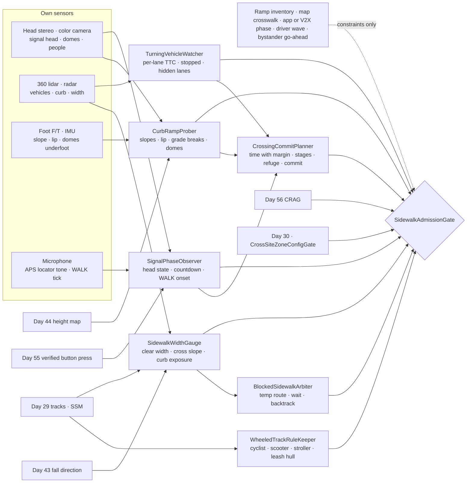
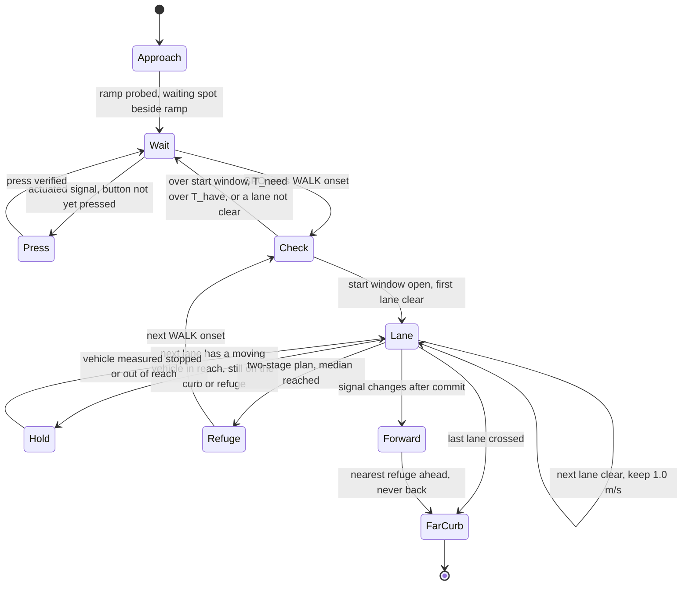
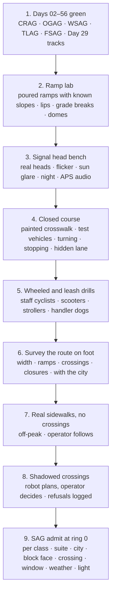

# Day 57 — Outdoor sidewalks, crosswalks, and curb ramps under the corridor stack: SidewalkWidthGauge / CurbRampProber / SignalPhaseObserver / TurningVehicleWatcher / CrossingCommitPlanner / WheeledTrackRuleKeeper / BlockedSidewalkArbiter / SidewalkAdmissionGate under CorridorAdmissionGate + ElevatorAdmissionGate + DoorwayAdmissionGate + WetSurfaceAdmissionGate + ConfinedSpaceAdmissionGate + ElevatedAccessAdmissionGate + OverheadToolAdmissionGate + BimanualToolAdmissionGate + PowerToolAdmissionGate + PushPullAdmissionGate + PayloadCarryAdmissionGate + OutdoorGroundAdmissionGate + TerrainLocomotionAdmissionGate + FallSafeAdmissionGate + DeliberateContactAdmissionGate + WholeBodyTouchAdmissionGate + HumanHandoverAdmissionGate + CooperativeTaskAdmissionGate + TaskCompositionAdmissionGate + FleetSkillCatalogAdmissionGate + proximity + zone attestation + supervisor + logging + canary + HIL + fleet + incident + change-management + maintenance + thermal + energy gates

![SidewalkWidthGauge / CurbRampProber / SignalPhaseObserver / TurningVehicleWatcher / CrossingCommitPlanner / WheeledTrackRuleKeeper / BlockedSidewalkArbiter / SidewalkAdmissionGate: a 63.8 kg humanoid on a 1.83 m downtown sidewalk measures the clear width between a tree grate and a cafe table and keeps its fall cone away from the curb; at the corner it probes the curb ramp (8.3% running slope, 2% cross slope, a 5% gutter counter slope, and a 13% grade break it puts no foot across) and waits beside the ramp, not on the truncated domes; it presses the push button, reads the pedestrian signal head with its own camera, and starts only within 2 s of WALK, because crossing 15.2 m at 1.0 m/s with a 25% margin takes 20 s of the 22 s the signal gives; a turning car must be measured stopped before it steps into the first lane; a 24.4 m arterial is refused as a single crossing and taken in two stages only with a measured median refuge; scooters, cyclists, strollers, and a dog with a leash nobody can see each get their own rule; and a sidewalk closed by construction is never bypassed in the street](/images/day57-sidewalks-crosswalks-curb-ramps.png)

[Day 05](/lessons/day-05-power-bms) owns `torque_scale` and state of charge **forever**. [Day 07](/lessons/day-07-wbc-balance) owns whole-body balance. [Day 17](/lessons/day-17-runtime-safety-supervisor) owns ESTOP and safe states. [Day 29](/lessons/day-29-human-proximity-safety) owns person tracks, speed and separation monitoring (SSM), and PFL rows. [Day 30](/lessons/day-30-collaborative-workspace-zoning) owns attested zones, refuge spots, and `CrossSiteZoneConfigGate`. [Day 43](/lessons/day-43-falls-fall-safe-contact) owns falls, fall direction, and FSAG. [Day 44](/lessons/day-44-stairs-ramps-uneven-terrain) owns the height map, step edges, and ramps. [Day 45](/lessons/day-45-outdoor-deformable-ground) owns outdoor ground and weather. [Day 53](/lessons/day-53-water-wet-floors-spills) owns wet friction. [Day 54](/lessons/day-54-doors-gates-thresholds) owns doors and blind sides. [Day 55](/lessons/day-55-elevators-lifts) owns pressing buttons it can verify. [Day 56](/lessons/day-56-crowded-corridors-walkways) owns density, lanes, passing width, yields, queues, track classes, streams, and CRAG.

Yesterday the robot learned to share a hallway. Today it walks out the front door onto a public sidewalk, and three things change at once. First, nobody attested this place: the city owns it, the sidewalk is whatever width the last utility cut left, and the curb ramp at the corner may or may not match the drawing. Second, there are now cars, and a car is a track Day 29 can't slow down. Third, the people around the robot include fast wheeled things (cyclists, scooters) and animals on leashes the lidar can't see. Day 56's rules still hold on the sidewalk. Today adds the curb, the crossing, and the street the robot never walks in.

Eight lies show up the first time a team sends a humanoid around the block:

1. **Sidewalk-is-a-corridor lie.** "It's just a wide hallway outdoors." One wall is a curb with traffic behind it. Where the robot can fall matters as much as where it can walk.
2. **Ramp-is-compliant lie.** "The city says every corner has an ADA ramp." Ramps crack, settle, pond, and were built steep. The ramp is measured, slope, cross slope, lip, and grade breaks, before the robot steps on it.
3. **Domes-mean-street lie.** "No truncated domes, so no street edge here." Domes are a constraint that says *street begins here*. Their absence says nothing. The edge is measured from curb geometry and traffic.
4. **Green-means-go lie.** "The app said WALK." The robot crosses on its own read of the pedestrian signal head, and only if the time left covers its crossing at its own speed with margin. A phone app or a V2X message may delay a crossing, never start one.
5. **Drivers-will-stop lie.** "The law says turning cars yield." Most do. The robot steps into a lane only when every vehicle that could reach it is measured stopped or far enough away, and never past a stopped car into a lane it can't see.
6. **It's-just-another-pedestrian lie.** "A scooter is a track." A scooter at 5.5 m/s closes 3.9 m in 0.7 s. Fast wheeled tracks, strollers, and dogs each get their own rule.
7. **Turn-back lie.** "If the signal changes, go back." Turning around in a lane doubles the time in the road. Once committed, the robot goes forward to the nearest refuge.
8. **Around-the-obstacle lie.** "The sidewalk's blocked, step into the street for 5 m." That is walking in traffic. The robot follows a marked temporary route, waits, or goes around the block.

Today owns **`SidewalkWidthGauge` / `CurbRampProber` / `SignalPhaseObserver` / `TurningVehicleWatcher` / `CrossingCommitPlanner` / `WheeledTrackRuleKeeper` / `BlockedSidewalkArbiter` / `SidewalkAdmissionGate`**. The question is: **how do you let a humanoid walk public sidewalks and cross streets, with clear width and curb-side fall exposure MEASURED, curb ramps and detectable warnings probed instead of trusted, crossings started only on the robot's own read of the signal and only when the time left covers its own crossing with margin, turning and approaching vehicles measured stopped or far before each lane, every crossing either finished or brought to a refuge it planned in advance, cyclists, scooters, strollers, and leashed dogs handled by their own stricter rules, and blocked sidewalks never bypassed in the street — without raising Day 29 PFL, writing Day 05 `torque_scale`, gating Day 17 ESTOP, or bypassing `CrossSiteZoneConfigGate`?**

## The street is the one place the robot never stands

The rule everything follows from: **clear width, ramp geometry, the signal's state, time left, every vehicle's speed and distance, and the class of every wheeled or leashed track are measurements this robot takes at this corner right now. The city's ramp inventory, a sign, the map's crosswalk, a phone app's signal phase, a V2X message, a driver's wave, and a pedestrian saying "you can go" are never inputs that admit anything.** They may add constraints. They may never raise a limit.

Three facts set the shape of the lesson.

**Separation sets speed, and the crossing needs speed.** Day 29's protective separation, with $v_h$ = 1.6 m/s, $T_r$ = 0.1 s, braking $a$ = 1.0 m/s², and $C$ = 0.1 m:

$$
S_p(v_r) = v_h\left(T_r + \frac{v_r}{a}\right) + v_r T_r + \frac{v_r^2}{2a} + C
$$

At the robot's outdoor cap of 1.0 m/s it needs 2.46 m to the nearest person; at 0.8 m/s, 1.94 m; at 0.5 m/s, 1.24 m. On a sidewalk that's a speed limit. In a crosswalk it's a clock: every pedestrian who comes within 2.46 m stretches the crossing.

**Signals are timed for people, not robots.** The MUTCD times the pedestrian clearance interval (flashing DON'T WALK) for a walking speed of 3.5 ft/s, about 1.07 m/s, from curb to curb, after a WALK interval of at least 7 s. For Site D's 15.2 m crosswalk that's 15 s of clearance and 7 s of WALK: 22 s from the start of WALK to steady DON'T WALK. A person who starts late is expected to make it at 1.07 m/s. The robot can't count on that.

**A car is a track Day 29 can't stop.** Day 29 assumes the robot can brake before contact. A turning car at 8.9 m/s (20 mph) with a 1.5 s driver reaction and a comfortable 3 m/s² stop needs about 26.6 m. The robot can't brake its way out of that; it can only not be there.

| Layer | Owns | Must not own |
|-------|------|--------------|
| `SidewalkWidthGauge` | Clear width every meter from own ranging; obstructions; cross slope; curb-side fall exposure; passing spaces | Width from the city's map or a sidewalk standard |
| `CurbRampProber` | Running slope, cross slope, counter slope, lip, grade breaks, landing, ponding, detectable warnings and their extent | "Compliant" from the inventory; street edge from domes alone |
| `SignalPhaseObserver` | Pedestrian head state (WALK, flashing, steady), countdown, push button pressed and acknowledged, WALK onset time | Phase from an app, V2X, or the car signal |
| `TurningVehicleWatcher` | Vehicle tracks per lane; speed, distance, time to the crosswalk; stopped or yielding measured; hidden lanes behind stopped vehicles | A driver's wave; "they have to yield" |
| `CrossingCommitPlanner` | Crossing time at the robot's speed with margin; start window; one or two stages; refuge; commit point; forward-only after commit | Turning back in a lane; stopping in a lane |
| `WheeledTrackRuleKeeper` | Cyclist, scooter, stroller, and leashed-dog classes with uncertainty; their bands and speeds; leash hulls | Raising any Day 29 row; identifying anyone |
| `BlockedSidewalkArbiter` | Closures, parked vehicles, bins; marked temporary routes; wait, backtrack, or other side | Walking in the street or the parking lane |
| `SidewalkAdmissionGate` | Fail-closed admit per robot class, suite, city, block face, crossing, time window, weather, light, task, payload | `JointCommand`; Day 05; PFL; Day 17 |
| Days 05 / 07 / 17 / 29 / 30 / 43 / 44 / 45 / 53 / 55 / 56 | Charge, balance, ESTOP, people, zones, falls, terrain, ground, wet friction, buttons, corridors | Being outranked by "everyone crosses here" |

**Core thesis:** **a humanoid on a public sidewalk trusts only what it measures: how much clear width there is and how close the curb is, what the ramp really looks like under its feet, what the signal head says and how many seconds are left, and whether every car that could reach it has actually stopped. It starts a crossing only if it can finish it with margin, goes forward once committed, gives the fast and the leashed their own room, and never walks in the street to get around anything.**



## Physical machine: what a city block does to a humanoid

The example robot is the same 63.8 kg humanoid: 0.50 m across the shoulders, 0.35 m chest to back, a 0.24 m foot, about ±0.03 m of sway, and an outdoor walking cap of 1.0 m/s on firm, dry, level pavement, which Day 45 and Day 53 lower when the ground or the weather says so. Three places run through the lesson:

- **Site D, downtown.** A 3.0 m sidewalk with tree grates, a bus shelter, sign poles, and cafe tables that leave 1.83 m clear at the pinch. The corner has perpendicular curb ramps and a signalized four-lane crossing, 15.2 m curb to curb, with a push button, an accessible pedestrian signal (APS), a countdown, and a 3 s leading pedestrian interval.
- **Site S, suburban arterial.** Six lanes, 24.4 m curb to curb with a 1.8 m raised median refuge, 7 s of WALK and 23 s of clearance, permissive left turns, and right turn on red.
- **Site R, residential.** A two-lane street 7.3 m wide with a marked crosswalk and no signal, about 300 vehicles an hour at 08:00.

### Width and the curb: where the robot walks and where it would fall

`SidewalkWidthGauge` measures clear width every meter with the robot's own lidar, the same way Day 56's PassingClearanceGauge measures a corridor, but now one side is a curb. The US Access Board's public right-of-way guidelines (PROWAG) ask for a 1.2 m pedestrian access route with 1.5 × 1.5 m passing spaces at least every 61 m when the route is narrower than 1.5 m, and a cross slope of 2% or less. Those are a city's design targets. SWG measures what the city actually has: at Site D's pinch between a tree grate and a cafe table it reads 1.83 m, not the 3.0 m the map shows.

Day 56's passing width for an adult was 1.72 m, so at 1.83 m an adult can pass the robot in motion with 0.11 m to spare. A stroller or wheelchair (1.82 m) leaves 0.01 m, which is no pass at all; the robot pulls into a wider spot ahead, the same as a corridor recess.

The new number is **curb exposure**. A corridor wall is something to lean away from. A curb is a 150 mm drop into a lane. Day 43's FallDirectionArbiter already picks which way the robot falls; SWG makes sure that choice exists by keeping the robot's line at least 1.0 m from the curb face where the width allows, and, where it doesn't (a pinch near the curb), slowing to 0.5 m/s and telling Day 43 that the street side is forbidden. A driveway apron is the other trap: SWG measured one at Site D with a 7% cross slope, three and a half times the target, so the robot slows to 0.5 m/s across it and Day 07 is told the slope before the foot lands, not after.

### Curb ramps: measured under the foot, never read from the inventory

`CurbRampProber` combines Day 44's height map with the foot's own force and tilt to check every ramp before the robot uses it. The geometry it expects, from PROWAG and the 2010 ADA Standards, is a running slope of 8.3% (1:12) or less, a cross slope of 2% or less, a gutter counter slope of 5% or less, a level landing of 1.2 × 1.2 m at the top, and no vertical lip at the bottom over 6 mm (6 to 13 mm only if beveled).

For a 150 mm curb, an 8.3% ramp is about 1.8 m long. At Site D's northeast corner CRP measured:

| Check | Expected | Measured | Result |
|------|------|------|------|
| Running slope | 8.3% or less | 8.1% | OK, 0.5 m/s |
| Cross slope | 2% or less | 2.4% | OK with Day 07 told, 0.5 m/s |
| Gutter counter slope | 5% or less | 5.2% | Grade break of 13.3% |
| Bottom lip | 6 mm or less | 11 mm, square | Treat as a step (Day 44), lift foot 30 mm |
| Ponding at the bottom | none | 2.1 m² of water after rain | Day 53 friction probe before use |

The grade break where an 8.1% ramp meets a 5.2% counter slope is a 13.3% change in direction. A flat 0.24 m foot centered on it rests on its toe and heel with an 8 mm gap under the middle, which turns a level stance into a rocking one. CRP's rule is simple: **no foot lands across a grade break.** Footstep planning puts each foot wholly on one side.

**Detectable warnings** are the truncated domes at the bottom of the ramp: 5 mm high, 23 to 36 mm across at the base, 41 to 61 mm apart, at least 610 mm deep and the full width of the ramp. They're there so a blind pedestrian's cane and feet find the edge of the street. For the robot they mean two things. As ground, they're a patch where the foot sole touches only the dome tops, so Day 53's wet friction is probed on the domes, not on the concrete beside them. As a boundary, they're a constraint: the far edge of the domes is the stop line. But a corner with no domes, or worn ones, is not a corner with no street. CRP finds the street edge from the curb face and the gutter line in the height map, and uses whichever edge comes first.

Where the robot waits matters too. The ramp and its landing are the only step-free way down for a wheelchair, and the domes are how a blind person finds the crossing. The robot waits **beside** the ramp, on the sidewalk, outside the landing and off the domes, and steps onto the ramp only when its crossing has started.

### The signal: read the head, press the button, start at WALK

`SignalPhaseObserver` reads the pedestrian signal head with the robot's own camera: the walking-person symbol for WALK, the upraised hand flashing for the clearance interval, the steady hand for DON'T WALK, and the countdown digits, which run only during the clearance interval. LED signal heads flicker at a rate a short exposure can catch in its off phase, so SPO integrates over at least 100 ms and needs three consecutive agreeing frames before it changes state. If the head is blocked by a truck, washed out by low sun, or dark, SPO reports `UNKNOWN`, and `UNKNOWN` is not WALK.

At Site D the APS gives a second channel: a locator tone once a second and a rapid tick or a voice message during WALK. SPO uses the audio only to agree with the camera. Sound alone never starts a crossing, because the next corner's APS can be heard from this one.

Many signals are actuated: no button press, no WALK. Pressing the button is a Day 55 job, a verified press with the button's own feedback (the light, a "wait" message, or the APS click), not a hope. SPO logs the press time and the WALK onset it then sees, so it knows how many seconds of WALK have already gone by when it decides.

A phone app or a V2X signal-phase message from the city is a constraint. If it says the phase is about to end, the robot waits. If it says WALK and the camera says otherwise, the robot believes the camera.

### Crossing time: the robot's own clock, with margin

`CrossingCommitPlanner` turns a crosswalk into a budget. The time the robot needs, curb to curb at speed $v_c$, with margin $m$ and a reaction allowance $t_0$:

$$
T_{\text{need}} = m\,\frac{L}{v_c} + t_0, \qquad m = 1.25,\ t_0 = 1.0\ \text{s}
$$

and the time it has is whatever is left of WALK plus the clearance interval:

$$
T_{\text{have}} = (t_{\text{walk}} - t_{\text{since onset}}) + t_{\text{clear}}
$$

At Site D, $L$ = 15.2 m and $v_c$ = 1.0 m/s give $T_{\text{need}}$ = 20.0 s, against $T_{\text{have}}$ = 22 s at the start of WALK. So the robot must step off within 2 s of WALK onset, or it waits for the next cycle. If a pedestrian group in the crosswalk holds it to 0.8 m/s, $T_{\text{need}}$ becomes 24.75 s and the crossing doesn't fit at all; the robot lets that cycle go and takes one with an emptier crosswalk.



Site S shows why the margin matters. Its 24.4 m crossing needs $T_{\text{need}}$ = 31.5 s; the signal gives 7 + 23 = 30 s. A person walking at 1.07 m/s makes it. The robot doesn't, so SAG refuses the single-stage crossing. A **two-stage** crossing uses the 1.8 m median: each stage is 11.3 m and needs 15.1 s, and the robot waits on the median for a whole signal cycle in between. CCP admits that only if the median is at least 1.8 m deep with the robot standing at least 0.3 m from each curb face, the median's own ramps or cut-through are probed, and Day 43 has a fall direction along the median's length, never into a lane. Standing a full cycle (about 120 s at Site S) next to traffic at 20 m/s is the most exposed place on the route, which is why the planner prefers a different crossing when one exists within 200 m.

**Commit and go forward.** The commit point is the curb line. Before it, any doubt means wait. After it, the robot doesn't turn back and doesn't stop in a lane: if the hand starts flashing or goes steady, or a car does something unexpected, it continues to the nearest refuge ahead (the median or the far curb) at the fastest speed Day 29 and Day 07 allow. Turning around doubles its time in the street and makes it unpredictable to every driver who has already planned around it. A crossing that ended with the hand steady is logged as a near miss, and that crossing's margin goes up to 1.4 until a review signs it down.

Day 17's ESTOP still wins in the street. A robot that stops in a lane holds standing with brakes, flashes its beacon, and alerts the operator with its position. That outcome is bad enough that SAG requires a live operator link for every crossing at ring 0, and it's the real reason the margin exists.

### Vehicles: stopped, far, or not yet

`TurningVehicleWatcher` tracks vehicles with lidar and radar and assigns each to a lane and a path through the crosswalk. For each lane it publishes the time until the nearest vehicle could reach the crosswalk, whether that vehicle is stopped (under 0.3 m/s for at least 1 s), and whether any part of the lane is hidden.

The robot steps into a lane only if every vehicle whose path crosses that lane is either **measured stopped** or has a time to the crosswalk of at least twice the robot's time to cross that lane. Site D's lanes are 3.3 m, 3.3 s at 1.0 m/s, so a moving vehicle must be at least 6.6 s away. A right-turning car at 4.5 m/s, 15 m from the crosswalk, is 3.3 s away, so the robot holds at the curb. Holding uses the start window: if the car hasn't stopped by 2 s after WALK onset, the robot lets the cycle go. The 3 s leading pedestrian interval is what makes this work at Site D, because turning cars still face red while the robot steps off.

A slowing car counts only when the deceleration TVW measures is enough to stop short of the crosswalk with room to spare. A car at 8.9 m/s, 20 m away, needs $v^2/2d$ = 1.98 m/s². TVW wants to see at least that, sustained, and then the car stopped before the robot enters its lane. A flashed headlight or a wave is not a measurement.

**Multiple threat.** At Site R a car in the near lane stops for the robot. The far lane is behind that car, and TVW can't see it. This is the classic multiple-threat crash: the stopped car hides the robot from the next driver and the next driver from the robot. TVW marks a lane hidden by a stopped vehicle as **occupied** until it can see along it, the same way Day 56's density estimator assumed the hidden part of a lobby was full. The robot steps to the edge of the stopped car's lane where it can see past it, or waits for both lanes to clear.

Without a signal, crossing is gap acceptance. Site R's 7.3 m takes 7.3 s at 1.0 m/s; with the allowance that's 8.3 s, and the robot wants a gap of twice that, 16.6 s, in both directions together. With $q$ vehicles per second arriving at random, Adams' average wait is

$$
\bar t_w = \frac{e^{qT} - qT - 1}{q}
$$

At 300 vehicles an hour ($q$ = 0.083/s) that's 19.3 s. At 600 an hour it's 72.8 s, and SAG's row for Site R caps the wait at 60 s before the robot routes to the signal one block over.

### Wheeled and leashed tracks: the fast ones carry the burden, the robot stays predictable

`WheeledTrackRuleKeeper` adds the sidewalk's classes to Day 56's TrackClassRuleKeeper. Same fail-closed rule: when unsure, take the strictest class the measurement allows.

| Class | Measured cue | Band | Rule |
|------|------|------|------|
| Cyclist on sidewalk | Over 3 m/s, narrow, upright, smooth heading | 0.75 m | $v_h$ raised to measured speed plus 0.5 m/s; hold line, stop early |
| E-scooter | Over 3 m/s, standing rider, low platform | 0.75 m | Same as cyclist; assume it can't swerve far |
| Stroller | 0.5–0.7 m wide, pushed, steady | 0.50 m | Wheelchair rules from Day 56: never make it maneuver, plus child rules |
| Person with dog | Dog track paired with a person track | Hull plus 0.5 m | The space between them is solid; never pass between; wide berth on the dog's side |
| Unknown fast track | Over 2 m/s, no class | 0.75 m | Cyclist rules |

The robot can't out-brake a scooter. With $v_h$ raised to 6.0 m/s for a 5.5 m/s scooter, the robot walking at 0.5 m/s needs $S_p$ = 3.87 m, and the scooter covers that in 0.7 s. Even standing still it needs 0.7 m. So WTRK's rule is **predictability over avoidance**: when a fast track is closing, the robot keeps its line, slows, and stops early, and never steps sideways into the path a rider is already steering around. A rider plans around where the robot is going; a robot that dodges ruins that plan.

The leash is the one track Day 29 doesn't have. A 1.8 m leash is a few millimeters of nylon the lidar rarely returns, and a retractable leash can run out to 5 m. WTRK pairs a dog track with the person it moves with and treats the convex hull of the two, plus 0.5 m, as occupied. The robot never passes between them. A dog that lunges or barks gets more room: the robot stops, keeps still, and waits for the pair to pass, because a moving robot is what a reactive dog reacts to.

### Blocked sidewalks: never the street

`BlockedSidewalkArbiter` handles everything that takes the sidewalk away: a construction closure, a car parked across it, trash bins on collection day, a delivery truck's ramp. The rule is absolute: **the robot never walks in the street, the parking lane, or the bike lane to get around anything.** People do it every day. A robot that falls there, or freezes there under Day 17, is in traffic.

For a construction closure, the MUTCD's temporary traffic control rules require a pedestrian route that is accessible and marked with detectable channelizing devices. BSA follows such a route only after SWG measures it (width, surface, cross slope, ramps at both ends) and SPO or TVW covers any crossing it adds. A route marked only by a "sidewalk closed, use other side" sign means use the other side: back to the last crossing, across with the full CCP checks, and along the opposite block face.

For a parked car or a bin, BSA waits up to 60 s for it to move, then backtracks. At Site D a delivery van parked across the sidewalk 40 m from the corner; going around the block cost about 3 minutes, including one full signal cycle. The task took longer. That's the right result.

## SidewalkWidthGauge: width and the curb

SWG measures clear width every meter, finds obstructions and passing spots, measures cross slope, keeps the robot at least 1.0 m from the curb face where width allows, and otherwise slows to 0.5 m/s and forbids Day 43 the street side. The city's map width is a constraint only.

## CurbRampProber: slopes, lips, breaks, and domes

CRP checks running slope, cross slope, counter slope, lip, landing, ponding, and grade breaks before every ramp. No foot lands across a grade break. Domes are a stop-line constraint and a friction patch; the street edge comes from curb geometry. The robot waits beside the ramp, never on it or on the domes.

## SignalPhaseObserver and TurningVehicleWatcher

SPO reads the head with integration over 100 ms and three agreeing frames, uses APS audio only to agree, verifies the button press through Day 55, logs WALK onset, and reports `UNKNOWN` when it can't see. TVW keeps per-lane time to the crosswalk, counts a vehicle as stopped only under 0.3 m/s for 1 s, requires twice the lane-crossing time for moving vehicles, and treats any lane hidden by a stopped vehicle as occupied.

## CrossingCommitPlanner, WheeledTrackRuleKeeper, and BlockedSidewalkArbiter

CCP computes $T_{\text{need}}$ with a 1.25 margin and 1 s allowance, opens a 2 s start window, splits crossings into two stages only with a measured median refuge, commits at the curb line, and goes forward only after commit. WTRK gives cyclists, scooters, strollers, and dog pairs their bands and holds the robot's line. BSA follows only measured temporary routes, waits up to 60 s, and otherwise backtracks, never into the street.

## SidewalkAdmissionGate

`SidewalkAdmissionGate` (SAG) admits sidewalk and crossing modes per robot class, sensor suite hash, city, block face, crossing, time window, weather, light level, task, and payload, under Day 56 CRAG for the crowd on the sidewalk, Day 45 OGAG and Day 53 WSAG for the ground, Day 44 TLAG for curbs and ramps, Day 43 FSAG for where it falls, Day 46 PCAG for what it carries, and Day 29 for every track. Public right of way is a zone class in Day 30 with no site authority behind it, so `CrossSiteZoneConfigGate` decides which cities, block faces, and crossings any robot may use, and a local permit or operator requirement is a row, never an assumption. Every row needs:

- SWG width and curb exposure measured this pass, with passing spots listed.
- CRP probe of both ramps on every crossing used, today.
- SPO with a seen head, a verified button press where actuated, and WALK onset logged.
- TVW per-lane clearances and hidden-lane marking.
- CCP $T_{\text{need}}$ at or under $T_{\text{have}}$ at step-off, with stages and refuge planned.
- WTRK classes active with strictest-when-unsure.
- BSA plan for closures on the route.
- A live operator link for every crossing at ring 0.

SAG never writes `JointCommand`, never touches Day 05 `torque_scale`, never raises a Day 29 row, never takes an app, V2X, map, inventory, sign, wave, or bystander as a measurement, never starts a crossing on `UNKNOWN`, flashing, or past its start window, never steps into a lane with a moving vehicle in reach or a lane it can't see, never turns back after commit, never stops in a lane except under Day 17, never waits on a ramp or the domes, never passes between a dog and its person, never walks in the street, and never gates ESTOP.

## Data shapes

```text
SidewalkSegment:                              # SWG
  city, block_face, s_m, clear_width_m, obstructions[], cross_slope_pct
  curb_dist_m, curb_side_fall_forbidden, v_max_mps, passing_spots[]
  map_width_m                       # constraint only

CurbRampProbe:                                # CRP
  corner, ramp_id, t, running_pct, cross_pct, counter_pct, grade_break_pct
  lip_mm, lip_beveled, landing_m, ponding_m2, domes_present, domes_depth_m
  street_edge_from                  # CURB | GUTTER | DOMES (first of)
  wait_spot, inventory_says         # constraint only

SignalRead:                                   # SPO
  crossing, t, head_state           # WALK | FLASHING | STEADY | UNKNOWN
  countdown_s, frames_agree, aps_agrees, button_pressed_t, button_ack
  walk_onset_t, app_or_v2x_phase    # constraint only

LaneClearance:                                # TVW
  crossing, lane_id, vehicle_id, v_mps, dist_m, ttc_s, stopped
  decel_mps2, decel_needed_mps2, hidden, lane_cross_s

CrossingPlan:                                 # CCP
  crossing, L_m, v_c_mps, margin, t0_s, T_need_s, T_have_s
  start_window_s, stages, refuge, committed_t, state
  # APPROACH | WAIT | PRESS | CHECK | LANE | HOLD | REFUGE | FORWARD | FAR_CURB
  near_miss

WheeledTrack:                                 # WTRK
  track_id, cls, p_cls, cls_used, v_mps, v_h_used, band_m
  paired_dog_id, leash_hull       # treated as solid

SidewalkBlock:                                # BSA
  block_face, kind, temp_route_measured, wait_s, decision
  # FOLLOW_TEMP_ROUTE | WAIT | BACKTRACK | OTHER_SIDE

SidewalkAdmission:                            # SAG
  robot_class, suite_hash, city, block_face, crossing, window, weather, light, task, payload
  ring, refusals[]
  forbidden:
    width_from_map: true
    ramp_from_inventory: true
    street_edge_from_domes_only: true
    foot_across_grade_break: true
    wait_on_ramp_or_domes: true
    phase_from_app_or_v2x: true
    start_on_unknown_or_flashing: true
    start_after_window: true
    enter_lane_with_moving_vehicle_in_reach: true
    enter_hidden_lane: true
    driver_wave_as_yield: true
    turn_back_after_commit: true
    stop_in_lane: true            # except Day 17
    pass_between_dog_and_person: true
    dodge_into_fast_track_path: true
    walk_in_street: true
    raise_pfl: true
    write_torque_scale: true
    gate_estop: true
    bypass_cross_site_zone_config_gate: true

# Unchanged owners
CorridorAdmissionGate (Day 56) · ElevatorAdmissionGate · verified button press (Day 55)
DoorwayAdmissionGate (Day 54) · WetSurfaceAdmissionGate (Day 53)
PayloadCarryAdmissionGate (Day 46) · OutdoorGroundAdmissionGate (Day 45) · TLAG · height map (Day 44)
FSAG · fall direction (Day 43) · CrossSiteZoneConfigGate · zones (Day 30) · tracks · SSM · PFL (Day 29)
SupervisorState ESTOP · safe states (Day 17) · WBC (Day 07)
BmsState / PowerState (Day 05): torque_scale, reserve
  accepts_requests_from_sidewalk: false
```

## Config

A starting configuration. Every number is a policy you re-derive from your own robot and your own city:

```yaml
sidewalk:
  width:
    measure_every_m: 1.0
    map_width: constraint_only
    curb_min_dist_m: 1.0
    near_curb_v_mps: 0.5
    near_curb_fall: forbid_street_side
    cross_slope_slow_above_pct: 2.0
    steep_cross_slope_v_mps: 0.5
  ramp:
    expect: {running_pct: 8.3, cross_pct: 2.0, counter_pct: 5.0, landing_m: 1.2, lip_mm: 6}
    lip_over_mm: day44_step
    foot_across_grade_break: never
    ponding: day53_probe
    street_edge: first_of_curb_gutter_domes
    wait: beside_ramp_off_landing_off_domes
  signal:
    integrate_ms: 100
    frames_agree: 3
    aps: agree_only
    button: day55_verified_press
    unknown_is_walk: false
    app_or_v2x: may_delay_only
  crossing:
    v_c_mps: 1.0
    margin: 1.25
    near_miss_margin: 1.4
    t0_s: 1.0
    start_window_s: 2.0
    commit_at: curb_line
    after_commit: forward_to_nearest_refuge
    two_stage_median_min_m: 1.8
    median_curb_clear_m: 0.3
    prefer_other_crossing_within_m: 200
    operator_link_ring0: required
  vehicles:
    stopped_below_mps: 0.3
    stopped_for_s: 1.0
    moving_ttc_factor: 2.0
    decel_must_exceed: v2_over_2d
    hidden_lane: occupied
    wave: ignored
    unsignalized_gap: 2x_cross_time
    unsignalized_max_wait_s: 60
  wheeled:
    unsure: strictest_consistent
    fast_above_mps: 2.0
    v_h_add_mps: 0.5
    band_m: {cyclist: 0.75, scooter: 0.75, stroller: 0.50, dog_pair_hull_add: 0.50}
    fast_closing: hold_line_slow_stop
    dog_pair: never_pass_between
  blocked:
    street_or_parking_or_bike_lane: never
    temp_route: follow_if_measured
    wait_s: 60
    then: [backtrack, other_side]
  admission:
    keyed_by: [robot_class, sensor_suite_hash, city, block_face, crossing, window, weather, light, task, payload]
    requires: [day56_crag, day45_ogag, day53_wsag, day44_tlag, day43_fsag, day46_pcag, cross_site_zone_config_gate]
```

## Physical ↔ digital pairing

| Physical | Digital twin / backing |
|----------|------------------------|
| Map says Site D's sidewalk is 3.0 m | SWG measures 1.83 m at the cafe pinch; adult pass OK, stroller pulls in ahead |
| Pinch is 0.6 m from the curb | SWG: 0.5 m/s, Day 43 street side forbidden |
| Driveway apron at 7% cross slope | SWG: 0.5 m/s, Day 07 told the slope before the foot lands |
| Ramp inventory says "compliant" | CRP: 11 mm square lip, 13.3% grade break, water at the bottom; step, footholds, friction probe |
| Robot waits for the signal | CRP: wait spot beside the ramp, off the landing and the domes |
| Phone app says WALK | SPO: camera says STEADY; robot waits |
| Low sun washes out the head | SPO: `UNKNOWN`; no start |
| WALK onset, crosswalk empty | CCP: $T_{\text{need}}$ 20.0 s, $T_{\text{have}}$ 22 s, step off within 2 s |
| Group in the crosswalk holds robot to 0.8 m/s | CCP: $T_{\text{need}}$ 24.75 s; skip this cycle |
| Right-turning car 15 m away at 4.5 m/s | TVW: 3.3 s, under 6.6 s; hold at curb; window closes, wait a cycle |
| Car stops in Site R's near lane | TVW: far lane hidden, occupied; step to where it can see, or wait |
| Site S, 24.4 m, 30 s | SAG: single stage refused; two-stage with measured median, or another crossing |
| Hand flashes mid-crossing | CCP: forward to far curb, near miss logged, margin 1.4 |
| Scooter closing at 5.5 m/s | WTRK: hold line, slow, stop; no dodge |
| Person and dog on either side of the path | WTRK: hull solid; robot stops and waits |
| Van parked across the sidewalk | BSA: wait 60 s, backtrack, cross, other side |

The pairing that matters most: **replay every block from the robot's own bag and show that width and curb distance were measured, both ramps of every crossing were probed that day, every crossing started within its window on the robot's own read of the head with $T_{\text{need}}$ under $T_{\text{have}}$, no lane was entered with a moving vehicle in reach or with a hidden lane beside it, nothing after a commit went backward, no dog and person were split, and the robot never set a foot in the street outside a crosswalk.**

## Bring-up sequence (before the robot crosses a real street)



1. **Days 02–56 green,** with CRAG, OGAG, WSAG, TLAG, and FSAG admitted and Day 29 tracking solid outdoors in daylight and at night.
2. **Ramp lab:** poured ramps at 6%, 8.3%, and 10% with 2% and 4% cross slopes, lips of 0, 6, 13, and 20 mm, grade breaks up to 15%, and dome panels dry and wet; CRP's readings checked against a digital level.
3. **Signal head bench:** real pedestrian heads on a controller, filmed at the robot's exposures in sun, glare, rain, and night; SPO must never read WALK when it isn't.
4. **Closed course:** a painted four-lane crosswalk with professional drivers turning, stopping, and not stopping, including a stopped car hiding a moving one.
5. **Wheeled and leash drills:** staff on bikes and scooters at set speeds, strollers with weighted dolls, and handler dogs that are comfortable with robots, leashes fixed and retractable.
6. **Survey the route on foot:** measure every block face, ramp, and crossing on the route, note closures, and talk to the city about permits and rules for sidewalk robots.
7. **Real sidewalks, no crossings:** off-peak, an operator following, every pull-in, hold, and backtrack logged.
8. **Shadowed crossings:** the robot plans every crossing and the operator decides; compare its refusals with the operator's.
9. **SAG admit at ring 0** per robot class, suite, city, block face, crossing, time window, weather, light, task, and payload.

## Failure gallery

| Symptom | Likely cause |
|---------|--------------|
| Robot stumbles at the bottom of a ramp | Foot landed across the grade break; lip treated as flat |
| Robot slips on the domes after rain | Friction probed on concrete beside the domes, not on them |
| Wheelchair user can't reach the button | Robot waiting on the ramp landing |
| Robot starts crossing on a flashing hand | Head read from one frame through LED flicker; app trusted |
| Robot still in the street at steady DON'T WALK | Started mid-WALK; no start window; margin skipped |
| Near miss with a turning car | Driver's wave or slowing treated as yield; stop not measured |
| Near miss in the far lane | Stepped past a stopped car into a lane it couldn't see |
| Robot turns around mid-crossing | No commit rule; signal change treated as abort |
| Scooter rider swerves and falls | Robot dodged into the path instead of holding its line |
| Robot trips on a leash | Dog and person tracked separately; passed between them |
| Robot seen walking in the parking lane | Blocked sidewalk bypassed instead of backtracking |

## Exercises

1. Using the $S_p$ formula, what free distance does the robot need to hold 0.9 m/s? If a group in the crosswalk keeps it at 1.5 m, what's its speed, and does Site D's crossing still fit?
2. A 12.8 m crossing with 7 s of WALK and 13 s of clearance. What's $T_{\text{need}}$ at 1.0 m/s, and how long after WALK onset can the robot still step off?
3. A ramp measures 9.1% running slope, 1.8% cross slope, 6% counter slope, and a 4 mm lip. What does CRP allow, at what speed, and where can't the feet go?
4. At an unsignalized 10.4 m crossing with 450 vehicles an hour, what gap does the robot need, and what's the expected wait? Does it fit a 60 s cap?
5. A cyclist approaches at 4.5 m/s on a 2.4 m sidewalk while the robot walks at 0.6 m/s. What $S_p$ does the robot need, how much time does the cyclist take to cover it, and what does WTRK do?
6. Write the `SidewalkAdmission` row for delivering a 2 kg parcel from Site D's lobby across the four-lane crossing at 12:15 in light rain. Which rows can refuse it, and what does the robot do if the hand starts flashing when it's 9 m across?

## What to freeze this week

Extend [frames](/frames) and your safety config with:

- `SidewalkWidthGauge`: clear width every meter; passing spots; cross slope; 1.0 m from the curb where width allows, else 0.5 m/s with the street side forbidden to Day 43; map width a constraint only.
- `CurbRampProber`: running, cross, and counter slope, lip, landing, ponding, and grade breaks probed; no foot across a grade break; domes a stop-line constraint and a friction patch; street edge from curb geometry; wait beside the ramp.
- `SignalPhaseObserver`: own camera, 100 ms integration, three agreeing frames, APS to agree only, verified button press, WALK onset logged; `UNKNOWN` is not WALK; app and V2X may only delay.
- `TurningVehicleWatcher`: per-lane time to the crosswalk; stopped means under 0.3 m/s for 1 s; moving vehicles at least twice the lane-crossing time away; hidden lanes occupied; waves ignored.
- `CrossingCommitPlanner`: $T_{\text{need}} = 1.25\,L/v_c + 1$ s at or under $T_{\text{have}}$; 2 s start window; two stages only with a measured median; commit at the curb line; forward only after commit; near misses raise the margin.
- `WheeledTrackRuleKeeper`: cyclists and scooters at 0.75 m with $v_h$ raised; strollers under wheelchair rules; dog and person as one hull; hold line, never dodge; strictest class when unsure.
- `BlockedSidewalkArbiter`: measured temporary routes only; wait 60 s; backtrack and use the other side; never the street, parking lane, or bike lane.
- `SidewalkAdmissionGate` fail-closed under Day 56 CRAG and the stack below it; keyed by robot class, suite, city, block face, crossing, time window, weather, light, task, and payload; **no phase from an app, no start on UNKNOWN or flashing, no lane with a moving vehicle in reach, no hidden lane, no turning back, no waiting on the ramp, no splitting a dog from its person, no walking in the street, no dual-write of Day 07, ESTOP, or `torque_scale`.**

The lesson isn't "teach the robot to use crosswalks." It's that **the street is the one place the robot never stands by choice: it measures the sidewalk and keeps its fall away from the curb, checks the ramp under its own feet, reads the signal itself and starts only a crossing it can finish with margin, steps into a lane only when every car that could reach it has stopped or is far away, goes forward once it's committed, gives scooters and dogs the room they need, and walks around the block before it walks in the road.**

## Further reading

Look these up by title; they're the standard sources for today's ramp, signal, gap, and crossing arguments:

- US Access Board, *Accessibility Guidelines for Pedestrian Facilities in the Public Right-of-Way* (PROWAG), final rule 2023, for pedestrian access routes, passing spaces, curb ramps, and detectable warnings.
- *2010 ADA Standards for Accessible Design*, sections 405, 406, and 705, for ramps, curb ramps, and truncated domes.
- FHWA, *Manual on Uniform Traffic Control Devices* (MUTCD), 11th edition, 2023, Part 4 for pedestrian signal timing, countdowns, accessible pedestrian signals, and leading pedestrian intervals, and Part 6 for temporary pedestrian routes.
- C. V. Zegeer et al., *Safety Effects of Marked Versus Unmarked Crosswalks at Uncontrolled Locations*, FHWA, 2005, for multiple-threat crashes.
- *Highway Capacity Manual*, pedestrian chapters, for crossing delay and gap acceptance at unsignalized crossings.
- W. F. Adams, "Road traffic considered as a random series," *Journal of the Institution of Civil Engineers*, 1936, for the gap-acceptance delay formula.
- ISO 13855 for the 1.6 m/s walking speed, ISO/TS 15066 for speed and separation monitoring, and ISO 13482 for personal care robots, including mobile servant robots in public spaces.

## Next

**Day 58+** — Parking lots and loading docks under the sidewalk stack: vehicles reversing with drivers who can't see the robot, no lanes and no signals, dock edges and dock plates as drop-offs and moving bridges, trailers that creep, forklifts crossing between dock and floor, and wheel chocks and dock locks read rather than trusted — without raising Day 29 PFL, writing Day 05 `torque_scale`, or bypassing `CrossSiteZoneConfigGate`, under the same gates plus sidewalk admission.
