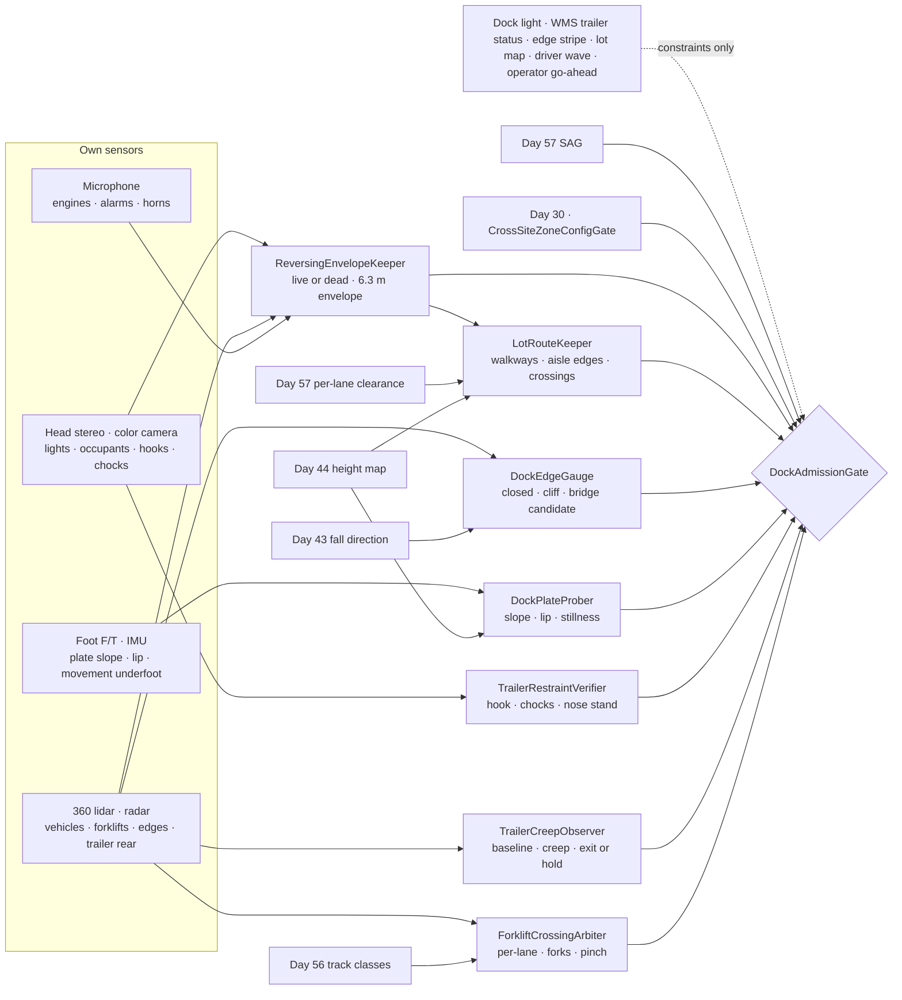
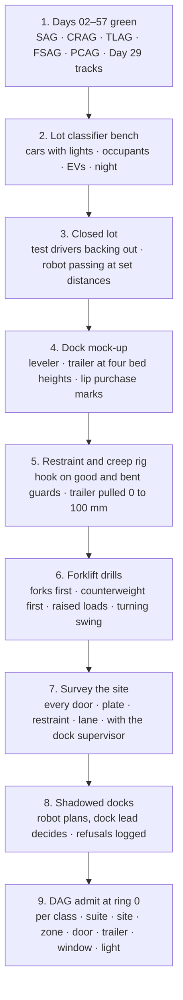

# Day 58 — Parking lots and loading docks under the sidewalk stack: ReversingEnvelopeKeeper / LotRouteKeeper / DockEdgeGauge / DockPlateProber / TrailerRestraintVerifier / TrailerCreepObserver / ForkliftCrossingArbiter / DockAdmissionGate under SidewalkAdmissionGate + CorridorAdmissionGate + ElevatorAdmissionGate + DoorwayAdmissionGate + WetSurfaceAdmissionGate + ConfinedSpaceAdmissionGate + ElevatedAccessAdmissionGate + OverheadToolAdmissionGate + BimanualToolAdmissionGate + PowerToolAdmissionGate + PushPullAdmissionGate + PayloadCarryAdmissionGate + OutdoorGroundAdmissionGate + TerrainLocomotionAdmissionGate + FallSafeAdmissionGate + DeliberateContactAdmissionGate + WholeBodyTouchAdmissionGate + HumanHandoverAdmissionGate + CooperativeTaskAdmissionGate + TaskCompositionAdmissionGate + FleetSkillCatalogAdmissionGate + proximity + zone attestation + supervisor + logging + canary + HIL + fleet + incident + change-management + maintenance + thermal + energy gates

![ReversingEnvelopeKeeper / LotRouteKeeper / DockEdgeGauge / DockPlateProber / TrailerRestraintVerifier / TrailerCreepObserver / ForkliftCrossingArbiter / DockAdmissionGate: a 63.8 kg humanoid in a retail lot classifies a parked car as live from its reverse lights and occupant, refuses to pass within 6.3 m of its rear bumper, walks the marked path instead of between cars, and crosses a 7.3 m aisle only when moving cars are 29 m away; at a 1.22 m warehouse dock it treats an open door with no trailer as a cliff, crosses a 1.83 m leveler only at 8.3% or less with at least 150 mm of lip on the trailer bed, enters a trailer only when the dock lock hook is seen on the rear impact guard and the trailer has held still within 5 mm for 60 s, watches for creep while inside, and crosses the forklift lane only when the truck is measured stopped or 28 m away, never under raised forks and never between a forklift and a trailer](/images/day58-parking-lots-loading-docks.png)

[Day 05](/lessons/day-05-power-bms) owns `torque_scale` and state of charge **forever**. [Day 07](/lessons/day-07-wbc-balance) owns whole-body balance. [Day 17](/lessons/day-17-runtime-safety-supervisor) owns ESTOP and safe states. [Day 29](/lessons/day-29-human-proximity-safety) owns person tracks, SSM, and PFL rows. [Day 30](/lessons/day-30-collaborative-workspace-zoning) owns attested zones and `CrossSiteZoneConfigGate`. [Day 43](/lessons/day-43-falls-fall-safe-contact) owns falls and fall direction. [Day 44](/lessons/day-44-stairs-ramps-uneven-terrain) owns the height map, steps, and ramps. [Day 46](/lessons/day-46-carrying-payloads-walking) owns what the robot carries. [Day 54](/lessons/day-54-doors-gates-thresholds) owns doors. [Day 56](/lessons/day-56-crowded-corridors-walkways) owns track classes and passing. [Day 57](/lessons/day-57-sidewalks-crosswalks-curb-ramps) owns the curb, crossings, per-lane vehicle clearance, and "never the street."

Yesterday the robot learned that the street is the one place it never stands. Today it walks into the two places where that rule breaks down. A parking lot has no sidewalk: the aisle *is* the walkway, and every parked car might start backing out with a driver who is looking at a mirror, not at a robot. A loading dock has no curb: it has a 1.22 m drop that sometimes has a trailer against it and sometimes doesn't, a steel plate that moves, a trailer that can creep away, and forklifts whose operators are often driving backwards. Day 57's measurements carry over. What changes is that vehicles start from rest right beside the robot, and the floor itself can leave.

Eight lies show up the first time a team sends a humanoid across a lot and onto a dock:

1. **Parked-means-still lie.** "It's in a stall, it's furniture." A car with someone in it, lights on, or the engine running is a vehicle that can move backward at any moment, and its driver can't see a robot behind it.
2. **Backup-alarm lie.** "Reversing vehicles beep." Cars don't, many trucks have the alarm switched off at night, and a rear camera helps only if the driver is looking at it.
3. **Shortcut lie.** "Cut between the parked cars." Between two cars the robot is hidden from every driver in the aisle and has wheel stops at its feet.
4. **Dock-door-is-a-doorway lie.** "It's just another door." An open dock door with no trailer is a 1.22 m cliff.
5. **Plate-is-floor lie.** "The leveler is down, walk on it." A leveler is a hinged bridge whose slope depends on today's trailer, whose lip may be barely on the bed, and which moves when a forklift drives onto it.
6. **Green-light lie.** "The dock light is green, the trailer is locked." The light reports what the restraint thinks. A hook can miss a bent or missing rear guard and still show green.
7. **Chocked-can't-move lie.** "It's chocked and the brakes are set." Trailers creep away from the dock under the push and pull of forklifts, and drivers sometimes pull out early.
8. **Forklift-sees-me lie.** "The operator will stop." With a tall load the operator drives in reverse, looking over a shoulder, and a loaded forklift needs nearly 4 m to stop from walking pace.

Today owns **`ReversingEnvelopeKeeper` / `LotRouteKeeper` / `DockEdgeGauge` / `DockPlateProber` / `TrailerRestraintVerifier` / `TrailerCreepObserver` / `ForkliftCrossingArbiter` / `DockAdmissionGate`**. The question is: **how do you let a humanoid cross parking lots and work loading docks, with every parked vehicle classified live or dead from what the robot itself sees and the space each live one could back into kept empty, routes kept on marked paths and out from between cars, dock edges treated as drops whenever no restrained trailer is there, dock plates measured for slope, lip, and stillness before every crossing, trailers entered only when the restraint is seen working and the trailer has held still, creep watched the whole time the robot is inside, and forklifts crossed only when measured stopped or far — without raising Day 29 PFL, writing Day 05 `torque_scale`, gating Day 17 ESTOP, or bypassing `CrossSiteZoneConfigGate`?**

## The floor and the vehicles both have to be proven still

The rule everything follows from: **whether a vehicle is live, how far it could reverse while the robot is behind it, where the dock edge is, what the plate's slope and lip are, whether the trailer is restrained and still, and where every forklift is and how fast it's going are measurements this robot takes at this lot and this door right now. A dock light, a "trailer locked" message from the warehouse system, a yellow edge stripe, a parking-lot map, a driver's wave, and an operator saying "go ahead" are never inputs that admit anything.** They may add constraints. They may never raise a limit.

Three facts set the shape of the lesson.

**A reversing car starts from rest, so it doesn't need to be moving to be dangerous.** Day 57's per-lane rule handled vehicles already in motion. Behind a parked car the robot needs room for one that starts moving while the robot is passing. With car width $w_c$ = 1.9 m, a 0.5 m band each side, the robot's 0.5 m shoulders, and robot speed $v_r$:

$$
t_p = \frac{w_c + 2b + w_r}{v_r} = \frac{1.9 + 1.0 + 0.5}{1.0} = 3.4\ \text{s}
$$

A driver who can't see the robot doesn't react at all, so the car simply accelerates. At a gentle $a$ = 1.0 m/s² for the whole pass, plus $C$ = 0.5 m:

$$
d_{\text{rev}} = \tfrac{1}{2} a\, t_p^{2} + C = 0.5 \times 1.0 \times 3.4^2 + 0.5 = 6.3\ \text{m}
$$

A two-way aisle is about 7.3 m wide. The aisle's centerline is 3.65 m from a parked car's bumper, well inside the envelope.

**A dock is a 1.22 m drop.** Falling from it, the 63.8 kg robot lands at $\sqrt{2gh}$ = 4.9 m/s with $mgh$ = 764 J to absorb, far more than any fall Day 43 plans for on level ground. Day 43 must never be asked to pick a fall direction off a dock.

**A forklift is a vehicle with a person in it, not a person.** Day 29 can't slow it. At a posted 2.2 m/s, with 1.0 s for the operator to react and a load-friendly 1.5 m/s² stop, it needs $2.2 \times 1.0 + 2.2^2/(2 \times 1.5)$ = 3.8 m, and only if the operator has seen the robot.

| Layer | Owns | Must not own |
|-------|------|--------------|
| `ReversingEnvelopeKeeper` | Live or dead per parked vehicle from lights, occupant, exhaust, sound, wheel motion; the 6.3 m rear envelope with turning swing; exit forward if it turns live around the robot | "Parked, so still"; a backup alarm as the only cue |
| `LotRouteKeeper` | Marked walkways first; aisle edges; no walking between parked cars; perpendicular aisle crossings with Day 57's per-lane rule; wheel stops as Day 44 steps; measured lot speeds | Shortcuts; the truck yard; the lot map's walkway as proof it's clear |
| `DockEdgeGauge` | Each dock door's state: closed (wall), open with no trailer (cliff), trailer present (bridge candidate); 1.0 m standoff and Day 43 edge-side forbidden | Edge from the yellow stripe alone; walking the edge |
| `DockPlateProber` | Leveler or dock plate slope, cross slope, lip purchase on the bed, side gaps, hinge seam, stillness under the robot's step, portable plate anchoring | "The leveler is down, so it's fine" |
| `TrailerRestraintVerifier` | Dock lock hook seen on the rear guard, or chocks seen on both sides; nose stand under an uncoupled trailer; tractor uncoupled or driver out; the light as a refusal-only input | Admitting on a green light or a warehouse-system flag |
| `TrailerCreepObserver` | Trailer rear position against a baseline; stillness before entry; creep during work; exit or hold decision | Assuming chocks stopped it |
| `ForkliftCrossingArbiter` | Forklift tracks with travel direction and load height; per-lane clearance; never under raised forks; never between a forklift and a trailer, rack, or wall; no robot and forklift in one trailer | An operator's nod; a horn as a yield |
| `DockAdmissionGate` | Fail-closed admit per robot class, suite, site, lot zone, dock door, trailer, time window, light, task, payload | `JointCommand`; Day 05; PFL; Day 17 |
| Days 05 / 07 / 17 / 29 / 30 / 43 / 44 / 46 / 54 / 56 / 57 | Charge, balance, ESTOP, people, zones, falls, terrain, payload, doors, track classes, crossings | Being outranked by "the light was green" |

**Core thesis:** **in a lot or at a dock, a humanoid trusts only what it measures: which parked vehicles are live and how far they could back up while it passes, where the dock edge is open, what the plate under its feet is doing, whether the trailer's restraint is actually engaged and the trailer is actually still, and where every forklift is. It stays out of the space anything could move into, and it never takes a light or a wave as permission.**



## Physical machine: what a lot and a dock do to a humanoid

The example robot is the same 63.8 kg humanoid: 0.50 m across the shoulders, a 0.24 m foot, an outdoor cap of 1.0 m/s, and a dock-floor cap of 0.8 m/s. Two places run through the lesson:

- **Site L, retail lot.** 90° stalls 2.7 × 5.5 m, two-way aisles 7.3 m wide, 150 mm concrete wheel stops, one painted walkway from the street to the entrance, and vehicle speeds the robot measured over a week at 4.0 m/s for the 85th percentile.
- **Site W, warehouse dock.** Twelve doors on a 1.22 m dock, each with a 1.83 m hydraulic leveler and a 406 mm lip, a hook-type vehicle restraint with red and green lights inside and out, a 3.6 m forklift lane along the dock face, and forklifts posted at 2.2 m/s that the robot has measured at up to 3.1 m/s empty.

### Parked or live: the car decides when it moves, not the robot

`ReversingEnvelopeKeeper` classifies every parked vehicle near the route. A vehicle is **live** if the robot sees any of: reverse lights, brake lights, an occupant in the driver's seat, exhaust plume or heat at the tailpipe, engine or motor sound localized to it, a door just closed, or any wheel motion. Electric cars make almost no sound, so sound can only add a live vote, never remove one. A vehicle the robot can't see well enough to classify is live.

Around each live vehicle REK keeps a **reverse envelope**: the 6.3 m from the formula above, measured straight back from the bumper, widened by 1.0 m on each side for the swing of a car that turns while it backs out. The robot doesn't enter it. On a 7.3 m aisle that means it can pass a live car only along the far edge, about 7.0 m from the bumper, and only if the car on that side isn't live too. Otherwise it waits outside both envelopes, at the aisle edge, for up to 60 s.

A rear camera doesn't change this. The US rear-visibility rule (FMVSS 111) makes new cars show a 3.0 × 6.1 m zone behind the bumper, which is roughly the envelope. It helps the driver who looks. REK assumes the driver doesn't.

If a car turns live while the robot is already inside its envelope, the robot does what Day 57 does after commit: it goes forward, out of the envelope by the shortest path, and never back across the bumper.

Trucks are worse. A 16.2 m trailer backing to a dock has a blind side the length of the trailer, and yard trucks shuttle trailers all day. The truck yard and the dock apron are **the street** in Day 57's sense: the robot never walks in them.

### Lot routes: walkways first, never between cars

`LotRouteKeeper` plans the walk across the lot. Its order of preference:

1. A **marked pedestrian walkway**, measured by Day 57's SidewalkWidthGauge like any sidewalk.
2. The **edge of an aisle**, just outside the bumper line, where every driver coming down the aisle can see the robot, and where REK's envelopes are checked car by car.
3. Nothing else. The robot never walks **between parked cars**: there it's hidden from every driver, there are wheel stops at its feet, and either car can go live with the robot beside it.

Crossing an aisle is a crossing, so it uses Day 57's per-lane rule. A 7.3 m two-way aisle is two 3.65 m lanes, 3.65 s each at 1.0 m/s, so a moving car in either lane must be at least 7.3 s away: 29 m at Site L's 4.0 m/s. Crossings go straight across the aisle, never diagonally, to keep the time in the lane short.

Wheel stops are 150 mm steps the camera often loses in the shadow under a bumper. LRK keeps them in Day 44's height map as steps, and the route never asks a foot to cross one.

Admission depends on the lot, not just the route. DAG admits a lot zone only if the robot's own week of measurements shows 85th-percentile speeds at or below 4.5 m/s; a lot used as a cut-through, with cars at 7 m/s, is refused.

### Dock edges: a door is a wall, a cliff, or a bridge

`DockEdgeGauge` gives every dock door one of three states, from the robot's own lidar and camera:

| State | How it's measured | Rule |
|------|------|------|
| Closed | Door panel within 0.1 m of the opening plane | A wall; normal passing |
| Open, no trailer | No surface within 2 m beyond the dock face at floor height | A cliff: 1.0 m standoff, 0.5 m/s within 2 m, Day 43 edge side forbidden |
| Open, trailer present | Trailer floor and walls seen beyond the face | A bridge candidate: still a cliff until DPP, TRV, and TCO all pass |

The yellow edge stripe is a constraint, not a measurement. Stripes wear off and are painted on the wrong side of a bumper. DEG finds the edge from the floor ending in the height map, and uses whichever comes first, the same as Day 57's curb edge.

Two edges matter beyond the doors. A **leveler with no trailer** is often left in its stored position, flush with the floor, but some sit with the lip hanging or the deck raised, so it's a hole or a step until measured. And an **open dock position with a dock seal** can show the robot a curtain of fabric that looks like a wall to lidar at a glance. DEG needs the floor beyond the face, not something in the way, before it calls a trailer present.

### Dock plates: the slope is today's trailer, and the bridge moves

`DockPlateProber` checks the leveler or portable plate before every crossing. The slope depends on where today's trailer bed sits against the dock:

| Trailer bed | Height difference | Leveler slope (1.83 m) | Rule |
|------|------|------|------|
| 1.32 m, standard dry van | +0.10 m | 5.5% up | OK, 0.5 m/s |
| 1.07 m, low-deck trailer | −0.15 m | 8.2% down | OK at the limit, 0.5 m/s, Day 07 told |
| 1.37 m, loaded reefer on air ride | +0.15 m | 8.2% up | OK at the limit |
| 1.42 m, container on chassis | +0.20 m | 10.9% up | Refused |

The cap is the same 8.3% as a curb ramp. A cross slope above 3% (an air-ride trailer leaning on one side) is refused too.

The **lip** is the part that rests on the trailer bed. DPP measures how much of it is resting on the bed with the camera: at least 150 mm to start, at least 100 mm to stay. The hinge seam where the lip meets the deck is a grade break, and as on a curb ramp, no foot lands across it. The side gaps between the leveler and the dock pit open up when the deck is raised, so footsteps stay at least 0.15 m in from the deck's sides.

Then DPP checks that the plate is still. The robot's first step on the plate is a probe: one foot loaded to half its weight, with the foot's force sensor and the head lidar watching. The plate must move less than 5 mm and the lip must not lift. A **portable dock plate** must also be anchored; the US rule for dockboards (OSHA 1910.26) requires portable ones to be secured against slipping. DPP pushes the plate sideways with the foot at 50 N before stepping on it, and refuses any plate that moves.

A leveler is a moving bridge. When a forklift drives onto it, the deck and trailer floor drop and spring back. The robot never shares a plate with a forklift and never stands on one when a forklift is within 5 m of the door.

### Restraints: the light reports, the robot verifies

`TrailerRestraintVerifier` decides whether a trailer is held. The restraint's red and green lights, and a "door locked" flag from the warehouse management system, are inputs that can only refuse: **red means no; green means the robot goes on to check.** The checks:

- **Dock lock:** the hook seen engaged over the trailer's rear impact guard, either directly by the robot before it entered the building or through a dock camera that Day 30 has attested as a site sensor for that door. A bent, missing, or unusually high guard means the hook may show green while holding nothing, so DAG refuses that door for the robot.
- **Chocks, where there's no dock lock:** a chock seen against a rear tire on each side, on the side of the tire away from the dock. OSHA 1910.178(k)(1) requires brakes set and wheel chocks in place before forklifts load a truck; the robot holds itself to the same rule.
- **An uncoupled trailer:** a nose stand seen under the front, because a trailer with no tractor can tip forward when weight moves into its nose; OSHA notes fixed jacks may be needed for exactly this.
- **A coupled trailer:** the driver seen out of the cab, or the site's key-control or glad-hand lock confirmed; a driver in the cab with the engine running is an early departure waiting to happen.

### Creep: still before entry, watched the whole time inside

`TrailerCreepObserver` takes a baseline of the trailer's rear edge position from the robot's lidar. Before entry the trailer must hold still within 5 mm for 60 s. Inside, TCO keeps measuring against the baseline from the robot's own position, using the trailer's rear frame as seen through the door.

Creep reduces the lip on the bed. Starting with 150 mm resting on the bed, 50 mm of creep leaves 100 mm, the minimum. So TCO's rules:

- Creep over 25 mm, or any steady drift: the robot stops loading and leaves, **if** the lip still has at least 100 mm on the bed and no forklift is near the door.
- Lip under 100 mm or the gap growing fast: the robot does **not** step onto the plate. It moves forward into the trailer, at least 2 m from the rear, crouches into Day 17's held safe state, and calls the operator and the dock office. A trailer pulling away with a robot inside is an incident. A robot falling 1.22 m off a moving plate is a worse one.

### Forklifts: stopped or far, never under the forks, never in the pinch

`ForkliftCrossingArbiter` treats a forklift as a vehicle in Day 57's sense: tracked, per lane, with Day 56's track classes adding its shape. For each forklift it measures speed, the direction it's traveling (forks first or counterweight first), and the load height. A forklift carrying a load it can't see over is required to drive in reverse (OSHA 1910.178(n)(6)), so its "front" for this crossing is its counterweight, and its operator is looking over a shoulder.

Crossing the 3.6 m forklift lane at 0.8 m/s takes 4.5 s, so a moving forklift must be at least 9 s away: 20 m at the posted 2.2 m/s, but FCA uses the measured speed, and at Site W's 3.1 m/s that's 28 m. A forklift is counted stopped under the same rule as a car: under 0.3 m/s for 1 s. A horn, a flash of the strobe, or a wave from the operator is not a stop.

Three rules don't depend on speed:

- **Never under raised forks or a raised load.** OSHA 1910.178(m)(1) says no one may stand or pass under the elevated part of a truck. Day 29's PFL can't help with a falling pallet.
- **Never in the pinch.** The robot never stands between a forklift and a trailer, rack, or wall with less than 1.5 m clear. Counterbalance forklifts steer with their rear wheels, so the counterweight swings out in a turn; FCA adds 1.0 m to the tail of every turning forklift.
- **One trailer, one machine.** The robot and a forklift are never in the same trailer, and the robot never enters a trailer a forklift is about to enter.

## ReversingEnvelopeKeeper and LotRouteKeeper

REK marks every parked vehicle live or dead from lights, occupant, exhaust, sound, door, and wheel motion, treats unknown as live, keeps a 6.3 m envelope plus 1.0 m swing behind each live vehicle, waits up to 60 s outside it, and exits forward if a car turns live around the robot. LRK uses marked walkways first and aisle edges second, never walks between parked cars, crosses aisles straight with Day 57's per-lane rule, keeps wheel stops as steps, and treats the truck yard as the street.

## DockEdgeGauge and DockPlateProber

DEG classifies each door as closed, cliff, or bridge candidate from the floor ending, not the stripe, keeps 1.0 m from any cliff, and forbids Day 43 that side. DPP accepts a plate at 8.3% slope or less and 3% cross slope or less, with at least 150 mm of lip on the bed to start and 100 mm to stay, no foot across the hinge seam, 0.15 m from the sides, under 5 mm of movement under a half-weight probe step, and portable plates anchored against a 50 N push.

## TrailerRestraintVerifier, TrailerCreepObserver, and ForkliftCrossingArbiter

TRV treats the light and the warehouse flag as refusal-only, and needs the hook seen on a sound rear guard, or chocks seen both sides, plus a nose stand under an uncoupled trailer and no driver in a coupled one. TCO needs 60 s within 5 mm before entry, and inside, on creep over 25 mm, exits only with at least 100 mm of lip on the bed, otherwise holds deep in the trailer and calls for help. FCA crosses forklift lanes only with forklifts stopped or twice the lane time away at measured speed, and never goes under forks, into a pinch, or into a trailer with a forklift.

## DockAdmissionGate

`DockAdmissionGate` (DAG) admits lot and dock modes per robot class, sensor suite hash, site, lot zone, dock door, trailer, time window, light level, task, and payload, under Day 57 SAG for the walk to the lot, Day 56 CRAG for people on the dock, Day 54 DoorwayAdmissionGate for the dock doors themselves, Day 46 PCAG for what it carries into a trailer, Day 44 TLAG for plates and wheel stops, Day 43 FSAG for where it falls, and Day 29 for every person. Lots and docks are Day 30 zones with a site authority, unlike a city sidewalk, so the site's dock and lot rules come in as rows through `CrossSiteZoneConfigGate`, and a site rule can only tighten. Every row needs:

- REK live or dead for every parked vehicle within 10 m of the route, this pass.
- LRK route with walkways, aisle edges, crossings, and wheel stops listed.
- DEG state for every door within 5 m of the route.
- DPP probe of this plate with this trailer, today.
- TRV restraint seen, not just reported.
- TCO baseline still for 60 s before entry, and live during the work.
- FCA per-lane clearance at every forklift-lane crossing.
- A live operator link and the dock office's contact for every trailer entry at ring 0.

DAG never writes `JointCommand`, never touches Day 05 `torque_scale`, never raises a Day 29 row, never takes a dock light, a warehouse flag, a stripe, a lot map, a wave, a horn, or a go-ahead as a measurement, never enters a reverse envelope, never walks between parked cars or in the truck yard, never stands within 1.0 m of an open dock edge, never crosses a plate above 8.3% or with under 150 mm of lip, never enters a trailer whose restraint wasn't seen or that hasn't held still, never steps onto a moving plate, never goes under forks or into a pinch, never shares a trailer with a forklift, and never gates ESTOP.

## Data shapes

```text
ParkedVehicle:                                # REK
  vehicle_id, kind, pose, live, live_cues[]   # REVERSE | BRAKE | OCCUPANT | EXHAUST | SOUND | DOOR | WHEEL
  classify_conf, envelope_m, swing_m, robot_inside, exit_path

LotRoute:                                     # LRK
  site, zone, segments[]                      # WALKWAY | AISLE_EDGE | AISLE_CROSSING
  between_cars: false, wheel_stops[], lot_v85_mps, crossing_clearance[]
  lot_map_walkway                             # constraint only

DockDoor:                                     # DEG
  door_id, state                              # CLOSED | CLIFF | BRIDGE_CANDIDATE
  edge_from                                   # FLOOR_END | STRIPE (first of)
  standoff_m, v_max_mps, fall_side_forbidden, leveler_stored_flush

PlateProbe:                                   # DPP
  door_id, trailer_id, t, slope_pct, cross_pct, lip_on_bed_mm, hinge_seam_pose
  side_margin_m, probe_move_mm, lip_lifted, portable, anchor_push_move_mm

RestraintCheck:                               # TRV
  door_id, trailer_id, light                  # RED | GREEN | DARK (refusal only)
  wms_flag                                    # constraint only
  hook_seen_on_guard, guard_condition, chocks_seen[], coupled, nose_stand_seen
  driver_in_cab, seen_by                      # ROBOT | ATTESTED_DOCK_CAMERA

CreepWatch:                                   # TCO
  trailer_id, baseline_t, still_window_s, still_within_mm, creep_mm, rate_mm_per_min
  decision                                    # ENTER | WORK | EXIT | HOLD_INSIDE

ForkliftTrack:                                # FCA
  track_id, v_mps, travel                     # FORKS_FIRST | COUNTERWEIGHT_FIRST
  load_height_m, forks_raised, tail_swing_m, lane_id, ttc_s, stopped, pinch_clear_m

DockAdmission:                                # DAG
  robot_class, suite_hash, site, lot_zone, door, trailer, window, light, task, payload
  ring, refusals[]
  forbidden:
    parked_means_still: true
    enter_reverse_envelope: true
    walk_between_parked_cars: true
    walk_in_truck_yard: true
    edge_from_stripe_only: true
    stand_near_open_edge: true
    plate_over_8_3_pct: true
    lip_under_150mm_to_start: true
    foot_across_hinge_seam: true
    admit_on_dock_light: true
    admit_on_wms_flag: true
    enter_trailer_not_still: true
    step_on_moving_plate: true
    under_raised_forks: true
    stand_in_pinch: true
    share_trailer_with_forklift: true
    wave_or_horn_as_yield: true
    raise_pfl: true
    write_torque_scale: true
    gate_estop: true
    bypass_cross_site_zone_config_gate: true

# Unchanged owners
SidewalkAdmissionGate · per-lane clearance (Day 57) · CorridorAdmissionGate · track classes (Day 56)
DoorwayAdmissionGate (Day 54) · PayloadCarryAdmissionGate (Day 46) · TLAG · height map (Day 44)
FSAG · fall direction (Day 43) · CrossSiteZoneConfigGate · zones (Day 30) · tracks · SSM · PFL (Day 29)
SupervisorState ESTOP · safe states (Day 17) · WBC (Day 07)
BmsState / PowerState (Day 05): torque_scale, reserve
  accepts_requests_from_dock: false
```

## Config

A starting configuration. Every number is a policy you re-derive from your own robot, lot, and dock:

```yaml
lot_dock:
  reversing:
    live_cues: [reverse_lights, brake_lights, occupant, exhaust, sound, door, wheel_motion]
    sound_can_clear: false
    unknown_is_live: true
    car_width_m: 1.9
    band_m: 0.5
    start_accel_mps2: 1.0
    envelope_c_m: 0.5          # gives 6.3 m at 1.0 m/s
    swing_m: 1.0
    wait_s: 60
    inside_when_live: exit_forward
  route:
    prefer: [marked_walkway, aisle_edge]
    between_parked_cars: never
    truck_yard_and_apron: never
    aisle_crossing: straight_day57_per_lane
    wheel_stops: day44_step
    lot_v85_max_mps: 4.5
  dock_edge:
    edge_from: first_of_floor_end_stripe
    cliff_standoff_m: 1.0
    near_cliff_v_mps: 0.5
    near_cliff_within_m: 2.0
    cliff_fall_side: forbidden
  plate:
    max_slope_pct: 8.3
    max_cross_pct: 3.0
    lip_on_bed_start_mm: 150
    lip_on_bed_stay_mm: 100
    hinge_seam: no_foot_across
    side_margin_m: 0.15
    probe_load: half_weight
    probe_move_max_mm: 5
    portable_anchor_push_n: 50
    forklift_clear_of_door_m: 5
    v_mps: 0.5
  restraint:
    light: refusal_only
    wms_flag: constraint_only
    need_one_of: [hook_seen_on_sound_guard, chocks_seen_both_sides]
    uncoupled_needs: nose_stand_seen
    coupled_needs: driver_out_or_site_key_control
    seen_by: [robot, day30_attested_dock_camera]
  creep:
    still_before_entry_s: 60
    still_within_mm: 5
    exit_above_mm: 25
    hold_inside_if_lip_under_mm: 100
    hold_inside_from_rear_m: 2.0
  forklift:
    v_from: measured
    stopped_below_mps: 0.3
    stopped_for_s: 1.0
    moving_ttc_factor: 2.0
    under_raised_forks: never
    pinch_min_m: 1.5
    tail_swing_add_m: 1.0
    same_trailer: never
    horn_or_wave: ignored
  admission:
    keyed_by: [robot_class, sensor_suite_hash, site, lot_zone, dock_door, trailer, window, light, task, payload]
    requires: [day57_sag, day56_crag, day54_doors, day46_pcag, day44_tlag, day43_fsag, cross_site_zone_config_gate]
    operator_link_trailer_entry_ring0: required
```

## Physical ↔ digital pairing

| Physical | Digital twin / backing |
|----------|------------------------|
| SUV in a stall, reverse lights on | REK: live; 6.3 m envelope plus 1.0 m swing; robot waits at the aisle edge |
| Silent EV, driver in the seat | REK: occupant cue alone makes it live |
| Robot passing when a car's brake lights come on | REK: exit forward, never back across the bumper |
| Shortcut between two cars to the entrance | LRK: refused; aisle edge then the marked walkway |
| Car 20 m away in the aisle at 4.0 m/s | LRK: 5 s, under 7.3 s; wait |
| Dock door 7 open, no trailer | DEG: cliff; 1.0 m standoff, 0.5 m/s, edge side forbidden to Day 43 |
| Yellow stripe worn off at door 3 | DEG: edge from the floor ending in the height map |
| Container chassis at door 9, bed at 1.42 m | DPP: 10.9%; refused |
| Lip shows 120 mm on the bed | DPP: under 150 mm; refused to start |
| Green light at door 4, guard bent upward | TRV: hook not seen on a sound guard; refused |
| Uncoupled trailer, no nose stand | TRV: refused |
| Trailer creeps 30 mm while robot unloads | TCO: lip still 120 mm, no forklift near; exit now |
| Trailer pulls away 80 mm | TCO: lip 70 mm; hold 2 m inside, Day 17 safe state, call |
| Forklift with tall load reversing along the dock face at 3.1 m/s | FCA: counterweight first; 28 m needed; wait |
| Pallet raised on forks over the walkway | FCA: never under; route around |

The pairing that matters most: **replay every lot crossing and every trailer entry from the robot's own bag and show that every parked vehicle near the route was classified, no reverse envelope was entered, no step was taken between cars or in the yard, every open door was treated as a cliff, every plate was probed with today's trailer, every restraint was seen and not just reported, every trailer held still before entry and was watched during the work, and no forklift was crossed in front of, gone under, or shared a trailer with.**

## Bring-up sequence (before the robot walks onto a real dock)



1. **Days 02–57 green,** with SAG, CRAG, TLAG, FSAG, and PCAG admitted.
2. **Lot classifier bench:** parked cars filmed day and night with every live cue on and off, including silent EVs and tinted windows; REK must never call a live car dead.
3. **Closed lot:** test drivers backing out on cue, starting at random while the robot passes; check the envelope holds at 1.0 m/s².
4. **Dock mock-up:** a leveler against a trailer set at 1.07, 1.32, 1.37, and 1.42 m, with marks on the bed for 100 and 150 mm of lip.
5. **Restraint and creep rig:** a hook on a good guard and on bent and missing ones; a trailer winched away 0 to 100 mm in steps while the robot works inside.
6. **Forklift drills:** trained operators driving forks first and counterweight first, with raised loads and tight turns, at posted and real speeds.
7. **Survey the site:** every door, plate, restraint, and forklift lane with the dock supervisor, and the site's dock rules written as Day 30 rows.
8. **Shadowed docks:** the robot plans every lot crossing and trailer entry, the dock lead decides; compare refusals.
9. **DAG admit at ring 0** per robot class, suite, site, lot zone, door, trailer, time window, light, task, and payload.

## Failure gallery

| Symptom | Likely cause |
|---------|--------------|
| Car backs toward the robot in the aisle | Parked car called dead; occupant or EV not detected |
| Robot hidden from a driver, near miss | Route went between parked cars |
| Robot trips in a lot | Wheel stop lost in bumper shadow, not in the height map |
| Robot near a dock edge with no trailer | Edge from a worn stripe; open door treated as a doorway |
| Robot rocks at the trailer end of the plate | Foot across the hinge seam |
| Robot enters a trailer that then moves | Green light trusted; hook on a bent guard; no stillness baseline |
| Robot steps onto a plate as the gap opens | Creep seen but exit allowed under 100 mm of lip |
| Near miss with a reversing forklift | Forklift's travel direction assumed forks first |
| Robot struck by a turning forklift's counterweight | No tail-swing band; robot in the pinch |
| Robot and forklift in the same trailer | No one-trailer rule; WMS said the door was free |

## Exercises

1. A pickup 2.0 m wide is live in its stall. At 0.8 m/s, what's the robot's pass time and reverse envelope? Can it pass along the far edge of a 7.3 m aisle?
2. A one-way 4.9 m aisle with cars at 3.5 m/s. What clearance does a car need before the robot crosses at 1.0 m/s?
3. A trailer bed sits at 1.30 m against a 1.22 m dock with a 2.44 m leveler. What's the slope? With a 1.83 m leveler?
4. The lip shows 160 mm on the bed when the robot enters. The trailer creeps 2 mm a minute. How long can the robot work before TCO's 25 mm rule fires, and how much lip is left then?
5. A forklift with a tall load crosses the dock lane at 2.6 m/s, counterweight first. The lane is 4.0 m and the robot crosses at 0.8 m/s. How far away must the forklift be, and which end is its front?
6. Write the `DockAdmission` row for the robot unloading 12 cartons of 8 kg from a 1.32 m dry van at Site W door 4 at 06:00. Which rows can refuse it, and what does the robot do if the light goes red while it's 6 m inside?

## What to freeze this week

Extend [frames](/frames) and your safety config with:

- `ReversingEnvelopeKeeper`: live or dead from lights, occupant, exhaust, sound, door, and wheels; unknown is live; 6.3 m envelope plus 1.0 m swing; wait 60 s; exit forward if a car turns live around the robot.
- `LotRouteKeeper`: marked walkways, then aisle edges; never between parked cars or in the truck yard; aisles crossed straight with Day 57's per-lane rule; wheel stops as steps; lots with 85th-percentile speeds over 4.5 m/s refused.
- `DockEdgeGauge`: closed, cliff, or bridge candidate from the floor ending, not the stripe; 1.0 m standoff and Day 43 edge side forbidden at every cliff.
- `DockPlateProber`: 8.3% slope and 3% cross slope at most; 150 mm of lip to start and 100 mm to stay; no foot across the hinge; under 5 mm of movement under a probe step; portable plates anchored.
- `TrailerRestraintVerifier`: lights and warehouse flags refusal-only; hook seen on a sound guard or chocks seen both sides; nose stand under uncoupled trailers; no driver in the cab.
- `TrailerCreepObserver`: 60 s within 5 mm before entry; exit on 25 mm only with 100 mm of lip; otherwise hold 2 m inside under Day 17 and call.
- `ForkliftCrossingArbiter`: measured speed and travel direction; stopped or twice the lane time away; never under raised forks, never in a pinch under 1.5 m, 1.0 m tail swing, one trailer one machine.
- `DockAdmissionGate` fail-closed under Day 57 SAG and the stack below it; keyed by robot class, suite, site, lot zone, door, trailer, time window, light, task, and payload; **no parked-means-still, no reverse envelope, no walking between cars, no edge from a stripe, no plate over 8.3%, no trailer on a green light alone, no moving plate, no forks overhead, no pinch, no dual-write of Day 07, ESTOP, or `torque_scale`.**

The lesson isn't "teach the robot to unload trucks." It's that **in a lot and at a dock, both the vehicles and the floor can move without warning, so the robot proves each one still before it trusts it: it stays out of the space a parked car could back into, treats every open dock door as a cliff, checks the plate under its own foot with today's trailer, sees the restraint working instead of reading a light, watches the trailer the whole time it's inside, and never stands where a forklift or its load could go.**

## Further reading

Look these up by title; they're the standard sources for today's dock, forklift, and backover arguments:

- OSHA 29 CFR 1910.26, *Dockboards*, for securing portable dockboards and preventing transport vehicles from moving while dockboards are in use.
- OSHA 29 CFR 1910.178, *Powered Industrial Trucks*, especially (k) on trucks and trailers at docks, (m)(1) on passing under elevated loads, and (n)(6) on traveling in reverse with an obstructed view.
- ANSI MH30.1, *Safety, Performance, and Testing of Dock Leveling Devices*, for leveler design, lip, and grade.
- ANSI MH30.3, *Safety, Performance, and Testing of Vehicle Restraining Devices*, for dock locks and their signaling.
- NHTSA, FMVSS No. 111, *Rear Visibility*, for the backup camera's required view behind a vehicle.
- NIOSH and OSHA guidance on backover incidents and dock safety, for how vehicles strike people on foot in yards and lots.
- ISO 3691-4 for driverless industrial trucks and ISO 13482 for personal care robots in shared spaces.

## Next

**Day 59+** — Construction sites and active work zones under the dock stack: unfinished floors and floor holes behind covers that may not be marked, open slab edges and guardrails measured rather than assumed, temporary cords and hoses across the path, heavy equipment swing radii and blind sides, overhead loads from cranes and hoists, and barricade tape versus hard barriers read for what they actually stop — without raising Day 29 PFL, writing Day 05 `torque_scale`, or bypassing `CrossSiteZoneConfigGate`, under the same gates plus dock admission.
