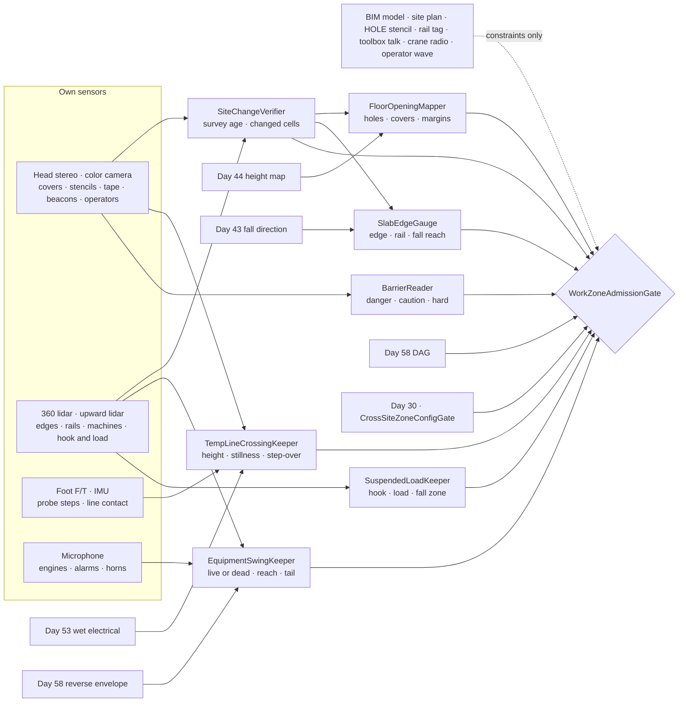
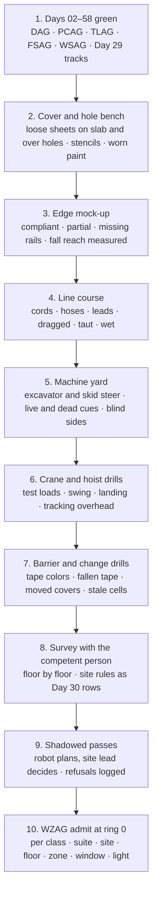

# Day 59 — Construction sites and active work zones under the dock stack: FloorOpeningMapper / SlabEdgeGauge / TempLineCrossingKeeper / EquipmentSwingKeeper / SuspendedLoadKeeper / BarrierReader / SiteChangeVerifier / WorkZoneAdmissionGate under DockAdmissionGate + SidewalkAdmissionGate + CorridorAdmissionGate + ElevatorAdmissionGate + DoorwayAdmissionGate + WetSurfaceAdmissionGate + ConfinedSpaceAdmissionGate + ElevatedAccessAdmissionGate + OverheadToolAdmissionGate + BimanualToolAdmissionGate + PowerToolAdmissionGate + PushPullAdmissionGate + PayloadCarryAdmissionGate + OutdoorGroundAdmissionGate + TerrainLocomotionAdmissionGate + FallSafeAdmissionGate + DeliberateContactAdmissionGate + WholeBodyTouchAdmissionGate + HumanHandoverAdmissionGate + CooperativeTaskAdmissionGate + TaskCompositionAdmissionGate + FleetSkillCatalogAdmissionGate + proximity + zone attestation + supervisor + logging + canary + HIL + fleet + incident + change-management + maintenance + thermal + energy gates

![FloorOpeningMapper / SlabEdgeGauge / TempLineCrossingKeeper / EquipmentSwingKeeper / SuspendedLoadKeeper / BarrierReader / SiteChangeVerifier / WorkZoneAdmissionGate: a 63.8 kg humanoid carrying 12 kg across level 3 of a concrete frame building under construction treats every loose sheet of plywood as a hole with a lid and never steps on one, measures the guardrail at the slab edge for rail height, midrail, toeboard, and gaps and still keeps 2.0 m from it because a falling robot hits the rail with more than it was tested for, steps over a 28 mm air hose with 61 mm of toe clearance only after it has lain still for 5 s, stays 11.4 m from a live 20 t excavator's bucket and 3.8 m from a parked one's tail, keeps a 3.9 m fall zone around a pallet hanging 20 m up from the tower crane, reads red danger tape as a hard no and yellow caution tape as a rule rather than a wall, and re-measures every cell that changed since its last pass](/images/day59-construction-sites-work-zones.png)

[Day 05](/lessons/day-05-power-bms) owns `torque_scale` and state of charge **forever**. [Day 07](/lessons/day-07-wbc-balance) owns whole-body balance. [Day 17](/lessons/day-17-runtime-safety-supervisor) owns ESTOP and safe states. [Day 29](/lessons/day-29-human-proximity-safety) owns person tracks, SSM, and PFL rows. [Day 30](/lessons/day-30-collaborative-workspace-zoning) owns attested zones and `CrossSiteZoneConfigGate`. [Day 43](/lessons/day-43-falls-fall-safe-contact) owns falls and fall direction. [Day 44](/lessons/day-44-stairs-ramps-uneven-terrain) owns the height map, steps, and ramps. [Day 46](/lessons/day-46-carrying-payloads-walking) owns what the robot carries. [Day 53](/lessons/day-53-water-wet-floors-spills) owns water near circuits. [Day 57](/lessons/day-57-sidewalks-crosswalks-curb-ramps) owns per-lane vehicle clearance. [Day 58](/lessons/day-58-parking-lots-loading-docks) owns reverse envelopes, dock edges, and forklifts.

Yesterday the robot learned that a dock floor can leave and that a parked vehicle can start moving with no warning. A construction site is both of those, everywhere, all day. The floor has holes in it that someone covered with plywood an hour ago. The building has edges where the floor just stops, three or thirty meters up. Cords and hoses get dragged across the walkway. Machines swing their whole upper body around without moving their tracks, and loads hang overhead from a crane whose operator can't see the ground under them. And the site is different every time the robot comes back, because building it is the whole point. Days 44, 57, and 58 carry over. What changes is that nothing on the site stays where it was.

Eight lies show up the first time a team sends a humanoid onto an active site:

1. **Plywood-is-floor lie.** "It's a sheet of plywood on the slab." On a site, a loose sheet on the floor is very often the only thing over a hole.
2. **Hole-is-marked lie.** "Covers say HOLE on them." The rule says they should. The paint wears off, the sheet gets flipped, and someone grabs a cover to use as a ramp.
3. **Guardrail-is-a-wall lie.** "There's a rail, so the edge is safe." A guardrail is tested to stop a person leaning or stumbling, not a 64 kg robot falling into it, and rails get removed for deliveries.
4. **Cord-is-flat lie.** "It's just a cord on the floor." A cord or hose can be yanked tight to shin height, can roll under a foot, and can be live in a puddle.
5. **Tape-is-a-wall lie.** "The tape keeps the excavator out." Tape stops nothing. It's a message, and the machine behind it ignores it.
6. **Operator-sees-me lie.** "The operator will stop swinging." The counterweight swings through the operator's blind side, and the bucket moves faster than the robot can walk.
7. **Load-is-held lie.** "It's on a hook, it's not going anywhere." Rigging slips, loads swing, and a falling load drifts sideways as it drops.
8. **Yesterday's-map lie.** "We surveyed this floor." That was before the next pour, the new shaft cover, and the scaffold that went up at lunch.

Today owns **`FloorOpeningMapper` / `SlabEdgeGauge` / `TempLineCrossingKeeper` / `EquipmentSwingKeeper` / `SuspendedLoadKeeper` / `BarrierReader` / `SiteChangeVerifier` / `WorkZoneAdmissionGate`**. The question is: **how do you let a humanoid walk an active construction site, with every hole and every cover found by the robot itself and never stepped on, every slab edge kept beyond the robot's own fall reach whatever rail is there, every cord and hose crossed only when it's flat and still, every live machine's full reach kept empty, every suspended load's fall zone kept clear, tape read as a rule but never as protection, and every part of the map re-measured when it changed — without raising Day 29 PFL, writing Day 05 `torque_scale`, gating Day 17 ESTOP, or bypassing `CrossSiteZoneConfigGate`?**

## The site changes faster than any map of it

The rule everything follows from: **where the holes and covers are, where the floor ends and what's actually at the edge, which lines cross the path and whether they're moving, which machines are live and how far they reach, where every hanging load is and where it would land, and what has changed since the robot last looked are measurements this robot takes on this floor right now. A BIM model, a site plan, a "HOLE" stencil, a guardrail inspection tag, a line of tape, the morning's toolbox talk, a radio call from the crane, and a wave from an operator are never inputs that admit anything.** They may add constraints. They may never raise a limit.

Three facts set the shape of the lesson.

**A cover is a hole with a lid, and the robot can't proof-test the lid.** US construction rules (OSHA 1926.502(i)) require a cover to hold at least twice the weight that may be put on it. With 12 kg on board the robot weighs 75.8 kg, 744 N, and walking peaks around 1.2 times that on one foot:

$$
F_{\text{cover}} = 2 \times 1.2 \times 744 = 1785\ \text{N}
$$

The robot can push down with at most its own 744 N. It can't prove that a cover holds 1.79 kN, so it never stands on one.

**An edge is a fall that Day 43 can't plan.** On a slab 3.6 m above the next floor, the robot would hit the floor below at $\sqrt{2gh}$ = 8.4 m/s with $mgh$ = 2253 J to absorb, nearly three times yesterday's dock.

**A machine's reach is faster than the robot's legs.** A 20 t excavator has a maximum reach of about 9.9 m and swings at around 11 rpm. Its bucket tip then moves at

$$
v_{\text{tip}} = \omega R = \frac{11 \times 2\pi}{60} \times 9.9 = 11.4\ \text{m/s}
$$

more than eleven times the robot's 1.0 m/s. If the robot is inside the reach when the machine swings, it can't get out.

| Layer | Owns | Must not own |
|-------|------|--------------|
| `FloorOpeningMapper` | Openings of 51 mm and up from the robot's own height map; every loose sheet on the floor treated as a cover; covers as holes; footstep margins | Floor from the BIM model; "it says HOLE, so it's secured"; any foot on a cover |
| `SlabEdgeGauge` | Edge from the floor ending; guardrail height, midrail, toeboard, gaps, and looseness measured; standoff from the robot's own fall reach | Edge from a rail or tape; leaning on, holding, or bracing against a rail |
| `TempLineCrossingKeeper` | Cords, hoses, and welding leads tracked; height and stillness measured; step-over with toe clearance; refusals for raised, taut, bundled, or wet lines | Stepping on a line; crossing one that is moving |
| `EquipmentSwingKeeper` | Live or dead per machine from engine, operator, beacon, and motion; full-reach envelope for live machines, tail swing for parked ones; Day 58's reverse envelope for wheeled ones | An operator's wave; a horn; the machine's tracks being still |
| `SuspendedLoadKeeper` | Hook and load tracked overhead; fall zone from load size, height, and swing speed; crossings only when landed or far; refusals under active work above | A crane radio call; "the rigger said it's fine" |
| `BarrierReader` | Danger, caution, and hard barriers classified; danger as refusal, caution as a constraint; hard barriers measured for height and gaps | Tape as protection; a gap in tape as an entrance |
| `SiteChangeVerifier` | Survey age per cell; changes since the last pass; any changed or stale cell marked unknown until re-measured | Yesterday's survey as today's floor |
| `WorkZoneAdmissionGate` | Fail-closed admit per robot class, suite, site, floor, zone, time window, light, task, payload | `JointCommand`; Day 05; PFL; Day 17 |
| Days 05 / 07 / 17 / 29 / 30 / 43 / 44 / 46 / 53 / 57 / 58 | Charge, balance, ESTOP, people, zones, falls, terrain, payload, water near circuits, crossings, reverse envelopes and edges | Being outranked by "the plan says it's floor" |

**Core thesis:** **on an active construction site, a humanoid trusts only what it measures on this floor right now. Every cover is a hole, every edge is kept beyond its own fall reach, every line is crossed only when it's flat and still, every live machine's reach and every hanging load's fall zone stay empty, tape is a rule but never a wall, and anything that changed since it last looked is unknown until it looks again.**



## Physical machine: what a site does to a humanoid

The example robot is the same 63.8 kg humanoid: 0.50 m across the shoulders, a 0.24 m foot, a 61 mm toe clearance from Day 54, and a site cap of 0.8 m/s. For edges we take its **fall reach** as 1.7 m: the farthest any part of it can land from where its feet were, measured on the Day 43 rig. One site runs through the lesson:

- **Site C, a six-storey concrete frame building under construction.** Floor-to-floor height 3.6 m. Level 3 is poured and stripped, with plywood covers over three plumbing penetrations and one stair opening, cable guardrails on two sides, and an open edge on the east side where a material landing is being built. A tower crane lifts pallets of block to level 3 with the hook about 20 m above the slab. A 20 t excavator is digging a utility trench beside the building. The robot's task is to carry 12 kg of fasteners from the hoist landing to a work area 40 m away on level 3.

### Holes and covers: a loose sheet is a hole until proven otherwise

`FloorOpeningMapper` finds openings in Day 44's height map. OSHA counts a gap of 2 in (51 mm) or more as a hole, and a 51 mm gap is enough to catch a toe, so the map's cells must be 25 mm or smaller wherever the robot might step. Anything below the slab surface by more than 20 mm in a patch at least 51 mm across is an opening.

Covers are the hard part. A cover hides the hole from the height map, so FOM looks for the cover instead. **Every loose sheet of plywood, steel plate, or board lying on the slab is a cover.** FOM recognizes loose sheets from their edges standing above the slab (a 19 mm plywood sheet stands 19 mm proud), from color and texture against concrete, and from screws or cleats. It doesn't try to prove that a sheet has floor under it. On a site the plywood that's only lying around and the plywood over a hole look the same, and getting it wrong once means a fall through the floor.

A stencil that says **HOLE** or **COVER** adds a constraint: the robot gives that sheet a wider margin. A sheet with no stencil gets the same no-step rule. The rules for every cover:

- No foot on it, ever, and no foot within 0.3 m of its edge, because covers are often smaller than the hole's rough edge and slide when kicked.
- No cart wheel, payload, or tool set down on it.
- A cover bigger than 1.0 m across (a stair or shaft opening) is also an edge: SEG treats it like one, and Day 43 is forbidden that side.
- A cover that has moved since the last survey (SCV sees it shifted, lifted at one corner, or gone) stops the robot and is reported. A missing cover is an open hole.

The robot never lifts, moves, or replaces a cover. If a cover blocks the only route, the route is blocked.

### Slab edges: the rail is for people, the standoff is for the robot

`SlabEdgeGauge` finds every edge where the floor ends, from the height map, the same way Day 58 found the dock edge. Then it measures what's at the edge. A compliant guardrail in US construction (OSHA 1926.502(b)) has:

| Part | Requirement | How SEG measures it |
|------|------|------|
| Top rail | 39 to 45 in (0.99 to 1.14 m) above the walking surface | Lidar, at every 2 m along the edge |
| Strength | Holds 200 lb (890 N) outward or downward without dropping below 39 in | A 100 N push from the robot's hand, deflection under 25 mm; never more |
| Midrail | About halfway, holding 150 lb (667 N) | Seen, continuous |
| Openings | No gap over 19 in (0.48 m) | Lidar, between rails and posts |
| Toeboard | At least 3.5 in (89 mm) where things can fall | Seen, continuous |

Measuring the rail tells the robot whether people near the edge are protected. It doesn't make the edge safe for the robot. A robot tripping toward the rail at 2.0 m/s carries $\tfrac{1}{2} \times 63.8 \times 2.0^2$ = 128 J. If the rail stops it in 0.1 m of give, the average force is 1.28 kN, above the 890 N the rail is tested for, and the robot's mass is above its center, near the top rail, so it tips over.

So SEG keeps the robot's own fall reach plus a margin between its feet and the edge, rail or no rail:

| Edge | Standoff (no foot closer) | Speed | Day 43 |
|------|------|------|------|
| Rail measured compliant, all parts | 1.7 + 0.3 = 2.0 m | 0.5 m/s within 3.0 m | Edge side forbidden |
| Rail missing a part, loose, or not measured | 3.0 m | 0.5 m/s within 5.0 m | Edge side forbidden |
| No rail, or tape or warning line only | 3.0 m, and only if a hard barrier is nowhere possible | 0.5 m/s within 5.0 m | Edge side forbidden |
| Rail section removed for a delivery | The edge is open: the row above | | |

The robot never leans on, holds, steadies itself on, or sets anything on a guardrail. The 100 N push is the only time its hand touches one, done from 0.6 m back with the other foot planted away from the edge.

### Cords, hoses, and leads: flat, still, stepped over

`TempLineCrossingKeeper` tracks every line that crosses the robot's route: extension cords, air and water hoses, welding leads, pump discharge lines. For each it measures, with the camera and lidar, the line's top height and whether it lies flat on the floor within 1.0 m each side of where the robot will cross.

The robot steps over a line, never on it. Stepping on a round line puts a 0.24 m foot on a roller; stepping on a cord damages insulation that Day 53 then has to worry about. The swing foot clears the line by the robot's 61 mm toe clearance:

| Line | Measured top | Foot lift needed | Rule |
|------|------|------|------|
| 12-gauge extension cord | 10 mm | 71 mm | Step over |
| Welding lead | 18 mm | 79 mm | Step over |
| 3/4 in air hose | 28 mm | 89 mm | Step over |
| 4 in pump discharge hose | 115 mm | 176 mm | Not a step-over; a Day 44 step or detour |

The rules:

- Lines taller than 40 mm (a foot lift over 101 mm) aren't stepped over; they're Day 44 obstacles.
- The line must lie still for 5 s before the robot crosses. A cord that a worker is dragging can be pulled taut to shin height in a moment.
- Any part of the line lifted off the floor within 1.0 m of the crossing means it's under tension: refused.
- Three or more lines within 1.0 m is a bundle: the robot uses a cord ramp or detours.
- A line lying in water is Day 53's: no foot within 0.5 m, and the area is a no-entry zone until someone with authority says the circuit is locked out and Day 53 attests it.
- Both feet cross; the line is never between the robot's feet when it stops.

Cord protectors (the yellow ramps that cover cables) are Day 44 ramps with measured slope.

### Heavy equipment: the whole reach is the machine

`EquipmentSwingKeeper` classifies every machine the way Day 58's REK classifies parked cars. A machine is **live** if the robot sees any of: engine running (sound, exhaust, heat), an operator in the seat, a rotating beacon, or any motion of tracks, boom, arm, bucket, or upper body. Unknown is live.

For each live machine that rotates (an excavator, a backhoe, a mobile crane), ESK keeps the **whole reach** empty:

$$
R_{\text{live}} = R_{\text{max reach}} + 1.5\ \text{m} = 9.9 + 1.5 = 11.4\ \text{m}
$$

measured from the center of the turntable, with the reach taken from the machine's spec sheet if the robot has it and from the arm's measured length plus 20% if not. A parked machine (engine off, operator out, bucket or attachment on the ground) still has a counterweight sticking out from its tracks, so ESK keeps tail swing plus 1.0 m clear: about 2.8 + 1.0 = 3.8 m for the 20 t excavator.

The excavator's blind side is its rear and, for most machines, its right, where the boom hides the view. ESK doesn't use that to shrink the envelope on the visible side. It uses it to refuse any route that would put the robot behind a live machine at all.

Wheeled machines that drive (loaders, dump trucks, telehandlers, skid steers) use Day 58's reverse envelope with the robot's own measured speeds and accelerations for that machine class. A skid steer can go from rest to 3 m/s in about a second in either direction, so its envelope is large on both ends.

A wave, a thumbs-up, a horn, or the bucket set down for a moment are not stops. The machine is dead only when the robot sees the engine off and the seat empty, for at least 10 s.

### Suspended loads: where the load lands, not where it hangs

`SuspendedLoadKeeper` tracks the hook and anything on it with the robot's upward-facing lidar and camera. A load that falls from height $h$ while swinging sideways at $v_h$ lands $v_h \sqrt{2h/g}$ away from where it was. For Site C's pallet of block, 1.2 × 1.2 m, 20 m up, swinging at 1.0 m/s, with a 1.0 m margin:

$$
r_{\text{fall}} = \tfrac{1}{2} d_{\text{load}} + v_h \sqrt{\frac{2h}{g}} + m = 0.85 + 1.0 \times 2.02 + 1.0 = 3.9\ \text{m}
$$

where $d_{\text{load}}$ = 1.7 m is the pallet's diagonal. The robot never enters this circle. US crane rules (OSHA 1926.1425) keep workers out of the fall zone of a hoisted load; the robot holds itself to the same rule, with the fall zone computed from what it measures.

The hook moves, so the circle moves with it. To cross the load's path, the robot needs either the load landed (hook slack, load on the deck) or the fall zone far enough away at the load's measured speed. Crossing the 7.8 m circle at 0.8 m/s takes 9.8 s; with the same factor of two as Day 57, the load's fall zone must be at least 19.5 s away, 19.5 m at 1.0 m/s.

Smaller things fall too. A 1 kg wrench dropped from 10 m hits at 14.0 m/s with 98 J. SLK refuses any area beneath active work on the floors above unless the robot sees overhead protection: a canopy, a debris net, or a deck between it and the work.

### Barriers: tape is a message, not a wall

`BarrierReader` classifies every barrier the robot sees:

| Barrier | What it means | Rule |
|------|------|------|
| Red danger tape, or a "Do not enter" sign | Danger: no entry without authorization | Refused, always; not even with an operator's go-ahead at ring 0 |
| Yellow caution tape | Caution: a hazard inside | A Day 30 constraint; entry only if WZAG admits that zone by name |
| Warning line, cones, or chains | Marks a boundary | A constraint, never protection |
| Hard barrier: fence, jersey barrier, guardrail | Physically stops some things | Measured for height, continuity, and gaps; still never protection from what's behind it |

Tape colors follow the US sign and marking rules (OSHA 1926.200 and ANSI Z535), but sites vary, so a site's own legend comes in through `CrossSiteZoneConfigGate` and can only make the reading stricter.

A gap in a tape line is not an entrance. Tape that has fallen to the floor still marks the zone, and BR keeps the last position it saw. And no barrier changes the other keepers: the robot keeps the excavator's full reach empty whether there's tape around it or not, because the excavator doesn't read the tape.

### Change: the map is only as old as the last look

`SiteChangeVerifier` keeps an age for every cell of the floor map. On an active floor, any cell the robot hasn't seen with its own sensors in the last 30 min is **unknown**: no foot goes there until the robot looks again. On every pass SCV compares what it sees to the last survey, and any change (a new cover, a moved cover, a new line, a new pile of material, a rail section missing, a new opening, a scaffold base) marks that cell and its neighbors within 1.0 m as unknown until FOM, SEG, and the others have re-measured them.

The BIM model and the site plan are useful for one thing: when they disagree with what the robot sees, SCV logs the difference for the site team. They never fill in a cell the robot hasn't seen.

## FloorOpeningMapper and SlabEdgeGauge

FOM finds openings of 51 mm or more in a 25 mm height map, treats every loose sheet on the slab as a cover, never puts a foot on or within 0.3 m of a cover, treats any cover over 1.0 m as an edge too, and stops and reports a cover that moved or vanished. SEG finds edges from the floor ending, measures rail height, a 100 N push, midrail, gaps, and toeboard, and keeps feet 2.0 m from a compliant rail and 3.0 m from anything less, with 0.5 m/s near the edge and Day 43 forbidden that side. It never leans on a rail.

## TempLineCrossingKeeper and EquipmentSwingKeeper

TLC steps over lines up to 40 mm high with 61 mm of toe clearance, only when they've been still 5 s and lie flat within 1.0 m, refuses bundles, taut lines, and lines in water, and never stops with a line between its feet. ESK calls a machine live on any cue, keeps the full reach plus 1.5 m empty around a live rotating machine and tail swing plus 1.0 m around a parked one, never routes behind a live machine, uses Day 58's envelope for wheeled ones, and calls a machine dead only after 10 s with the engine off and the seat empty.

## SuspendedLoadKeeper, BarrierReader, and SiteChangeVerifier

SLK tracks hook and load overhead, keeps the fall zone from load size, height, and swing speed empty, crosses the load path only when the load is landed or twice the crossing time away, and refuses areas under active work without overhead protection. BR treats danger tape as refusal, caution tape as a named-zone constraint, and hard barriers as measured but never protective. SCV marks cells unknown after 30 min unseen and around every change until re-measured.

## WorkZoneAdmissionGate

`WorkZoneAdmissionGate` (WZAG) admits site modes per robot class, sensor suite hash, site, floor, zone, time window, light level, task, and payload, under Day 58 DAG for the hoist landing and any material dock, Day 46 PCAG for what it carries, Day 44 TLAG for steps, ramps, and cord protectors, Day 43 FSAG for where it falls, and Day 29 for every worker. A construction site has a site authority, so the general contractor's rules come in as rows through `CrossSiteZoneConfigGate`, and a site rule can only tighten. Every row needs:

- SCV: every cell on the route seen in the last 30 min, and every change re-measured.
- FOM: openings and covers mapped for every cell within 1.0 m of the route.
- SEG: every edge within 5.0 m of the route classified, with its rail measured.
- TLC: every line crossing listed with height and stillness.
- ESK: every machine within 20 m classified, with its envelope.
- SLK: every hook within 50 m tracked, and the area overhead checked for active work.
- BR: every barrier on or beside the route classified.
- A live operator link and the site's competent person (the person the contractor names as responsible for the floor) reachable for every admit at ring 0.

WZAG never writes `JointCommand`, never touches Day 05 `torque_scale`, never raises a Day 29 row, never takes a BIM model, a plan, a stencil, a rail tag, tape, a radio call, or a wave as a measurement, never puts a foot on a cover, never moves a cover, never stands within its fall reach plus margin of an edge, never leans on a rail, never steps on or crosses a moving line, never enters a live machine's reach or goes behind one, never enters a load's fall zone or stands under active work without overhead protection, never crosses danger tape, never steps on a cell it hasn't seen in 30 min, and never gates ESTOP.

## Data shapes

```text
FloorOpening:                                 # FOM
  cell_id, kind                               # HOLE | COVER | LOOSE_SHEET
  size_m, depth_mm, stencil                   # constraint only
  moved_since_survey, missing, is_edge, margin_m, foot_allowed: false

SlabEdge:                                     # SEG
  edge_id, from                               # FLOOR_END
  drop_m, rail_state                          # COMPLIANT | PARTIAL | NONE | REMOVED | NOT_MEASURED
  top_rail_m[], push_defl_mm, midrail, max_gap_m, toeboard_mm
  standoff_m, slow_within_m, fall_side_forbidden, rail_tag   # constraint only

TempLine:                                     # TLC
  line_id, kind                               # CORD | HOSE | LEAD | DISCHARGE
  top_mm, flat_within_1m, still_s, in_water, bundle_count
  decision                                    # STEP_OVER | DAY44_STEP | DETOUR | REFUSE

Machine:                                      # ESK
  machine_id, kind, rotates, wheeled, live, live_cues[]   # ENGINE | OPERATOR | BEACON | MOTION
  reach_m, reach_from                         # SPEC | MEASURED_PLUS_20PCT
  tail_swing_m, envelope_m, blind_sides[], dead_for_s, operator_signal   # ignored

SuspendedLoad:                                # SLK
  hook_id, load_diag_m, height_m, v_h_mps, landed
  fall_zone_m, crossing_ttc_s, overhead_work_above, overhead_protection_seen

Barrier:                                      # BR
  barrier_id, kind                            # DANGER_TAPE | CAUTION_TAPE | WARNING_LINE | HARD
  last_seen_pose, fallen, gaps[], site_legend # tighten only

CellAge:                                      # SCV
  cell_id, last_seen_t, changed, unknown, bim_disagrees   # logged, never fills a cell

WorkZoneAdmission:                            # WZAG
  robot_class, suite_hash, site, floor, zone, window, light, task, payload
  ring, refusals[]
  forbidden:
    foot_on_cover: true
    move_cover: true
    floor_from_bim: true
    within_fall_reach_of_edge: true
    lean_on_guardrail: true
    step_on_line: true
    cross_moving_line: true
    enter_live_machine_reach: true
    route_behind_live_machine: true
    operator_wave_as_stop: true
    enter_load_fall_zone: true
    under_active_work_unprotected: true
    cross_danger_tape: true
    tape_as_protection: true
    step_on_stale_cell: true
    raise_pfl: true
    write_torque_scale: true
    gate_estop: true
    bypass_cross_site_zone_config_gate: true

# Unchanged owners
DockAdmissionGate · reverse envelope · dock edges (Day 58) · per-lane clearance (Day 57)
WetSurfaceAdmissionGate · wet electrical (Day 53) · PayloadCarryAdmissionGate (Day 46)
TLAG · height map (Day 44) · FSAG · fall direction (Day 43)
CrossSiteZoneConfigGate · zones (Day 30) · tracks · SSM · PFL (Day 29)
SupervisorState ESTOP · safe states (Day 17) · WBC (Day 07)
BmsState / PowerState (Day 05): torque_scale, reserve
  accepts_requests_from_site: false
```

## Config

A starting configuration. Every number is a policy you re-derive from your own robot and site:

```yaml
work_zone:
  openings:
    min_hole_mm: 51
    map_cell_mm: 25
    below_slab_mm: 20
    loose_sheet_is_cover: true
    stencil: constraint_only
    foot_on_cover: never
    cover_margin_m: 0.3
    cover_is_edge_above_m: 1.0
    moved_or_missing: stop_and_report
    robot_moves_cover: never
  edge:
    edge_from: floor_end
    fall_reach_m: 1.7
    margin_m: 0.3
    standoff_compliant_rail_m: 2.0
    standoff_other_m: 3.0
    slow_v_mps: 0.5
    slow_within_compliant_m: 3.0
    slow_within_other_m: 5.0
    rail_top_m: [0.99, 1.14]
    rail_push_n: 100
    rail_push_defl_max_mm: 25
    rail_max_gap_m: 0.48
    toeboard_min_mm: 89
    lean_on_rail: never
    fall_side: forbidden
  lines:
    toe_clearance_mm: 61
    max_step_over_mm: 40
    still_s: 5
    flat_within_m: 1.0
    bundle_count: 3
    in_water: day53_no_entry
    stop_with_line_between_feet: never
  machines:
    live_cues: [engine, operator, beacon, motion]
    unknown_is_live: true
    live_reach_margin_m: 1.5
    reach_unknown_factor: 1.2
    parked_tail_margin_m: 1.0
    behind_live_machine: never
    wheeled: day58_reverse_envelope_measured
    dead_after_s: 10
    wave_or_horn: ignored
  loads:
    fall_zone: half_diag_plus_vh_sqrt_2h_over_g_plus_margin
    margin_m: 1.0
    crossing_ttc_factor: 2.0
    under_active_work: refuse_without_overhead_protection
    crane_radio: constraint_only
  barriers:
    danger_tape: refuse
    caution_tape: named_zone_admit_only
    warning_line: constraint_only
    hard_barrier: measured_never_protection
    tape_gap_is_entrance: false
    site_legend: tighten_only
  change:
    stale_after_min: 30
    changed_cell_neighbors_m: 1.0
    bim: log_disagreement_only
  admission:
    keyed_by: [robot_class, sensor_suite_hash, site, floor, zone, window, light, task, payload]
    requires: [day58_dag, day46_pcag, day44_tlag, day43_fsag, day53_wsag, cross_site_zone_config_gate]
    operator_link_and_competent_person_ring0: required
```

## Physical ↔ digital pairing

| Physical | Digital twin / backing |
|----------|------------------------|
| Plywood sheet on level 3, no stencil | FOM: cover; no foot on it or within 0.3 m |
| 1.2 m stair opening under a stenciled cover | FOM: cover and edge; SEG standoff; Day 43 forbidden that side |
| Cover shifted 80 mm since the last pass | SCV: changed; FOM: stop and report |
| Cable rail on the north edge, top at 1.07 m, 12 mm under a 100 N push | SEG: compliant; feet stay 2.0 m back |
| East edge with only a warning line | SEG: no rail; 3.0 m standoff, 0.5 m/s within 5.0 m |
| Air hose across the route, still for 8 s | TLC: 28 mm, lift 89 mm; step over |
| Cord being dragged by a worker | TLC: not still; wait |
| Excavator idling, operator in the seat, bucket down | ESK: live; 11.4 m from the turntable |
| Excavator off, operator gone for 15 s | ESK: dead; tail swing 3.8 m |
| Operator waves the robot past | ESK: ignored |
| Pallet of block 20 m up, swinging 1.0 m/s | SLK: 3.9 m fall zone; wait for landing or 19.5 m |
| Formwork crew working on level 4 above, no net | SLK: refuse the area under it |
| Red tape across the corridor to the east bay | BR: refuse |
| Tape fallen to the floor | BR: last seen position still marks the zone |
| Floor area last seen 45 min ago | SCV: unknown; look again before stepping |

The pairing that matters most: **replay every site pass from the robot's own bag and show that no foot landed on or near a cover, no foot came within fall reach plus margin of an edge, no rail was leaned on, every line was crossed flat and still, no live machine's reach or load's fall zone was entered, no danger tape was crossed, and every cell stepped on had been seen within 30 min.**

## Bring-up sequence (before the robot walks onto a real site)



1. **Days 02–58 green,** with DAG, PCAG, TLAG, FSAG, and WSAG admitted.
2. **Cover and hole bench:** plywood sheets on solid slab and over holes, stenciled, unstenciled, and worn; FOM must call every loose sheet a cover.
3. **Edge mock-up:** rails at the low and high limits, missing midrails, loose posts, and open edges; Day 43's fall reach measured on this robot.
4. **Line course:** cords, hoses, and leads of every size, dragged, pulled taut, bundled, and lying in water.
5. **Machine yard:** an excavator and a skid steer with trained operators, cycling between live and dead, swinging through blind sides.
6. **Crane and hoist drills:** test loads lifted, swung, and landed while the robot tracks them overhead.
7. **Barrier and change drills:** every tape color, fallen tape, covers moved between passes, cells left unseen past 30 min.
8. **Survey with the competent person:** floor by floor, with the contractor's rules written as Day 30 rows.
9. **Shadowed passes:** the robot plans every route, the site lead decides; compare refusals.
10. **WZAG admit at ring 0** per robot class, suite, site, floor, zone, time window, light, task, and payload.

## Failure gallery

| Symptom | Likely cause |
|---------|--------------|
| Foot drops through the floor | Loose sheet called floor; cover with no stencil trusted |
| Robot near an open shaft | BIM model said slab; cell not re-seen after the cover was moved |
| Robot falls against a rail and over it | Standoff taken from the rail, not from the robot's fall reach |
| Robot trips at shin height | Cord crossed while a worker was dragging it |
| Foot rolls on a hose | Line stepped on, not over |
| Bucket swings toward the robot | Machine called dead from its tracks being still; operator in the seat |
| Robot behind an excavator's counterweight | Route went behind a live machine on its blind side |
| Robot under a swinging pallet | Fall zone from the load's position at rest, not its swing |
| Robot walks into a danger zone | Gap in the tape read as an entrance; fallen tape forgotten |
| Robot steps where a new opening was cut | Cell older than 30 min treated as known |

## Exercises

1. The robot carries 20 kg instead of 12 kg. What load must a cover hold under the 2× rule with a 1.2 walking factor? Can the robot prove it by pressing down?
2. A rail's top measures 0.97 m at one post. Which standoff applies, and why?
3. A 2.5 t mini excavator has a 4.9 m maximum reach and a 0.9 m tail swing. What are its live and parked envelopes?
4. A bundle of rebar 6.0 m long and 0.3 m wide hangs 30 m up and swings at 1.5 m/s. What's its fall zone radius? How far away must its fall zone be for the robot to cross a path it covers?
5. A 1 in water hose (34 mm outer diameter) lies across the route beside a puddle that touches a cord 0.4 m away. Which keepers decide, and what does the robot do?
6. Write the `WorkZoneAdmission` row for the robot carrying 12 kg from the hoist landing on level 3 at Site C at 07:30. Which rows can refuse it, and what happens if the tower crane starts a lift over the route halfway across?

## What to freeze this week

Extend [frames](/frames) and your safety config with:

- `FloorOpeningMapper`: 51 mm openings in a 25 mm map; every loose sheet is a cover; no foot on or within 0.3 m of a cover; large covers are edges; moved or missing covers stop the robot; the robot never moves a cover.
- `SlabEdgeGauge`: edge from the floor ending; rail measured for height, a 100 N push, midrail, gaps, and toeboard; 2.0 m standoff from compliant rails and 3.0 m from anything less; 0.5 m/s near edges; Day 43 forbidden that side; no leaning.
- `TempLineCrossingKeeper`: step over lines up to 40 mm with 61 mm toe clearance; still 5 s and flat within 1.0 m; no bundles, taut lines, or lines in water; never on a line.
- `EquipmentSwingKeeper`: live on any cue; full reach plus 1.5 m around live rotating machines, tail swing plus 1.0 m around parked ones; never behind a live machine; Day 58 envelopes for wheeled ones; dead after 10 s off and empty.
- `SuspendedLoadKeeper`: fall zone from load size, height, and swing; cross only when landed or twice the crossing time away; no area under active work without overhead protection.
- `BarrierReader`: danger tape refuses; caution tape is a named-zone constraint; hard barriers measured but never protection; gaps aren't entrances; fallen tape still marks the zone.
- `SiteChangeVerifier`: cells unknown after 30 min unseen and around every change; the BIM model logs disagreements and never fills a cell.
- `WorkZoneAdmissionGate` fail-closed under Day 58 DAG and the stack below it; keyed by robot class, suite, site, floor, zone, time window, light, task, and payload; **no foot on a cover, no edge within fall reach, no leaning on rails, no line underfoot, no live machine's reach, no load's fall zone, no danger tape, no stale cell, no dual-write of Day 07, ESTOP, or `torque_scale`.**

The lesson isn't "teach the robot to work construction." It's that **on an active site the floor, the edges, the lines, the machines, and the loads overhead all change faster than any plan of them, so the robot proves each one on this floor right now: it treats every cover as a hole, keeps its own fall reach from every edge, steps over lines only when they're still, stays out of every live machine's reach and every load's fall zone, reads tape as a rule but never as a wall, and looks again at anything it hasn't seen lately.**

## Further reading

Look these up by title; they're the standard sources for today's hole, edge, equipment, and crane arguments:

- OSHA 29 CFR 1926.500–503, *Fall Protection* (Subpart M), especially 1926.500 for the definition of a hole, 1926.502(b) for guardrail heights and strength, and 1926.502(i) for covers.
- OSHA 29 CFR 1926.1400–1442, *Cranes and Derricks in Construction*, especially 1926.1424 on swing radius hazards and 1926.1425 on keeping clear of the load.
- OSHA 29 CFR 1926.600–606, *Motor Vehicles, Mechanized Equipment, and Marine Operations*, for equipment on construction sites.
- OSHA 29 CFR 1926.200, *Accident Prevention Signs and Tags*, and ANSI Z535 for the meaning of danger and caution colors.
- OSHA 29 CFR 1926.405 and NFPA 70E for temporary wiring and electrical hazards on sites.
- NIOSH guidance on struck-by hazards and blind areas around construction equipment.
- ISO 13482 for personal care robots in shared spaces, and ISO 3691-4 for driverless trucks, for how other robot standards handle mixed sites.

## Next

**Day 60+** — Night work and low light under the work-zone stack: what each sensor actually sees as the light drops (stereo, color, and lidar on dark, shiny, and wet surfaces), headlights and work lights that blind cameras, glare and flicker from LED and sodium lamps, reflective vests and the people who aren't wearing them, and how much every earlier keeper's margins must grow when the robot can see less — without raising Day 29 PFL, writing Day 05 `torque_scale`, or bypassing `CrossSiteZoneConfigGate`, under the same gates plus work-zone admission.
