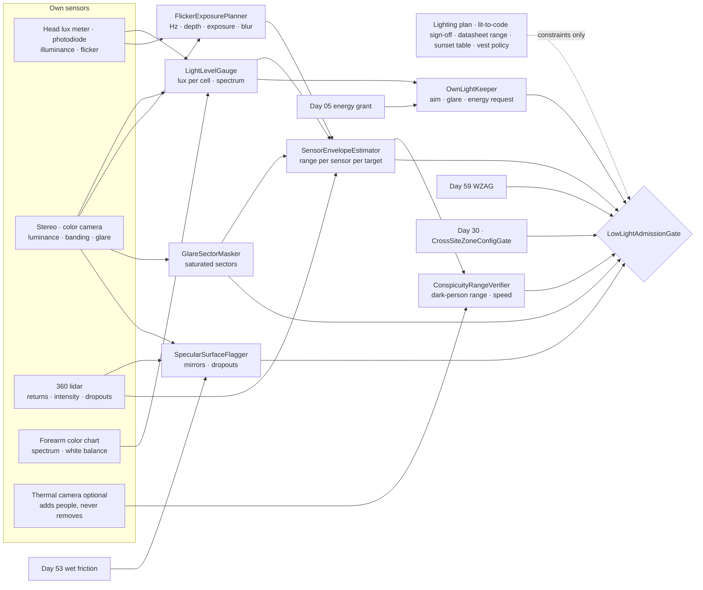
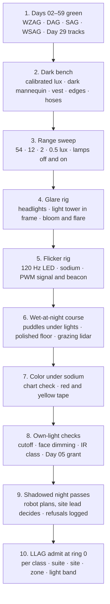

# Day 60 — Night work and low light under the work-zone stack: LightLevelGauge / SensorEnvelopeEstimator / GlareSectorMasker / FlickerExposurePlanner / SpecularSurfaceFlagger / ConspicuityRangeVerifier / OwnLightKeeper / LowLightAdmissionGate under WorkZoneAdmissionGate + DockAdmissionGate + SidewalkAdmissionGate + CorridorAdmissionGate + ElevatorAdmissionGate + DoorwayAdmissionGate + WetSurfaceAdmissionGate + ConfinedSpaceAdmissionGate + ElevatedAccessAdmissionGate + OverheadToolAdmissionGate + BimanualToolAdmissionGate + PowerToolAdmissionGate + PushPullAdmissionGate + PayloadCarryAdmissionGate + OutdoorGroundAdmissionGate + TerrainLocomotionAdmissionGate + FallSafeAdmissionGate + DeliberateContactAdmissionGate + WholeBodyTouchAdmissionGate + HumanHandoverAdmissionGate + CooperativeTaskAdmissionGate + TaskCompositionAdmissionGate + FleetSkillCatalogAdmissionGate + proximity + zone attestation + supervisor + logging + canary + HIL + fleet + incident + change-management + maintenance + thermal + energy gates

![LightLevelGauge / SensorEnvelopeEstimator / GlareSectorMasker / FlickerExposurePlanner / SpecularSurfaceFlagger / ConspicuityRangeVerifier / OwnLightKeeper / LowLightAdmissionGate: the same 63.8 kg humanoid on level 3 of Site C at 19:30 in November measures 54 lux under the light tower, 12 lux in the corridor between, and 2 lux in the east bay; masks the sector where a dump truck's headlights saturate its camera; locks its exposure to 8.33 ms so the 120 Hz work lights don't band; flags a puddle that shows the light tower 6 m below the slab as wet, not as a hole; detects a vested worker at 40 m but a worker in a dark jacket at only 6 m, and so walks at 0.5 m/s; reads red and yellow tape against the color chart on its own forearm; and lights its own path without pointing its lamps at anyone's eyes](/images/day60-night-work-low-light.png)

[Day 05](/lessons/day-05-power-bms) owns `torque_scale` and state of charge **forever**. [Day 17](/lessons/day-17-runtime-safety-supervisor) owns ESTOP and safe states. [Day 29](/lessons/day-29-human-proximity-safety) owns person tracks, SSM, and PFL rows. [Day 30](/lessons/day-30-collaborative-workspace-zoning) owns attested zones and `CrossSiteZoneConfigGate`. [Day 44](/lessons/day-44-stairs-ramps-uneven-terrain) owns the height map. [Day 53](/lessons/day-53-water-wet-floors-spills) owns wet friction and water near circuits. [Day 57](/lessons/day-57-sidewalks-crosswalks-curb-ramps) owns signal reading and vehicle gaps. [Day 58](/lessons/day-58-parking-lots-loading-docks) owns reverse envelopes. [Day 59](/lessons/day-59-construction-sites-work-zones) owns covers, edges, lines, machines, loads, tape, and cell age.

Yesterday's site lesson quietly assumed daylight. Every keeper on Day 59 starts with "the robot sees": it sees the plywood edge, the guardrail, the hose lying still, the operator in the seat, the hook overhead, the red tape. At 16:40 in New Jersey in November the sun goes down, and the site keeps working under light towers, string lights, and headlights. Nothing about the rules changes. What changes is how far, how well, and how reliably the robot can see, and every rule that says "seen" now needs a number for how far "seen" reaches.

Eight lies show up the first time a team runs a humanoid after dark:

1. **Lights-are-on lie.** "The site is lit." A light tower makes a bright pool and a dark ring around it; the robot walks through both.
2. **Auto-gain lie.** "The camera adjusts." It adjusts by turning up gain and exposure, which buys you noise and motion blur, and the detector's range quietly drops.
3. **Lidar-doesn't-need-light lie.** "Lidar works in the dark." It does, until the surface is black, wet, or shiny, and it can't read color, tape, signals, or a beacon.
4. **Vest lie.** "Workers wear high-vis." The vest lights up in the robot's lamps at 40 m. The person who took theirs off is in a dark jacket and shows up at 6 m.
5. **Headlights-help lie.** "More light is better." A headlight in the frame saturates a whole sector of the image, and anything beside it disappears.
6. **Steady-light lie.** "The lamp is on." LED and sodium lamps flicker 100 or 120 times a second; a short exposure can catch them off, and a signal head can read dark.
7. **Puddle lie.** "That's a hole" or "that's floor." At night a puddle reflects the lights above it, so stereo sees a light 6 m below the slab, and lidar sees nothing at all.
8. **My-lights-fix-it lie.** "Turn on the robot's headlamps." They light 6 m ahead, blind the people facing them, and cost battery that Day 05 hasn't granted.

Today owns **`LightLevelGauge` / `SensorEnvelopeEstimator` / `GlareSectorMasker` / `FlickerExposurePlanner` / `SpecularSurfaceFlagger` / `ConspicuityRangeVerifier` / `OwnLightKeeper` / `LowLightAdmissionGate`**. The question is: **how do you let a humanoid keep working as the light drops, with how much light there is and what color it is measured by the robot itself, every sensor's real range measured at that light on those surfaces, every blinded sector and every reflective puddle marked unknown, exposures chosen so flicker can't hide a lamp or a signal, speed set by how far away the robot can actually see a person in dark clothes, and its own lights used without blinding anyone — without raising Day 29 PFL, writing Day 05 `torque_scale`, gating Day 17 ESTOP, or bypassing `CrossSiteZoneConfigGate`?**

## Seeing is a range, and the range shrinks with the light

The rule everything follows from: **how much light falls on each part of the route and what spectrum it has, how far each sensor actually detects a dark-clothed person, a dark floor edge, a still hose, and a parked machine at that light, which sectors are blinded by glare, which lamps flicker and at what rate, and which floor cells are mirrors are measurements this robot takes here, now. A lighting plan, a "site is lit to code" sign-off, a sensor datasheet's range, a camera's auto-exposure, a sunset table, and a worker's vest are never inputs that admit anything.** They may add constraints. They may never raise a limit.

Three facts set the shape of the lesson.

**Lit to code is not lit for a camera.** US construction rules (OSHA 1926.56) set minimum illumination at 5 foot-candles (54 lux) for general construction areas and 3 foot-candles (32 lux) for concrete placement, excavations, accessways, and loading platforms. That is a floor for people, measured where the lights are aimed. A camera sees **luminance**, the light coming back off a surface, which for a diffuse surface of reflectance $\rho$ under illuminance $E$ is

$$
L = \frac{\rho E}{\pi}
$$

A dark jacket ($\rho$ = 0.05) under 5 lux returns $L$ = 0.08 cd/m². A wet black tire is darker still.

**A scene at night has more range than any camera.** A headlight's lens sits around $10^6$ cd/m². Dark pavement ($\rho$ = 0.1) at 5 lux sits at 0.16 cd/m². The ratio is

$$
20 \log_{10}\!\left(\frac{10^6}{0.16}\right) \approx 136\ \text{dB}
$$

against roughly 70 dB for a single exposure and around 120 dB for a good HDR sensor. When a headlight is in the frame, something in that frame is lost. The robot's job is to know which part.

**Speed comes from how far you can see the person you'd hurt.** Day 29's separation distance for a robot at speed $v$, a person approaching at $v_h$ = 1.6 m/s, a night perception latency $t_r$ = 0.3 s (three frames at 10 Hz), braking at $a$ = 1.0 m/s², and a 0.5 m intrusion margin is

$$
S(v) = (v + v_h)\, t_r + \frac{v^2}{2a} + v_h \frac{v}{a} + C
$$

With a factor of two for the detector's spread, the robot needs to detect a person at $2S(v)$. That's 5.6 m at 0.8 m/s, 4.1 m at 0.5 m/s, and 3.2 m at 0.3 m/s. The robot doesn't pick a speed and hope. It measures how far it can detect a dark-clothed person right now and reads the speed off that.

| Layer | Owns | Must not own |
|-------|------|--------------|
| `LightLevelGauge` | Illuminance per route cell from the head's lux meter and camera luminance at worst-case reflectance; light spectrum from the on-body color chart; dark ring around every light pool | Light from a lighting plan or sign-off; color from a lamp's label |
| `SensorEnvelopeEstimator` | Per-sensor detection range at the measured light, for each target class (dark person, floor edge, line, parked machine); valid-depth fill per cell | A datasheet's range; "lidar doesn't need light" |
| `GlareSectorMasker` | Saturated and blooming sectors in each camera; their bearing and elevation; marking them unknown until seen from another angle or after the source passes | Detections "around" a glare source; HDR as a fix |
| `FlickerExposurePlanner` | Flicker frequency and depth from rolling-shutter banding and photodiode; exposure locked to whole flicker periods; matching speed and head-rate limits for blur | Auto-exposure while flicker is present; a dark signal head read as off |
| `SpecularSurfaceFlagger` | Cells where stereo sees lights below the ground plane, lidar returns drop, or brightness follows the light; flagged wet for Day 53 | A reflection as a hole; a lidar gap as free floor |
| `ConspicuityRangeVerifier` | Detection range measured on a dark-clothed reference, never on a vest; the speed that range allows; every person-dependent margin re-derived | Vest-only detection range; a worker's radio "I'm clear" |
| `OwnLightKeeper` | The robot's lamps and IR illuminator: aim, intensity, cutoff, glare limits toward faces, eye-safety class, energy request to Day 05 | Lamps pointed at people; writing Day 05 budget |
| `LowLightAdmissionGate` | Fail-closed admit per robot class, suite, site, zone, light band, time window, task, payload | `JointCommand`; Day 05; PFL; Day 17 |
| Days 05 / 17 / 29 / 30 / 44 / 53 / 57 / 58 / 59 | Charge, ESTOP, people, zones, height map, wet surfaces, signals and gaps, reverse envelopes, site hazards | Being outranked by "the site is lit" |

**Core thesis:** **at night a humanoid trusts only what it can show it sees at the distance it needs. It measures the light, measures each sensor's real range on dark targets, marks glare and mirrors as unknown, chooses exposures flicker can't fool, sets its speed from how far it sees a person in dark clothes, and lights its own way without blinding anyone. When it can see less, every margin grows, and when it can't see enough, it stops.**



## Physical machine: what darkness does to each sensor

The example robot is the same 63.8 kg humanoid from Day 59, carrying 12 kg, with a head stereo pair (700 px focal length, 0.12 m baseline, global shutter), a rolling-shutter color camera (15 µs per row), a 360° lidar rated 100 m on a 10% target, a cosine-corrected lux meter and a fast photodiode on top of the head, a small printed color chart on the left forearm, and two 15 W head lamps with a sharp upper cutoff. Its site speed cap is 0.8 m/s.

One site runs through the lesson:

- **Site C at night.** Same building, level 3, 19:30 on a November evening. A four-head LED light tower at the hoist landing gives about 54 lux on the slab under it. Temporary LED string lights along the core give 10 to 15 lux in the corridor. The east bay, where the material landing is being built, has no lights of its own and sits around 2 lux from spill. A dump truck idles at ground level with its headlights pointed at the building, and the excavator in the trench runs its work lights. The task is the same: carry 12 kg of fasteners from the hoist landing to a work area 40 m away.

The numbers in the tables below are **example bench values for this robot**. They're there to show the shape of the measurement. Re-measure every one on your own robot, sensors, and site.

### Light: measured per cell, at the worst reflectance, with its color

`LightLevelGauge` keeps an illuminance estimate for every route cell. The lux meter on the head reads the light falling on the head, which is not the light on the floor 5 m ahead. So LLG also reads luminance off the floor from the calibrated camera (from pixel value, exposure, gain, and aperture) and converts to illuminance at the **highest** plausible reflectance for that surface, which gives the **lowest** illuminance that could explain what it sees:

$$
E_{\min} = \frac{\pi L}{\rho_{\max}}
$$

Concrete takes $\rho_{\max}$ = 0.4. A patch at 0.5 cd/m² is then at least 3.9 lux, not the 15 lux the string lights are rated to give.

Light pools have edges. LLG marks every cell by the lowest value measured along the route through it, so the 3 m dark ring between the tower's pool and the string lights is a 4 lux cell, not an average of 54 and 12.

Light also has a color. Under high-pressure sodium lamps (color rendering index around 20) red and orange shift toward each other; under low-pressure sodium, which is almost a single 589 nm line, red, yellow, and orange all look the same. Day 59's `BarrierReader` needs to tell red danger tape from yellow caution tape. LLG reads the forearm color chart in the current light, once per zone: if the chart's red and yellow patches come out less than a set distance apart in the camera's color space, color is **unreliable** in that zone, and BR must read every red-or-yellow tape as danger.

### Sensors: a real range for each target, not a datasheet

`SensorEnvelopeEstimator` turns light into range. For each sensor and each target class the robot cares about, it keeps a measured detection range at the current light band.

**Camera.** Fewer photons means more shot noise: signal-to-noise goes as the square root of the photon count, so a quarter of the light halves it. The camera answers with more gain (more noise) and longer exposure (more blur), and the detector's confident range drops. The only honest number is the one measured on the bench with the real detector at that light.

**Stereo.** Stereo matches texture between two images. Dark, smooth, and noisy surfaces match badly, so the fraction of pixels with valid depth falls. SEE tracks the **valid-depth fill** per height-map cell. A cell under 80% fill is unknown in Day 44's map; Day 59's `SiteChangeVerifier` doesn't count it as seen.

**Lidar.** Lidar brings its own light, so ambient darkness doesn't matter. Surface does. For a diffuse target, the return falls as $\rho / R^2$, so the maximum range scales as the square root of reflectance:

$$
R_{\max}(\rho) = R_{10} \sqrt{\frac{\rho}{0.10}}
$$

A 100 m rating at 10% gives 71 m on a dark jacket at 5% and 45 m on a wet black tire at 2%. Those are fine for a person. The problem is the floor: at a grazing angle a wet or polished surface sends the beam forward like a mirror, and the return vanishes. **A missing lidar return on the floor is unknown, never free.** And lidar can't see color, tape, a signal head, a beacon, or whether an operator is in the seat. Day 59's BR and ESK still need a camera.

**Retroreflectors.** High-vis vest strips (ANSI/ISEA 107) send light straight back toward its source. In the robot's own lamps a vest blazes; in lidar a strip can saturate the receiver and smear into a wider ghost. SEE caps lidar width estimates near very-high-intensity returns and trusts the camera's outline when it has one.

Example bench results for this robot:

| Target | 54 lux (tower) | 12 lux (strings) | 2 lux (east bay), lamps off | 2 lux, own lamps on |
|------|------|------|------|------|
| Person in a high-vis vest, camera | 40 m | 35 m | 18 m | 40 m |
| Person in a dark jacket, camera | 22 m | 12 m | 3 m | 6 m |
| Person in a dark jacket, lidar cluster | 20 m | 20 m | 20 m | 20 m |
| Floor edge (stereo fill ≥ 80%) | 8 m | 6 m | 1.5 m | 5 m |
| Hose on concrete (28 mm) | 6 m | 4 m | 1 m | 4 m |

Two things to notice. Lidar finds a person-sized cluster at 20 m in any light, but at 2 lux the camera can't confirm it's a person, and Day 29 needs the class. And the vest row is the one everyone measures; it's the dark-jacket row that sets the speed.

### Glare: a blinded sector is unknown, not empty

`GlareSectorMasker` watches every camera for saturation. Any 5° by 5° sector with more than 2% of its pixels at full scale, or with a blooming halo or lens flare streak through it, is **blinded**: detections in it are dropped, and the absence of detections means nothing. The sector's bearing and elevation go into the world model as an unknown cone.

The dump truck's headlights, 30 m away and aimed at the building, blind a cone about 10° wide. Anyone standing in front of that truck, which is exactly where a spotter would stand, is invisible to the camera. GSM does three things with a blinded cone:

- Day 29 treats the cone as occupied out to the lidar's range on a dark target, so the robot can't route through it toward the truck.
- If lidar shows a cluster in the cone, it's a person until the camera sees otherwise.
- The cone clears only when the robot sees it from a different angle with the source outside the frame, or after the source has been gone for 3 s.

Turning up HDR doesn't fix this; 136 dB doesn't fit in 120. Stepping sideways does.

### Flicker: lock the exposure to the light

`FlickerExposurePlanner` measures how each lamp flickers. LED drivers and sodium ballasts on 60 Hz mains flicker at 120 Hz; cheap LED drivers can flicker at their own PWM rate. The fast photodiode on the head gives frequency and modulation depth directly. The rolling-shutter camera confirms it: bands appear every

$$
n_{\text{rows}} = \frac{1}{f \cdot t_{\text{row}}} = \frac{1}{120 \times 15\ \mu\text{s}} \approx 556\ \text{rows}
$$

When flicker deeper than 20% is present, FEP locks exposure to a whole number of flicker periods, 8.33 ms at 120 Hz, so every frame integrates the same amount of light. That collides with motion blur. An object 3 m away moves across the image at

$$
\dot{u} = f_{\text{px}}\left(\omega_{\text{head}} + \frac{v}{z}\right)
$$

At 0.8 m/s and 0.5 rad/s of head turn that's 537 px/s, or 4.5 px of blur in 8.33 ms. Detectors trained on sharp images lose range at that blur. Holding blur near 2 px needs about 0.5 m/s and 0.2 rad/s: 257 px/s, 2.1 px. So under flickering light FEP hands two limits to the planner, a walking speed and a head-turn rate, and they're often tighter than the speed the detection range allows.

Flicker also matters for anything that signals with light. A PWM-driven signal head, a vehicle's LED brake lights, and an excavator's LED beacon can all read dark in a short exposure. FEP tells Day 57's `SignalPhaseObserver` and Day 59's ESK that a light reads **off** only if it was dark across exposures that together cover at least two of its measured periods. Until then it's UNKNOWN, which Day 57 already treats as not WALK and ESK already treats as live.

### Mirrors on the floor: wet at night looks like a hole or like nothing

`SpecularSurfaceFlagger` looks for the night version of Day 53's puddle. Standing water reflects the light tower above it. Stereo matches the reflection and reports a bright point as far below the floor as the light is above it, 6 m under the slab, which looks like an opening. Lidar at a grazing angle gets no return from the same patch, which looks like nothing. Either answer is wrong.

SSF flags a cell as **specular** when any of these hold:

- Stereo points appear more than 50 mm below the fitted ground plane, and they move when the robot moves in the way a reflection does (mirrored about the floor).
- Lidar returns drop out on a patch surrounded by valid floor at similar range and angle.
- The patch's brightness changes as the robot's own lamps move across it, much faster than diffuse floor would.

A specular cell is wet until Day 53 says otherwise. It goes to Day 53's `WettedFrictionProber` and `StandingWaterGauge` before any foot lands on it. It is not a hole for Day 59's `FloorOpeningMapper`, and it is not floor. And a wet cell near a cord is still Day 53's electrical no-entry zone, now with lower confidence in where the cord ends.

### People: measure range on the person without a vest

`ConspicuityRangeVerifier` turns SEE's dark-person range into a speed. It never uses the vest row. The reference target is a mannequin in a dark jacket and dark trousers ($\rho$ ≈ 0.05), and the measured range is the distance at which the camera detector confirms "person" in three of three frames at the current light, glare, and blur.

Using the separation formula from the top of the lesson, with the factor of two:

| Measured dark-person range | Allowed speed |
|------|------|
| 5.6 m or more | 0.8 m/s (site cap) |
| 4.1 to 5.6 m | 0.5 m/s |
| 3.2 to 4.1 m | 0.3 m/s |
| Less than 3.2 m | Stop; turn on own lamps and re-measure, or refuse the zone |

At Site C that gives 0.8 m/s under the tower (22 m), 0.8 m/s in the corridor but 0.5 m/s once FEP's blur limit applies, and a stop at the edge of the east bay until the lamps are on (3 m), then 0.5 m/s with them on (6 m, held to 0.5 m/s by blur).

A thermal camera, if fitted, can add a person the color camera missed. It can't remove one: glass blocks it, and a warm wall or a running engine can hide a body. CRV's range never comes from thermal alone.

**Every distance-based margin re-derives.** CRV publishes the night perception latency and range to every earlier keeper. The pattern is the same everywhere: a margin built on "the robot sees the hazard at distance $d$" gets the extra latency times the hazard's speed, and the admission needs the measured range to cover the result. Day 57's crossing gaps and Day 58's reverse envelopes add $v_{\text{vehicle}} \times \Delta t_r$. Day 59's covers, edges, and lines need stereo fill at the distance where the robot plans its foothold, so the planner looks closer and walks slower. Day 59's 30 min cell age counts a cell as seen only if it was seen at valid fill.

### Own lights: light the path, not the faces

`OwnLightKeeper` runs the robot's lamps. A lamp of luminous intensity $I$ puts $E = I/R^2$ on a surface at distance $R$. To light a dark jacket to 30 lux at 6 m needs

$$
I = E R^2 = 30 \times 6^2 = 1080\ \text{cd}
$$

which two 15 W LED head lamps can do. The rules:

- Lamps have a sharp upper cutoff and are aimed at the floor ahead; nothing above 1.0 m gets direct beam within 10 m. When Day 29 tracks a face in the beam, OLK dims that lamp segment.
- No strobing or flashing white light; a steady amber marker light shows the robot is there.
- An IR illuminator, if fitted, must be in the Exempt group of IEC 62471 at the closest distance a person can be, which is the Day 29 PFL contact distance, not 1 m.
- Lamp energy is a request to Day 05: 30 W for a 4 h shift is 120 Wh, reserved from the charge budget before the run starts. OLK never writes the budget; if Day 05 says no, the lamps stay off and the robot's range is the lamps-off row.
- Lamps change what other sensors see. Turning them on makes vests flare and puddles glint, so SEE re-measures and SSF rechecks after every lamp change.

## LightLevelGauge and SensorEnvelopeEstimator

LLG keeps minimum illuminance per cell from the head meter and camera luminance at the highest plausible reflectance, marks dark rings at pool edges, and reads the forearm color chart per zone to say whether red and yellow can be told apart. SEE keeps measured range per sensor per target class at the current light band, valid stereo fill per height-map cell (under 80% is unknown), lidar range scaled by $\sqrt{\rho}$, missing floor returns as unknown, and caps lidar widths near retroreflectors.

## GlareSectorMasker and FlickerExposurePlanner

GSM marks any 5° sector over 2% saturated, or crossed by bloom or flare, as blinded and unknown, treats it as occupied out to lidar dark-target range, calls lidar clusters inside it people, and clears it only from another angle or 3 s after the source leaves. FEP measures flicker by photodiode and banding, locks exposure to whole periods above 20% depth, hands blur-driven speed and head-rate limits to the planner, and reads a light as off only after two full periods dark.

## SpecularSurfaceFlagger, ConspicuityRangeVerifier, and OwnLightKeeper

SSF flags cells with mirrored points below the floor, lidar dropout amid valid floor, or brightness that follows the robot's lamps, and hands them to Day 53 as wet. CRV measures detection range on a dark-clothed reference, maps it to speed (5.6 / 4.1 / 3.2 m for 0.8 / 0.5 / 0.3 m/s, stop below), lets thermal add people but never remove them, and re-derives every distance-based margin with night latency. OLK aims cutoff lamps at the floor, dims for faces, keeps IR Exempt at contact distance, and requests lamp energy from Day 05.

## LowLightAdmissionGate

`LowLightAdmissionGate` (LLAG) admits night and low-light modes per robot class, sensor suite hash, site, zone, light band, time window, task, and payload, under Day 59 WZAG for the site and everything WZAG sits on. Light bands are measured, not scheduled: the gate is keyed on LLG's lux, not the clock, so a dark stairwell at noon gets the same row as the east bay at night. Every row needs:

- LLG: minimum illuminance measured for every route cell, and color reliability per zone.
- SEE: a range measured at this light band for every target class on the route, on this suite.
- GSM: blinded cones listed, and no route through one.
- FEP: flicker measured for every lamp in view, exposure locked, and speed and head-rate limits applied.
- SSF: every specular cell handed to Day 53 and resolved.
- CRV: dark-person range at or above the range for the planned speed; every earlier margin re-derived.
- OLK: lamp aim checked, IR class checked, and lamp energy granted by Day 05 if the row depends on lamps.
- A live operator link and the site's competent person reachable at ring 0, as on Day 59.

LLAG never writes `JointCommand`, never touches Day 05 `torque_scale`, never raises a Day 29 row, never takes a lighting plan, a sign-off, a datasheet, auto-exposure, a sunset time, or a vest as a measurement, never treats a blinded sector or a missing return as empty, never reads a flickering light as off from one frame, never calls a reflection a hole or a dropout floor, never sets speed from vest range, never points a lamp at a face, and never gates ESTOP.

## Data shapes

```text
LightCell:                                    # LLG
  cell_id, e_min_lux, from                    # HEAD_METER | CAMERA_LUMINANCE
  rho_max, spectrum_zone, color_reliable      # chart red–yellow separation
  plan_lux                                    # constraint only

SensorEnvelope:                               # SEE
  sensor, target_class                        # DARK_PERSON | VEST_PERSON | EDGE | LINE | PARKED_MACHINE
  light_band, lamps_on, range_m, stereo_fill, lidar_dropout, datasheet_range   # ignored

GlareCone:                                    # GSM
  camera, bearing_deg, elevation_deg, width_deg, saturated_frac
  occupied_to_m, cleared_by                   # OTHER_ANGLE | SOURCE_GONE_3S

FlickerSource:                                # FEP
  source_id, f_hz, depth, from                # PHOTODIODE | BANDING
  exposure_ms, blur_px, v_limit_mps, head_rate_limit_rps, off_requires_periods: 2

SpecularCell:                                 # SSF
  cell_id, mirrored_points_below_mm, lidar_dropout, follows_own_lamps
  handed_to_day53, resolved

ConspicuityRange:                             # CRV
  reference                                   # DARK_CLOTHED_MANNEQUIN
  range_m, frames_confirmed, t_r_s, v_allowed_mps, thermal_adds_only: true
  rederived_margins[]                         # day57 · day58 · day59

OwnLight:                                     # OLK
  lamp_id, intensity_cd, cutoff_deg, face_dimmed, ir_class, energy_wh, day05_grant

LowLightAdmission:                            # LLAG
  robot_class, suite_hash, site, zone, light_band, window, task, payload
  ring, refusals[]
  forbidden:
    light_from_plan: true
    range_from_datasheet: true
    auto_exposure_under_flicker: true
    blinded_sector_as_empty: true
    missing_return_as_floor: true
    reflection_as_hole: true
    flicker_off_from_one_frame: true
    speed_from_vest_range: true
    thermal_removes_person: true
    lamp_at_face: true
    write_day05_budget: true
    raise_pfl: true
    write_torque_scale: true
    gate_estop: true
    bypass_cross_site_zone_config_gate: true

# Unchanged owners
WorkZoneAdmissionGate · covers · edges · lines · machines · loads · tape · cell age (Day 59)
DockAdmissionGate · reverse envelope (Day 58) · signals · gaps (Day 57)
WetSurfaceAdmissionGate · wet friction · wet electrical (Day 53) · height map (Day 44)
CrossSiteZoneConfigGate · zones (Day 30) · tracks · SSM · PFL (Day 29)
SupervisorState ESTOP · safe states (Day 17)
BmsState / PowerState (Day 05): torque_scale, reserve
  accepts_requests_from_site: false
```

## Config

A starting configuration. Every number is a policy you re-derive from your own robot, sensors, and site:

```yaml
low_light:
  light:
    e_from: [head_meter, camera_luminance]
    rho_max_concrete: 0.4
    cell_value: route_minimum
    color_chart_check: per_zone
    color_unreliable: red_or_yellow_tape_is_danger
    lighting_plan: constraint_only
  sensors:
    range_from: bench_measured_per_light_band
    stereo_fill_min: 0.80
    lidar_range_scaling: sqrt_reflectance
    missing_floor_return: unknown
    retroreflector_width_cap: true
    datasheet_range: ignored
  glare:
    sector_deg: 5
    saturated_frac_max: 0.02
    blinded: unknown_and_occupied_to_lidar_dark_range
    lidar_cluster_in_cone: person
    clear_after_source_gone_s: 3
  flicker:
    detect: [photodiode, rolling_shutter_banding]
    lock_above_depth: 0.20
    exposure: whole_periods
    blur_max_px: 2
    off_requires_periods: 2
  specular:
    mirrored_below_mm: 50
    lidar_dropout_amid_floor: flag
    follows_own_lamps: flag
    flagged: day53_wet
  people:
    reference: dark_clothed_mannequin
    frames_confirmed: 3
    t_r_s: 0.3
    v_h_mps: 1.6
    a_mps2: 1.0
    c_m: 0.5
    range_factor: 2.0
    speed_table: { 5.6: 0.8, 4.1: 0.5, 3.2: 0.3 }
    below_min: stop
    thermal: add_only
    rederive: [day57_gaps, day58_envelopes, day59_footholds, day59_cell_age]
  own_lights:
    upper_cutoff: true
    no_beam_above_m_within_10m: 1.0
    dim_on_face: true
    strobe_white: never
    ir_class_at: day29_contact_distance
    energy: request_day05
    remeasure_after_change: true
  admission:
    keyed_by: [robot_class, sensor_suite_hash, site, zone, light_band, window, task, payload]
    light_band_from: measured_lux_not_clock
    requires: [day59_wzag, day58_dag, day57_sag, day53_wsag, day44_tlag, cross_site_zone_config_gate]
    operator_link_and_competent_person_ring0: required
```

## Physical ↔ digital pairing

| Physical | Digital twin / backing |
|----------|------------------------|
| Light tower at the hoist landing | LLG: 54 lux under it; dark ring 4 lux at its edge |
| String lights rated 15 lux, floor reads 0.5 cd/m² | LLG: 3.9 lux minimum, not 15 |
| High-pressure sodium lamp at the gate | LLG: chart red and yellow merge; all red-or-yellow tape is danger |
| Dump truck headlights aimed at level 3 | GSM: 10° blinded cone, occupied, no route through it |
| Lidar cluster inside the cone | GSM: a person until the camera sees otherwise |
| LED work lights at 120 Hz, 60% depth | FEP: exposure 8.33 ms; 0.5 m/s and 0.2 rad/s for 2 px blur |
| Excavator's LED beacon dark in one frame | FEP: unknown; ESK keeps the machine live |
| Puddle shows the tower 6 m below the slab | SSF: specular; Day 53 probes it; not a hole |
| Vested worker at 40 m | CRV: ignored for speed |
| Dark-jacket mannequin confirmed at 3 m in the east bay | CRV: stop; lamps on and re-measure |
| Lamps on, mannequin at 6 m | CRV: 0.8 m/s allowed by range, 0.5 m/s by blur |
| Worker walks into the robot's beam | OLK: dims that segment |
| Day 05 denies 120 Wh for lamps | OLK: lamps off; east bay refused |

The pairing that matters most: **replay every night pass from the robot's own bag and show that every route cell had a measured light level, no speed exceeded what the measured dark-person range allowed, no route crossed a blinded cone, no flickering light was read as off from one frame, every specular cell went to Day 53 before a foot landed, and no lamp lit a tracked face.**

## Bring-up sequence (before the robot works a real site after dark)



1. **Days 02–59 green,** with WZAG and the stack below it admitted in daylight first.
2. **Dark bench:** a calibrated lux meter, a dark-clothed mannequin, a vested one, floor edges, and hoses, in a room you can dim.
3. **Range sweep:** every target class at every light band, lamps off and on, on this exact sensor suite.
4. **Glare rig:** headlights and a light tower placed in frame at different bearings; GSM must mark every blinded sector.
5. **Flicker rig:** 120 Hz LED, sodium, and PWM signal heads and beacons; FEP must never read one as off from one frame.
6. **Wet-at-night course:** puddles under lights, polished concrete, grazing lidar; SSF must flag every one and never call one a hole.
7. **Color under sodium:** the forearm chart and both tape colors under each lamp type.
8. **Own-light checks:** cutoff measured, face dimming tested with people, IR class checked, energy granted by Day 05.
9. **Shadowed night passes:** the robot plans, the site lead decides; compare refusals.
10. **LLAG admit at ring 0** per robot class, suite, site, zone, light band, time window, task, and payload.

## Failure gallery

| Symptom | Likely cause |
|---------|--------------|
| Robot walks at full speed and stops late for a worker | Speed set from vest range; dark-jacket range never measured |
| Robot passes close to a spotter by a truck | Detections dropped in a glare cone, and the empty cone read as clear |
| Excavator called parked at night | LED beacon caught dark in one short exposure |
| Signal read as DON'T WALK when it was WALK, or worse | PWM signal head sampled off; exposure not locked to the period |
| Robot refuses a route over a "hole" that's a puddle | Reflection below the floor taken as an opening |
| Foot lands on wet polished concrete | Lidar dropout read as floor; specular cell not flagged |
| Robot walks into caution-only area that was actually danger | Red and yellow tape confused under sodium light |
| Detector range collapses on the move | Exposure locked for flicker but speed not reduced for blur |
| Worker complains of being blinded | Lamp with no cutoff, or no dimming on a tracked face |
| Robot stops halfway with lamps dimming | Lamp energy not reserved from Day 05 before the run |

## Exercises

1. A dark-person range of 4.6 m is measured in the corridor. What speed does CRV allow? If FEP's blur limit is 0.5 m/s, which binds?
2. Redo the separation range at 0.8 m/s with $t_r$ = 0.5 s instead of 0.3 s. Does the 5.6 m threshold still hold?
3. A lidar is rated 120 m at 10%. What range should SEE expect on a 3% target? Why doesn't that help on a wet floor?
4. A lamp flickers at 100 Hz on 50 Hz mains. What exposure does FEP lock to, and how far apart are the bands on a 20 µs-per-row camera?
5. A puddle 4 m ahead reflects a lamp 5 m above the slab. Where does stereo put the reflected point? Which checks flag it?
6. Write the `LowLightAdmission` row for carrying 12 kg from the hoist landing into the east bay at 19:30 at Site C. Which rows can refuse it, and what happens if Day 05 denies the lamp energy?

## What to freeze this week

Extend [frames](/frames) and your safety config with:

- `LightLevelGauge`: minimum lux per cell from the head meter and camera luminance at the highest plausible reflectance; dark rings kept; color reliability from the forearm chart, and red-or-yellow tape read as danger when color is unreliable.
- `SensorEnvelopeEstimator`: measured range per sensor per target per light band; stereo fill under 80% is unknown; lidar range by $\sqrt{\rho}$; missing floor returns are unknown; lidar widths capped near retroreflectors.
- `GlareSectorMasker`: saturated or flared sectors are blinded, unknown, and occupied to lidar dark range; lidar clusters in them are people; cleared only from another angle or after the source leaves.
- `FlickerExposurePlanner`: flicker measured; exposure locked to whole periods above 20% depth; blur held near 2 px by speed and head-rate limits; a light is off only after two dark periods.
- `SpecularSurfaceFlagger`: mirrored points, lidar dropouts, and lamp-following brightness flag a cell wet for Day 53; never a hole, never floor.
- `ConspicuityRangeVerifier`: range from a dark-clothed reference, never a vest; speed from range (5.6 / 4.1 / 3.2 m); thermal only adds people; every distance-based margin re-derived with night latency.
- `OwnLightKeeper`: cutoff lamps at the floor, faces dimmed, IR Exempt at contact distance, energy requested from Day 05, sensors re-measured after every lamp change.
- `LowLightAdmissionGate` fail-closed under Day 59 WZAG and the stack below it; keyed by measured light band, not the clock; **no speed from vest range, no route through glare, no one-frame flicker read, no reflection as a hole, no dropout as floor, no lamp at a face, no dual-write of ESTOP, PFL, or `torque_scale`.**

The lesson isn't "teach the robot to see in the dark." It's that **every rule on every earlier day says "seen," and at night "seen" has a range that the robot has to measure: on the dark target, in this light, with this glare and this flicker, on this wet floor. It walks only as fast as that range allows, treats what it can't see as there, and when it can't see enough, it stops.**

## Further reading

Look these up by title; they're the standard sources for today's lighting, glare, flicker, and visibility arguments:

- OSHA 29 CFR 1926.56, *Illumination*, for minimum foot-candles on construction sites.
- ANSI/IES RP-8, *Recommended Practice for Lighting Roadways and Parking Facilities*, and the IES Lighting Handbook for illuminance, luminance, and glare.
- IEEE 1789, *Recommended Practices for Modulating Current in High-Brightness LEDs*, for flicker frequency and modulation depth.
- IEC 62471, *Photobiological Safety of Lamps and Lamp Systems*, for LED and IR illuminator risk groups.
- ANSI/ISEA 107, *High-Visibility Safety Apparel*, for retroreflective performance and what a vest does and doesn't promise.
- ISO 13849 and IEC 62998 for safety-related sensors, and ISO/TS 15066 for the separation-distance model behind Day 29.
- Work on lidar performance on wet and low-reflectance surfaces and on HDR and LED-flicker mitigation in automotive cameras (for example the IEEE P2020 automotive image quality effort).

## Next

**Day 61+** — Weather: rain, snow, fog, and wind under the low-light stack: rain and snow as lidar and camera noise, fog as a range that shrinks with no warning, ice as Day 53's friction problem with no puddle to see, wind loads on a tall robot carrying a panel, cold batteries and Day 05's reserve, and when the robot goes back inside — without raising Day 29 PFL, writing Day 05 `torque_scale`, or bypassing `CrossSiteZoneConfigGate`, under the same gates plus low-light admission.
