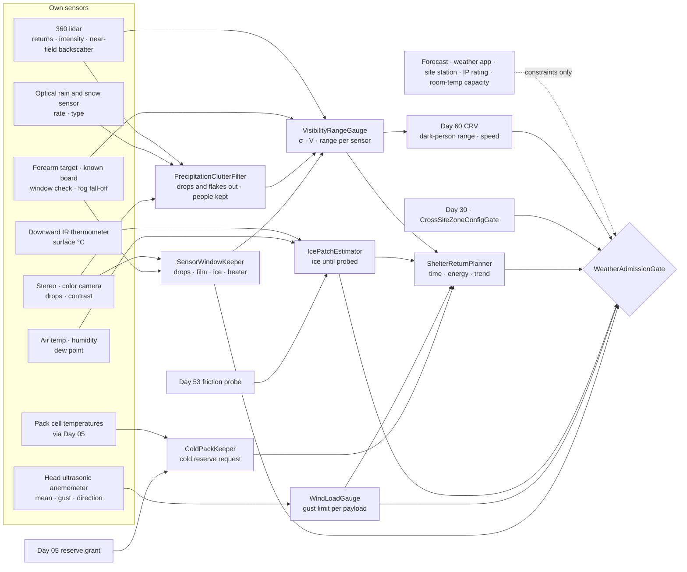
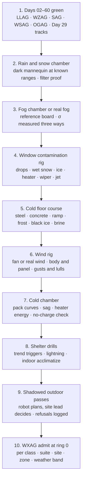

# Day 61 — Weather under the low-light stack: PrecipitationClutterFilter / VisibilityRangeGauge / SensorWindowKeeper / IcePatchEstimator / WindLoadGauge / ColdPackKeeper / ShelterReturnPlanner / WeatherAdmissionGate under LowLightAdmissionGate + WorkZoneAdmissionGate + DockAdmissionGate + SidewalkAdmissionGate + CorridorAdmissionGate + ElevatorAdmissionGate + DoorwayAdmissionGate + WetSurfaceAdmissionGate + ConfinedSpaceAdmissionGate + ElevatedAccessAdmissionGate + OverheadToolAdmissionGate + BimanualToolAdmissionGate + PowerToolAdmissionGate + PushPullAdmissionGate + PayloadCarryAdmissionGate + OutdoorGroundAdmissionGate + TerrainLocomotionAdmissionGate + FallSafeAdmissionGate + DeliberateContactAdmissionGate + WholeBodyTouchAdmissionGate + HumanHandoverAdmissionGate + CooperativeTaskAdmissionGate + TaskCompositionAdmissionGate + FleetSkillCatalogAdmissionGate + proximity + zone attestation + supervisor + logging + canary + HIL + fleet + incident + change-management + maintenance + thermal + energy gates

![PrecipitationClutterFilter / VisibilityRangeGauge / SensorWindowKeeper / IcePatchEstimator / WindLoadGauge / ColdPackKeeper / ShelterReturnPlanner / WeatherAdmissionGate: the same 63.8 kg humanoid on the open level 3 slab of Site C at 07:10 on a January morning filters snowflake returns out of its lidar without filtering out a person; measures fog visibility of 100 m from the fall-off of its own returns off a known board, so its lidar reaches 26 m on a dark jacket instead of 71; keeps its lens and lidar window clear and checks them against a target on its own forearm; reads a slab surface at −1 °C under a dew point of +1 °C as ice even though it looks dry; refuses to carry a 1.2 × 2.4 m panel across the open slab when the gusts reach 6 m/s because the panel would tip it over above 4.4 m/s; gets a cold-weather reserve from Day 05 because its pack at −5 °C holds less and sags more; and starts walking back inside while it still has twice the time it needs](/images/day61-weather-rain-snow-fog-wind.png)

[Day 05](/lessons/day-05-power-bms) owns `torque_scale`, state of charge, and the reserve **forever**. [Day 17](/lessons/day-17-runtime-safety-supervisor) owns ESTOP and safe states. [Day 29](/lessons/day-29-human-proximity-safety) owns person tracks, SSM, and PFL rows. [Day 30](/lessons/day-30-collaborative-workspace-zoning) owns attested zones and `CrossSiteZoneConfigGate`. [Day 44](/lessons/day-44-stairs-ramps-uneven-terrain) owns the height map. [Day 45](/lessons/day-45-outdoor-deformable-ground) owns snow and mud as ground you sink into. [Day 53](/lessons/day-53-water-wet-floors-spills) owns wet friction and water near circuits. [Day 57](/lessons/day-57-sidewalks-crosswalks-curb-ramps) owns signals and vehicle gaps. [Day 59](/lessons/day-59-construction-sites-work-zones) owns covers, edges, lines, machines, and loads. [Day 60](/lessons/day-60-night-work-low-light) owns light, glare, flicker, and the dark-person range.

Yesterday the robot learned that "seen" has a range, and that the range is something it measures. Night shrinks that range slowly and predictably: the sun sets at a known time and the lights come on. Weather shrinks it fast and with no warning. A fog bank rolls off the river in ten minutes. A snow squall turns the lidar into a cloud of points. And weather does more than blind the robot. It makes the floor slippery where nothing looks wet, pushes on the robot and whatever it carries, and drains the battery faster than the plan said.

Eight lies show up the first time a team runs a humanoid outside in bad weather:

1. **Forecast lie.** "The forecast said light rain." The forecast is for a 3 km grid cell an hour from now. The robot is standing on one slab, now.
2. **Lidar-sees-through-it lie.** "Lidar handles rain." Raindrops and snowflakes return pulses. Filter too little and the robot stops for a snowflake; filter too much and it filters out a person.
3. **Fog-is-just-dim lie.** "Fog is like night." Night lowers light; fog scatters it. The robot's own lamps make fog worse, and lidar range drops as $e^{-2\sigma R}$, not by a fixed amount.
4. **Clean-lens lie.** "The cameras are fine." One drop on a lens or a film of wet snow on the lidar window wipes out a sector, and the self-test still passes.
5. **Dry-looks-dry lie.** "No puddles, so no slip." Black ice and frost look like dry concrete. Day 53's friction problem arrives with nothing to see.
6. **Mean-wind lie.** "Wind is 3 m/s." The gusts are 6 m/s, and a sheet of plywood is a sail. Force goes with the square of speed, so the gust is four times the push.
7. **Full-battery lie.** "Charge is 80%." At −5 °C the pack holds less and sags more under load, and charging it below 0 °C damages it.
8. **Back-inside-is-safe lie.** "Just walk back in." The walk back is slower on ice and in fog than the walk out, and a cold robot carried into a warm room fogs up inside.

Today owns **`PrecipitationClutterFilter` / `VisibilityRangeGauge` / `SensorWindowKeeper` / `IcePatchEstimator` / `WindLoadGauge` / `ColdPackKeeper` / `ShelterReturnPlanner` / `WeatherAdmissionGate`**. The question is: **how do you let a humanoid keep working outside as the weather turns, with rain, snow, fog, ice, wind, and cold all measured by the robot itself where it stands, every sensor's range re-measured through the weather, every surface that could be ice treated as ice until probed, every load it carries checked against the gusts it actually feels, its battery reserve re-granted by Day 05 for the cold, and a walk back inside that always starts with time to spare — without raising Day 29 PFL, writing Day 05 `torque_scale`, gating Day 17 ESTOP, or bypassing `CrossSiteZoneConfigGate`?**

## Weather is measured where the robot stands

The rule everything follows from: **rain and snow rate, visibility, the state of each sensor window, the surface temperature and moisture of each floor cell, wind speed and gusts at the robot, and the temperature of its own cells are measurements this robot takes here, now. A forecast, a weather app, a site weather station on another roof, a "snow day" call, a sensor's IP rating, and a battery's room-temperature capacity are never inputs that admit anything.** They may add constraints. A forecast of lightning or a storm warning can stop work. Nothing they say can raise a limit.

Three facts set the shape of the lesson.

**Fog shrinks range exponentially.** Fog and heavy snow scatter light with an extinction coefficient $\sigma$ (per meter). Meteorological visibility $V$, the distance at which a black object's contrast against the sky falls to 2%, is Koschmieder's relation:

$$
V = \frac{3.912}{\sigma}
$$

A lidar pulse crosses the fog twice, so the return from a target at range $R$ with reflectance $\rho$ goes as

$$
P(R) \propto \frac{\rho\, e^{-2\sigma R}}{R^2}
$$

The lidar from Day 60, rated 100 m on a 10% target, reaches 71 m on a dark jacket ($\rho$ = 0.05) in clear air, 57 m at 1 km visibility, 35 m at 200 m, 26 m at 100 m, and 18 m at 50 m. Fog also returns light from the air itself, so a dense bank can look like a soft wall a few meters ahead.

**Wind pushes with the square of speed.** The drag on a flat panel is

$$
F = \tfrac{1}{2}\, \rho_{\text{air}}\, v^2\, C_d\, A
$$

A 1.2 × 2.4 m sheet ($A$ = 2.88 m², $C_d$ ≈ 1.2) in cold air ($\rho_{\text{air}}$ = 1.29 kg/m³) takes 56 N at 5 m/s and 223 N at 10 m/s. Held at 1.2 m, that's a tipping moment of 67 N·m and 267 N·m.

**Cold is a battery problem and a floor problem.** Lithium-ion cells lose usable capacity and gain internal resistance as they cool, so the same peak current pulls the voltage closer to Day 05's cutoff. Most cell makers forbid charging below 0 °C because it plates lithium. And a concrete slab that radiates heat to a clear night sky can sit below 0 °C while the air is above it, so frost and black ice form on a surface that looks dry.

| Layer | Owns | Must not own |
|-------|------|--------------|
| `PrecipitationClutterFilter` | Rain and snow returns removed from lidar and stereo by range, intensity, neighborhood, and persistence; precipitation rate from the robot's own sensor; a person-shaped cluster never filtered | Filtering by "it's snowing"; a filter tuned until the robot stops stopping |
| `VisibilityRangeGauge` | Extinction $\sigma$ and visibility $V$ from the fall-off of returns off known targets; the fog-reduced range for each sensor and target; near-field backscatter marked as fog, not as a wall or free space | Visibility from a weather app; Day 60 ranges reused in fog |
| `SensorWindowKeeper` | Drops, film, snow, and ice on each lens and lidar window; heaters, wipers, and air jets; a sharpness and return check against a fixed target on the robot's own body | A self-test that passes with a wet window; cleaning by request from the site |
| `IcePatchEstimator` | Surface temperature per cell from a downward IR thermometer; dew point from the robot's own temperature and humidity; every cell near or below freezing with possible moisture treated as ice until Day 53 probes it | "Looks dry"; air temperature as surface temperature; salt as a guarantee |
| `WindLoadGauge` | Wind speed and gusts at the robot from its own anemometer; drag on the body and on what it carries; the gust limit for each payload and posture; wind-acceleration zones at edges and corners | Mean wind as the limit; leaning into the wind as extra margin |
| `ColdPackKeeper` | Cell temperatures; cold capacity and sag from Day 05's measured curves; a request to Day 05 for a cold reserve and pack heating energy; no charge below the cell maker's minimum | Writing Day 05's reserve, budget, or `torque_scale` |
| `ShelterReturnPlanner` | Time and energy to shelter at today's weather-reduced speed; trends in visibility, wind, surface temperature, and precipitation; leaving while time to shelter is half the time left; lightning stops; acclimatizing before power-up indoors | Walking back on the outbound plan; "one more trip" |
| `WeatherAdmissionGate` | Fail-closed admit per robot class, suite, site, zone, weather band, time window, task, payload | `JointCommand`; Day 05; PFL; Day 17 |
| Days 05 / 17 / 29 / 30 / 44 / 45 / 53 / 57 / 59 / 60 | Charge, ESTOP, people, zones, height map, deformable ground, wet surfaces, signals and gaps, site hazards, light and dark-person range | Being outranked by "the forecast is fine" |

**Core thesis:** **outside, a humanoid trusts its own measurements of the weather where it stands. It removes rain and snow from its sensors without removing people, measures how far it sees through fog, keeps its windows clean and proves they are, treats any cold surface that could be wet as ice, checks every load against the gusts it actually feels, gets a cold reserve from Day 05, and starts walking back inside while it still has twice the time it needs.**



## Physical machine: what weather does to the robot

The example robot is the same 63.8 kg humanoid from Days 59 and 60, carrying 12 kg, with the same head stereo pair, rolling-shutter color camera, 360° lidar rated 100 m at 10%, lux meter, photodiode, and forearm color chart. For today it also has:

- A small optical rain and snow sensor on the head (the kind used on car windshields and weather stations), giving precipitation rate and type.
- A two-axis ultrasonic anemometer on top of the head, sampling at 4 Hz, giving mean wind over 2 min and the peak 3 s gust.
- A downward-looking IR thermometer on each shin, reading the surface temperature about 0.5 m ahead of each foot.
- An air temperature and humidity sensor in a shaded vent at the hip.
- Heated lens covers and a heated lidar window, a small wiper on the stereo pair, and an air jet on the lidar window.
- A fixed high-contrast target on the left forearm that the head can see in one pose, and a 0.5 × 0.5 m reference board fixed to a column on each level at a surveyed distance.
- An IP rating of IP54 on the body and IP65 on the head.

Its battery is an example pack with its own bench-measured cold curves (below). Its site speed cap is 0.8 m/s.

One site runs through the lesson:

- **Site C in winter.** Same building, level 3, now with the slab open to the weather on three sides and the east bay still unenclosed. 07:10 on a January morning. Air temperature +1 °C, light snow turning to freezing drizzle, river fog drifting in from the east, wind from the northwest at 3 m/s mean with gusts to 6 m/s at the slab edge. The robot spent the night in the heated site office at ground level. The task: carry a 1.2 × 2.4 m sheet of plywood (12 kg) from the hoist landing 25 m across the open slab to the east bay, then bring 12 kg of fasteners back.

The numbers below are **example bench values for this robot**. Re-measure every one on your own robot, sensors, and site.

### Rain and snow: remove the drops, never the person

`PrecipitationClutterFilter` cleans the point cloud. Raindrops and snowflakes make returns that are:

- **Close.** Most precipitation returns come from the first few meters, where the beam is narrow and the drop fills enough of it.
- **Weak and isolated.** A drop or flake makes one or two points with no neighbors at the same range.
- **Not persistent.** It isn't in the same place in the next scan.

A person, a pole, and a parked excavator are the opposite: many neighboring points that stay put or move smoothly. Filters that use point density in a radius that grows with range, such as the dynamic radius outlier removal (DROR) filter published for lidar in snow, remove most flakes and keep solid objects.

The danger is tuning. A filter that removes everything sparse also removes the arm of a person at 20 m, a thin pole, a rope, and a hose. So PCF has three rules:

- It runs only when the robot's own precipitation sensor reports rain or snow, and its strength follows the measured rate, not a switch.
- It never removes points from a cluster that Day 29's tracker or Day 59's keepers already hold, and never removes a cluster big enough to be a person's limb at that range.
- Its effect is measured on the bench: in a rain and snow chamber (or real weather), with the dark-clothed mannequin from Day 60 placed at known ranges, the filtered cloud must keep the mannequin at every range the unfiltered cloud did. If it doesn't, the filter is wrong, not the mannequin.

Stereo has its own version: drops and flakes in front of the lens make bright streaks and false near matches. PCF drops stereo points that appear in one frame only within the first 2 m.

Wet snow and heavy rain also change the ground. Snow covering a floor hides Day 59's covers, edges, and lines. **A snow-covered cell is unknown height**, and Day 59's `FloorOpeningMapper` already treats unknown as an opening. In practice the robot walks only on cleared paths. Deep or soft snow as ground to sink into stays with [Day 45](/lessons/day-45-outdoor-deformable-ground).

### Fog: measure visibility from your own returns

`VisibilityRangeGauge` measures $\sigma$ itself. Each level has a reference board at a surveyed distance. In clear air at commissioning, the robot records the board's lidar return intensity $P_0$ at distance $R_b$. In fog it reads $P$ from the same pose, and

$$
\sigma = \frac{1}{2 R_b} \ln\frac{P_0}{P}
$$

With no board in view, VRG uses two other measurements and takes the worse one: the slope of return intensity from flat floor at several ranges, and the camera contrast of any known high-contrast edge at a known distance (contrast falls as $e^{-\sigma R}$). It also looks at the near field. Fog makes a soft cloud of weak returns in the first 2 to 5 m; VRG labels those as fog, so they neither stop the robot like a wall nor read as free space.

From $\sigma$, VRG re-derives every sensor's range. For lidar, it solves the return equation above for each target class. For the camera, a dark target's contrast against bright fog of starting contrast $C_0$ falls below the detector's threshold $\varepsilon$ at

$$
R_{\text{cam}} = \frac{1}{\sigma} \ln\frac{C_0}{\varepsilon}
$$

The fog range is a cap on top of Day 60's light range, never a replacement. The robot's range for each target is the smaller of the two.

Example values for this robot, for a person in a dark jacket:

| Visibility $V$ | $\sigma$ (1/m) | Lidar range, dark jacket | Camera fog cap ($C_0$ = 0.6, $\varepsilon$ = 0.05) |
|------|------|------|------|
| Clear | ≈ 0 | 71 m | none |
| 1000 m | 0.004 | 57 m | 635 m |
| 200 m | 0.020 | 35 m | 127 m |
| 100 m | 0.039 | 26 m | 64 m |
| 50 m | 0.078 | 18 m | 32 m |

For people nearby, Day 60's dark-person range usually binds first, because the robot only needs 5.6 m at full speed. Fog bites at long range. Day 57's crossing needs to see a vehicle far enough away to cover the robot's whole crossing: a 12 m crossing at 0.8 m/s takes 15 s, and a car at 13 m/s covers 195 m in that time. At 100 m visibility that crossing is refused, however empty the road looks. The same goes for Day 59's suspended loads seen from far away and Day 58's yard.

The robot's own lamps make fog worse: light scattered back from the fog just in front of the head fills the image. Day 60's `OwnLightKeeper` gets one more rule from VRG: in fog, aim low, dim if the near-field brightness rises when the lamps come on, and re-measure range with lamps off and on.

### Windows: prove the sensor can see before trusting what it sees

`SensorWindowKeeper` owns every lens and window. A drop on a lens blurs a patch of the image; a film of wet snow on the lidar window cuts every return in that sector; ice can do both. The trap is that most self-tests check that the sensor is running, not that it can see.

SWK checks seeing directly:

- **Camera.** Once a minute, and after any heater, wiper, or jet cycle, the head looks at the forearm target. The image sharpness (edge contrast) of that target must stay above 80% of its dry baseline in every region of the lens the target covers; the head pans so the target crosses the whole field over a few cycles. A region below that is **blinded**, exactly like a Day 60 glare sector: unknown and occupied.
- **Lidar.** Returns within 0.3 m of the window mean something is on it. SWK tracks the near-window return count per sector; a sector over its dry baseline is contaminated. It also checks that the reference board and the floor return at expected intensity in every sector it can.
- **Cleaning.** Heaters keep windows above the dew point and above 0 °C. Wipers and jets run on a schedule set by the measured precipitation rate. After every cleaning, SWK re-checks before clearing the sector. The energy for heaters is part of the cold reserve request to Day 05.

The IP rating says the head survived a water spray test. It does not say the cameras see through rain, and it does not say how long the body seals last in freezing drizzle. Day 53 still owns water near circuits; SWK owns whether the windows are clear.

### Ice: anything cold and possibly wet is ice until probed

`IcePatchEstimator` deals with ice that can't be seen. Day 53 measured friction on wet floors with a toe-slide probe and set step length from the admitted friction $\mu_{\text{adm}}$. On ice, kinetic friction for a rubber sole can fall to around 0.05 to 0.1, well below what normal walking needs. The problem is finding it.

IPE reads the surface temperature $T_s$ of each cell from the shin IR thermometers and computes the dew point $T_d$ from the robot's own air temperature and humidity. A cell is **ice-possible** when

- $T_s$ is at or below +1 °C, and
- there is any moisture source: precipitation measured now or in the last 6 h, $T_s$ at or below $T_d$ (so frost or condensation can form), meltwater from snow nearby, or a specular cell from Day 60.

An ice-possible cell is ice. It goes to Day 53's `WettedFrictionProber` before any foot lands on it, with a lower friction prior, and Day 53's step and speed rules apply with the probed value. Salted or sanded cells are probed too; salt lowers the freezing point but doesn't promise friction, and a thin brine film is slippery.

Two details matter on a building site. First, **surfaces freeze unevenly**. A steel deck, a slab edge, a ramp exposed to the sky, and a shaded patch run colder than the middle of the slab, so IPE keeps $T_s$ per cell, not one number. Second, **ice changes**. When $T_s$ is falling or within 1 °C of freezing, a probed cell's result expires after 15 min. A cell that was fine on the way out may not be fine on the way back.

At Site C: air +1 °C, humidity 95%, so $T_d$ ≈ +0.3 °C. The middle of the slab reads $T_s$ = +0.5 °C, the steel deck at the hoist landing −1.5 °C, the slab edge −1 °C. All of them are ice-possible. The robot probes its path; the steel deck probes at μ = 0.08 and is refused, so the hoist crew lays sand and the robot re-probes at 0.35.

### Wind: the gust tips you, not the mean

`WindLoadGauge` reads mean wind and gusts from the head anemometer and computes the push on the robot and on what it carries. For each payload and posture it computes the gust speed at which the wind's tipping moment uses up the robot's stability margin.

For this robot, [Day 07](/lessons/day-07-wbc-balance)'s balance controller keeps the center of pressure at least 0.08 m inside the edge of the support polygon. With the 63.8 kg robot plus a 12 kg payload, that margin resists a moment of about

$$
M_{\text{cap}} = m g\, d = 75.8 \times 9.81 \times 0.08 \approx 59\ \text{N·m}
$$

The robot body alone ($A$ ≈ 0.6 m², $C_d$ ≈ 1.0, center of pressure 0.9 m up) uses that margin at a gust of about 13 m/s. The plywood sheet held at 1.2 m adds a sail. Body and sheet together use it at a gust of **4.4 m/s**.

| Gust at the robot | Force on the sheet | Moment, sheet plus body | Fits 59 N·m? |
|------|------|------|------|
| 3 m/s | 20 N | 27 N·m | Yes |
| 4.4 m/s | 43 N | 59 N·m | At the limit |
| 6 m/s | 80 N | 109 N·m | No |
| 10 m/s | 223 N | 302 N·m | No |

So the sheet crosses the open slab only when the measured 3 s gust stays below 4.4 m/s with margin; WLG uses 3.5 m/s. The mean doesn't count, and neither does leaning. The robot can lean into a steady wind, but the gust stops as fast as it starts; a robot leaning against 6 m/s that suddenly gets 2 m/s falls forward. WLG gives no credit for leaning beyond the lowest wind seen in the last 2 min.

Wind isn't uniform. It speeds up around building corners, through openings, and at slab edges, and it's stronger higher up. WLG keeps a gust map per zone from the robot's own readings and treats a zone it hasn't measured in the last 10 min as having the highest gust seen anywhere on that level. Near Day 59's slab edges, wind toward the edge adds to the push margin Day 59 already keeps. And WLG never decides anything for a crane: Day 59's `SuspendedLoadKeeper` keeps the robot out of the fall zone, and the crane's own wind limit belongs to the crane operator.

At Site C: 3 m/s mean, 6 m/s gusts at the edge. The sheet is refused on the open slab. The robot asks for the sheet to go up the hoist to the enclosed core and carries the fasteners instead; or two workers carry the sheet.

### Cold: ask Day 05 for a cold reserve, never write it

`ColdPackKeeper` reads cell temperatures from Day 05 and turns Day 05's own bench-measured cold curves into a request. Example curves for this pack:

| Cell temperature | Usable capacity | Voltage sag at peak current | Charge allowed |
|------|------|------|------|
| +20 °C | 100% | baseline | Yes |
| +5 °C | 92% | 1.4× | Yes, at reduced rate |
| −5 °C | 78% | 2.0× | No |
| −15 °C | 60% | 3.0× | No |

The robot left the office with cells at +18 °C. After 40 min on the slab at +1 °C air with wind, the outer cells read +4 °C and are falling. CPK asks Day 05 for three things: a larger reserve to cover the trip back at cold capacity and walking at reduced speed, energy for the pack heater and the window heaters, and a lower peak-current limit so sag stays above the cutoff. Day 05 grants or refuses; CPK never writes the reserve, the budget, or `torque_scale`. If Day 05 tightens `torque_scale` because of sag, the robot's push margin from Day 53 and wind margin from WLG shrink, and both re-derive.

No charging until the cells are above the maker's minimum, measured, not assumed from the room. A robot plugged in the moment it comes in from −5 °C waits for the pack to warm.

### Going back inside: leave while you still have twice the time

`ShelterReturnPlanner` keeps a live answer to "how long to get inside, and with how much energy." It plans the return at today's conditions, not the morning's: the ice probes still to repeat on the way back, the speed fog and Day 60 allow, the wind map, and the cold capacity. Call that $t_{\text{shelter}}$.

It also tracks the trend of every weather measurement and estimates $t_{\text{limit}}$, the time until any one of them crosses the gate's limit at the current rate of change (visibility falling, gusts rising, $T_s$ dropping, precipitation rising, cell temperature falling). The robot starts back when

$$
t_{\text{limit}} \le 2\, t_{\text{shelter}}
$$

or when Day 05's reserve for the return is reached, whichever comes first. A forecast can make it leave earlier, never later.

Lightning ends outdoor work at once. Thunder heard by the robot's microphones, a lightning alert from the site's detector, or a severe weather warning sends the robot inside on the shortest attested route, and it stays in until 30 min after the last thunder or alert, the same rule as for people (National Weather Service: "When thunder roars, go indoors"). A humanoid on an open slab is the tallest thing around.

Inside, the return isn't over. A cold robot carried into a warm, humid room is a cold surface below the room's dew point, and water condenses on its lenses, windows, and electronics. SRP holds the robot in an entry zone, cameras covered and high-voltage loads off, until SWK's window check passes and the body surface is above the room's dew point. Day 53 dries and checks soles and seals before dry duty, and CPK waits for the cells to warm before charging.

## PrecipitationClutterFilter and VisibilityRangeGauge

PCF removes weak, isolated, non-persistent lidar points and one-frame stereo streaks near the sensor, with strength set by the robot's measured precipitation rate, never removing points from tracked clusters or anything limb-sized at its range, and proven on the bench against the dark mannequin. Snow-covered cells are unknown height. VRG measures $\sigma$ from the reference board, floor fall-off, or known edge contrast, takes the worst, labels near-field backscatter as fog, and caps every Day 60 range with the fog range for each sensor and target.

## SensorWindowKeeper and IcePatchEstimator

SWK checks camera sharpness on the forearm target and lidar near-window returns per sector, marks failing regions blinded and occupied, cleans by heater, wiper, and jet on a schedule from precipitation rate, and re-checks after every cleaning. IPE keeps surface temperature per cell, computes dew point from the robot's own sensors, treats any cell at or below +1 °C with a moisture source as ice, sends it to Day 53's probe, and expires probes after 15 min when the surface is near freezing.

## WindLoadGauge, ColdPackKeeper, and ShelterReturnPlanner

WLG sets a gust limit per payload and posture from the robot's tipping margin and measured 3 s gusts, gives no credit for leaning beyond the lowest recent wind, keeps a gust map per zone with unmeasured zones at the level's worst, and adds edge-directed wind to Day 59's push margin. CPK turns Day 05's cold curves into a reserve, heater energy, and peak-current request and blocks charging below the cell minimum. SRP keeps time and energy to shelter at current conditions, leaves when the time to the next limit falls to twice that, stops for lightning with a 30 min wait, and acclimatizes the robot indoors before power-up and charge.

## WeatherAdmissionGate

`WeatherAdmissionGate` (WXAG) admits outdoor and open-structure modes per robot class, sensor suite hash, site, zone, weather band, time window, task, and payload, under Day 60 LLAG and everything below it. Weather bands are measured: precipitation type and rate, visibility, gust, surface temperature, and cell temperature, all from the robot's own sensors. Every row needs:

- PCF: filter proven against the dark mannequin at this precipitation band on this suite.
- VRG: visibility measured in the last 2 min, and every range on the route re-derived; every long-range task (crossings, yards, loads) checked against the fog cap.
- SWK: every window passing its check, with heater energy granted.
- IPE: every ice-possible cell on the route probed in the last 15 min, or refused.
- WLG: measured gust below the payload's limit with margin, for every zone on the route.
- CPK: cold reserve, heater energy, and peak-current limit granted by Day 05.
- SRP: time to shelter at current conditions less than half the time to the next limit, and no lightning in the last 30 min.
- A live operator link and the site's competent person reachable at ring 0, as on Days 59 and 60.

WXAG never writes `JointCommand`, never touches Day 05 `torque_scale` or reserve, never raises a Day 29 row, never takes a forecast, a weather app, another roof's station, an IP rating, or room-temperature capacity as a measurement, never filters a tracked cluster, never treats fog backscatter as free space, never trusts a sensor whose window failed its check, never calls a cold surface dry because it looks dry, never sets a load limit from mean wind, never charges a cold pack, never plans the walk back on the outbound conditions, and never gates ESTOP.

## Data shapes

```text
PrecipitationBand:                            # PCF
  type, rate_mm_h, from                       # OWN_RAIN_SENSOR
  filter_strength, protected_clusters[], bench_proof_id
  forecast                                    # constraint only

Visibility:                                   # VRG
  sigma_per_m, v_m, from                      # REF_BOARD | FLOOR_FALLOFF | EDGE_CONTRAST (worst)
  near_field_fog_m, range_caps[]              # sensor · target · range_m

WindowState:                                  # SWK
  sensor, region, sharpness_frac, near_returns, blinded
  heater_on, last_clean, rechecked

IceCell:                                      # IPE
  cell_id, t_surface_c, t_dew_c, moisture_source
  ice_possible, day53_probe_mu, probed_at, expires_at

WindState:                                    # WLG
  zone, mean_mps, gust3s_mps, dir_deg, measured_at
  payload_id, area_m2, cd, height_m, gust_limit_mps, lean_credit_mps

ColdPack:                                     # CPK
  cell_t_min_c, capacity_frac, sag_factor
  request: { reserve_wh, heater_wh, peak_a }, day05_grant, charge_allowed

ShelterPlan:                                  # SRP
  route_id, t_shelter_s, e_shelter_wh, t_limit_s, limiting_measure
  lightning_last_s, acclimatize_required

WeatherAdmission:                             # WXAG
  robot_class, suite_hash, site, zone, weather_band, window, task, payload
  ring, refusals[]
  forbidden:
    weather_from_forecast: true
    filter_tracked_cluster: true
    fog_backscatter_as_free: true
    trust_failed_window: true
    looks_dry_as_dry: true
    load_limit_from_mean_wind: true
    lean_credit_above_lull: true
    charge_below_cell_min: true
    return_on_outbound_plan: true
    write_day05_reserve: true
    raise_pfl: true
    write_torque_scale: true
    gate_estop: true
    bypass_cross_site_zone_config_gate: true

# Unchanged owners
LowLightAdmissionGate · light · glare · flicker · dark-person range (Day 60)
WorkZoneAdmissionGate · covers · edges · lines · machines · loads (Day 59)
SidewalkAdmissionGate · signals · gaps (Day 57) · deformable ground (Day 45)
WetSurfaceAdmissionGate · wet friction · wet electrical (Day 53) · height map (Day 44)
CrossSiteZoneConfigGate · zones (Day 30) · tracks · SSM · PFL (Day 29)
SupervisorState ESTOP · safe states (Day 17)
BmsState / PowerState (Day 05): torque_scale, reserve
  accepts_requests_from_site: false
```

## Config

A starting configuration. Every number is a policy you re-derive from your own robot, sensors, and site:

```yaml
weather:
  precipitation:
    rate_from: own_sensor
    filter: dynamic_radius_outlier
    strength_follows_rate: true
    protect: [day29_tracks, day59_keepers, limb_sized_clusters]
    stereo_one_frame_near_m: 2.0
    bench_proof: dark_mannequin_all_ranges
    snow_covered_cell: unknown_height
  visibility:
    sigma_from: [ref_board, floor_falloff, edge_contrast]
    take: worst
    max_age_s: 120
    near_field_backscatter: fog_label
    range: min(day60_light_range, fog_cap)
    cam_contrast_c0: 0.6
    cam_threshold: 0.05
    lamps_in_fog: aim_low_dim_on_backscatter
  windows:
    camera_check: forearm_target_sharpness
    camera_min_frac: 0.80
    lidar_near_window_m: 0.3
    check_period_s: 60
    failed_region: blinded_and_occupied
    recheck_after_clean: true
  ice:
    t_surface_from: shin_ir_per_cell
    dew_point_from: own_temp_humidity
    ice_possible_at_or_below_c: 1.0
    moisture_lookback_h: 6
    treat_as: ice_until_day53_probe
    probe_expires_min_near_freezing: 15
    salted_cells: probe
  wind:
    gust_window_s: 3
    mean_window_s: 120
    limit_from: tipping_margin
    margin_m: 0.08
    rho_air: 1.29
    gust_limit_sheet_mps: 3.5      # computed 4.4, held with margin
    lean_credit: lowest_wind_last_120s
    unmeasured_zone_age_min: 10
    unmeasured_zone_gust: level_worst
    crane_limits: crane_operator
  cold:
    curves_from: day05_bench
    request_day05: [cold_reserve, heater_energy, peak_current_limit]
    charge_below_cell_min: never
  shelter:
    plan_at: current_conditions
    leave_when: t_limit <= 2 * t_shelter
    forecast: may_only_advance
    lightning: stop_and_shelter
    lightning_wait_min: 30
    indoor_acclimatize: until_window_check_and_above_dew_point
  admission:
    keyed_by: [robot_class, sensor_suite_hash, site, zone, weather_band, window, task, payload]
    weather_band_from: own_measurements
    requires: [day60_llag, day59_wzag, day57_sag, day53_wsag, day45_ogag, day44_tlag, cross_site_zone_config_gate]
    operator_link_and_competent_person_ring0: required
```

## Physical ↔ digital pairing

| Physical | Digital twin / backing |
|----------|------------------------|
| Light snow, 1 mm/h measured on the head | PCF: filter on at that rate; mannequin kept at all ranges |
| Snow drift over the east bay floor | PCF: unknown height; Day 59 treats it as an opening |
| River fog, reference board at 30 m returns 9% of its clear value | VRG: σ ≈ 0.04, V ≈ 100 m; lidar dark-jacket range 26 m |
| Street crossing at the site gate, 12 m wide | VRG: needs 195 m of sight; refused at 100 m visibility |
| Freezing drizzle film on the lidar window, east sector | SWK: near-window returns up; sector blinded until heater and jet clear it and the check passes |
| Steel deck at −1.5 °C, looks dry | IPE: ice; Day 53 probe reads 0.08; refused until sanded |
| Slab edge at −1 °C, probed fine on the way out | IPE: probe expired after 15 min; re-probe on the way back |
| Gusts to 6 m/s at the slab edge, 3 m/s mean | WLG: plywood sheet refused (limit 3.5 m/s); fasteners allowed |
| Outer cells fall to +4 °C after 40 min | CPK: cold reserve, heater energy, and peak-current limit requested; Day 05 grants |
| Visibility falling 10 m per minute | SRP: limit in 5 min, shelter 3 min away; robot starts back |
| Thunder heard at 07:55 | SRP: shelter now; outside again at 08:25 at the earliest |
| Robot walks into the warm site office | SRP: entry zone, cameras covered, no charge until cells warm |

The pairing that matters most: **replay every outdoor pass from the robot's own bag and show that every weather number the gate used came from the robot's own sensors, no tracked cluster was filtered, every window passed its check before its sector was trusted, every cold cell with moisture was probed before a foot landed, no load crossed a zone with gusts above its limit, Day 05 granted the cold reserve, and the robot started back with at least twice the time it needed.**

## Bring-up sequence (before the robot works outside in bad weather)



1. **Days 02–60 green,** with LLAG and the stack below it admitted in clear weather first.
2. **Rain and snow chamber:** the dark mannequin at known ranges at each precipitation rate; PCF must keep it everywhere the unfiltered cloud did.
3. **Fog chamber or real fog:** measure $\sigma$ from the board, the floor, and an edge; they must agree within your tolerance, and the robot uses the worst.
4. **Window rig:** drops, wet snow, and ice on each window; SWK must mark every affected region and clear it only after cleaning and a passing check.
5. **Cold floor course:** steel and concrete at and below freezing, with frost, black ice, and brine; IPE must flag every one and Day 53 must probe it.
6. **Wind rig:** a fan or real wind on the body and on each payload, with gusts and sudden lulls; the robot must refuse above the computed limit and never fall in a lull.
7. **Cold chamber:** Day 05's pack curves measured at each temperature, heater energy measured, and charging refused below the cell minimum.
8. **Shelter drills:** falling visibility, rising wind, and a simulated lightning alert; the robot must start back in time every time, and wait indoors before power-up.
9. **Shadowed outdoor passes:** the robot plans, the site lead decides; compare refusals.
10. **WXAG admit at ring 0** per robot class, suite, site, zone, weather band, time window, task, and payload.

## Failure gallery

| Symptom | Likely cause |
|---------|--------------|
| Robot stops every few meters in snow | No precipitation filter, or one that doesn't follow the measured rate |
| Robot walks past a worker in a snow squall | Filter tuned too hard; tracked cluster removed |
| Robot treats fog ahead as a wall, or as open space | Near-field backscatter not labeled |
| Crossing started in fog and a car appeared | Day 60's range used without the fog cap |
| Sector goes quiet in freezing drizzle | Iced lidar window; check counted "running" as "seeing" |
| Foot slips on dry-looking concrete at dawn | Surface temperature not read; air temperature used |
| Probe passed on the way out, slip on the way back | Probe result never expired as the surface cooled |
| Robot staggers carrying plywood on the slab | Load limit set from mean wind, not gusts |
| Robot pitches forward when the wind drops | Leaning credited above the recent lull |
| Robot stops short of the door with low voltage | Cold capacity and sag not requested from Day 05 |
| Cameras fog up indoors after a cold shift | No acclimatize step; powered up below the room's dew point |

## Exercises

1. The reference board at 25 m returns 20% of its clear-air intensity. What are $\sigma$ and $V$? What lidar range should VRG expect on a dark jacket?
2. Redo the gust limit for a 1.2 × 1.2 m sheet held at 1.0 m. Does it change which loads cross the slab at Site C?
3. Air is +2 °C at 90% humidity and the slab reads +0.8 °C under a clear sky. Is the cell ice-possible? What moisture source applies?
4. The robot is 4 min from shelter and gusts are rising 0.5 m/s per minute toward a limit 2.5 m/s away. Does SRP start back now?
5. A filter removes 98% of snow returns but loses the mannequin at 18 m in heavy snow. What do you change, and what does the gate do until you do?
6. Write the `WeatherAdmission` row for carrying 12 kg of fasteners across the open slab at Site C at 07:10. Which rows can refuse it, and what happens when the fog bank arrives?

## What to freeze this week

Extend [frames](/frames) and your safety config with:

- `PrecipitationClutterFilter`: drops and flakes removed by range, intensity, neighborhood, and persistence, at a strength set by the measured rate; tracked and limb-sized clusters never removed; proven against the dark mannequin; snow-covered cells unknown.
- `VisibilityRangeGauge`: $\sigma$ from the board, floor, or edges, worst of them; near-field backscatter labeled fog; every Day 60 range capped by the fog range.
- `SensorWindowKeeper`: seeing checked on the forearm target and near-window returns; failed regions blinded and occupied; cleaned and re-checked.
- `IcePatchEstimator`: surface temperature per cell; any cell at or below +1 °C with moisture is ice until Day 53 probes it; probes expire after 15 min near freezing.
- `WindLoadGauge`: gust limit per payload from the tipping margin; gusts, not means; no leaning credit above the lull; unmeasured zones at the level's worst.
- `ColdPackKeeper`: cold reserve, heater energy, and peak-current limit requested from Day 05; no charge below the cell minimum.
- `ShelterReturnPlanner`: return planned at current conditions; leave at $t_{\text{limit}} \le 2\,t_{\text{shelter}}$; lightning stops with a 30 min wait; acclimatize before power-up indoors.
- `WeatherAdmissionGate` fail-closed under Day 60 LLAG and the stack below it; keyed by measured weather, not the forecast; **no forecast as a measurement, no filtered person, no trust in a failed window, no dry-looking ice, no mean-wind load limit, no cold charge, no dual-write of ESTOP, PFL, or `torque_scale`.**

The lesson isn't "make the robot weatherproof." It's that **weather changes what the robot sees, what it stands on, what pushes on it, and how much energy it has, all at once and faster than night does. The robot measures each of those where it stands, treats what it can't prove as the worse case, and goes inside while going inside is still easy.**

## Further reading

Look these up by title; they're the standard sources for today's weather, visibility, ice, wind, and battery arguments:

- WMO *Guide to Instruments and Methods of Observation* (WMO-No. 8) for visibility, precipitation, and wind gust measurement.
- Koschmieder's visibility relation and the Beer–Lambert law, in any atmospheric optics text.
- Charron, Phillips, and Waslander, *De-noising of Lidar Point Clouds Corrupted by Snowfall* (2018), for the DROR filter.
- Work on lidar and camera performance in rain, fog, and snow, for example studies run in fog and rain chambers for automated driving.
- IEC 60529 for IP codes, and what a spray test does and doesn't promise.
- ASCE 7 and Eurocode 1 (EN 1991-1-4) for wind pressure, drag coefficients, and gust factors.
- Lithium-ion cell datasheets and IEC 62133 for operating and charging temperature limits.
- National Weather Service lightning safety guidance.
- OSHA guidance on winter weather and slips on ice for construction sites.

## Next

**Day 62+** — Heat, direct sun, and dust under the weather stack: a low sun straight into the cameras, hot surfaces and hot air pushing actuators into [Day 27](/lessons/day-27-thermal-budgets-duty-cycle)'s thermal derate, dark panels too hot to touch or carry, dust on windows and in joints and seals, and the heat stress of the people working next to the robot — without raising Day 29 PFL, writing Day 05 `torque_scale`, or bypassing `CrossSiteZoneConfigGate`, under the same gates plus weather admission.
