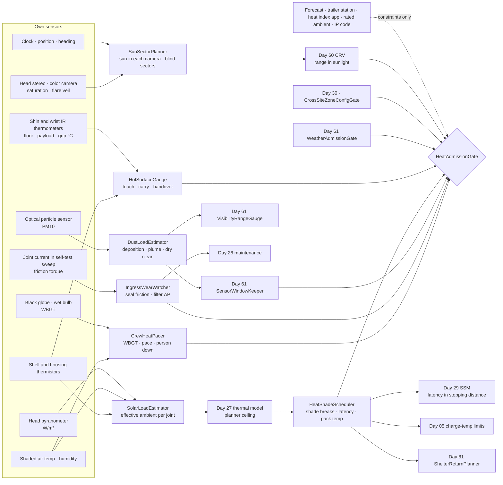
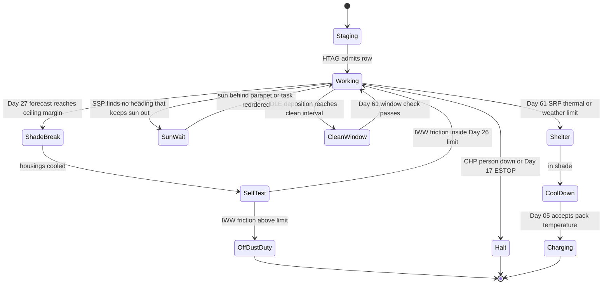
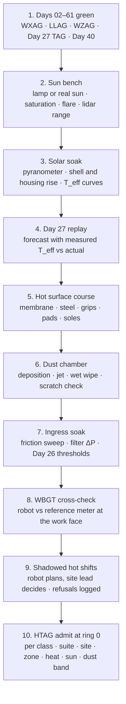

# Day 62 — Heat, direct sun, and dust under the weather stack: SunSectorPlanner / SolarLoadEstimator / HotSurfaceGauge / HeatShadeScheduler / DustLoadEstimator / IngressWearWatcher / CrewHeatPacer / HeatAdmissionGate under WeatherAdmissionGate + LowLightAdmissionGate + WorkZoneAdmissionGate + DockAdmissionGate + SidewalkAdmissionGate + CorridorAdmissionGate + ElevatorAdmissionGate + DoorwayAdmissionGate + WetSurfaceAdmissionGate + ConfinedSpaceAdmissionGate + ElevatedAccessAdmissionGate + OverheadToolAdmissionGate + BimanualToolAdmissionGate + PowerToolAdmissionGate + PushPullAdmissionGate + PayloadCarryAdmissionGate + OutdoorGroundAdmissionGate + TerrainLocomotionAdmissionGate + FallSafeAdmissionGate + DeliberateContactAdmissionGate + WholeBodyTouchAdmissionGate + HumanHandoverAdmissionGate + CooperativeTaskAdmissionGate + TaskCompositionAdmissionGate + FleetSkillCatalogAdmissionGate + proximity + zone attestation + supervisor + logging + canary + HIL + fleet + incident + change-management + maintenance + thermal + energy gates

![SunSectorPlanner / SolarLoadEstimator / HotSurfaceGauge / HeatShadeScheduler / DustLoadEstimator / IngressWearWatcher / CrewHeatPacer / HeatAdmissionGate: the same 63.8 kg humanoid on the black roof of Site C on a July afternoon measures 35 °C air and 900 W/m² of sun where it stands instead of trusting the 34 °C at the site trailer; finds its dark shell at 72 °C and its white shell at 48 °C; hands Day 27 an effective ambient of 46 °C so the knee's continuous current falls to 87% of the shade value; reads a bundle of black steel channel at 62 °C and refuses to hand it to a roofer; cleans saw dust off its lidar window with the air jet, never a dry wipe and never toward a person; sees its knee seal friction up 45% in three days and sends it to Day 26; reports WBGT 32 °C at the work face to the site's heat plan without setting a pace anyone has to match; and at 19:00 plans its walk west so the 14° sun is never straight in the head cameras](/images/day62-heat-sun-dust.png)

[Day 05](/lessons/day-05-power-bms) owns `torque_scale`, charge, the reserve, and charge-temperature limits **forever**. [Day 17](/lessons/day-17-runtime-safety-supervisor) owns ESTOP and safe states. [Day 26](/lessons/day-26-actuator-wear-predictive-maintenance) owns actuator wear and maintenance calls. [Day 27](/lessons/day-27-thermal-budgets-duty-cycle) owns the thermal model, the planner ceiling, and `ThermalAdmissionGate`. [Day 29](/lessons/day-29-human-proximity-safety) owns person tracks, SSM, and PFL rows. [Day 30](/lessons/day-30-collaborative-workspace-zoning) owns attested zones and `CrossSiteZoneConfigGate`. [Day 40](/lessons/day-40-human-robot-handover-co-carry) owns handover. [Day 60](/lessons/day-60-night-work-low-light) owns light, glare masks, and the dark-person range. [Day 61](/lessons/day-61-weather-rain-snow-fog-wind) owns precipitation, visibility, sensor windows, wind, cold, and the walk back to shelter.

Yesterday the weather took things away from the robot quickly: range, grip, battery. Heat, sun, and dust take them away slowly, and that's why they're dangerous. Nothing happens in the first ten minutes. After two hours on a black roof, the shell is too hot to touch, the knees are twenty degrees closer to their limit than the plan assumed, the compute has throttled, a film of dust has grown on the lidar window, and the people working next to the robot are deep into heat stress. And twice a day, for about an hour, the sun sits low enough to look straight into the cameras.

Eight lies show up the first time a team runs a humanoid through a summer on an open site:

1. **Weather-station lie.** "It's 34 °C." That's air in the shade at the site trailer. The robot is standing in full sun on a black roof, and its dark panels are at 72 °C.
2. **Auto-exposure lie.** "The camera handles the sun." The sun in the frame saturates pixels, blooms, and throws a veil of flare across the whole image. Sunlight also raises the lidar's noise floor and shortens its range.
3. **Rated-ambient lie.** "The actuators are rated to 40 °C." That rating is shade and still air at a stated duty. Sun adds heat on top, and thermal headroom falls with the square root of the temperature you lose.
4. **Feels-fine lie.** "The robot can grab that panel." Dark steel in the sun reaches 60 °C and more. The gripper pads have a temperature limit, and the roofer the robot hands it to has a much lower one.
5. **Compute-is-fine lie.** "Perception runs at 45 ms." Until the compute bay hits its throttle point, and then it runs at 80 ms with no error message.
6. **Cleaned-it lie.** "Just wipe the lens." A dry wiper drags dust across a window and scratches it for good. An air jet that clears the window can blow silica dust into a worker's face.
7. **Sealed lie.** "It's IP54." An IP rating is a test on a new robot. Dust works into joint seals over weeks, and the first sign is friction, not failure.
8. **People-are-fine lie.** "The crew's used to it." The robot doesn't get heat stroke. If it sets a steady pace in WBGT 32 °C, the people working with it keep up, and they do.

Today owns **`SunSectorPlanner` / `SolarLoadEstimator` / `HotSurfaceGauge` / `HeatShadeScheduler` / `DustLoadEstimator` / `IngressWearWatcher` / `CrewHeatPacer` / `HeatAdmissionGate`**. The question is: **how do you let a humanoid keep working through a hot, sunny, dusty day, with the sun's position, solar load, air temperature, surface temperatures, dust, and heat stress all measured by the robot where it works, every sensor's range re-measured in sunlight, every hot thing it touches, carries, or hands over checked against the right contact limit, its thermal headroom recomputed by Day 27 from what it measured, its windows cleaned without scratching them or dusting anyone, its seals watched, and its pace never setting a pace for people — without raising Day 29 PFL, writing Day 05 `torque_scale`, overriding Day 27's ceiling, gating Day 17 ESTOP, or bypassing `CrossSiteZoneConfigGate`?**

## Heat is measured where the robot works

The rule everything follows from: **the sun's position in each camera, solar flux on each face of the robot, air temperature at the robot, the temperature of every surface it stands on, touches, carries, or offers to a person, airborne dust at the robot, and wet-bulb globe temperature at the work face are measurements this robot takes here, now. A weather forecast, the site trailer's station, a heat index from an app, a datasheet's rated ambient, an IP code, and "it was fine yesterday" are never inputs that admit anything.** They may add constraints. A heat advisory can shorten the day. Nothing they say can raise a limit.

Four facts set the shape of the lesson.

**Sunlight is a heat input the size of a small heater.** A surface with solar absorptance $\alpha$ facing sun of irradiance $G$ absorbs, per unit area,

$$
q = \alpha\, G
$$

At $G$ = 900 W/m², a dark gray shell ($\alpha$ ≈ 0.85) absorbs 765 W/m² and a white one ($\alpha$ ≈ 0.30) 270 W/m². On a torso showing 0.25 m² to the sun, that's 191 W versus 68 W. A thin shell with an insulated back sheds that heat by convection and radiation with a combined coefficient $h$ of roughly 20 W/m²·K in a light breeze, so it settles near

$$
T_{\text{shell}} \approx T_{\text{air}} + \frac{\alpha G}{h}
$$

That's 34 + 38 = 72 °C for the dark shell and 34 + 14 = 48 °C for the white one. Color is a thermal design choice, not a styling choice.

**Thermal headroom falls with the square root.** Day 27's model says a joint's steady copper loss $P \propto i^2$ has to leave through a thermal resistance to ambient, so the continuous current a joint can carry goes as

$$
\frac{i_{\text{cont}}(T_{\text{eff}})}{i_{\text{cont}}(T_0)} = \sqrt{\frac{T_{\lim} - T_{\text{eff}}}{T_{\lim} - T_0}}
$$

where $T_{\text{eff}}$ is the effective ambient the housing sees, including the sun. With an example planning limit $T_{\lim}$ = 110 °C, a knee that carries 1.00 at 25 °C carries 0.95 at 34 °C air in shade, 0.87 at 46 °C (34 °C air plus 12 K of measured solar rise on the housing), and 0.83 at 52 °C. Thirteen percent of continuous torque is gone before the robot lifts anything.

**Hot surfaces burn in seconds, and the limit depends on how long you touch.** ISO 13732-1 gives burn thresholds for skin contact that fall with contact time. For bare metal they are roughly 65 °C for 1 s, 55 °C for 10 s, about 51 °C for 1 min, 48 °C for 10 min, and 43 °C for 8 h. A hand that holds a handed-over part keeps holding it, so the one-minute row applies. (Read the standard for the curves by material; these are approximate.)

**The sun is a moving glare source with a known path.** Day 60 masked glare from work lights that stay put. The sun moves about 15° an hour across the sky, and its position is predictable to a fraction of a degree from the date, time, and the robot's own location and heading. At Site C (40.3° N) on 16 July, it stands 63° high in the southwest at 14:30 and 14° high at 286° (west-northwest) at 19:00, low enough to sit in the middle of a level head camera's view.

| Layer | Owns | Must not own |
|-------|------|--------------|
| `SunSectorPlanner` | Sun azimuth and elevation from the robot's own clock, position, and heading; the sun's place in each camera; flare and saturation measured in the image; predicted blind sectors along a route; headings and task order that keep the sun out of the cameras a task needs | Masking only when the image is already white; trusting the ephemeris over a saturated image; Day 60's light masks |
| `SolarLoadEstimator` | Shaded air temperature at the robot; solar flux from its own pyranometer; shell and housing temperatures per face; effective ambient per joint and per compute bay handed to Day 27 | The site trailer's air temperature; rated ambient from a datasheet; Day 27's model or ceiling |
| `HotSurfaceGauge` | Surface temperature of floor cells, payloads, handholds, tool grips, and the robot's own touchable surfaces from its IR sensors; contact-time limits for skin, gripper pads, and foot soles; refusals for carry, touch, and handover | "It's fine to grab"; handing a hot part to a person; Day 40's handover rules |
| `HeatShadeScheduler` | Shade breaks and task order requested from Day 27; compute throttle and measured perception latency sent to Day 29; pack temperature sent to Day 05; a thermal time-to-limit sent to Day 61's return planner | Writing Day 27's ceiling, Day 05's charge limits, or Day 29's SSM |
| `DustLoadEstimator` | Airborne dust from its own particle sensor; dust deposition rate on each window; dust plumes in lidar near-field marked like fog; dry-cleaning schedule handed to Day 61's window keeper; air jets never pointed at a tracked person | A dry wipe on a dusty window; blowing dust toward people; deciding silica controls for the site |
| `IngressWearWatcher` | Joint friction torque in a fixed self-test sweep; cooling filter pressure drop; seal and filter trends sent to Day 26 | The IP code as a seal-life promise; maintenance calls (Day 26 owns them) |
| `CrewHeatPacer` | WBGT at the work face from its own globe, wet-bulb, and dry-bulb sensors; that reading published to the site's heat plan; a task pace no person has to match; a person-down alarm to the competent person | Judging any person's health; setting work and rest for people; touching or moving a person |
| `HeatAdmissionGate` | Fail-closed admit per robot class, suite, site, zone, heat band, sun window, dust band, task, payload | `JointCommand`; Day 05; Day 27's ceiling; PFL; Day 17 |
| Days 05 / 17 / 26 / 27 / 29 / 30 / 40 / 60 / 61 | Charge, ESTOP, wear, thermal model, people, zones, handover, light, weather | Being outranked by "it's only sunny" |

**Core thesis:** **in heat, sun, and dust, a humanoid measures the heat it is actually in, hands those measurements to the owners that already exist, and lets them shrink its work. It keeps the sun out of the cameras it needs by planning where it faces, never touches or offers anything hotter than the contact limit, cleans its windows without scratching them or dusting anyone, watches its seals before they fail, and never sets a pace for the people beside it.**



## Physical machine: what heat, sun, and dust do to the robot

The example robot is the same 63.8 kg humanoid from Days 59 to 61, carrying 12 kg, with the same head stereo pair, rolling-shutter color camera, 360° lidar rated 100 m at 10%, lux meter, forearm chart and target, shin IR thermometers, anemometer, and shaded air sensor. For today it also has:

- A small pyranometer on top of the head, reading solar irradiance in W/m².
- A 50 mm black globe thermometer and a shaded natural wet-bulb sensor on the backpack, for WBGT.
- An IR thermometer in each wrist, aimed at what the hand is about to grasp.
- Thermistors under each shell panel and on each actuator housing, already logged by Day 27.
- A small optical particle sensor in the hip vent, reading PM10.
- A torso compute bay cooled by a fan through a replaceable filter, with a pressure sensor across the filter.
- A dark gray shell on the legs and arms and a white shell on the torso and head, an IP54 body, an IP65 head, and the same air jet and wiper on its windows as Day 61.

Its site speed cap is 0.8 m/s. Its gripper pads are an example silicone rated to 60 °C, and its foot soles an example rubber rated to 80 °C.

One site runs through the lesson:

- **Site C in summer.** Same building, now topped out. The roof is black EPDM membrane with rooftop mechanical units being set. A crew is saw-cutting concrete curbs on the north side of the roof. 16 July. At 14:30 the site trailer's station reads 34 °C; the sun is 63° high in the southwest; WBGT at the work face is about 32 °C. The task: carry 12 kg bundles of black steel strut channel 40 m from the hoist landing to the west parapet, where two roofers are setting equipment supports, and hand each bundle to a roofer. At 19:00 the same walk faces the low sun, 14° high at 286°.

The numbers below are **example bench values for this robot**. Re-measure every one on your own robot, sensors, and site.

### Sun: plan where the robot faces

`SunSectorPlanner` computes the sun's azimuth and elevation from the robot's clock, its surveyed or GNSS position, and its heading from localization. It projects that direction into each camera with the camera's calibrated extrinsics and intrinsics. When the sun is inside a camera's field of view, or within a margin outside it where lens flare starts, that camera's image is suspect.

The prediction is only half the job. SSP also measures what the sun did to the image: the size of the saturated blob, the flare veil (the rise in the darkest pixels across the frame), and the loss of contrast on the forearm target when the head looks at it. **The camera wins.** If the ephemeris says the sun is out of frame and the image is saturated anyway (a reflection off a glass curtain wall or a steel roof unit), the region is blinded. Blinded regions go to Day 60's glare masks as blinded and occupied, exactly like a work light.

Sunlight also raises the lidar's background. Each return has to stand out from the shot noise of the sun's own photons at the laser's wavelength, so the range on a dark target falls in full sun. The example lidar's bench measurement: a dark jacket at 71 m at night and 50 m in 100 klx sunlight, consistent with the signal needed doubling as the background quadruples. SSP sends the measured sunlight band to Day 60's `ConspicuityRangeVerifier`, which takes the smaller range as always.

Then SSP plans. A walk west at 19:00 puts the sun 14° high, almost dead ahead of a level head camera. SSP has three moves, in order:

1. **Reorder.** Do the west-facing carries before about 18:00, when the sun is above the cameras' vertical field of view, and save east-facing work for the evening.
2. **Reroute.** Approach the parapet on a heading that keeps the sun at least 25° off each forward camera's edge, even if the path is longer.
3. **Refuse.** If the task needs the forward cameras (a handover to a person, a walk along the parapet edge from Day 59) and no heading keeps the sun out, the task waits for the sun to drop behind the parapet.

It never "squints" by turning the exposure down until the sun stops saturating. That makes everything else in the frame black, including the person standing against the sun.

### Solar load: hand Day 27 the ambient you're actually in

`SolarLoadEstimator` reads the pyranometer, the shaded air sensor at the robot, and every shell and housing thermistor. From them it computes an effective ambient for each actuator and the compute bay: the temperature the housing would sit at with the joint idle. On the bench, the example knee housing in 900 W/m² sun with a 2 m/s breeze sits 12 K above air. At 34 °C air that's 46 °C, and Day 27's model uses 46, not 34, and not the 25 °C it was calibrated at.

SLE doesn't touch Day 27's model or ceiling. It replaces one input, $T_a$, with a measured one per joint, and Day 27's `ThermalHeadroomForecaster` does the rest. The ceiling stays under Day 05's derate start exactly where Day 27 put it.

| Condition at the knee housing | $T_{\text{eff}}$ | Continuous current (vs 25 °C) |
|------|------|------|
| Shade, 25 °C air (calibration) | 25 °C | 1.00 |
| Shade, 34 °C air | 34 °C | 0.95 |
| Sun 900 W/m², 34 °C air, 2 m/s breeze | 46 °C | 0.87 |
| Sun, 34 °C air, still air on a roof | 52 °C | 0.83 |

Two other things heat up. The compute bay throttles its processor at an example junction limit, and SLE tracks the bay's effective ambient so Day 27 can forecast the throttle. The pack sits in the torso under the white shell, but its cells still climb; Day 05's charge limit (an example 45 °C maximum cell temperature for charging) applies when the robot docks.

### Hot surfaces: the contact limit depends on who touches and for how long

`HotSurfaceGauge` keeps a temperature for every surface the robot or a person might touch: floor cells from the shin IR, payloads and grips from the wrist IR, and the robot's own shell from its thermistors. Each surface gets three checks.

**The floor.** Black EPDM in July sun reads 71 °C at 14:30. The example soles are rated to 80 °C, so walking is fine, but standing still heats the sole toward the surface temperature. HSG limits standing time on surfaces above 60 °C. Foot force sensors drift with temperature, so HSG schedules a re-zero in the shade at each break. Soft roofing and hot asphalt also dent under a point load, so the robot's foot pressure goes to Day 45's ground model as a deformable-surface check.

**What the robot grasps.** The bundle of black steel channel reads 62 °C. The example pads are rated to 60 °C. **HSG refuses the bare grasp.** The site's answer is to stage bundles under a tarp or in the hoist shade so they read below the pad limit, which also helps the next check.

**What a person touches.** Anything the robot hands to a person (Day 40) or puts where a person will grab it must be at or below the one-minute contact limit for its material, 51 °C for bare metal by default. A bundle staged in the shade reads 44 °C and passes. The robot's own surfaces count too. A roofer who steadies the robot's forearm during a co-carry touches the dark shell, which in sun reads 72 °C. HSG marks every shell panel above the one-second limit as **no-touch**: Day 40 refuses a co-carry where a person's hand would land there, and the robot's chest display says the panel is hot.

HSG never makes a person's decision for them. A roofer in gloves can grab a 62 °C bundle; the robot just won't hand it over, and it logs the refusal.

### Shade breaks and the hidden costs of heat

`HeatShadeScheduler` turns Day 27's forecast into a plan. When Day 27 says the knees will hit the planner ceiling in 25 min at the current task, HSS asks Day 27 for a shade break: carry the next bundle, then stand in the shade of the rooftop unit for 8 min while the housings cool. It also reorders tasks so the heaviest carries happen early, when the roof is cooler.

It sends three other measurements to their owners:

- **Perception latency to Day 29.** When the compute bay throttles, perception goes from 45 ms to 80 ms on the example robot. At 0.8 m/s that's only 2.8 cm more stopping distance, but Day 29's SSM computes it from the measured latency, not the nominal one, and HSS reports it every cycle.
- **Pack temperature to Day 05.** Cells at 47 °C after a sunny shift can't charge under the example limit. HSS asks Day 05 for a shaded cool-down before charge; Day 05 decides.
- **Thermal time-to-limit to Day 61.** Day 61's `ShelterReturnPlanner` leaves for shelter when the time to the next limit falls to twice the time to get there. Today adds the thermal limit to that list: the walk to the shade is planned the same way as the walk out of the fog.

### Dust: clean the window without scratching it or dusting anyone

`DustLoadEstimator` reads PM10 at the hip vent and two signs of dust on the windows: the contrast drop on the forearm target (Day 61's check) and the near-window lidar returns. Near the saw on the roof's north side PM10 reads 900 µg/m³, and the example window loses about 2% contrast per minute there. DLE sets Day 61's cleaning schedule from the measured deposition rate, so the window is cleaned every 8 min near the saw and every hour elsewhere.

Dust needs different cleaning than rain:

- **No dry wipe.** A wiper dragged across dry dust scratches the window, and the scratch scatters light forever. DLE uses the air jet first and the wiper only with washer fluid.
- **No jet toward people.** The jet's cone and 3 m beyond it must be free of any Day 29 track before it fires. Concrete dust contains respirable crystalline silica, and the robot never blows it at someone.
- **Plumes are visibility.** A dust cloud from the saw scatters light like fog. DLE hands it to Day 61's `VisibilityRangeGauge`, which measures $\sigma$ through it and caps every range the same way.

DLE doesn't decide the site's silica controls. The saw crew's water feed, vacuum, and respirators are the site's job. The robot's job is to stay out of the plume when it can, and to log the exposure its own hardware got.

### Seals: watch friction before something fails

Dust works into joint seals and bearings slowly. `IngressWearWatcher` runs a fixed self-test sweep at each shade break: each joint moves through the same range at the same slow speed, and the motor current gives the friction torque. The example knee read 0.42 N·m at commissioning and 0.61 N·m after three days on the dusty roof, a 45% rise. IWW sends the trend to Day 26, whose example rule calls for a seal inspection above 30%. Day 26 makes the maintenance call; until it's done, the gate keeps that robot off dust-band work.

IWW also watches the compute bay's filter pressure drop. A filter clogging with dust cuts airflow, the bay's thermal resistance rises, and the compute throttles sooner. A 60% rise in pressure drop goes to Day 26 for a filter swap and to Day 27 as a higher bay resistance.

### People: measure the heat at the work face, never set the pace

`CrewHeatPacer` measures WBGT where the crew is working, not at the trailer. Outdoors in sun,

$$
\text{WBGT} = 0.7\, T_{\text{nwb}} + 0.2\, T_{g} + 0.1\, T_{db}
$$

With natural wet bulb 26.5 °C, globe 52 °C, and dry bulb 34 °C, that's 32.3 °C. CHP publishes it to the site's heat plan every 5 min. The heat plan, written by the site from OSHA and NIOSH guidance, sets work and rest for people. The robot never does.

What the robot controls is its own pace. In a cooperative task (Day 38's task composition, Day 40's handover), CHP makes the robot wait for the person rather than the other way around: it never starts the next handover until the roofer signals for it, and it never shortens the gap between bundles because the last one went quickly. A robot that delivers a bundle every 90 s on a timer sets a pace for the crew. In WBGT 32 °C, that's how people get hurt.

CHP also watches for a person down. If a Day 29 track goes to the ground and stays still for 20 s, CHP raises an alarm to the site's competent person over the operator link and stops all motion near the track. It never touches or moves the person, and it never guesses why they're down.

## SunSectorPlanner and SolarLoadEstimator

SSP projects the sun into each camera from the robot's clock, position, heading, and calibration; measures saturation, flare veil, and target contrast; blinds any saturated region whatever the ephemeris says; sends the sunlight band to Day 60 for lidar and camera ranges; and plans task order and headings to keep the sun out of the cameras a task needs, refusing when it can't. SLE computes effective ambient per actuator and the compute bay from its own pyranometer, shaded air sensor, and thermistors, and hands it to Day 27 as $T_a$.

## HotSurfaceGauge and HeatShadeScheduler

HSG keeps surface temperatures for floors, payloads, grips, and the robot's own panels; limits standing time on hot floors; refuses grasps above the pad limit; refuses handovers and co-carries above the person's contact limit for the expected contact time; and marks hot panels no-touch. HSS requests shade breaks and task order from Day 27, reports measured perception latency to Day 29, pack temperature to Day 05, and a thermal time-to-limit to Day 61.

## DustLoadEstimator, IngressWearWatcher, and CrewHeatPacer

DLE measures PM10 and window deposition, sets Day 61's cleaning schedule, cleans with the jet first and the wiper only wet, never jets toward a track, and hands dust plumes to Day 61 as visibility. IWW measures joint friction and filter pressure drop at each break and sends trends to Day 26 and Day 27. CHP measures WBGT at the work face, publishes it to the site's heat plan, keeps the robot's pace behind the person's, and raises a person-down alarm.

## HeatAdmissionGate

`HeatAdmissionGate` (HTAG) admits work in heat, sun, and dust per robot class, sensor suite hash, site, zone, heat band, sun window, dust band, task, and payload, under Day 61 WXAG and everything below it. It sits on top of Day 27's `ThermalAdmissionGate`, never in place of it. Heat bands, sun windows, and dust bands are measured: air temperature, solar flux, WBGT, sun position in each camera, and PM10, all from the robot's own sensors. Every row needs:

- SSP: the sun outside every camera the task needs, with margin, for the whole planned task, or the task reordered or refused; the sunlight band sent to Day 60.
- SLE: effective ambient per joint measured in the last 2 min and accepted by Day 27's forecaster.
- HSG: every grasp below the pad limit, every handover and co-carry contact below the person's limit for the contact time, every hot panel marked no-touch.
- HSS: Day 27 forecast inside the ceiling with the planned shade breaks; measured latency reported to Day 29; pack temperature accepted by Day 05.
- DLE: windows passing Day 61's check at the measured deposition rate; jet cone clear of tracks.
- IWW: friction and filter trends inside Day 26's thresholds.
- CHP: WBGT published to the site's heat plan in the last 5 min; person-paced handovers only.
- A live operator link and the site's competent person reachable at ring 0, as on Days 59 to 61.

HTAG never writes `JointCommand`, never touches Day 05 `torque_scale`, reserve, or charge limits, never raises Day 27's ceiling, never raises a Day 29 row, never takes the trailer station, a forecast, a heat index app, a rated ambient, or an IP code as a measurement, never trusts the ephemeris over a saturated image, never turns exposure down to hide the sun, never hands a person anything above the contact limit, never wipes a dry window, never jets dust toward a track, never sets a pace a person has to match, never judges a person's health, and never gates ESTOP.

## Data shapes

```text
SunState:                                     # SSP
  azimuth_deg, elevation_deg, from            # OWN_CLOCK_POSITION_HEADING
  per_camera[]                                # camera · sun_in_fov · off_edge_deg
  measured_saturation[], flare_veil, target_contrast
  blinded_regions[]                           # → Day 60 masks
  sunlight_band_klx                           # → Day 60 CRV
  plan: REORDER | REROUTE | REFUSE | CLEAR

SolarLoad:                                    # SLE
  air_c, irradiance_w_m2, wind_mps
  shell_c[]                                   # panel · temp
  t_eff_c[]                                   # joint or bay · temp → Day 27 T_a
  trailer_station_c                           # constraint only

SurfaceHeat:                                  # HSG
  surface_id, kind                            # FLOOR | PAYLOAD | GRIP | OWN_PANEL
  temp_c, material, from                      # SHIN_IR | WRIST_IR | THERMISTOR
  limits: pad_c, sole_c, skin_c_for_contact_s
  verdict: OK | LIMIT_STANDING | NO_GRASP | NO_HANDOVER | NO_TOUCH

HeatPlan:                                     # HSS
  day27_forecast_id, shade_breaks[]           # requests only
  perception_latency_ms                       # → Day 29
  pack_cell_max_c                             # → Day 05
  thermal_time_to_limit_s                     # → Day 61 SRP

DustState:                                    # DLE
  pm10_ug_m3, deposition_pct_per_min[]
  clean_interval_s, method                    # JET | WET_WIPE (never DRY_WIPE)
  jet_cone_clear_of_tracks: bool
  plume_sigma_per_m                           # → Day 61 VRG

IngressTrend:                                 # IWW
  joint, friction_nm, baseline_nm, rise_pct
  filter_dp_pa, filter_rise_pct               # → Day 26, Day 27

CrewHeat:                                     # CHP
  wbgt_c, t_nwb_c, t_globe_c, t_db_c, at_work_face: true
  published_to_heat_plan_at
  pace: PERSON_PACED
  person_down_alarm[]                         # track · since_s

HeatAdmission:                                # HTAG
  robot_class, suite_hash, site, zone
  heat_band, sun_window, dust_band, task, payload
  requires: [WXAG, LLAG, WZAG, TAG_DAY27, CrossSiteZoneConfigGate]
  forbidden:
    raise_day27_ceiling: true
    write_torque_scale: true
    raise_pfl: true
    gate_estop: true
    bypass_cross_site_zone_config_gate: true

# Unchanged owners
WeatherAdmissionGate · precipitation · visibility · windows · wind · cold · shelter (Day 61)
LowLightAdmissionGate · light · glare · flicker · dark-person range (Day 60)
WorkZoneAdmissionGate · covers · edges · lines · machines · loads (Day 59)
Handover and co-carry (Day 40) · tracks · SSM · PFL (Day 29) · zones (Day 30)
ThermalAdmissionGate · model · planner ceiling (Day 27) · wear (Day 26)
SupervisorState ESTOP · safe states (Day 17)
BmsState / PowerState (Day 05): torque_scale, reserve, charge-temp limits
  accepts_requests_from_site: false
```

## Config

A starting configuration. Every number is a policy you re-derive from your own robot, sensors, and site:

```yaml
heat:
  sun:
    position_from: [own_clock, own_position, own_heading]
    camera_wins_over_ephemeris: true
    flare_margin_deg: 25
    plan_order: [reorder, reroute, refuse]
    lower_exposure_to_hide_sun: never
    sunlight_band_to: day60_crv
  solar:
    air_from: own_shaded_sensor
    irradiance_from: own_pyranometer
    t_eff_per: [joint, compute_bay]
    hand_to: day27_thermal_model
    trailer_station: constraint_only
  surfaces:
    floor_standing_limit_above_c: 60
    gripper_pad_max_c: 60
    sole_max_c: 80
    person_contact_default: iso13732_1_one_minute   # ~51 °C bare metal
    own_panel_no_touch_above: iso13732_1_one_second
    rezero_foot_ft_in_shade: true
  shade:
    breaks_requested_from: day27
    report_latency_to: day29
    report_pack_temp_to: day05
    thermal_limit_to: day61_srp
  dust:
    pm_from: own_particle_sensor
    clean_schedule_from: measured_deposition
    methods: [air_jet, wet_wipe]
    dry_wipe: never
    jet_clear_of_tracks_m: 3
    plume_to: day61_vrg
  ingress:
    friction_sweep_at: every_shade_break
    trends_to: day26
    filter_dp_to: [day26, day27]
  crew:
    wbgt_from: own_globe_wet_bulb_dry_bulb
    publish_every_min: 5
    publish_to: site_heat_plan
    pace: person_paced
    person_down_still_s: 20
    person_down_action: [alarm_competent_person, stop_motion_near_track]
  admission:
    keyed_by: [robot_class, sensor_suite_hash, site, zone, heat_band, sun_window, dust_band, task, payload]
    bands_from: own_measurements
    requires: [day61_wxag, day60_llag, day59_wzag, day27_tag, day40_handover, cross_site_zone_config_gate]
    operator_link_and_competent_person_ring0: required
```

## A heat shift as states

Most of what today adds is when the robot stops working, not how it works. The robot's heat shift is a small state machine, and every transition is driven by a measurement from one of today's owners or the ones below it.



## Physical ↔ digital pairing

| Physical | Digital twin / backing |
|----------|------------------------|
| Trailer station 34 °C, roof air 35 °C at the robot | SLE: 35 °C used; trailer value logged as constraint only |
| 900 W/m² sun on the roof at 14:30 | SLE: dark shell 72 °C, white 48 °C; knee $T_{\text{eff}}$ 46 °C to Day 27 |
| Knee continuous current falls to 0.87 | Day 27: forecast to ceiling in 25 min; HSS requests 8 min shade break |
| Compute throttles at 15:40 | HSS: latency 45 → 80 ms sent to Day 29; SSM adds 2.8 cm at 0.8 m/s |
| Black steel bundle at 62 °C in the sun | HSG: grasp refused (pad 60 °C); staged under tarp, reads 44 °C, grasp and handover pass |
| Roofer reaches for robot's forearm | HSG: dark panel 72 °C no-touch; Day 40 refuses the co-carry grip there |
| Saw cutting curbs on the north side | DLE: PM10 900 µg/m³; window cleaned every 8 min by jet, never dry wipe |
| Roofer walks into the jet cone | DLE: jet held until the track is 3 m clear |
| Dust plume drifts across the route | DLE → Day 61 VRG: σ measured, ranges capped |
| Knee friction 0.42 → 0.61 N·m in three days | IWW → Day 26: +45%, seal inspection; HTAG keeps robot off dust-band work |
| WBGT 32.3 °C at the parapet | CHP: published to the site heat plan; handovers wait for the roofer's signal |
| Sun 14° high at 286°, walk west at 19:00 | SSP: west carries moved before 18:00; evening approach rerouted 25° off camera edge |
| Glass on the next building reflects the sun into the left camera | SSP: saturated region blinded despite ephemeris; Day 60 masks it |
| Pack cells 47 °C at dock | HSS → Day 05: charge refused until cooled in shade |

The pairing that matters most: **replay every hot shift from the robot's own bag and show that every heat, sun, and dust number the gate used came from the robot's own sensors, Day 27 forecast with the measured ambient, no grasp or handover exceeded its contact limit, the sun never sat in a camera a task depended on, every window cleaning was wet or by jet with no track in the cone, every friction trend reached Day 26, and no handover started before the person asked for it.**

## Bring-up sequence (before the robot works through a hot, sunny, dusty day)



1. **Days 02–61 green,** with WXAG, Day 27's TAG, and Day 40's handover admitted in mild weather first.
2. **Sun bench:** a solar simulator or the real sun at measured positions; SSP's predicted sun location must match the saturated blob in each camera within your tolerance, and the lidar's dark-target range in sunlight is measured.
3. **Solar soak:** the robot standing and walking in measured sun and breeze; shell and housing rise recorded per panel and joint to build the $T_{\text{eff}}$ curves.
4. **Day 27 replay:** Day 27's forecast run with measured $T_{\text{eff}}$ against the actual temperatures from the soak; it must stay pessimistic.
5. **Hot surface course:** membrane, steel deck, and payloads at known temperatures; HSG must refuse every grasp, handover, and co-carry contact above its limit.
6. **Dust chamber:** known dust loads on each window; deposition rate measured; jet and wet wipe tested; a window inspected for scratches after a hundred cycles.
7. **Ingress soak:** joints run in dust for the equivalent of weeks; the friction sweep must catch the rise before any seal fails.
8. **WBGT cross-check:** the robot's WBGT against a reference meter at the work face over a full day.
9. **Shadowed hot shifts:** the robot plans, the site lead decides; compare refusals.
10. **HTAG admit at ring 0** per robot class, suite, site, zone, heat band, sun window, dust band, task, and payload.

## Failure gallery

| Symptom | Likely cause |
|---------|--------------|
| Robot walks into a person standing against the low sun | Exposure turned down to tame the sun; person rendered black |
| Left camera goes white with the sun nowhere near it | Reflection off glass; SSP trusted the ephemeris over the image |
| Knees reach Day 05 derate mid-carry on a hot roof | Day 27 forecast with calibration ambient, not measured $T_{\text{eff}}$ |
| Perception slows in the afternoon with no fault | Compute throttled; latency never reported to Day 29 |
| Gripper pads go glossy and lose grip | Grasped payloads above the pad limit |
| Roofer pulls their hand back on a handover | Contact limit checked for 1 s, not the 1 min a hand holds a part |
| Lidar window cloudy after a dusty week | Dry wiper on dust; window scratched |
| Worker complains the robot blew dust at them | Jet fired with a track in the cone |
| Knee seal fails with no warning | No friction sweep, or trend never sent to Day 26 |
| Crew exhausted keeping up with the robot | Timed handovers; robot set the pace |
| Robot won't charge after a sunny shift | Pack above Day 05's charge-temperature limit; no shaded cool-down planned |

## Exercises

1. A white torso panel ($\alpha$ = 0.30) and a dark one ($\alpha$ = 0.85) face 700 W/m² of sun in 30 °C air with $h$ = 15 W/m²·K. What does each settle at? Which is no-touch at the one-second limit?
2. Day 27's planning limit is 110 °C. How much continuous current does a joint lose going from 30 °C shade to $T_{\text{eff}}$ = 50 °C? How much shade time would you plan, and how would you find out?
3. At 07:30 the sun is 20° high at 80° azimuth, and the hoist is due east of the parapet. Which carries does SSP reorder, and which does it reroute?
4. A steel tool grip reads 53 °C. Can the robot hand it to a person who will use it for 30 s? For 10 min? What does HSG do in each case?
5. Window contrast falls 3% per minute near a saw, and Day 61's check fails at 15% loss. What's the cleaning interval with margin? What happens when a person stands next to the window?
6. Write the `HeatAdmission` row for handing strut bundles to a roofer at the west parapet at 14:30 and again at 19:00. Which rows can refuse each, and why?

## What to freeze this week

Extend [frames](/frames) and your safety config with:

- `SunSectorPlanner`: sun projected into each camera from the robot's own clock, position, heading, and calibration; saturation and flare measured; the image wins over the ephemeris; reorder, reroute, or refuse; never hide the sun with exposure.
- `SolarLoadEstimator`: shaded air, solar flux, and shell and housing temperatures measured at the robot; effective ambient per joint and compute bay handed to Day 27.
- `HotSurfaceGauge`: surface temperatures for floors, payloads, grips, and the robot's own panels; pad, sole, and skin contact limits by contact time; hot panels no-touch.
- `HeatShadeScheduler`: shade breaks requested from Day 27; measured latency to Day 29; pack temperature to Day 05; thermal limit to Day 61's return planner.
- `DustLoadEstimator`: PM10 and window deposition measured; cleaning by jet or wet wipe on a measured schedule; never a dry wipe; never a jet toward a track; plumes handed to Day 61 as visibility.
- `IngressWearWatcher`: friction sweep at every break and filter pressure drop, trended to Day 26 and Day 27.
- `CrewHeatPacer`: WBGT at the work face published to the site's heat plan; person-paced work only; person-down alarm without touching anyone.
- `HeatAdmissionGate` fail-closed under Day 61 WXAG and on top of Day 27's TAG; keyed by measured heat, sun, and dust bands; **no trailer station as a measurement, no ephemeris over a white image, no hot handover, no dry wipe, no dust jet at a person, no robot-set pace, no raised Day 27 ceiling, no dual-write of ESTOP, PFL, or `torque_scale`.**

The lesson isn't "make the robot heatproof." It's that **heat, sun, and dust cost the robot slowly and its people even more, and nobody notices until the shift is half over. The robot measures the heat it's actually in, lets the owners that already exist shrink its work, keeps hot things away from hands, and lets the people beside it set the pace.**

## Further reading

Look these up by title; they're the standard sources for today's sun, heat, contact, dust, and heat-stress arguments:

- NOAA's solar position algorithm and the NREL Solar Position Algorithm (SPA) for sun azimuth and elevation.
- ISO 13732-1, *Ergonomics of the thermal environment — Methods for the assessment of human responses to contact with surfaces — Part 1: Hot surfaces*.
- ISO 7243 for the WBGT index, and the NIOSH *Criteria for a Recommended Standard: Occupational Exposure to Heat and Hot Environments*.
- OSHA guidance on heat illness prevention and on respirable crystalline silica in construction.
- Incropera and DeWitt, *Fundamentals of Heat and Mass Transfer*, for convection coefficients and solar absorptance.
- Lidar datasheets that state range under 100 klx ambient light, and work on lidar performance in sunlight.
- IEC 60529 for IP codes, and what a dust test does and doesn't promise.
- Lithium-ion cell datasheets for charge and discharge temperature limits.

## Next

**Day 63+** — Temporary power and electrical hazards under the heat stack: extension cords and temporary distribution boards across walkways, energized panels and lockout/tagout the robot must respect and prove, overhead lines near the hoist and crane, ground-fault protection on site circuits, and the robot docking and charging on temporary site power — without raising Day 29 PFL, writing Day 05 `torque_scale`, or bypassing `CrossSiteZoneConfigGate`, under the same gates plus heat admission.
