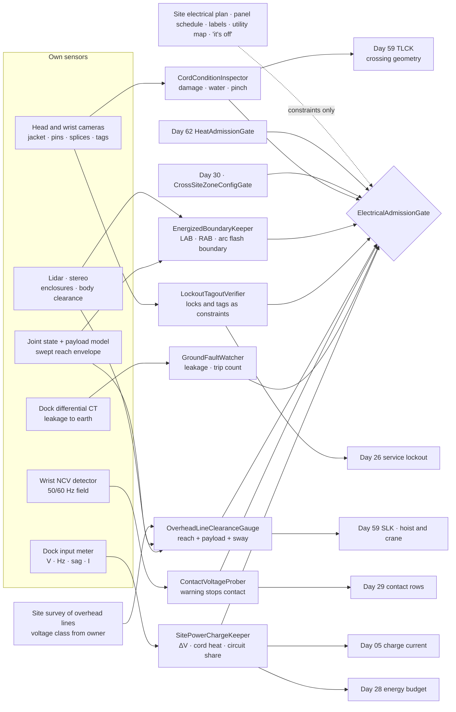
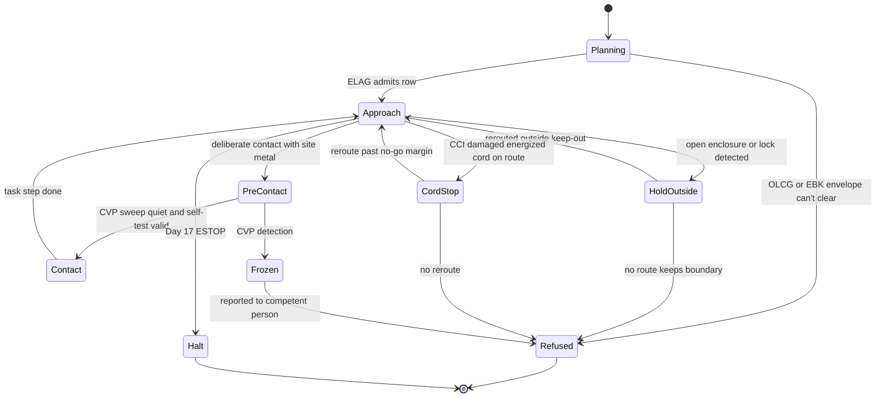
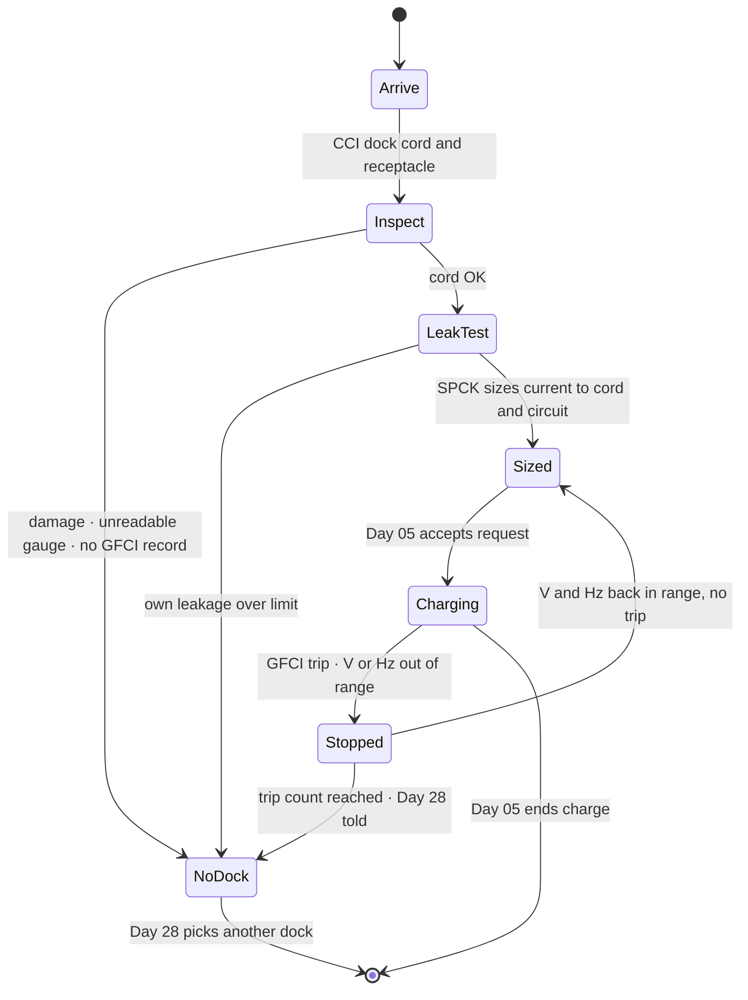
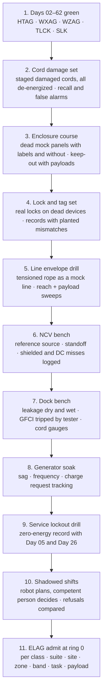

# Day 63 — Temporary power and electrical hazards under the heat stack: CordConditionInspector / EnergizedBoundaryKeeper / LockoutTagoutVerifier / OverheadLineClearanceGauge / ContactVoltageProber / GroundFaultWatcher / SitePowerChargeKeeper / ElectricalAdmissionGate under HeatAdmissionGate + WeatherAdmissionGate + LowLightAdmissionGate + WorkZoneAdmissionGate + DockAdmissionGate + SidewalkAdmissionGate + CorridorAdmissionGate + ElevatorAdmissionGate + DoorwayAdmissionGate + WetSurfaceAdmissionGate + ConfinedSpaceAdmissionGate + ElevatedAccessAdmissionGate + OverheadToolAdmissionGate + BimanualToolAdmissionGate + PowerToolAdmissionGate + PushPullAdmissionGate + PayloadCarryAdmissionGate + OutdoorGroundAdmissionGate + TerrainLocomotionAdmissionGate + FallSafeAdmissionGate + DeliberateContactAdmissionGate + WholeBodyTouchAdmissionGate + HumanHandoverAdmissionGate + CooperativeTaskAdmissionGate + TaskCompositionAdmissionGate + FleetSkillCatalogAdmissionGate + proximity + zone attestation + supervisor + logging + canary + HIL + fleet + incident + change-management + maintenance + thermal + energy gates

![CordConditionInspector / EnergizedBoundaryKeeper / LockoutTagoutVerifier / OverheadLineClearanceGauge / ContactVoltageProber / GroundFaultWatcher / SitePowerChargeKeeper / ElectricalAdmissionGate: the same 63.8 kg humanoid on Site C keeps its raised reach plus a 3.05 m conduit stick more than 3.05 m from the 13.2 kV line along the street even though its lidar sees no wire there; stops outside the limited approach boundary of an open temporary distribution board and never opens it; reads a lock and tag on the hoist disconnect as a hard constraint and never touches it; refuses a route across a cord with a split jacket lying in a puddle and reports it; treats a wrist voltage detector alarm on a metal fence as a stop but never treats silence as proof of dead; measures its own charger leakage before it plugs into a GFCI receptacle of its own; and charges at the current the cord and circuit can carry, with the voltage at the dock measured](/images/day63-temporary-power-electrical-hazards.png)

[Day 05](/lessons/day-05-power-bms) owns `torque_scale`, the pack, charge current, the reserve, and charge-temperature limits **forever**. [Day 17](/lessons/day-17-runtime-safety-supervisor) owns ESTOP and safe states. [Day 26](/lessons/day-26-actuator-wear-predictive-maintenance) owns maintenance calls. [Day 28](/lessons/day-28-energy-budgets-mission-planning) owns the energy budget and when the robot must go to the dock. [Day 29](/lessons/day-29-human-proximity-safety) owns person tracks, SSM, and PFL rows. [Day 30](/lessons/day-30-collaborative-workspace-zoning) owns attested zones and `CrossSiteZoneConfigGate`. [Day 48](/lessons/day-48-powered-hand-tools-process-forces) owns corded and cordless tool use. [Day 59](/lessons/day-59-construction-sites-work-zones) owns cords and hoses as things to step over (`TempLineCrossingKeeper`) and crane and hoist loads overhead (`SuspendedLoadKeeper`). [Day 61](/lessons/day-61-weather-rain-snow-fog-wind) owns rain, standing water, and the walk back to shelter. [Day 62](/lessons/day-62-heat-sun-dust) owns heat, sun, and dust.

On Day 59 a cord was a line on the floor: how high it is, whether it moves, where to put the foot. Today the same cord is a conductor at 120 V with a jacket that may be split. A construction site runs on temporary power: spider boxes and distribution boards fed from a generator or a temporary service, extension cords run across decks and through doorways, panels standing open while an electrician terminates circuits, and a utility line along the street that the hoist and the crane work beside. Electricity on a site doesn't look like anything. A live cord and a dead one are the same orange. An open panel with the main off and an open panel with the main on look identical. A wire 9 m up doesn't show up in the lidar.

The robot adds two new risks of its own. It's a large conductive object that can reach, carry long metal things, and stand in water. And it needs a lot of power, every day, from the same temporary circuits the crew depends on.

Eight lies show up the first time a team runs a humanoid on a site with temporary power:

1. **Just-a-cord lie.** "Day 59 handles cords." Day 59 decides where the foot goes. It doesn't know the jacket is split, the ground pin is snapped off, or the splice is wrapped in tape and lying in a puddle.
2. **Breaker-is-off lie.** "The main's off, the panel is dead." A switch position, a breaker handle, or a dark indicator light isn't proof of absence of voltage. Backfeed, a second source, a mislabeled breaker, or a generator someone started does the rest. Only a qualified person's test proves a panel dead.
3. **My-task lie.** "The lock is in the way, I'll just move it." A lock and tag belong to the person who hung them, and the only person allowed to remove them is that person, under the site's procedure. The robot never removes, operates, or works around a locked device.
4. **No-return lie.** "The lidar shows nothing up there." A 1 to 2 cm conductor tens of meters away returns a handful of points or none. A black conductor against a bright sky is invisible to the cameras. No return is not no line.
5. **Plastic-shell lie.** "The robot is covered in plastic." Its frame, actuators, and fasteners are metal, and so is anything it carries. If it touches a live part while a person touches it, the person is part of the circuit.
6. **Tester-was-quiet lie.** "The wrist detector didn't beep." A non-contact voltage detector misses shielded cable, DC, a conductor in metal conduit, and a reading taken at the wrong distance. It can warn. It can never prove anything is dead.
7. **GFCI-will-save-us lie.** "It's on a GFCI." A GFCI trips on current leaking to ground. It does nothing for a hand bridging hot and neutral, nothing on a circuit that isn't on it, and nothing once someone swaps it out because the robot's charger "keeps tripping it."
8. **Plugged-in lie.** "It's on the dock, it's charging." At the end of 30 m of thin cord off a loaded generator, the dock sees a sagging voltage, the cord heats, and a charger pulling full current trips the crew's circuit or cooks a plug.

Today owns **`CordConditionInspector` / `EnergizedBoundaryKeeper` / `LockoutTagoutVerifier` / `OverheadLineClearanceGauge` / `ContactVoltageProber` / `GroundFaultWatcher` / `SitePowerChargeKeeper` / `ElectricalAdmissionGate`**. The question is: **how do you let a humanoid work and charge on a site full of temporary power, with every cord it crosses or uses inspected for damage, every open enclosure and exposed part kept outside its approach boundaries with its whole swept body and payload, every lock and tag respected and never touched, every overhead line kept outside the required clearance from its reach and anything it carries, every voltage warning treated as a stop and every silence treated as nothing, its own charger's leakage measured before it shares a ground-fault circuit, and its charge drawn at what the cord and circuit can carry — without raising Day 29 PFL, writing Day 05 `torque_scale` or charge current, gating Day 17 ESTOP, or bypassing `CrossSiteZoneConfigGate`?**

## The robot is never the qualified person

The rule everything follows from: **the robot is never a qualified electrical worker, never opens an enclosure, never operates a disconnect, breaker, lock, or tag, and never decides that anything is de-energized. Absence of voltage is a record from a qualified person, tied to a lockout, and even then the robot's own boundaries stay in force. Everything the robot does measure (cord condition, distance to exposed parts and lines, a voltage warning, leakage, and voltage at its dock) can only shrink its work.** A site electrical plan, a panel schedule, a breaker label, a "dead" sticker, a utility map, and "the electrician said it's off" may add constraints. None of them admits anything.

Four facts set the shape of the lesson.

**Current through a body, not voltage, does the damage, and it doesn't take much.** For a contact of voltage $V$ through a body path of resistance $R_{\text{body}}$,

$$
I = \frac{V}{R_{\text{body}}}
$$

Hand-to-hand or hand-to-foot resistance falls from tens of kilohms for dry skin to around 1 kΩ for wet skin or a firm grip on metal. At 120 V and 1 kΩ that's 120 mA. IEC 60479-1 puts perception around 0.5 mA, the let-go threshold around 10 mA, and the risk of ventricular fibrillation starting in the tens of milliamps for contact lasting a second or more (read the standard for the curves; these are approximate). A site at 120 V is lethal on a wet day.

**A ground-fault circuit interrupter is a current comparator with a small budget.** A GFCI compares the current out on the hot conductor with the current back on the neutral and trips when the difference, the current leaking to ground, exceeds its threshold. Personnel GFCIs in North America (UL 943 Class A) must trip at 6 mA and must not trip below 4 mA. Every piece of equipment on the circuit spends part of that budget. A charger's EMI filter puts Y capacitors from line to the protective earth, and each one leaks

$$
I_{\text{leak}} = 2\pi f\, C_Y\, V
$$

At 60 Hz and 120 V, a 4.7 nF Y capacitor leaks 0.21 mA. Two chargers, a saw, a string of work lights, and 60 m of cord lying in rain can reach 4 mA together, and the GFCI trips with nobody touching anything.

**Thin, long cords drop voltage and get hot.** With conductor resistance $R'$ per meter, a cord of length $L$ carrying current $I$ drops

$$
\Delta V = 2 L R' I, \qquad P_{\text{cord}} = I^2 \cdot 2 L R'
$$

Copper 12 AWG is about 5.2 mΩ/m and 16 AWG about 13.2 mΩ/m. A dock drawing 10 A through 30 m of 12 AWG drops 3.1 V and heats the cord by 31 W. Through 30 m of 16 AWG it drops 7.9 V (6.6% of 120 V) and heats the cord by 79 W, more if the cord is coiled on a reel.

**Overhead line clearance is a distance from the line to the nearest point of anything, including the payload.** OSHA 29 CFR 1926.1408 Table A sets minimum clearances for cranes and derricks near power lines: 3.05 m (10 ft) up to 50 kV, 4.6 m (15 ft) over 50 to 200 kV, 6.1 m (20 ft) over 200 to 350 kV, and more above that. The distance is to the closest part of the equipment, the load, and the rigging. For a robot that carries conduit, ladders, and strut, the payload is the part most likely to get there first.

| Layer | Owns | Must not own |
|-------|------|--------------|
| `CordConditionInspector` | Jacket damage, exposed conductors, missing ground pins, field splices, cords in water, cords pinched in doors or under plates, from its own cameras; condition of every cord on its route and its own dock cord; reports to the competent person | Crossing geometry (Day 59 TLCK owns it); unplugging, moving, repairing, or taping any cord |
| `EnergizedBoundaryKeeper` | Open enclosures and exposed parts detected; the limited and restricted approach boundaries and the arc flash boundary from the site's posted labels or the strictest default; the robot's swept body and payload kept outside them | Opening, closing, or reaching into any enclosure; deciding a part is dead |
| `LockoutTagoutVerifier` | Locks and tags on disconnects, breakers, valves, and machines detected and logged as hard constraints; the site's lockout records read as constraints; the robot's own zero-energy state for service proved and handed to Day 26 | Removing, moving, operating, or working around any lock or tag; treating ESTOP as lockout |
| `OverheadLineClearanceGauge` | Line positions from the site's survey and marked hazards, re-observed where the robot can; voltage class from the owner; the robot's reach envelope plus payload length and sway; clearance kept above the table value | "No lidar return"; acting as the crane's dedicated spotter; moving lines or asking for them to be moved |
| `ContactVoltageProber` | Wrist non-contact voltage detector swept over metal before deliberate contact on site; a warning stops the contact and is reported | Treating silence as proof of absence of voltage; testing any part for a person |
| `GroundFaultWatcher` | Its own charger's leakage to earth measured before each plug-in; GFCI protection of its dock receptacle confirmed by the site's test record and a trip test at install; trips counted and reported | Resetting a GFCI; plugging into an unprotected receptacle; asking anyone to remove or bypass a GFCI |
| `SitePowerChargeKeeper` | Voltage, frequency, and sag measured at the dock input; cord gauge and length; charge input current requested from Day 05 within what the cord and circuit can carry; its own dock cord routed off walkways | Day 05's charge current or limits; the site's load plan; Day 28's energy budget |
| `ElectricalAdmissionGate` | Fail-closed admit per robot class, suite, site, zone, electrical hazard band, task, payload | `JointCommand`; Day 05; PFL; Day 17 |
| Days 05 / 17 / 26 / 28 / 29 / 30 / 48 / 59 / 61 / 62 | Pack and charge, ESTOP, maintenance, energy, people, zones, tools, crossings and loads, water, heat | Being outranked by "it's only 120 volts" |

**Core thesis:** **on a site with temporary power, a humanoid treats every enclosure, cord, line, and lock as energized until a qualified person's record says otherwise, and even then keeps its boundaries. It inspects what it crosses, stays outside approach and line clearances with everything it carries, takes a voltage warning as a stop and silence as nothing, never touches a lock, and charges without spending the crew's ground-fault budget or their circuit.**



## Physical machine: where the electricity is

Walk Site C on a Tuesday morning and count the sources. A 60 kW towable generator in the yard feeds a temporary distribution board by the hoist. From there, spider boxes on each deck with 20 A GFCI receptacles, and cords running out from them to saws, lights, chargers, and a heater. On the second floor an electrician has the cover off a new panel and is terminating branch circuits; the feeder breaker is locked and tagged, and the panel next to it is live. The hoist motor's disconnect is locked out for a brake inspection. Along the street, 9.5 m above the curb and 5 m out from the building face, runs a 13.2 kV distribution line.

None of this is new to the crew. All of it is new to the robot, and the robot adds hazards of its own:

- **It's big and it reaches.** Standing on a deck, the robot's raised hand reaches about 2.2 m. Holding a 3.05 m (10 ft) stick of conduit by one end and tipping it up, the far end can reach above 5 m from the deck in under a second.
- **It's conductive.** The shell is plastic; the frame, actuators, hands, and fasteners aren't. Day 05's pack is isolated from the frame, but the frame is not a safe insulator for anyone.
- **It stands in water.** Day 61 left it working in rain. A wet sole on a wet deck is a good path to earth.
- **It eats power.** A dock pulling 1.2 kW from 120 V draws 10 A, half of a 20 A spider box receptacle, every night and often at lunch.

### Cords: inspect what Day 59 steps over

Day 59's `TempLineCrossingKeeper` already treats every cord as a line on the floor and owns where the foot goes. CCI adds the electrical question to every cord on the route and in the work area: is it safe to be near? From the head and wrist cameras it looks for split or abraded jackets, exposed colored conductors or copper, missing or bent ground pins, field splices and taped sections, cords pinched in doors, under plates, or under material, cords in standing water (with Day 61's water map), and cords run through holes or over sharp edges without protection.

A cord flagged damaged and energized is a no-go zone with a margin of 0.5 m around the damage, and twice that if it's in water. The robot never unplugs it, moves it, tapes it, or steps over it. It reports the location and a photo to the competent person and routes around. A cord flagged damaged but clearly unplugged at both ends is reported and crossed by Day 59 as usual, because damage and energization are separate measurements and "unplugged" is something the robot actually sees.

The robot's own dock cord is inspected every time it docks, and it gets the same standard. CCI also checks that the cord the robot plugs into is rated for the current SPCK plans to draw, from the gauge printed on the jacket, and refuses the dock if it can't read it.

### Enclosures and exposed parts: approach boundaries, with the robot's whole body

NFPA 70E defines shock approach boundaries around exposed energized parts. For 151 V to 750 V AC, the limited approach boundary is 3.05 m (10 ft) from an exposed movable conductor and 1.07 m (3 ft 6 in) from an exposed fixed circuit part, and the restricted approach boundary is 0.3 m (1 ft). The arc flash boundary is separate: the distance where incident energy would reach 1.2 cal/cm², set by the site's arc flash study and posted on the equipment label. Unqualified persons stay outside the limited approach boundary unless escorted by a qualified person. The robot is always unqualified.

EBK detects open enclosures, removed covers, open distribution board doors, and exposed terminals with lidar and cameras. It reads the posted label if there is one, and if there isn't, it applies the strictest default from config. Then it does what Day 59 did for slab edges: it keeps the **whole swept volume** of the robot outside the boundary, including the arms through any motion the planner might command, the payload, and a margin for a fall. For an open 208 V panel with an arc flash label that says 1.2 m, the keep-out is the larger of the limited approach boundary for fixed parts (1.07 m) and the arc flash boundary (1.2 m), plus the robot's fall reach from Day 59. The robot never opens an enclosure, never closes one, and never hands anything to a person working inside one; if a person inside asks, it sets the item down outside the boundary.

### Locks and tags: constraints the robot never touches

LTV recognizes locks and tags on disconnects, breakers, valves, and machines, and logs each as a hard constraint on the attested zone map: the device and anything it controls are no-touch, and the robot doesn't operate any control in the same group. It reads the site's lockout records as constraints too, and here is the asymmetry that matters: **a lockout record never admits work near energized parts. It's the qualified person's protection, not the robot's.** If the hoist is locked out, the robot still treats the hoist motor terminals as energized for its own boundaries. If a lock is missing from a device the records say is locked, LTV reports the mismatch and refuses work in that zone until the competent person confirms.

The robot also needs its own lockout. When Day 26 sends it for service, the technician needs it at zero energy, and Day 17's ESTOP is not that. ESTOP removes motor torque through a supervised path; it doesn't open the pack, discharge the motor drives' DC link capacitors, or hold up an arm that gravity will drop. LTV hands Day 26 a zero-energy record built from measurements: pack contactor open and the service disconnect pulled (Day 05 reports both), DC link voltage measured below the safe-touch threshold (60 V DC is a common one), every joint either at a mechanical stop or supported, and the technician's lock on the robot's service disconnect. Day 26 doesn't start until that record exists.

### Overhead lines: clearance from the reach envelope and the payload

The Site C line is a 13.2 kV distribution circuit, so the Table A clearance is 3.05 m. Take the deck at 3.6 m above the curb and the line 9.5 m above the curb and 5 m out from the building face. The robot stands at the guardrail and reaches 0.5 m past the edge with its hand 2.2 m above the deck, 5.8 m above the curb. The hand is 4.5 m out and 3.7 m below the line: $\sqrt{4.5^2 + 3.7^2}$ = 5.83 m away. Fine. Now give it a 3.05 m conduit stick held at one end and let the planner swing it up toward the line: the tip ends up 5.83 − 3.05 = 2.78 m from the line, inside 3.05 m before any sway or stumble.

So OLCG computes clearance from the **envelope**: the robot's kinematic reach plus the payload's length in any orientation the grasp allows, plus sway, plus a margin for a stumble. It takes the line position from the site's survey and marked hazards, re-observes it with the cameras where it can, and keeps the measured position if it's closer. It never takes the absence of a lidar return as the absence of a line. Near a line, long payloads are carried horizontal and parallel to the building face, the planner can't tip them, and the robot stays back from the deck edge by however far it takes to keep the envelope outside clearance. Where it can't, it refuses. When the hoist works near the line, the dedicated spotter is a person; the robot reports what it sees to Day 59's SLK and never takes that job.

### Voltage warnings: a stop, never a proof

CVP carries a non-contact voltage detector in the wrist: a capacitive pickup that senses the 50 or 60 Hz electric field around an energized AC conductor. Before every deliberate contact with metal on site (scaffolding, temporary fence, metal decking near cords, a tool housing, a handrail), the hand sweeps the contact point at a fixed standoff. A detection stops the contact, freezes the motion with Day 29's contact rows, and is reported to the competent person with the location. That's how a fence energized by a cord pinched in its gate gets found before anyone grabs it.

A quiet detector is logged and means nothing. The detector can't see DC, misses conductors in metal conduit or shielded cable, misses at the wrong standoff, and misses when its own battery is low. CVP self-tests against a known live source on the dock at every shift start, and if the self-test fails, all deliberate contact with site metal is refused for the shift. Contact still goes through the robot's normal limits, and no amount of quiet from the detector changes ELAG's boundaries.

### Ground faults: the robot's charger spends the crew's budget

OSHA 29 CFR 1926.404(b)(1) requires ground-fault protection for 120 V 15, 20, and 30 A receptacles on construction sites that aren't part of the permanent wiring, either GFCIs or an assured equipment grounding conductor program. GFW makes the robot's dock a good neighbor on that circuit:

- The dock plugs only into a receptacle the site's records show as GFCI-protected and tested, and only one with no other loads on the same GFCI. The trip test at install is done by a person with a tester, and GFW logs it.
- Before each plug-in, the dock measures its own charger's leakage to earth with a differential current transformer. With two 4.7 nF Y capacitors from line to earth in the filter, that's about 0.42 mA at 120 V and 60 Hz. GFW's limit is a fraction of the 4 mA no-trip floor (1 mA in the example config), and a wet dock cord that pushes it higher is reported and not used.
- A GFCI trip while charging is evidence, not a nuisance. GFW stops the charge, never resets the GFCI, counts the trip, and reports it. Two trips in a shift take the dock off that circuit until a person inspects it.
- GFW never asks for a GFCI to be removed, bypassed, or replaced with a less sensitive one, and it never plugs into a receptacle it can't confirm is protected.

### Charging on temporary power

SPCK measures voltage, frequency, and sag at the dock input, and reads the cord gauge and length from CCI and the site's records. From those it computes the input current the cord can carry with a voltage drop under the config limit and a cord temperature rise the cord's rating allows, and the current the circuit can share with whatever else the site's load plan puts on it. It requests a charge input current from Day 05 no higher than the smallest of those. Day 05 still owns charge current, temperature limits, and when to stop.

On a generator, frequency and voltage wander as saws start and stop. If the dock measures input voltage below the charger's rated range or frequency outside it, SPCK stops requesting charge and tells Day 28, which owns whether the robot has enough energy to keep working or needs to walk to another dock. The dock cord itself is routed by Day 59's rules like any other line, off walkways, with a cover where it must cross one, and never through a doorway where the door can pinch it.

## CordConditionInspector and EnergizedBoundaryKeeper

CCI inspects every cord on the robot's route and work area for jacket damage, exposed conductors, missing pins, splices, water, and pinching; marks damaged energized cords no-go with a margin; reports with a photo; and never touches a cord. EBK detects open enclosures and exposed parts, takes the larger of the limited approach and arc flash boundaries from labels or strict defaults, and keeps the robot's whole swept body, payload, and fall reach outside them.

## LockoutTagoutVerifier and OverheadLineClearanceGauge

LTV logs every lock and tag as a no-touch constraint, cross-checks lockout records, reports mismatches, treats locked-out equipment as energized for its own boundaries, and builds the robot's own zero-energy record for Day 26. OLCG computes clearance from the reach envelope plus payload length, sway, and stumble margin to the surveyed or observed line, whichever is closer, constrains how long payloads may be carried near a line, and refuses when clearance can't be kept.

## ContactVoltageProber, GroundFaultWatcher, and SitePowerChargeKeeper

CVP sweeps the wrist detector over site metal before deliberate contact, stops on a detection, ignores silence as evidence, and self-tests every shift. GFW confirms GFCI protection by record, measures the charger's own leakage before every plug-in, never resets a trip, and reports repeated trips. SPCK measures dock voltage and frequency, sizes the charge current to the cord and circuit, and hands the request to Day 05 and power problems to Day 28.

## ElectricalAdmissionGate

`ElectricalAdmissionGate` (ELAG) admits work and charging near temporary power per robot class, sensor suite hash, site, zone, electrical hazard band, task, and payload, under Day 62 HTAG and everything below it. Electrical hazard bands are measured from the robot's own detections: nearest open enclosure, nearest damaged cord, nearest overhead line, and active voltage warnings. Every row needs:

- CCI: every cord on the route inspected in the last 10 min, no damaged energized cord within its no-go margin of the path.
- EBK: the swept body, payload, and fall reach outside every approach and arc flash boundary for the whole planned task.
- LTV: every lock and tag in the zone logged; lockout records consistent with what the robot sees.
- OLCG: envelope clearance to every line above the table value plus margin for the whole task, with the payload's allowed orientations.
- CVP: self-test passed this shift; no unresolved detection in the zone.
- GFW and SPCK (charging rows): GFCI protection confirmed, own leakage under limit, trip count under limit, cord and circuit current computed, dock voltage and frequency in range.
- A live operator link and the site's competent person reachable at ring 0, as on Days 59 to 62.

ELAG never writes `JointCommand`, never touches Day 05 `torque_scale`, charge current, or limits, never raises a Day 29 row, never takes a panel schedule, a breaker label, a "dead" sticker, a utility map, or anyone's word as proof of absence of voltage, never opens an enclosure, never touches a lock or tag, never handles a damaged cord, never treats a quiet voltage detector or a missing lidar return as evidence, never resets a GFCI, never plugs into an unprotected receptacle, and never gates ESTOP.

## Data shapes

```text
CordState:                                    # CCI
  cord_id, gauge_awg, length_m, from          # JACKET_PRINT | SITE_RECORD | UNREADABLE
  damage[]                                    # SPLIT_JACKET | EXPOSED_CONDUCTOR | MISSING_GROUND_PIN | SPLICE | PINCHED
  in_water: bool                              # from Day 61 water map
  energized: UNKNOWN | SEEN_PLUGGED | SEEN_UNPLUGGED_BOTH_ENDS
  no_go_margin_m, reported_at                 # → competent person
  crossing: DAY59_TLCK                        # geometry not owned here

ExposedPart:                                  # EBK
  part_id, kind                               # OPEN_ENCLOSURE | REMOVED_COVER | EXPOSED_TERMINAL
  voltage_class_v, from                       # LABEL | STRICT_DEFAULT
  limited_approach_m, restricted_approach_m, arc_flash_boundary_m
  keep_out_m                                  # max(...) + Day 59 fall reach
  assumed_energized: true                     # always

LockTag:                                      # LTV
  device_id, lock_seen, tag_seen, record_id
  mismatch: bool                              # → refuse zone, report
  no_touch_group[]
  own_zero_energy:                            # → Day 26
    pack_contactor_open, service_disconnect_pulled   # from Day 05
    dc_link_v, joints_supported, tech_lock_on

LineClearance:                                # OLCG
  line_id, voltage_kv, required_m             # Table A
  position_from: SURVEY | OBSERVED            # closer wins
  envelope_m: reach + payload_len + sway + stumble
  min_clearance_m, payload_orientation_lock
  verdict: CLEAR | CONSTRAIN_PAYLOAD | STAND_BACK | REFUSE

VoltageWarning:                               # CVP
  location, standoff_mm, detected: bool
  self_test_passed_at
  silence_is_evidence: false

GroundFault:                                  # GFW
  receptacle_id, gfci_record_id, shared_loads: 0
  own_leakage_ma, limit_ma, trips_this_shift

DockPower:                                    # SPCK
  v_in, f_in_hz, sag_v, cord_drop_v, cord_heat_w
  i_cord_max_a, i_circuit_share_a
  charge_request_a                            # → Day 05 (request only)
  energy_alert                                # → Day 28

ElectricalAdmission:                          # ELAG
  robot_class, suite_hash, site, zone
  electrical_band, task, payload, charging: bool
  requires: [HTAG, WXAG, WZAG, TLCK_DAY59, SLK_DAY59, CrossSiteZoneConfigGate]
  forbidden:
    open_enclosure: true
    touch_lock_or_tag: true
    reset_gfci: true
    write_torque_scale: true
    write_charge_current: true
    raise_pfl: true
    gate_estop: true
    bypass_cross_site_zone_config_gate: true

# Unchanged owners
HeatAdmissionGate · sun · solar load · hot surfaces · dust · crew heat (Day 62)
WeatherAdmissionGate · water · windows · wind · shelter (Day 61)
WorkZoneAdmissionGate · TLCK crossings · SLK loads overhead · edges (Day 59)
Tool use (Day 48) · tracks · SSM · PFL (Day 29) · zones (Day 30)
Energy budget (Day 28) · maintenance (Day 26) · ESTOP (Day 17)
BmsState / PowerState (Day 05): torque_scale, charge current, reserve, charge-temp limits
  accepts_requests_from_site: false
```

## Config

A starting configuration. Every number is a policy you re-derive from your own robot, sensors, site, and the standards that apply where you work:

```yaml
electrical:
  qualified_person: never
  absence_of_voltage_from: qualified_person_record_only
  cords:
    inspect_route_every_min: 10
    damage_kinds: [split_jacket, exposed_conductor, missing_ground_pin, splice, pinched, in_water]
    no_go_margin_m: 0.5
    no_go_margin_in_water_m: 1.0
    touch_cord: never
    crossing_geometry: day59_tlck
    unreadable_gauge_at_dock: refuse
  enclosures:
    assume_energized: always
    boundaries_from: [posted_label, strict_default]
    strict_default:
      limited_approach_fixed_m: 1.07
      limited_approach_movable_m: 3.05
      restricted_approach_m: 0.30
      arc_flash_boundary_m: 3.0      # if no label; conservative policy, not a calculation
    keep_out: max_of_boundaries_plus_day59_fall_reach
    swept_volume: [body, arms_all_planned_motion, payload]
    open_or_close: never
    hand_items_into_boundary: never
  lockout:
    lock_or_tag: no_touch_group
    record_mismatch: refuse_zone_and_report
    locked_out_equipment: still_energized_for_robot_boundaries
    own_service_zero_energy:
      requires: [pack_contactor_open, service_disconnect_pulled, dc_link_below_v: 60, joints_supported, tech_lock_on]
      estop_counts_as_lockout: false
  overhead_lines:
    clearance_table: osha_1926_1408_table_a
    margin_m: 0.5
    envelope: [reach, payload_length_any_allowed_orientation, sway, stumble]
    position: closer_of_survey_and_observed
    no_lidar_return_is_evidence: false
    long_payload_near_line: horizontal_parallel_to_face
    act_as_spotter: never
  voltage_detector:
    sweep_before_contact_with: [scaffold, fence, deck, handrail, tool_housing]
    standoff_mm: 10
    detection: stop_and_report
    silence_is_evidence: false
    self_test: every_shift_on_dock_reference
  ground_fault:
    receptacle_must_be: gfci_record_tested
    shared_loads_on_gfci: 0
    own_leakage_limit_ma: 1.0
    reset_gfci: never
    trips_per_shift_to_disconnect: 2
  dock_power:
    max_cord_drop_pct: 3
    circuit_share_from: site_load_plan
    charge_request_to: day05
    out_of_range_to: day28
    route_dock_cord_by: day59_tlck
  admission:
    keyed_by: [robot_class, sensor_suite_hash, site, zone, electrical_band, task, payload, charging]
    bands_from: own_measurements
    requires: [day62_htag, day61_wxag, day59_wzag, day30_cross_site_zone_config_gate]
    operator_link_and_competent_person_ring0: required
```

## Approaching an electrical hazard, as states

Every task that comes near temporary power walks the same small state machine. The point of drawing it is to see that the robot has no transition into "it's dead now." The only exits from a hazard are distance, a person, or refusal.



And the dock has one of its own:



## Physical ↔ digital pairing

| Physical | Digital twin / backing |
|----------|------------------------|
| 13.2 kV line 9.5 m up, 5 m off the face | OLCG: required 3.05 m; surveyed position; lidar returns logged, absence ignored |
| Robot asked to stand conduit sticks upright at the deck edge | OLCG: tip envelope 2.78 m from line → payload kept horizontal, robot held 3 m back, or refuse |
| Electrician working in an open 208 V panel, label says AFB 1.2 m | EBK: keep-out 1.2 m + fall reach; tool handed by setting it down outside |
| Open distribution board with no label | EBK: strict default; reported as unlabeled |
| Hoist disconnect locked and tagged | LTV: no-touch group; hoist terminals still energized for robot boundaries |
| Records say the heater circuit is locked, no lock seen | LTV: mismatch reported, zone refused |
| Cord with a split jacket in a puddle across the corridor | CCI: no-go 1.0 m, photo to competent person; Day 59 never asked to cross |
| Temporary fence by the gate buzzes on the wrist detector | CVP: contact frozen, reported; cord pinched in gate found by crew |
| Wrist detector quiet on a handrail near metal conduit | CVP: logged as quiet, nothing admitted by it; normal contact limits apply |
| Dock leakage 0.42 mA dry, 1.6 mA after rain soaked the cord | GFW: over 1 mA limit → dock refused, cord reported |
| GFCI trips twice during lunch charge | GFW: never reset; dock off that circuit; Day 28 picks another |
| Dock at end of 30 m of 16 AWG on a generator | SPCK: 7.9 V drop at 10 A → request cut to 4.5 A (3% drop); Day 05 accepts |
| Saw start sags dock to 102 V | SPCK: charge request paused; resumes when back in range |
| Robot due for actuator service | LTV → Day 26: pack open, DC link 12 V, arms supported, tech lock on |

The pairing that matters most: **replay every shift on temporary power from the robot's own bag and show that the robot never opened, closed, or reached into an enclosure, never touched a lock or tag, never came inside an approach boundary or line clearance with any part of its body or payload, never crossed or handled a cord CCI flagged, never treated silence from its detector or a missing return as evidence, never reset a GFCI, and never drew more charge current than the cord and circuit could carry.**

## Bring-up sequence (before the robot works or charges on temporary power)



1. **Days 02–62 green,** with HTAG, WXAG, and Day 59's TLCK and SLK admitted on site first.
2. **Cord damage set:** cords with known damage, every one de-energized and tagged as such by a qualified person. Measure CCI's recall on each damage type and its false alarms on good cords.
3. **Enclosure course:** de-energized mock panels and boards, labeled and unlabeled; EBK must keep the swept body and every payload outside the keep-out through every planned motion.
4. **Lock and tag set:** real locks and tags on dead devices and a lockout log with planted mismatches; LTV must log every one and refuse every mismatched zone.
5. **Line envelope drill:** never near a real line. A tensioned, nonconductive rope at a surveyed height stands in for the line; OLCG must hold clearance with every payload length and refuse when it can't.
6. **NCV bench:** a reference source at known voltage; the detection standoff measured, and the misses on shielded cable, conduit, and DC logged so nobody forgets them.
7. **Dock bench:** charger leakage measured dry and with the cord wet; GFCI trips with a tester confirmed to stop charging and never reset; cord gauges and lengths swept for SPCK's current sizing.
8. **Generator soak:** the dock on a site generator with saws starting and stopping; SPCK's pause and resume and Day 05's acceptance recorded.
9. **Service lockout drill:** a technician takes the robot to zero energy with LTV's record; every item measured, not assumed.
10. **Shadowed shifts:** the robot plans, the competent person decides; compare refusals.
11. **ELAG admit at ring 0** per robot class, suite, site, zone, electrical band, task, and payload.

## Failure gallery

| Symptom | Likely cause |
|---------|--------------|
| Robot hands a tool into an open panel | EBK treated the electrician's "it's off" as a measurement |
| Conduit tip passes within 2 m of the street line | OLCG computed clearance from the hand, not the payload |
| Robot walks a route that's under an overhead line it never saw | Line position taken from lidar returns, not the survey |
| Crew finds a lock moved on the hoist disconnect | A planner skill operated a control in a locked group |
| Robot steps beside a split cord in a puddle | Day 59 crossed it; CCI never ran or had no water map |
| Robot grabs an energized fence | CVP detector failed its self-test and contact wasn't refused |
| "Dead" cable live after a quiet detector | Silence treated as proof; cable was shielded |
| GFCI by the hoist trips every lunch | Dock shared the GFCI with saws and lights; leakage not measured wet |
| Someone swapped the dock's GFCI receptacle for a plain one | Trips reported as nuisances, not evidence |
| Dock plug and cord end discolored | Full current through 30 m of 16 AWG; SPCK never read the gauge |
| Charger faults every time the saw starts | Generator sag outside the charger's range; request not paused |
| Technician gets a shock from a motor drive on a "safe" robot | ESTOP taken as lockout; DC link never measured |

## Exercises

1. A worker grips a wet steel handrail energized at 120 V while standing on a wet deck. Body resistance is 1 kΩ. What current flows, and where does it sit against IEC 60479-1's let-go and fibrillation regions? What changes with dry skin at 20 kΩ?
2. A GFCI circuit feeds two docks, each with 2 × 4.7 nF Y capacitors, a saw leaking 0.6 mA, and lights leaking 0.3 mA. What's the total leakage at 120 V and 60 Hz? How much margin is left to the 4 mA no-trip floor? What does GFW do?
3. A dock draws 10 A at the end of 45 m of 14 AWG (8.3 mΩ/m). What's the voltage drop and cord heating? What current should SPCK request to stay at 3% drop?
4. The robot carries a 3.05 m aluminum ladder on a deck 6 m above grade, 2 m from the edge, with a 34.5 kV line 12 m above grade and 5 m from the building face. What's the required clearance? Which orientations of the ladder clear it, and where must the robot stand?
5. An electrician asks the robot to pass a meter into a 480 V panel with an arc flash label of 1.8 m. Write what EBK does, step by step.
6. Write the `ElectricalAdmission` rows for carrying conduit past the open second-floor panel and for charging at the hoist spider box during a rainy lunch. Which owners can refuse each, and why?

## What to freeze this week

Extend [frames](/frames) and your safety config with:

- `CordConditionInspector`: every cord on the route and the dock cord inspected for damage, water, and pinching; damaged energized cords no-go with margin; never touch a cord; crossing geometry stays with Day 59.
- `EnergizedBoundaryKeeper`: every enclosure and exposed part assumed energized; approach and arc flash boundaries from labels or strict defaults; the whole swept body, payload, and fall reach kept outside; never open, close, or hand into.
- `LockoutTagoutVerifier`: locks and tags as no-touch groups; records cross-checked and mismatches refused; locked-out equipment still energized for the robot; the robot's own zero-energy record for Day 26, with ESTOP never counted as lockout.
- `OverheadLineClearanceGauge`: clearance from the reach plus payload envelope to the closer of surveyed and observed lines; long payloads constrained near lines; never a spotter.
- `ContactVoltageProber`: sweep before contact with site metal; detection stops and reports; silence is never evidence; self-test every shift.
- `GroundFaultWatcher`: GFCI-protected and tested receptacles only, with no shared loads; own leakage measured before each plug-in; never reset a GFCI; repeated trips take the dock off the circuit.
- `SitePowerChargeKeeper`: voltage, frequency, and sag measured at the dock; charge current sized to the cord and circuit and requested from Day 05; out-of-range power handed to Day 28.
- `ElectricalAdmissionGate` fail-closed under Day 62 HTAG; keyed by measured electrical hazard bands; **no robot as qualified person, no "it's off" as a measurement, no opened enclosure, no touched lock, no handled cord, no envelope inside a boundary or line clearance, no quiet detector or missing return as evidence, no reset GFCI, no shared GFCI, no charge request past the cord, no dual-write of ESTOP, PFL, `torque_scale`, or charge current.**

The lesson isn't "teach the robot electrical work." It's that **on a site, electricity is everywhere and looks like nothing, and the robot is a big, wet, conductive thing that reaches and carries long metal. So it assumes everything is live, keeps its whole envelope outside every boundary, leaves every lock and cord to the people who own them, and charges without spending the crew's safety margin.**

## Further reading

Look these up by title; they're the standard sources for today's shock, approach boundary, lockout, overhead line, ground-fault, and cord arguments:

- IEC 60479-1, *Effects of current on human beings and livestock — Part 1: General aspects*.
- NFPA 70E, *Standard for Electrical Safety in the Workplace*, for approach boundaries, arc flash boundaries, and qualified persons.
- OSHA 29 CFR 1910.147, *The control of hazardous energy (lockout/tagout)*, and ANSI/ASSP Z244.1.
- OSHA 29 CFR 1926.1408 and Table A, *Power line safety (up to 350 kV) — equipment operations*, and 1926.416 on work near overhead lines.
- OSHA 29 CFR 1926.404(b)(1) on ground-fault protection and the assured equipment grounding conductor program, and 1926.405(g) on flexible cords.
- UL 943, *Ground-Fault Circuit-Interrupters*.
- IEC 62368-1 and IEC 60335-1 for touch current limits on equipment, and charger datasheets that state leakage current.
- The NEC (NFPA 70) Article 590, *Temporary Installations*, and Chapter 9 Table 8 for conductor resistance.

## Next

**Day 64+** — Noise, vibration, and communications on a loud site under the electrical stack: the robot's microphones and voice prompts in 95 dB of saws and generators, hand signals and radio protocols it must read and must never pretend to understand, vibration from compactors and breakers through the deck into its IMU and foot force sensors, the robot's own noise added to the crew's exposure, and lost operator links in steel and concrete — without raising Day 29 PFL, writing Day 05 `torque_scale`, or bypassing `CrossSiteZoneConfigGate`, under the same gates plus electrical admission.
