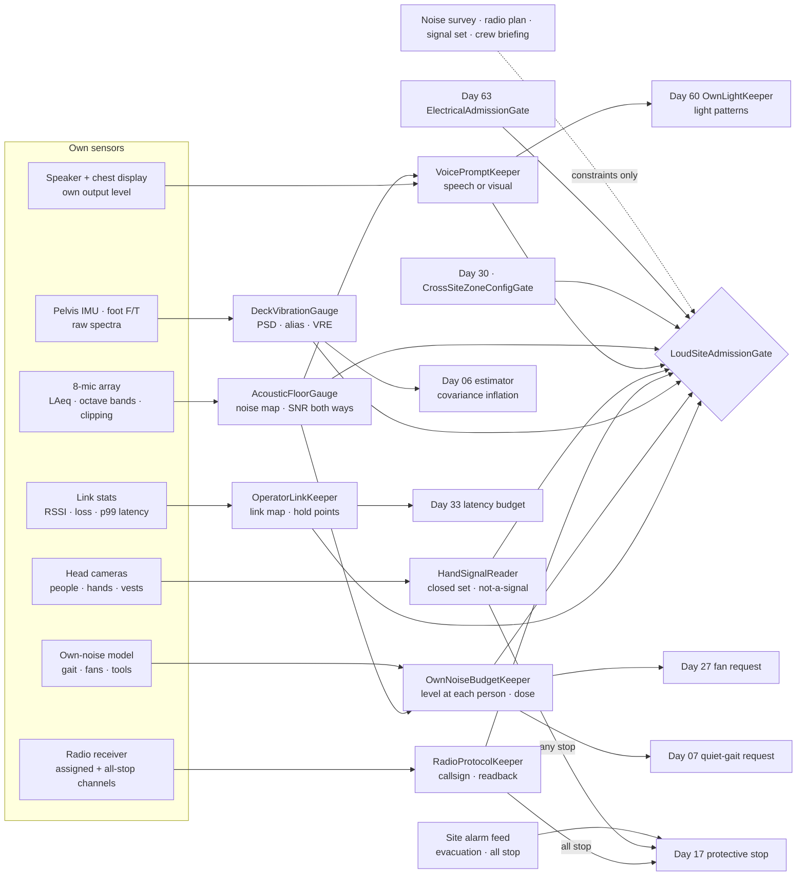
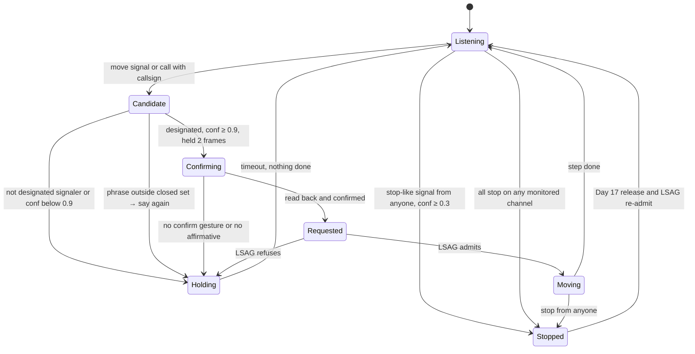
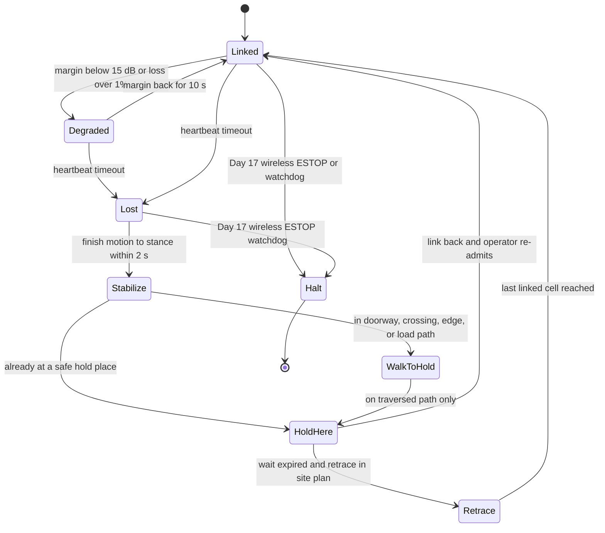
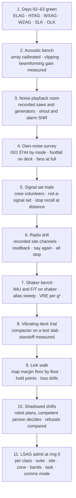

# Day 64 — Noise, vibration, and communications under the electrical stack: AcousticFloorGauge / VoicePromptKeeper / HandSignalReader / RadioProtocolKeeper / DeckVibrationGauge / OwnNoiseBudgetKeeper / OperatorLinkKeeper / LoudSiteAdmissionGate under ElectricalAdmissionGate + HeatAdmissionGate + WeatherAdmissionGate + LowLightAdmissionGate + WorkZoneAdmissionGate + DockAdmissionGate + SidewalkAdmissionGate + CorridorAdmissionGate + ElevatorAdmissionGate + DoorwayAdmissionGate + WetSurfaceAdmissionGate + ConfinedSpaceAdmissionGate + ElevatedAccessAdmissionGate + OverheadToolAdmissionGate + BimanualToolAdmissionGate + PowerToolAdmissionGate + PushPullAdmissionGate + PayloadCarryAdmissionGate + OutdoorGroundAdmissionGate + TerrainLocomotionAdmissionGate + FallSafeAdmissionGate + DeliberateContactAdmissionGate + WholeBodyTouchAdmissionGate + HumanHandoverAdmissionGate + CooperativeTaskAdmissionGate + TaskCompositionAdmissionGate + FleetSkillCatalogAdmissionGate + proximity + zone attestation + supervisor + logging + canary + HIL + fleet + incident + change-management + maintenance + thermal + energy gates

![AcousticFloorGauge / VoicePromptKeeper / HandSignalReader / RadioProtocolKeeper / DeckVibrationGauge / OwnNoiseBudgetKeeper / OperatorLinkKeeper / LoudSiteAdmissionGate: the same 63.8 kg humanoid on Site C measures 95 dBA beside a cut-off saw and knows a shout from 5 m arrives 27 dB under the noise, so it never treats "nobody shouted" as clear; announces its moves with a light pattern because a voice prompt the crew can't hear through earmuffs isn't a warning; stops on any stop-like hand signal from anyone at low confidence but takes a go only from the designated signal person at high confidence after confirming on its chest display; answers "say again" on the radio instead of guessing and never keys up on the crane channel; measures a plate compactor's 90 Hz deck vibration in its feet and finds the 180 Hz harmonic aliasing to 20 Hz in a misconfigured IMU; computes what its own fans and footsteps add to a worker's daily noise dose; and walks to a planned hold point when its operator link drops in the stair core](/images/day64-noise-vibration-communications.png)

[Day 03](/lessons/day-03-sensing-beyond-joint) owns the IMU, foot force/torque sensors, and their sampling. [Day 05](/lessons/day-05-power-bms) owns `torque_scale` and the pack **forever**. [Day 06](/lessons/day-06-estimation-balance) owns state estimation and contact detection; [Day 07](/lessons/day-07-wbc-balance) owns balance. [Day 17](/lessons/day-17-runtime-safety-supervisor) owns ESTOP, the wireless ESTOP watchdog, and safe states. [Day 26](/lessons/day-26-actuator-wear-predictive-maintenance) owns maintenance calls. [Day 27](/lessons/day-27-thermal-budgets-duty-cycle) owns fan speed and thermal limits. [Day 29](/lessons/day-29-human-proximity-safety) owns person tracks, SSM, and PFL rows. [Day 30](/lessons/day-30-collaborative-workspace-zoning) owns attested zones and `CrossSiteZoneConfigGate`. [Day 33](/lessons/day-33-remote-multisite-teleop-latency) owns the teleop latency budget. [Day 59](/lessons/day-59-construction-sites-work-zones) owns crane and hoist loads overhead (`SuspendedLoadKeeper`). [Day 60](/lessons/day-60-night-work-low-light) owns the robot's own lights (`OwnLightKeeper`). [Day 63](/lessons/day-63-temporary-power-electrical-hazards) owns electrical hazards.

Every lesson since Day 57 has quietly assumed three channels work: the robot can hear a warning, a person can hear or see the robot's warning, and the operator is on the other end of the link. On a busy site, none of those are free. A cut-off saw runs at 95 to 105 dBA at the operator's ear. Generators, compressors, and a concrete pump stack on top. Half the crew wears earmuffs or plugs. The crane talks on a dedicated radio channel, and everyone else uses hand signals because nobody can hear anybody. A plate compactor on the slab below shakes the deck at 90 Hz. And the floors are concrete on steel deck, which is what you would build if you wanted to block a 5 GHz radio.

The robot adds three things of its own. It has microphones and a speaker, which invites people to talk to it and the team to treat speech as a safety channel. It has an IMU and foot force sensors that were tuned in a quiet lab. And it makes noise: gear whine, fans that spin up in Day 62 heat, and footfalls on steel deck, all of it added to the dose of whoever works beside it.

Eight lies show up the first time a team runs a humanoid on a loud site:

1. **Heard-nothing lie.** "Nobody shouted a warning." A shout from 5 m arrives at the robot's microphones far below the saw. Silence on the microphones is not the absence of a warning.
2. **Said-it lie.** "The robot announced it was moving." It said it at 75 dB into 95 dB noise to a worker wearing earmuffs. Spoken isn't heard.
3. **Waved-on lie.** "The worker waved it through." A gesture classifier with no "not a signal" class maps a wipe of the brow to the nearest gesture it knows. A robot that always produces an answer is pretending to understand.
4. **Radio-said-so lie.** "Somebody said 'go ahead' on the radio." It was the crane operator talking to the signal person, with no callsign and no readback, and the speech recognizer filled in the rest.
5. **Balance-handles-it lie.** "Vibration is Day 07's problem." The compactor's harmonics alias into the IMU's band, MEMS accelerometers rectify vibration into a tilt bias, and foot force noise flickers the contact estimator. Day 07 balances on whatever Day 06 tells it.
6. **Quiet-robot lie.** "It's 76 dBA, nothing next to a saw." Next to a worker in a quieter hour, at handover distance, with fans at full speed, the robot can be the loudest thing in that person's day.
7. **Full-bars lie.** "The link was fine at the hoist." One slab and a stair core later it's gone, and the loss comes in bursts, not gradually.
8. **Finish-the-task lie.** "If the link drops, it'll finish and come back." A robot that keeps working while nobody can see it or stop it remotely has quietly promoted itself to unsupervised.

Today owns **`AcousticFloorGauge` / `VoicePromptKeeper` / `HandSignalReader` / `RadioProtocolKeeper` / `DeckVibrationGauge` / `OwnNoiseBudgetKeeper` / `OperatorLinkKeeper` / `LoudSiteAdmissionGate`**. The question is: **how do you let a humanoid work on a loud, shaking site where speech fails in both directions, with the noise at its microphones and at every person measured, no warning assumed heard or unheard, every hand signal and radio call either understood from a closed set or refused, every stop obeyed from anyone, deck vibration measured before it reaches the estimator, its own noise counted in the crew's dose, and the operator link mapped and its loss planned for — without raising Day 29 PFL, writing Day 05 `torque_scale`, gating Day 17 ESTOP, or bypassing `CrossSiteZoneConfigGate`?**

## Speech is not a safety channel

The rule everything follows from: **on a loud site, sound is a best-effort channel in both directions. The robot never treats the absence of a heard warning as clearance, never treats its own spoken prompt as a warning anyone received, never acts on a signal or call it can't map to a closed set with confidence, obeys a stop from anyone, and never continues a task when its operator can't see or reach it. Everything it measures (noise, vibration, link quality, its own emissions) can only shrink its work.** A site noise survey, a radio plan, a crew briefing, and "everybody knows the robot" may add constraints. None of them admits anything.

Five facts set the shape of the lesson.

**Decibels add as powers, not numbers.** Two sources at levels $L_1$ and $L_2$ combine to

$$
L_{\text{total}} = 10 \log_{10}\!\left(10^{L_1/10} + 10^{L_2/10}\right)
$$

Two 82 dBA sources make 85 dBA, not 164. A robot 13 dB quieter than a saw adds 0.2 dB. A robot as loud as the quiet background doubles the sound power a worker receives.

**Sound from a small source falls about 6 dB per doubling of distance in the open.** For a level $L_1$ measured at 1 m,

$$
L(r) \approx L_1 - 20 \log_{10} r
$$

Indoors, reflections from slabs and walls flatten that, so a measured map beats the formula. A shout is about 82 dB at 1 m (ANSI S3.5's "shouted" vocal effort); at 5 m it's about 68 dB, 27 dB under a 95 dBA saw.

**Speech needs a positive signal-to-noise ratio to be understood, and warnings need much more to be noticed.** Sentence intelligibility falls off a cliff below about 0 dB SNR and is reliable above about +15 dB (ISO 9921 frames this with the speech transmission index). ISO 7731 asks a danger signal to exceed the ambient by more than 15 dB A-weighted. At 95 dBA that's 110 dBA at the listener, which no robot speaker should produce near anyone. Hearing protection takes another 10 to 20 dB off what arrives at the ear in practice (OSHA derates a muff's NRR as $(\text{NRR} - 7)/2$ for A-weighted exposure).

**Noise dose is time-weighted and the exchange rate is steep.** OSHA 29 CFR 1926.52 and 1910.95 allow, at level $L$, a time

$$
T(L) = \frac{8\ \text{h}}{2^{(L - 90)/5}}, \qquad D = 100 \sum_i \frac{C_i}{T_i}
$$

with $C_i$ the hours spent at each level. 95 dBA is allowed for 4 h; 100 dBA for 2 h. 1910.95 starts a hearing conservation program at an 8-hour TWA of 85 dBA. NIOSH recommends 85 dBA with a 3 dB exchange rate, under which 95 dBA is allowed for about 48 minutes. Peak impulse noise should not exceed 140 dB.

**Radio through concrete loses tens of decibels per slab.** Free-space path loss in dB at distance $d$ in km and frequency $f$ in MHz is

$$
\text{FSPL} = 20 \log_{10} d + 20 \log_{10} f + 32.44
$$

At 5.8 GHz and 50 m that's 81.7 dB. A reinforced concrete slab on steel deck takes another 20 to 40 dB, depending on thickness, rebar, and moisture. Two slabs between the robot and the access point usually means no link.

| Layer | Owns | Must not own |
|-------|------|--------------|
| `AcousticFloorGauge` | A-weighted and octave-band levels at the robot's microphones, clipping, the SNR a shout or the site alarm would have at the robot, and a noise map per cell for the shift; a measured "can the robot hear a person" and "can a person hear the robot" per cell | Deciding nobody is warning it; replacing the site's alarm feed |
| `VoicePromptKeeper` | The robot's speech and audible signals: level at the nearest listener, SNR against AFG's map, and the switch to visual and display prompts when speech can't reach; acknowledgement required for anything safety-relevant | Day 60's lights (it requests patterns); treating "spoken" as "received"; raising its voice past the cap |
| `HandSignalReader` | A closed set of hand signals the site agrees for the robot, read with an explicit not-a-signal class; any stop-like signal from anyone stops it; anything else only from the designated signal person, at high confidence, confirmed back on the display | Signaling a crane or hoist; interpreting signals meant for other equipment; acting on an ambiguous go |
| `RadioProtocolKeeper` | Listening on its assigned channel and the site's all-stop channel; callsign, readback, and "say again" discipline; a closed phrase set; all-stop keywords as stops | Transmitting on the crane channel; acting on calls without its callsign; free-form speech as commands |
| `DeckVibrationGauge` | Floor-borne vibration at the feet and pelvis measured as spectra; IMU and F/T sampling checked for aliasing and rectification; vibration bands and estimate inflation handed to Day 06; standoff from vibrating plant | Day 06's estimator and Day 07's balance; changing Day 03 sampling at runtime |
| `OwnNoiseBudgetKeeper` | The robot's own measured sound power by mode (gait, fans, tools, voice) and its level at each tracked person; the added dose against the site's noise map; quieter modes requested | Day 27 fan speed (it requests); Day 07 gait (it requests); anyone's hearing protection |
| `OperatorLinkKeeper` | Measured RSSI, packet loss, and p99 latency per cell; a link map refreshed as it walks; tasks admitted only with margin; a planned hold point for every position on the route; behavior on link loss | Day 17's wireless ESTOP watchdog; Day 33's latency budget; moving repeaters |
| `LoudSiteAdmissionGate` | Fail-closed admit per robot class, suite, site, zone, noise band, vibration band, link band, task, comms mode | `JointCommand`; Day 05; PFL; Day 17 |
| Days 03 / 05 / 06 / 07 / 17 / 26 / 27 / 29 / 30 / 33 / 59 / 60 / 63 | Sensors, pack, estimation, balance, ESTOP, maintenance, thermal, people, zones, latency, loads overhead, lights, electricity | Being outranked by "everyone knows the robot" |

**Core thesis:** **on a loud site, a humanoid assumes it can't hear warnings and can't be heard, so it measures both, warns by sight, and stops on anything that might be a stop. It reads only signals and calls from a closed set and says "say again" rather than guessing, measures the deck shaking before its estimator does, counts its own noise in the crew's dose, and treats the operator link as a mapped resource with a planned answer for losing it.**



## Physical machine: what a loud site does to a humanoid

Walk Site C on Thursday afternoon. On deck 2, a laborer cuts rebar with an abrasive cut-off saw: 97 dBA at 2 m. The 60 kW generator in the yard and an air compressor beside it hold the yard at 86 dBA. On the slab-on-grade below deck 1, a reversible plate compactor runs at 90 Hz. The crane works the east side on radio channel 3 with a designated signal person; the rest of the crew uses channel 1 and hand signals. Two workers in earmuffs are hanging strut on deck 2, 3 m from where the robot is staging conduit. The site's Wi-Fi access point is on the hoist tower at deck 2. The stair core is cast concrete with steel doors.

The robot's hardware for this:

- **Microphones:** an 8-element MEMS array on the head, each with about 120 dB SPL acoustic overload point. Delay-and-sum beamforming gains at most $10 \log_{10} 8 \approx 9$ dB against diffuse noise, and much less against a single loud source in the beam.
- **Speaker and display:** a speaker capped at 85 dBA at 1 m, and a chest display that shows short text and icons readable at about 5 m.
- **Cameras:** the head cameras from Day 60, used today for hands, arms, and vests.
- **Radio:** a site radio receiver on assigned channels, and a transmitter enabled only on the robot's channel.
- **IMU and foot F/T:** the Day 03 pelvis IMU (accelerometer ±16 g, gyro) and six-axis force/torque in each ankle.
- **Network:** a 5 GHz Wi-Fi client and a separate safety-rated wireless ESTOP receiver owned by Day 17.

### Noise: measure both directions, per cell

AFG computes LAeq over 1 s and 60 s windows, octave bands from 63 Hz to 8 kHz, and peak level, with each microphone's clipping counted. It builds a noise map by cell for the shift, because the noise at the robot changes as it walks and as tools start and stop. From that map it derives two numbers per cell, both stated as SNR:

- **Can the robot hear a person?** The SNR a shout from 5 m would have at the array after beamforming. Beside the saw: 82 − 14 + 9 − 97 = −20 dB. That's not a hearing channel.
- **Can a person hear the robot?** The SNR the robot's capped voice would have at the nearest tracked person. 85 dBA at 1 m is 75 dBA at 3 m. Against 92 dBA at the strut workers, that's −17 dB before their earmuffs.

When the "hear a person" SNR is under its threshold, AFG marks the cell **deaf**. The robot isn't more careful because it heard nothing; it's more careful because it **can't** hear. In a deaf cell the robot's motion is limited to what Day 29 and today's visual channel admit, the site alarm feed (the site's evacuation and all-stop alarms, wired to the robot over the network, not heard) becomes the only alarm path LSAG accepts, and keyword spotting for "stop" is still run but only ever adds stops.

Microphone clipping matters too. A nail gun beside the head can drive peaks past 120 dB SPL; clipped frames are flagged and excluded from every level estimate, and a mic that clips for more than a few percent of a window marks the cell's level as **at least** the clip level, never as the average of what survived.

### Warnings: visual first, acknowledged when it matters

VPK chooses the channel for every prompt. If speech would reach the nearest listener with at least +15 dB SNR at their position (after a hearing-protection derating whenever the person wears it or Day 29 can't tell), speech is allowed for information. **For anything safety-relevant (moving toward a person, swinging a payload, starting a tool), speech never counts as the warning.** The warning is a light pattern requested from Day 60's `OwnLightKeeper` and a display message, both aimed at the person, and the robot waits for an acknowledgement it can see: a raised hand, the person stepping clear, or a tap on the display (a nod never counts). No acknowledgement means the robot waits or reroutes; it never proceeds on the theory that the person must have heard.

VPK never raises its voice past the 85 dBA cap. Shouting louder only adds to the crew's dose and masks their speech to each other.

### Hand signals: a closed set, an asymmetric threshold

OSHA 29 CFR 1926 Subpart CC Appendix A illustrates the standard crane hand signals, and 1926.1419 requires that only a qualified signal person signals the crane, except one signal: **the operator must obey a stop or emergency stop signal from anyone** (1926.1417(y)). HSR borrows exactly that asymmetry for the robot.

The site agrees a small signal set for the robot in the crew briefing: STOP (arm extended, palm down, moving horizontally), EMERGENCY STOP (both arms), HOLD (closed fist raised), COME TO ME, GO BACK, and THIS WAY. HSR's classifier has an explicit **not-a-signal** class, trained on wiping a brow, pointing at a drawing, waving to a coworker, carrying material, and stretching. Its rules:

- **Any stop-like signal from anyone stops the robot at low confidence.** STOP, EMERGENCY STOP, and HOLD fire at 0.3. A protective stop is requested from Day 17; HSR never decides to resume.
- **Any other signal moves the robot only if** it comes from the designated signal person for the robot (identified by vest marker and the day's assignment), at confidence 0.9 or more, held for two frames a few hundred milliseconds apart, and confirmed back on the chest display ("THIS WAY → east, 3 m?") with a second gesture.
- **Anything below that is not a signal.** The robot holds and shows "?" on its display. It never picks the nearest class.
- **Signals meant for the crane are not for the robot.** HSR ignores signals directed away from it, and the robot never gives crane signals.

A signal from 25 m in low sun, or with the signaler half behind a column, drops confidence. That's correct: a go becomes impossible, and a stop is still easy.

### Radio: callsign, readback, "say again"

The site radio plan gives the robot a callsign ("Robot One") and channel 1, and puts the crane on channel 3 with its own signal person. 1926.1420 requires that crane voice signals identify the function, direction, and distance or speed, and that the crane channel be dedicated. RPK follows the same discipline:

- It acts only on transmissions that open with its callsign, contain a phrase from its closed set (STOP, ALL STOP, HOLD, RESUME, RETURN TO DOCK, GO TO followed by a named location), and pass the speech recognizer at high confidence.
- It reads every command back on channel 1 ("Robot One, go to staging east, reading back") and waits for "affirmative" from the same speaker. No affirmative, no action.
- Anything it can't parse gets "Robot One, say again." It never guesses.
- It listens to channel 3 but **never** transmits on it. "All stop" or "stop stop stop" heard on any monitored channel requests a protective stop from Day 17 regardless of callsign.
- RESUME after a stop needs the same readback and the robot's own checks; it's a request to LSAG, not a release of Day 17.

Radio audio is noisy and band-limited, and a speech recognizer trained on clean speech hallucinates plausible words into static. RPK's closed phrase set exists so that a hallucination has nothing to land on.

### Vibration: through the deck into the estimator

The plate compactor runs at 90 Hz with strong harmonics. On the slab above it, at the robot's feet, DVG measures 0.3 g RMS in the 80 to 200 Hz band. Three things go wrong if nobody looks:

- **Aliasing.** Suppose the IMU's accelerometer is configured to 200 Hz output data rate with its internal low-pass set wide. 90 Hz passes (under the 100 Hz Nyquist), but the 180 Hz harmonic folds to $|180 - 200| = 20$ Hz, right in the band where Day 06 estimates tilt and Day 07 balances. The estimator sees a 20 Hz wobble that isn't there.
- **Rectification.** MEMS accelerometers under strong vibration show a DC offset, the vibration rectification error, often specified in mg per g² of vibration. A 0.02 g bias reads as a tilt of $\arctan(0.02) \approx 1.15°$. Gyros have g-sensitivity too.
- **Foot force noise.** The deck moving under a 63.8 kg robot puts force noise on each foot. If Day 06's contact detector thresholds on force and its variance, a vibrating floor flickers contact states during stance.

DVG doesn't fix the estimator. It **measures**: power spectral density of the raw IMU and F/T channels during stance, checked against the Day 03 sampling configuration for any band that would alias into the estimator's band; a rectification test on the bench shaker so the bias per g² is a number, not a datasheet line; and a standing check on each new cell. It hands Day 06 a vibration band and an inflation factor for accelerometer and contact covariance, and it reports configuration problems (a wide internal filter, a sample rate that aliases) to change management rather than changing Day 03 sampling at runtime. Near vibrating plant it keeps a standoff, measured as the distance where the in-band acceleration falls under the robot's qualified limit, and it treats a sudden rise in deck vibration as a sign heavy plant has started nearby, which goes to Day 29 as a reason to look.

Vibration also hurts the camera (rolling-shutter wobble at 90 Hz) and the robot's own hardware over time; DVG logs exposure hours per band for Day 26.

### Own noise: the robot is in someone's dose

ONBK measures the robot's sound power by mode on the bench (ISO 3744 survey method around the robot): standing with fans idle 62 dBA at 1 m, walking on concrete 70 dBA, walking on steel deck 76 dBA with footfall peaks near 110 dB, fans at full in Day 62 heat 82 dBA, and voice at its 85 dBA cap. At a handover distance of 0.7 m, the 82 dBA fan level becomes 85 dBA at the person.

For every tracked person within 10 m, ONBK computes the robot's level at that person and combines it with AFG's map at their position. In the saw cell it hardly matters: 75 dBA under 95 dBA adds less than 0.1 dB. In a quiet hour beside two workers hanging strut at 82 dBA, the robot at 82 dBA at their position makes it 85 dBA, and for a worker who spent the morning beside the saw, that's points of dose they didn't have. ONBK's job is to keep the robot's contribution under a policy limit (here, under 1 dB added at any person, and never pushing a cell over 85 dBA by itself). When it can't, it **requests**: a quieter gait from Day 07 (softer heel strike, shorter steps), a fan cap from Day 27 (which Day 27 grants only within its thermal limits), the voice off in favor of the display, or more distance. If Day 27 says the fans must run, the robot works farther from people or stops; heat wins over quiet, and distance wins over both.

ONBK never asks anyone to change their hearing protection and never treats earmuffs as a reason the robot's noise doesn't count.

### The operator link: a mapped resource with a planned loss

From the Day 59 lessons on, every LSAG row has needed "a live operator link at ring 0." OPLK makes that a measurement. As the robot walks, it logs RSSI, packet loss, and p99 round-trip latency per cell, and it keeps a link map for the shift. A cell is **linked** if its RSSI margin over the radio's sensitivity for the needed rate is at least 15 dB, loss under 1%, and p99 latency inside Day 33's budget for the task. Cells near the stair core and below the deck 2 slab typically aren't: the access point on the hoist tower at 5.8 GHz gives about −56 dBm at 50 m in the open, one slab takes that to around −86 dBm, and two make it disappear.

Every task plan must keep the robot in linked cells, and every position on the route gets a **hold point**: the nearest place off walkways, out of doorways, away from edges, and out from under loads (Day 59 SLK) where the robot can stand and wait. On link loss:

1. The current motion finishes to a stable stance within 2 s, with any payload held or set down per [Day 46](/lessons/day-46-carrying-payloads-walking)'s rules, never dropped.
2. If the robot is already at a safe place to wait, it waits. If it's in a doorway, a crossing, under a load path, or at an edge, it walks to the hold point along a path it already traversed, at walking speed, no new tasks.
3. It shows "LINK LOST — HOLDING" on the display and the Day 60 pattern for holding.
4. After a configurable wait, it may retrace to the last linked cell along its own path, if the site agreed to that in the plan. It never finishes the task, and it never explores for signal.

Day 17's wireless ESTOP has its own watchdog and its own answer to loss (it stops the robot). OPLK never changes that, never delays it, and never counts the Wi-Fi link as a safety link.

## AcousticFloorGauge and VoicePromptKeeper

AFG measures levels at the array per cell, both-way SNR for a shout and the robot's capped voice, and clipping, and marks deaf cells where silence means nothing. VPK picks speech only when it reaches +15 dB at the listener after a hearing-protection derating, puts every safety-relevant warning on Day 60's lights and the display, waits for a visible acknowledgement, and never raises its voice past the cap.

## HandSignalReader and RadioProtocolKeeper

HSR reads a closed signal set with a not-a-signal class: any stop-like signal from anyone at low confidence stops the robot through Day 17, and anything that moves it needs the designated signal person, high confidence, and a confirmed read-back on the display. RPK acts only on its callsign and closed phrases with readback and affirmative, says "say again" to everything else, obeys all-stop from any monitored channel, and never transmits on the crane channel.

## DeckVibrationGauge, OwnNoiseBudgetKeeper, and OperatorLinkKeeper

DVG measures floor-borne vibration as spectra at the feet and pelvis, finds aliasing and rectification against the Day 03 configuration, and hands Day 06 a vibration band and covariance inflation while keeping a standoff from vibrating plant. ONBK computes the robot's level and added dose at every person nearby and requests quieter gait, fans, or voice, or moves away. OPLK maps link margin per cell, admits tasks only in linked cells, plans a hold point for every position, and on loss holds rather than finishing.

## LoudSiteAdmissionGate

`LoudSiteAdmissionGate` (LSAG) admits work on a loud or vibrating site per robot class, sensor suite hash, site, zone, noise band, vibration band, link band, task, and comms mode, under Day 63 ELAG and everything below it. Bands come from the robot's own measurements: AFG's LAeq and hear-a-person SNR at the robot's cells, DVG's in-band acceleration, and OPLK's link margin along the planned route. Every row needs:

- AFG: noise map fresh within 5 min for every cell on the route; deaf cells marked; site alarm feed connected and tested this shift.
- VPK: a visual warning channel (Day 60 lights and display) available for every safety-relevant step; no step whose only warning is speech.
- HSR: signal set briefed to the crew today; designated signal person identified; stop recall verified on the shift-start check.
- RPK: callsign and channels loaded from today's radio plan; transmitter locked out of the crane channel.
- DVG: no unresolved alias band; vibration band under the qualified limit at every stance cell, or the standoff applied.
- ONBK: robot's added level under limit at every tracked person along the plan, with Day 27's fan forecast for the task.
- OPLK: every cell on the route linked; a hold point for every position; Day 17's wireless ESTOP receiver healthy.
- The site's competent person reachable at ring 0, as on Days 59 to 63.

LSAG never writes `JointCommand`, never touches Day 05 `torque_scale` or limits, never raises a Day 29 row, never changes Day 03 sampling, Day 06's estimator, Day 07's gait, or Day 27's fans directly, never takes a noise survey, a radio plan, a crew briefing, or "everyone knows the robot" as evidence that a warning will be heard, never accepts silence as clearance, never acts on a signal or call outside its closed set, never transmits on the crane channel, never continues a task on link loss, and never gates ESTOP.

## Data shapes

```text
AcousticCell:                                 # AFG
  cell_id, laeq_1s, laeq_60s, lcpeak
  octave_db[63..8k], clipped_frac[8]          # per mic
  snr_shout_5m_db                             # after beamforming gain
  snr_robot_voice_at_nearest_db               # after hearing-protection derating
  deaf: bool                                  # silence is not clearance
  site_alarm_feed: CONNECTED | TESTED_AT | DOWN

Prompt:                                       # VPK
  purpose: INFO | SAFETY
  listener_track_id, distance_m, hp_assumed: bool
  channel: SPEECH | LIGHT_PATTERN | DISPLAY   # SAFETY never SPEECH-only
  light_request → Day 60 OwnLightKeeper
  ack: NONE | HAND_RAISED | STEPPED_CLEAR | DISPLAY_TAP
  voice_level_cap_dba: 85

HandSignal:                                   # HSR
  track_id, is_designated_signaler: bool
  label: STOP | EMERGENCY_STOP | HOLD | COME | GO_BACK | THIS_WAY | NOT_A_SIGNAL
  confidence, frames_held, directed_at_robot: bool
  confirmed_on_display: bool
  action: PROTECTIVE_STOP → Day 17 | MOVE_REQUEST → LSAG | HOLD_AND_ASK

RadioCall:                                    # RPK
  channel, callsign_heard, phrase, asr_conf
  readback_sent, affirmative_from_same_speaker: bool
  all_stop_detected: bool                     # any monitored channel → Day 17
  response: ACT | SAY_AGAIN | IGNORE
  tx_on_crane_channel: never

DeckVibration:                                # DVG
  cell_id, accel_rms_g_by_band{}, ft_force_rms_n
  peak_freqs_hz[], alias_into_est_band[]      # vs Day 03 ODR and filter
  vre_bias_g                                  # bench-measured per g²
  est_inflation → Day 06                      # accel and contact covariance
  plant_standoff_m, exposure_h_by_band → Day 26

OwnNoise:                                     # ONBK
  mode: IDLE | WALK_CONCRETE | WALK_DECK | FANS_FULL | VOICE
  lw_dba, l_at_1m_dba, footfall_peak_db
  per_person[]: track_id, ambient_dba, robot_dba, added_db, dose_delta_pct
  requests: QUIET_GAIT → Day 07 | FAN_CAP → Day 27 | VOICE_OFF | MORE_DISTANCE

LinkCell:                                     # OPLK
  cell_id, rssi_dbm, margin_db, loss_pct, p99_rtt_ms
  linked: bool                                # margin, loss, Day 33 budget
  hold_point_id
  on_loss: STABILIZE | HOLD_HERE | WALK_TO_HOLD | RETRACE_IF_AGREED
  wireless_estop: DAY17_OWNED

LoudSiteAdmission:                            # LSAG
  robot_class, suite_hash, site, zone
  noise_band, vibration_band, link_band, task, comms_mode
  requires: [ELAG, HTAG, WXAG, WZAG, SLK_DAY59, OLK_DAY60, CrossSiteZoneConfigGate]
  forbidden:
    speech_only_safety_warning: true
    silence_as_clearance: true
    act_outside_closed_set: true
    tx_crane_channel: true
    continue_task_on_link_loss: true
    write_torque_scale: true
    raise_pfl: true
    gate_estop: true
    bypass_cross_site_zone_config_gate: true

# Unchanged owners
ElectricalAdmissionGate · cords · enclosures · lines · GFCI · dock power (Day 63)
HeatAdmissionGate · sun · dust · crew heat (Day 62) · WeatherAdmissionGate (Day 61)
OwnLightKeeper · lights (Day 60) · WorkZoneAdmissionGate · SLK loads (Day 59)
Latency budget (Day 33) · tracks · SSM · PFL (Day 29) · zones (Day 30)
Fans and thermal (Day 27) · maintenance (Day 26) · ESTOP and wireless watchdog (Day 17)
Gait and balance (Day 07) · estimation and contact (Day 06) · IMU and F/T sampling (Day 03)
BmsState / PowerState (Day 05): torque_scale, reserve
  accepts_requests_from_site: false
```

## Config

A starting configuration. Every number is a policy you re-derive from your own robot, sensors, site, and the rules that apply where you work:

```yaml
loud_site:
  speech_is_safety_channel: never
  acoustic:
    windows_s: [1, 60]
    map_refresh_min: 5
    shout_reference_db_at_1m: 82        # ANSI S3.5 shouted
    beamforming_gain_db: 9               # measured on your array, not assumed
    deaf_if_snr_shout_5m_below_db: 0
    clip_frac_to_flag: 0.02
    clipped_level: at_least_clip_point
    alarm_path: site_alarm_feed          # never "heard it"
    stop_keyword_spotting: adds_stops_only
  prompts:
    voice_cap_dba_at_1m: 85
    speech_min_snr_at_listener_db: 15
    hearing_protection_derate: osha_nrr_minus_7_over_2
    hp_unknown: assume_worn
    safety_prompt_channels: [day60_light_pattern, display]
    safety_prompt_needs_ack: [hand_raised, stepped_clear, display_tap]
    no_ack: wait_or_reroute
  hand_signals:
    set_from: crew_briefing_today
    classes: [stop, emergency_stop, hold, come, go_back, this_way, not_a_signal]
    stop_like_threshold: 0.3             # anyone
    move_threshold: 0.9                  # designated signaler only
    move_frames_held: 2
    move_needs_display_confirm: true
    below_threshold: hold_and_show_question
    signal_crane: never
  radio:
    callsign_from: radio_plan
    tx_channels: [robot_channel]
    rx_channels: [robot_channel, crane_channel, all_stop_channel]
    phrases: [stop, all_stop, hold, resume, return_to_dock, go_to_named_location]
    asr_min_conf: 0.9
    readback: always
    needs_affirmative_from_same_speaker: true
    unparsed: say_again
    all_stop_any_channel: protective_stop_day17
  vibration:
    psd_band_hz: [5, 500]
    estimator_band_hz: [0, 30]
    alias_check_against: day03_sampling_config
    alias_found: report_to_change_management_and_refuse_cell
    vre_bench_test: required_per_imu_sku
    qualified_limit_g_rms_in_band: 0.15
    beyond_limit: standoff_or_refuse
    inflate_covariance_to: day06
    sudden_rise_db: 6                    # → Day 29 look-around
  own_noise:
    survey_method: iso_3744
    persons_within_m: 10
    max_added_db_at_person: 1.0
    never_push_cell_over_dba: 85
    requests: [day07_quiet_gait, day27_fan_cap, voice_off, more_distance]
    heat_beats_quiet: true
  link:
    min_margin_db: 15
    max_loss_pct: 1
    p99_budget_from: day33
    route_cells: linked_only
    hold_point_per_position: required
    stabilize_within_s: 2
    on_loss: [stabilize, hold_or_walk_to_hold_point, show_link_lost]
    retrace_to_last_linked: only_if_in_site_plan
    finish_task_on_loss: never
    wifi_is_safety_link: false
    wireless_estop: day17
  admission:
    keyed_by: [robot_class, sensor_suite_hash, site, zone, noise_band, vibration_band, link_band, task, comms_mode]
    bands_from: own_measurements
    requires: [day63_elag, day62_htag, day61_wxag, day59_wzag, day60_olk, day30_cross_site_zone_config_gate]
    competent_person_ring0: required
```

## Signals and calls, as states

Every signal or call walks the same small machine. The point of drawing it is to see that a stop has a short path from anyone and a move has a long path from one person, and that "I'm not sure" always lands on holding.



And the link has one of its own:



## Physical ↔ digital pairing

| Physical | Digital twin / backing |
|----------|------------------------|
| Cut-off saw at 97 dBA, 2 m from the robot | AFG: shout SNR −20 dB → cell deaf; alarm feed only; motion limited to visual channel |
| Robot about to swing conduit past two workers in earmuffs | VPK: voice at 3 m = −17 dB SNR → light pattern + display; waits for a raised hand |
| Laborer wipes his brow with a raised arm | HSR: NOT_A_SIGNAL 0.71, STOP 0.22 → nothing |
| Anyone's flat palm sweeping, half behind a column | HSR: STOP 0.38 → protective stop requested from Day 17 |
| Designated signaler points east from 25 m in low sun | HSR: THIS_WAY 0.64 → hold, display shows "?" |
| "Go ahead, swing it" on channel 3 | RPK: no callsign, crane channel → ignored, never answered |
| "Robot One, go to staging east" with static | RPK: read back, affirmative from same speaker → request to LSAG |
| "Robot One, uh, grab that thing by the" | RPK: outside closed set → "Robot One, say again" |
| Plate compactor on the slab below | DVG: 0.3 g RMS 80–200 Hz; 180 Hz aliasing to 20 Hz at 200 Hz ODR → cell refused, config reported |
| Bench shaker at 1 g RMS | DVG: VRE bias 0.018 g → 1.0° tilt error; covariance inflation table for Day 06 |
| Robot walking past the strut crew at 82 dBA with fans at full | ONBK: +1.6 dB at 1.5 m → quiet gait to Day 07, path widened to 3 m, +0.5 dB |
| Fans at full on a hot afternoon near a handover | ONBK: 85 dBA at 0.7 m; Day 27 refuses fan cap → handover moved to a set-down point |
| Stair core between decks 1 and 2 | OPLK: −88 dBm, 6% loss → not linked; route avoids it or a repeater is placed by the crew |
| Link drops in a doorway | OPLK: stance in 1.4 s, walks 4 m back to hold point, display LINK LOST |

The pairing that matters most: **replay every loud-site shift from the robot's own bag and show that no safety-relevant step went out with speech as its only warning, no silence was used as clearance in a deaf cell, every stop-like signal and all-stop call produced a stop, no move came from anyone but the designated person at high confidence with a confirmed readback, the robot never transmitted on the crane channel, no estimator ran on an aliased band, the robot never added more than its limit to anyone's noise, and no task continued after a link loss.**

## Bring-up sequence (before the robot works on a loud site)



1. **Days 02–63 green,** with ELAG, HTAG, and Day 60's `OwnLightKeeper` admitted on site first, because today's warnings ride on its lights.
2. **Acoustic bench:** calibrate every microphone against a reference calibrator; measure the clipping point and the real beamforming gain against diffuse and point-source noise.
3. **Noise playback room:** play recorded site noise at measured levels and a shout and the site alarm at known positions; check AFG's deaf-cell marks against what the robot actually detects.
4. **Own-noise survey:** ISO 3744 measurements per mode, including footfall on steel deck and fans at Day 27's maximum; this table is ONBK's only source of truth.
5. **Signal set trials:** crew volunteers, real vests, real distances and lighting; stop recall above 99% at the briefed range, and the not-a-signal set scored for false moves (target zero).
6. **Radio drill:** recorded site channels with static, crosstalk, and the crane's calls; RPK must ignore every call without its callsign, read back every command, and answer "say again" to every out-of-set phrase.
7. **Shaker bench:** the IMU and ankle F/T on a shaker swept 5 to 500 Hz; find every frequency that aliases into the estimator band at the production configuration, and measure VRE.
8. **Vibrating deck trial:** a plate compactor on a test slab; measure in-band acceleration vs distance and set the standoff; check Day 06 with DVG's inflation on.
9. **Link walk:** walk every floor, map margin, loss, and p99 latency; place hold points; drill link loss in a doorway, at a crossing, and under a mock load path.
10. **Shadowed shifts:** the robot plans, the competent person decides; compare refusals.
11. **LSAG admit at ring 0** per robot class, suite, site, zone, noise band, vibration band, link band, task, and comms mode.

## Failure gallery

| Symptom | Likely cause |
|---------|--------------|
| Robot backs into a worker who was shouting at it | Silence in a deaf cell treated as clearance |
| Worker says "it never warned me" | Speech-only warning, earmuffs, no acknowledgement required |
| Robot walks toward a worker who was wiping his brow | Classifier with no not-a-signal class; nearest gesture chosen |
| Robot ignores a stop from a laborer | Stops accepted only from the designated signaler |
| Robot moves on "go ahead" meant for the crane | Callsign not required; crane channel treated as a command channel |
| Robot answers on channel 3 during a lift | Transmitter not locked to the robot's channel |
| Robot sways when the compactor starts below | 180 Hz harmonic aliasing to 20 Hz; wide IMU filter |
| Slow tilt drift during jackhammering | Vibration rectification bias never measured |
| Contact flicker and stumbles on a vibrating slab | Day 06 never got DVG's covariance inflation |
| Crew complains the robot is "loud as a saw" at lunch | ONBK used the morning's noise map; fans at full near people |
| Robot stops in a doorway for 20 minutes | Link loss with no hold point; stopped where it stood |
| Robot finishes a carry nobody could see | Link loss behavior was "continue mission" |

## Exercises

1. A saw runs at 97 dBA at the robot. A worker 6 m away shouts at 82 dB at 1 m. With 9 dB of beamforming gain, what's the shout's SNR at the robot? How close would the worker need to be for 0 dB?
2. Two strut workers stand in 82 dBA. The robot's level at 1 m is 82 dBA with fans at full. At what distance does it add less than 1 dB at their position? What does ONBK request first, and what if Day 27 refuses?
3. A worker spends 4 h at 92 dBA and 4 h at 82 dBA. Compute the OSHA dose and TWA. Now the robot works beside them for the second 4 h, raising that period to 85 dBA. Recompute. Do the same with NIOSH's 85 dBA criterion and 3 dB exchange rate.
4. The IMU samples at 200 Hz with a 150 Hz internal bandwidth. A compactor runs at 90 Hz with harmonics at 180 and 270 Hz. Which frequencies land below 30 Hz after sampling? Pick an ODR and filter that fix it.
5. The access point is at 5.8 GHz, 20 dBm, 3 dBi antennas on both ends, with −82 dBm needed for the rate you use. How many 30 dB slabs can sit between the robot and the access point at 40 m and keep a 15 dB margin?
6. Write the `LoudSiteAdmission` rows for staging conduit beside the cut-off saw and for walking the stair core to deck 1 during compaction. Which owners can refuse each, and why?

## What to freeze this week

Extend [frames](/frames) and your safety config with:

- `AcousticFloorGauge`: noise map per cell with both-way SNR; deaf cells where silence means nothing; clipping counted; alarms only from the site feed.
- `VoicePromptKeeper`: safety warnings on Day 60 lights and the display, never speech alone; visible acknowledgement required; voice capped.
- `HandSignalReader`: closed signal set with not-a-signal; stop-like signals from anyone at low confidence; moves only from the designated signaler at high confidence with display confirmation; never signal a crane.
- `RadioProtocolKeeper`: callsign, closed phrases, readback and affirmative; "say again" over guessing; all-stop from any channel; never transmit on the crane channel.
- `DeckVibrationGauge`: spectra at feet and pelvis; aliasing and VRE measured against Day 03's configuration; inflation to Day 06; standoff from plant; exposure to Day 26.
- `OwnNoiseBudgetKeeper`: measured own noise by mode; added level and dose at each person; quieter modes requested from Day 07 and Day 27; distance when they can't.
- `OperatorLinkKeeper`: link margin mapped per cell; tasks in linked cells only; a hold point everywhere; on loss, stabilize and hold, never finish; Day 17's wireless ESTOP untouched.
- `LoudSiteAdmissionGate` fail-closed under Day 63 ELAG; keyed by measured noise, vibration, and link bands; **no speech-only safety warning, no silence as clearance, no guessed signal or call, no ignored stop from anyone, no crane-channel transmission, no estimator on an aliased band, no robot noise past its share, no task after link loss, no dual-write of ESTOP, PFL, `torque_scale`, fans, or gait.**

The lesson isn't "teach the robot to listen better." It's that **on a loud site, sound fails both ways, the deck shakes, and the radio dies in the concrete. So the robot assumes it can't hear and can't be heard, warns by sight, stops on anything that might be a stop, measures the shaking before its estimator trusts it, counts its own noise in other people's ears, and knows in advance where it will stand when the link goes.**

## Further reading

Look these up by title; they're the standard sources for today's noise, speech, signaling, vibration, and radio arguments:

- OSHA 29 CFR 1926.52 and 1910.95, *Occupational noise exposure*, and NIOSH Publication 98-126, *Criteria for a Recommended Standard: Occupational Noise Exposure*.
- ANSI/ASA S3.5, *Methods for Calculation of the Speech Intelligibility Index*, for vocal effort levels.
- ISO 9921, *Ergonomics — Assessment of speech communication*, and ISO 7731, *Danger signals for public and work areas — Auditory danger signals*.
- ISO 3744, *Determination of sound power levels of noise sources using sound pressure — Engineering methods*.
- OSHA 29 CFR 1926.1417, 1926.1419–1422 and Subpart CC Appendix A, on signals, signal persons, radio signals, and standard hand signals; ASME B30.5 for crane signals.
- ISO 2631-1 and ISO 5349 for whole-body and hand-arm vibration, and MEMS IMU datasheets and application notes on vibration rectification error and anti-alias filtering.
- ITU-R P.2040, *Effects of building materials and structures on radiowave propagation above about 100 MHz*.

## Next

**Day 65+** — Hot work and fire hazards under the loud-site stack: welding arcs and their UV in the robot's cameras and on people's eyes, grinding sparks and spatter on sensor windows, cables, and the robot's own covers, fire watch duties the robot must never claim, flammable storage and generator fuel near its routes, its own battery pack as a fire load and what a thermal runaway does on a deck, and evacuation alarms and muster points it must follow — without raising Day 29 PFL, writing Day 05 `torque_scale`, or bypassing `CrossSiteZoneConfigGate`, under the same gates plus loud-site admission.
