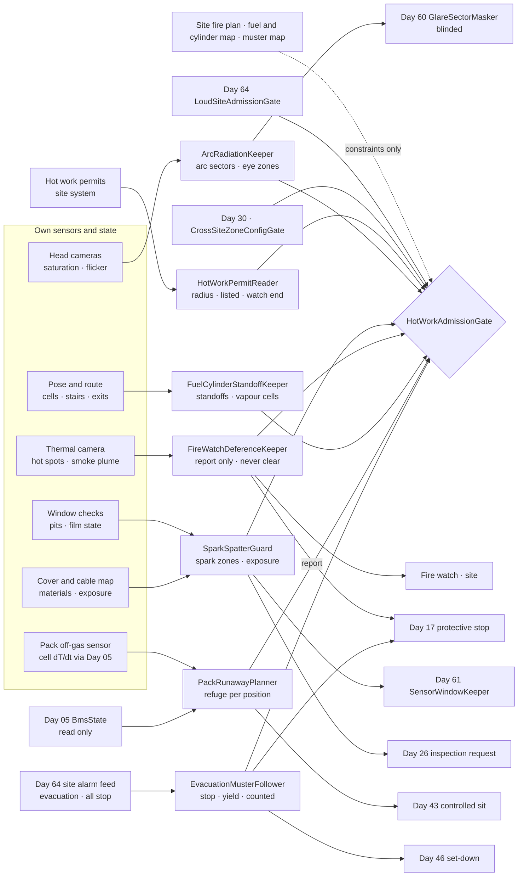
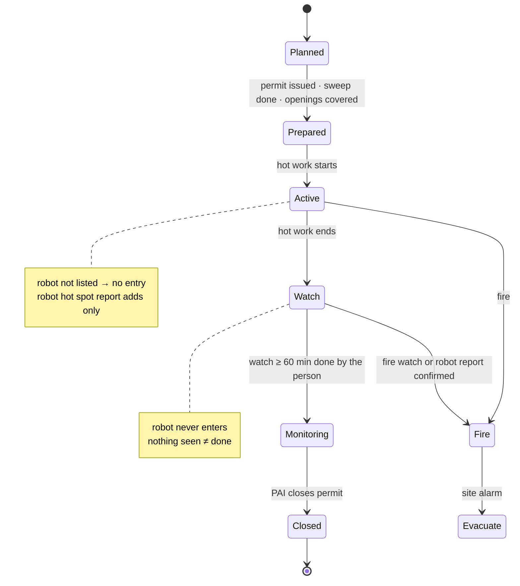
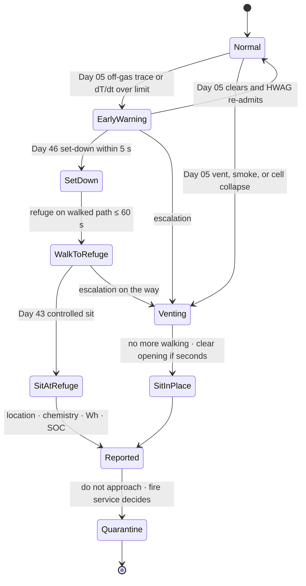
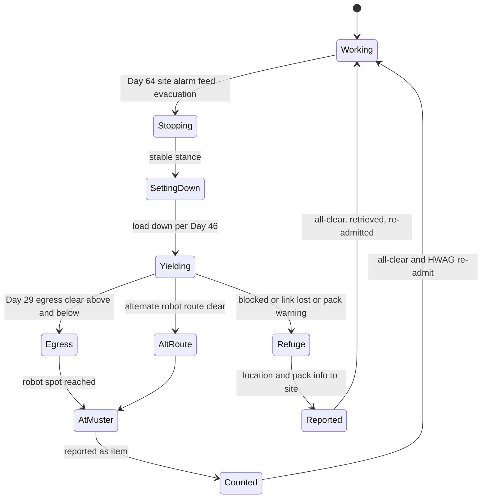
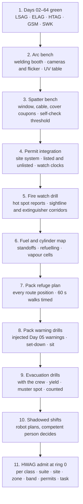

# Day 65 — Hot work and fire hazards under the loud-site stack: ArcRadiationKeeper / SparkSpatterGuard / HotWorkPermitReader / FireWatchDeferenceKeeper / FuelCylinderStandoffKeeper / PackRunawayPlanner / EvacuationMusterFollower / HotWorkAdmissionGate under LoudSiteAdmissionGate + ElectricalAdmissionGate + HeatAdmissionGate + WeatherAdmissionGate + LowLightAdmissionGate + WorkZoneAdmissionGate + DockAdmissionGate + SidewalkAdmissionGate + CorridorAdmissionGate + ElevatorAdmissionGate + DoorwayAdmissionGate + WetSurfaceAdmissionGate + ConfinedSpaceAdmissionGate + ElevatedAccessAdmissionGate + OverheadToolAdmissionGate + BimanualToolAdmissionGate + PowerToolAdmissionGate + PushPullAdmissionGate + PayloadCarryAdmissionGate + OutdoorGroundAdmissionGate + TerrainLocomotionAdmissionGate + FallSafeAdmissionGate + DeliberateContactAdmissionGate + WholeBodyTouchAdmissionGate + HumanHandoverAdmissionGate + CooperativeTaskAdmissionGate + TaskCompositionAdmissionGate + FleetSkillCatalogAdmissionGate + proximity + zone attestation + supervisor + logging + canary + HIL + fleet + incident + change-management + maintenance + thermal + energy gates

![ArcRadiationKeeper / SparkSpatterGuard / HotWorkPermitReader / FireWatchDeferenceKeeper / FuelCylinderStandoffKeeper / PackRunawayPlanner / EvacuationMusterFollower / HotWorkAdmissionGate: the same 63.8 kg humanoid on Site C marks a 200 A MIG arc as a blinded camera sector and a no-handover zone for people's eyes, and never moves the welding curtain; sees that it is standing 9 m from a grinder inside the permit's 10.7 m sweep that was cleared before it walked in, and leaves; swaps its polycarbonate camera windows for glass with a sacrificial film before any route near hot work; reports a hot spot on its thermal camera to the fire watch and never counts itself as the fire watch or shortens the 60-minute watch; keeps 6.1 m from the oxygen and acetylene cylinders and walks nowhere near the generator while it's being refuelled; plans a pack refuge reachable in 60 s from every cell of its route so that a battery warning ends in an empty corner of concrete instead of a stair; and on the evacuation alarm sets down its load, waits for the stair to clear, walks to its own spot at the muster point, and reports itself counted so nobody goes back in for it](/images/day65-hot-work-fire-hazards.png)

[Day 05](/lessons/day-05-power-bms) owns `torque_scale`, the pack, its contactors, and the BMS protection paths **forever**. [Day 17](/lessons/day-17-runtime-safety-supervisor) owns ESTOP and safe states. [Day 27](/lessons/day-27-thermal-budgets-duty-cycle) owns thermal limits. [Day 28](/lessons/day-28-energy-budgets-mission-planning) owns the energy budget and dock trips. [Day 29](/lessons/day-29-human-proximity-safety) owns person tracks, SSM, and PFL rows. [Day 30](/lessons/day-30-collaborative-workspace-zoning) owns attested zones and `CrossSiteZoneConfigGate`. [Day 43](/lessons/day-43-falls-fall-safe-contact) owns controlled descent and falls. [Day 46](/lessons/day-46-carrying-payloads-walking) owns set-downs of a carried load. [Day 48](/lessons/day-48-powered-hand-tools-process-forces) owns the robot's own tool use. [Day 59](/lessons/day-59-construction-sites-work-zones) owns floor openings (`FloorOpeningMapper`) and loads overhead (`SuspendedLoadKeeper`). [Day 60](/lessons/day-60-night-work-low-light) owns blinded camera sectors (`GlareSectorMasker`), flicker, and the robot's lights. [Day 61](/lessons/day-61-weather-rain-snow-fog-wind) owns the state of its sensor windows (`SensorWindowKeeper`). [Day 62](/lessons/day-62-heat-sun-dust) owns hot surfaces and dust. [Day 63](/lessons/day-63-temporary-power-electrical-hazards) owns electrical hazards and charging on temporary power. [Day 64](/lessons/day-64-noise-vibration-communications) owns the site alarm feed, warnings, radio, and the operator link.

Every construction site does hot work every day. Ironworkers weld beam connections and stud shear connectors through the deck. Pipefitters braze copper. A laborer cuts rebar with an abrasive saw and another grinds a weld flush. A roofer runs a torch on modified bitumen. Each of these makes heat, light, or flying hot metal, and each of them is the most common way a building under construction catches fire. That is why the practice around hot work is so old and so specific: a permit for the area, combustibles moved or covered within 35 ft, openings covered, an extinguisher at hand, and a **fire watch**, a person whose only job is to watch for fire during the work and for a fixed time after it.

A humanoid walking through this is three things at once. It's a **camera platform** that a welding arc blinds and whose windows spatter pits. It's a **combustible**: polymer covers, cable jackets, foam padding, and grease, none of which were on the floor when someone did the 35 ft sweep. And it carries a **fire load**: a lithium-ion pack that can go into thermal runaway, vent flammable and toxic gas, and burn on a deck full of formwork and cords. It is not, and never becomes, a fire watch.

Eight lies show up the first time a team runs a humanoid near hot work:

1. **Auto-exposure lie.** "The cameras handle the arc." They saturate, bloom, and lose the welder and everyone behind the arc. And the robot's cameras aren't the eyes that matter: the UV that a camera barely registers is what gives bystanders arc eye.
2. **Moved-the-curtain lie.** "The welding screen was in the way, so the robot moved it." A screen moved 1 m opens the arc to everyone on that side. So does a handover that asks a person to step to the robot beside a weld.
3. **Bounced-off lie.** "Sparks just bounce off the robot." Grinding sparks and MIG spatter pit polycarbonate windows, melt PVC cable jackets, and smoulder in fabric and foam covers long after the robot has walked on.
4. **Permit's-signed lie.** "There's a hot work permit, so the area's controlled." The permit was swept before the robot walked in, and the robot is a pile of plastic and a battery that nobody counted.
5. **Robot-fire-watch lie.** "It has a thermal camera and it's standing there anyway. Let it be the fire watch." A fire watch is a trained person with an extinguisher and the authority to stop the work. A robot that says "no hot spots" has shortened nothing.
6. **Just-a-gas-can lie.** "It's just the generator's fuel can." Gasoline vapour is heavier than air and pools at exactly the height of the robot's feet and ankle actuators, and the robot is not built to be an electrical device in a flammable atmosphere.
7. **BMS-handles-it lie.** "Thermal runaway is Day 05's problem." The BMS can open the contactors. It cannot stop a cell that is already in runaway. Where the robot is standing when that happens was decided by the route planner hours earlier.
8. **Walk-out-with-everyone lie.** "On the alarm, the robot finishes up and walks out with the crew." A humanoid descending a 1.1 m stair at a third of a person's speed is an obstruction in the only way out, and a robot nobody can find at the muster point is a reason for someone to go back in.

Today owns **`ArcRadiationKeeper` / `SparkSpatterGuard` / `HotWorkPermitReader` / `FireWatchDeferenceKeeper` / `FuelCylinderStandoffKeeper` / `PackRunawayPlanner` / `EvacuationMusterFollower` / `HotWorkAdmissionGate`**. The question is: **how do you let a humanoid work on a site where welding, cutting, and grinding go on all shift, with every arc treated as a blinded sector and a hazard to people's eyes, every spark zone counted against its windows, cables, and covers, every hot work permit read as a constraint that the robot itself may violate, the fire watch left to people, fuel and cylinders kept at standoff from an ignition source that walks, its own pack planned as a fire load with a refuge for every position, and every evacuation alarm answered by getting out of the way and being counted — without raising Day 29 PFL, writing Day 05 `torque_scale`, gating Day 17 ESTOP, or bypassing `CrossSiteZoneConfigGate`?**

## The robot is never the fire watch

The rule everything follows from: **near hot work, the robot is a sensor platform to be protected, a combustible to be counted, and a fire load to be planned. It never performs hot work, never claims or shortens a fire watch, never treats a permit as admission for itself, never moves a fire or radiation barrier, never brings its pack near fuel or cylinders, and answers every evacuation alarm by stopping, yielding the way out, and being counted. Everything it senses about fire can only add a report or a stop; nothing it senses can clear an area, end a watch, or close a permit.** A permit, a fire watch standing nearby, a sprinkler system, and "the welder knows the robot is here" may add constraints. None of them admits anything.

Five facts set the shape of the lesson.

**A welding arc is an ultraviolet source that hurts eyes in seconds to minutes, and the damage shows up hours later.** Arc welding emits UV-C, UV-B, and UV-A along with intense visible light and infrared. Unprotected corneal exposure causes photokeratitis, called arc eye or welder's flash: sand-in-the-eyes pain that typically starts 6 to 12 hours later, so a bystander who glanced at an arc at noon finds out at dinner. The ACGIH threshold limit value for actinic UV (180 to 400 nm) is an effective radiant exposure of 30 J/m² (3 mJ/cm²) in a day, weighted by the spectral effectiveness $S(\lambda)$. For an effective irradiance $E_{\text{eff}}$ the allowed time is

$$
t_{\max} = \frac{30\ \text{J/m}^2}{E_{\text{eff}}}
$$

and from a small source $E_{\text{eff}}$ falls with the square of distance. Published measurements for gas-metal and shielded-metal arcs at a metre give allowed times of seconds to tens of seconds, rising with process, current, and shielding gas; aluminium and stainless reflect more. ANSI Z49.1 and OSHA 29 CFR 1910.252(b)(2)(iii) ask that people nearby be protected from arc rays by noncombustible or flameproof screens, which is what those orange curtains are.

**Sparks and slag travel farther than intuition says, and farther still when they fall.** Grinding throws a stream of hot steel fragments, and cutting and welding throw molten slag and spatter. The 35 ft (10.7 m) radius in NFPA 51B and OSHA 1910.252(a)(2) exists because that's how far sparks can carry horizontally on a floor and still ignite something. From height, sparks bounce, roll, and drop through openings, so the zone below is wider than the zone on the floor. Spatter from MIG welding arrives molten (steel melts around 1400 to 1500 °C), and polycarbonate softens near 150 °C, PVC jackets well below that.

**A hot work permit and a fire watch are about people, and the watch outlasts the work.** NFPA 51B (2019 edition) requires the fire watch to stay for at least 1 hour after hot work ends (it was 30 minutes before), and allows the permit authorizing individual to require more and to add a later fire-monitoring period. OSHA 1910.252(a)(2)(iii) requires at least half an hour, and requires a fire watch whenever combustibles are closer than 35 ft or other than a minor fire might develop. The fire watch has an extinguisher, knows how to sound the alarm, and can stop the work. Fires from hot work often start as smoulders in hidden spaces and break out after everyone has left.

**Fuel and oxidizer near an ignition source is a geometry problem with hard numbers.** OSHA 29 CFR 1926.350(a)(10) requires oxygen cylinders in storage to be kept at least 20 ft (6.1 m) from fuel-gas cylinders and combustibles, or behind a noncombustible barrier at least 5 ft (1.5 m) high with at least a half-hour fire rating. Gasoline has a flash point around −43 °C, a lower flammable limit around 1.4% by volume, and vapour three to four times as dense as air, so on a still day it flows along the floor and into pits. The robot's motors, drives, relays, and connectors were never designed or listed for use in a classified (flammable atmosphere) location, so in the vapour it is an ignition source on legs.

**A lithium-ion pack in thermal runaway can't be switched off.** As a cell heats, the anode's SEI layer starts to break down around 80 to 120 °C, the separator melts around 130 °C (polyethylene) to 165 °C (polypropylene), and the cell shorts internally. Layered oxide cathodes such as NMC release oxygen as they decompose, so the cell burns without needing air, venting hot gas rich in hydrogen, carbon monoxide, carbon dioxide, hydrocarbons, and hydrogen fluoride from the electrolyte salt, often as a jet flame. Heat from one cell drives its neighbours, so a module propagates in seconds to minutes, and a pack that looks out can reignite hours later. LFP cells run away at higher temperatures and less violently, but they still vent flammable gas. Off-gas sensors and the rate of cell temperature rise can give some warning before runaway; how much warning varies from none to many minutes.

| Layer | Owns | Must not own |
|-------|------|--------------|
| `ArcRadiationKeeper` | Arc detection from the cameras, the permit, and flicker signature; arc sectors handed to Day 60 as blinded; a UV eye-hazard zone per arc from process, current, distance, and screens; refusal of any handover, call-over, or path that puts a person in the zone | Day 60's masking logic; moving screens or curtains; telling a welder to stop |
| `SparkSpatterGuard` | Spark and spatter zones per hot work activity, horizontal and below; exposure of the robot's windows, cables, and covers; window material checks; post-exposure inspection of covers for embedded hot metal | Day 61 window state (it reports); Day 26 maintenance calls (it requests); the robot doing hot work |
| `HotWorkPermitReader` | Every active permit on site: location, radius, activity, times, fire watch, end of watch and monitoring; whether the robot is listed; a no-entry zone for unlisted permits; the robot's own combustible inventory | Signing, extending, or closing a permit; being the permit authorizing individual |
| `FireWatchDeferenceKeeper` | Keeping the robot out of a watcher's sightline and the extinguisher's path; thermal-camera hot spots and smoke reported to the fire watch and the site; its own stop on a report | Being or counting as a fire watch; ending a watch; "no hot spot seen" as clearance |
| `FuelCylinderStandoffKeeper` | Mapped fuel storage, generators and their refuelling, safety cans, and compressed gas cylinders; standoffs and refuelling exclusion; low-lying vapour cells; never touching a cylinder or valve | Moving, carrying, or securing cylinders and fuel; being in a classified location |
| `PackRunawayPlanner` | A pack refuge for every position on the route, reachable within the warning budget; response to Day 05 warnings; what responders are told | Day 05's BMS, contactors, `torque_scale`, or charge limits; Day 43's descent; firefighting |
| `EvacuationMusterFollower` | The response to every alarm from Day 64's site alarm feed: stop, set down, yield the egress, walk to the robot's muster spot, report counted; staying out until the all-clear | Its own alarm decisions; the human headcount; being the reason anyone re-enters |
| `HotWorkAdmissionGate` | Fail-closed admit per robot class, suite, site, zone, hot work band, permit set, fuel set, refuge plan, task | `JointCommand`; Day 05; PFL; Day 17 |
| Days 05 / 17 / 26 / 27 / 28 / 29 / 30 / 43 / 46 / 48 / 59 / 60 / 61 / 62 / 63 / 64 | Pack, ESTOP, maintenance, thermal, energy, people, zones, falls, set-downs, tools, openings and loads, blinded sectors, windows, heat, electricity, alarms | Being outranked by "there's a permit" |

**Core thesis:** **near hot work, a humanoid treats every arc as a blinded sector and a hazard to people's eyes, every spark zone as a hazard to its own windows, cables, and covers, and every permit as a radius it isn't listed in. It leaves the fire watch to people and only ever adds reports, keeps its ignition-source body away from fuel and cylinders, plans a refuge for its own pack from every position it stands in, and answers every alarm by getting out of the way of people and being counted.**



## Physical machine: where the heat and the fuel are

Walk Site C on Tuesday morning. On deck 3, two ironworkers weld beam-to-column moment connections with flux-cored and MIG at around 200 A, inside orange welding curtains on stands. Ten metres away a third grinds the welds flush with a 125 mm angle grinder. On deck 2, directly below, a pipefitter brazes copper with an oxy-acetylene torch; his cylinders stand on a cart, and the site's cylinder cage (oxygen on one side, acetylene and propane on the other, a block wall between) is in the yard. The 60 kW diesel generator from Day 63 sits in the yard with two 5-gallon safety cans of gasoline beside it for the small generators and the cut-off saw. Formwork lumber, cardboard from fixture boxes, and foam pipe insulation lie around deck 2. The hot work permits for deck 3 and deck 2 were issued at 07:00 by the site's permit authorizing individual. Each names a fire watch. The building has no working sprinklers yet. The muster point is the parking lot across the access road.

The robot's hardware for this:

- **Cameras:** the Day 60 head cameras behind polycarbonate windows from the factory, and a spare set of borosilicate glass windows with replaceable clear film.
- **Thermal camera:** a 160 × 120 uncooled microbolometer (8 to 14 µm), used on Day 62 for hot surfaces.
- **Covers:** a polyurethane-coated nylon fabric over the thighs and torso, ABS shells on the forearms and head, and foam padding under the shells for Day 41 touch.
- **Cables:** PVC-jacketed cables at the wrists and ankles, outside the shells for a few centimetres each.
- **Pack:** a 48 V-class NMC pack of about half a kilowatt-hour (Day 28's figure of roughly 5 Wh per SOC point), in an aluminium enclosure in the torso with cell thermistors, a vent port, and an off-gas sensor wired to Day 05's BMS.
- **Alarm path:** Day 64's site alarm feed over the network, with the air horn pattern detected as an extra that can only add.

### Arcs: a blinded sector for the robot, a hazard zone for people

`ArcRadiationKeeper` (ARK) finds arcs three ways: the permit says where hot work is, the cameras saturate on a small, intensely bright source, and the arc's light flickers in a recognizable way (AC and pulsed processes at their own frequencies, which Day 60's `FlickerExposurePlanner` already knows how to see). Any of the three makes an arc candidate. ARK does two separate things with it.

For the robot, the arc is **Day 60's problem with a new source**. ARK hands `GlareSectorMasker` the arc's bearing and a sector wide enough to cover the bloom and the lens flare streaks. The sector is blinded: anyone behind the arc is unknown until seen from another angle. ARK never trusts an auto-exposure that "recovered" by darkening everything else.

For people, the arc is an **eye-hazard zone**, and this is where the robot can actually cause harm. A humanoid that asks a worker to "come take this" next to a weld, that stands in a spot that makes a worker walk around it through the arc's line of sight, or that moves a curtain because it was in the robot's path, has exposed someone. ARK computes a zone per arc from a table you build from published measurements for your processes:

```python
def eye_zone_radius_m(process, amps, screened_sides, tlv_j_m2=30.0,
                      max_exposure_s=60.0):
    # E_eff at 1 m from your measured table, W/m^2 effective
    e1 = UV_TABLE[process].at(amps)
    # radius where an unprotected person reaches the TLV in max_exposure_s
    r = math.sqrt(e1 * max_exposure_s / tlv_j_m2)
    return {side: (0.0 if side in screened_sides else r) for side in SIDES}
```

With an illustrative $E_{\text{eff}} = 1\ \text{W/m}^2$ at 1 m, the TLV arrives in 30 s at 1 m, about 4.5 minutes at 3 m, and about 18 minutes at 6 m. The policy is not "people within 1.4 m," it's: inside the zone on any unscreened side, the robot never asks a person to approach, never offers a handover, never stages material that someone will fetch, and never stands so that the clear path around it crosses the zone. ARK **never** moves, opens, or leans on a curtain, screen, or welding blanket. If a curtain blocks its route, the route is blocked.

The robot doesn't tell the welder to stop and it doesn't look away for the welder's sake. It reports arcs it sees without a matching permit to the site through Day 64's channels, because an unpermitted arc is the site's problem to solve.

### Sparks and spatter: on its windows, cables, and covers

`SparkSpatterGuard` (SSG) draws a spark zone around every hot work activity: 10.7 m on the floor by default (NFPA 51B's 35 ft), widened in the direction a grinder is throwing, and a wider footprint on the floor below for work at height or near openings that Day 59's `FloorOpeningMapper` knows about. A policy sketch, not physics:

$$
r_{\text{below}} = 10.7\ \text{m} + k\,h, \qquad k = 0.5 \text{ until you have measured your own}
$$

so grinding at a deck edge 4 m up claims at least 12.7 m on the deck below.

Inside a zone, three parts of the robot are at risk:

- **Windows.** Polycarbonate camera and lidar windows pit and fog where spatter lands, and a pitted window scatters light into everything Day 60 and Day 61 measure. SSG requires the glass windows with film fitted before any route that crosses a spark zone, and it hands every exposure to Day 61's `SensorWindowKeeper` as a reason to check the window.
- **Cables.** PVC jackets soften and melt where molten spatter lands, and a jacket breach at the ankle is a Day 63 problem at 48 V and a Day 26 problem forever. SSG counts exposure seconds per cable segment and requests an inspection after any exposure.
- **Covers.** Fabric and foam can hold a hot fragment and smoulder after the robot has left. SSG's rule is that after any route through a spark zone, the robot stops in a cleared cell for a thermal self-check (the head turned to look at its own limbs, and a scan by a person with a thermal camera if the robot can't see a surface) before it walks anywhere with combustibles. Any warm spot above ambient by more than a threshold is a stop and a report.

The default is simpler: **the robot doesn't walk through active spark zones.** SSG makes the exceptions measurable (a route past a screened weld, with glass windows, for at most a few seconds at the zone's edge) and makes them leave a record.

### Permits: a radius the robot isn't listed in

`HotWorkPermitReader` (HWPR) reads every active permit from the site's permit system: location, activity, radius, the start and expected end of work, the fire watch's name, the end of the watch, any fire-monitoring period after it, and whether combustibles and openings were dealt with. Then it asks one question about the robot: **is the robot on this permit?**

The 35 ft sweep was a person walking the area and moving or covering what would burn. The robot wasn't there. It carries polyurethane-coated fabric, ABS, foam, PVC, grease on its joints, and a lithium-ion pack. HWPR keeps an inventory of the robot's combustibles and its pack, and an unlisted robot inside an active permit's radius is the same as a stack of cardboard someone carried in after the sweep. So:

- For any permit that doesn't list the robot, the permit radius (and the zone below it) is a **no-entry zone** from the start of work until the end of the watch and any monitoring period.
- A permit that lists the robot must say what for (a route along a screened edge, a delivery to a set-down point outside the radius) and for how long. HWPR turns that into constraints and hands them to HWAG.
- A permit that is expired, unsigned, missing a fire watch, or has a watch end in the past while hot work is still detected is reported, and the zone stays no-entry.

HWPR never signs, extends, or closes a permit, and it never assumes "no permit" means "no hot work." ARK's arcs and SSG's spark detections without a matching permit go to the site.

### Fire watch: deference, sightlines, and reports that only add

`FireWatchDeferenceKeeper` (FWDK) exists so that nobody ever lets the robot stand in for a person. The fire watch has a trained job: watch the area and the areas sparks reach, extinguish small fires, sound the alarm, and stop the work if conditions change, and stay for the full watch after the work. None of that can be delegated to a robot, and FWDK makes sure the robot never looks like it could be:

- The robot never appears as the fire watch on a permit and never answers to a call for one. A permit that names the robot as fire watch is refused and reported.
- It keeps out of the line between the fire watch and the work, and out of the path between the fire watch and the extinguisher.
- It never enters a permit area during the watch or monitoring period, even after the work has stopped, because disturbing a smouldering spot or walking embers out on its feet is exactly what the watch is there to catch.

The robot's thermal camera **does** see things. FWDK turns them into reports that only add. A hot spot that is warmer than its surroundings and not a known source (a welded joint, a lamp, a generator exhaust), or a plume that looks like smoke, becomes a report to the named fire watch and the site through Day 64's channels, and a protective stop for the robot if it's nearby. The opposite never happens. "No hot spots seen" doesn't end a watch early, doesn't close a permit, and isn't logged as anything but "nothing reported." A microbolometer sees surfaces, not the smoulder inside a wall cavity or under insulation.

### Fuel and cylinders: an ignition source walking past

`FuelCylinderStandoffKeeper` (FCSK) keeps a map of fuel and gas: the cylinder cage, every cylinder cart, the generator and its fuel, safety cans, flammable storage cabinets, and the fuelling area. Its standoffs:

- **Cylinders:** never touched, moved, steadied, or bumped, and never approached closer than the reach-and-fall envelope plus a margin (Day 43's fall footprint matters here, because a 63.8 kg robot falling onto a cylinder valve is a missile and a leak). Oxygen and fuel gas on a cart together are hot work equipment, not storage, and belong to the person using them.
- **Generators and fuel:** the robot never routes past a generator while it's being refuelled, and never within a standoff of open fuel or a spill. Refuelling is done with the engine off and cool, by a person; the robot never carries fuel.
- **Vapour:** gasoline vapour sits low. FCSK marks pits, trenches, low corners, and the downwind side of a spill as **vapour cells**, refused until the site says they're clear. The robot's feet, ankle actuators, and their connectors are the lowest electrical parts on site.
- **Its own charging:** Day 63's dock is never placed within the fuel standoff or a hot work radius, and the robot never charges during an active permit within 10.7 m, because the dock and pack are a fire load and an ignition source at once.

FCSK never takes "it's diesel" as a reason to ignore the generator: diesel's flash point (above about 52 °C) makes vapour ignition much less likely, but a diesel spill is still fuel, and the generator's exhaust is a hot surface for Day 62.

### Its own pack: a fire load with a planned refuge

`PackRunawayPlanner` (PRP) reads Day 05's `BmsState` and never writes it. Day 05 detects (cell over-temperature, abnormal rate of temperature rise, off-gas, cell voltage collapse) and opens the contactors. What Day 05 can't decide is where the robot is when that happens. PRP plans it in advance.

For every position on the route, PRP keeps a **pack refuge**: a cell the robot can reach on a path it has already walked, within a warning budget, that is

- clear of people per Day 29 and out of every walkway, doorway, stair, and egress route;
- outside every hot work radius and fuel standoff, away from formwork, cardboard, insulation, and cords;
- not over or beside a floor opening (Day 59), so nothing burning drops to the deck below;
- on concrete, with nothing combustible within a couple of metres, and reachable by the fire service from outside if possible (an open slab edge with a guardrail, a yard cell).

The warning budget is a policy: 60 s at the robot's walking speed of 0.8 m/s is 48 m of already-walked path. A route with any position more than 60 s from a refuge is refused. On a deck that is mostly formwork and material, that can mean the robot simply doesn't work there.

When Day 05 raises a warning, PRP picks a branch by how bad it is:

1. **Early warning** (off-gas trace, temperature rate above threshold, no venting): stop the task, set down the load per Day 46, walk to the refuge, sit or kneel low per Day 43 so it can't fall onto anything, and report "pack warning, at refuge R3" with location, chemistry, and capacity.
2. **Venting or runaway** (smoke from the vent, rapid temperature rise, contactors open): no more walking. The robot is already a fire. A controlled sit where it stands, unless it is on a stair or in a doorway, in which case Day 43 takes it to the nearest stable seated pose clear of the opening if that can be done in a few seconds. Then the alarm through Day 64 and the report to the site.
3. **After:** the robot is a hazard for hours. It reports "do not approach" on its display while it has power, and the site keeps people away until the fire service decides.

PRP never routes the robot to its dock, into a hoist or elevator (Day 55), or toward people with any pack warning, and it never decides how to fight the fire. What responders need is information, so PRP keeps it ready: chemistry, nominal energy, SOC, where the pack is in the robot, and its location. Many fire services use large amounts of water to cool lithium-ion packs; that's their call to make.

### Evacuation: stop, yield, be counted

`EvacuationMusterFollower` (EMF) answers the site's evacuation alarm, which on this robot arrives only through Day 64's site alarm feed (with the horn pattern detected as an extra that can only add). The robot's behaviour is the same every time:

1. **Stop and set down.** The current motion finishes to a stable stance; a carried load is set down per Day 46 in place or at the nearest set-down point that isn't in a walkway. The task is abandoned, not paused.
2. **Yield the way out.** People leave first. EMF checks Day 29's tracks on the egress route. If anyone is on it or behind the robot, the robot moves to the nearest wait point off the route and waits. A humanoid on stairs at about 0.3 m/s, 0.6 m wide on a 1.1 m stair, stops anyone behind it from passing. EMF only enters a stair when Day 29 shows it clear above and below, or takes a second egress route that the evacuation plan gives the robot.
3. **Go to its own muster spot.** The robot has a designated spot near the muster point, out of the human assembly area and out of the fire apparatus access lane. It never takes the hoist or an elevator during an alarm.
4. **Be counted.** It reports "Robot One at muster" to the site's accountability list as an item, not a person, so nobody looks for it at headcount and nobody goes back in for it.
5. **If it can't get out** (stairs blocked, link lost per Day 64, pack warning): it goes to a refuge or hold point off the egress route and reports exactly where it is and what's in it, so responders know there's a battery at deck 3, northeast corner, and nobody has to search for it.
6. **Stay out.** The robot doesn't re-enter until the site gives the all-clear and HWAG re-admits it.

EMF never decides there isn't a fire, never silences or acknowledges an alarm, and never treats a drill differently from the real thing.

## ArcRadiationKeeper and SparkSpatterGuard

ARK hands every arc to Day 60 as a blinded sector and builds an eye-hazard zone per unscreened side from a measured UV table, inside which the robot never calls people over, offers a handover, or shapes a path through the line of sight, and it never moves a screen. SSG draws spark zones on the floor and below, keeps the robot out of active zones by default, requires glass windows with film for any exception, counts exposure on windows, cables, and covers, and requires a thermal self-check before the robot walks anywhere after exposure.

## HotWorkPermitReader and FireWatchDeferenceKeeper

HWPR reads every permit and treats any radius that doesn't list the robot as no-entry from the start of work to the end of the watch and monitoring periods, because the robot is an uncounted combustible. FWDK keeps the robot from ever being or looking like the fire watch, keeps it out of the watcher's sightlines and path to the extinguisher, and turns thermal-camera hot spots into reports that only add, never into clearance.

## FuelCylinderStandoffKeeper, PackRunawayPlanner, and EvacuationMusterFollower

FCSK keeps the robot away from cylinders, fuel, refuelling, and low vapour cells, because it is an unlisted electrical device. PRP plans a refuge for the pack from every position and answers Day 05's warnings by walking to it or sitting in place, never toward the dock, a lift, or people. EMF answers every alarm by stopping, setting down, yielding the way out, going to its own muster spot, and being counted.

## HotWorkAdmissionGate

`HotWorkAdmissionGate` (HWAG) admits work on a site with active or recent hot work per robot class, sensor suite hash, site, zone, hot work band, permit set, fuel set, refuge plan, and task, under Day 64 LSAG and everything below it. The hot work band comes from HWPR's permits and the robot's own ARK and SSG detections along the planned route: none, recent (watch or monitoring running), adjacent (a zone within 10 m of the route), or inside. Every row needs:

- HWPR: permits synchronized within 5 min; every route cell outside every radius that doesn't list the robot, through the end of watch and monitoring.
- ARK: every arc on the route's sightlines matched to a permit or reported; no step that asks a person to move into an eye zone.
- SSG: no route through an active spark zone, or an exception with glass windows fitted and an exposure budget; self-check cells planned after exposure.
- FWDK: the robot named nowhere as a fire watch; sightline and extinguisher corridors kept clear.
- FCSK: fuel and cylinder map fresh for the shift; no route within a standoff; no vapour cell on the route; no refuelling scheduled across the route window.
- PRP: a refuge within 60 s for every position; Day 05 off-gas sensor and thermistors healthy.
- EMF: the evacuation plan and robot muster spot loaded; Day 64's site alarm feed connected and tested this shift; a second egress route or a wait point for every stair.
- The site's competent person reachable at ring 0, as on Days 59 to 64.

HWAG never writes `JointCommand`, never touches Day 05 `torque_scale`, contactors, or limits, never raises a Day 29 row, never changes Day 60's masks or Day 61's window state directly, never takes a permit, a fire watch nearby, a sprinkler system, or "the welder knows the robot is here" as admission, never admits the robot into an unlisted permit radius, never counts the robot as a fire watch, never lets a robot sensor end a watch or close a permit, never admits a route without a pack refuge, never lets a task continue on an alarm, and never gates ESTOP.

## Data shapes

```text
ArcSource:                                    # ARK
  arc_id, bearing_deg, elevation_deg, cell_id
  detected_by: PERMIT | SATURATION | FLICKER  # any one is enough
  process: GMAW | FCAW | SMAW | GTAW | PAC | UNKNOWN, amps_est
  permit_id | UNPERMITTED                     # unpermitted → report to site
  blinded_sector → Day 60 GlareSectorMasker
  eye_zone_m_by_side{}, screened_sides[]
  forbid: [call_over, handover, staging, path_through_zone, move_screen]

SparkZone:                                    # SSG
  activity: GRIND | CUT | WELD | TORCH, source_cell, throw_bearing_deg
  r_floor_m: 10.7, r_below_m, below_cells[]   # via Day 59 openings
  exposure_s_by_part{}: window_*, cable_*, cover_*
  window_material: POLYCARBONATE | GLASS_FILM  # PC never admitted in zone
  self_check_required: bool → thermal look + person scan
  reports → Day 61 SensorWindowKeeper, Day 26

HotWorkPermit:                                # HWPR
  permit_id, area, radius_m, activity, pai_signed: bool
  work_start, work_end, watch_end, monitoring_end
  fire_watch_name                             # a person; never the robot
  robot_listed: bool, robot_scope?, robot_window?
  no_entry_until: max(watch_end, monitoring_end) if not robot_listed
  robot_combustibles: [pu_fabric, abs, foam, pvc, grease, li_ion_pack]

FireReport:                                   # FWDK
  kind: HOT_SPOT | SMOKE_PLUME | FLAME
  cell_id, delta_t_k, known_source_match: bool
  sent_to: [fire_watch, site] via Day 64, protective_stop → Day 17
  clears_anything: never                      # "nothing seen" is not a reading

FuelCylinderItem:                             # FCSK
  kind: O2 | ACETYLENE | PROPANE | GASOLINE_CAN | DIESEL_TANK | CABINET | GENERATOR
  cell_id, standoff_m, refuelling: bool
  vapour_cells[], touch: never

PackRefuge:                                   # PRP
  position_id → refuge_id, path_walked: bool, t_walk_s ≤ 60
  clear_of: [people, egress, hot_work, fuel, openings, combustibles_2m]
  bms_level: NONE | EARLY_WARNING | VENTING   # read from Day 05
  action: WALK_TO_REFUGE_AND_SIT | SIT_IN_PLACE | NONE
  responder_info: chemistry, nominal_wh, soc, pack_location, robot_cell

Evacuation:                                   # EMF
  alarm_from: DAY64_SITE_FEED (+ horn_pattern adds only)
  phase: STOP | SET_DOWN | YIELD | EGRESS | MUSTER | COUNTED | REFUGE | STAY_OUT
  egress_route_id, alt_route_id?, wait_point_id
  robot_muster_spot, accountability_status: ITEM_COUNTED
  hoist_or_elevator: never, re_enter_before_all_clear: never

HotWorkAdmission:                             # HWAG
  robot_class, suite_hash, site, zone
  hot_work_band: NONE | RECENT | ADJACENT | INSIDE
  permit_set_hash, fuel_map_hash, refuge_plan_hash, task
  requires: [LSAG, ELAG, HTAG, WXAG, WZAG, GSM_DAY60, SWK_DAY61, CrossSiteZoneConfigGate]
  forbidden:
    perform_hot_work: true
    enter_unlisted_permit_radius: true
    act_as_fire_watch: true
    sensor_clears_watch_or_permit: true
    move_screen_or_blanket: true
    touch_cylinder_or_fuel: true
    route_without_refuge: true
    continue_task_on_alarm: true
    write_torque_scale: true
    raise_pfl: true
    gate_estop: true
    bypass_cross_site_zone_config_gate: true

# Unchanged owners
LoudSiteAdmissionGate · site alarm feed · warnings · radio · link (Day 64)
ElectricalAdmissionGate · dock and charging on temporary power (Day 63)
HeatAdmissionGate · hot surfaces (Day 62) · SensorWindowKeeper (Day 61)
GlareSectorMasker · flicker · lights (Day 60) · openings · SLK loads (Day 59)
Tool use (Day 48) · set-downs (Day 46) · falls and controlled sit (Day 43)
Tracks · SSM · PFL (Day 29) · zones (Day 30) · energy (Day 28) · thermal (Day 27)
Maintenance (Day 26) · ESTOP and safe states (Day 17)
BmsState / PowerState (Day 05): torque_scale, contactors, protection
  accepts_requests_from_site: false
```

## Config

A starting configuration. Every number is a policy you re-derive from your own robot, sensors, site, and the rules that apply where you work:

```yaml
hot_work:
  robot_performs_hot_work: never
  robot_is_fire_watch: never
  arcs:
    detect_by: [permit, saturation, flicker]       # any one
    blinded_sector_to: day60_glare_sector_masker
    uv_table: measured_or_published_per_process
    tlv_effective_j_m2: 30                         # ACGIH actinic UV, 180–400 nm
    eye_zone_max_exposure_s: 60
    in_eye_zone_forbid: [call_over, handover, staging, path_through]
    move_screens: never
    unpermitted_arc: report_to_site
  sparks:
    r_floor_m: 10.7                                # NFPA 51B 35 ft
    r_below_k_per_m_height: 0.5                    # policy until measured
    default: no_route_through_active_zone
    exception_needs: [glass_film_windows, exposure_budget_s, screened_source]
    exposure_budget_s: 5
    self_check_after_exposure: [thermal_self_look, person_scan_if_unseen]
    self_check_delta_k: 10
    reports_to: [day61_sensor_window_keeper, day26]
  permits:
    sync_max_age_min: 5
    unlisted_radius: no_entry
    no_entry_until: max_watch_and_monitoring_end
    watch_min_after_work_min: 60                   # NFPA 51B 2019; OSHA 1910.252 ≥ 30
    robot_combustible_inventory: required
    invalid_permit: report_and_keep_no_entry
    robot_signs_or_closes: never
  fire_watch:
    robot_named_as_watch: refuse_and_report
    keep_clear: [watch_sightline, extinguisher_path]
    enter_area_during_watch: never
    hot_spot_delta_k: 15
    reports_to: [named_fire_watch, site_via_day64]
    report_triggers_stop: true
    nothing_seen_means: nothing_reported
  fuel_and_cylinders:
    o2_to_fuel_gas_m: 6.1                          # 1926.350(a)(10), or 1.5 m half-hour barrier
    cylinder_standoff: fall_footprint_plus_m_1.0
    touch_cylinder_or_valve: never
    refuelling_exclusion_m: 15
    vapour_cells: [pits, trenches, low_corners, downwind_of_spill]
    carry_fuel: never
    dock_in_fuel_or_hot_work_radius: never
    charge_within_active_permit_m: 10.7
  pack:
    bms_access: read_only
    refuge_per_position: required
    refuge_walk_budget_s: 60
    refuge_path: already_walked
    refuge_clear_of: [people, egress, hot_work, fuel, openings, combustibles_2m]
    early_warning: [stop, set_down_day46, walk_to_refuge, sit_low_day43, report]
    venting: [no_walk, controlled_sit_day43, alarm_day64, report]
    forbid_with_warning: [dock, hoist, elevator, toward_people]
    responder_info: [chemistry, nominal_wh, soc, pack_location, robot_cell]
  evacuation:
    alarm_source: day64_site_alarm_feed
    horn_pattern: adds_only
    sequence: [stop, set_down, yield, egress, muster_spot, report_counted]
    stair_entry_needs: day29_clear_above_and_below
    wait_point_per_stair: required
    accountability: item_not_person
    hoist_or_elevator_in_alarm: never
    re_enter: after_all_clear_and_hwag_readmit
    drills: same_as_real
  admission:
    keyed_by: [robot_class, sensor_suite_hash, site, zone, hot_work_band, permit_set, fuel_set, refuge_plan, task]
    bands_from: [permits, own_detections]
    requires: [day64_lsag, day63_elag, day62_htag, day61_wxag, day59_wzag, day60_olk, day30_cross_site_zone_config_gate]
    competent_person_ring0: required
```

## A hot work area, as states

The robot's relationship to a permitted area doesn't end when the welder puts the gun down. The point of drawing it is to see that the area stays closed to the robot through the whole watch and monitoring time, and that nothing the robot sees can move the area forward.



The pack has one of its own:



And evacuation:



## Physical ↔ digital pairing

| Physical | Digital twin / backing |
|----------|------------------------|
| 200 A MIG arc behind an open curtain side, 4 m from the robot | ARK: sector blinded via Day 60; eye zone 1.4 m on the open side → staging point moved 3 m away |
| Robot's path blocked by a welding curtain on a stand | ARK: screen never moved → route blocked, reroute 22 m longer |
| Worker would need to walk past the open side to take a handover | ARK: handover refused, set-down point outside the zone instead |
| Grinder at the deck 3 edge, 4 m above deck 2 | SSG: r_below 12.7 m on deck 2 → three cells refused below |
| Robot crosses the edge of a screened weld zone for 3 s with glass windows | SSG: exposure 3 s of 5 s budget; self-check cell; forearm ABS +4 K, fine |
| Spatter mark found on the left camera film | SSG → Day 61: film replaced, polycarbonate window never refitted for hot work |
| Deck 3 permit lists only the ironworkers | HWPR: radius no-entry 07:00 to watch end 12:40 and monitoring end 15:40 |
| A foreman types the robot's name in the fire watch field | FWDK: permit refused for the robot and reported; no change to the watch |
| Thermal camera sees a 60 °C spot on insulation on deck 2 after brazing | FWDK: HOT_SPOT report to the named fire watch and site; robot stops 10 m away |
| Supervisor asks "did the robot see anything?" to end the watch early | FWDK: "nothing reported" logged; watch end unchanged |
| Generator being refuelled from a safety can in the yard | FCSK: 15 m exclusion; route through the yard waits |
| Gasoline spill near the generator, still air | FCSK: spill and the low trench downwind marked vapour cells; refused until site clears |
| Day 05 off-gas trace on deck 3 | PRP: set-down in 4 s, 31 m walk to refuge R3 at the open slab edge, sit, report |
| Evacuation alarm while carrying conduit on deck 2 | EMF: set-down, waits at the wait point while 14 people use the stair, descends after Day 29 clear, counted at muster at 6 min |

The pairing that matters most: **replay every shift with hot work from the robot's own bag and show that no arc went unmasked, no person was asked into an eye zone, no screen was moved, no active spark zone was crossed without an exception and its self-check, no unlisted permit radius was entered before its watch and monitoring ended, the robot was never a fire watch and never shortened one, no cylinder or fuel was touched or approached inside its standoff, every position had a pack refuge, and every alarm produced a set-down, a yield, and a count.**

## Bring-up sequence (before the robot works near hot work)



1. **Days 02–64 green,** with LSAG and its site alarm feed tested, and Day 60 and Day 61 admitted first, because today's masking and window state ride on them.
2. **Arc bench:** in a welding booth with a qualified welder and screens, record each camera's saturation, bloom, and flicker for each process you'll meet; build the UV table from published measurements or a radiometer, never from the camera.
3. **Spatter bench:** expose window, cable, and cover coupons to grinding and MIG spatter at measured distances; confirm polycarbonate fails and glass with film survives; set the self-check threshold from how warm a smouldering coupon gets.
4. **Permit integration:** connect to the site's permit system; test listed, unlisted, expired, and unsigned permits and the watch and monitoring clocks.
5. **Fire watch drill:** a hot plate and a smoke source in a test area; check that every detection becomes a report to the named watch, that nothing the robot sees changes a watch, and that the robot keeps sightline and extinguisher corridors clear.
6. **Fuel and cylinder map:** survey the cage, carts, generators, cans, and cabinets; set standoffs; mark low cells; schedule refuelling into the route planner.
7. **Pack refuge plan:** for every route on site, time the walk from every position to its refuge; refuse routes over budget.
8. **Pack warning drills:** inject Day 05 early-warning and venting flags in sim and then on hardware with the pack disconnected from any real fault; verify set-down, walk, sit, and report.
9. **Evacuation drills:** run the site's drill with the crew; check that the robot never enters an occupied stair, never takes the hoist, reaches its spot, and is counted.
10. **Shadowed shifts:** the robot plans, the competent person decides; compare refusals.
11. **HWAG admit at ring 0** per robot class, suite, site, zone, hot work band, permit set, fuel set, refuge plan, and task.

## Failure gallery

| Symptom | Likely cause |
|---------|--------------|
| Robot loses track of a worker behind a welder | Arc not handed to Day 60 as a blinded sector; auto-exposure trusted |
| Worker gets arc eye after taking a handover by the weld | No eye-hazard zone; handover planned on the open side |
| Curtain found moved after the robot passed | Screen treated as an obstacle to push aside |
| Camera images go soft after a week on deck 3 | Polycarbonate windows pitted by spatter; no exposure count |
| Smouldering forearm cover found at the dock | No self-check after a spark zone; fabric held a fragment |
| Robot inside a radius during the watch | Permit read as "area controlled"; robot not checked against the listed scope |
| Watch ended early "because the robot saw nothing" | A robot sensor accepted as clearance |
| Robot parked next to the generator during refuelling | Fuel map missing refuelling; no exclusion |
| Pack warning while in the stair core | No refuge per position; route planned on energy alone |
| Robot blocks the stair during the drill | Egress taken with people on it; no wait point |
| Crew sent back in to look for the robot | Robot not on the accountability list |

## Exercises

1. A GMAW arc gives $E_{\text{eff}} = 2\ \text{W/m}^2$ at 1 m on its unscreened side. How long can an unprotected person stand at 2 m and at 5 m before reaching the TLV? With a 60 s exposure policy, what is the eye-zone radius?
2. Grinding at a deck edge 6 m above the lower deck. Using today's policy sketch, what is the spark zone below? Name two things that should replace $k = 0.5$ with a measured number.
3. A permit's hot work ends at 11:40, and the PAI sets a 3-hour monitoring period after the NFPA 51B watch. When may the unlisted robot first enter? What changes if the permit was written to OSHA's 30-minute minimum only?
4. The robot walks at 0.8 m/s, and deck 2 has refuges at its two ends, 70 m apart, on a straight walked path. Is every position on the deck within the 60 s budget? Where would you add a refuge, and what must be true of it?
5. Fourteen people use a stair that takes them 90 s to clear. The robot descends one floor in 40 s. What does EMF do if it reaches the stair at 30 s, and when does it start down?
6. Write the `HotWorkAdmission` rows for staging conduit on deck 3 during welding and for walking deck 2 during the monitoring period after brazing. Which owners can refuse each, and why?

## What to freeze this week

Extend [frames](/frames) and your safety config with:

- `ArcRadiationKeeper`: arcs from permit, saturation, or flicker; blinded sectors to Day 60; eye zones from a measured UV table; no call-over, handover, or path through them; screens never moved.
- `SparkSpatterGuard`: 10.7 m floor zones and wider zones below; no route through an active zone by default; glass and film for any exception; exposure counted and a thermal self-check after.
- `HotWorkPermitReader`: every permit read; unlisted radii no-entry through watch and monitoring; the robot's combustibles inventoried; never signs or closes.
- `FireWatchDeferenceKeeper`: never the fire watch; sightlines and extinguisher paths clear; hot spots reported, nothing ever cleared.
- `FuelCylinderStandoffKeeper`: standoffs from cylinders, fuel, refuelling, and vapour cells; never touches cylinders or fuel; no dock near either.
- `PackRunawayPlanner`: a refuge per position within 60 s; Day 05 read only; walk on warning, sit on venting; never the dock, a lift, or people; responder information ready.
- `EvacuationMusterFollower`: stop, set down, yield, egress only when clear, robot muster spot, counted as an item; never the hoist; stay out until the all-clear.
- `HotWorkAdmissionGate` fail-closed under Day 64 LSAG; keyed by hot work band, permits, fuel map, and refuge plan; **no hot work by the robot, no unlisted radius, no fire watch claim, no sensor clearance, no moved screen, no touched cylinder, no route without a refuge, no task on an alarm, no dual-write of ESTOP, PFL, `torque_scale`, masks, or window state.**

The lesson isn't "give the robot a fire extinguisher." It's that **near hot work the robot is a camera to protect, a pile of plastic nobody counted, and a battery that can burn. So it treats arcs as blindness and as harm to other people's eyes, stays out of radii it isn't listed in, leaves the fire watch to people and only ever adds to what they know, keeps its body away from fuel, plans where its pack would burn before it walks anywhere, and on the alarm gets out of everyone's way and makes sure it's counted.**

## Further reading

Look these up by title; they're the standard sources for today's hot work, fire, and battery arguments:

- NFPA 51B, *Standard for Fire Prevention During Welding, Cutting, and Other Hot Work* (2019 edition and later), including the 35 ft rule, permits, fire watch, and fire monitoring.
- OSHA 29 CFR 1910.252, *Welding, cutting, and brazing: General requirements*, and 29 CFR 1926 Subpart J (1926.350 to 1926.354) for construction.
- ANSI/AWS Z49.1, *Safety in Welding, Cutting, and Allied Processes*.
- ACGIH, *TLVs and BEIs*, ultraviolet radiation, and published measurements of UV emission from arc welding processes.
- NFPA 241, *Standard for Safeguarding Construction, Alteration, and Demolition Operations*, for fire protection on construction sites.
- OSHA 29 CFR 1926.150 to 1926.152 on fire protection and flammable liquids in construction.
- Reviews of lithium-ion thermal runaway mechanisms and vent gas composition, and UL 9540A, *Test Method for Evaluating Thermal Runaway Fire Propagation in Battery Energy Storage Systems*.
- OSHA 29 CFR 1926.34 and 1926.35 on means of egress and employee emergency action plans.

## Next

**Day 66+** — Airborne hazards and air quality under the hot-work stack: welding fume and its plume, respirable crystalline silica from cutting and grinding concrete, carbon monoxide from generators and gas-powered tools run indoors, solvent and adhesive vapours, low-oxygen pockets outside Day 52's confined spaces, the robot's own fans and footsteps as a fume and dust mixer, and gas readings it can report but never use to clear an area — without raising Day 29 PFL, writing Day 05 `torque_scale`, or bypassing `CrossSiteZoneConfigGate`, under the same gates plus hot-work admission.
