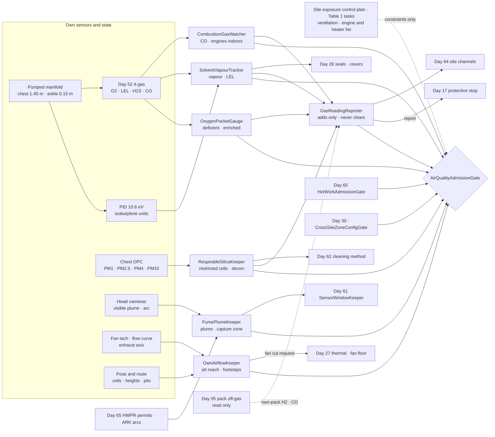
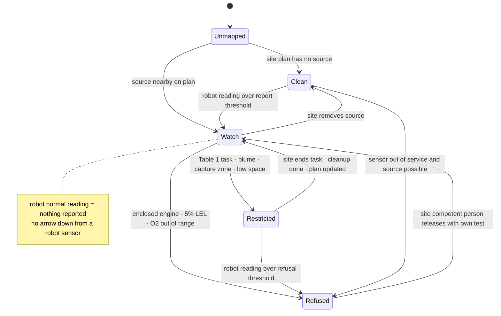
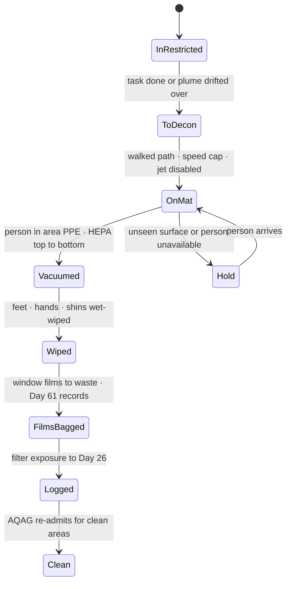
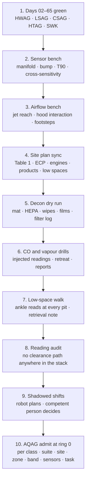

# Day 66 — Airborne hazards and air quality under the hot-work stack: FumePlumeKeeper / RespirableSilicaKeeper / CombustionGasWatcher / SolventVapourTracker / OxygenPocketGauge / OwnAirflowKeeper / GasReadingReporter / AirQualityAdmissionGate under HotWorkAdmissionGate + LoudSiteAdmissionGate + ElectricalAdmissionGate + HeatAdmissionGate + WeatherAdmissionGate + LowLightAdmissionGate + WorkZoneAdmissionGate + DockAdmissionGate + SidewalkAdmissionGate + CorridorAdmissionGate + ElevatorAdmissionGate + DoorwayAdmissionGate + WetSurfaceAdmissionGate + ConfinedSpaceAdmissionGate + ElevatedAccessAdmissionGate + OverheadToolAdmissionGate + BimanualToolAdmissionGate + PowerToolAdmissionGate + PushPullAdmissionGate + PayloadCarryAdmissionGate + OutdoorGroundAdmissionGate + TerrainLocomotionAdmissionGate + FallSafeAdmissionGate + DeliberateContactAdmissionGate + WholeBodyTouchAdmissionGate + HumanHandoverAdmissionGate + CooperativeTaskAdmissionGate + TaskCompositionAdmissionGate + FleetSkillCatalogAdmissionGate + proximity + zone attestation + supervisor + logging + canary + HIL + fleet + incident + change-management + maintenance + thermal + energy gates

![FumePlumeKeeper / RespirableSilicaKeeper / CombustionGasWatcher / SolventVapourTracker / OxygenPocketGauge / OwnAirflowKeeper / GasReadingReporter / AirQualityAdmissionGate: the same 63.8 kg humanoid on Site C keeps its body out of a stainless TIG welder's rising plume and out of the 20 cm where his fume extractor's hood still pulls 0.58 m/s, and turns so that its own 4 m/s fan exhaust, still about 0.5 m/s at 3.8 m, never points at the hood; stays out of the cells around a wet concrete saw that the site's silica exposure control plan restricts, never blows dust off itself with its air jet there, and stops at the decon cell for a HEPA vacuum before it goes near the dock or anyone's hands; refuses the basement outright while a gasoline power trowel runs there, because a well-mixed estimate puts the room past 35 ppm of CO in about 80 s; reads a flooring adhesive's vapour on its PID in isobutylene units and doesn't pretend to know what it is; finds 18.9% oxygen at ankle height in a pump sump where argon purge gas has pooled, and tells the site that if it ever stops in there nobody should come in after it; and every reading it sends says "robot sensor, adds only" because nothing it measures can clear an area](/images/day66-airborne-hazards-air-quality.png)

[Day 05](/lessons/day-05-power-bms) owns `torque_scale`, the pack, and its off-gas sensor **forever**. [Day 17](/lessons/day-17-runtime-safety-supervisor) owns ESTOP and safe states. [Day 26](/lessons/day-26-actuator-wear-predictive-maintenance) owns maintenance calls and filters. [Day 27](/lessons/day-27-thermal-budgets-duty-cycle) owns thermal limits and the cooling fans' floor. [Day 29](/lessons/day-29-human-proximity-safety) owns person tracks, SSM, and PFL rows. [Day 30](/lessons/day-30-collaborative-workspace-zoning) owns attested zones and `CrossSiteZoneConfigGate`. [Day 52](/lessons/day-52-confined-crawl-spaces) owns permit-required confined spaces and `ConfinedAtmosphereBudgeter` inside them. [Day 59](/lessons/day-59-construction-sites-work-zones) owns openings and work zones. [Day 61](/lessons/day-61-weather-rain-snow-fog-wind) owns window state (`SensorWindowKeeper`) and visibility. [Day 62](/lessons/day-62-heat-sun-dust) owns PM10 at the hip, window cleaning schedules (`DustLoadEstimator`), and seal and filter wear (`IngressWearWatcher`). [Day 64](/lessons/day-64-noise-vibration-communications) owns warnings, radio, the site alarm feed, and the operator link. [Day 65](/lessons/day-65-hot-work-fire-hazards) owns arcs, spark zones, hot work permits, fuel and cylinder standoffs, the pack refuge, and evacuation.

Day 65 was about what burns. Today is about what people breathe. The same welding that throws sparks also makes fume. The same concrete saw that Day 62 treated as a dust plume on the robot's lidar is putting respirable crystalline silica into the air that the laborer next to it breathes. The gasoline power trowel that finishes the basement slab makes carbon monoxide that nobody can smell. The flooring crew's adhesive fills the corridor with solvent vapour. The pipefitter purging stainless pipe with argon fills the pump sump with a gas that leaves no oxygen to breathe and gives no warning.

A humanoid on this site doesn't breathe, doesn't get silicosis, and doesn't pass out in 16% oxygen. That's exactly what makes it dangerous. It can walk where people can't and invite them to follow. Its cooling fans and its feet stir dust and fume into breathing zones. Its covers carry silica out of a controlled area to the dock and into a handover. And it carries gas sensors, which makes it look like a gas detector that has been somewhere and found it fine. It is not a gas tester, and nothing it reads ever clears an area.

Eight lies show up the first time a team runs a humanoid where the air is bad:

1. **Fume-goes-up lie.** "Welding fume rises away from everyone." The plume rises from the arc straight through the welder's breathing zone when he leans over the work, and a robot standing beside the bench deflects it sideways into the next person's.
2. **Extractor's-on lie.** "The fume extractor is running, so the fume's handled." Capture velocity falls roughly with the square of distance from the hood, and a crossdraft from the robot's own cooling fans can beat it from metres away.
3. **Particle-counter lie.** "The robot's PM4 reads low, so there's no silica problem." An optical particle counter counts particles. It can't tell quartz from gypsum, and silica compliance is decided by the site's Table 1 controls or by sampling and lab analysis, never by a robot's counter.
4. **Blow-it-off lie.** "Use the robot's air jet to blow the dust off before it leaves." OSHA's construction silica standard bars compressed air for cleaning surfaces where it could contribute to exposure, and the dust leaves with the robot if nobody cleans it.
5. **Doors-are-open lie.** "The trowel's engine is fine, the garage door is open." Carbon monoxide has no smell or colour, and a small gasoline engine in a basement can take the room past 35 ppm in a couple of minutes.
6. **Smell-test lie.** "We'd smell it if the adhesive was a problem." Noses tire of a solvent within minutes, and a PID reading of an unknown mixture is a number in isobutylene units, not a concentration of anything.
7. **Doesn't-breathe lie.** "It's a robot, low oxygen doesn't matter." It doesn't, to the robot. It matters to the person who climbs down to fetch it, and would-be rescuers are a large share of the people killed by oxygen-deficient atmospheres.
8. **Green-light lie.** "The robot walked through and its monitor read normal, so the area's clear." A robot reading is a sensor on a moving body at one height at one moment. It adds a report or a stop. It never clears anything.

Today owns **`FumePlumeKeeper` / `RespirableSilicaKeeper` / `CombustionGasWatcher` / `SolventVapourTracker` / `OxygenPocketGauge` / `OwnAirflowKeeper` / `GasReadingReporter` / `AirQualityAdmissionGate`**. The question is: **how do you let a humanoid work on a site where welding fume, silica dust, engine exhaust, solvent vapour, and inert gas are part of every shift, with its body kept out of plumes and capture zones, silica areas treated as restricted cells it leaves only after decontamination, combustion and solvent sources mapped and refused when enclosed, low-oxygen pockets treated as places that would kill whoever follows it, its own fans and feet budgeted as a mixer, and every gas reading it takes sent as a report that only adds — without raising Day 29 PFL, writing Day 05 `torque_scale`, overriding Day 27's fan floor, gating Day 17 ESTOP, or bypassing `CrossSiteZoneConfigGate`?**

## The robot is never the gas test

The rule everything follows from: **in bad air, the robot is a mixer to be budgeted, a carrier to be cleaned, and a sensor platform whose readings only add. It never stands in a plume or a capture zone, never cleans with compressed air or a dry wipe where silica, lead, or chromium dust is present, never leaves a restricted air area without decontamination, never routes into an enclosed space with a running engine, never stages a task or calls a person into an oxygen-deficient or vapour cell, and never presents a reading as a clearance, an entry test, or anyone's exposure.** The site's exposure control plan, its competent person's calibrated gas tests, its ventilation, and its air sampling may add constraints. Nothing the robot measures admits anything, and a reading of "normal" is logged as "nothing reported."

Five facts set the shape of the lesson.

**Welding fume is mostly sub-micron metal oxide, and what's in it depends on what's being welded.** Fume forms when vaporized metal condenses into particles mostly well below 1 µm, which agglomerate into chains that reach deep into the lungs. IARC classified welding fumes as carcinogenic to humans (Group 1) in 2017 (Monograph 118). The base metal and consumable decide the rest: manganese from most steel consumables; hexavalent chromium from stainless steel and chromium-bearing rods, for which OSHA's construction standard 29 CFR 1926.1126 sets a PEL of 5 µg/m³ and an action level of 2.5 µg/m³ as 8-hour TWAs; zinc oxide from galvanized steel; lead from cutting or welding through lead paint (29 CFR 1926.62, PEL 50 µg/m³). The arc's UV also makes ozone, especially with GMAW and GTAW on aluminium, and ozone's OSHA PEL is 0.1 ppm. None of these can be measured by a direct-reading particle counter.

**Respirable crystalline silica is a size and a mineral, and the standard is written around tasks.** Cutting, grinding, drilling, and chipping concrete, block, brick, and stone release quartz particles small enough to reach the gas-exchange region. The ISO 7708 respirable convention passes 50% of particles at 4 µm aerodynamic diameter. OSHA's construction standard, 29 CFR 1926.1153, sets a PEL of 50 µg/m³ and an action level of 25 µg/m³ as 8-hour TWAs. Its Table 1 lists common tasks with the engineering controls (integrated water delivery, shrouds with vacuum dust collectors) and, for some tasks and durations, respirators that satisfy the standard when followed exactly. The standard requires a written exposure control plan that includes procedures to restrict access to work areas, and its housekeeping paragraph forbids dry sweeping or brushing where that could contribute to exposure unless wet methods or HEPA vacuums aren't feasible, and forbids compressed air for cleaning clothing or surfaces unless it's used with ventilation that captures the dust or no alternative is feasible.

**Carbon monoxide gives no warning and builds fast in enclosed space.** OSHA's PEL for CO is 50 ppm as an 8-hour TWA; NIOSH recommends 35 ppm TWA with a 200 ppm ceiling, and lists 1200 ppm as immediately dangerous to life or health. Gasoline-powered saws, trowels, pressure washers, and generators, propane heaters and forklifts, and diesel equipment all make it. In a well-mixed room of volume $V$ with ventilation flow $Q$ and a CO source $G$,

$$
C(t) = \frac{G}{Q}\left(1 - e^{-Qt/V}\right)
$$

so the room heads toward $G/Q$ with a time constant $V/Q$. Near the source, it's worse than this average.

**Oxygen is about 20.9% of normal air, and the gases that displace it are mostly invisible and heavy.** OSHA defines an oxygen-deficient atmosphere as below 19.5% and an oxygen-enriched one as above 23.5%. Argon (about 1.38 times as dense as air) and carbon dioxide (about 1.52) sink and pool in pits, sumps, trenches, and basements. Nitrogen is about as dense as air and mixes. A person in a deficient atmosphere loses judgement before they notice anything, and the US Chemical Safety Board has documented how often the second victim is someone who went in after the first.

**Direct-reading instruments are useful and limited.** Electrochemical CO cells cross-respond to hydrogen. Catalytic-bead LEL sensors need oxygen to work and are poisoned by silicones and some sulfur compounds. A PID with a 10.6 eV lamp sees many solvents but not methane, and reads in units of its calibration gas, usually isobutylene, so a number only becomes a concentration when you know the compound and apply its correction factor. Every sensor has a warm-up, a response time ($T_{90}$ of tens of seconds for many electrochemical cells), and a drift, which is why the instrument industry's guidance is a bump test before each day's use. And all of them read the air at their inlet, not in anyone's breathing zone.

| Layer | Owns | Must not own |
|-------|------|--------------|
| `FumePlumeKeeper` | Fume plumes from Day 65's permits and arcs and from what the cameras see; the welder's breathing zone and every LEV hood's capture zone kept free of the robot's body and exhaust; a process-to-contaminant table (Mn, Cr(VI), Zn, Pb, ozone) used to tag cells; fume deposits on windows reported to Day 61 | Moving, aiming, or switching an extractor; the site's fume controls; anyone's PPE |
| `RespirableSilicaKeeper` | Table 1 tasks and the site's exposure control plan read as restricted cells; no compressed air and no dry wipe in silica, lead, or Cr(VI) cells; walking-speed caps on dusty floors; decontamination at the boundary before clean areas, the dock, a lift, or a handover | Choosing controls or respirators; the site's housekeeping; air sampling; Day 62's cleaning schedule (it constrains only the method) |
| `CombustionGasWatcher` | Fuel-burning equipment indoors from the site plan and its own CO readings; CO level and rate of rise; enclosed cells with running engines refused; never routed through an exhaust stream; reports to the site | Starting, stopping, or moving engines and heaters; ventilation; telling anyone a space is safe |
| `SolventVapourTracker` | Adhesive, coating, and solvent application and cure areas; PID readings in calibration-gas units, converted only when the compound is known; LEL from the Day 52 monitor; heavy vapour on the ankle inlet; cover and seal compatibility handed to Day 26 | Ventilation and cure times; classifying the area; any claim to be rated for a flammable atmosphere |
| `OxygenPocketGauge` | Deficient and enriched pockets outside Day 52's permit spaces: pits, sumps, trenches, basements, inert purges, dry ice, leaking oxygen; ankle-inlet O2; no staging, call-over, or handover in a deficient cell; "do not enter to retrieve" if the robot stops in one | Day 52's permit spaces; rescue; entry decisions for people |
| `OwnAirflowKeeper` | Its own fan exhaust jets, footsteps, and arm sweeps as a mixer; exhaust axis kept off plumes, hoods, settled dust, and people within the measured jet reach; fan reductions requested from Day 27; walking speed caps handed to the planner | Day 27's thermal limits and fan floor; the fan controller |
| `GasReadingReporter` | Bump-test and calibration state, warm-up, $T_{90}$, cross-sensitivities, inlet height; every reading timestamped and labelled "robot sensor, adds only"; reports to the site through Day 64 | Clearing a cell; ending a ventilation period; gas tests for permits or entry; personal exposure monitoring |
| `AirQualityAdmissionGate` | Fail-closed admit per robot class, suite, site, zone, air band, sensor state, decon plan, task | `JointCommand`; Day 05; PFL; Day 17 |
| Days 05 / 17 / 26 / 27 / 29 / 30 / 52 / 59 / 61 / 62 / 64 / 65 | Pack, ESTOP, maintenance, thermal and fans, people, zones, confined spaces, work zones, windows, dust and seals, alarms and comms, hot work | Being outranked by "the robot's monitor read fine" |

**Core thesis:** **where the air is bad, a humanoid keeps its body and its exhaust out of every plume and capture zone, treats silica, lead, and chromium areas as restricted cells it leaves only after it's been cleaned, refuses enclosed spaces with running engines and vapour or oxygen-deficient cells that people might follow it into, budgets its own fans and feet as a dust and fume mixer, and sends every reading as a report that adds a constraint and never removes one.**



## Physical machine: where the bad air is

Walk Site C on Wednesday morning, two days after Day 65's walk, with the temperature outside at 4 °C and the building closed in with tarps. In the level B1 mechanical room, a pipefitter TIG-welds stainless steel pipe, purging the inside with argon, and a portable fume extractor's 200 mm hood sits on an arm beside the joint. Beside him is a pump sump, 2 × 2 m and 1.5 m deep, open, guarded by a rail, and not a permit-required confined space. On the B1 slab a finisher runs a gasoline power trowel, and a propane construction heater warms the stair core. On deck 2 a laborer cuts openings in the slab with a walk-behind saw with integrated water delivery; the site's exposure control plan marks the cells around it as restricted. On deck 3 ironworkers MIG-weld galvanized brackets, and a painter's crew cut out a section of old lead-painted steel from the original structure last week. On level 1, a flooring crew rolls a solvent-based adhesive in the east corridor with the doors at both ends propped open.

The robot's hardware for this:

- **Sampling manifold:** two inlets on short PTFE-lined tubes, one at the chest at 1.45 m and one at the right ankle at 0.15 m, switched by a small valve every 30 s and drawn by a 0.5 L/min pump. The transport delay through 1 m of 3 mm tube is about a second; the sensors' response time dominates.
- **Day 52's 4-gas monitor,** moved from its confined-space mount onto the manifold: galvanic O2, catalytic-bead LEL, electrochemical H2S and CO (not hydrogen-compensated).
- **A PID** with a 10.6 eV lamp on the manifold, calibrated with isobutylene.
- **A chest optical particle counter** reporting PM1, PM2.5, PM4, and PM10 (Day 62's hip PM10 sensor stays where it is).
- **Cooling:** two torso fans, about 20 L/s each, exhausting through two 80 mm grilles at the back at about 4 m/s; tachometers and a measured flow curve. Intake through Day 62's filter.
- **Covers:** Day 65's polyurethane-coated fabric, ABS shells, foam padding, and PVC-jacketed cables, now with a smooth, wipeable over-cover on the shins and feet.
- **No ozone sensor and no metal analysis.** The robot can't measure the things that make fume hazardous. It knows what's being welded only from the permit and the site's table.

### Fume: keep out of the plume and out of the hood's way

`FumePlumeKeeper` (FPK) marks a plume for every welding and cutting activity it knows about: from Day 65's `HotWorkPermitReader` (activity, location, and base metal if the permit records it), from `ArcRadiationKeeper`'s arcs, and from a visible plume in the head cameras. Each plume gets a contaminant tag from a table the site provides: stainless (Cr(VI)), galvanized (zinc oxide), lead-painted (lead), aluminium GMAW and GTAW (ozone), mild steel (manganese). The tag doesn't drive a measurement the robot can't make. It decides which other keepers apply: a lead or Cr(VI) tag turns the cells around the work into restricted cells for `RespirableSilicaKeeper`'s decon rules.

The plume rises from the arc and widens. A welder bent over the work has his head in it, and anyone the robot pushes sideways around the bench walks through it. FPK refuses robot positions that put its body between the plume and open air on the side a person is working from, and positions that would make someone's path around the robot cross the plume.

Then there's the hood. A local exhaust hood only captures fume close to its face. The usual design relation for a plain (unflanged) hood is the Dalla Valle equation from the ACGIH ventilation manual:

$$
V(x) = \frac{Q}{10x^2 + A}
$$

where $V$ is the air velocity toward the hood at distance $x$ along its axis, $Q$ the hood flow, and $A$ its face area. For a 200 mm hood ($A = 0.031\ \text{m}^2$) at $Q = 0.25\ \text{m}^3/\text{s}$ (900 m³/h):

| Distance from hood | Velocity toward hood |
|---|---|
| 0.15 m | 0.98 m/s |
| 0.20 m | 0.58 m/s |
| 0.30 m | 0.27 m/s |

A common design capture velocity for welding fume is around 0.5 m/s, so this hood works out to about 20 cm and barely at all at 30 cm. That's the welder's job to manage by keeping the hood close. The robot's job is never to make it worse: it never stands, reaches, or passes within the hood's capture zone, never moves or bumps the hood arm, and never points its exhaust at it (see `OwnAirflowKeeper`). An extractor that's running is a constraint the robot must protect, never a reason to come closer.

Fume also coats the robot. A fine oxide film on camera and lidar windows looks like slow fog in Day 61's contrast check. FPK hands every plume exposure to `SensorWindowKeeper` as a reason to check, and the film itself becomes contaminated waste if the fume was tagged lead or Cr(VI).

### Silica: restricted cells, no air jet, and decon on the way out

`RespirableSilicaKeeper` (RSK) reads the site's written exposure control plan and Table 1 task list. Every active Table 1 task (the walk-behind saw, a core drill, a grinder with a shroud and vacuum, a jackhammer) and every area the plan restricts becomes a **restricted cell**. Lead and Cr(VI) cells from FPK and the site's lead plan are handled the same way. In a restricted cell:

- **No entry by default.** The robot isn't part of the task, and the plan's access restriction applies to it as an object that moves through and carries dust out.
- **No compressed air, no dry wipe.** Day 62's `DustLoadEstimator` cleans windows with an air jet first. In a restricted cell, or anywhere with settled silica, lead, or chromium dust, RSK forbids the jet entirely and allows only a wet wipe. The jet is a compressed-air cleaning method under 1926.1153's housekeeping rule, and it puts the dust back in the air whether or not anyone is in its cone.
- **No sweeping for the site.** A humanoid offered a broom in a silica area gets a refusal. Housekeeping there is wet methods or a HEPA vacuum, done under the site's plan.
- **Slow feet.** Each footstep lifts settled dust. RSK hands a walking-speed cap (0.4 m/s by policy, re-derived from the bench) to the planner for any dusty floor, restricted or not, and keeps the robot off freshly cut areas until they've been wet-cleaned or vacuumed.

The particle counter does one honest thing here: it tells the robot that the air at its chest is dusty. A PM4 spike near the saw is a reason to back off and report "dust plume at deck 2 cell D2-14" to the site. It's never a silica concentration and never compared to the PEL. A PM4 reading of 30 µg/m³ in a cell doesn't mean silica is below 25.

When the robot must leave a restricted cell (it was admitted for a delivery to the cell's edge, or a plume drifted over it), RSK routes it to a **decon cell** at the boundary before it goes near a clean area, the dock, a lift, the site trailer, or a handover to anyone:

1. Stop on the decon mat with arms out from the body.
2. A person wearing the area's PPE HEPA-vacuums the covers top to bottom and wet-wipes the feet, hands, and shins; the robot holds still and reports which surfaces it couldn't see.
3. Window films are peeled and bagged as contaminated waste; Day 61 records new films.
4. The intake filter's exposure is logged for Day 26, whose filter change in silica or lead service is a wet, bagged, HEPA-vacuumed job, never a tap-out.

The decon cell is part of the plan before the robot goes in. RSK refuses entry to any restricted cell that doesn't have one.

### Engines and heaters: CO in enclosed space

`CombustionGasWatcher` (CGW) keeps a list of fuel-burning equipment from the site's plan (generators, saws, trowels, pressure washers, propane heaters, forklifts, diesel equipment) and where each one runs. Inside the building, any running engine or heater makes the space a CO cell. CGW's basement example, with illustrative numbers: B1 is about 600 m³, ventilated at 2 air changes per hour ($Q = 1200\ \text{m}^3/\text{h}$), and the trowel puts out about 1 m³/h of CO (a few percent CO in a few tens of m³/h of exhaust). Then the well-mixed steady state is $G/Q \approx 830$ ppm, and

$$
t_{35} = -\frac{V}{Q}\ln\left(1 - \frac{35}{833}\right) \approx 1.3\ \text{min}, \qquad t_{200} \approx 8.2\ \text{min}
$$

The average room is past NIOSH's 35 ppm in a minute and a half and at its 200 ppm ceiling in about 8 minutes, and the air near the engine is far worse. That isn't the robot's to fix, and it doesn't wait to measure it. CGW's rules:

- **Enclosed space with a running engine:** refused for the robot, on the plan alone. A propped door isn't ventilation the robot can count.
- **Its own CO readings:** a level or a rate of rise above threshold (by policy, 25 ppm or 5 ppm/min at the chest inlet) is a report to the site and a retreat along the walked path, never into the stair core where the heater is.
- **Exhaust streams:** never routed through or parked in, outside or in.
- **Its own pack:** a CO rise at the chest inlet with no fuel-burning equipment nearby is passed to Day 65's `PackRunawayPlanner` as a reading from near its own torso, because pack off-gas contains CO and hydrogen and the CO cell cross-responds to hydrogen. Day 05's off-gas sensor decides; CGW only passes the reading on.

The robot is battery-powered and makes no CO. That's a reason the site might send it into a basement instead of a gasoline machine. It isn't a reason it can tell anyone the basement's air is fine.

### Solvents and adhesives: vapour it can see but not name

`SolventVapourTracker` (SVT) marks application and cure areas from the site's plan (flooring adhesive, epoxy coatings, primers, sealants, cleaning solvents) and from its own PID. The PID reads in isobutylene units. If the site's plan names the product and the product's main solvent is in the PID maker's table, SVT converts: toluene's correction factor on a 10.6 eV lamp is about 0.5, so 40 units is about 20 ppm of toluene. If it doesn't know the compound, the number stays in isobutylene units and is reported that way. SVT never guesses a compound to make a number look smaller.

Many solvent vapours are heavier than air, so SVT reads the ankle inlet as well as the chest. A vapour concentration high enough to matter for fire shows up on the Day 52 LEL sensor. SVT refuses any cell at or above 5% LEL (half the usual 10% working limit for people, because the robot is a non-rated ignition source, the same number Day 52 uses inside confined spaces) and any cell the site's plan marks as an application or cure area. It never trusts the LEL reading where the oxygen reading is below the sensor maker's minimum, because catalytic beads need oxygen.

Solvents also attack the robot. Polyurethane coatings, ABS, and some seal elastomers swell or craze in ketones and aromatics, and ozone from aluminium welding cracks some rubbers. SVT logs exposure per surface and hands it to Day 26, which decides inspection and replacement.

### Oxygen pockets: a place the robot can go and a person can't follow

`OxygenPocketGauge` (OPG) handles deficient and enriched air outside Day 52's permit spaces. On Site C the candidates are the B1 pump sump, the elevator pit, a utility trench outside, the low corner of B1 near the dry-ice blast cleaning the crew used last week, and anywhere argon or nitrogen purging happens. Argon from the pipefitter's purge flows out of the pipe ends and sinks into the sump. Illustrative numbers: the sump holds 6 m³; mixing argon into it uniformly, oxygen falls to 19.5% once argon is

$$
1 - \frac{19.5}{20.9} \approx 6.7\%
$$

of the volume, about 0.4 m³. At a purge flow of 15 L/min that's under half an hour, and because argon layers at the bottom instead of mixing, the floor of the sump gets there sooner. A full 50 L argon cylinder at 200 bar holds about 10 m³.

The robot doesn't breathe and its electronics don't care. So OPG's rules are all about people:

- **No staging, handover, call-over, or task in a deficient cell,** and no robot position that makes a person reach into one.
- **The ankle inlet reads every pit, sump, and trench edge** the route passes, because heavy gas pools low. Any reading below 19.5% or above 23.5% is a report to the site and a constraint.
- **Do not enter to retrieve.** If the robot is ever stopped inside a deficient or unknown low space (fallen into the sump, stalled in a trench), its display, its Day 64 report, and its status say "do not enter to retrieve, oxygen-deficient atmosphere suspected." Retrieval is planned the way Day 52 plans it: from outside, with no one going in.
- **Enriched is a fire problem.** Oxygen above 23.5% near a leaking oxy-fuel set makes everything burn faster, and the robot is a non-rated ignition source. OPG hands enriched cells to Day 65's `FuelCylinderStandoffKeeper` as an extra standoff.

OPG never takes a normal O2 reading at the sump's rim as "the sump is fine." It sampled one point, at one height, for one moment.

### Its own air: fans and feet as a mixer

`OwnAirflowKeeper` (OAK) treats the robot as what it is aerodynamically: a 1.7 m body walking around with two small jets on its back. Each grille pushes about 20 L/s through 80 mm, so about 4 m/s at the face. A round jet's centreline velocity, well downstream, decays roughly as

$$
u(x) \approx K\,u_0\,\frac{d}{x}, \qquad K \approx 6
$$

so with $u_0 = 4$ m/s and $d = 0.08$ m the jet still moves at about 1.9 m/s at 1 m, 0.96 m/s at 2 m, and 0.5 m/s at about 3.8 m. That's the capture velocity of the hood in the last section. A grille is not an ideal jet and the robot's body changes the flow, so OAK measures the reach on the bench with an anemometer, but the order of magnitude is the lesson: **the robot's own exhaust can undo a fume extractor from four metres away, and it can lift settled dust from a floor it isn't even close to.**

OAK's rules:

- **Exhaust axis:** never pointed at a plume, a hood, an open sump, a dusty floor patch, or a Day 29 track within the measured reach. The planner gets the exhaust axis as a heading constraint, so the robot turns its back away from the work instead of toward it.
- **Fan cuts are requests.** In a restricted cell or beside a hood, OAK asks Day 27 to drop fan speed. Day 27 answers with the time the robot can work at that speed before its limit, and that time becomes a task window. OAK never goes below Day 27's fan floor.
- **Feet and arms:** speed caps on dusty floors from RSK; no sweeping arm motions near settled dust; no carrying dusty material across clean cells without a cover.
- **Intake:** Day 62's `IngressWearWatcher` trends filter pressure drop. OAK adds the reason: a filter loaded in silica service holds silica, and the fans blow through it.

### Readings: every number adds, none clears

`GasReadingReporter` (GRR) is the one place every reading leaves the robot, and it decides what a reading is allowed to mean:

- **Is the sensor in service?** Bump test at the dock with calibration gas each day before use (done by a person, the cylinder kept at the dock and never handled by the robot); full calibration on the maker's schedule; warm-up done; no fault flags. A sensor out of service makes the robot's readings for that gas "unknown," and AQAG treats unknown as a constraint, not as zero.
- **What can it see?** Each reading carries its inlet height, its $T_{90}$, its known cross-sensitivities (CO to hydrogen, PID to humidity, LEL invalid in low O2), and the time the robot spent in that cell. A 10 s pass through a cell with a 30 s sensor says nothing about the cell.
- **What's it for?** Every message says "robot sensor, adds only." High readings become reports to the site and the competent person through Day 64, and a protective stop request to Day 17 if the robot is in the cell. Normal readings are logged as "nothing reported."

GRR never posts an all-clear, never fills a field on an entry permit or a hot work permit, never ends a ventilation period, and never reports anything as a person's exposure. People's exposure is measured in their breathing zone, within about 30 cm of the nose and mouth, with a sampler they wear, over their shift. The robot's chest inlet is at a person's height. It isn't on a person.

## FumePlumeKeeper and RespirableSilicaKeeper

FPK marks a plume and a contaminant tag for every welding and cutting activity, keeps the robot's body out of the plume and out of every hood's capture zone, never touches an extractor, and hands fume deposits on its windows to Day 61. RSK turns Table 1 tasks and the site's exposure control plan into restricted cells, forbids compressed air and dry wiping there, caps walking speed on dusty floors, and requires a decon cell before the robot leaves for anywhere clean.

## CombustionGasWatcher, SolventVapourTracker, and OxygenPocketGauge

CGW refuses enclosed spaces with running engines or heaters from the plan alone, and reports CO levels and rises as retreats. SVT marks application and cure areas, reports PID readings in calibration-gas units unless the compound is known, refuses cells at 5% LEL, and sends material exposure to Day 26. OPG reads every pit and low space at ankle height, keeps tasks and people out of deficient cells, hands enriched cells to Day 65, and makes sure nobody goes in after a stopped robot.

## OwnAirflowKeeper and GasReadingReporter

OAK treats the robot's fans and feet as a mixer, keeps its exhaust off plumes, hoods, dust, and people within the measured reach, and asks Day 27 for fan cuts it can't take for itself. GRR carries every reading out with its sensor state, height, and limits, and only ever adds.

## AirQualityAdmissionGate

`AirQualityAdmissionGate` (AQAG) admits work per robot class, sensor suite hash, site, zone, air band, sensor state, decon plan, and task, under Day 65 HWAG and everything below it. The air band comes from the site's plan first and the robot's own readings second, and readings can only move it up: `CLEAN` (no source on the plan, no reading over threshold), `WATCH` (a source nearby, or a reading over a report threshold), `RESTRICTED` (inside a restricted cell, a capture zone, a plume, an application area, or a low space), and `REFUSED` (an enclosed running engine, a vapour cell at 5% LEL, an oxygen-deficient or enriched cell, or anything unknown with the relevant sensor out of service). Every row needs:

- FPK: plume map fresh for the shift from permits and the site's table; no position in a plume or capture zone; exhaust axis constraints loaded.
- RSK: Table 1 tasks and the exposure control plan synced; restricted cells no-entry or admitted with a decon cell; jet disabled in silica, lead, and Cr(VI) cells; speed caps set.
- CGW: engine and heater list synced; no enclosed cell with a running source on the route.
- SVT: application and cure areas loaded; LEL in service where needed; no vapour cell on the route.
- OPG: every pit, sump, trench, and low corner on the route marked and read; no task in a deficient cell; "do not enter to retrieve" text loaded.
- OAK: measured jet reach and fan flow curve for this robot; Day 27 fan floor known.
- GRR: every sensor bumped today; unknowns explicit.
- The site's competent person reachable at ring 0, as on Days 59 to 65.

AQAG never writes `JointCommand`, never touches Day 05 `torque_scale` or limits, never raises a Day 29 row, never sets a fan speed below Day 27's floor, never changes Day 61 window state or Day 62's cleaning schedule directly, never takes a running extractor, an open door, a ventilation fan, a site gas test, or a normal robot reading as admission, never admits the robot into a restricted cell without a decon cell, never admits a route through an enclosed running engine, a vapour cell, or a deficient cell, never lets a robot reading clear anything, and never gates ESTOP.

## Data shapes

```text
FumePlume:                                    # FPK
  plume_id, source: PERMIT | ARC | CAMERA      # any one is enough
  process: GMAW | FCAW | SMAW | GTAW | PAC | OXYFUEL | GRIND
  base_metal: MILD | STAINLESS | GALVANIZED | LEAD_PAINT | ALUMINIUM | UNKNOWN
  tag: MN | CR6 | ZN | PB | OZONE | UNKNOWN    # from site table, never measured
  cells[], welder_side_cells[]
  hood?: {face_area_m2, flow_m3_s, capture_radius_m}
  forbid: [body_in_plume, body_in_capture, touch_hood, exhaust_at]
  window_exposure → Day 61 SensorWindowKeeper

RestrictedCell:                               # RSK
  cell_id, reason: TABLE1_TASK | ECP_AREA | LEAD | CR6
  task?: {equipment, control: WATER | SHROUD_VAC | ...}
  entry: NONE | EDGE_DELIVERY
  decon_cell_id                                # required for any entry
  cleaning_allowed: [wet_wipe]                 # never air_jet, never dry_wipe
  floor_speed_cap_m_s: 0.4
  opc_reading: "dust, not silica"

CombustionSource:                             # CGW
  kind: GENERATOR | SAW | TROWEL | WASHER | PROPANE_HEATER | FORKLIFT | DIESEL
  cell_id, enclosed: bool, running: bool, exhaust_cells[]
  co_ppm, co_rate_ppm_min, inlet: CHEST | ANKLE
  own_pack_suspect: bool → Day 65 PRP

VapourCell:                                   # SVT
  cell_id, product?, compound?, cf?
  pid_units: ISOBUTYLENE, pid_reading, converted_ppm?
  lel_pct, lel_valid: bool                     # false if O2 below sensor min
  exposure_s_by_surface{} → Day 26

LowSpace:                                     # OPG
  space_id, kind: PIT | SUMP | TRENCH | BASEMENT | PURGE | DRY_ICE
  permit_space: false                          # true → Day 52 owns it
  o2_pct_ankle, o2_pct_chest, state: OK | DEFICIENT | ENRICHED | UNKNOWN
  forbid: [stage, handover, call_over, task]
  retrieval_note: "do not enter to retrieve"

OwnAirflow:                                   # OAK
  fan_flow_l_s[2], grille_d_m, u0_m_s, jet_reach_m_at_0_5   # measured
  exhaust_axis_deg, forbidden_headings[]
  fan_cut_request → Day 27 → work_window_s
  floor_speed_cap_m_s

GasReading:                                   # GRR
  gas, value, units, inlet_height_m, t90_s, dwell_s
  sensor_state: IN_SERVICE | BUMP_DUE | FAULT | WARMING
  cross: [H2_on_CO, humidity_on_PID, lowO2_on_LEL]
  label: "robot sensor, adds only"
  clears_anything: never

AirQualityAdmission:                          # AQAG
  robot_class, suite_hash, site, zone
  air_band: CLEAN | WATCH | RESTRICTED | REFUSED
  plume_map_hash, ecp_hash, source_list_hash, sensor_state_hash, decon_plan, task
  requires: [HWAG, LSAG, ELAG, HTAG, WXAG, WZAG, CSAG_DAY52, CrossSiteZoneConfigGate]
  forbidden:
    stand_in_plume_or_capture_zone: true
    touch_extractor: true
    air_jet_or_dry_wipe_in_restricted: true
    leave_restricted_without_decon: true
    enter_enclosed_running_engine: true
    enter_vapour_or_o2_cell: true
    task_in_deficient_cell: true
    exhaust_at_plume_hood_dust_people: true
    fan_below_day27_floor: true
    reading_clears_area: true
    write_torque_scale: true
    raise_pfl: true
    gate_estop: true
    bypass_cross_site_zone_config_gate: true

# Unchanged owners
HotWorkAdmissionGate · permits · arcs · fuel · pack refuge · evacuation (Day 65)
LoudSiteAdmissionGate · site alarm feed · warnings · radio · link (Day 64)
ElectricalAdmissionGate (Day 63) · HeatAdmissionGate · PM10 · cleaning · seals (Day 62)
SensorWindowKeeper · visibility (Day 61) · openings · work zones (Day 59)
ConfinedSpaceAdmissionGate · ConfinedAtmosphereBudgeter (Day 52)
Tracks · SSM · PFL (Day 29) · zones (Day 30) · thermal and fan floor (Day 27)
Maintenance and filters (Day 26) · ESTOP and safe states (Day 17)
BmsState / PowerState (Day 05): torque_scale, contactors, off-gas
  accepts_requests_from_site: false
```

## Config

A starting configuration. Every number is a policy you re-derive from your own robot, sensors, site, and the rules that apply where you work:

```yaml
air_quality:
  robot_reading_clears: never
  robot_is_gas_tester: never
  fume:
    plume_from: [day65_permits, day65_arcs, camera_plume]
    contaminant_tag_from: site_table               # Mn · Cr(VI) · Zn · Pb · O3
    capture_velocity_m_s: 0.5                      # design figure for welding fume hoods
    hood_capture_model: dalla_valle_unflanged      # V = Q / (10x² + A)
    forbid: [body_in_plume, body_in_capture_zone, touch_hood, exhaust_at_hood]
    lead_or_cr6_tag: restricted_cell
    window_deposit_to: day61_sensor_window_keeper
  silica:
    restricted_from: [table1_tasks, exposure_control_plan, lead_plan, cr6_cells]
    default_entry: none
    entry_needs: decon_cell
    cleaning_in_restricted: [wet_wipe]              # 1926.1153 housekeeping
    air_jet_in_restricted: never
    dry_wipe_in_restricted: never
    sweep_for_site: never
    dusty_floor_speed_cap_m_s: 0.4
    opc_means: dust_present_only
    decon: [stop_on_mat, hepa_vac_by_person, wet_wipe_feet_hands, bag_window_films, log_filter_exposure]
  combustion:
    sources_from: site_equipment_list
    enclosed_running_engine: refuse
    co_report_ppm: 25
    co_rate_report_ppm_min: 5
    co_action: [report_site_day64, retreat_walked_path]
    exhaust_streams: never_route
    co_rise_without_source: pass_to_day65_prp
  vapour:
    areas_from: [site_plan, pid]
    pid_lamp_ev: 10.6
    pid_units: isobutylene
    convert_only_if_compound_known: true
    lel_refuse_pct: 5                              # half of 10% for a non-rated ignition source
    lel_valid_min_o2_pct: per_sensor_maker
    inlets: [chest, ankle]
    material_exposure_to: day26
  oxygen:
    deficient_below_pct: 19.5
    enriched_above_pct: 23.5
    read_at: [pit_edges, sumps, trenches, low_corners, purge_areas]
    inlet: ankle
    forbid_in_deficient: [stage, handover, call_over, task]
    stopped_inside_display: "do not enter to retrieve"
    enriched_to: day65_fuel_cylinder_standoff_keeper
    permit_spaces: day52
  own_airflow:
    jet_reach_m_at_0_5_m_s: measured               # ≈ 3.8 m on the example robot
    exhaust_axis_forbidden_at: [plume, hood, sump, dusty_floor, tracked_person]
    fan_cut: request_day27
    below_fan_floor: never
  readings:
    bump_test: daily_before_use_at_dock_by_person
    calibration: per_maker_schedule
    out_of_service_means: unknown_constraint
    label: "robot sensor, adds only"
    normal_logged_as: nothing_reported
    personal_exposure: never
    permit_fields: never
  admission:
    keyed_by: [robot_class, sensor_suite_hash, site, zone, air_band, sensor_state, decon_plan, task]
    bands_from: [site_plan, own_readings]          # readings only raise the band
    requires: [day65_hwag, day64_lsag, day63_elag, day62_htag, day61_wxag, day59_wzag, day52_csag, day30_cross_site_zone_config_gate]
    competent_person_ring0: required
```

## A cell's air, as states

The point of drawing it is to see that the robot's readings have arrows going up and none coming down. Only the site, with its own tests and its own plan, moves a cell back to clean.



And leaving a restricted cell:



## Physical ↔ digital pairing

| Physical | Digital twin / backing |
|----------|------------------------|
| TIG welder on stainless pipe in B1, extractor hood 20 cm from the joint | FPK: plume tagged Cr(VI); capture zone 0.2 m around the hood axis forbidden; robot staging point 3 m to the welder's off side |
| Robot's route past the welder would put its back 2 m from the hood | OAK: jet ≈ 0.96 m/s at 2 m; heading constraint turns the robot to face the hood as it passes |
| Visible plume drifting across the B1 corridor | FPK: plume cells widened from the camera; window exposure to Day 61 |
| Walk-behind saw on deck 2 with water feed | RSK: Table 1 task → restricted cells; delivery admitted to the edge only, decon cell D2-DC1 at the stair |
| Robot's lidar window dusty after the delivery | RSK: air jet disabled; wet wipe only; film bagged at decon |
| Laborer hands the robot a broom | RSK: refused; "HEPA or wet methods only here" on the display |
| PM4 at 30 µg/m³ in a cell next to the saw | RSK: "dust present" report; never compared to the silica PEL |
| Gasoline power trowel running on B1 | CGW: B1 refused on the plan; task rescheduled after the trowel is gone and the site releases |
| Chest CO climbs 6 ppm/min in the stair core by the propane heater | CGW: report to site via Day 64, retreat along walked path |
| CO rises 15 ppm at the chest in an open yard, no engine nearby | CGW → Day 65 PRP: possible own-pack off-gas; Day 05 off-gas sensor checked |
| Adhesive rolled in the level 1 east corridor | SVT: application area refused; PID 40 units isobutylene, product sheet names toluene → ≈ 20 ppm; reported in both units |
| Unknown cleaner smell in the elevator lobby | SVT: PID 12 units isobutylene, compound unknown, reported unconverted |
| Argon purge in B1; sump at 18.9% O2 at ankle height | OPG: sump DEFICIENT; no staging by the rail; deficient report to the site |
| Robot tips a knee over the sump rail during a stumble drill | OPG: display "do not enter to retrieve"; Day 52 retrieval plan from outside |
| CO sensor missed today's bump test | GRR: CO unknown; AQAG refuses B1 and the stair core until it passes |
| Supervisor asks "did the robot read anything in B1?" to restart work | GRR: readings with heights and $T_{90}$; "robot sensor, adds only"; no clearance given |

The pairing that matters most: **replay every shift from the robot's own bag and show that it never stood in a plume or a capture zone, never pointed its exhaust at a hood, plume, sump, dusty floor, or person within its measured reach, never used its air jet or a dry wipe in a restricted cell, never left one without the decon sequence, never entered an enclosed space with a running engine, a vapour cell, or a deficient cell, never staged anything a person would reach into a low space for, every sensor was bumped before it was used, and every reading went out labelled as adding only, with nothing ever cleared by it.**

## Bring-up sequence (before the robot works in bad air)



1. **Days 02–65 green,** with HWAG's permits and arcs feeding FPK, Day 52's confined-space boundary drawn so OPG never takes a permit space, and Day 62's cleaning schedule in place for RSK to constrain.
2. **Sensor bench:** in a test chamber with calibration gases, measure each sensor's response through the manifold at both inlets, its $T_{90}$, its warm-up, and its cross-responses (hydrogen on the CO cell, humidity on the PID, low O2 on the LEL bead). Set up the dock bump-test station.
3. **Airflow bench:** measure the fan exhaust jet's centreline velocity with an anemometer at 0.5 m steps; place a real fume extractor and smoke source and find the distance and angle where the robot's exhaust visibly pulls smoke out of capture; walk over a dusted floor at several speeds with the OPC at ankle height and set the speed cap.
4. **Site plan sync:** connect to the site's exposure control plan, Table 1 task log, equipment list, product list with safety data sheets, and low-space map; test stale and missing data.
5. **Decon dry run:** walk the decon sequence with the people who'll do it, with a fluorescent tracer dust on the covers, and find what the HEPA pass misses.
6. **CO and vapour drills:** inject readings in sim, then use a calibration gas at the chest and ankle inlets on hardware; verify retreat, reports, and the own-pack handoff.
7. **Low-space walk:** with the competent person, walk every pit, sump, and trench edge on the route; record ankle readings; load the "do not enter to retrieve" text and the outside retrieval plan.
8. **Reading audit:** grep the stack and the interfaces for any path where a robot reading lowers a band, closes a permit, or fills a clearance field. There must be none.
9. **Shadowed shifts:** the robot plans, the competent person decides; compare refusals.
10. **AQAG admit at ring 0** per robot class, suite, site, zone, air band, sensor state, decon plan, and task.

## Failure gallery

| Symptom | Likely cause |
|---------|--------------|
| Welder complains the extractor "stopped working" whenever the robot passes | Exhaust axis not constrained; jet reach never measured |
| Robot stands beside the bench and the next worker walks through the plume | Plume cells drawn only above the arc, not on the welder's sides |
| Silica dust found on the dock and charging contacts | No decon cell; restricted cell exit not gated |
| Dust cloud from the robot's back near the saw | Day 62 air jet still enabled in a restricted cell |
| Supervisor restarts work because "the robot's PM4 was low" | OPC reading presented as a silica measurement |
| Robot reports B1 "normal" during the trowel run | Plan not synced; robot sampled the chest only, near the door, for 10 s |
| CO alarms on the robot in an empty yard | Hydrogen cross-sensitivity or own-pack off-gas; not passed to Day 65 PRP |
| PID reports "20 ppm toluene" in a room with an unknown cleaner | Correction factor applied without knowing the compound |
| LEL reads zero in the argon-filled sump | Catalytic bead without oxygen; LEL validity not tied to O2 |
| A laborer climbs into the sump to fetch a dropped part beside the robot | Staging allowed in a low space; no OPG constraint |
| Cracked seals on the forearms after a month in the mechanical room | Ozone and solvent exposure not logged to Day 26 |
| Gas readings used at the morning meeting to decide the basement is safe | Readings not labelled; normal reported as clear |

## Exercises

1. A 150 mm unflanged hood ($A = 0.018\ \text{m}^2$) runs at 0.15 m³/s. At what distance does the centreline velocity fall to 0.5 m/s? If the robot's exhaust jet is 0.6 m/s at that point and blowing across the hood axis, what happens to capture?
2. Using the CO model, a 400 m³ room at 4 air changes per hour has a 0.6 m³/h source. What's the steady-state concentration, and how long to reach 35 ppm and 200 ppm? Why does CGW refuse the room before either?
3. The robot's grille is 60 mm and moves 15 L/s. Estimate $u_0$ and the distance at which the jet falls to 0.5 m/s. Name two reasons the measured reach will differ.
4. A sump of 9 m³ receives argon at 20 L/min. Under the well-mixed assumption, when does it pass 19.5% O2? Why is the bottom of the sump deficient sooner, and what does the ankle inlet at the rim actually tell you?
5. The PID reads 60 units isobutylene in a corridor where the product sheet names a solvent with a correction factor of 1.6. What's the concentration? What do you report if a second, unnamed product is also in use?
6. Write the `AirQualityAdmission` rows for a delivery to the edge of the deck 2 saw cell, and for a walk through B1 while the stainless welder works with the trowel gone. Which owners can refuse each, and why?

## What to freeze this week

Extend [frames](/frames) and your safety config with:

- `FumePlumeKeeper`: plumes from permits, arcs, and cameras; contaminant tags from the site's table; no body in a plume or a capture zone; extractors never touched; window deposits to Day 61.
- `RespirableSilicaKeeper`: Table 1 tasks and the exposure control plan as restricted cells; no air jet, dry wipe, or sweeping there; speed caps on dusty floors; a decon cell before any entry and every exit.
- `CombustionGasWatcher`: enclosed running engines refused on the plan; CO level and rate reported with a retreat; exhaust streams never routed; unexplained CO passed to Day 65's pack planner.
- `SolventVapourTracker`: application and cure areas refused; PID in calibration-gas units unless the compound is known; 5% LEL refusal with LEL validity tied to O2; material exposure to Day 26.
- `OxygenPocketGauge`: every low space read at the ankle; no task, staging, or call-over in a deficient cell; "do not enter to retrieve"; enriched cells to Day 65.
- `OwnAirflowKeeper`: measured jet reach; exhaust axis kept off plumes, hoods, sumps, dust, and people; fan cuts requested from Day 27, never below its floor.
- `GasReadingReporter`: daily bump tests; unknown when out of service; every reading labelled "adds only"; nothing ever cleared, no permit fields, no personal exposure.
- `AirQualityAdmissionGate` fail-closed under Day 65 HWAG; keyed by air band, sensor state, and decon plan; **no plume or capture zone, no exhaust at a hood, no jet or dry wipe in a restricted cell, no exit without decon, no enclosed running engine, no vapour or deficient cell, no clearance from a robot reading, no dual-write of ESTOP, PFL, `torque_scale`, fan floor, or window state.**

The lesson isn't "put a gas monitor on the robot." It's that **in bad air the robot is a mixer, a carrier, and a sensor that can only add. So it keeps its body and its exhaust out of every plume and every hood's reach, leaves restricted dust areas only after it's been cleaned, stays out of enclosed engines, vapour, and low oxygen that people might follow it into, and sends every reading as a report that can raise a constraint and never lower one.**

## Further reading

Look these up by title; they're the standard sources for today's fume, dust, gas, and instrument arguments:

- OSHA 29 CFR 1926.1153, *Respirable Crystalline Silica* (construction), including Table 1 and the housekeeping and exposure control plan paragraphs.
- OSHA 29 CFR 1926.1126, *Chromium (VI)*, and 29 CFR 1926.62, *Lead*, for construction.
- OSHA 29 CFR 1926.353, *Ventilation and protection in welding, cutting, and heating*, and ANSI/AWS Z49.1, *Safety in Welding, Cutting, and Allied Processes*.
- IARC Monographs Volume 118, *Welding, Molybdenum Trioxide, and Indium Tin Oxide*.
- NIOSH *Pocket Guide to Chemical Hazards*, entries for carbon monoxide, ozone, manganese, and common solvents.
- NIOSH Alert, *Preventing Carbon Monoxide Poisoning from Small Gasoline-Powered Engines and Tools*.
- ACGIH, *Industrial Ventilation: A Manual of Recommended Practice for Design*, for capture velocities and hood equations.
- ISO 7708, *Air quality — Particle size fraction definitions for health-related sampling*.
- ISEA, *Statement on Validation of Operation for Direct Reading Portable Gas Monitors*, on bump testing and calibration.
- US Chemical Safety Board, *Hazards of Nitrogen Asphyxiation* safety bulletin, and OSHA 29 CFR 1910.146 for the oxygen-deficient and enriched definitions.

## Next

**Day 67+** — Excavations and trenches under the air-quality stack: cave-in zones and the protective systems a trench needs (sloping, benching, shoring, trench boxes) read as constraints the robot never installs or judges; spoil piles and equipment kept back from the edge, and the robot's own weight, footfall vibration, and payload treated as a surcharge at the lip; ladders and ramps as the only ways in and out, with the robot never in a trench a person must enter to retrieve it; trenches handed back from Day 66 as low spaces for heavy gas and low oxygen; and water, frozen ground, and buried utilities — without raising Day 29 PFL, writing Day 05 `torque_scale`, or bypassing `CrossSiteZoneConfigGate`, under the same gates plus air-quality admission.
