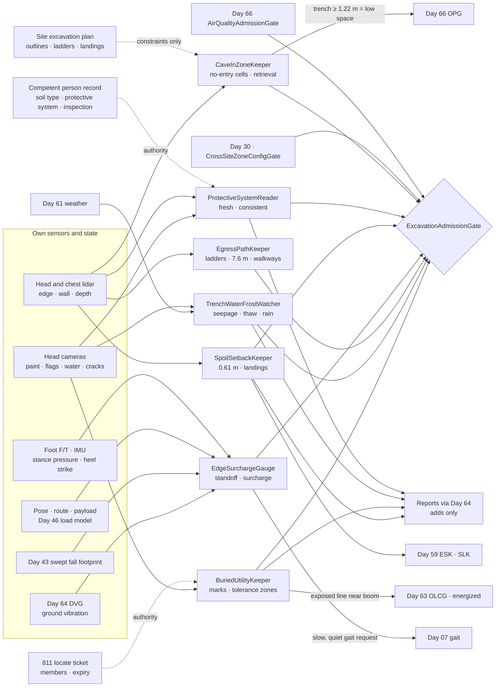
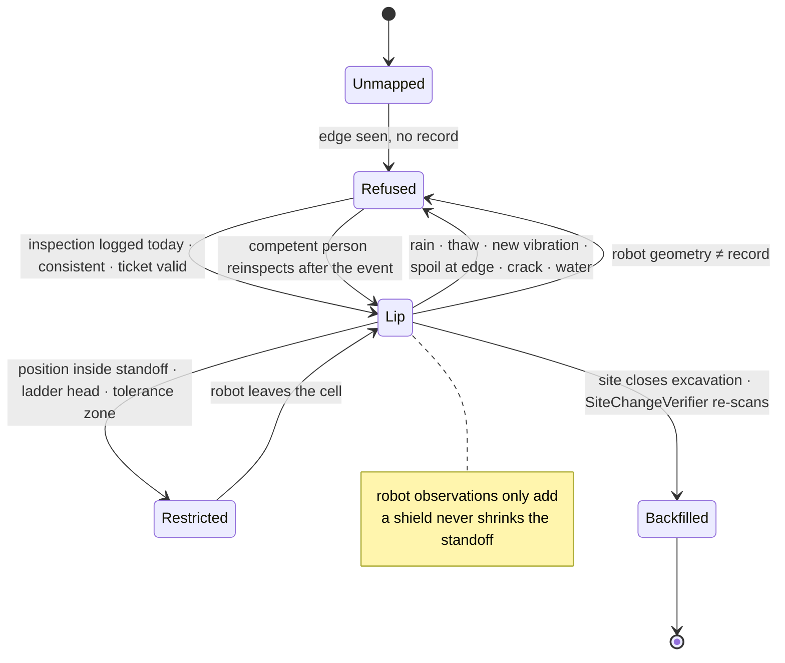
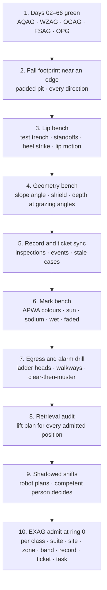

# Day 67 — Excavations and trenches under the air-quality stack: CaveInZoneKeeper / ProtectiveSystemReader / SpoilSetbackKeeper / EdgeSurchargeGauge / EgressPathKeeper / TrenchWaterFrostWatcher / BuriedUtilityKeeper / ExcavationAdmissionGate under AirQualityAdmissionGate + HotWorkAdmissionGate + LoudSiteAdmissionGate + ElectricalAdmissionGate + HeatAdmissionGate + WeatherAdmissionGate + LowLightAdmissionGate + WorkZoneAdmissionGate + DockAdmissionGate + SidewalkAdmissionGate + CorridorAdmissionGate + ElevatorAdmissionGate + DoorwayAdmissionGate + WetSurfaceAdmissionGate + ConfinedSpaceAdmissionGate + ElevatedAccessAdmissionGate + OverheadToolAdmissionGate + BimanualToolAdmissionGate + PowerToolAdmissionGate + PushPullAdmissionGate + PayloadCarryAdmissionGate + OutdoorGroundAdmissionGate + TerrainLocomotionAdmissionGate + FallSafeAdmissionGate + DeliberateContactAdmissionGate + WholeBodyTouchAdmissionGate + HumanHandoverAdmissionGate + CooperativeTaskAdmissionGate + TaskCompositionAdmissionGate + FleetSkillCatalogAdmissionGate + proximity + zone attestation + supervisor + logging + canary + HIL + fleet + incident + change-management + maintenance + thermal + energy gates

![CaveInZoneKeeper / ProtectiveSystemReader / SpoilSetbackKeeper / EdgeSurchargeGauge / EgressPathKeeper / TrenchWaterFrostWatcher / BuriedUtilityKeeper / ExcavationAdmissionGate: the same 63.8 kg humanoid on Site C walks up to a 2.4 m deep, 1.0 m wide water-service trench in soil the competent person has just reclassified as Type C and stops 2.1 m from the lip, because tension cracks open about 0.75 times the depth back from a vertical face and its own fall footprint is 1.8 m long; it knows the wall below the trench box is the box's job and the lip outside the box is nobody's, so it never leans over, hands anything down, or sets its 12 kg box of couplings anywhere but the landing the competent person marked; it reads the competent person's inspection record and refuses the whole trench until she reinspects after last night's rain; it sees a 1 m spoil pile 0.4 m from the edge and reports it instead of walking past, because that pile alone can take a wall's critical height from 4.2 m to 2.2 m; it never parks within 1.5 m of the two ladders that are the crew's only way out; it reads the yellow gas mark and the orange telecom flags but never moves a flag or drives a stake inside the 24 in tolerance zone; it finds water seeping at the toe and a frozen crust on the spoil and reports both; and every trench it passes goes to Day 66 as a low space it never enters, with a retrieval plan that never sends a person down for it](/images/day67-excavations-trenches.png)

[Day 05](/lessons/day-05-power-bms) owns `torque_scale` and the pack **forever**. [Day 07](/lessons/day-07-wbc-balance) owns gait and balance. [Day 17](/lessons/day-17-runtime-safety-supervisor) owns ESTOP and safe states. [Day 29](/lessons/day-29-human-proximity-safety) owns person tracks, SSM, and PFL rows. [Day 30](/lessons/day-30-collaborative-workspace-zoning) owns attested zones and `CrossSiteZoneConfigGate`. [Day 43](/lessons/day-43-falls-fall-safe-contact) owns the fall direction and the swept fall footprint. [Day 44](/lessons/day-44-stairs-ramps-uneven-terrain) owns ramps and step edges. [Day 45](/lessons/day-45-outdoor-deformable-ground) owns ground compliance and sinkage under its own feet. [Day 51](/lessons/day-51-ladders-elevated-work-platforms) owns ladders the robot climbs (it climbs none today). [Day 52](/lessons/day-52-confined-crawl-spaces) owns permit-required confined spaces. [Day 53](/lessons/day-53-water-wet-floors-spills) owns standing water. [Day 59](/lessons/day-59-construction-sites-work-zones) owns floor openings, slab edges, machine swing, suspended loads, and barriers. [Day 61](/lessons/day-61-weather-rain-snow-fog-wind) owns weather and ice. [Day 63](/lessons/day-63-temporary-power-electrical-hazards) owns overhead line clearance and energized boundaries. [Day 64](/lessons/day-64-noise-vibration-communications) owns warnings, radio, the site alarm feed, and deck vibration. [Day 65](/lessons/day-65-hot-work-fire-hazards) owns evacuation. [Day 66](/lessons/day-66-airborne-hazards-air-quality) owns low spaces as an air hazard (`OxygenPocketGauge`) and every gas reading.

Day 66 was about the air in a hole. Today is about the hole. A trench is the most ordinary thing on a site: a backhoe opens it in the morning, a crew lays pipe in it, and it's backfilled by evening. It is also one of the deadliest. The walls look like they'll stand, and they do, until a seam lets go and a slab of soil weighing more than a car per metre of trench drops onto whoever is in it. People in trenches die from soil that never moved more than a metre.

A humanoid at a trench has three ways to make that worse. It is a load at the lip: 64 kg on two small feet, walking right where the soil is weakest, sometimes carrying a box it's tempted to put down on the edge. It is a body that can fall in, and a robot lying in a 2.4 m trench is a reason for someone to climb down after it. And it is a camera on legs that sees walls, boxes, ladders, and paint marks, which makes it look like something that could judge whether a trench is safe. It cannot. Soil classification, protective systems, and inspections belong to the site's competent person, and nothing the robot sees ever makes a trench safer than the record says.

Eight lies show up the first time a team runs a humanoid near open excavations:

1. **Only-shallow lie.** "It's barely 1.5 m deep, nobody needs a box." One cubic metre of soil weighs 1.6 to 2 t, and a person kneeling to work on a pipe in a 1.5 m trench has their head below grade. OSHA starts requiring protective systems at 5 ft (1.52 m) and only lets a shallower trench go without one when a competent person has looked and found no sign of a cave-in.
2. **Walls-look-solid lie.** "The walls have stood since Tuesday." Cohesive soil holds a vertical face for a while because of suction and cementation that rain, thaw, vibration, and time take away. Stand-up time is not a property you can see in a lidar scan.
3. **Box-is-in lie.** "There's a trench box, so it's safe near the trench." A shield protects the people inside it. It doesn't hold up the lip outside its walls, the trench beyond its ends, or anything a robot stands on at grade.
4. **Spoil's-out-of-the-way lie.** "The spoil's on the other side from the work." Spoil and materials within 0.6 m of the edge can roll in, and a pile at the lip is a surcharge that can halve how high a wall will stand.
5. **Robot-is-light lie.** "It weighs less than a person with a jackhammer." Spread over its footprint, the robot is a light surcharge. On one foot at heel strike it presses nearly 40 kPa onto a lip that may already have a tension crack behind it, and it can fall in.
6. **Ladder's-somewhere lie.** "There's a ladder in the box." For a trench 4 ft (1.22 m) or deeper, every worker needs a ladder, ramp, or stair within 25 ft (7.6 m) of lateral travel, and a robot standing at the top of that ladder is an obstruction at the moment someone needs it most.
7. **It's-dry lie.** "It rained last night but the bottom's dry now." Water that soaked into the walls overnight is the water that matters, and a frozen crust on a morning at −3 °C hides the cracks it'll show at noon.
8. **Marks-are-there lie.** "The locator painted everything." Paint marks show approximately where utilities run, within a tolerance zone, for the facilities the one-call members own. Private lines, abandoned lines, and marks lost under spoil or snow aren't on the ground at all.

Today owns **`CaveInZoneKeeper` / `ProtectiveSystemReader` / `SpoilSetbackKeeper` / `EdgeSurchargeGauge` / `EgressPathKeeper` / `TrenchWaterFrostWatcher` / `BuriedUtilityKeeper` / `ExcavationAdmissionGate`**. The question is: **how do you let a humanoid work beside open excavations, with every trench mapped as a cave-in zone it never enters, the site's protective systems and inspection records read as constraints it can tighten but never judge or relax, spoil and materials kept back from the edge, its own weight, footfall, payload, and fall footprint treated as a surcharge and a fall hazard at the lip, ladders and ramps kept clear as the crew's only ways out, water and frost reported and turned into holds, and buried utilities kept inside their tolerance zones untouched — without raising Day 29 PFL, writing Day 05 `torque_scale`, gating Day 17 ESTOP, or bypassing `CrossSiteZoneConfigGate`?**

## The robot is never the competent person

The rule everything follows from: **at an excavation, the robot is a surcharge to be kept back, a fall to be kept out, and an observer whose reports only add. It never enters a trench, never stands, sets down, or hands anything within its edge standoff, never installs, moves, adjusts, or leans on shoring, a shield, a ladder, or a plate, never obstructs a ladder, ramp, or walkway, never digs, probes, or drives a stake, never moves a locate flag, and never presents anything it sees or measures as a soil classification, an inspection, or a clearance.** OSHA calls the person who classifies soil, picks or checks the protective system, and inspects the excavation every day the **competent person**. The robot can tell that person things. It can't be that person, and it can't stand in for that person's record.

Six facts set the shape of the lesson.

**Cave-ins are heavy and fast.** A failure wedge from a 2.4 m vertical face, if it breaks at 45°, holds about

$$
\tfrac{1}{2} H^2 \gamma_m = \tfrac{1}{2}(2.4)^2 (1.9\ \text{t/m}^3) \approx 5.5\ \text{t per metre of trench}
$$

Even a 0.4 m slab peeling off the top 1.5 m of a wall is more than a tonne per metre. It falls the depth of the trench in well under a second. Nobody outruns it, and a person buried to the chest can't breathe because of the pressure on their ribs, before any question of air.

**A cohesive wall stands because of cohesion, and anything that cuts cohesion or loads the top shortens it.** For a vertical cut in a purely cohesive soil with undrained shear strength $c$ (half the unconfined compressive strength $q_u$) and unit weight $\gamma$, the classic Rankine estimate of the height that can stand unsupported, with a surcharge $q$ on the ground at the top, is

$$
H_c = \frac{4c - 2q}{\gamma}
$$

and tension cracks can open from the surface to a depth of about $2c/\gamma$. With $q_u = 40\ \text{kPa}$ (Type C territory), $c = 20\ \text{kPa}$ and $\gamma = 19\ \text{kN/m}^3$: $H_c \approx 4.2\ \text{m}$ with nothing on top. Put a 1 m pile of spoil at the lip ($q \approx 19\ \text{kPa}$) and $H_c$ falls to about 2.2 m, less than the trench. Let overnight rain halve $c$ and the bare wall's $H_c$ is 2.1 m. Real soil is fissured and layered and worse than this formula. The formula's job here is to show the direction of every effect: water, thaw, vibration, and weight at the top all make a wall that was standing into one that isn't.

**OSHA's rules are written around depth, soil type, and the competent person.** Subpart P (29 CFR 1926.650–652) requires a protective system for any excavation 5 ft (1.52 m) or deeper unless it's entirely in stable rock, and for shallower ones when the competent person sees signs of a possible cave-in; excavations deeper than 20 ft (6.1 m) need a system designed by a registered professional engineer. Appendix A classifies soil: Type A is cohesive with $q_u \geq 1.5$ tsf (≈144 kPa), and no soil is Type A if it's fissured, subject to vibration, previously disturbed, or seeping; Type B is $0.5$–$1.5$ tsf; Type C is $\leq 0.5$ tsf (≈48 kPa), granular, submerged, or seeping. Appendix B gives maximum allowable slopes (H:V) for excavations under 20 ft: 3/4:1 for Type A (53°), 1:1 for Type B (45°), 1½:1 for Type C (34°), with benching not allowed in Type C. Appendices C and D give timber and aluminium hydraulic shoring tables, and shields (trench boxes) come with the maker's tabulated data.

**Edges, spoil, and egress have fixed numbers.** Spoil, materials, and equipment must be kept at least 2 ft (0.61 m) from the edge or held back by retaining devices (1926.651(j)(2)). Trench excavations 4 ft (1.22 m) or deeper need a stairway, ladder, ramp, or other safe means of egress within 25 ft (7.6 m) of lateral travel for every worker (1926.651(c)(2)), and a portable ladder must extend at least 3 ft (0.9 m) above the landing (1926.1053(b)(1)). Nobody may be under loads handled by digging or lifting equipment (1926.651(e)). OSHA's trenching guidance also notes that tension cracks usually form at a horizontal distance of 0.5 to 0.75 times the trench depth back from the top of a vertical face.

**Inspections happen daily, before work, and after anything that makes things worse.** The competent person inspects the excavation, adjacent areas, and protective systems daily and before work starts, as needed during the shift, and after every rainstorm or other hazard-increasing occurrence (1926.651(k)(1)). No one works in an excavation where water is accumulating unless precautions are taken (1926.651(h)). Where a hazardous atmosphere could reasonably be expected in an excavation deeper than 4 ft, the atmosphere is tested before anyone enters (1926.651(g)).

**Utilities are located by a call and marked by paint, within a tolerance.** Before digging, the excavator calls 811 and the one-call system notifies its member utilities, who mark their lines with the APWA uniform colour code: red electric, yellow gas, oil, and steam, orange communications, blue potable water, green sewers and drains, purple reclaimed water, pink temporary survey marks, white proposed excavation. Each state defines a tolerance zone either side of a mark within which only careful hand digging or vacuum excavation is allowed; New Jersey's is 24 in (0.61 m). OSHA requires exposed utilities to be protected, supported, or removed (1926.651(b)(4)). Marks fade, get buried, and only cover what the members own.

| Layer | Owns | Must not own |
|-------|------|--------------|
| `CaveInZoneKeeper` | Every excavation on the site plan and in its own scans: outline, depth, width, kind (trench, open, pit); the cave-in zone around and inside it as no-entry cells; "never enter" with any exception admitted only by the site; every trench 1.22 m or deeper handed to Day 66 OPG as a low space; a retrieval plan that never needs a person in an unprotected trench | Soil classification; deciding a trench is safe to enter; rescue |
| `ProtectiveSystemReader` | The competent person's daily inspection record, soil type, and protective system (slope ratio, benching, shoring, shield) with its tabulated data, read and checked for freshness and consistency against what the robot sees; mismatches reported and refused | Installing, adjusting, judging, or approving any protective system; inspections |
| `SpoilSetbackKeeper` | Spoil piles, stacked materials, and parked equipment checked against the 0.61 m setback; violations reported; the robot's own setdowns only at site-marked landings outside its standoff; never between a machine and an edge | Moving spoil or materials for the site; machine swing (Day 59 ESK) |
| `EdgeSurchargeGauge` | The robot's own static and heel-strike pressure, payload, and footfall vibration as a surcharge; the lip standoff from depth, tension-crack band, and Day 43 fall footprint; slow and quiet gait requested from Day 07 along the band; lip deformation and new cracks reported | Gait and balance (Day 07); ground compliance under its own feet (Day 45) |
| `EgressPathKeeper` | Ladders, ramps, stairs, and walkways mapped with their 7.6 m lateral-travel coverage; ladder heads, ramp heads, and walkways kept clear; trench crossings only on site walkways; on alarm, no position between a trench and its egress | Placing or moving ladders, ramps, or walkways; evacuation (Day 65) |
| `TrenchWaterFrostWatcher` | Rain from Day 61 and its own sightings of seepage, standing water, sloughing, tension cracks, bulging, and frozen or thawing ground turned into holds and reports; "reinspection after hazard-increasing event" enforced from the record | Dewatering; classifying soil; declaring water "not accumulating" |
| `BuriedUtilityKeeper` | Locate tickets and their expiry; paint and flag marks read by colour with a not-sure class; tolerance zones as no-stake, no-probe, no-load cells; exposed and supported utilities never touched or loaded; lost marks and unmarked crossings reported | Locating, marking, or exposing utilities; any digging; telling anyone a strip is clear |
| `ExcavationAdmissionGate` | Fail-closed admit per robot class, suite, site, zone, excavation band, inspection record, locate ticket, task | `JointCommand`; Day 05; PFL; Day 17 |
| Days 05 / 07 / 17 / 29 / 30 / 43 / 44 / 45 / 53 / 59 / 61 / 63 / 64 / 65 / 66 | Pack, gait, ESTOP, people, zones, falls, ramps, ground, water, openings and machines, weather, overhead lines, comms and vibration, evacuation, low spaces | Being outranked by "the robot looked at the trench and it's fine" |

**Core thesis:** **beside an open excavation, a humanoid stays out of every trench and outside a lip standoff set by the depth, the tension-crack band, and its own fall footprint, reads the competent person's record as the only authority and refuses whenever the record is stale or doesn't match what it sees, keeps spoil, loads, and itself off the edge, keeps every ladder and ramp clear, turns rain, seepage, and thaw into holds, never touches the ground inside a utility's tolerance zone, and reports what it sees as additions that can only tighten a constraint.**



## Physical machine: where the ground opens

Walk Site C on Thursday morning. It got down to −3 °C overnight after an evening of rain, and the sun is coming up over the east fence. On the street side of the building, the 20 t excavator from Day 59 is digging a new water service and a storm drain connection: a trench 1.0 m wide, 2.4 m deep, and 30 m long, running from the building's north wall to the street. The competent person classified the soil yesterday as Type B (previously disturbed fill over clay). Last night's rain came after that inspection. At 07:40 she reinspects, finds seepage at the toe of the west wall, reclassifies the trench as Type C, and has the tie-in excavation laid back to 1½:1. In the deep section a 2.4 m × 3.7 m steel trench box sits in the trench with two pipe layers inside it. At the street end, where the new line ties into the main, the trench widens into an open excavation sloped back on both sides. The spoil runs in a long pile along the west side. One aluminium extension ladder stands inside the box; a second leans against the wall at the street end. A steel plate covers the trench where the site's haul road crosses it, and a plank walkway with handrails crosses it near the building. Along the curb line there's a yellow paint line for a gas main and orange flags for a telecom duct that crosses the trench route; blue paint marks the water main at the tie-in. Behind the building, a 1.1 m deep excavation for a new footing is open, unshored. A plate compactor is working the backfill at the far end of the trench.

The robot's task is to deliver a 12 kg box of pipe couplings and a rotating laser level to the pipe crew.

The robot's hardware for this:

- **Lidar** on the head (360°, 0.1° resolution) and a forward-down chest lidar that sees trench walls and the bottom from the standoff distance, at grazing angles that make every number past the lip low-confidence.
- **Head cameras** with Day 60's low-light settings and Day 61's window state, used for paint colours, flags, water, ice, and cracks.
- **Six-axis force/torque sensors in each ankle** (from Day 03) and the IMU, which give stance load and heel-strike peaks.
- **Day 64's deck vibration gauge**, here reading ground vibration through the feet when the robot is standing.
- **Feet** 0.25 m × 0.10 m, robot mass 63.8 kg, 75.8 kg with today's payload.
- **Two rated lift points** at the shoulders, from Day 43's retrieval work, for a lift from outside if it ever ends up in a hole.
- **No soil instruments.** No penetrometer, no shear vane, no ground-penetrating radar, no locator. The robot can't classify soil or find a pipe, and isn't given tools that would tempt anyone to think it can.

### The cave-in zone: the robot doesn't go in

`CaveInZoneKeeper` (CZK) keeps a map of every excavation: from the site's excavation plan, from Day 59's `FloorOpeningMapper` and `SiteChangeVerifier` (an excavation is an opening in the ground), and from its own lidar, where a sudden drop in the ground height map of more than 0.3 m over a short run marks an edge. Each excavation gets an outline, a depth (measured where the lidar can see the bottom, else "unknown, assume the plan or worse"), a width, and a kind: a **trench** (narrow, deeper than wide, by OSHA's definition no wider than 15 ft at the bottom), an **open excavation**, or a **pit**.

The interior of every excavation is a no-entry cell. Today that rule has no exception in the default config. A site can add one, and only one: a sloped or benched open excavation with an equipment ramp the competent person designed and listed for the robot, within Day 44's ramp limits, with nobody working below and a retrieval plan by lift from the top. Trenches are never on that list. The reason is the note from Day 66, extended: **the robot must never be somewhere a person would have to climb into an unprotected trench to fetch it.** A robot that trips a knee into a trench or slides down a slope is precisely what a crew member will jump in to grab.

So every position the robot is admitted to comes with an answer to "if it ended up in that excavation, how does it come out?" and the answer is always "lifted by the site's rigging from the lip with the shoulder lift points, under the competent person's direction," never "someone climbs down." If the robot ever does end up in a trench, its display and its message to the site say: **"DO NOT ENTER TO RETRIEVE. Trench, protective system status unknown to the robot."**

Every trench 1.22 m or deeper also goes to Day 66's `OxygenPocketGauge` as a `LowSpace` of kind `TRENCH`. Carbon dioxide and argon pool in it, the excavator's exhaust settles into it on a still morning, and a sewer connection can carry hydrogen sulfide. OPG reads it from the lip at ankle height if the robot passes. The robot doesn't do the 1926.651(g) atmosphere test, and never says the trench's air is fine.

### Protective systems: read the record, check it, never judge it

`ProtectiveSystemReader` (PSR) reads what the competent person writes down: today's inspection with its time, the soil type, the protective system for each section (sloping at a ratio, benching, timber or hydraulic shoring from a table, a shield with the maker's tabulated data), and anything the inspector restricted. It never classifies soil, never computes whether a system is adequate, and never touches a shield, a strut, a plate, or a ladder.

What it does is check the record against itself, against the clock, and against what the robot can see, the same way Day 63's `LockoutTagoutVerifier` checks locks against the lockout record:

- **Is it fresh?** An inspection from before today's start of work is stale. An inspection from before a hazard-increasing event (last night's rain, a thaw, a new vibration source, a nearby surcharge, a change in the trench) is stale. PSR takes events from `TrenchWaterFrostWatcher` and Day 61, and the record's own time. Stale means the excavation is `REFUSED` for the robot until a new inspection is logged.
- **Does it match the soil type?** A record that says "Type B, sloped 1:1" in a section the record also notes as seeping, or after the competent person's own note of "fissured," is inconsistent; Type A soil that's been disturbed or vibrated can't be Type A. PSR doesn't reclassify. It reports the inconsistency and refuses.
- **Does it match what the robot sees?** The robot measures the slope angle of a sloped section with its lidar and compares it to the record's ratio. If the record says 1½:1 (34°) and the lidar sees 45°, that's a report and a refusal. A shield the record lists that the lidar can't find, a shield whose top is below the lip in a section where the record says it's flush or above, a gap between shield sections, or a shield sitting more than 0.61 m above the trench bottom (1926.652(g)(2) allows digging up to 2 ft below a shield only when it's designed for the full depth and there's no sign of soil loss) are all reports.
- **What it doesn't do.** A slope the robot measures as flatter than the record says doesn't relax anything. A shield it sees in place doesn't make the lip safe. A record that matches doesn't mean the trench is safe; it means the robot found nothing to add.

### Spoil and loads: 0.61 m is the site's floor, not the robot's

`SpoilSetbackKeeper` (SSK) measures every spoil pile, material stack, and parked piece of equipment along an excavation and compares its toe to the edge. Under 0.61 m is a report to the site through Day 64 with a photo and a distance. It doesn't move the spoil, doesn't kick a clod back, and doesn't route along the narrow strip between a pile and an edge.

The robot's own setdowns are stricter. It sets loads down only at **landings** the competent person marks outside its edge standoff (below), never on spoil, never on a plate or walkway, never at a ladder head. It never hands anything down into a trench or over the edge, never lowers anything on a line, and never stands where a crew below would be under the load (1926.651(e)). The pipe crew walks up the ladder to the landing, or the site lowers the box itself.

SSK also keeps the robot from being the thing between a machine and an edge. Day 59's `EquipmentSwingKeeper` already keeps the excavator's reach empty; SSK adds that the robot never stands on the strip between a machine's tracks or wheels and an excavation edge, and never between the plate compactor and the trench, because a machine that shies away from the robot shies toward the hole.

### Its own weight: light for the soil, heavy for the lip

`EdgeSurchargeGauge` (ESG) computes what the robot does to the ground at the edge, and from that, how close it may come.

The robot with today's payload weighs $75.8 \times 9.81 \approx 744\ \text{N}$. Spread over a standing footprint of about 0.6 m × 0.4 m, that's 3.1 kPa; with a heel-strike factor of 1.3 from the ankle F/T logs, about 4.0 kPa. As a surcharge in the formula above that's worth $2q/\gamma \approx 0.42\ \text{m}$ of critical height: small next to a spoil pile, not nothing next to a wall already close to its limit. Under one foot at heel strike it's a different story: $744 \times 1.3 / 0.025 \approx 39\ \text{kPa}$ on a patch of soil that, at the lip, may have a tension crack behind it and nothing in front of it. That's the load that breaks off the top 30 cm of a lip, and the robot goes with it.

So ESG doesn't treat the robot as "lighter than a person." It sets a **lip standoff** for each edge as the largest of:

- the site's 0.61 m setback, which applies to the robot as much as to a bucket of fittings;
- the **tension-crack band**, $0.75 D$ for a vertical face of depth $D$, because that's where the soil may already be separating; for a sloped section, measured from the top of the slope;
- the robot's **fall footprint** from Day 43, 1.8 m for a 1.65 m robot, plus a 0.3 m margin, so that no fall in any direction reaches the edge.

For the 2.4 m trench, that's $\max(0.61,\ 1.8,\ 2.1) = 2.1\ \text{m}$. For the 1.1 m footing excavation, it's still 2.1 m: the fall footprint dominates every shallow hole. The standoff doesn't shrink because there's a shield in the trench, because the shield doesn't hold the lip. It doesn't shrink because the ground is frozen hard, because frost is temporary strength.

Along the band beyond the standoff (out to twice the standoff), ESG asks Day 07 for a slow, quiet gait with shorter steps, which lowers heel strike and keeps the robot's own footfall vibration low. It watches the ground with lidar as it passes: a new crack parallel to the edge, a lip that's dropped since the last scan, or a bulge in the visible wall is a report to the site and a `REFUSED` excavation until the competent person has looked. Day 45's `SinkageTracker` sees the robot's own feet sinking; ESG sees the edge moving.

ESG also reports ground vibration near an open trench from Day 64's gauge. The plate compactor 15 m away is the competent person's to weigh (vibration is one of the things that disqualifies Type A); the robot's job is to say it's there.

### Ladders, ramps, and walkways: the crew's way out

`EgressPathKeeper` (EPK) maps every ladder, ramp, stairway, and walkway at every excavation, and checks coverage the way the rule does: every point in a trench 1.22 m or deeper must be within 7.6 m of lateral travel of a way out. For the 30 m trench, that means ladders no more than about 15 m apart along any section where people work. EPK doesn't place ladders. It reports a gap in coverage (the crew moved down the trench and the ladder stayed in the box) to the competent person.

What EPK enforces on the robot:

- **No robot within 1.5 m of a ladder head or a ramp head,** and never on the line between a ladder head and open ground, so that someone climbing out never has to climb around it.
- **Never on a walkway or plate** unless the site lists that walkway as rated for the robot and guarded; a walkway across a trench 1.8 m or more deep needs guardrails (1926.651(l)), and EPK checks that Day 59's `BarrierReader` sees them.
- **Never crossing a trench any other way.** No stepping over a narrow trench, ever, however narrow. Day 44's step-over geometry doesn't apply to holes with people in them.
- **On any alarm** (Day 64's site feed, Day 65's evacuation, or a "get out" from the crew), the robot stops, sets down if it's carrying, and moves away from every ladder head and ramp head before walking to muster, so the people climbing out never meet it at the top.

### Water and frost: holds, not judgements

`TrenchWaterFrostWatcher` (TWF) turns weather and what the robot sees into holds. Rain logged by Day 61 since the last inspection makes every excavation stale for PSR until a new inspection. Standing water in the bottom (Day 53's `StandingWaterGauge` method, through the lidar's drop-out on water and the cameras), seepage on a wall, sloughing at the toe, soil on the floor of a shield that wasn't there at the last scan, and fresh tension cracks are reports with photos and positions. The robot doesn't decide that water is "not accumulating," that a pump is keeping up, or that a wet wall is still fine.

Frost gets its own rule. A frozen crust on the spoil and the lip makes soil look and feel strong in the morning, and on a sunny day it thaws from the surface by noon. TWF records the frost at the start of the shift and asks for a reinspection when Day 62's sun model or Day 61's temperature says the thaw has started. The robot's standoff never shrinks on frozen ground.

### Utilities: paint is approximate, and the robot never touches the ground there

`BuriedUtilityKeeper` (BUK) reads the locate ticket from the site (ticket number, members notified, the excavation area, the valid-through date) and the marks on the ground. Its cameras classify paint and flags by the APWA colours with a **not-sure** class for faded paint, dim light, mud, and Day 60's sodium lights that make yellow and orange look alike. A not-sure mark is treated as the worst colour it might be. A mark is a line with a tolerance zone either side of its outside edge: 0.61 m in New Jersey, the state's figure elsewhere.

Inside a tolerance zone, the robot drives no stakes, sets no sign bases, plants no survey pins, probes nothing, and sets no load (a mark is where a shallow line might be, and a pallet on a shallow duct is a strike of a different kind). It never moves a flag or paints a mark. Outside the marks, the robot still never digs, because the marks only cover the one-call members' facilities.

In the trench, exposed utilities are supported or protected by the crew. BUK marks every exposed pipe, duct, or cable the lidar sees as a no-touch, no-load cell; the robot never steps on one, never rests anything on one, and treats a sagging support as a report. An exposed electric line or anything red near the excavator's boom goes to Day 63's `EnergizedBoundaryKeeper` and `OverheadLineClearanceGauge`. A smell or a reading near a yellow mark goes to Day 66 and the site at once: a damaged gas line is an evacuation, not a report.

BUK reports **lost marks** (paint covered by spoil, flags knocked over, marks outside the ticket's area, a ticket past its valid date) and **unmarked crossings** (a pipe or duct the lidar sees in a trench wall that no mark accounts for). It never says a strip of ground is clear.

### Putting the standoff in code

The standoff and setdown checks are small enough to show whole. Everything here only ever adds constraints; there's no branch that removes one.

```python
from dataclasses import dataclass

SETBACK_M = 0.61            # 1926.651(j)(2), applies to the robot too
CRACK_BAND = 0.75           # tension cracks at 0.5–0.75 D behind a vertical face
FALL_MARGIN_M = 0.3

@dataclass
class Edge:
    excavation_id: str
    depth_m: float | None    # None = lidar can't see the bottom
    plan_depth_m: float
    face: str                # "VERTICAL" | "SLOPED" | "SHIELD"

def lip_standoff(edge: Edge, fall_footprint_m: float) -> float:
    depth = max(edge.depth_m or 0.0, edge.plan_depth_m)   # unseen → plan, never less
    crack = CRACK_BAND * depth                             # from the slope top if SLOPED
    # a shield protects people inside it; it does nothing for the lip
    return max(SETBACK_M, crack, fall_footprint_m + FALL_MARGIN_M)

def surcharge_kpa(mass_kg: float, payload_kg: float, footprint_m2=0.24, heel=1.3):
    w = (mass_kg + payload_kg) * 9.81
    return {"spread_kpa": heel * w / footprint_m2 / 1e3,
            "one_foot_kpa": heel * w / 0.025 / 1e3}

def setdown_ok(p, landings, edges, ladders, tolerance_zones, standoffs) -> bool:
    if not any(l.contains(p) for l in landings):            # site-marked only
        return False
    if any(e.distance(p) < standoffs[e.excavation_id] for e in edges):
        return False
    if any(lad.head_distance(p) < 1.5 for lad in ladders):  # EPK
        return False
    if any(z.contains(p) for z in tolerance_zones):         # BUK
        return False
    return True
```

```python
def protective_record_state(rec, events, seen):
    """PSR: returns REFUSED or WATCH with reasons. It has no branch that returns SAFE."""
    reasons = []
    if rec is None or rec.inspected_at < rec.shift_start:
        reasons.append("no inspection before today's work")
    if any(ev.time > rec.inspected_at for ev in events):    # rain, thaw, vibration, surcharge
        reasons.append("hazard-increasing event after inspection")
    if rec.soil == "A" and rec.notes & {"fissured", "disturbed", "vibration", "seeping"}:
        reasons.append("record inconsistent: Type A with a disqualifier")
    for sec in rec.sections:
        s = seen.get(sec.id)
        if sec.system == "SLOPE" and s and s.slope_deg > sec.max_slope_deg + 3:
            reasons.append(f"{sec.id}: measured {s.slope_deg:.0f}° vs record {sec.max_slope_deg:.0f}°")
        if sec.system == "SHIELD" and (s is None or not s.shield_found):
            reasons.append(f"{sec.id}: listed shield not seen")
        if sec.system == "SHIELD" and s and s.shield_gap_above_bottom_m > 0.61:
            reasons.append(f"{sec.id}: shield more than 0.61 m above bottom")
    return ("REFUSED", reasons) if reasons else ("WATCH", ["nothing to add"])
```

## CaveInZoneKeeper and ProtectiveSystemReader

CZK maps every excavation, makes its interior a no-entry cell with no default exception, attaches a lift-from-the-lip retrieval plan to every admitted position, puts "do not enter to retrieve" on the display if the robot ever ends up inside, and hands every trench 1.22 m or deeper to Day 66 as a low space. PSR reads the competent person's record, refuses whenever it's stale or inconsistent or doesn't match the robot's own geometry, and never classifies, approves, or touches anything.

## SpoilSetbackKeeper and EdgeSurchargeGauge

SSK reports spoil, materials, and equipment inside 0.61 m, sets the robot's loads down only at site landings, never hands anything down, and keeps the robot from being between a machine and an edge. ESG computes the robot's own surcharge, sets each edge's standoff from the setback, the tension-crack band, and the Day 43 fall footprint, asks Day 07 for a quiet gait along the band, and reports edges that move.

## EgressPathKeeper, TrenchWaterFrostWatcher, and BuriedUtilityKeeper

EPK checks the 7.6 m coverage, keeps the robot off ladder heads, ramp heads, and walkways, never lets it cross a trench except on a rated, guarded walkway, and clears egress first on any alarm. TWF makes every rain, thaw, and new sighting into a reinspection hold. BUK reads the ticket and the marks with a not-sure class, keeps the robot's stakes, probes, and loads out of tolerance zones and off exposed utilities, and reports lost marks and unmarked crossings.

## ExcavationAdmissionGate

`ExcavationAdmissionGate` (EXAG) admits work per robot class, sensor suite hash, site, zone, excavation band, inspection record hash, locate ticket hash, and task, under Day 66 AQAG and everything below it. The band comes from the record first and the robot's observations second, and observations only push it up: `CLEAR` (no excavation within twice any standoff of the route), `LIP` (within twice the standoff, outside it; quiet gait, landings only), `RESTRICTED` (inside a standoff, a setback, a ladder-head zone, or a tolerance zone: no-entry cells), and `REFUSED` (no current inspection, a hazard-increasing event since it, a record mismatch, accumulating water, a moving edge, an expired ticket or lost marks on the route, or a missing egress). Every row needs:

- CZK: excavation map fresh for the shift; every interior no-entry; a lift-from-the-lip retrieval plan for every position; trenches handed to Day 66.
- PSR: an inspection logged today, after the last event, consistent with itself and with the robot's geometry.
- SSK: no route along a strip between spoil or a machine and an edge; landings marked; setback reports sent.
- ESG: standoff computed per edge with this robot's measured fall footprint; gait request accepted by Day 07.
- EPK: egress coverage reported; no position at a ladder head, ramp head, or walkway.
- TWF: no unacknowledged rain, thaw, water, or crack since the inspection.
- BUK: ticket valid; marks read; tolerance zones loaded; exposed utilities marked no-touch.
- The site's competent person reachable at ring 0, as on Days 59 to 66.

EXAG never writes `JointCommand`, never touches Day 05 `torque_scale` or limits, never raises a Day 29 row, never changes Day 07 gait directly, never takes a shield, a matching record, a frozen crust, a dry-looking bottom, a robot measurement, or a locate mark as admission to an edge or into an excavation, never admits a trench interior, never admits a position whose retrieval would need a person in an unprotected trench, never admits a setdown off a landing, never lets a robot observation clear anything, and never gates ESTOP.

## Data shapes

```text
Excavation:                                   # CZK
  excavation_id, kind: TRENCH | OPEN | PIT
  outline, depth_m_seen?, depth_m_plan, width_m
  interior: NO_ENTRY                           # only site-listed ramped OPEN may differ
  retrieval_plan: LIFT_FROM_LIP                # never PERSON_ENTERS
  low_space → Day 66 OPG (depth ≥ 1.22 m)
  inside_display: "DO NOT ENTER TO RETRIEVE"

ProtectiveRecord:                             # PSR (read only)
  inspected_at, inspector, soil: A | B | C | ROCK
  notes: {fissured, disturbed, vibration, seeping, ...}
  sections[]: {id, system: SLOPE | BENCH | SHORING | SHIELD,
               max_slope_deg?, table_ref?, shield_tab_data?}
  check: FRESH | STALE_TIME | STALE_EVENT | INCONSISTENT | MISMATCH_SEEN

SetbackFinding:                               # SSK
  item: SPOIL | MATERIAL | EQUIPMENT, toe_to_edge_m, photo
  report_if_below_m: 0.61
  landings[]: site-marked, outside standoff

EdgeStandoff:                                 # ESG
  edge_id, depth_m, face: VERTICAL | SLOPED | SHIELD
  setback_m: 0.61, crack_band_m: 0.75·D, fall_m: Day 43 + 0.3
  standoff_m = max(...)
  surcharge: {spread_kpa, one_foot_kpa}
  edge_motion: {new_crack, lip_drop_mm, bulge} → REFUSED

EgressMap:                                    # EPK
  ladders[]: {pos, extends_m ≥ 0.9}, ramps[], walkways[]: {guarded, robot_rated}
  coverage_gaps[] (lateral travel > 7.6 m)
  keep_clear_m: 1.5

WaterFrostEvent:                              # TWF
  kind: RAIN | SEEPAGE | STANDING_WATER | SLOUGH | CRACK | FROST | THAW
  time, position, photo → PSR stale; report via Day 64

UtilityMark:                                  # BUK
  ticket_id, valid_through, colour: RED | YELLOW | ORANGE | BLUE | GREEN | PURPLE | PINK | WHITE | NOT_SURE
  line, tolerance_m (0.61 in NJ)
  forbid: [stake, probe, load, move_flag]
  exposed_in_trench?: {supported, sag} → no_touch

ExcavationAdmission:                          # EXAG
  robot_class, suite_hash, site, zone
  band: CLEAR | LIP | RESTRICTED | REFUSED
  record_hash, ticket_hash, egress_hash, standoff_set_hash, task
  requires: [AQAG, HWAG, LSAG, ELAG, HTAG, WXAG, WZAG, OGAG, FSAG, CrossSiteZoneConfigGate]
  forbidden:
    enter_trench: true
    retrieval_needs_person_entry: true
    inside_standoff: true
    setdown_off_landing: true
    hand_down_or_lower: true
    touch_shield_shoring_ladder_plate: true
    block_ladder_or_ramp_head: true
    cross_trench_off_walkway: true
    stake_or_probe_in_tolerance_zone: true
    load_exposed_utility: true
    move_flag_or_mark: true
    observation_clears: true
    write_torque_scale: true
    raise_pfl: true
    gate_estop: true
    bypass_cross_site_zone_config_gate: true

# Unchanged owners
AirQualityAdmissionGate · OxygenPocketGauge · readings (Day 66)
Evacuation (Day 65) · site alarm feed · DVG · radio (Day 64)
EnergizedBoundaryKeeper · OverheadLineClearanceGauge (Day 63) · weather (Day 61)
Openings · edges · ESK · SLK · BarrierReader (Day 59) · standing water (Day 53)
Ground compliance · sinkage (Day 45) · ramps (Day 44) · fall footprint (Day 43)
Tracks · SSM · PFL (Day 29) · zones (Day 30) · gait (Day 07) · ESTOP (Day 17)
BmsState / PowerState (Day 05): torque_scale, contactors
  accepts_requests_from_site: false
```

## Config

A starting configuration. Every number is a policy you re-derive from your own robot, your site, and the rules that apply where you work:

```yaml
excavation:
  robot_is_competent_person: never
  observation_clears: never
  cave_in:
    sources: [site_excavation_plan, day59_floor_opening_mapper, day59_site_change_verifier, own_lidar]
    edge_drop_m: 0.3
    interior: no_entry
    entry_exception: site_listed_ramped_open_excavation_only   # never a trench
    retrieval: lift_from_lip_by_site_rigging
    inside_display: "DO NOT ENTER TO RETRIEVE"
    low_space_handoff_min_depth_m: 1.22                         # → day66 OPG
  protective_record:
    authority: competent_person
    stale_if: [before_shift_start, before_hazard_event]
    hazard_events: [rain, thaw, new_vibration_source, new_surcharge, trench_change, water]
    slope_check_tolerance_deg: 3
    shield_max_above_bottom_m: 0.61                             # 1926.652(g)(2)
    on_mismatch: [report_competent_person, refuse]
    touch_systems: never
  setback:
    min_m: 0.61                                                 # 1926.651(j)(2)
    setdown: site_landings_only
    hand_down_or_lower: never
    between_machine_and_edge: never
  surcharge:
    heel_factor: measured                                       # 1.3 on the example robot
    foot_area_m2: 0.025
    standoff: max(setback, 0.75 * depth, day43_fall_footprint + 0.3)
    shield_reduces_standoff: false
    frost_reduces_standoff: false
    band_gait: request_day07_quiet_short_steps
    band_width: 2 * standoff
    edge_motion_refuse: [new_parallel_crack, lip_drop_20mm, wall_bulge]
  egress:
    required_min_depth_m: 1.22                                  # 1926.651(c)(2)
    max_lateral_travel_m: 7.6
    ladder_extension_min_m: 0.9                                 # 1926.1053(b)(1)
    keep_clear_of_heads_m: 1.5
    walkway_guard_min_depth_m: 1.8                              # 1926.651(l)
    cross_trench: rated_guarded_walkway_only
    step_over_trench: never
    on_alarm: [stop, set_down, clear_egress_heads, then_day65_muster]
  water_frost:
    rain_from: day61
    report: [seepage, standing_water, slough, crack, bulge, frost, thaw]
    hold_until: new_inspection_logged
    thaw_trigger: [day61_temp_above_0, day62_sun_on_face]
  utilities:
    ticket_required: true
    colours: apwa
    not_sure_means: worst_possible_colour
    tolerance_m: 0.61                                           # New Jersey; per state
    in_tolerance_forbid: [stake, probe, load, sign_base]
    flags_and_paint: never_touch
    exposed: no_touch_no_load
    red_near_boom_to: day63
    gas_odour_or_reading: [day66, site_alarm]
    report: [lost_marks, expired_ticket, unmarked_crossing]
  admission:
    keyed_by: [robot_class, sensor_suite_hash, site, zone, band, record_hash, ticket_hash, task]
    bands_from: [competent_person_record, own_observations]    # observations only raise
    requires: [day66_aqag, day65_hwag, day64_lsag, day63_elag, day62_htag, day61_wxag, day59_wzag, day45_ogag, day43_fsag, day30_cross_site_zone_config_gate]
    competent_person_ring0: required
```

## An excavation, as states

As on Day 66, the arrows the robot can draw only go up. The competent person moves an excavation back down, with a new inspection.



## Physical ↔ digital pairing

| Physical | Digital twin / backing |
|----------|------------------------|
| 2.4 m water-service trench, 1.0 m wide, trench box in the deep section | CZK: TRENCH, interior no-entry; OPG low space; retrieval by lift from the lip |
| Yesterday's inspection, Type B; rain last evening | PSR: STALE_EVENT; whole trench REFUSED until reinspection |
| 07:40 reinspection: Type C (seepage), tie-in slope laid back to 1½:1 | PSR: FRESH; robot measures the tie-in slope at 33°, consistent; LIP band |
| Spoil pile toe 0.4 m from the west edge | SSK: report with photo to the competent person; no route along that strip |
| Crew asks the robot to pass the couplings down | SSK: refused; box set at landing L1, 2.6 m back; "set at the landing" on the display |
| Robot walks along the east side to landing L1 | ESG: standoff 2.1 m; quiet gait band out to 4.2 m |
| Robot carries 12 kg | ESG: 4.0 kPa spread, 39 kPa per foot at heel strike, logged |
| Hairline crack 1.6 m back from the east lip, new since 07:40 | ESG: edge motion; report; trench REFUSED until the competent person looks |
| Ladder inside the box, ladder at the street end, 18 m apart | EPK: each ladder covers 7.6 m either way; the 2.8 m between coverage areas reported as a gap |
| Plank walkway with handrails near the building | EPK: guarded but not robot-rated; robot walks around via the street end |
| Plate compactor working backfill 15 m away | ESG: ground vibration reported via Day 64; SSK: never between it and the trench |
| Frozen crust on spoil and lip at 07:00, sun on the face by 10:30 | TWF: FROST logged; thaw trigger → reinspection request |
| 50 mm of water at the bottom near the tie-in | TWF: STANDING_WATER report; REFUSED for that section until the site acts and reinspects |
| Yellow gas line along the curb, orange telecom flags across the route | BUK: tolerance zones 0.61 m; no stake or sign base inside; cone placed outside |
| Orange flag knocked flat under the spoil | BUK: lost mark report; worst-case orange across the spoil strip |
| Uncharted 100 mm duct visible in the trench wall | BUK: unmarked crossing report; exposed no-touch |
| 1.1 m footing excavation behind the building, no shoring | CZK: OPEN, interior no-entry; ESG standoff 2.1 m (fall footprint dominates) |
| Evacuation alarm during the delivery | EPK: stop, set down, clear both ladder heads, then Day 65 muster |

The pairing that matters most: **replay every shift from the robot's own bag and show that it never entered an excavation, never stood or set anything inside an edge standoff, never handed or lowered anything to anyone below, never touched a shield, strut, ladder, plate, flag, or exposed utility, never stood within 1.5 m of a ladder or ramp head, never crossed a trench off a rated walkway, never worked beside an excavation without a current inspection that postdated the last rain, thaw, or change, never drove a stake or set a load inside a tolerance zone, and every observation it made went out as a report that added a hold or a constraint, with nothing ever cleared by it.**

## Bring-up sequence (before the robot works beside excavations)



1. **Days 02–66 green,** with Day 59's opening map and machine envelopes, Day 45's ground models, Day 43's fall footprint, and Day 66's OPG taking trenches as low spaces.
2. **Fall footprint near an edge:** re-run Day 43's fall drills beside a padded pit (not a trench) in every direction, with the payload, and confirm the swept footprint plus margin used by ESG.
3. **Lip bench:** at a test trench dug for the purpose, shored by a contractor and inspected by a competent person, measure heel-strike loads at the standoff and inside the band, and watch the lip with a dial gauge and the robot's own lidar to set the edge-motion thresholds. Nobody, and no robot, goes in.
4. **Geometry bench:** measure slope angles, shield positions, and depth from the standoff at grazing angles; find where the lidar's depth goes to "unknown" and make sure the plan depth takes over.
5. **Record and ticket sync:** connect to the site's inspection log and locate ticket; test stale-by-time, stale-by-event, inconsistent soil notes, missing sections, and expired tickets.
6. **Mark bench:** paint and flags in all APWA colours, in low sun, under Day 60's sodium and LED lights, wet, faded, and half-buried; tune the not-sure class until no mark is called a lower-consequence colour.
7. **Egress and alarm drill:** with the crew, a ladder in a trench, and the site alarm: stop, set down, clear the heads, then muster; verify the robot is never at a head when someone climbs out.
8. **Retrieval audit:** for every admitted position, show a lift plan from the lip that doesn't need anyone in the excavation. Grep the stack for any path where an observation lowers a band or fills an inspection field. There must be none.
9. **Shadowed shifts:** the robot plans, the competent person decides; compare refusals.
10. **EXAG admit at ring 0** per robot class, suite, site, zone, band, record, ticket, and task.

## Failure gallery

| Symptom | Likely cause |
|---------|--------------|
| Robot walked the east lip at 0.8 m "because the box was in" | Standoff shrunk for SHIELD faces; shield treated as lip support |
| Robot delivered beside a trench at 08:00 after overnight rain | PSR freshness checked against time only, not against Day 61 events |
| Crew member climbed out and had to step around the robot | Landing placed at a ladder head; EPK keep-clear not applied to landings |
| Box handed down to a pipe layer over the edge | Handover skill from Day 40 not blocked by SSK at excavations |
| Robot set a cone base on the gas line's mark | Tolerance zone not loaded; cone treated as zero-load |
| Yellow line read as orange under sodium lights | No not-sure class; colour classifier trained in daylight only |
| Robot routed between the compactor and the trench | SSK machine-edge strip not computed for small machines |
| Crack behind the lip seen in the bag but no report | ESG edge-motion check run only on the route, not on the lip within the band |
| A worker climbed into the footing hole to free the robot's foot | Shallow excavation exempted from standoff; retrieval plan missing |
| Robot "confirmed" a slope ratio in a message to the foreman | PSR consistency result phrased as approval; reports not labelled "adds only" |
| Frozen lip treated as Type A-strength at noon | Frost reduced the standoff; no thaw trigger |
| Uncharted duct in the wall went unreported | BUK only matched lidar returns to marked lines |

## Exercises

1. A trench is 3.0 m deep with vertical walls in a shield. The robot's Day 43 fall footprint is 1.8 m. What's its standoff? Would it change if the walls were sloped at 1:1, and from where would you measure it?
2. With $c = 25\ \text{kPa}$ and $\gamma = 18.5\ \text{kN/m}^3$, compute $H_c$ with no surcharge, with a 1.2 m spoil pile at the lip, and with the robot's spread surcharge of 4 kPa. What does each number say, and what doesn't it say?
3. A 40 m trench has ladders at 3 m and 28 m along its length. Which sections violate the 7.6 m lateral travel rule, and what does EPK do about it?
4. The record says "Type A, vertical to 1.2 m, sloped 3/4:1 above." The robot sees the plate compactor running 8 m away and the upper slope at 58°. List PSR's findings and the resulting band.
5. A locate ticket expired yesterday and the site is still digging. What does BUK report, which constraints does it add, and which decisions stay with people?
6. Write the `ExcavationAdmission` rows for the coupling delivery to landing L1 before and after the 07:40 reinspection. Which owners can refuse each, and why?

## What to freeze this week

Extend [frames](/frames) and your safety config with:

- `CaveInZoneKeeper`: every excavation mapped; interiors no-entry with no default exception; lift-from-the-lip retrieval for every position; "do not enter to retrieve"; trenches 1.22 m or deeper to Day 66 OPG.
- `ProtectiveSystemReader`: the competent person's record as the only authority; stale by time or event, inconsistent, or mismatched with the robot's geometry means refused; nothing ever approved or touched.
- `SpoilSetbackKeeper`: 0.61 m setback reports; setdowns only at site landings; nothing handed down or lowered; never between a machine and an edge.
- `EdgeSurchargeGauge`: standoff = max(0.61 m, 0.75 D, fall footprint + 0.3 m), never shrunk by a shield or frost; quiet gait requested in the band; moving edges refused.
- `EgressPathKeeper`: 7.6 m coverage reported; 1.5 m clear of ladder and ramp heads; trench crossings on rated, guarded walkways only; on alarm, clear egress before muster.
- `TrenchWaterFrostWatcher`: rain, seepage, water, cracks, frost, and thaw as reinspection holds; nothing declared dry or stable.
- `BuriedUtilityKeeper`: ticket checked; marks read with a not-sure class; tolerance zones no-stake, no-probe, no-load; exposed utilities no-touch; lost marks and unmarked crossings reported.
- `ExcavationAdmissionGate` fail-closed under Day 66 AQAG; keyed by band, record, and ticket; **no trench entry, no retrieval by a person, no position or setdown inside a standoff, no handing down, no touching protective systems or flags, no blocked egress, no stake in a tolerance zone, no clearance from a robot observation, no dual-write of ESTOP, PFL, gait, or `torque_scale`.**

The lesson isn't "teach the robot to spot a bad trench." It's that **at an excavation the robot is a surcharge, a fall, and an observer that can only add. So it stays out of every hole and back from every lip by more than its own fall, sets nothing down but at a landing, keeps the ladders clear, treats the competent person's record as the only word on soil and shoring and refuses whenever that word is stale or doesn't match what it sees, turns rain and thaw into holds, keeps its feet and its loads out of every utility's tolerance zone, and makes sure nobody ever climbs down after it.**

## Further reading

Look these up by title; they're the standard sources for today's soil, shoring, egress, and utility arguments:

- OSHA 29 CFR 1926 Subpart P, *Excavations* (1926.650–652), including Appendix A (soil classification), Appendix B (sloping and benching), Appendices C and D (timber and aluminium hydraulic shoring), and Appendix F (selection of protective systems).
- OSHA Technical Manual, Section V, Chapter 2, *Excavations: Hazard Recognition in Trenching and Shoring*, for tension cracks and failure modes.
- OSHA 3015, *Excavations* booklet, and OSHA Trenching and Excavation Safety fact sheets.
- NIOSH, *Preventing Worker Deaths from Trench Cave-ins* (Workplace Solutions), and NIOSH FACE reports on trench fatalities.
- OSHA 29 CFR 1926.1053, *Ladders*, for extension above landings.
- Common Ground Alliance, *Best Practices Guide*, and the APWA *Uniform Color Code* for marking underground utilities.
- New Jersey Underground Facility Protection Act and N.J.A.C. 14:2, for the one-call process and the 24 in tolerance zone.
- Terzaghi, Peck, and Mesri, *Soil Mechanics in Engineering Practice*, on unsupported cuts, tension cracks, and lateral earth pressure.

## Next

**Day 68+** — Concrete pours, formwork, and rebar under the excavation stack: the pump boom and its hose-whip zone, and the line from the truck kept clear like a suspended load; fresh concrete as ground that isn't ground yet, with no footfall, setdown, or wheel on it until the site says it has cured; formwork, shores, and reshores the robot never loads, leans on, or strips, with the pour sequence read as a constraint; protruding rebar as an impalement hazard, capped or not, for people the robot might push or block; vibrators, screeds, and power trowels as moving tools at people's feet; and wet concrete's alkalinity on the robot's covers and seals — without raising Day 29 PFL, writing Day 05 `torque_scale`, or bypassing `CrossSiteZoneConfigGate`, under the same gates plus excavation admission.
