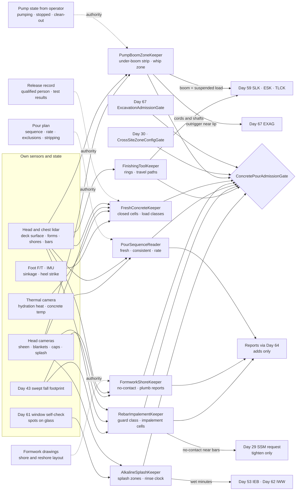
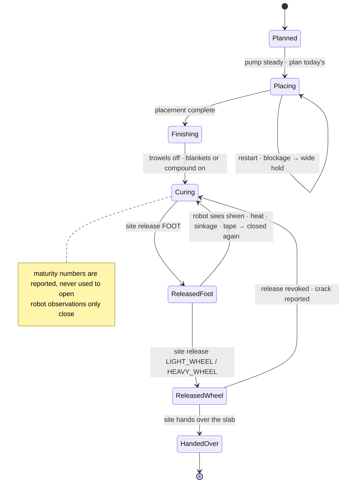
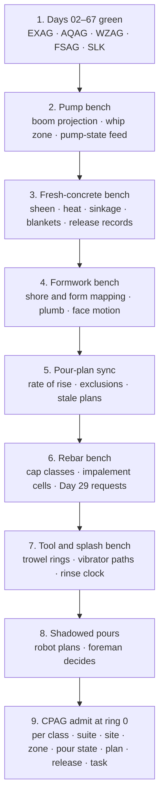

# Day 68 — Concrete pours, formwork, and rebar under the excavation stack: PumpBoomZoneKeeper / FreshConcreteKeeper / FormworkShoreKeeper / PourSequenceReader / RebarImpalementKeeper / FinishingToolKeeper / AlkalineSplashKeeper / ConcretePourAdmissionGate under ExcavationAdmissionGate + the air-quality stack: CaveInZoneKeeper / ProtectiveSystemReader / SpoilSetbackKeeper / EdgeSurchargeGauge / EgressPathKeeper / TrenchWaterFrostWatcher / BuriedUtilityKeeper / ExcavationAdmissionGate under AirQualityAdmissionGate + HotWorkAdmissionGate + LoudSiteAdmissionGate + ElectricalAdmissionGate + HeatAdmissionGate + WeatherAdmissionGate + LowLightAdmissionGate + WorkZoneAdmissionGate + DockAdmissionGate + SidewalkAdmissionGate + CorridorAdmissionGate + ElevatorAdmissionGate + DoorwayAdmissionGate + WetSurfaceAdmissionGate + ConfinedSpaceAdmissionGate + ElevatedAccessAdmissionGate + OverheadToolAdmissionGate + BimanualToolAdmissionGate + PowerToolAdmissionGate + PushPullAdmissionGate + PayloadCarryAdmissionGate + OutdoorGroundAdmissionGate + TerrainLocomotionAdmissionGate + FallSafeAdmissionGate + DeliberateContactAdmissionGate + WholeBodyTouchAdmissionGate + HumanHandoverAdmissionGate + CooperativeTaskAdmissionGate + TaskCompositionAdmissionGate + FleetSkillCatalogAdmissionGate + proximity + zone attestation + supervisor + logging + canary + HIL + fleet + incident + change-management + maintenance + thermal + energy gates

![PumpBoomZoneKeeper / FreshConcreteKeeper / FormworkShoreKeeper / PourSequenceReader / RebarImpalementKeeper / FinishingToolKeeper / AlkalineSplashKeeper / ConcretePourAdmissionGate: the same 63.8 kg humanoid on Site C on a cold Friday morning carries a 12 kg case of cylinder molds to the testing technician at the tail of a ready-mix truck while a 38 m boom pump places the east half of the level 2 deck; it stays out of the strip under the boom and 4 m from the end hose, because that hose holds about 88 kg of concrete under tens of bar and whips when air gets into the line; it never steps on yesterday's ground-floor slab under its blankets, because only the site releases concrete for feet, wheels, or loads; it never leans on, grabs, or sets anything against a form, a shore, or a reshore, and it stays out of the bay under the deck while the deck is being placed; it reads the pour plan, sees the core-wall lift rising at 1.6 m per hour against a plan limit of 1.2, and reports it instead of judging it; it treats the plastic mushroom caps on the footing dowels as uncapped, because they aren't impalement protection, and never stands where a person would have to step past bare bars to get around it; it keeps clear of the vibrators, the screed, and the trowels at people's feet; and when a splash of grey paste lands on its shin cover it asks for a clean-water rinse within 30 minutes instead of waiting for tonight](/images/day68-concrete-pours-formwork-rebar.png)

[Day 05](/lessons/day-05-power-bms) owns `torque_scale` and the pack **forever**. [Day 07](/lessons/day-07-wbc-balance) owns gait and balance. [Day 17](/lessons/day-17-runtime-safety-supervisor) owns ESTOP and safe states. [Day 29](/lessons/day-29-human-proximity-safety) owns person tracks, SSM, and PFL rows. [Day 30](/lessons/day-30-collaborative-workspace-zoning) owns attested zones and `CrossSiteZoneConfigGate`. [Day 40](/lessons/day-40-human-robot-handover-co-carry) owns handovers. [Day 43](/lessons/day-43-falls-fall-safe-contact) owns the fall direction and the swept fall footprint. [Day 45](/lessons/day-45-outdoor-deformable-ground) owns ground compliance and sinkage under its own feet. [Day 53](/lessons/day-53-water-wet-floors-spills) owns standing water and the ingress exposure budget. [Day 59](/lessons/day-59-construction-sites-work-zones) owns slab edges, openings, machine swing, suspended loads, trip lines across walkways, and barriers. [Day 61](/lessons/day-61-weather-rain-snow-fog-wind) owns weather, cold, and the sensor windows. [Day 62](/lessons/day-62-heat-sun-dust) owns ingress wear. [Day 63](/lessons/day-63-temporary-power-electrical-hazards) owns overhead line clearance and cords. [Day 64](/lessons/day-64-noise-vibration-communications) owns warnings, radio, hand signals, and deck vibration. [Day 65](/lessons/day-65-hot-work-fire-hazards) owns evacuation. [Day 66](/lessons/day-66-airborne-hazards-air-quality) owns silica and every gas reading. [Day 67](/lessons/day-67-excavations-trenches) owns excavations, lips, spoil, and outrigger-near-edge reports.

Day 67 was about the hole. Today is about what goes into it, and into the forms above it. A concrete pour is the busiest few hours on a site. Trucks queue on the street, a boom unfolds 30 m over the deck, a crew of eight walks backwards through wet concrete with vibrators and rakes, carpenters watch the forms from underneath, and the finishers wait for the slab to be just stiff enough to trowel. Then it's over, and for days afterwards the slab looks like a floor and isn't one yet.

A humanoid at a pour has four ways to make things worse. It's **a body in the danger zones** of the pump: under the boom, near the end hose, beside a reversing truck. It's **a load in the wrong place**: on fresh concrete, against a form, bumping a shore, standing on a rebar mat. It's **an obstacle** that can push a person, or make them step around it, toward bare rebar or a spinning trowel. And it's **a machine made of polycarbonate, anodized aluminium, and seals**, splashed with a paste whose pH is 12 to 13. None of those makes it the person who decides when concrete can carry a load, when a form comes off, or where the pump hose goes.

Eight lies show up the first time a team runs a humanoid near a pour:

1. **Fresh-is-firm lie.** "The finishers are walking on it." They're on knee boards that spread their weight over a square metre, they know when the surface will take them, and they fix their own marks. The robot's heel puts about 39 kPa onto a material that, an hour after placement, has a yield stress in the hundreds of pascals.
2. **Forms-are-strong lie.** "That wall form holds 70 kPa of concrete, so it can take me leaning on it." Formwork is designed for the loads in its drawings, in the directions in its drawings. A push on a brace, a kicker, or a waler is a load nobody designed for, and it arrives during the pour, when the form is closest to its limit.
3. **Shore-is-a-post lie.** "A shore is a steel post. Bumping it is nothing." A shore is a slender column loaded along its axis, and its capacity depends on its being plumb, seated, and braced. Decks collapse during placement, and they collapse from the shores.
4. **It's-cured lie.** "The maturity logger says 70 percent, so it's fine to walk on, load, or strip." OSHA says forms and shores come off only when the employer has determined the concrete is strong enough, from the plans and specifications or from ASTM test results. A number on a logger is an input to that decision, made by someone else.
5. **Hose-is-just-a-hose lie.** "The hose man is holding the end, so it's safe to stand next to it." A 3 m, 125 mm end hose full of concrete weighs about 88 kg, sits at the end of a line under tens of bar, and whips at start-up, at restart, when air gets into the line, and when a blockage clears.
6. **Boom's-up-there lie.** "The boom is 30 m up, nowhere near me." A boom over a deck is a suspended load. It drips, it sways, it gets folded and unfolded over people, and when a pipe section or a clamp fails, what's under it gets hit.
7. **Capped lie.** "The bars are capped." Most orange plastic mushroom caps keep people from scratching themselves on a bar end. They don't stop a falling person from being impaled. Only caps and covers made and tested for impalement do.
8. **Rinse-later lie.** "It's grey splatter. It'll wash off tonight." Wet cement paste is caustic. It sets on a camera window in tens of minutes, a set spot can't be wiped off without scratching the window, and strong alkali attacks polycarbonate and anodizing and carries grit into seals.

Today owns **`PumpBoomZoneKeeper` / `FreshConcreteKeeper` / `FormworkShoreKeeper` / `PourSequenceReader` / `RebarImpalementKeeper` / `FinishingToolKeeper` / `AlkalineSplashKeeper` / `ConcretePourAdmissionGate`**. The question is: **how do you let a humanoid work through a concrete pour, with the pump boom and the end hose's whip zone kept clear like a suspended load, fresh concrete treated as ground that isn't ground until the site releases it for that load, formwork, shores, and reshores never loaded, leaned on, or stripped, the pour plan read as a constraint it can tighten but never relax, protruding rebar treated as an impalement hazard for the people around it, the finishing tools kept away from as moving machines at people's feet, and its own covers and seals protected from wet concrete's alkalinity — without raising Day 29 PFL, writing Day 05 `torque_scale`, gating Day 17 ESTOP, or bypassing `CrossSiteZoneConfigGate`?**

## The robot is never the one who releases concrete

The rule everything follows from: **at a pour, the robot is a body kept out of the pump's reach, a load kept off everything that isn't ready for it, an obstacle kept out of people's way around bars and tools, and an observer whose reports only add. It never stands under the boom or inside the end hose's whip zone, never holds, guides, or steps over a pump line, never puts a foot, a wheel, or a setdown on concrete the site hasn't released for that load, never leans on, grabs, braces against, moves, or strips a form, shore, reshore, tie, or brace, never stands on a rebar mat, never caps, bends, or moves a bar, never operates or stands in the path of a vibrator, screed, or trowel, and never presents anything it measures as a strength, a release, a stripping time, or a placement instruction.** The site has people for those calls: the pour foreman and the pump operator, the formwork engineer and the carpenters who watch the forms, the qualified person who says what a slab can carry, and the testing technician and the engineer behind every strength result. The robot can tell them things. It can't stand in for them.

Six facts set the shape of the lesson.

**Fresh concrete is a heavy fluid, then a weak solid, then a floor, and you can't see the transitions.** Normal-weight concrete weighs about 2400 kg/m³, or $\gamma_c \approx 23.5\ \text{kN/m}^3$. Fresh, it behaves like a Bingham fluid: it flows once the stress passes a yield stress of a few hundred pascals to a couple of kilopascals for pumpable mixes. ASTM C403 defines the time of **initial set** as when a needle's penetration resistance reaches 3.5 MPa (500 psi) and **final set** at 27.6 MPa (4000 psi), which, for a typical mix on a cool morning, can be several hours after placement. After final set the slab gains strength for weeks, how fast depending on the mix and, above all, on its temperature. The surface can look dry, grey, and hard long before any of that.

**Formwork carries a pressure set by how high and how fast you pour, and how cold it is.** The upper bound is full liquid head:

$$
p_{\max} = \gamma_c\, h = 23.5\ \text{kN/m}^3 \times 3.0\ \text{m} \approx 70.5\ \text{kPa}
$$

at the bottom of a 3.0 m wall lift. Concrete that starts to stiffen as it's placed presses less than that, and ACI 347 gives a design pressure for walls placed at a rate of rise $R \le 7$ ft/h. In inch-pound units, with the unit-weight and chemistry coefficients equal to 1,

$$
p = 150 + \frac{9000\,R}{T}\ \ \text{psf}
$$

with $R$ in ft/h and $T$ the concrete temperature in °F. At 4 ft/h (1.2 m/h) and 50 °F (10 °C), $p \approx 870$ psf, about 41.7 kPa. At 40 °F (4 °C) it's 1050 psf, about 50.3 kPa: the colder the concrete, the longer it stays fluid, the higher the pressure. Pour faster than 7 ft/h and you're outside the formula, back towards full liquid head. The robot can measure the rate of rise and see the thermometer. It controls neither, and what it measures goes out as a report.

**Decks are carried by shores, then reshores, and the loads are someone's calculation.** ACI 347 recommends designing deck forms for the concrete's weight plus a construction live load of at least 50 psf (2.4 kPa), and at least 100 psf (4.8 kPa) combined. A 200 mm slab is $0.2 \times 23.5 = 4.7\ \text{kPa}$ on its own. OSHA's Subpart Q says no construction loads go on a concrete structure until a qualified person, from tests or from the design, says it can carry them (1926.701(a)); formwork must be designed and erected to carry every vertical and lateral load, with drawings on site (1926.703(a)); shoring is inspected before erection and immediately before, during, and after placement (1926.703(b)); and forms and shores come off only when the employer has determined, from the plans and specifications or from ASTM test results, that the concrete is strong enough, with reshores staying until the concrete they hold up is too (1926.703(e)).

**Exposed rebar impales.** OSHA requires protruding reinforcing steel onto and into which employees could fall to be guarded to eliminate the impalement hazard (1926.701(b)), and vertical rebar for walls, piers, and columns to be supported against tipping over and collapse (1926.703(d)). OSHA's interpretations say ordinary plastic mushroom caps generally don't do the first job; California's construction orders spell out a drop test for caps and covers that do. A bar is hazardous to the people near it, so it matters to a robot that might push, block, or startle a person.

**The pump is two machines: a boom and a line.** A truck-mounted boom pump unfolds a placing boom of 30 to 60 m over the work, and pumps concrete through steel pipe along the boom to a flexible end hose that the hose man walks through the pour. ASME B30.27 covers these material placement systems, and the pump associations' safety manuals agree on a few rules: nobody under the boom, nobody near the end hose at start-up, at restart after a stop, when cleaning out, or when a blockage is being cleared, and a **whip zone** around the end hose commonly taken as a circle whose radius is the length of the end hose. OSHA requires concrete pipeline supports to be designed for a 100 % overload, and fail-safe joint connectors on the compressed-air hoses used to clean out a line (1926.702(e)). Boom near power lines is Day 63's. The outriggers near an excavation are Day 67's. The truck reversing to the hopper is Day 59's.

**The finishing tools are moving machines at people's feet, and wet concrete is caustic.** Internal vibrators run at around 10,000 to 12,000 vibrations a minute on a flexible shaft and cord dragged across the deck. Walk-behind power trowels are 0.9 to 1.2 m across with blades turning at around 100 to 150 rpm, and OSHA requires manually guided powered trowels to have a dead-man control that stops them when the operator lets go (1926.702(c)). Screeds run the full width of a strip. Wet cement paste has a pH of 12 to 13: it burns skin, and on a robot it etches anodizing, crazes polycarbonate, and leaves grit in every seal it reaches.

| Layer | Owns | Must not own |
|-------|------|--------------|
| `PumpBoomZoneKeeper` | The pump truck, outrigger footprint, boom envelope and its vertical projection, the pipe line and end hose; the under-boom strip handed to Day 59 SLK as a suspended load; the end-hose whip zone; start-up, restart, clean-out, and blockage states as wider holds; the hopper, the truck tail, and the wash-out as no-loiter cells | Moving, holding, or guiding any pump component; signalling the operator (only Day 64 reports); boom near lines (Day 63) |
| `FreshConcreteKeeper` | Every placement from the pour log and its own sensors (sheen, hydration heat, footprints, blankets, curing tape) as cells closed to feet, wheels, and setdowns until the site releases each one for that load class; maturity loggers read as information only; rebar mats and chairs never stood on | Deciding a slab can carry anything; stripping, finishing, or curing |
| `FormworkShoreKeeper` | Forms, braces, kickers, walers, ties, shores, reshores, and their drawings mapped; every one a no-contact, no-lean, no-handhold, no-setdown object; fall footprint kept off shore lines; missing, out-of-plumb, unseated, or damaged shores and weeping or moving forms reported | Inspecting, adjusting, loading, or stripping formwork; form watching |
| `PourSequenceReader` | The pour plan (placements, sequence, rate-of-rise limits, pump location, exclusion areas, form watchers, cold joints, stripping and reshoring schedule) read and checked for freshness and consistency against what the robot sees; rate of rise and concrete temperature measured and reported against the plan | Changing the sequence, the rate, or the stripping schedule; approving anything |
| `RebarImpalementKeeper` | Protruding bars, dowels, and starter bars mapped with their guarding classified (impalement-rated, scratch-cap only, bare); impalement cells around unguarded bars where the robot never pushes, blocks, crowds, or startles a person; its own fall footprint kept off bare bars; tall unsupported cages as tip-over zones | Capping, bending, cutting, or tying rebar; deciding a cap is good enough |
| `FinishingToolKeeper` | Vibrators, screeds, power trowels, and bull floats as moving machines with keep-out rings and travel paths, their operators walking backwards; never in a trowel's or screed's path; cords and shafts handed to Day 59 trip lines | Running, carrying, or handing any finishing tool while it's running |
| `AlkalineSplashKeeper` | Splash zones at the chute, hopper, end hose, vibrators, and wash-out; wet-concrete contact detected on covers, windows, and seals; rinse requested within the exposure window; contact minutes added to Day 53's ingress budget and Day 62's wear log | Cleaning itself in a wash-out pit or storm drain; declaring a window or seal clean |
| `ConcretePourAdmissionGate` | Fail-closed admit per robot class, suite, site, zone, pour state, pour plan, release record, task | `JointCommand`; Day 05; PFL; Day 17 |
| Days 05 / 07 / 17 / 29 / 30 / 40 / 43 / 45 / 53 / 59 / 61 / 62 / 63 / 64 / 65 / 66 / 67 | Pack, gait, ESTOP, people, zones, handover, falls, ground, ingress, machines and loads and trip lines, weather and windows, wear, lines and cords, comms, evacuation, silica, excavations | Being outranked by "the robot looked at the slab and it's hard" |

**Core thesis:** **at a concrete pour, a humanoid stays out from under the boom and outside the end hose's whip zone, keeps its feet and its loads off every placement the site hasn't released for that load, never touches a form, a shore, or a reshore, reads the pour plan as the only authority and reports when the pour doesn't match it, never pushes or crowds a person near bare rebar or a running tool, gets wet concrete off itself within minutes, and reports everything it sees as additions that only tighten a constraint.**



## Physical machine: where the concrete goes

Walk Site C on Friday morning. It's 2 °C at 06:30, forecast to reach 9 °C, dry, light wind. The east half of the level 2 deck is being poured today: 200 mm, conventionally reinforced, about 300 m², on aluminium deck forms carried by shores on a 1.2 m grid that stand on the ground-floor slab. The west half was poured last week, stripped on Wednesday, and reshored. A 38 m truck-mounted boom pump is set up on the street with its outriggers on timber cribbing; the nearest pad is 3.5 m from the end of Day 67's water-service trench, which is backfilled except for the tie-in pit. Ready-mix trucks queue along the curb and back up to the pump's hopper one at a time. The end hose is 3 m long, 125 mm in diameter. The ground-floor slab in the east bay was poured yesterday afternoon, finished, and covered with insulated curing blankets for the cold night, so this morning it's 16 hours old. On the ground floor, the core wall's next 3.0 m lift is formed and will be placed from the pump at 10:30, with a pour-plan limit of 1.2 m per hour. Yesterday afternoon, after the competent person's inspection, the footing behind the building was poured too, and twelve 16 mm column dowels stick up 0.9 m from it: ten have orange plastic mushroom caps, two have nothing. Starter bars for the level 2 columns stick up along the deck edge. Two finishers with vibrators work the placement, a vibrating truss screed follows it, and two 0.9 m walk-behind power trowels are on the deck waiting for the slab to stiffen. A wash-out container stands by the gate.

The robot's task: carry a 12 kg case of cylinder molds and a slump cone to the testing technician at the truck tail, then take a 10 kg bag of form pins to the carpenters in the ground-floor west bay.

The robot's hardware for this:

- **Lidar** on the head (360°, 0.1° resolution) and a forward-down chest lidar, which see the deck surface, the edges of the forms, the shores, and the bars. The rate of rise in a wall form is the change in distance to the top of the concrete, seen over the form's edge.
- **Head cameras** with Day 60's low-light settings and Day 61's window self-check, used for the wet sheen of fresh concrete, blankets and curing tape, cap colours and shapes, and grey spots on its own windows.
- **A thermal camera** (from Day 62), which sees fresh concrete as warmer than its surroundings once hydration gets going, and the concrete's surface temperature.
- **Six-axis force/torque sensors in each ankle** (from Day 03) and the IMU, which see a foot sinking or sliding before the eyes do.
- **The Day 43 fall model,** giving a swept fall footprint of 1.8 m with today's payload.
- **Covers** of painted aluminium and glass-filled nylon, a polycarbonate visor and camera windows, silicone seals at the ankles, knees, and wrists, rated IP54 overall.

### The pump: the boom is a suspended load, the hose is a whip

`PumpBoomZoneKeeper` takes the pump's position and state from the operator's feed (or, if there isn't one, from the pour plan and its own eyes, as the worse of the two). It builds three cells.

The **boom envelope** is the space the boom can reach from the turret, and its **vertical projection plus 2 m** is handed to Day 59's `SuspendedLoadKeeper` as a suspended-load footprint: no position under it, no route across it while the boom moves. The robot never asks the operator to move the boom. The **outrigger footprint** is the pads, the cribbing, and a band around them, a no-entry cell, and when a pad is within Day 67's crack band of an excavation edge, PBZK sends a report to Day 67, which already owns that question.

The **whip zone** is a circle around the end hose of radius

$$
r_{\text{whip}} = L_{\text{hose}} + 1.0\ \text{m} = 4.0\ \text{m}
$$

for today's 3 m hose. The hose holds about

$$
\pi (0.0625)^2 \times 3.0 \times 2400 \approx 88\ \text{kg}
$$

of concrete. When a pocket of air pumped into the line reaches the end and expands, or a blockage lets go, the hose end can thrash through that whole circle faster than anyone can step out of it. The 1.0 m is the robot's own margin: its arm span and the step it needs to stop. In the states the safety manuals single out (**start-up, restart after a stop, clean-out, and blockage clearing**) PBZK refuses the whole placement area within $2\,r_{\text{whip}}$ of the end hose, and the pipe line along its length, until the operator's feed says pumping is steady. It never holds the end hose, never helps the hose man drag it, never stands on or steps over a pipeline or a hose on the deck, and if a person asks it to, it says "I can't handle the pump hose" and stays put.

The truck tail and the hopper are no-loiter cells. The testing technician works at the chute of the truck that's discharging, not the one backing in, so the robot delivers to a landing the technician marks beside the truck, outside Day 59's reversing envelope, and waits there, not in the gap between two trucks.

### Fresh concrete: ground that isn't ground yet

`FreshConcreteKeeper` turns every placement into a cell with a **load-class release**: `FOOT`, `LIGHT_WHEEL` (a hand cart), `HEAVY_WHEEL` (a pallet jack or a lift), `STACKED_MATERIAL`. Each cell starts closed to every class when concrete goes in, and each class opens only when a release record from the site, naming the qualified person, the slab, the class, and the time, says so. The robot's own observations can only keep a cell closed or close one again: wet sheen, hydration heat above ambient, a footprint, a blanket, curing tape, cones, a "do not walk" sign, or a foot that sinks.

Why so strict, when the finishers walk on it? Work the numbers. An hour after placement, the robot's heel at strike puts

$$
\frac{744\ \text{N} \times 1.3}{0.025\ \text{m}^2} \approx 39\ \text{kPa}
$$

on a material whose yield stress is a few hundred pascals to a couple of kilopascals. The foot goes to the bottom: through 200 mm of concrete onto the rebar mat, which it then pushes down, reducing the concrete cover over the top bars. That's a durability defect someone has to find and fix. At four hours, near initial set, the slab will hold the robot up, but its heel will leave a dent the finishers have to chase, and its ankle seals sit in caustic paste. At 16 hours, under blankets on a 2 °C night, the slab may well carry it. But "may well" is the robot's judgement, and the blankets are there because the slab needs its heat.

FCK also reads **maturity loggers** if the site has them. ASTM C1074's Nurse-Saul method sums temperature over time above a datum, often $-10\ °\text{C}$:

$$
M = \sum (T - T_0)\,\Delta t
$$

Yesterday's slab, averaging 8 °C under its blankets for 16 hours, has $M \approx (8 + 10) \times 16 = 288\ °\text{C·h}$. The same slab at 20 °C would be at $480\ °\text{C·h}$. How much strength 288 °C·h means depends on a calibration curve made for that mix in a lab. FCK shows the number to the site in its reports and never turns it into a release. **No branch of FCK opens a cell.**

Rebar mats and chairs inside a placement aren't footing either. Ironworkers walk on them; the robot doesn't. Day 44's and Day 45's footing models don't cover a grid of 16 mm bars on plastic chairs, and every step pushes bars out of position.

### Forms, shores, and reshores: never touched

`FormworkShoreKeeper` maps every form panel, brace, kicker, waler, tie, shore, and reshore from the formwork drawings and its own lidar. Every one is a **no-contact object**: the robot never leans on it, grabs it for balance (Day 07 gets these objects marked as forbidden handholds), sets anything against it, hangs anything on it, or brushes it with its payload. Its swept path keeps 0.3 m from every shore and brace. Its Day 43 fall footprint must not reach a shore line while the shores are carrying wet concrete, because a 64 kg robot falling sideways into a shore is a lateral load at mid-height on a slender column that's at its working load.

During placement, the bay under the deck being placed is **refused**, end to end, plus the next line of shores. The only people there are the carpenters the pour plan names as form watchers, and the robot isn't one. The 10 kg bag of form pins waits at landing L2 in the west bay, outside the line, and the robot tells the carpenters it's there.

FSK reports what it sees and adds holds: a shore more than about 1° out of plumb (the threshold is the formwork engineer's; it comes from the drawings), a shore head not bearing, a missing shore in the grid, a base on something soft or wet, a form weeping paste at a joint, or a form face moving between two lidar scans more than the noise floor. A moving form during placement is the most urgent report the robot can make, and it goes out over Day 64's radio with the location, not a judgement: "Form face on core wall north side moved 8 mm in two minutes at grid C-3."

FSK never strips, adjusts, or re-seats anything, and never carries a stripped form panel unless the task says so and the panel is lying on a released slab, outside the refused bay.

### The pour plan: read, check, never change

`PourSequenceReader` reads the site's pour plan: placements in order, rate-of-rise limits for walls and columns, pump position and boom swing area, exclusion areas during placement, named form watchers, cold-joint locations, and the stripping and reshoring schedule with the strength each step needs. It checks the plan the way Day 67's `ProtectiveSystemReader` checks an inspection: is it today's, does it agree with itself, and does it match what the robot sees?

The rate of rise is the clearest case. At 10:30 the core-wall lift starts, and PSR watches the concrete surface through the top of the form. Twenty minutes in, it has risen 0.53 m: **1.6 m/h against a plan limit of 1.2 m/h**, with the concrete at 9 °C. ACI 347's formula in metric units, $p = 7.2 + 785R/(T + 17.8)$ kPa, gives about 42 kPa at the plan rate and about 54 kPa at the measured one, and the formwork was designed for the plan. PSR doesn't say the form is overloaded. It reports the measured rate, the temperature, and the plan limit to the foreman and the form watcher, and adds a hold: no robot position within 3 m of that wall until the foreman acknowledges. It has no branch that tells anyone to slow down; the pump operator and the foreman do that.

Post-tensioned slabs, when a site has them, add a line to the plan: nobody behind the jack while tendons are being stressed, and no drilling, coring, or anchoring into the slab without the tendon layout. PSR maps the jacking area as no-entry during stressing and takes the robot's tasks out of it.

### Rebar: impalement is about the people

`RebarImpalementKeeper` maps every protruding bar end and classifies its guard from the site's guard log and its own camera: `RATED` (a cap or trough cover made and tested for impalement, logged by the site), `SCRATCH_ONLY` (ordinary plastic mushroom caps, end protectors), or `BARE`. Anything it can't classify is `BARE`. **`SCRATCH_ONLY` counts as `BARE` for everything that follows.**

Around every unguarded bar end, RIK builds an **impalement cell** of 1.5 m, about how far a stumbling adult travels. Inside that cell the robot never pushes, crowds, startles, or blocks a person: it requests a larger separation from Day 29 for any person track in the cell (a tighter constraint, which Day 29 accepts or not; it's never a PFL change), it admits no deliberate contact (Day 42) and no handover (Day 40), it never parks where a person would have to step around it towards the bars, and it moves at Day 29's slowest approach speed. It also keeps its own Day 43 fall footprint off bare bars, which is about the robot (a 64 kg body landing on 16 mm steel) and about the bars, which bend and get the ironworkers called back.

RIK reports missing guards with a photo and a grid location. It never caps, recaps, bends, or ties a bar, and never moves a cap from one bar to another.

Tall unsupported rebar cages for walls and columns tip over (OSHA requires them supported, 1926.703(d)). RIK treats a cage taller than its guy or brace plan shows, or with a brace missing, as a tip-over zone with a radius of its height plus 1 m, and the robot doesn't go in it.

### Finishing tools: moving machines at people's feet

`FinishingToolKeeper` tracks the tools that move people's attention away from where they're walking. A finisher with a vibrator is bent over, looking down, walking backwards, dragging a shaft and a cord. A trowel operator watches the blades and walks backwards in arcs. A screed crew watches the screed.

| Tool | Keep-out | Travel path |
|------|----------|-------------|
| Internal vibrator | 1.5 m from the operator and the head; shaft and cord to Day 59 TLCK as trip lines | Behind the operator, who walks backwards |
| Vibrating truss screed | Full strip width plus 1 m each side; 3 m ahead of travel | The strip, at the crew's pace |
| Walk-behind power trowel | Blade radius plus 1.5 m (2.0 m for a 0.9 m trowel) | Arcs and passes the robot can't predict; whole panel refused while it runs |
| Ride-on trowel | Panel refused | Panel |
| Bull float | Handle length plus 1 m | Back and forth across the strip |

Mostly, these are on fresh concrete the robot can't walk on anyway. FTK matters at the edges: the walkway beside the strip, the stair head where the trowels get lifted onto the deck, the hand-off point for a cord. The robot never hands a running tool, never picks up a trowel by its guard ring, and never stands where an operator walking backwards would back into it.

### Alkalinity: get it off now

`AlkalineSplashKeeper` maps splash zones: 2 m around the chute and the hopper, the whip zone around the end hose (it's already refused), 1 m around a running vibrator, and the wash-out container. It avoids them when the task allows.

When paste lands on the robot anyway, ASK sees it two ways: the Day 61 window self-check finds grey spots on a camera window or the visor, and the cameras on the other side see spatter on a cover. Each contact starts a **rinse clock**: a request to the site for a clean-water rinse of that area within 30 minutes, with the robot at the site's rinse station, never in the wash-out container and never over a storm drain. It never wipes a window dry (cement grit scratches polycarbonate) and never lets anyone use acid on its covers. Wet-concrete contact minutes go to Day 53's ingress exposure budget as their own category, and to Day 62's ingress wear log for the seals they touched. If a window spot is still there after the rinse, that camera's field of view is degraded, and Day 61's window state says so.

Why 30 minutes? Paste on a surface starts stiffening within tens of minutes, and on a cold morning more slowly. The point isn't a precise chemistry number. It's that the budget is minutes, not "tonight."

### Putting the cells in code

The cells are small enough to show whole. Everything here only ever adds constraints or keeps them; nothing removes one.

```python
from dataclasses import dataclass

WHIP_MARGIN_M = 1.0
UNDER_BOOM_MARGIN_M = 2.0
IMPALEMENT_R_M = 1.5
SHORE_CLEARANCE_M = 0.3

@dataclass
class PumpState:
    end_hose_len_m: float
    mode: str            # "PUMPING" | "STOPPED" | "STARTUP" | "RESTART" | "CLEANOUT" | "BLOCKAGE" | "UNKNOWN"

def whip_radius(p: PumpState) -> float:
    r = p.end_hose_len_m + WHIP_MARGIN_M
    # unsteady states and missing state both mean the wide hold
    return 2 * r if p.mode in {"STARTUP", "RESTART", "CLEANOUT", "BLOCKAGE", "UNKNOWN"} else r

LOAD_CLASSES = ("FOOT", "LIGHT_WHEEL", "HEAVY_WHEEL", "STACKED_MATERIAL")

def placement_open(cell, load_class, releases, seen) -> bool:
    """FCK: open only by a site release for this class; any observation keeps it closed."""
    rel = releases.get((cell.id, load_class))
    if rel is None or rel.revoked or rel.time < cell.placed_at:
        return False
    if seen.sheen or seen.hydration_heat_c > 2.0 or seen.blanket or seen.tape or seen.sinkage_mm > 2:
        return False                      # observations only ever close
    return True                           # maturity numbers never appear in this function

def guard_class(bar, guard_log, cam) -> str:
    logged = guard_log.get(bar.id)
    if logged == "RATED" and cam.cap_seen:
        return "RATED"
    return "BARE"                         # SCRATCH_ONLY and unknown both count as bare

def position_ok(p, shores, bars, guard_log, cam, fall_fp) -> bool:
    if any(s.distance(p) < SHORE_CLEARANCE_M for s in shores):
        return False
    if any(fall_fp(p).intersects(s) for s in shores if s.loaded):
        return False
    for b in bars:
        if guard_class(b, guard_log, cam) == "BARE" and fall_fp(p).intersects(b):
            return False
    return True
```

```python
def rate_of_rise_report(form, scans, plan, temp_c):
    """PSR: measure, compare, report. No branch slows the pump or approves the form."""
    (t0, z0), (t1, z1) = scans[0], scans[-1]
    rate_m_h = (z1 - z0) / ((t1 - t0) / 3600)
    findings = []
    if plan is None or plan.date != form.pour_date:
        findings.append("no pour plan for today: whole area REFUSED")
    elif rate_m_h > plan.rate_limit_m_h[form.id]:
        findings.append(f"{form.id}: rise {rate_m_h:.1f} m/h vs plan {plan.rate_limit_m_h[form.id]:.1f} m/h at {temp_c:.0f} °C")
    return findings   # each finding adds a 3 m hold around the form until acknowledged
```

## PumpBoomZoneKeeper and FreshConcreteKeeper

PBZK and FCK are the two that keep the robot's body out of the concrete's way. PBZK works in time as much as in space: the same spot beside the hose man that's merely a whip-zone exclusion while pumping is steady becomes part of an 8 m hold when the operator stops to swap trucks and restarts. Missing pump state is treated as the worst state. FCK works over days: a placement stays in its table until every load class has a release or the slab is handed over as finished construction, and a release can be revoked (a cold night, a crack, a change of plan), which closes the cell again.

## FormworkShoreKeeper and PourSequenceReader

FSK and PSR keep the robot from being a load on the temporary structure and from pretending to know more about it than the people who designed it. FSK's objects come from the drawings first and its scans second; a shore the drawings show and the scan doesn't find is reported as missing, and a shore the scan finds and the drawings don't show is still a no-contact object. PSR's plan is the authority on what happens when; a pour that's gone off-plan (wrong rate, wrong sequence, people under a deck being placed who aren't named form watchers) gets reported, and the robot's own area gets a hold.

## RebarImpalementKeeper, FinishingToolKeeper, and AlkalineSplashKeeper

RIK and FTK are about the people around the robot more than the robot. Both turn into tighter constraints on Day 29's tracks, never looser ones, and both keep the robot from being the reason a person steps somewhere they shouldn't. ASK is about the robot: its job is to keep wet concrete contact short and recorded, so that Day 53's and Day 62's budgets stay honest and no camera works through a cement spot nobody noticed.

## ConcretePourAdmissionGate

```text
ConcretePourAdmission
  robot_class, suite, site, zone, task
  pour_state: PLANNED | PLACING | FINISHING | CURING | RELEASED_PARTIAL | HANDED_OVER
  requires:
    Day 67 ExcavationAdmissionGate: admitted for this zone
    Day 30 CrossSiteZoneConfigGate: pass
    pour_plan: today's, consistent, matches seen pump position and exclusions
    pump_state feed: present (else UNKNOWN → wide holds)
    release_record: present for every cell the task route touches, for its load class
    formwork_drawings: present for every bay the route passes
    guard_log: present (else every bar BARE)
  refuses if:
    any route cell under the boom projection, inside whip_radius, or in an outrigger cell
    any foot, wheel, or setdown on an unreleased placement or a rebar mat
    any position under a deck being placed, or within 0.3 m of a shore or brace
    any fall footprint touching a loaded shore or a bare bar
    any person track inside an impalement cell where the plan needs approach or contact
    any route through a running trowel panel or a screed strip
    open rinse clock past 30 min
  never: raises PFL · writes torque_scale · gates ESTOP · writes gait · bypasses CrossSiteZoneConfigGate
```

CPAG fails closed under Day 67's EXAG and everything beneath it. It is keyed by pour state as well as zone, because the same deck is a refused bay at 08:00, a released walking surface for feet on Monday, and a place for a pallet jack only when the qualified person says so.

## Data shapes

```text
PumpCell
  pump_id, turret_xy, boom_envelope, boom_projection, outrigger_pads[]
  end_hose: len_m, dia_mm, xy, mode
  whip_radius_m, under_boom_margin_m
  source: OPERATOR_FEED | PLAN | OWN_EYES (worst wins)

Placement
  id, outline, depth_mm, placed_at, mix_id
  releases: [ (load_class, qualified_person, time, revoked) ]
  seen: sheen, hydration_heat_c, blanket, tape, footprints, sinkage_mm
  maturity: logger_id, M_degC_h (information only)

FormObject
  id, kind: FORM | BRACE | KICKER | WALER | TIE | SHORE | RESHORE
  drawing_ref, xy, loaded: bool
  seen: plumb_deg, head_bearing, base_ok, weeping, moved_mm

PourPlan
  date, placements_in_order[], rate_limit_m_h{form}, exclusions[], form_watchers[]
  cold_joints[], stripping_schedule[ (bay, required_strength, decided_by) ]

BarEnd
  id, xy, height_m, dia_mm, guard: RATED | SCRATCH_ONLY | BARE, impalement_r_m

ToolRing
  tool: VIBRATOR | TRUSS_SCREED | WALK_TROWEL | RIDE_TROWEL | BULL_FLOAT
  operator_track, keep_out_m, path_cells

SplashEvent
  surface: WINDOW | VISOR | COVER | SEAL, location, time, rinse_due, rinsed_at

# Unchanged owners
ExcavationAdmissionGate · lips · spoil (Day 67) · silica · gas (Day 66)
Evacuation (Day 65) · radio · DVG (Day 64) · cords · OLCG (Day 63)
Ingress wear (Day 62) · weather · window state (Day 61)
SLK · ESK · TLCK · edges · barriers (Day 59) · ingress budget (Day 53)
Ground compliance (Day 45) · fall footprint (Day 43) · handover (Day 40)
Tracks · SSM · PFL (Day 29) · zones (Day 30) · gait (Day 07) · ESTOP (Day 17)
BmsState / PowerState (Day 05): torque_scale, contactors
  accepts_requests_from_site: false
```

## Config

A starting configuration. Every number is a policy you re-derive from your own robot, your site, and the rules that apply where you work:

```yaml
concrete_pour:
  robot_releases_concrete: never
  observation_opens_cell: never
  pump:
    whip_margin_m: 1.0
    unsteady_modes_double_radius: [STARTUP, RESTART, CLEANOUT, BLOCKAGE, UNKNOWN]
    under_boom_margin_m: 2.0
    handle_hose_or_line: never
    truck_tail_loiter: never
  fresh_concrete:
    load_classes: [FOOT, LIGHT_WHEEL, HEAVY_WHEEL, STACKED_MATERIAL]
    release_source: site_release_record
    close_on: [sheen, hydration_heat_above_2c, blanket, curing_tape, cones, footprint, sinkage_2mm]
    maturity_logger: information_only
    rebar_mat_footing: never
  formwork:
    contact: never
    handhold: never
    path_clearance_m: 0.3
    fall_footprint_on_loaded_shore: refuse
    under_deck_during_placement: refuse_bay_plus_one_line
    report: [out_of_plumb, head_not_bearing, missing_shore, soft_base, weeping, face_moved]
  pour_plan:
    required: today
    rate_of_rise_hold_m: 3.0
    post_tension_jacking_area: no_entry_during_stressing
  rebar:
    scratch_caps_count_as: BARE
    unknown_counts_as: BARE
    impalement_radius_m: 1.5
    day29_request: larger_separation   # tighten only, never PFL
    contact_or_handover_in_cell: never
    cage_tip_radius: height_plus_1m
  finishing_tools:
    vibrator_keep_out_m: 1.5
    walk_trowel_keep_out: blade_radius_plus_1_5m
    ride_trowel: panel_refused
    screed: strip_plus_1m_and_3m_ahead
    hand_running_tool: never
  alkaline:
    splash_zone_m: { chute: 2.0, hopper: 2.0, vibrator: 1.0 }
    rinse_within_min: 30
    rinse_in_washout_or_drain: never
    wipe_window_dry: never
    acid_on_covers: never
  requires: [day67_exag, day66_aqag, day65_hwag, day64_lsag, day63_elag, day62_htag, day61_wxag, day59_wzag, day45_ogag, day43_fsag, day30_cross_site_zone_config_gate]
  never:
    raise_pfl: true
    write_torque_scale: true
    gate_estop: true
    bypass_cross_site_zone_config_gate: true
```

## A placement, as states

As on Days 66 and 67, the arrows the robot can draw only go towards more closed. The site moves a placement towards open, with a release.



## Physical ↔ digital pairing

| Physical | Digital twin / backing |
|----------|------------------------|
| 38 m boom pump on the street, outriggers on cribbing | PBZK: boom projection + 2 m to Day 59 SLK; outrigger cells no-entry |
| Nearest outrigger pad 3.5 m from the tie-in pit | PBZK: report to Day 67; EXAG decides the lip question |
| 3 m, 125 mm end hose, ~88 kg of concrete | PBZK: whip radius 4.0 m while pumping |
| Operator stops to swap trucks, restarts | PBZK: RESTART → 8.0 m hold until the feed says steady |
| Testing technician at the discharging truck | PBZK: landing beside the truck, outside the reversing envelope; robot waits there |
| Hose man asks the robot to help drag the hose | PBZK: refused; "I can't handle the pump hose" on the display |
| Ground-floor east slab, 16 h old, under blankets | FCK: closed to all classes; blanket seen; maturity 288 °C·h reported only |
| Level 2 east deck being placed | FSK + PSR: ground-floor east bay and next shore line refused |
| Form pins for the carpenters | FSK: bag set at landing L2 in the west bay; carpenters told by radio |
| Reshores in the west bay | FSK: no-contact; path 0.3 m clear; fall footprint off the reshore lines |
| Shore at grid D-4 out of plumb by about 2° | FSK: report with photo; no position within 3 m |
| Core-wall lift rising 1.6 m/h against a 1.2 m/h limit at 9 °C | PSR: report rate, temperature, limit; 3 m hold until the foreman acknowledges |
| Twelve footing dowels: ten mushroom caps, two bare | RIK: all twelve BARE; 1.5 m impalement cells; Day 29 separation request; missing-guard report |
| Column starter bars along the deck edge | RIK: BARE; robot never between a person and the edge bars |
| Two finishers with vibrators | FTK: 1.5 m rings; shafts and cords to Day 59 TLCK |
| Walk-behind trowels waiting on the deck | FTK: panel refused once they run; stair head kept clear when they're lifted |
| Paste splash on the left shin cover at the chute | ASK: rinse clock 30 min; rinsed at the site station at 18 min; 18 wet minutes to Day 53 |
| Grey spot on the right head camera window | ASK + Day 61: window degraded until rinsed and rechecked; not wiped dry |
| Evacuation alarm during the core-wall pour | Day 65 muster; PBZK keeps the route out of the boom strip and whip zone |

The pairing that matters most: **replay every shift from the robot's own bag and show that it never stood under the boom or inside the whip zone, never touched a pump line, never put a foot, a wheel, or a setdown on a placement without a release for that load class, never stood on a rebar mat, never touched a form, a shore, or a reshore, never stood under a deck being placed, never pushed, blocked, or crowded a person near a bare bar, never stood in a running tool's path, never carried wet concrete on itself past its rinse window, and every observation it made went out as a report that added a hold, with nothing ever released by it.**

## Bring-up sequence (before the robot works through a pour)



1. **Days 02–67 green,** with Day 59's suspended-load, machine, and trip-line keepers, Day 61's window self-check, Day 43's fall footprint, and Day 67's EXAG.
2. **Pump bench:** at a pump owner's yard, with the operator, map the boom envelope and its projection from the truck and from the feed; drive the feed through every mode, including dropping it, and check that UNKNOWN gives the wide hold. Nobody goes near a live end hose to test the whip.
3. **Fresh-concrete bench:** test slabs poured for the purpose, watched from placement to seven days with the cameras, the thermal camera, and the feet on a released edge strip only; tune the sheen and heat detectors so no fresh slab ever reads as dry; connect to the site's release records and test missing, wrong-class, and revoked releases.
4. **Formwork bench:** with a formwork contractor, scan shore grids against their drawings, plumb a shore by known angles, and move a form face by known amounts with a jack, to set the reporting thresholds above the lidar's noise.
5. **Pour-plan sync:** connect to the site's plan; test yesterday's plan, a plan with two sequences, a pump position that doesn't match, and rate-of-rise measurement over a form edge at grazing angles.
6. **Rebar bench:** every cap and cover type on the market, in daylight, in Day 60's lighting, and wet; tune until no scratch cap is ever classed as rated; check Day 29 receives and applies the separation requests.
7. **Tool and splash bench:** trowels and vibrators run by finishers on a test slab; splash the robot's spare covers and windows with paste and time how long until a rinse no longer cleans them.
8. **Shadowed pours:** the robot plans each move, the foreman decides; compare refusals and every report.
9. **CPAG admit at ring 0** per robot class, suite, site, zone, pour state, plan, release record, and task.

## Failure gallery

| Symptom | Likely cause |
|---------|--------------|
| Robot stood beside the hose man during a restart | Whip radius not widened for RESTART; pump state assumed PUMPING when the feed dropped |
| Robot walked under the boom while it was folding | Boom projection sent to SLK only while pumping, not while moving |
| Heel print in yesterday's slab | Blanket removed for a check; release absent, but "no blanket" treated as open |
| Footprints across the rebar mat before the pour | Rebar mat not mapped as a placement cell until concrete arrived |
| Robot steadied itself on a shore when it slipped | Shores not marked as forbidden handholds for Day 07 |
| Robot delivered pins under the deck mid-pour | Exclusion read for the placement bay only, not the next shore line |
| Robot reported "form OK" to the foreman | PSR phrasing; reports not labelled "adds only" |
| Worker sidestepped the robot into the footing dowels | Mushroom caps classed as guarded; impalement cell not built |
| Robot routed across a trowel panel between passes | Trowel stopped, panel treated as open; ring computed only while blades turn |
| Camera window scratched | Window wiped dry by a well-meaning worker; "never wipe dry" not on the display |
| Wet-concrete minutes missing from the ingress budget | ASK logged splash events but not contact duration |

## Exercises

1. A pump has a 4 m end hose. What's the whip radius while pumping, and during clean-out? The pump-state feed drops for 90 s. What does PBZK do, and when does it stop doing it?
2. A wall form is designed for ACI 347 pressure at 1.5 m/h and 15 °C. Compute that pressure. The concrete arrives at 6 °C. At what rate of rise does the pressure match the design value? What does PSR report, and to whom?
3. Compute the maturity of a slab that averaged 4 °C for 24 h with a datum of −10 °C. Then write down everything the robot is allowed to do with that number.
4. A deck has shores on a 1.2 m grid and the robot's fall footprint is 1.8 m. Can it walk down the centre of a 2.4 m aisle between two shore lines while the deck above is being placed? While the deck above is cured but still shored?
5. Ten dowels have plastic mushroom caps and the site's guard log says "capped." What does RIK classify them as, what constraints does it add, and what does it report?
6. Write the `ConcretePourAdmission` rows for the cylinder-mold delivery before and after the operator's 08:15 restart. Which owners can refuse each, and why?

## What to freeze this week

Extend [frames](/frames) and your safety config with:

- `PumpBoomZoneKeeper`: boom projection + 2 m to Day 59 SLK; whip radius = end hose + 1 m, doubled in start-up, restart, clean-out, blockage, and unknown; no hose or line handling; no loitering at the truck tail.
- `FreshConcreteKeeper`: placements closed to every load class until the site releases each; observations only close; maturity information only; no footing on rebar mats.
- `FormworkShoreKeeper`: forms, shores, and reshores no-contact and no-handhold; 0.3 m clearance; fall footprint off loaded shores; the bay under a placement plus one line refused; plumb, bearing, weeping, and movement reported.
- `PourSequenceReader`: today's plan as the only authority; rate of rise measured and reported with a 3 m hold; post-tension jacking areas no-entry during stressing.
- `RebarImpalementKeeper`: scratch caps and unknowns count as bare; 1.5 m impalement cells with Day 29 separation requests and no contact or handover; fall footprint off bare bars; cages as tip-over zones.
- `FinishingToolKeeper`: vibrator, screed, and trowel rings and paths; trowel panels refused while running; no handing running tools.
- `AlkalineSplashKeeper`: splash zones avoided; 30 min rinse clock at the site station; never in a wash-out or drain; never wiped dry; wet minutes to Day 53 and Day 62.
- `ConcretePourAdmissionGate` fail-closed under Day 67 EXAG; keyed by pour state, plan, and release; **no position under the boom or in the whip zone, no hose handling, no foot, wheel, or setdown on unreleased concrete, no contact with formwork, no position under a deck being placed, no crowding near bare bars, no running-tool paths, no release from a robot observation, no dual-write of ESTOP, PFL, gait, or `torque_scale`.**

The lesson isn't "teach the robot to tell when concrete is ready." It's that **at a pour the robot is a body to keep out of the pump's reach, a load to keep off everything that isn't ready for it, an obstacle to keep away from people near bars and tools, and an observer that can only add. So it stays out from under the boom and away from the hose, keeps off every slab until the site releases it for that load, never touches the temporary structure holding the concrete up, reads the pour plan as the only word on sequence and rate and reports when the pour drifts from it, treats every cap it can't vouch for as no cap at all, and gets the concrete off itself while it's still wet.**

## Further reading

- OSHA 29 CFR 1926 Subpart Q, *Concrete and Masonry Construction* (1926.700–706), especially 1926.701 (construction loads, reinforcing steel), 1926.702 (equipment and tools, including concrete pumping systems and power trowels), and 1926.703 (cast-in-place concrete: formwork, shoring and reshoring, vertical reinforcing, removal of formwork).
- ACI 347R, *Guide to Formwork for Concrete*, for lateral pressure, construction live loads, and shoring and reshoring.
- ACI 306R, *Guide to Cold Weather Concreting*, and ACI 308R, *Guide to External Curing of Concrete*.
- ASTM C403, *Time of Setting of Concrete Mixtures by Penetration Resistance*, and ASTM C1074, *Estimating Concrete Strength by the Maturity Method*.
- ASME B30.27, *Material Placement Systems*, and the American Concrete Pumping Association's safety materials on boom and end-hose hazards.
- OSHA letters of interpretation on rebar impalement protection, and Cal/OSHA Title 8 construction safety orders on impalement-rated caps and covers.
- NIOSH and OSHA guidance on skin hazards of wet cement.

## Next

**Day 69+** — Cranes, rigging, and lifts overhead under the pour stack: the crane's load chart and radius as the operator's, never the robot's; the fall zone under a load and the swing radius of the counterweight; taglines the robot never holds; signal persons and hand signals it reads but never gives; rigging, slings, and hooks it never attaches or inspects; tower-crane and mobile-crane set-up as Day 67 ground and outrigger questions; and the robot itself as a load when it has to be lifted — without raising Day 29 PFL, writing Day 05 `torque_scale`, or bypassing `CrossSiteZoneConfigGate`, under the same gates plus concrete-pour admission.
