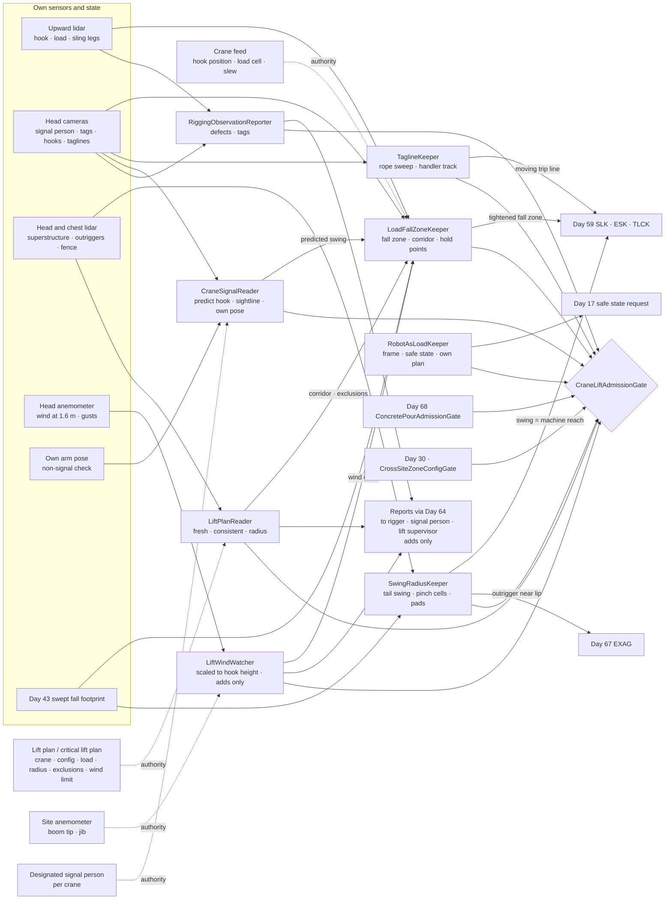
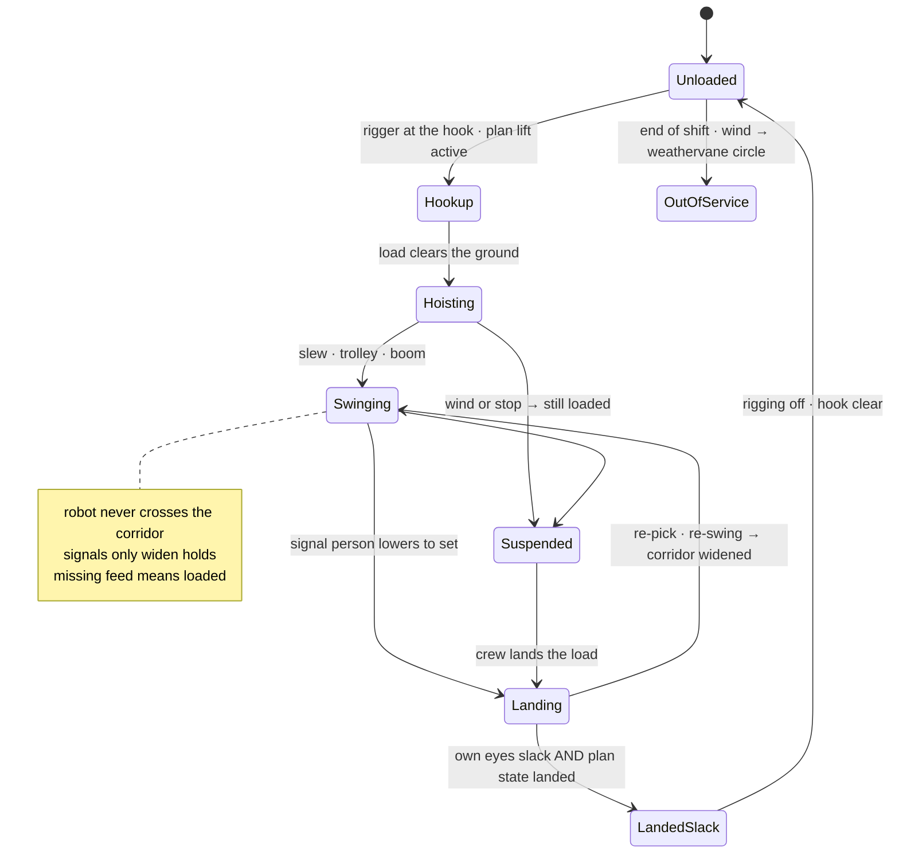
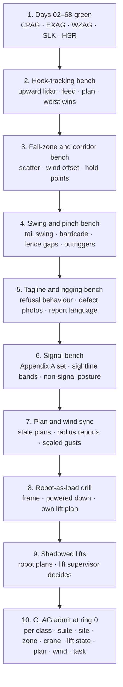

# Day 69 — Cranes, rigging, and overhead lifts under the pour stack: LoadFallZoneKeeper / SwingRadiusKeeper / TaglineKeeper / CraneSignalReader / RiggingObservationReporter / LiftPlanReader / LiftWindWatcher / RobotAsLoadKeeper / CraneLiftAdmissionGate under ConcretePourAdmissionGate + the excavation stack: PumpBoomZoneKeeper / FreshConcreteKeeper / FormworkShoreKeeper / PourSequenceReader / RebarImpalementKeeper / FinishingToolKeeper / AlkalineSplashKeeper / ConcretePourAdmissionGate under ExcavationAdmissionGate + AirQualityAdmissionGate + HotWorkAdmissionGate + LoudSiteAdmissionGate + ElectricalAdmissionGate + HeatAdmissionGate + WeatherAdmissionGate + LowLightAdmissionGate + WorkZoneAdmissionGate + DockAdmissionGate + SidewalkAdmissionGate + CorridorAdmissionGate + ElevatorAdmissionGate + DoorwayAdmissionGate + WetSurfaceAdmissionGate + ConfinedSpaceAdmissionGate + ElevatedAccessAdmissionGate + OverheadToolAdmissionGate + BimanualToolAdmissionGate + PowerToolAdmissionGate + PushPullAdmissionGate + PayloadCarryAdmissionGate + OutdoorGroundAdmissionGate + TerrainLocomotionAdmissionGate + FallSafeAdmissionGate + DeliberateContactAdmissionGate + WholeBodyTouchAdmissionGate + HumanHandoverAdmissionGate + CooperativeTaskAdmissionGate + TaskCompositionAdmissionGate + FleetSkillCatalogAdmissionGate + proximity + zone attestation + supervisor + logging + canary + HIL + fleet + incident + change-management + maintenance + thermal + energy gates

![LoadFallZoneKeeper / SwingRadiusKeeper / TaglineKeeper / CraneSignalReader / RiggingObservationReporter / LiftPlanReader / LiftWindWatcher / RobotAsLoadKeeper / CraneLiftAdmissionGate: the same 63.8 kg humanoid on Site C on a cold, gusty Tuesday carries a 12 kg box of grout shims and bearing pads to the precast crew while a 60 t all-terrain crane sets two 2.6 t precast stair flights into the core under a critical lift plan at 79 % of its chart and a tower crane flies 750 kg formwork tables and 12 m rebar bundles overhead; it waits at a hold point outside a 16.8 m fall zone around the rebar bundle instead of timing a dash under it, because a bar sliding out of a choker lands anywhere within half its length; it keeps 5.5 m from the mobile crane's counterweight and never stands between the turning superstructure and the site fence; it never touches the tagline the rigger hands toward it; it stays out of the sightline between the signal person and the operator and keeps its arms low, because a humanoid waving a balancing arm looks like a crane signal; it photographs a web sling with a cut edge and a hook with no latch and reports both without calling anything good or bad; it reads the measured hook radius at 21.5 m against a planned 20.0 m and reports it to the lift supervisor instead of judging the chart; it reads 6 m/s at its own head and reports that the wind up at the jib is likely nearly twice that, without ever saying a lift is safe to make; and when the foreman suggests flying it up to level 3 in a material basket, it refuses, because the only way a robot goes up on a hook is powered down in its own rated frame on a lift plan of its own](/images/day69-cranes-rigging-overhead-lifts.png)

[Day 05](/lessons/day-05-power-bms) owns `torque_scale` and the pack **forever**. [Day 07](/lessons/day-07-wbc-balance) owns gait and balance. [Day 17](/lessons/day-17-runtime-safety-supervisor) owns ESTOP and safe states. [Day 29](/lessons/day-29-human-proximity-safety) owns person tracks, SSM, and PFL rows. [Day 30](/lessons/day-30-collaborative-workspace-zoning) owns attested zones and `CrossSiteZoneConfigGate`. [Day 40](/lessons/day-40-human-robot-handover-co-carry) owns handovers. [Day 43](/lessons/day-43-falls-fall-safe-contact) owns the fall direction and the swept fall footprint. [Day 59](/lessons/day-59-construction-sites-work-zones) owns slab edges, openings, machine swing, the base suspended-load fall zone, trip lines, and barriers. [Day 61](/lessons/day-61-weather-rain-snow-fog-wind) owns weather, lightning holds, and the sensor windows. [Day 63](/lessons/day-63-temporary-power-electrical-hazards) owns overhead line clearance, including the crane's. [Day 64](/lessons/day-64-noise-vibration-communications) owns warnings, radio, the closed hand-signal set, and the not-a-signal class. [Day 65](/lessons/day-65-hot-work-fire-hazards) owns evacuation. [Day 67](/lessons/day-67-excavations-trenches) owns excavations, lips, and outrigger-near-edge reports. [Day 68](/lessons/day-68-concrete-pours-formwork-rebar) owns pumps, fresh concrete, formwork, and rebar.

Day 68 was about what flows down a pipe into the forms. Today is about everything that arrives on a hook. After the deck is poured, the building goes up by crane: formwork tables flown from one level to the next, rebar bundles from the laydown yard, precast stairs, steel, mechanical units, the site's own toilets. The crane is the one machine on the site that routinely moves tonnes over people's heads, and almost every rule around it exists because someone was under a load, beside a counterweight, or holding a rope when it went wrong.

A humanoid near a lift has five ways to make things worse. It's **a body under or beside the load**: in the fall zone, in the load's path, in the swing of the counterweight. It's **a pair of hands** that someone will hand a tagline, a shackle, or a hook to. It's **a moving silhouette with arms** in the operator's view, where arm positions are the language the crane is driven by. It's **an observer** that sees slings, hooks, wind, and radius, and will be tempted, or asked, to say something is fine. And, eventually, it's **a load itself**, because there will be a day when the stair tower isn't up and somebody suggests the crane. None of those makes it the operator, the signal person, the rigger, or the lift supervisor.

Eight lies show up the first time a team runs a humanoid near a crane:

1. **It's-only-a-second lie.** "The load's 20 m up and moving away; just dash under it." Day 59 already says the robot crosses a load path only when the load is landed or far enough away. A loose bundle adds a scatter term: a 12 m bar that slides out of a choker lands anywhere within about half its length of the bundle, and nothing about the dash is shorter than the time it takes to fall 20 m.
2. **Counterweight's-behind-it lie.** "The load's on the other side, so the back of the crane is safe." The counterweight swings when the boom swings, at the same angular speed, in the opposite direction, with no one looking at it. People are crushed between it and the fence, a truck, or a column.
3. **Just-hold-the-rope lie.** "Hang on to the tagline for a second." A tagline is a hand-held connection to a tonne in the wind. A gust or a swing loads it faster than any arm controller can let go, wraps it round a wrist, and pulls the holder off a deck edge. A humanoid's grip is the last thing you want on a rope that a load decides to take.
4. **Robot-waved-it-in lie.** "The robot was standing there with its arm out, so I thought it was the signal." An extended arm, palm down, moving back and forth is a stop. An arm out with a pointing finger is a swing. A humanoid shifting a carried box, balancing on a slope, or pointing its camera arm can look exactly like either.
5. **Sling-looks-fine lie.** "The robot looked at the slings; they're fine." Rigging is inspected by a competent person before each shift and by a qualified rigger at hook-up, against removal criteria like broken wires per lay, kinks, cuts, heat damage, hook throat opening, and missing tags. A camera seeing "no visible damage" is not an inspection and must never sound like one.
6. **Chart-says-so lie.** "The crane's rated for 60 tonnes; a 2.6 t stair is nothing." A crane's capacity depends on its configuration, its radius, and its boom length, and at 20 m on this crane it's 4.0 t, not 60. The radius grows as the boom deflects under load and when the hook is swung out. The chart is the operator's, read by the operator, for the configuration on the crane.
7. **Calm-down-here lie.** "It's barely breezy." Wind speed rises with height. The robot's anemometer sits at 1.6 m in the lee of a building; the load is at 30 m, with the sail area of a billboard. The number that limits a lift is the manufacturer's, measured at the boom tip or the jib, applied by the operator to that load.
8. **Just-fly-it-up lie.** "Stairs aren't in yet; put the robot in the material basket and fly it to level 3." A powered humanoid in a basket is an uncertified load with a moving centre of mass, a lithium pack, and joints that can twitch, carried in equipment designed for neither people nor robots.

Today owns **`LoadFallZoneKeeper` / `SwingRadiusKeeper` / `TaglineKeeper` / `CraneSignalReader` / `RiggingObservationReporter` / `LiftPlanReader` / `LiftWindWatcher` / `RobotAsLoadKeeper` / `CraneLiftAdmissionGate`**. The question is: **how do you let a humanoid work on a site with cranes, with the fall zone under every load and the corridor of every load path kept empty of it, the counterweight's swing and every pinch point beside it kept clear, taglines and rigging never held, attached, or inspected, the signal person deferred to, never imitated, and never blocked from the operator's view, the lift plan and the load chart read as someone else's authority it can tighten but never relax, wind at the hook estimated only to add holds, and the robot itself lifted only as a planned, powered-down load in its own frame — without raising Day 29 PFL, writing Day 05 `torque_scale`, gating Day 17 ESTOP, or bypassing `CrossSiteZoneConfigGate`?**

## The robot is never part of the lift

The rule everything follows from: **around a crane, the robot is a body kept out from under the load and out of the swing, a pair of hands kept off every rope, sling, and hook, a silhouette that never looks like a signal and never stands in one's way, and an observer whose reports only add. It never enters a fall zone or crosses a load path while the hook is loaded, never stands inside the counterweight's swing radius or between the superstructure and anything fixed, never holds, guides, or ties off a tagline, never attaches, detaches, carries to the hook, inspects, or passes judgement on rigging, never gives a signal to a crane (including a stop), never stands between the signal person and the operator, never reads or presents a load chart, a radius, or a wind reading as a reason a lift can go ahead, and never rides a hook, a load, a basket, or a personnel platform.** The site has people for those calls: the crane operator who owns the chart and the controls, the qualified signal person who owns the operator's eyes, the qualified rigger who owns the hook-up, the competent person who inspects rigging each shift, and the lift supervisor or lift director who owns the plan and decides when the wind has won. The robot can tell them things. It can't stand in for them.

Six facts set the shape of the lesson.

**Nobody is under a load, and the fall zone is bigger than the load.** OSHA's crane rule for construction (29 CFR 1926 Subpart CC) defines the *fall zone* as the area, including the area directly beneath the load, in which it's reasonably foreseeable that partially or completely suspended materials could fall in the event of an accident (1926.1401). While the operator isn't moving a load, only workers hooking, unhooking, or guiding it, or doing the initial attachment, may be in the fall zone, and nobody is ever directly under a load except in narrowly listed cases (1926.1425). The robot is none of those workers, so for the robot the fall zone is always closed. Day 59 gave it a fall zone of

$$
r_{\text{fall}} = \tfrac{1}{2} d_{\text{load}} + v_h \sqrt{\frac{2h}{g}} + m
$$

Today adds two terms that the crane makes unavoidable: a **scatter** term for loads that come apart, and a **wind offset** for loads the wind pushes off the hook's plumb line.

**The back of the crane is as dangerous as the front.** OSHA requires the worker-accessible areas within the swing radius of a crane's rotating superstructure to be barricaded, so nobody can be struck or crushed by it (1926.1424). On a 60 t all-terrain crane, the counterweight's tail swing is about 4 m from the centre of rotation, and it sweeps at the boom's angular speed. Wherever the swing envelope comes close to something fixed, a fence, a wall, a parked truck, a column, the gap becomes a pinch point. Outrigger beams extend and retract, and their pads carry tens of tonnes into ground the controlling entity has to have prepared (1926.1402). The ground part is Day 67's.

**Signals belong to one person, except stop.** A signal person is required when the point of operation isn't in full view of the operator, when the operator's view is obstructed in the direction of travel, or when the operator or the person handling the load decides one is needed (1926.1419). Signal persons are qualified (1926.1428), use the standard hand signals in Appendix A of Subpart CC or an agreed radio protocol, and the operator takes instructions from one signal person at a time, except that the operator obeys a stop or emergency stop from anyone (1926.1417(y)). That last rule is why a humanoid's arms matter: anything it does with them in the operator's view can be read as a stop, and something less obvious can be read as a swing.

**Rigging is inspected by people, against numbers.** Rigging equipment is inspected before use on each shift by a competent person and removed when defective (1926.251). ASME B30.9 removes a wire-rope sling for, among other things, ten randomly distributed broken wires in one rope lay, or five broken wires in one strand in one rope lay, for kinks, crushing, bird-caging, heat damage, or a missing or illegible tag. ASME B30.10 removes a hook whose throat opening has increased or whose tip is twisted beyond the manufacturer's limits, or whose latch is missing or doesn't close. The tension in a sling leg depends on the angle:

$$
T_{\text{leg}} = \frac{W}{n \sin\theta}
$$

with $W$ the load, $n$ the number of legs carrying it, and $\theta$ the leg angle from horizontal. At 60° each leg of a two-leg bridle carries 0.58 W; at 30° it carries 1.0 W. A sling that "looks fine" can be loaded twice as hard as the one beside it. None of that is visible to a camera from 15 m.

**The chart is a curve, the radius moves, and some lifts are critical.** A mobile crane's rated capacity falls steeply with radius. On today's 60 t all-terrain crane, with 30.4 m of boom on full outriggers, the operator's chart gives about 4.0 t at 20 m and about 3.6 t at 22 m (illustrative numbers for this lesson; only the chart in the cab counts). The load is everything under the boom tip: 2.60 t of stair, 0.15 t of rigging, and a 0.40 t hook block make 3.15 t, which is 79 % of the chart at 20 m and 88 % at 22 m. Many sites call any lift above 75 % of chart a **critical lift**, as well as tandem lifts, lifts of people, lifts near power lines, blind lifts, and lifts over occupied areas, and require a written plan signed by a lift director. Radius is measured from the centre of rotation to the hook's plumb line, and it grows when the boom deflects under load or the load swings out.

**Wind scales with height and with sail area.** Mobile crane manufacturers commonly publish in-service wind limits of around 9 to 14 m/s, measured at the boom tip, with lower limits for loads with a large area. Tower cranes go out of service at higher speeds, and out of service they're left free to slew, so that the jib weathervanes downwind. Near the ground, wind follows roughly a power law:

$$
v(z) = v_{\text{ref}} \left(\frac{z}{z_{\text{ref}}}\right)^{\alpha}
$$

with $\alpha \approx 0.2$ to $0.3$ over a built-up site. A reading of 6.0 m/s at 1.6 m becomes, with $\alpha = 0.2$, $6.0 \times (40/1.6)^{0.2} \approx 11.4$ m/s at 40 m. The force on a flat load is $F = \tfrac{1}{2}\rho C_d A v^2$: a 2.4 × 6.0 m formwork table ($A$ = 14.4 m², $C_d \approx 1.2$, $\rho$ = 1.225 kg/m³) feels about 1.06 kN at 10 m/s and 2.1 kN at 14 m/s, against a weight of 7.4 kN. That's enough to hold it 8° to 16° off plumb on its rigging and to set it spinning.

| Layer | Owns | Must not own |
|-------|------|--------------|
| `LoadFallZoneKeeper` | Every hook within range, from the lift plan, the crane's feed, and its own upward lidar and camera, worst wins; fall zone per load with Day 59's terms plus scatter (loose bundles) and wind offset; the planned load path swept into a corridor; hold points outside it; crossing only with the hook unloaded or the load landed and slack seen; handed to Day 59 SLK as a tightening | Being in any fall zone for any reason; asking for a load to be moved, held, or lowered |
| `SwingRadiusKeeper` | The superstructure's tail swing and the barricade line, worst wins, plus 1 m; pinch cells wherever the swing envelope passes within 1 m of something fixed; outrigger beams and pads as no-entry cells; a tower crane's base, and the full jib and counter-jib circle when out of service; set-up near edges reported to Day 67 | Moving a barricade; deciding ground is good enough; signalling the operator |
| `TaglineKeeper` | Every tagline tracked as a rope with a load on the end: never held, guided, stepped on, tied off, or handed on; the handler's track and the rope's sweep kept clear; slack rope across a walkway handed to Day 59 TLCK as a trip line that can move | Holding any rope connected to a load, ever |
| `CraneSignalReader` | The designated signal person for each crane from the lift plan; Appendix A crane signals read only to predict the hook's next motion and widen holds; the signal person's sightline to the operator kept clear; the robot's own arms held in a non-signal posture whenever it's in an operator's view | Giving any signal to a crane, stop included; relaying a signal; transmitting on the crane channel; acting on a crane signal as a permission |
| `RiggingObservationReporter` | Slings, shackles, hooks, spreaders, and their tags, seen from outside the fall zone; visible defects photographed and reported to the rigger and the competent person, labelled adds-only | Touching, attaching, detaching, carrying to the hook, inspecting, or calling any rigging serviceable |
| `LiftPlanReader` | Today's lift plans and critical lift plans read and checked for freshness and consistency against the crane, the configuration, the radius, the load, and the exclusion zones it sees; measured radius and visible configuration reported against the plan | Reading or presenting a load chart; approving, extending, or re-sequencing a lift |
| `LiftWindWatcher` | The site's boom-tip or jib anemometer as the authority; its own readings at 1.6 m scaled to hook height and gusts as a report that only adds; the plan's wind limit per load; lift-suspended state holds every loaded hook as loaded until landed; out-of-service tower cranes as weathervaning circles | Declaring a lift safe in the wind; replacing the site's anemometer |
| `RobotAsLoadKeeper` | Never riding a hook, a load, a basket, or a personnel platform; any lift of the robot only in its rated transport frame, powered down in Day 17 safe state, with declared mass and CG, on its own lift plan, rigged by riggers | Self-rigging; being lifted by a limb, a harness point, or in a basket; moving any joint while suspended; Day 05 pack decisions |
| `CraneLiftAdmissionGate` | Fail-closed admit per robot class, suite, site, zone, crane, lift state, lift plan, wind state, task | `JointCommand`; Day 05; PFL; Day 17 |
| Days 05 / 07 / 17 / 29 / 30 / 40 / 43 / 59 / 61 / 63 / 64 / 65 / 67 / 68 | Pack, gait, ESTOP, people, zones, handover, falls, machines and loads and trip lines, weather, lines, comms, evacuation, excavations, pours | Being outranked by "the robot watched the lift and it looked fine" |

**Core thesis:** **on a site with cranes, a humanoid keeps out of every fall zone and every loaded load path by waiting at hold points rather than timing its way through, stays outside the counterweight's swing and every pinch point beside it, never touches a tagline or a piece of rigging, never looks like a signal and never blocks one, treats the lift plan and the chart as somebody else's and reports when what it sees doesn't match them, adds holds from the wind but never lifts one, and goes up on a hook only as a planned, powered-down load in its own frame.**



## Physical machine: where the loads go

Walk Site C on Tuesday morning. It's 4 °C at 07:00, dry, wind 4 to 6 m/s from the north-west at street level, forecast to gust 12 m/s at 30 m by early afternoon. A flat-top tower crane stands in the core with a 50 m jib, 40 m under the hook, slewing at up to 0.6 rpm; its base is fenced. This morning it flies formwork tables (2.4 × 6.0 m, 750 kg each) from the stripped west half of level 2 up to level 3, and lifts 1.5 t bundles of 12 m, 20 mm rebar from the laydown yard on the north side, choked at two points. On the street, a 60 t all-terrain crane is set up on full outriggers on 1.5 × 1.5 m timber mats, 30.4 m of boom out, to set two precast stair flights (2.6 t, 4.2 × 1.2 m each) into the east stair core at a planned radius of 20 m. That lift is at 79 % of chart, so it has a critical lift plan, signed by the lift director, with a named signal person on the level 2 deck (it's a blind lift: the operator can't see the landing), a qualified rigger at the pick, two tagline handlers, a 7 m exclusion zone around the pick, and a wind limit of 9 m/s at the boom tip. The crane's rear outrigger pad is 2.8 m from the fence; its counterweight swings 4.0 m from the centre of rotation, and the barricade tape is at 4.5 m. The nearest outrigger mat is 4.1 m from the backfilled line of Day 67's water-service trench. Level 2 east, poured on Friday, is released for foot traffic only.

The robot's tasks: carry a 12 kg box of grout shims and bearing pads to the precast crew at the level 2 east stair landing, then take an 8 kg case of spare radio batteries to the lift supervisor at the gate. At the end of the shift, the foreman wants it on level 3 for tomorrow's layout work. The stair tower only reaches level 2.

The robot's hardware for this:

- **An upward-facing lidar and camera pair** on the upper back of the head (from Day 59), which see the hook, the load, the sling legs, and the boom tip against the sky.
- **Head and chest lidar** for the superstructure, the counterweight, the outriggers, the fence, and anything fixed beside them.
- **Head cameras** with Day 60's low-light settings and Day 61's window self-check, used for the signal person's arms, sling tags, hook latches, and taglines.
- **A small ultrasonic anemometer** in the head (from Day 61), 1.6 m off the ground.
- **Arm pose** from its own joint encoders, so that it knows, as a state, what its arms look like from outside.
- **The Day 43 fall model,** giving a swept fall footprint of 1.8 m with today's payload.
- **A transport frame**: a steel cradle with four rated lift points, 55 kg, that the robot can be strapped into seated with its joints braked (from the fleet's shipping kit).

### The load: fall zones, scatter, and wind

`LoadFallZoneKeeper` takes every hook within 60 m from three sources: the crane's feed if the site provides one (hook position, load cell, slew angle), the lift plan, and its own upward lidar and camera. Where they disagree, the worst wins. A hook is **loaded** from the moment the rigger's hook-up starts until LFZK sees the load landed and the slings slack *and* the lift plan's state agrees. A missing feed is a loaded hook.

For each loaded hook it computes

$$
r_{\text{fall}} = \tfrac{1}{2} d_{\text{load}} + v_h \sqrt{\frac{2h}{g}} + s + m
$$

with $s$ the **scatter term**: zero for a single rigid piece, half the longest member's length for a bundle of loose members (bars, pipe, lumber, scaffold tube), and half the load's length for any long load hung from a single pick point. $v_h$ is the larger of the hook speed it measures and the speed the crane can reach at that radius. For the tower crane slewing at 0.6 rpm at 30 m radius, that's $2\pi \times 30 \times 0.6 / 60 \approx 1.9$ m/s.

| Load | $d_{\text{load}}$ | $h$ | $v_h$ | $s$ | $m$ | $r_{\text{fall}}$ |
|------|------|-----|-----|-----|-----|-----|
| Formwork table, 2.4 × 6.0 m | 6.5 m | 12 m | 1.9 m/s | 0 | 1.0 m | 3.25 + 2.97 + 0 + 1.0 = **7.2 m** |
| Rebar bundle, 12 m bars | 12.0 m | 20 m | 1.9 m/s | 6.0 m | 1.0 m | 6.0 + 3.84 + 6.0 + 1.0 = **16.8 m** |
| Precast stair, 4.2 × 1.2 m | 4.4 m | 12 m | 1.0 m/s | 0 | 1.0 m | 2.18 + 1.56 + 0 + 1.0 = **4.7 m** |

Then wind. A load on rigging of length $L$ (hook to load) under a horizontal wind force $F_w$ and weight $W$ hangs at $\phi = \arctan(F_w/W)$ off plumb, so its centre sits $L \tan\phi$ downwind of the hook. LFZK shifts the fall zone downwind by that amount, using `LiftWindWatcher`'s estimate at hook height, and grows it by the same amount if the wind direction is gusting around. For a formwork table 4 m below the hook at 10 m/s, $\phi \approx 8°$ and the offset is 0.6 m; for the same table on a 20 m hoist line, during the climb, the hook is already moving and the offset is 2.9 m.

The **load path** is the planned route from pick to set, swept by the fall zone into a corridor, and LFZK takes it from the lift plan, from the signal person's swing signal (via `CraneSignalReader`), and from the hook's measured motion, whichever is widest. The rule for the robot is stricter than Day 59's crossing rule: **while a hook is loaded, the robot doesn't cross its corridor at all.** It waits at a **hold point**, a spot outside the corridor and every fall zone, outside the swing radius, off every walkway, and in the open, and it goes when the load is landed and slack. Day 59's timing rule remains for unloaded hooks moving overhead.

The rebar bundle shows why. Its corridor from the laydown yard to level 2 crosses the only route from the gate to the stair tower. At 16.8 m radius, the robot at 0.8 m/s needs 42 s to cross a corridor's width; a tower crane covers 80 m of slew arc in that time. There's no timing that makes it acceptable to be near a 1.5 t bundle of loose bars choked at two points, so the robot waits, and the four minutes are logged as a lift wait in the task record.

### The crane: counterweight, pinch, outriggers

`SwingRadiusKeeper` takes the crane's position and configuration from the lift plan and its own lidar, and builds:

- a **swing cell**: the circle of the superstructure's tail swing, or the barricade line, whichever is larger, plus 1 m. Here that's max(4.0, 4.5) + 1.0 = 5.5 m. The robot doesn't enter it whether or not the crane is slewing, because slewing starts without warning to anyone at the back.
- **pinch cells**: wherever the swing envelope passes within 1 m of anything fixed (here, the fence 2.8 m behind the rear outrigger), the gap between them and 1 m either side is no-entry. A robot that stops in a pinch gap because a person walked in front of it has turned itself into a crush hazard for the person.
- **outrigger cells**: every beam and pad plus 1 m, and the space under the beams. Outrigger beams move only during set-up and tear-down, which are when people least expect it.
- for the **tower crane**: the fenced base, the counter-jib's swept circle under its ballast blocks, and, whenever the crane is out of service (end of shift, or the wind), the full jib circle, because a weathervaning crane slews freely and anything hanging from the trolley swings with it.

If an outrigger mat sits within Day 67's lip standoff of an excavation, SRK reports it to Day 67, whose gate decides. If the robot sees water ponding at a mat, a mat that has visibly settled, or cribbing that has shifted, it reports to the lift supervisor: the ground under an outrigger carrying about 28 t on a 1.5 × 1.5 m mat ($28 \times 9.81 / 2.25 \approx 122$ kPa) is the controlling entity's to have prepared, and the robot's observation can only add a question.

### Taglines: never on the robot's hands

`TaglineKeeper` finds the ropes tied to a load: from the plan (which lists them for this lift), from the cameras (a rope leaving the load and ending at a person), and from the handlers' tracks. A tagline is a rope with a tonne on the end, so TLK treats it two ways: the handler is a person working at the edge of a fall zone, whose track Day 29 gets a separation request for, and the rope's sweep (the circle it can cover if the load swings or spins, about the rope's length around its tie point) is a cell the robot stays out of. Slack rope on the deck goes to Day 59's trip-line keeper as a line that can move without warning, which it never steps over or on.

The robot **never holds a tagline**: not to help, not "for a second," not when a handler holds one out. The reasons are physical. A load in a gust can put hundreds of newtons into a rope in a fraction of a second. A human handler lets go; a gripper closed by an impedance controller may not open faster than the load takes up the slack, and a rope round a forearm or a finger linkage pulls a 64 kg body off its feet, possibly over the deck edge. Near power lines, taglines must be non-conductive (1926.1408), and the robot can't certify that either. When a rope is offered, the robot keeps both hands on its box, steps back, and says on its display and speaker: "I can't hold taglines."

### Signals: read, never given, never blocked

`CraneSignalReader` extends Day 64's `HandSignalReader` for cranes. Day 64 already says any stop-like signal from anyone stops the robot, and the robot never signals a crane. Today adds three things.

**Reading crane signals to predict the hook.** CSR knows the Appendix A signals (hoist, lower, swing, boom up and down, extend and retract, travel, stop, emergency stop, dog everything) and the designated signal person for each crane from the lift plan. When that person gives a swing toward the robot's side, LFZK widens the corridor before the hook moves. A signal only ever widens a hold; "lower" doesn't mean the area is safe, and "dog everything" doesn't mean the hook is unloaded.

**Keeping the sightline clear.** For each crane with a signal person, CSR draws the line from the signal person's position to the operator's cab (or, for a radio-only blind lift, to wherever the signal person needs to watch the load) and makes a 1.5 m-wide band around it a no-loiter cell. A 1.8 m robot standing in that band is a body between the operator and the only eyes the operator has.

**Not looking like a signal.** Whenever the robot is inside an operator's field of view (the cab's position and its own sightline to it), CSR adds a **non-signal posture** constraint to Day 07's arm planning, as a request: no arm raised above the shoulder, no arm extended horizontally, no forearm vertical with a pointing hand, no repeated side-to-side or circular arm motion, and both hands on the payload or by the body. It can't guarantee a human won't misread it, but it can make sure no posture it chooses is one of the signals. If Day 07 needs an arm out for balance, the robot stops, settles, and lets Day 07 do what it needs; CSR's constraint is a request, never a limit on balance.

Why not let the robot give a stop, which the operator must obey from anyone? Because a stop from a robot comes from a source the operator hasn't agreed to work with, over a channel nobody acknowledges, based on a partial view, and a load stopped mid-swing near people swings on its rigging. When the robot sees a person enter a fall zone, it sends a priority report to the designated signal person and the lift supervisor through Day 64, and it stops itself. The people decide what the crane does. Exercise 4 asks you to argue the other side.

### Rigging: seen, never touched

`RiggingObservationReporter` watches the rigging from outside the fall zone and the swing cell. It classifies nothing as serviceable. It looks for things a camera can see and a rigger would want to hear about: a sling with no tag or an illegible one, a web sling with a cut, burn, or frayed edge, a wire-rope sling with a kink, a bird-cage, or visible broken wires, a hook without a latch or with a latch that doesn't close, a shackle whose pin isn't seated or isn't moused, a sling leg running over a sharp edge with no softener, an angle visibly under 30° from horizontal, a choker hitch on a bundle with no wrap. Each one goes out as a photo, a location, the crane and lift ID, and "adds only: not an inspection," to the rigger and the competent person. It never says "looks good," "no defects," or "passed," and the absence of a report means nothing.

It never touches rigging: it doesn't carry slings to the hook, hand a shackle to a rigger, unhook a landed load, or pick up a sling off the deck. Every one of those puts it at the hook, inside a fall zone, at the moment the load is least predictable.

### The plan and the chart: someone else's numbers

`LiftPlanReader` reads every lift plan for today from the site: crane, configuration, load weight (including rigging and hook block), pick and set radius, percent of chart, signal person, rigger, tagline handlers, exclusion zones, wind limit, and whether it's critical. It checks that each plan is today's, that the crane it sees is in the plan's position and configuration (outriggers out, boom length roughly as planned), and that the exclusion zones on the ground match the plan. A stale, missing, or inconsistent plan means the whole lift area is refused.

During the lift, LPR measures what it can see: the hook's horizontal distance from the crane's centre of rotation, from its upward lidar and the crane's position. When the stair hangs at 21.5 m against a planned 20.0 m, LPR reports "measured radius about 21.5 m, plan 20.0 m" to the signal person and the lift supervisor. It doesn't say what the chart allows at 21.5 m, doesn't compute a percentage, and doesn't say the lift should stop. The operator has the chart and the load moment indicator; the report is an extra pair of eyes on a number they already own.

### Wind: adds only

`LiftWindWatcher` takes the site's anemometer (on the mobile crane's boom tip and the tower crane's jib) as the authority, and its own 1.6 m readings as a report. It scales its own mean and gust speeds to hook height with $\alpha = 0.3$ (the conservative end for a built-up site) and reports when the scaled gust exceeds 0.8 of the plan's wind limit for any lift in progress. At 13:10 it reads gusts of 5.5 m/s at its head, which scales to $5.5 \times (30/1.6)^{0.3} \approx 13.3$ m/s at 30 m. The precast lift is done, but the tower crane is still flying tables with a plan limit of 9 m/s, so LWW reports to the lift supervisor. It never reports "wind OK" and it never uses a low reading to lift a hold: its sensor sits in the building's lee and can only add.

When the site suspends lifting for wind, LWW sets a lift-suspended state: every hook that was loaded stays loaded to LFZK until the robot sees it landed and slack, and every tower crane goes to its weathervaning circle once out of service. Lightning holds are Day 61's.

### The robot as a load

`RobotAsLoadKeeper` exists because someone will ask. The robot never rides a hook, a load, a material basket, a skip, a pallet, or a personnel platform (1926.1431 governs hoisting people; the robot isn't one, and it doesn't make a personnel platform safe to share). It never lets itself be lifted by a limb, by a wrist or ankle link, or by a harness point clipped to its torso.

If the site really needs it at height without stairs or a hoist, the answer is a **lift of the robot as cargo**: the robot walks to the frame, sits, and is strapped in by people; it goes to Day 17's powered-down safe state with its joint brakes engaged; Day 05 decides the pack's transport state (the robot can only request it); the frame's four rated lift points take a spreader and slings supplied and inspected by the riggers; the lift plan lists the robot's mass (63.8 kg), the frame (55 kg), its CG, and a tagline handled by a person; and the robot stays powered down until it's landed, the slings are off, and a person releases it. Total load 118.8 kg plus rigging: trivial for the crane, but every piece of the plan exists for the same reasons as the stair's. A joint that twitches in the air moves the CG of a load on a hook, so nothing moves while it's suspended. The foreman's material-basket suggestion is refused, with the reason on the display, and logged.

### Putting the cells in code

As every day since Day 59: everything here adds or keeps constraints; nothing removes one.

```python
import math
from dataclasses import dataclass

G = 9.81
MARGIN_M = 1.0
SWING_MARGIN_M = 1.0
PINCH_GAP_M = 1.0

@dataclass
class Hook:
    load_diag_m: float
    longest_member_m: float
    loose_bundle: bool
    single_pick_long_load: bool
    height_m: float
    v_meas_m_s: float
    v_crane_max_m_s: float
    rigging_len_m: float
    weight_n: float
    sail_area_m2: float
    state: str            # "UNLOADED" | "HOOKUP" | "HOISTING" | "SWINGING" | "LANDING" | "LANDED_SLACK" | "UNKNOWN"

def scatter(h: Hook) -> float:
    if h.loose_bundle or h.single_pick_long_load:
        return 0.5 * h.longest_member_m
    return 0.0

def wind_offset(h: Hook, v_wind_hook_m_s: float, cd: float = 1.2, rho: float = 1.225) -> float:
    f = 0.5 * rho * cd * h.sail_area_m2 * v_wind_hook_m_s ** 2
    return h.rigging_len_m * f / h.weight_n          # L tan(phi), tan(phi) = F/W

def fall_radius(h: Hook, v_wind_hook_m_s: float) -> float:
    v = max(h.v_meas_m_s, h.v_crane_max_m_s)          # never trust a slow moment
    r = 0.5 * h.load_diag_m + v * math.sqrt(2 * h.height_m / G) + scatter(h) + MARGIN_M
    return r + wind_offset(h, v_wind_hook_m_s)        # grown, not just shifted, when gusty

def hook_loaded(h: Hook, plan_state: str) -> bool:
    # the robot's eyes and the plan must both say landed and slack; anything else is loaded
    return not (h.state == "LANDED_SLACK" and plan_state == "LANDED") and h.state != "UNLOADED"

def may_cross_corridor(h: Hook, plan_state: str) -> bool:
    return not hook_loaded(h, plan_state)             # no timing rule while loaded

def swing_cell_radius(tail_swing_m: float, barricade_m: float) -> float:
    return max(tail_swing_m, barricade_m) + SWING_MARGIN_M

def scaled_wind(v_own_m_s: float, z_hook_m: float, z_own_m: float = 1.6, alpha: float = 0.3) -> float:
    return v_own_m_s * (z_hook_m / z_own_m) ** alpha  # report only; never lowers a hold
```

```python
SIGNAL_POSES = {"ARM_ABOVE_SHOULDER", "ARM_HORIZONTAL", "FOREARM_VERTICAL_POINT",
                "REPEATED_LATERAL", "CIRCULAR"}

def arm_request(in_operator_view: bool, planned_pose_classes: set[str]) -> dict:
    """CSR: a request to Day 07, never a limit on balance."""
    if not in_operator_view:
        return {}
    bad = planned_pose_classes & SIGNAL_POSES
    return {"avoid": sorted(SIGNAL_POSES), "replan": bool(bad), "if_balance_needs_it": "stop_and_settle"}

def radius_report(hook_xy, crane_xy, plan):
    """LPR: measure, compare, report. No branch computes chart capacity."""
    r = math.dist(hook_xy, crane_xy)
    if plan is None or not plan.today:
        return ["no lift plan for today: lift area REFUSED"]
    if r > plan.set_radius_m + 0.5:
        return [f"{plan.lift_id}: measured radius ~{r:.1f} m, plan {plan.set_radius_m:.1f} m (adds only)"]
    return []
```

## LoadFallZoneKeeper and SwingRadiusKeeper

LFZK and SRK keep the robot's body out of the two places a crane kills people: under the front and beside the back. LFZK works in time, like Day 68's pump keeper: the same spot is open while the hook is empty and closed from hook-up until the load is landed and slack, and missing state is the worst state. Its main tool is patience: hold points outside every corridor, chosen when the lift plan is read rather than when the load is overhead. SRK works in space and in states: the swing and pinch cells are constant while the crane is set up, the outrigger cells grow during set-up and tear-down, and a tower crane's cells grow to the full circle when it goes out of service.

## TaglineKeeper and CraneSignalReader

TLK and CSR are about the robot's hands and arms, the two parts of a humanoid that a crane crew will instinctively treat as a person's. TLK keeps its hands off every rope with a load on the end; CSR keeps its arms from saying anything, keeps its body out of the signal person's sightline, and uses the signals it reads only to widen holds. Both are requests to other owners (Day 29 for the handlers, Day 07 for the arms) that only tighten.

## RiggingObservationReporter, LiftPlanReader, LiftWindWatcher, and RobotAsLoadKeeper

ROR, LPR, and LWW are the observers. Each sees something that matters (a cut sling, a radius drifting out, wind higher up than anyone feels), each reports it to the person who owns that number, and none of them ever produces a sentence that sounds like approval. RAL is the one keeper that's about the robot as cargo: it refuses every improvised lift and turns the legitimate one into a plan, with the robot powered down for the whole of it.

## CraneLiftAdmissionGate

```text
CraneLiftAdmission
  robot_class, suite, site, zone, crane_id, task
  lift_state: NO_LIFT | RIGGING | HOISTING | SWINGING | LANDING | LANDED | SUSPENDED_WIND | OUT_OF_SERVICE
  requires:
    Day 68 ConcretePourAdmissionGate: admitted for this zone
    Day 30 CrossSiteZoneConfigGate: pass
    lift_plan: today's, consistent with crane position and configuration seen
    crane_feed or plan hook state: present (else every hook LOADED, UNKNOWN)
    signal_person: designated per crane in plan (else sightline cells = whole crane area)
    site_anemometer: present (else lift area refused when own scaled gust > 0.5 × limit)
    hold_points: planned for every corridor the task route meets
  refuses if:
    any route cell inside a fall zone or a loaded corridor
    any route cell inside a swing, pinch, or outrigger cell, or a tower crane base
    any route cell in a tagline sweep, or any grasp of a rope, sling, shackle, or hook
    any loiter in a signal person's sightline band
    any planned arm pose in the signal set while in an operator's view
    any task that puts the robot at a hook, on a load, in a basket, or on a platform
    any lift of the robot without RAL's plan, frame, and Day 17 safe state
  never: raises PFL · writes torque_scale · gates ESTOP · writes gait · bypasses CrossSiteZoneConfigGate
```

CLAG fails closed under Day 68's CPAG and everything beneath it. It's keyed by crane and lift state as well as zone, because the same walkway is open at 07:30, a corridor at 09:10 when the rebar bundle flies, a hold point at 10:40 during the stair lift, and a weathervaning circle at 16:30 when the tower crane goes out of service.

## Data shapes

```text
HookTrack
  crane_id, hook_xyz, v_h_meas, v_h_crane_max, state, source: FEED | PLAN | OWN_EYES (worst wins)
  load: diag_m, longest_member_m, loose_bundle, single_pick_long, weight_n, sail_area_m2, rigging_len_m
  fall_radius_m, wind_offset_m, corridor_id

LoadCorridor
  lift_id, path_polyline, width_m, hold_points[], active: bool

CraneCell
  crane_id, kind: MOBILE | TOWER | CRAWLER
  centre_xy, tail_swing_m, barricade_m, swing_cell_m
  pinch_cells[], outrigger_cells[], out_of_service_circle_m

Tagline
  lift_id, tie_point, length_m, handler_track_id, sweep_cell, slack_on_deck: bool

SignalContext
  crane_id, signal_person_track_id, method: HAND | RADIO | BOTH
  sightline_band, last_signal, predicted_motion
  robot_in_operator_view: bool, arm_request

RiggingObservation
  lift_id, item: SLING | SHACKLE | HOOK | SPREADER | TAG, finding, photo, location
  label: "adds only: not an inspection"

LiftPlan
  lift_id, date, crane_id, config, load_total_kg, pick_radius_m, set_radius_m, pct_chart (read, never computed)
  critical: bool, lift_director, signal_person, rigger, tagline_handlers[], exclusions[], wind_limit_m_s

WindState
  site_tip_m_s, site_gust_m_s, own_m_s, own_gust_m_s, own_scaled_hook_m_s
  lift_suspended: bool, source_authority: SITE

RobotLift
  plan_id, frame_id, frame_kg, robot_kg, cg_xyz, day17_state: POWERED_DOWN, day05_transport_request

# Unchanged owners
ConcretePourAdmissionGate · pumps · fresh concrete (Day 68) · EXAG · lips (Day 67)
Evacuation (Day 65) · radio · HSR (Day 64) · OLCG (Day 63) · weather · lightning (Day 61)
SLK · ESK · TLCK · edges · barriers (Day 59) · fall footprint (Day 43) · handover (Day 40)
Tracks · SSM · PFL (Day 29) · zones (Day 30) · gait (Day 07) · ESTOP (Day 17)
BmsState / PowerState (Day 05): torque_scale, contactors
  accepts_requests_from_site: false
```

## Config

A starting configuration. Every number is a policy you re-derive from your own robot, your site, and the rules that apply where you work:

```yaml
crane_lift:
  robot_part_of_lift: never
  fall_zone:
    margin_m: 1.0
    v_h: max(measured, crane_max_at_radius)
    scatter: { rigid: 0, loose_bundle: half_longest_member, single_pick_long_load: half_length }
    wind_offset: rigging_len_x_F_over_W
    enter: never
    corridor_crossing_while_loaded: never
    loaded_until: [own_eyes_landed_slack, plan_state_landed]
    missing_state: LOADED
    hold_points: planned_with_lift_plan
  swing:
    cell_m: max(tail_swing, barricade) + 1.0
    pinch_gap_m: 1.0
    outrigger_cells_m: 1.0
    tower_crane_out_of_service: full_jib_circle
    ground_reports_to: [day67_exag, lift_supervisor]
  tagline:
    hold: never
    sweep_cell: rope_length_around_tie_point
    handler: day29_larger_separation      # tighten only, never PFL
    slack_rope: day59_tlck_moving_line
  signals:
    give_signal_to_crane: never           # including stop
    relay_signal: never
    transmit_on_crane_channel: never
    read_signals_for: widen_holds_only
    sightline_band_m: 1.5
    non_signal_posture_in_operator_view: request_to_day07
    person_in_fall_zone: priority_report_to_signal_person_and_lift_supervisor_and_self_stop
  rigging:
    touch_attach_detach_carry: never
    inspection_language: never
    report_label: "adds only: not an inspection"
  lift_plan:
    required: today
    critical_flag: read_only
    chart_or_pct: never_computed_or_presented
    radius_report_threshold_m: 0.5
  wind:
    authority: site_anemometer
    own_reading: scaled_report_only
    alpha: 0.3
    report_at_fraction_of_limit: 0.8
    no_site_anemometer_refuse_at_fraction: 0.5
    lower_hold_from_own_reading: never
  robot_as_load:
    ride_hook_load_basket_platform: never
    lift_by_limb_or_harness: never
    only_in: rated_transport_frame
    state_while_suspended: day17_powered_down_brakes_on
    pack: request_day05_transport_state
    own_lift_plan: required
  requires: [day68_cpag, day67_exag, day66_aqag, day65_hwag, day64_lsag, day63_elag, day61_wxag, day59_wzag, day43_fsag, day30_cross_site_zone_config_gate]
  never:
    raise_pfl: true
    write_torque_scale: true
    gate_estop: true
    bypass_cross_site_zone_config_gate: true
```

## A hook, as states

As on Days 66 to 68, the arrows the robot can draw only go toward more closed. The crew moves a hook toward open, by landing the load and taking the rigging off.



## Physical ↔ digital pairing

| Physical | Digital twin / backing |
|----------|------------------------|
| Flat-top tower crane, 50 m jib, 0.6 rpm | SRK: base and counter-jib circle no-entry; LFZK: $v_h$ = 1.9 m/s at 30 m |
| Rebar bundle, 12 m bars, choked at two points | LFZK: $r_{\text{fall}}$ 16.8 m with 6.0 m scatter; corridor across the gate route; robot waits 4 min at hold point H2 |
| Formwork tables, 750 kg, 14.4 m² | LFZK: 7.2 m plus wind offset; LWW: plan limit 9 m/s |
| 60 t all-terrain crane, 30.4 m boom, full outriggers | SRK: swing cell 5.5 m; outrigger cells pad + 1 m |
| Rear outrigger 2.8 m from the fence | SRK: pinch cell between swing envelope and fence |
| Nearest mat 4.1 m from Day 67's trench line | SRK: report to Day 67; EXAG decides |
| Precast stair, 3.15 t under the tip, 79 % of chart, critical lift | LPR: plan read, critical flag shown; 7 m exclusion refused; percent never computed by the robot |
| Hook measured at 21.5 m, plan 20.0 m | LPR: radius report to signal person and lift supervisor, adds only |
| Signal person on level 2, blind lift | CSR: designated signaller from plan; sightline band no-loiter; "swing east" widens corridor before the hook moves |
| Robot carrying shims up the stair in the operator's view | CSR: non-signal posture request to Day 07; both hands on box |
| Rigger offers the robot a tagline | TLK: refused; "I can't hold taglines" on display; robot steps back out of the sweep |
| Web sling with a cut edge; hook with no latch | ROR: photos to rigger and competent person, "adds only: not an inspection" |
| 13:10 gusts 5.5 m/s at the head | LWW: ~13.3 m/s scaled to 30 m; report against the 9 m/s table limit; nothing lifted |
| Site suspends lifting for wind | LWW: SUSPENDED_WIND; hooks stay loaded until landed and slack |
| Tower crane out of service at 16:30 | SRK: full 50 m jib circle as weathervane cell |
| Foreman: "fly the robot up in the basket" | RAL: refused, logged; RobotLift plan requested with frame, Day 17 powered-down state, riggers |
| Evacuation alarm during the stair lift | Day 65 muster; LFZK keeps the route out of corridors and the swing cell |

The pairing that matters most: **replay every shift from the robot's own bag and show that it never entered a fall zone, never crossed a loaded corridor, never stood in a swing, pinch, or outrigger cell, never held a rope or touched a piece of rigging, never stood in a signal person's sightline, never held a signal pose in an operator's view, never gave a signal, never presented a radius, a wind reading, or a rigging observation as approval, and never left the ground on a hook except powered down in its frame on its own plan.**

## Bring-up sequence (before the robot works near a crane)



1. **Days 02–68 green,** with Day 59's suspended-load, machine, and trip-line keepers, Day 64's hand-signal reader, Day 43's fall footprint, and Day 68's CPAG.
2. **Hook-tracking bench:** at a crane rental yard with an operator, track an empty hook and a test weight through hoist, slew, trolley, and luff, against the crane's own feed; drop the feed and check every hook goes LOADED.
3. **Fall-zone and corridor bench:** compute fall zones and corridors for the site's real loads (bundles, tables, precast, steel); check scatter and wind offset change the circles; plan hold points from lift plans, not from what's overhead.
4. **Swing and pinch bench:** map tail swing for each crane configuration against the manufacturer's drawings; build pinch cells against fences, walls, and parked vehicles; walk the robot around a slewing crane at distance and check it never plans through a swing cell.
5. **Tagline and rigging bench:** have riggers offer ropes, slings, and shackles in every way they can think of; the robot refuses every one. Show the reporter a rigging loft's quarantine bin and check every report it writes carries "adds only" and none says "good."
6. **Signal bench:** a qualified signal person runs Appendix A at 10 to 40 m in daylight and Day 60 lighting; check reads only widen holds. Film the robot from the operator's cab doing every task it does near cranes and have operators mark anything that looks like a signal.
7. **Plan and wind sync:** connect to the site's lift plans and anemometers; test yesterday's plan, a crane in the wrong spot, a radius that drifts, a missing anemometer, and gusts in the lee of a building.
8. **Robot-as-load drill:** with riggers and a crane at the yard, practise the frame lift: powered down, brakes on, Day 05 transport state, no motion until released. Practise refusing the basket.
9. **Shadowed lifts:** the robot plans each move on site, the lift supervisor decides; compare its holds and reports with the crew's.
10. **CLAG admit at ring 0** per robot class, suite, site, zone, crane, lift state, plan, wind state, and task.

## Failure gallery

| Symptom | Likely cause |
|---------|--------------|
| Robot crossed under a rebar bundle "with 20 s to spare" | Day 59 timing rule applied to a loaded hook; corridor crossing not refused while loaded |
| Robot stood 3 m from a dropped bar's landing point | Scatter term missing; bundle treated as a rigid load |
| Robot parked by the fence behind the crane | Pinch cells not built; swing cell computed from tail swing only, not barricade |
| Robot under a tower crane's counter-jib at end of shift | Out-of-service state not handled; weathervane circle missing |
| Robot took a tagline from a rigger | TLK refusal not wired to the grasp planner; rope classed as "light object" |
| Operator stopped a lift because the robot "waved" | Non-signal posture not requested while in operator view; balance arm swing in the signal set |
| Signal person lost sight of the load | Robot loitered in the sightline band on a blind lift |
| Rigger read "no visible damage" as a pass | ROR phrasing; report not labelled "adds only: not an inspection" |
| Lift supervisor thought the robot approved the radius | LPR computed a percent of chart from a scraped chart |
| Robot told the crew "wind is fine" | LWW reporting own unscaled reading; low reading used to lift a hold |
| Robot rode a material basket to level 3 | RAL bypassed by a task authored as "deliver robot"; task catalog not checked |
| Robot twitched while suspended in its frame | Day 17 state not powered down; joint brakes released by a heartbeat timeout |

## Exercises

1. A tower crane lifts a bundle of 9 m scaffold tubes at 25 m height, slewing at 0.7 rpm at 35 m radius. Compute the fall radius. Then compute it for the same bundle in a properly rated, closed stillage. What does the robot do differently for each?
2. A 60 t crane's counterweight swings 4.0 m, the barricade is at 3.5 m, and a concrete truck parks 4.6 m from the centre of rotation. Draw the swing and pinch cells. Where can the robot stand while it waits for the truck?
3. A formwork table (2.4 × 6.0 m, 750 kg) hangs 6 m below the hook. At what wind speed is it 15° off plumb? How far does that shift its fall zone, and who decides whether the lift goes on?
4. OSHA says the operator obeys a stop from anyone. Argue for and against letting the robot give a crane stop signal. What would you need to be true (channel, acknowledgement, view, training) before you allowed it?
5. Write the `RiggingObservation` for a two-leg wire-rope bridle where one leg has a visible kink and the tag is missing. Then write three sentences the robot must never say about it.
6. Write the `CraneLiftAdmission` rows for the robot's shim delivery at 09:10 (rebar bundle flying), 10:40 (stair lift), and 16:30 (tower crane out of service). Which owners can refuse each, and why?
7. Write the lift plan for flying the robot to level 3 in its frame. Which owners does each line belong to?

## What to freeze this week

Extend [frames](/frames) and your safety config with:

- `LoadFallZoneKeeper`: hooks from feed, plan, and own eyes, worst wins; missing state = loaded; fall radius with Day 59's terms plus scatter and wind offset; no entry to a fall zone; no crossing of a loaded corridor; hold points planned from the lift plan.
- `SwingRadiusKeeper`: swing cell max(tail swing, barricade) + 1 m; 1 m pinch cells against everything fixed; outrigger cells; tower crane base, counter-jib, and out-of-service weathervane circle; ground observations reported to Day 67 and the lift supervisor.
- `TaglineKeeper`: no rope with a load on the end ever held; sweep cells; Day 29 separation for handlers; slack rope as a moving Day 59 trip line.
- `CraneSignalReader`: designated signal person per crane; Appendix A read only to widen holds; 1.5 m sightline band no-loiter; non-signal posture requested of Day 07 in an operator's view; never signal, relay, or transmit on the crane channel; priority report and self-stop when a person enters a fall zone.
- `RiggingObservationReporter`: no touching, carrying, attaching, or detaching rigging; defects photographed and reported, "adds only: not an inspection"; no approval language.
- `LiftPlanReader`: today's plan or refusal; critical flag read only; chart and percentages never computed or presented; radius drift reports above 0.5 m.
- `LiftWindWatcher`: site anemometer authority; own reading scaled to hook height with α = 0.3, report-only; never lowers a hold; suspended lifts keep hooks loaded until landed.
- `RobotAsLoadKeeper`: never ride a hook, load, basket, or platform; lifted only in the rated frame, powered down, brakes on, on its own plan, rigged by riggers.
- `CraneLiftAdmissionGate` fail-closed under Day 68 CPAG; keyed by crane, lift state, plan, and wind; **no position in a fall zone, loaded corridor, swing, pinch, or outrigger cell, no grasp of rope or rigging, no loitering in a sightline, no signal pose in an operator's view, no signal of any kind, no approval language, no ride on a hook, no dual-write of ESTOP, PFL, gait, or `torque_scale`.**

The lesson isn't "teach the robot to judge a lift." It's that **around a crane the robot is a body to keep out from under the load and out of the swing, a pair of hands to keep off ropes and rigging, a silhouette that must never be mistaken for a signal or stand in one's way, and an observer that can only add. So it waits outside the corridor instead of racing the hook, stays clear of the counterweight and every gap beside it, refuses every tagline, reads the signal person without ever speaking for them, reports what it sees in the rigging, the radius, and the wind to the people who own those numbers, and only goes up on a hook as cargo, powered down, in its own frame, on its own plan.**

## Further reading

- OSHA 29 CFR 1926 Subpart CC, *Cranes and Derricks in Construction* (1926.1400–1442), especially 1926.1401 (definitions, including fall zone), 1926.1402 (ground conditions), 1926.1408 (power line safety), 1926.1417 (operation, including stop signals), 1926.1419–1422 and Appendix A (signals), 1926.1424 (work area control and swing radius), 1926.1425 (keeping clear of the load), 1926.1428 (signal person qualifications), and 1926.1431 (hoisting personnel).
- OSHA 1926.251, *Rigging Equipment for Material Handling*.
- ASME B30.5 (*Mobile and Locomotive Cranes*), B30.3 (*Tower Cranes*), B30.9 (*Slings*), B30.10 (*Hooks*), B30.26 (*Rigging Hardware*).
- ASME P30.1, *Planning for Load Handling Activities*, for lift categories and critical lift plans.
- EN 13000 (*Cranes — Mobile cranes*) and EN 14439 (*Cranes — Tower cranes*) on in-service and out-of-service wind.
- Crane manufacturers' guidance on wind influence and load sail area, and the Specialized Carriers & Rigging Association's materials on lift planning.

## Next

**Day 70+** — Structural steel erection and metal decking under the crane stack: beams and columns landed on the hook but not yet bolted (two bolts per connection before the load line is released, 1926.756) treated as loads still in the air; connectors working at the connection point as people the robot never approaches from below; controlled decking zones (1926.760) as no-entry cells; bundles of decking landed on joists and girders but not banded or secured, and their sheets as kites in the wind; falling bolts, drift pins, and tools under every connection; shear studs and loose sheets on a deck as footing the robot never trusts; column anchor rods, guying, and plumbing cables as structure it never touches or leans on; and welding and bolting on steel as Day 65 and Day 64 questions — without raising Day 29 PFL, writing Day 05 `torque_scale`, or bypassing `CrossSiteZoneConfigGate`, under the same gates plus crane-lift admission.
