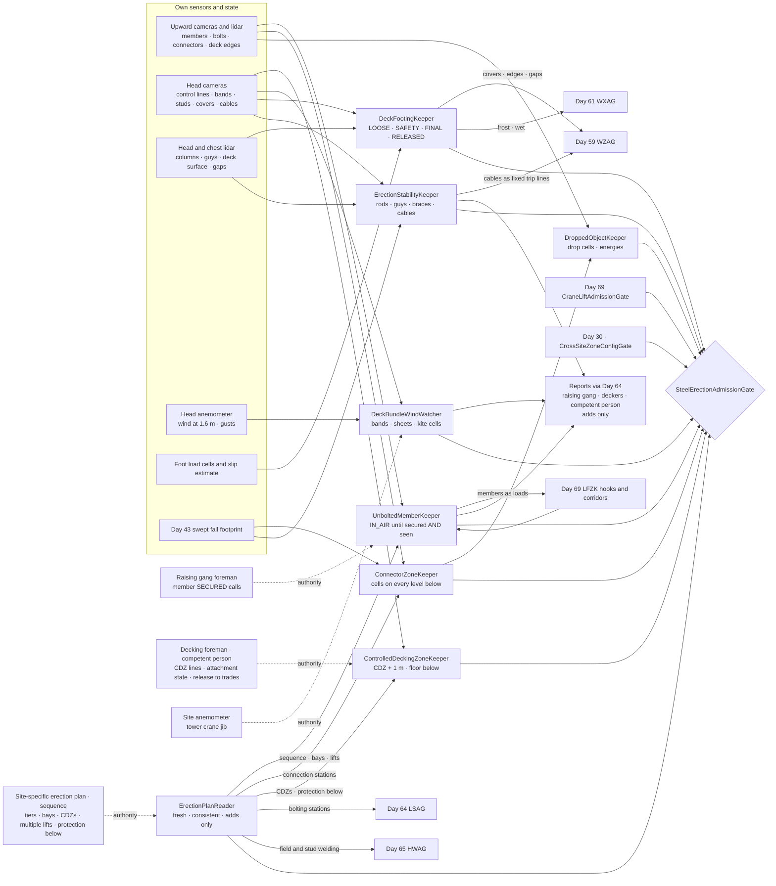
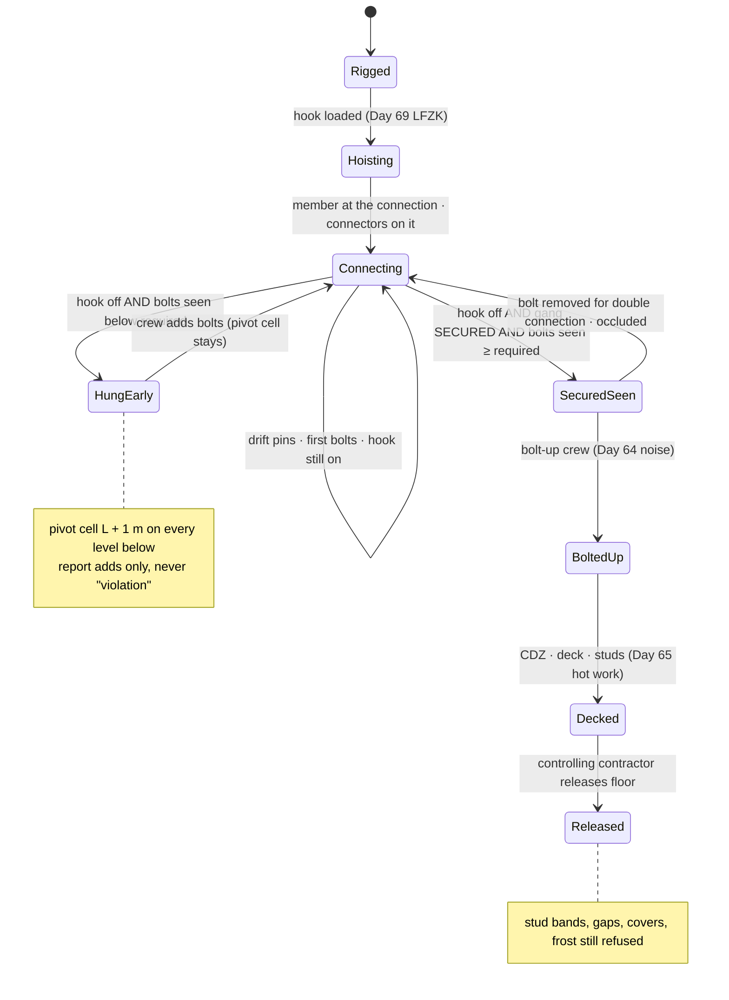
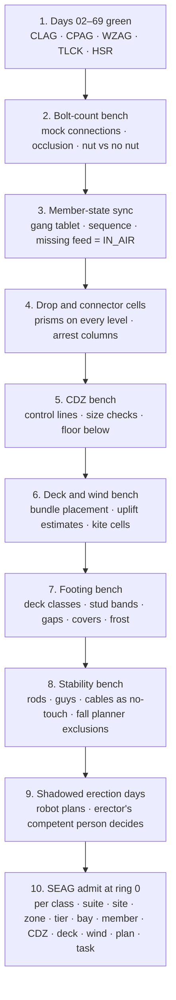

# Day 70 — Structural steel erection and metal decking under the crane stack: UnboltedMemberKeeper / ConnectorZoneKeeper / ControlledDeckingZoneKeeper / DeckBundleWindWatcher / DroppedObjectKeeper / DeckFootingKeeper / ErectionStabilityKeeper / ErectionPlanReader / SteelErectionAdmissionGate under CraneLiftAdmissionGate + the pour stack: LoadFallZoneKeeper / SwingRadiusKeeper / TaglineKeeper / CraneSignalReader / RiggingObservationReporter / LiftPlanReader / LiftWindWatcher / RobotAsLoadKeeper / CraneLiftAdmissionGate under ConcretePourAdmissionGate + ExcavationAdmissionGate + AirQualityAdmissionGate + HotWorkAdmissionGate + LoudSiteAdmissionGate + ElectricalAdmissionGate + HeatAdmissionGate + WeatherAdmissionGate + LowLightAdmissionGate + WorkZoneAdmissionGate + DockAdmissionGate + SidewalkAdmissionGate + CorridorAdmissionGate + ElevatorAdmissionGate + DoorwayAdmissionGate + WetSurfaceAdmissionGate + ConfinedSpaceAdmissionGate + ElevatedAccessAdmissionGate + OverheadToolAdmissionGate + BimanualToolAdmissionGate + PowerToolAdmissionGate + PushPullAdmissionGate + PayloadCarryAdmissionGate + OutdoorGroundAdmissionGate + TerrainLocomotionAdmissionGate + FallSafeAdmissionGate + DeliberateContactAdmissionGate + WholeBodyTouchAdmissionGate + HumanHandoverAdmissionGate + CooperativeTaskAdmissionGate + TaskCompositionAdmissionGate + FleetSkillCatalogAdmissionGate + proximity + zone attestation + supervisor + logging + canary + HIL + fleet + incident + change-management + maintenance + thermal + energy gates

![UnboltedMemberKeeper / ConnectorZoneKeeper / ControlledDeckingZoneKeeper / DeckBundleWindWatcher / DroppedObjectKeeper / DeckFootingKeeper / ErectionStabilityKeeper / ErectionPlanReader / SteelErectionAdmissionGate: the same 63.8 kg humanoid on Site C on a frosty, gusty Wednesday carries a 9 kg box of stud ferrules to the stud-welding crew while a three-story steel frame goes up beside the concrete core; it treats a 9.14 m W18×35 beam as a load in the air until the raising gang calls it secured and its own cameras see two bolts at every end, and when the hook comes off a beam with only one bolt visible it holds a 10.1 m pivot cell around it and reports it without calling it a violation; it refuses to carry a bolt bag up to the connectors, because every route to a connector ends under a connection where a dropped spud wrench arrives with about 91 J; it never crosses the red control line of the 18 × 27 m controlled decking zone on level 3 or works on the floor beneath it; it reports a 1.71 t roof deck bundle landed 0.9 m from the joist bearing and posts 19.3 m downwind kite cells when its gusts scale to about 11.8 m/s at deck height, above the roughly 10.5 m/s at which a loose 86 kg sheet can lift; it hands the ferrules over at the core doorway instead of stepping onto deck that hasn't been released, where 100 mm shear studs stand higher than its 61 mm toe clearance; and when an ironworker asks it to hold a guy cable steady, it refuses, because a 100 N lean on a 20 m cable adds about 5 kN to the column it is plumbing](/images/day70-structural-steel-metal-decking.png)

[Day 05](/lessons/day-05-power-bms) owns `torque_scale` and the pack **forever**. [Day 07](/lessons/day-07-wbc-balance) owns gait and balance. [Day 17](/lessons/day-17-runtime-safety-supervisor) owns ESTOP and safe states. [Day 29](/lessons/day-29-human-proximity-safety) owns person tracks, SSM, and PFL rows. [Day 30](/lessons/day-30-collaborative-workspace-zoning) owns attested zones and `CrossSiteZoneConfigGate`. [Day 43](/lessons/day-43-falls-fall-safe-contact) owns the fall direction and the swept fall footprint. [Day 59](/lessons/day-59-construction-sites-work-zones) owns slab edges, openings, covers, trip lines, and barriers. [Day 61](/lessons/day-61-weather-rain-snow-fog-wind) owns weather, ice, and lightning holds. [Day 63](/lessons/day-63-temporary-power-electrical-hazards) owns welding leads, stud-welder power, and cords. [Day 64](/lessons/day-64-noise-vibration-communications) owns warnings, radio, hand signals, and the noise floor. [Day 65](/lessons/day-65-hot-work-fire-hazards) owns arcs, sparks, fire watch, and evacuation. [Day 67](/lessons/day-67-excavations-trenches) owns excavations and lips. [Day 68](/lessons/day-68-concrete-pours-formwork-rebar) owns pours, formwork, and rebar. [Day 69](/lessons/day-69-cranes-rigging-overhead-lifts) owns hooks, fall zones, load corridors, swing cells, taglines, rigging reports, and lift plans.

Day 69 was about everything that arrives on a hook. Today is about the one kind of load that the crew deliberately turns into the building while it's still on the hook. A steel beam isn't "landed" when it touches the column; it's landed when the connectors have put at least two bolts through each end and drawn them up, and only then does the operator take the load line off. Between those moments the beam is a load in the air that happens to be touching steel. The frame that grows from it is unstable until it's bolted, braced, plumbed, and decked, and the deck that goes on it arrives as two-tonne bundles of thin sheets that act like sails until they're fastened down.

A humanoid on a steel job has five ways to make things worse. It's **a body under the work**: under a member that isn't bolted, under a connector who is tied off above it, under a connection where bolts, drift pins, and spud wrenches get dropped. It's **a pair of hands** that someone will ask to carry bolts up a ladder, steady a beam end, or pull a sheet into place. It's **a pair of feet** that will be tempted onto deck that looks like a floor and isn't one yet. It's **a heavy thing that leans**: on a column, a guy cable, or a plumbing cable, any of which is holding up a structure that can't yet hold itself. And it's **an observer** that can count bolts it sees and will be tempted, or asked, to say a connection is made. None of those makes it a connector, a decker, the erector's competent person, or the engineer of record.

Eight lies show up the first time a team runs a humanoid near steel erection:

1. **It's-landed lie.** "The beam's sitting on the column; you can walk under it." A beam with one bolt in it, or with its bolts in but not drawn up, is still on the hook for a reason. OSHA doesn't let the load line be released until there are at least two wrench-tight bolts per connection (1926.756(a)(1)). If the hook is gone and the robot only sees one bolt, the beam is worse than a load in the air: it's a pendulum hanging from one end.
2. **Hand-it-up lie.** "Run this bag of bolts up to the connectors." Every route to a connector ends under a connection, and connectors work tied off at the top of the frame with their hands full. A robot under them is in their drop zone; a robot next to them is something they have to watch instead of the beam.
3. **It's-just-deck lie.** "It's only sheet metal; walk across to the stair." Where decking is first laid and forms the leading edge, the erector may set up a controlled decking zone in which only trained deckers working that edge are allowed (1926.760(c)(2)). Its sheets can be held by as few as two safety attachments each.
4. **Bundle's-down lie.** "The deck bundle's on the steel; it's not going anywhere." Once the bands are cut, a bundle is a stack of loose sheets. A 9 m sheet of 20-gauge deck weighs about 86 kg and has 8.4 m² of surface; a gust under its edge can lift it.
5. **Only-a-bolt lie.** "It's one bolt; it'll bounce off your head." A 0.25 kg bolt and nut dropped from the third-floor connection hit at 12.8 m/s with about 21 J; a 1.1 kg spud wrench from the same place brings about 91 J, well over the 54 J a hard hat is tested with. The robot's head is a camera cluster, not a hard hat.
6. **Deck's-a-floor lie.** "The deck's on and the studs are in, so it's a floor." Shear studs stand about 100 mm proud of the deck in rows along every beam; the robot's toe clears 61 mm. Sheets with only safety attachments, gaps around columns, hole covers, and frost on galvanized steel are all on the same "floor."
7. **Lean-on-it lie.** "Grab the column if you need to; it's steel." A freshly set column sits on four anchor rods and leveling nuts, often with guy cables still tensioned to plumb it. A 100 N lean on a tensioned cable at mid-span can add several kilonewtons to it, and a robot catching its balance on a column puts in a moment of the same order as the eccentric load the anchorage is designed to resist during erection.
8. **It's-just-bolting lie.** "Bolting isn't hot work, and welding up there doesn't matter down here." Impact wrenches turn the noise floor into Day 64's problem; field welding and stud welding throw sparks and slag through deck flutes and openings onto the levels below, which is Day 65's.

Today owns **`UnboltedMemberKeeper` / `ConnectorZoneKeeper` / `ControlledDeckingZoneKeeper` / `DeckBundleWindWatcher` / `DroppedObjectKeeper` / `DeckFootingKeeper` / `ErectionStabilityKeeper` / `ErectionPlanReader` / `SteelErectionAdmissionGate`**. The question is: **how do you let a humanoid work on a site where a steel frame is going up, with every member that isn't yet bolted treated as a load still in the air, every connector and every active connection kept above nothing but empty floor, every controlled decking zone treated as a no-entry cell, every unbanded bundle and unfastened sheet treated as something the wind can pick up, every dropped bolt, pin, and wrench given somewhere empty to land, every stud row, loose sheet, cover, and unreleased bay refused as footing, every anchor rod, guy, brace, and plumbing cable left untouched, and every bolt count, plumb reading, and erection-plan line read as someone else's authority it can tighten but never relax — without raising Day 29 PFL, writing Day 05 `torque_scale`, gating Day 17 ESTOP, or bypassing `CrossSiteZoneConfigGate`?**

## The robot is never part of the erection

The rule everything follows from: **around steel erection, the robot is a body kept out from under every member that isn't bolted, every connector, and every connection being made; a pair of hands kept off steel, bolts, deck, and cables; a pair of feet that stands only on deck the site has handed over; and an observer whose reports only add. It never stands under or within the pivot reach of a member until the erector's state and its own eyes both say the member is secured and the load line is off, never approaches a connector from below or hands, throws, or hoists anything up to one, never enters a controlled decking zone or crosses its control line, never cuts, lifts, or walks on bands, bundles, or unfastened sheets, never steps on a stud row, a loose sheet, a cover, or a bay that hasn't been released to other trades, never touches, leans on, steps over, or ties off to an anchor rod, guy, brace, plumbing cable, or perimeter safety cable, and never says a connection is made, a column is plumb, a bundle is placed correctly, or a floor is safe.** The site has people for those calls: the connectors and their raising gang foreman, who decide when a member is secured; the deckers who own the leading edge; the steel erector's competent person, who decides about bolts on cantilevers, guying, bracing, and plumbing-up; the qualified person who writes the site-specific erection plan; the project structural engineer of record, who owns anchor rods and anything that affects the design; and the controlling contractor, who decides when an erected floor is handed to other trades. The robot can tell them things. It can't stand in for them.

Six facts set the shape of the lesson.

**A member is a load until it's bolted.** 29 CFR 1926 Subpart R (Steel Erection, 1926.750–.761) says that during final placing of solid web structural members, the load can't be released from the hoisting line until the member is secured with at least two bolts per connection, of the size and strength on the erection drawings, drawn up wrench-tight or the equivalent specified by the engineer of record (1926.756(a)(1)). A competent person decides if a cantilevered member needs more (1926.756(a)(2)). Diagonal bracing gets at least one bolt per connection (1926.756(b)). Where two members share holes on opposite sides of a column web, at least one bolt with its wrench-tight nut stays in the first member unless a seat or equivalent device holds it (1926.756(c)). Routes for suspended loads are pre-planned so that nobody works directly below a load except the people making the initial connection or hooking and unhooking (1926.753(d)), and multiple lifts ("Christmas-treeing") carry at most five members, rigged at least 7 ft (2.1 m) apart and set from the bottom up (1926.753(e)).

**Connectors work at the top of the frame, with things falling from their hands.** Connectors are protected from falls of more than two stories or 30 ft (9.1 m), whichever is less, and between 15 and 30 ft are provided with personal fall arrest, positioning, or restraint and wear the gear needed to tie off (1926.760(b)). All materials, equipment, and tools not in use aloft must be secured, and the controlling contractor must bar other construction processes below steel erection unless overhead protection is provided for the people below (1926.759). That second sentence is the robot's rule too: it is another process.

**Decking has its own zone.** A controlled decking zone (CDZ) may be set up between 15 and 30 ft above a lower level, where metal decking is first being installed and forms the leading edge. Access is limited to employees doing leading-edge work, who have had CDZ training; the boundaries are designated and marked by control lines or the equivalent; the CDZ is at most 90 ft (27.4 m) wide and 90 ft deep from any leading edge; unsecured decking in it may not exceed 3,000 ft² (about 279 m²); safety deck attachments go in from the leading edge back to the control line, with at least two per panel; and final deck attachments and shear connectors are not installed inside a CDZ (1926.760(c)). Outside the CDZ, decking is laid tightly and immediately secured upon placement (1926.754(e)(5)), perimeter safety cables go in at the final perimeters as soon as the deck is installed on multi-story structures (1926.760(a)(2)), and other trades use an erected floor's fall protection only after the controlling contractor has directed it left in place and has inspected and accepted it (1926.760(e)).

**Deck bundles are rules about where weight lands.** Bundle packaging and strapping aren't used for hoisting unless designed for it; loose items on a bundle are secured to it; bundles are landed on framing so they can be unbanded without being dislodged; and at the end of the shift, or when conditions require, decking is secured against displacement (1926.754(e)(1)). On steel joists, a decking bundle may be landed before all bridging is in only if a qualified person has documented in the site-specific erection plan that the structure can take it, the bundle sits on at least three joists attached at both ends, at least one row of bridging is installed and anchored, the bundle weighs no more than 4,000 lb (1,816 kg), and its edge is within 1 ft (0.30 m) of the bearing surface of the joist end (1926.757(e)(4)–(5)).

**Shear studs and loose sheets aren't floor.** Shear connectors, reinforcing bars, deformed anchors, and threaded studs aren't attached to top flanges so they project from them until the deck or other walking surface is installed, and shear connectors on composite floors are laid out and installed after the deck is down, using the deck as the working platform, never from inside a CDZ (1926.754(c)). So every stud row on a deck was put there on purpose, after the deck, as the last thing before concrete: a field of 19 mm steel pins at roughly 100 mm tall along every beam line.

**The frame stands on things nobody may touch.** Every column is anchored by at least four anchor rods; each column's anchorage is designed for an eccentric gravity load of at least 300 lb (136 kg) at 18 in (0.46 m) from the outer face of the column in each direction; columns stand on level floors, pre-grouted plates, leveling nuts, or shim packs; and a competent person decides whether guying or bracing is needed (1926.755(a)). Anchor rods aren't repaired, replaced, or field-modified without the engineer of record's approval (1926.755(b)). Plumbing-up equipment goes in when a competent person deems it necessary, is in place before the structure is loaded with bundles, and comes out only with the competent person's approval (1926.754(d)). Structural stability is to be maintained at all times (1926.754(a)); on multi-story frames there may be no more than four floors or 48 ft of unfinished bolting or welding above the foundation or uppermost permanently secured floor, and a fully planked or decked floor or nets within two stories or 30 ft directly under any erection work (1926.754(b)).

| Layer | Owns | Must not own |
|-------|------|--------------|
| `UnboltedMemberKeeper` | Every member from pick to secured: IN_AIR while on the hook, while the raising gang hasn't called it secured, while its own eyes see fewer than the required bolts at any connection, or while the plan's state is missing; a hook-released member with too few bolts as a pivot cell of member length + 1 m; Christmas-tree lifts as separate members handed to Day 69 LFZK | Saying a member is secured; counting a bolt it sees as wrench-tight; touching, steadying, or guiding steel |
| `ConnectorZoneKeeper` | Each connector's and each active connection's cell on every level below, from the erection sequence, its upward cameras, and Day 29 tracks: the drop cell plus the connector's fall-arrest clearance column; no approach from below; no handing, throwing, or hoisting anything up | Supplying connectors; being a steadying hand or a target for "catch this" |
| `ControlledDeckingZoneKeeper` | Every CDZ's control line, size, and leading edge from the erector and its own eyes; CDZ plus 1 m no-entry; the floor below a CDZ refused unless the plan lists overhead protection; perimeter cable and opening state reported to Day 59 | Entering a CDZ for any reason; moving a control line; judging attachments |
| `DeckBundleWindWatcher` | Every bundle and sheet that isn't fastened: banded, unbanded, partly spread, or left loose at shift end; bundle placement against 1926.757(e)(4) reported, adds-only; uplift threshold per sheet type; downwind kite cells when the site's wind or its own scaled gust passes a fraction of it | Cutting bands, holding sheets down, declaring a bundle secured or a placement compliant |
| `DroppedObjectKeeper` | Drop cells under every connection, bolting station, stud-welding run, and deck edge at work; energies of the tools in use; secured-aloft observations reported; Day 65 spark cells for field and stud welding merged in | Standing in a drop cell "for a moment"; picking up anything that has fallen inside one |
| `DeckFootingKeeper` | Footing classes for every deck cell: LOOSE, SAFETY_ATTACHED, FINAL_ATTACHED, RELEASED; stud bands, column gaps, covers, frost, wet, and oil; walking only on RELEASED cells on the site's marked route | Releasing a floor; stepping on studs, loose sheets, or covers; asking Day 07 for a gait that steps over studs |
| `ErectionStabilityKeeper` | Anchor rods, leveling nuts, grout pockets, guys, braces, plumbing cables, turnbuckles, perimeter safety cables, and their anchors as no-touch cells and immovable trip lines; observations (slack cable, missing nut, cracked grout) reported to the competent person | Touching, leaning on, stepping over, tying off to, or setting anything against them; saying a column is plumb or stable |
| `ErectionPlanReader` | The site-specific erection plan and the day's sequence: concrete-strength notice, anchor-rod changes, tier and bay states, bolt-up and decking status, floors below erection and their protection, CDZs, multiple lifts, bolting and welding stations sent to Days 64 and 65 | Re-sequencing erection; computing a connection's capacity; calling a tier bolted up |
| `SteelErectionAdmissionGate` | Fail-closed admit per robot class, suite, site, zone, tier, bay, member state, CDZ state, deck state, wind state, erection plan, task | `JointCommand`; Day 05; PFL; Day 17 |
| Days 05 / 07 / 17 / 29 / 30 / 43 / 59 / 61 / 63 / 64 / 65 / 67 / 68 / 69 | Pack, gait, ESTOP, people, zones, falls, edges and covers, weather, power, comms, hot work, excavations, pours, hooks | Being outranked by "the robot counted two bolts" |

**Core thesis:** **on a steel job, a humanoid treats every member as a load until the people who connect it and its own eyes both say it's bolted and off the hook, keeps out from under every connector and every connection being made, stays out of every controlled decking zone, gives loose deck the wind's respect, leaves somewhere empty for every dropped bolt and wrench, stands only on deck the site has handed over, never touches the rods, guys, and cables that hold the frame up, and reports what it sees to the people who own those numbers without ever saying anything is made, plumb, or safe.**



## Physical machine: where the steel goes

Walk Site C on Wednesday. The concrete core from Days 68 and 69 now has a steel-framed east wing growing off it: three stories of composite floor, 4.2 m floor to floor, on a 9.14 m (30 ft) column grid. Level 1 is a slab on grade; level 2 is at 4.2 m; level 3 at 8.4 m (27.6 ft); the roof at 12.6 m will be open-web steel joists and roof deck. The columns are W12s, single pieces from base plate to roof, each on four anchor rods with leveling nuts, the grout not yet placed under most of them. The east column line has guy cables to deadmen at grade, about 20 m long, with turnbuckles the competent person set yesterday to plumb the frame.

It's 2 °C at 07:00, with frost on the galvanized deck until about 10:00, and the forecast gusts are 12 m/s at roof height after lunch. Day 69's flat-top tower crane (0.6 rpm) is setting level-3 and roof beams on the east bays at about 28 m radius: W18×35s, 9.14 m long, 476 kg each, plus one Christmas-tree lift of three roof beams at 2.1 m spacing. A raising gang of two connectors works at the top of the frame, tied off; a bolt-up crew with impact wrenches follows a bay behind. On level 3, the deckers have set a controlled decking zone over the east bays, 18 m wide and 27 m deep from the north leading edge, marked with a control line of red flagged rope. On the roof, a bundle of 20 deck sheets (1.5 in wide-rib, 20 gauge, 36 in × 30 ft) has been landed on the joists. On level 2, the deck is final-attached and a stud-welding crew is shooting 19 mm studs along the west beam lines. The controlling contractor hasn't released level 2 or level 3 to other trades.

The robot's tasks: carry a 9 kg box of ceramic stud ferrules from the gate to the stud crew, handed over at the level-2 doorway of the concrete core; and, during the afternoon, photograph grid-line benchmarks at grade for the surveyor along the south perimeter. Twice during the day someone will ask it for something else.

The robot's hardware for this:

- **Upward-facing cameras and lidar** (from Day 59), which see beam ends, bolt heads and nuts, connectors, and deck edges against the sky.
- **Head cameras** with Day 60's low-light settings and Day 61's window self-check, for control lines, bundle bands, sheet edges, stud rows, hole covers, and cables.
- **Head and chest lidar** for columns, guy cables, braces, deck surface height, and gaps around columns.
- **A small ultrasonic anemometer** in the head (from Day 61), 1.6 m off the ground.
- **Foot load cells and Day 53's slip estimator,** used only to refuse.
- **The Day 43 fall model,** giving a swept fall footprint of 1.8 m with today's payload.

### Members: loads until they're bolted

`UnboltedMemberKeeper` follows every member from pick to secured. Day 69's `LoadFallZoneKeeper` already holds a hook as loaded until the load is landed and slack. For steel, "landed" isn't enough: a beam sitting on its seats with the load line still taut is a beam the connectors haven't finished with. UMK keeps the member **IN_AIR** while any of these is true:

- the hook is still attached;
- the raising gang's state (from the erection sequence, the foreman's tablet, or a radio call relayed by Day 64) doesn't say SECURED;
- at any connection the robot can see, it counts fewer than the required bolts with nuts on them: two for a beam (1926.756(a)(1)), one for diagonal bracing (1926.756(b)), and whatever the competent person wrote for a cantilever (1926.756(a)(2));
- it can't see a connection at all (occlusion counts as too few);
- the state feed is missing.

Its eyes can only veto. A nut on a bolt doesn't tell a camera whether the bolt is wrench-tight, so two visible bolts are necessary for the robot, never sufficient; and it never says "two bolts in" as though that meant anything to the crew.

While the member is on the hook, Day 69's fall zone applies. For a W18×35, 9.14 m long, at the level-3 connection, $h = 8.4$ m, with the tower crane's slew speed at 28 m radius $v_h = 2\pi \times 28 \times 0.6 / 60 \approx 1.76$ m/s:

$$
r_{\text{fall}} = \tfrac{1}{2}(9.14) + 1.76\sqrt{\frac{2 \times 8.4}{9.81}} + 0 + 1.0 \approx 4.57 + 2.30 + 1.0 = 7.9 \text{ m}
$$

If the hook comes off a member that UMK still holds IN_AIR, the geometry changes. A beam held at one end by one bolt hangs like a pendulum from that bolt, so the cell becomes a **pivot cell**: a circle of radius $L + m$ around the connection the robot can see, on every level below:

$$
r_{\text{pivot}} = L + m = 9.14 + 1.0 \approx 10.1 \text{ m}
$$

That's bigger than the hook's fall zone, which is the point: a member that someone has released early is more dangerous than one still on the crane. At 10:05 the hook comes off the C4–D4 beam on level 3 while the robot can see one bolt at the east end. UMK puts a 10.1 m pivot cell around it and sends the raising gang foreman "C4–D4 L3: one bolt visible east end after hook release (adds only: not an inspection)." It doesn't say "violation," doesn't say "unsafe," and doesn't ask for the hook back. Ten minutes later the bolt-up crew has the second bolt in, the foreman marks the beam SECURED, and the robot's next view of the connection shows two; the cell closes.

Multiple lifts are a stack of members, not one load. The three roof beams in the Christmas-tree lift hang 2.1 m apart and are set bottom up (1926.753(e)), so when the first is being connected the other two are still overhead on the same hook. UMK hands each member to LFZK as its own load and keeps the lift loaded until the last member is SECURED.

### Connectors: never from below

`ConnectorZoneKeeper` takes each connector's position from the erection sequence, its upward cameras, and Day 29's tracks, and each active connection from the sequence and from what's on the hook. It builds a cell on **every level below** the connection, down to the ground:

$$
r_{\text{CZK}} = \max\left(r_{\text{drop}},\ \ell_{\text{lanyard}} + 1.0\ \text{m}\right)
$$

with $r_{\text{drop}}$ from `DroppedObjectKeeper` and $\ell_{\text{lanyard}}$ the connector's lanyard or SRL length from the plan (1.8 m if unknown). Below a tied-off connector there's also a column of space the connector would occupy in a fall: with a 1.8 m lanyard, the deceleration distance 1926.502 allows (up to 1.07 m), about 1.5 m from the harness D-ring to the feet, and a 0.6 m margin, that's about 5 m below the anchorage. Connectors at level 3 anchored about 1 m above the floor would fall into the head height of level 2. The robot never stands in that column.

"Never from below" also means never toward. The robot doesn't carry bolts, pins, tools, or water up a ladder, a stair, or a lift to a connector; it doesn't stand at the base of their ladder; it doesn't catch anything thrown down; and it doesn't hold anything for them to drop into. At 09:20, while the robot is crossing the gate area with the ferrules, the connector foreman calls over: "Run this bolt bag up to the guys on three." The bag is 11 kg; the robot could carry it. CZK refuses, because every route to the connectors ends under a connection, and the robot says on its display and speaker: "I can't take things to the connectors." The foreman sends it up on the material hoist.

### Controlled decking zones: no-entry

`ControlledDeckingZoneKeeper` takes each CDZ from the erector (bay, leading edge, control line) and from its own cameras (flagged rope or the site's equivalent), and checks them against the rule: between 15 and 30 ft (4.6 to 9.1 m) above the lower level, at most 27.4 m wide and 27.4 m deep from the leading edge (1926.760(c)). Today's is at 8.4 m, 18 × 27 m: it reports nothing about the size, because it's within the limits, and it wouldn't say "compliant" if asked. A CDZ seen above 30 ft, or bigger than the limits, or a control line that isn't where the erector's map says, is reported to the decking foreman, "adds only."

The cell is the CDZ plus 1 m inside the control line's side, and the robot never crosses the line: not to fetch something, not to take a photo, not because a decker waves it in. Access is limited to leading-edge workers who've had CDZ training (1926.760(c)(2), (c)(4)), and the robot isn't one. Below the CDZ, level 2 east is "below steel erection" in the sense of 1926.759(b): CDZK refuses it unless the plan lists overhead protection for that bay. Today it doesn't, so the east half of level 2 and the space under it on level 1 are closed to the robot until the deckers finish and the CDZ comes down.

### Deck bundles and loose sheets: the wind's

`DeckBundleWindWatcher` tracks every bundle and every sheet that isn't fastened, as one of: BANDED, UNBANDED, SPREAD (sheets laid but not attached), SAFETY_ATTACHED, FINAL_ATTACHED. Only the last is not its business.

**Placement.** On joists, the robot compares what it sees with 1926.757(e)(4): at least three joists, attached at both ends, at least one row of bridging, at most 4,000 lb, the edge within 0.30 m of the joist-end bearing. Today's roof bundle is 20 sheets at about 85.6 kg each, roughly 1.71 t (3,780 lb), and it sits on four joists, but its near edge is about 0.9 m from the bearing. DBWW sends a photo and "roof bundle near grid D5: edge about 0.9 m from joist bearing (adds only)" to the erector's competent person. It doesn't call the bundle overloaded, misplaced, or noncompliant; the site-specific erection plan may say something it can't see.

**Wind.** A 20-gauge, 1.5 in wide-rib deck weighs roughly 2.1 psf, about 10.3 kg/m² or 101 Pa. A sheet lifts when the suction or the pressure under a raised edge exceeds that:

$$
\tfrac{1}{2}\rho C v^2 = w \quad\Rightarrow\quad v = \sqrt{\frac{2w}{\rho C}}
$$

With $\rho = 1.225$ kg/m³, $C = 1.0$ gives 12.8 m/s and $C = 1.5$ (a gust under an edge that's already lifting) gives 10.5 m/s. Those are estimates for a flat plate; DBWW uses the lower one as its threshold for loose sheets and the site's wind limit for decking as the authority. A sheet that goes is 8.4 m² and 86 kg of edged steel.

At 13:30 the robot reads gusts of 7 m/s at 1.6 m at grade. Scaled to the level-3 deck with Day 69's $\alpha = 0.3$: $7 \times (9/1.6)^{0.3} \approx 11.8$ m/s, above 0.8 × 10.5 m/s. DBWW posts a **kite cell** downwind of every unfastened sheet and the open roof bundle: a ±45° sector of radius $2L + 1 = 2 \times 9.14 + 1 \approx 19.3$ m on the same level and every level below, and reports the estimate to the decking foreman. It never reports "wind OK for decking"; it never cuts or tightens a band, holds a sheet down, or sets anything on one to weigh it. At the end of the shift, decking is supposed to be secured against displacement (1926.754(e)(1)(v)); DBWW reports any sheet or bundle it sees that isn't, and keeps its kite cells until a person says otherwise and its eyes agree.

### Dropped objects: somewhere empty to land

`DroppedObjectKeeper` puts a **drop cell** under every connection being made, every bolting station, every stud-welding run, and every deck edge where sheets are being laid, on every level below:

$$
r_{\text{drop}} = r_{\text{offset}} + \max\left(2.0\ \text{m},\ \tfrac{h}{3}\right)
$$

with $r_{\text{offset}}$ how far the work reaches out from the steel (the connector's arm, the wrench, about 0.5 m) and the $h/3$ term a policy allowance for things that hit a flange or the deck and kick sideways. It's not from a standard; re-derive it from your own site's drop records. At level 3 that's 0.5 + 2.8 = 3.3 m; at the roof, 0.5 + 4.2 = 4.7 m.

The reason for the cells is the energy, $E = mgh$, at an impact speed of $\sqrt{2gh}$:

| Object | Mass | From level 3 (8.4 m, 12.8 m/s) | From the roof (12.6 m, 15.7 m/s) |
|--------|------|------|------|
| 3/4 in structural bolt with nut and washer | ~0.25 kg | ~21 J | ~31 J |
| Drift pin | ~0.7 kg | ~58 J | ~87 J |
| Spud wrench | ~1.1 kg | ~91 J | ~136 J |
| 3/4 in drive impact wrench | ~4.5 kg | ~371 J | ~556 J |

A Type I hard hat is tested with a 3.6 kg striker dropped from 1.52 m, about 54 J (ANSI/ISEA Z89.1). The robot's head is cameras, lidar, and a window it can't see through when cracked. Materials and tools not in use aloft are supposed to be secured (1926.759(a)); when the robot sees something sitting loose on a flange or the deck edge above a route, it reports it as "loose item above grid C3, level 3 (adds only)," and it treats the space below as a drop cell until it's gone. It never picks up anything that has landed inside a drop cell, and it never walks under a cell "while nobody is bolting."

### Footing: studs, loose sheets, and unreleased deck

`DeckFootingKeeper` classifies every deck cell the robot might stand on:

- **LOOSE:** sheets laid but not fastened, sheets in a bundle, or sheets lifted for cutting. Never.
- **SAFETY_ATTACHED:** sheets with the minimum attachments for a CDZ (two per panel, 1926.760(c)(6)). Never.
- **FINAL_ATTACHED:** fastened to the steel but not yet released to other trades. Never, because the fall protection, perimeter cables, and covers on that floor are still the erector's (1926.760(e)).
- **RELEASED:** the controlling contractor has released the floor to other trades, perimeter safety cables are in (1926.760(a)(2)), and openings are covered or protected (1926.754(e)(2)–(3)). Walkable, on the site's marked route, with everything below still applying.

Inside a RELEASED cell, DFK still refuses: **stud bands** (each row of studs plus 0.15 m either side; 19 mm studs standing about 100 mm above the deck, against a 61 mm toe clearance from Day 54, and a 0.24 m foot that would land on them), **column gaps** (where the deck doesn't fit tightly and the mesh or plywood isn't in, 1926.754(e)(4)), **covers** (anything marked "HOLE" or "COVER," handed to Day 59 as an opening), and **frost, water, or oil** on galvanized deck, handed to Day 61 and Day 53. It never asks Day 07 for a high-stepping gait to cross a stud band. A stud band is crossed only on a plank bridge the site has placed and marked, and if there isn't one the route goes around.

Today neither level 2 nor level 3 is RELEASED, so the robot never steps onto the steel at all. It hands the ferrules over at the level-2 doorway of the concrete core, through Day 40's handover with the stud crew's lead standing on the deck side of the threshold, and it doesn't put a foot past the door frame.

### Rods, guys, braces, and cables: hands off

`ErectionStabilityKeeper` marks every anchor rod and its leveling nut, every grout pocket, every guy cable and its turnbuckle and deadman, every brace, every plumbing cable, and every perimeter safety cable as a **no-touch cell** (the object plus 0.3 m) and every cable at foot or shin height as an **immovable trip line** for Day 59's keeper: never stepped over, under, or on. The robot never leans on, steadies itself on, ties off to, hangs a bag on, or sets a box against any of them, or against a column.

The numbers show why "just a lean" isn't. A guy cable spanning 20 m, pushed sideways at mid-span with 100 N until it deflects 0.1 m, takes up a tension of about

$$
T \approx \frac{F\,L}{4\,\delta} = \frac{100 \times 20}{4 \times 0.1} = 5\ \text{kN}
$$

and pulls that into the column it's plumbing. A column's anchorage is designed during erection for at least a 300 lb (1.33 kN) eccentric gravity load at 18 in from the outer face (1926.755(a)(2)); for a W12, about 0.31 m deep, that's a moment of roughly $1.33 \times (0.46 + 0.155) \approx 0.82$ kN·m about the column's centre. A robot that catches its balance on a column with a few hundred newtons at shoulder height puts in a moment of the same order. That isn't the column's capacity, and the robot doesn't compute one; it's the reason the robot's Day 43 fall planner treats columns and cables as things it never braces against.

At 14:10 an ironworker adjusting a turnbuckle asks the robot to "hold the cable steady for a sec." ESK refuses, with the reason on the display, and the robot steps back out of the cell. If it sees a slack guy, a missing leveling nut, a cracked grout pad, or a plumbing cable gone from where it was this morning, it reports to the competent person: plumbing-up equipment comes out only with their approval (1926.754(d)(3)), and anchor rods are the engineer of record's (1926.755(b)).

### The erection plan: someone else's sequence

`ErectionPlanReader` reads the site-specific erection plan and the day's sequence: the controlling contractor's written notice that the footings and piers reached 75 % of design strength or enough for erection loads (1926.752(a)), any anchor-rod repairs or modifications, the tiers and bays being erected and their states, bolt-up and decking status, the CDZs, multiple lifts, where the connectors and bolt-up crews will be, and which floors below erection have overhead protection. It checks that the plan is today's and consistent with what it sees: a beam that's up where the plan says it won't be until Thursday, a CDZ where the plan has none, more floors of unfinished bolting above the last secured floor than 1926.754(b)(2) allows (four floors or 48 ft), or no decked floor or nets within two stories or 30 ft under erection work (1926.754(b)(3)). Each mismatch is reported to the erector's competent person and refuses the affected bays; a stale or missing plan refuses the whole steel area.

EPR also routes the two kinds of connection work that aren't its own question. **Bolting** stations go to Day 64: pneumatic impact wrenches are often measured above 100 dBA at the operator, so speech is gone near the bolt-up crew and the robot's warnings go to the radio and the display. **Field welding and stud welding** go to Day 65 as hot work, with the sparks and slag cells extended downward through deck flutes, column gaps, and openings onto every level below, and to Day 63 for the welding leads and the stud welder's power source and cables. The robot never asks for the bolting to stop so it can pass, never asks for a weld to be finished faster, and never reports a connection as complete.

### Putting the cells in code

As every day since Day 59: everything here adds or keeps constraints; nothing removes one.

```python
import math
from dataclasses import dataclass, field

G = 9.81
MARGIN_M = 1.0
DEFAULT_LANYARD_M = 1.8

REQUIRED_BOLTS = {"BEAM": 2, "DIAGONAL_BRACE": 1}   # cantilevers: competent person's number

@dataclass
class Member:
    kind: str                     # "BEAM" | "DIAGONAL_BRACE" | "CANTILEVER" | "COLUMN"
    length_m: float
    hook_attached: bool
    gang_state: str | None        # "SECURED" | "CONNECTING" | None (missing)
    bolts_seen: dict = field(default_factory=dict)   # connection_id -> int, or None if occluded
    cantilever_bolts: int | None = None

def required(m: Member) -> int:
    if m.kind == "CANTILEVER":
        return m.cantilever_bolts or 10**6          # unknown = never enough
    return REQUIRED_BOLTS.get(m.kind, 2)

def in_air(m: Member) -> bool:
    """UMK: eyes can only veto; a nut on a bolt is not 'wrench-tight'."""
    if m.hook_attached or m.gang_state != "SECURED":
        return True
    return any(n is None or n < required(m) for n in m.bolts_seen.values())

def pivot_radius(m: Member) -> float:
    return m.length_m + MARGIN_M                       # hook gone, too few bolts: a pendulum

def drop_radius(h_m: float, offset_m: float = 0.5) -> float:
    return offset_m + max(2.0, h_m / 3.0)              # policy, not a standard

def connector_radius(h_m: float, lanyard_m: float | None) -> float:
    return max(drop_radius(h_m), (lanyard_m or DEFAULT_LANYARD_M) + MARGIN_M)

def sheet_uplift_speed(w_pa: float, c: float, rho: float = 1.225) -> float:
    return math.sqrt(2 * w_pa / (rho * c))

def kite_cell(sheet_len_m: float) -> dict:
    return {"radius_m": 2 * sheet_len_m + MARGIN_M, "half_angle_deg": 45, "levels": "same_and_below"}

def scaled_gust(v_own: float, z_m: float, z_own: float = 1.6, alpha: float = 0.3) -> float:
    return v_own * (z_m / z_own) ** alpha             # report only; never lowers a hold
```

```python
FOOTING_OK = {"RELEASED"}
NEVER_FOOTING = {"STUD_BAND", "COLUMN_GAP", "COVER", "FROST", "WET", "OIL"}

def may_step(cell_class: str, features: set[str], on_marked_route: bool) -> bool:
    """DFK: deck is footing only when the site has released it, and even then not everywhere."""
    return cell_class in FOOTING_OK and not (features & NEVER_FOOTING) and on_marked_route

def bundle_report(on_joists: bool, n_joists: int, edge_to_bearing_m: float, est_lb: float) -> list[str]:
    """DBWW: observations against 1926.757(e)(4)-(5). Never 'compliant', never 'overloaded'."""
    out = []
    if on_joists and n_joists < 3:
        out.append(f"bundle on {n_joists} joists seen (adds only)")
    if on_joists and edge_to_bearing_m > 0.30:
        out.append(f"bundle edge ~{edge_to_bearing_m:.1f} m from joist bearing (adds only)")
    if est_lb > 4000:
        out.append(f"bundle estimate ~{est_lb:.0f} lb from sheet count (adds only)")
    return out
```

## UnboltedMemberKeeper and ConnectorZoneKeeper

UMK and CZK keep the robot out from under the steel while it's still becoming a building. UMK works in states, like Day 69's hook keeper, but with a stricter end: a member isn't done when it's landed, only when it's secured, and the robot's eyes can hold it open but never close it. Its distinctive move is the pivot cell for a member released too early, which is bigger than the cell for a member still on the hook. CZK works in space, vertically: every connection being made has a prism under it to the ground, and the connector above has a fall-arrest column under them. Both refuse every request that would put the robot in those prisms, especially the friendly ones.

## ControlledDeckingZoneKeeper and DeckBundleWindWatcher

CDZK and DBWW are about the deck while it's still sheets. CDZK makes the CDZ what the rule already says it is, a place only trained leading-edge workers enter, and extends it downward to the floors it's above. DBWW gives every bundle and every unfastened sheet a wind estimate and, when the estimate says so, a downwind cell; it reports placement against the joist rules without ever saying "compliant."

## DroppedObjectKeeper, DeckFootingKeeper, and ErectionStabilityKeeper

DOK gives everything that falls off the work somewhere empty to land. DFK makes the deck a floor only when the site has handed it over, and even then keeps the robot's feet off studs, gaps, covers, and frost. ESK keeps the robot's hands and body off the things that are holding up a frame that can't hold itself up yet. All three only add cells.

## ErectionPlanReader

EPR is the observer. It reads the erection plan as somebody else's authority, reports when what it sees doesn't match, refuses bays when the plan is stale or the protections below erection aren't listed, and sends the bolting and welding stations to the days that own noise and hot work. It never computes a capacity, never re-sequences, and never calls a tier bolted up.

## SteelErectionAdmissionGate

```text
SteelErectionAdmission
  robot_class, suite, site, zone, tier, bay, task
  erection_state: NO_ERECTION | RAISING | CONNECTING | BOLT_UP | DECKING_CDZ | STUD_WELDING | SECURED_NOT_RELEASED | RELEASED
  requires:
    Day 69 CraneLiftAdmissionGate: admitted for this zone
    Day 30 CrossSiteZoneConfigGate: pass
    erection_plan: today's, consistent with members, CDZs, and protection seen
    gang_state or sequence state: present (else every member IN_AIR, every connection ACTIVE)
    cdz_map: present for every decking bay (else the whole decking floor and below refused)
    site_anemometer: present (else kite cells at own scaled gust ≥ 0.5 × uplift estimate)
    floor_release: from controlling contractor for every deck cell on the route (else not footing)
  refuses if:
    any route cell under or within the fall or pivot cell of an IN_AIR member
    any route cell in a connector prism, a drop cell, or a fall-arrest column
    any route cell in a CDZ (+1 m) or below one without listed overhead protection
    any route cell below steel erection without listed overhead protection
    any route cell in a kite cell, or any grasp of a band, sheet, or bundle
    any foot placement not RELEASED, or on a stud band, column gap, cover, frost, wet, or oil
    any contact with an anchor rod, guy, brace, plumbing or perimeter cable, or column
    any task that carries, hands, throws, or hoists anything toward a connector
    any report phrased as secured, plumb, compliant, stable, or safe
  never: raises PFL · writes torque_scale · gates ESTOP · writes gait · bypasses CrossSiteZoneConfigGate
```

SEAG fails closed under Day 69's CLAG and everything beneath it. It's keyed by tier, bay, and erection state as well as zone, because the same doorway is a handover point at 09:30, a spot under a pivot cell at 10:05, inside a kite cell at 13:30, and, the day the controlling contractor releases level 2, the start of a walkable route with its stud bands still refused.

## Data shapes

```text
MemberTrack
  member_id, kind: BEAM | DIAGONAL_BRACE | CANTILEVER | COLUMN, length_m, mass_kg
  tier, bay, lift_id, multiple_lift_position
  hook_attached, gang_state: CONNECTING | SECURED | MISSING
  bolts_seen: {connection_id: int | OCCLUDED}, required_bolts (plan, never computed)
  state: IN_AIR | SECURED_SEEN, cell: FALL (Day 69) | PIVOT, radius_m

ConnectorCell
  person_track_id, connection_id, anchorage_xyz, lanyard_m
  drop_radius_m, arrest_column_bottom_z, levels_below[]

CDZ
  bay, level_z, leading_edge, control_line_polyline, width_m, depth_m
  overhead_protection_below: bool, reports[]

DeckItem
  item_id, kind: BUNDLE | SHEET, state: BANDED | UNBANDED | SPREAD | SAFETY_ATTACHED | FINAL_ATTACHED
  on_joists, n_joists, edge_to_bearing_m, est_weight_lb, sheet_len_m, w_pa
  uplift_v_m_s (C = 1.0, 1.5), kite_cell

DropCell
  source: CONNECTION | BOLTING | STUD_WELDING | DECK_EDGE | LOOSE_ITEM, xyz, h_m, radius_m

DeckCell
  polygon, class: LOOSE | SAFETY_ATTACHED | FINAL_ATTACHED | RELEASED
  features: {STUD_BAND, COLUMN_GAP, COVER, FROST, WET, OIL}, release_ref

StabilityItem
  kind: ANCHOR_ROD | LEVELING_NUT | GROUT | GUY | TURNBUCKLE | BRACE | PLUMBING_CABLE | PERIMETER_CABLE
  geometry, no_touch_m: 0.3, observation, label: "adds only: not an inspection"

ErectionPlan
  date, concrete_notice_ref, anchor_rod_changes[], tiers[], bays[], cdzs[], multiple_lifts[]
  floors_unbolted_above_secured (read), decked_floor_below (read), protection_below[]
  bolting_stations[] → Day 64, welding_stations[] → Day 65, Day 63

# Unchanged owners
CraneLiftAdmissionGate · hooks · fall zones · corridors · swing · taglines (Day 69)
ConcretePourAdmissionGate (Day 68) · EXAG (Day 67) · HWAG · evacuation (Day 65)
LSAG · radio · HSR (Day 64) · ELAG (Day 63) · WXAG (Day 61) · edges · covers · TLCK (Day 59)
Fall footprint (Day 43) · handover (Day 40) · tracks · SSM · PFL (Day 29) · zones (Day 30)
Gait (Day 07) · ESTOP (Day 17)
BmsState / PowerState (Day 05): torque_scale, contactors
  accepts_requests_from_site: false
```

## Config

A starting configuration. Every number is a policy you re-derive from your own robot, your site, and the rules that apply where you work:

```yaml
steel_erection:
  robot_part_of_erection: never
  members:
    in_air_until: [hook_off, gang_state_secured, bolts_seen_ge_required]
    required_bolts: { beam: 2, diagonal_brace: 1, cantilever: competent_person_value }
    occluded_connection: too_few
    missing_state: IN_AIR
    pivot_cell: length_plus_1m
    multiple_lift: each_member_own_load_until_last_secured
    touch_steady_guide: never
  connectors:
    cell: max(drop_radius, lanyard + 1.0)
    default_lanyard_m: 1.8
    arrest_column_below_anchorage_m: 5.0
    approach_from_below: never
    carry_hand_throw_hoist_to_connector: never
  cdz:
    enter: never
    cell_margin_m: 1.0
    check_limits: { height_ft: [15, 30], max_width_ft: 90, max_depth_ft: 90, unsecured_ft2: 3000 }
    floor_below: refuse_unless_overhead_protection_listed
  deck_wind:
    sheet_weight_pa: from_deck_table     # 20 ga 1.5 in wide-rib ≈ 101 Pa
    uplift_c: [1.0, 1.5]
    kite_trigger_fraction: 0.8
    kite_cell: { radius: 2L_plus_1m, half_angle_deg: 45, levels: same_and_below }
    bundle_checks: [n_joists_ge_3, edge_to_bearing_le_0.30m, weight_le_4000lb]
    cut_band_hold_sheet_weigh_down: never
  dropped_objects:
    drop_radius: offset + max(2.0, h/3)
    offset_m: 0.5
    pick_up_inside_cell: never
    loose_item_aloft: report_and_cell
  footing:
    walkable: [RELEASED]
    never: [LOOSE, SAFETY_ATTACHED, FINAL_ATTACHED]
    refuse_features: [stud_band, column_gap, cover, frost, wet, oil]
    stud_band_margin_m: 0.15
    high_step_request_to_day07: never
    stud_crossing: site_plank_bridge_only
  stability:
    no_touch_margin_m: 0.3
    items: [anchor_rod, leveling_nut, grout, guy, turnbuckle, brace, plumbing_cable, perimeter_cable, column]
    cables_low: day59_tlck_immovable
    lean_brace_tie_off_hang: never
    fall_brace_targets_exclude: [column, cable, brace]
  plan:
    required: today
    mismatch: refuse_bay_and_report
    capacity_or_sequence: never_computed
    bolting_to: day64_lsag
    welding_to: [day65_hwag, day63_elag]
  language:
    never_say: [secured, bolted up, plumb, stable, compliant, safe, good]
    label: "adds only: not an inspection"
  requires: [day69_clag, day68_cpag, day67_exag, day66_aqag, day65_hwag, day64_lsag, day63_elag, day61_wxag, day59_wzag, day43_fsag, day30_cross_site_zone_config_gate]
  never:
    raise_pfl: true
    write_torque_scale: true
    gate_estop: true
    bypass_cross_site_zone_config_gate: true
```

## A member, as states

As on Days 66 to 69, the arrows the robot can draw only go toward more closed. The raising gang and the bolt-up crew move a member toward secured, and the robot's eyes only hold the gate.



## Physical ↔ digital pairing

| Physical | Digital twin / backing |
|----------|------------------------|
| W18×35, 9.14 m, 476 kg, on the hook at the level-3 connection | Day 69 LFZK + UMK: $r_{\text{fall}} \approx$ 7.9 m with $v_h$ = 1.76 m/s at 28 m |
| C4–D4 hook off with one bolt visible at the east end | UMK: IN_AIR, pivot cell 10.1 m; report to raising gang foreman, adds only |
| Christmas-tree lift of three roof beams, 2.1 m apart | UMK: three loads, lift loaded until the last is SECURED |
| Connectors tied off at level 3 | CZK: max(3.3 m, 1.8 + 1.0 m) prism on every level below; ~5 m arrest column |
| "Run this bolt bag up to the guys on three" | CZK: refused; "I can't take things to the connectors"; bag goes on the material hoist |
| Level-3 CDZ, 18 × 27 m at 8.4 m | CDZK: CDZ + 1 m no-entry; level 2 east and level 1 below refused, no overhead protection listed |
| Roof bundle, 20 sheets ≈ 1.71 t, edge ~0.9 m from bearing | DBWW: photo and report to competent person against 1926.757(e)(4)–(5), adds only |
| 13:30 gusts 7 m/s at 1.6 m | DBWW: ≈ 11.8 m/s at 9 m vs 10.5 m/s uplift estimate; 19.3 m kite cells downwind |
| Bolts, drift pins, spud wrenches above every connection | DOK: drop cells 3.3 m (level 3) and 4.7 m (roof); 91 J spud wrench vs 54 J helmet test |
| Level 2 deck final-attached, studs going in, not released | DFK: FINAL_ATTACHED = not footing; ferrules handed over at the core doorway via Day 40 |
| 19 mm studs ≈ 100 mm proud, 61 mm toe clearance | DFK: stud bands + 0.15 m refused; plank bridge only |
| Frost on galvanized deck until 10:00 | DFK → Day 61: refused |
| Guy cables to deadmen, turnbuckles, plumbing cables | ESK: no-touch 0.3 m; immovable trip lines to Day 59; "hold the cable" refused |
| Anchor rods, leveling nuts, ungrouted base plates | ESK: no-touch; slack guy or missing nut reported to competent person |
| Impact wrenches on the bolt-up crew | EPR → Day 64: speech gone, warnings by radio and display |
| Stud welding and field welding | EPR → Day 65 sparks through flutes and gaps to levels below; Day 63 leads |
| Evacuation alarm during raising | Day 65 muster; route kept out of pivot, drop, kite, and CDZ cells |

The pairing that matters most: **replay every shift from the robot's own bag and show that it never stood under or within the cell of a member it hadn't seen secured and released, never stood below a connector or a connection, never carried anything toward a connector, never crossed a control line, never touched a band, a sheet, or a bundle, never stood in a drop cell or a kite cell, never put a foot on deck that wasn't released or on a stud, a gap, a cover, or frost, never touched a rod, a guy, a brace, a cable, or a column, and never described anything as secured, plumb, stable, compliant, or safe.**

## Bring-up sequence (before the robot works near steel erection)



1. **Days 02–69 green,** with Day 69's hook keeper and lift admission, Day 59's edges, covers, and trip lines, Day 64's comms, and Day 65's hot work.
2. **Bolt-count bench:** at a fabricator's yard, mock up shear-tab and clip-angle connections with zero, one, two, and more bolts, with and without nuts, and from below at 4 to 13 m; check the counter errs low and that occlusion counts as too few.
3. **Member-state sync:** connect to the erector's sequence and the raising gang's tablet; test a missing feed, a member marked SECURED that the robot sees with one bolt, and a multiple lift.
4. **Drop and connector cells:** build prisms for every connection in a real sequence and check that routes on every level below avoid them; check arrest columns against the connectors' actual lanyards and SRLs.
5. **CDZ bench:** with a decking crew, set and move control lines; check the robot never crosses one, that the floor below closes, and that oversize or over-height CDZs get reported, not judged.
6. **Deck and wind bench:** walk bundles landed on joists with tape-measured edge distances; check the reports, the uplift numbers for the site's deck table, and kite cells against the site anemometer.
7. **Footing bench:** lay deck in all four classes with stud rows, column gaps, covers, and frost; check the robot steps only on RELEASED cells on the marked route and never asks Day 07 for a high step.
8. **Stability bench:** guy a column with turnbuckles at a yard; check the robot treats every cable and rod as no-touch, routes around low cables, and that Day 43's planner never chooses a column or cable to brace on.
9. **Shadowed erection days:** the robot plans every move on site; the erector's competent person decides; compare its cells and reports with the crew's.
10. **SEAG admit at ring 0** per robot class, suite, site, zone, tier, bay, member state, CDZ state, deck state, wind state, plan, and task.

## Failure gallery

| Symptom | Likely cause |
|---------|--------------|
| Robot walked under a beam held by one bolt after the hook came off | UMK closed on hook release alone; bolt count not required; pivot cell missing |
| Robot counted two bolts that were drift pins | Bolt classifier didn't require a nut; eyes treated as sufficient instead of veto-only |
| Robot waited under the second beam of a Christmas-tree lift | Multiple lift treated as one load and closed when the first member was set |
| Robot carried a bolt bag to the base of the connectors' ladder | CZK not wired into task authoring; "deliver to crew" not checked against connector prisms |
| Robot crossed a CDZ control line to reach the stair | Control line classed as a trip line instead of a boundary; CDZ map missing |
| Robot worked on level 2 under an active CDZ | Floor below not refused; 1926.759(b) protection list not read |
| A deck sheet blew across the robot's route | Kite cells keyed to robot's unscaled 1.6 m wind; unbanded bundle not tracked |
| Robot reported a bundle "compliant" | DBWW phrasing; placement checks presented as a verdict |
| Robot stubbed a toe on a stud row and fell toward a column | Stud bands not refused; Day 07 asked for a high step; Day 43 chose the column to brace |
| Robot stood on a sheet with only safety attachments | Deck classes collapsed to "deck / no deck"; release state not read |
| Plumbing cable went slack after the robot passed | Low cable not an immovable trip line; robot stepped on it |
| Robot told a foreman the column "looks plumb" | ESK observation phrasing; inclinometer reading presented as a judgement |

## Exercises

1. A W24×55 beam, 12.2 m long, is set at the roof (12.6 m) by the same tower crane at 32 m radius. Compute its fall zone on the hook and its pivot cell if the hook comes off with one bolt. Which is larger, and why does that matter for where the robot waits?
2. A connector anchors 1.0 m above level 3 with a 1.8 m lanyard. Compute the arrest column and the CZK cell. What changes if the plan says they use a 3 m SRL? What doesn't change?
3. A CDZ is planned at 33 ft above the level below. What should CDZK report, and to whom? What must it not say?
4. Compute the uplift speed for a 22-gauge deck sheet at about 1.8 psf with $C = 1.0$ and $C = 1.5$. If the robot reads 6 m/s at 1.6 m, at what deck height does the scaled gust pass 0.8 of the lower threshold?
5. Write the `DeckItem` for a bundle of 24 sheets of 20-gauge, 36 in × 30 ft deck on three joists, one attached only at one end, with its edge 0.25 m from the bearing. Which observations go in the report? Which sentences must never appear?
6. A 1.4 kg hammer falls from the roof edge. Compute its impact energy and the drop cell. Then argue whether the $h/3$ term is too small for something that can hit a flange at 12 m and kick sideways.
7. Write the `SteelErectionAdmission` rows for the ferrule handover at 09:20, a route past grid C4 at 10:05, and the benchmark photos at 13:30. Which owners can refuse each, and why?
8. The controlling contractor releases level 2 on Thursday. Draw the robot's walkable cells on it, with stud bands, column gaps, covers, and the CDZ above on level 3 if it's still there. What has to be true about overhead protection before any of it opens?

## What to freeze this week

Extend [frames](/frames) and your safety config with:

- `UnboltedMemberKeeper`: members IN_AIR until hook off, gang SECURED, and bolts seen ≥ required (two per beam connection, one per brace, competent person's number for cantilevers); occluded = too few; missing state = IN_AIR; pivot cell $L$ + 1 m when the hook is off too early; multiple lifts loaded until the last member is secured; reports adds-only.
- `ConnectorZoneKeeper`: prisms of max(drop radius, lanyard + 1 m) under every connector and active connection on every level below, plus arrest columns; no approach from below; nothing carried, handed, thrown, or hoisted to a connector.
- `ControlledDeckingZoneKeeper`: CDZ + 1 m no-entry; control lines never crossed; limits checked and reported only; floors below refused without listed overhead protection.
- `DeckBundleWindWatcher`: every unfastened bundle and sheet tracked; placement against 1926.757(e)(4)–(5) reported, adds-only; uplift estimates per deck table; downwind kite cells $2L$ + 1 m at 0.8 of the lower estimate; never cut, hold, or weigh down.
- `DroppedObjectKeeper`: drop cells offset + max(2 m, $h$/3) under connections, bolting, stud welding, and deck edges, on every level below; loose items aloft reported and celled; nothing picked up inside a cell.
- `DeckFootingKeeper`: only RELEASED deck on the marked route; LOOSE, SAFETY_ATTACHED, and FINAL_ATTACHED never footing; stud bands + 0.15 m, gaps, covers, frost, wet, and oil refused; no high-step requests; plank bridges only.
- `ErectionStabilityKeeper`: anchor rods, nuts, grout, guys, turnbuckles, braces, plumbing and perimeter cables, and columns no-touch at 0.3 m; low cables immovable trip lines; never a fall-brace target; observations to the competent person.
- `ErectionPlanReader`: today's plan or refusal; concrete notice, anchor-rod changes, tiers, CDZs, multiple lifts, unfinished-bolting and decked-floor limits read; mismatches refuse bays; bolting to Day 64, welding to Days 65 and 63; never computes or re-sequences.
- `SteelErectionAdmissionGate` fail-closed under Day 69 CLAG; keyed by tier, bay, member, CDZ, deck, wind, and plan; **no position under an unbolted member, a connector, or a connection, no CDZ entry, no kite or drop cell, no footing that isn't released, no stud, gap, or cover underfoot, no touch on rods, guys, cables, or columns, nothing handed up, no structural verdicts, no dual-write of ESTOP, PFL, gait, or `torque_scale`.**

The lesson isn't "teach the robot to judge a steel frame." It's that **on a steel job the robot is a body to keep out from under steel that isn't bolted and people who are bolting it, a pair of hands to keep off steel, deck, and the cables that hold the frame up, a pair of feet that waits for the site to hand a floor over, and an observer that can only add. So it treats every member as a load until the crew and its own eyes both say otherwise, refuses every errand toward the connectors, stays out of the decking zone and from under it, respects loose deck in the wind, leaves room for every dropped bolt, stands only on released deck and never on a stud, and reports what it sees to the people who own the frame without ever saying it's made, plumb, or safe.**

## Further reading

- OSHA 29 CFR 1926 Subpart R, *Steel Erection* (1926.750–761), especially 1926.752 (site layout, site-specific erection plan, concrete-strength notification), 1926.753 (hoisting and rigging, working under loads, multiple lift rigging), 1926.754 (structural steel assembly: stability, permanent floors, unfinished bolting, shear connectors, plumbing-up, metal decking, covers, gaps around columns), 1926.755 (column anchorage), 1926.756 (beams and columns: two bolts per connection, diagonal bracing, double connections, perimeter columns), 1926.757 (open web steel joists, including landing and placing loads), 1926.759 (falling object protection), 1926.760 (fall protection, connectors, controlled decking zones, custody of fall protection), and 1926.761 (training), with the non-mandatory appendices (site-specific erection plan, CDZ demarcation, perimeter cables, double-connection devices).
- OSHA 1926.502, fall protection systems criteria and practices (deceleration distance, clearance).
- AISC 303, *Code of Standard Practice for Steel Buildings and Bridges*, and AISC Design Guide 10, *Erection Bracing of Low-Rise Structural Steel Buildings*.
- RCSC, *Specification for Structural Joints Using High-Strength Bolts*, for snug-tight and pretensioned joints.
- Steel Deck Institute, *Manual of Construction with Steel Deck* and SDI deck specifications.
- Steel Joist Institute, technical digests on joist erection and bridging.
- ANSI/ISEA Z89.1, *Industrial Head Protection*, for helmet impact test energies.
- AWS D1.1, *Structural Welding Code — Steel*, clause on stud welding, and NFPA 51B for hot work.

## Next

**Day 71+** — Scaffolds, mast climbers, and aerial lifts under the steel stack: scaffold tags read but never treated as a release, and no robot ever on a scaffold platform, plank, or frame it hasn't been planned onto; scaffolds being erected, altered, or dismantled as drop and no-entry cells; ties, braces, base plates, mudsills, and guardrails as structure it never touches, leans on, or climbs; mast climbers and their masts and landings as moving machines with crush zones; mobile elevating work platforms (scissor and boom lifts) as tip-over, platform-crush, and swing cells, their outriggers and ground pressure handed to Day 67; and the robot never riding a platform as a passenger — without raising Day 29 PFL, writing Day 05 `torque_scale`, or bypassing `CrossSiteZoneConfigGate`, under the same gates plus steel-erection admission.
