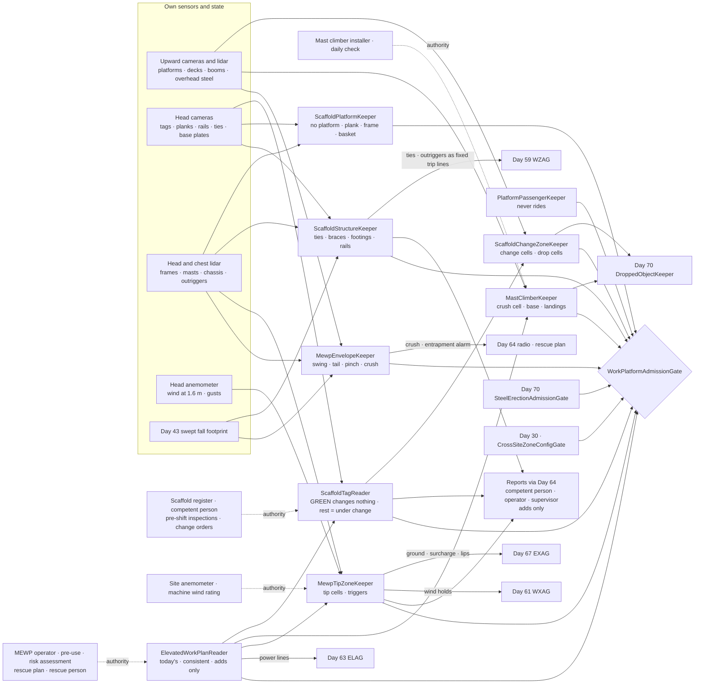
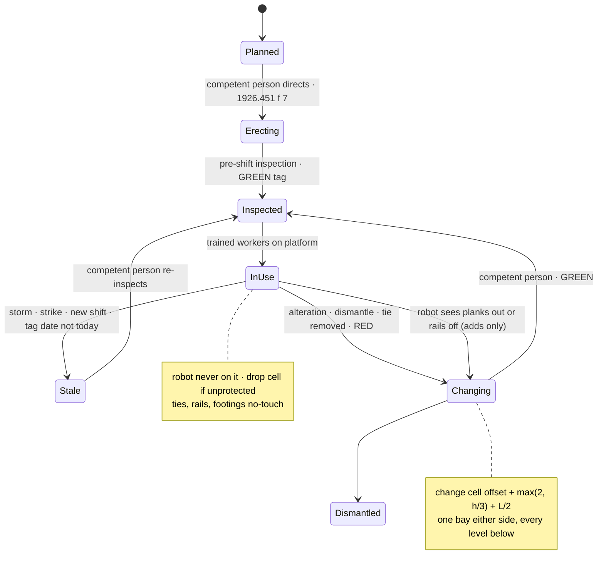
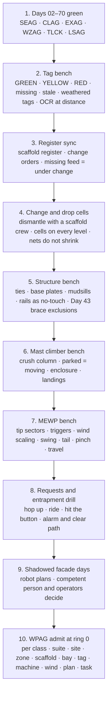

# Day 71 — Scaffolds, mast climbers, and aerial lifts under the steel stack: ScaffoldTagReader / ScaffoldPlatformKeeper / ScaffoldChangeZoneKeeper / ScaffoldStructureKeeper / MastClimberKeeper / MewpTipZoneKeeper / MewpEnvelopeKeeper / PlatformPassengerKeeper / ElevatedWorkPlanReader / WorkPlatformAdmissionGate under SteelErectionAdmissionGate + the steel stack: UnboltedMemberKeeper / ConnectorZoneKeeper / ControlledDeckingZoneKeeper / DeckBundleWindWatcher / DroppedObjectKeeper / DeckFootingKeeper / ErectionStabilityKeeper / ErectionPlanReader / SteelErectionAdmissionGate under CraneLiftAdmissionGate + ConcretePourAdmissionGate + ExcavationAdmissionGate + AirQualityAdmissionGate + HotWorkAdmissionGate + LoudSiteAdmissionGate + ElectricalAdmissionGate + HeatAdmissionGate + WeatherAdmissionGate + LowLightAdmissionGate + WorkZoneAdmissionGate + DockAdmissionGate + SidewalkAdmissionGate + CorridorAdmissionGate + ElevatorAdmissionGate + DoorwayAdmissionGate + WetSurfaceAdmissionGate + ConfinedSpaceAdmissionGate + ElevatedAccessAdmissionGate + OverheadToolAdmissionGate + BimanualToolAdmissionGate + PowerToolAdmissionGate + PushPullAdmissionGate + PayloadCarryAdmissionGate + OutdoorGroundAdmissionGate + TerrainLocomotionAdmissionGate + FallSafeAdmissionGate + DeliberateContactAdmissionGate + WholeBodyTouchAdmissionGate + HumanHandoverAdmissionGate + CooperativeTaskAdmissionGate + TaskCompositionAdmissionGate + FleetSkillCatalogAdmissionGate + proximity + zone attestation + supervisor + logging + canary + HIL + fleet + incident + change-management + maintenance + thermal + energy gates

![ScaffoldTagReader / ScaffoldPlatformKeeper / ScaffoldChangeZoneKeeper / ScaffoldStructureKeeper / MastClimberKeeper / MewpTipZoneKeeper / MewpEnvelopeKeeper / PlatformPassengerKeeper / ElevatedWorkPlanReader / WorkPlatformAdmissionGate: the same 63.8 kg humanoid on Site C on a cold, gusty Thursday carries an 8 kg case of air-barrier tape to the facade crew's staging table at the foot of a 12 m frame scaffold on the south face of the steel wing; it reads a green scaffold tag and still refuses to climb the end frames to the second lift, because a tag is a competent person's statement to trained workers about today's inspection, not a release for a biped nobody counted, and cross braces are never access; it holds a 5.6 m change cell outside bays 5 and 6 while the scaffold crew strips the top lift, where a 1.2 kg coupler falling 12 m arrives with about 141 J; it never touches a tie, a brace, a base plate, a mudsill, or a guardrail, because a stumbling 64 kg robot can put more than the 890 N a top rail is built for into it; it refuses a shortcut under the east mast climber "parked" at 9 m over lunch, because a parked platform can move whenever someone on it presses a button; it keeps out of a 26 ft scissor's 10.0 m tip cell and a 60 ft articulating boom's 13.7 m swing envelope, posts the boom's full 20.4 m tip cell when its 5.8 m/s gust scales to about 12.0 m/s at platform height against a 12.5 m/s rating, and hands the boom's wheel 1.5 m from a trench lip to Day 67; it refuses to ride up in the basket with a box; and when the boom platform is pinned against overhead steel and the operator shouts for someone to hit the down button, it raises the radio alarm and clears the path for the trained rescue person instead of touching the ground controls](/images/day71-scaffolds-mast-climbers-aerial-lifts.png)

[Day 05](/lessons/day-05-power-bms) owns `torque_scale` and the pack **forever**. [Day 07](/lessons/day-07-wbc-balance) owns gait and balance. [Day 17](/lessons/day-17-runtime-safety-supervisor) owns ESTOP and safe states. [Day 29](/lessons/day-29-human-proximity-safety) owns person tracks, SSM, and PFL rows. [Day 30](/lessons/day-30-collaborative-workspace-zoning) owns attested zones and `CrossSiteZoneConfigGate`. [Day 40](/lessons/day-40-human-robot-handover-co-carry) owns handovers. [Day 43](/lessons/day-43-falls-fall-safe-contact) owns the fall direction and the swept fall footprint. [Day 59](/lessons/day-59-construction-sites-work-zones) owns slab edges, openings, covers, trip lines, and barriers. [Day 61](/lessons/day-61-weather-rain-snow-fog-wind) owns weather, ice, and lightning holds. [Day 63](/lessons/day-63-temporary-power-electrical-hazards) owns power lines, cords, and clearances. [Day 64](/lessons/day-64-noise-vibration-communications) owns warnings, radio, and hand signals. [Day 65](/lessons/day-65-hot-work-fire-hazards) owns arcs, sparks, fire watch, and evacuation. [Day 67](/lessons/day-67-excavations-trenches) owns excavations, lips, and ground surcharge. [Day 69](/lessons/day-69-cranes-rigging-overhead-lifts) owns hooks and fall zones. [Day 70](/lessons/day-70-structural-steel-metal-decking) owns members, connectors, CDZs, deck, drop cells under erection, and the frame's rods and cables.

Day 70 was about the frame going up. Today is about the temporary structures and machines that put people next to it once it's up: scaffolds, mast-climbing work platforms, and mobile elevating work platforms (MEWPs: scissor lifts and boom lifts). All three exist to hold a person in the air at a working face. All three are designed, rated, inspected, and operated around **people**: a rated load in people and materials, guardrails at a person's waist, a harness anchorage sized for a person, a tag written for a trained worker, a rescue plan for an operator. None of them was designed around a 64 kg biped with a dynamic gait, a 1.8 m fall footprint, and no hands to spare for a guardrail.

A humanoid around elevated work has five ways to make things worse. It's **a pair of feet** that will be invited onto a platform, a plank, or a frame because "it's green-tagged." It's **a body under the work**: under a scaffold being stripped, under a mast climber's platform, inside a boom's swing or a scissor's tip line. It's **a heavy thing that leans**: on a guardrail, a tie, a brace, a mast, or a base plate, each of which is part of a structure that only stands because nobody touches it. It's **a passenger** that someone will offer a ride to the fourth floor with a box. And it's **an observer** that can read a tag, a tilt, and a wind speed, and will be tempted, or asked, to say a scaffold is good, a lift is level, or the wind is fine. None of those makes it a scaffold competent person, a qualified MEWP operator, an occupant, or the rescue person on the ground.

Eight lies show up the first time a team runs a humanoid near scaffolds and lifts:

1. **Green-tag lie.** "It's green-tagged; hop up and pass this to the second lift." A tag isn't in the OSHA rule at all; it's a site convention (ANSI/SAIA A10.8 and most contractors' programs) for telling trained workers that a competent person inspected the scaffold before this shift (1926.451(f)(3)). It says nothing about a load nobody counted, a gait nobody tested on planks, or a fall that lands on a guardrail.
2. **It's-just-a-ladder lie.** "Climb the end frame; everyone does." Cross braces on tubular welded frame scaffolds may not be used as access (1926.451(e)(1)). End frames with rungs are access only if they're designed as ladders, and a robot that climbs anything is a robot whose fall footprint is now at height.
3. **Just-changing-a-bay lie.** "They're only taking the top lift down." A scaffold being erected, altered, moved, or dismantled is under the direction of a competent person (1926.451(f)(7)) precisely because, for that hour, its planks, guardrails, and ties are out and its components are being passed hand to hand above whoever is underneath.
4. **Lean-on-it lie.** "Grab the rail; that's what it's for." A scaffold top rail is built for 200 lb (890 N) of force (1926.451(g)(4)(vii)); a robot catching a stumble can put more than that into it. A tie is the only thing keeping a 4:1 scaffold from going over, and a base plate on a mudsill is the only thing keeping it from punching through the ground.
5. **It's-parked lie.** "The mast climber's parked at nine metres for lunch; cut under it." A mast-climbing work platform is a machine whose controls are on the platform. Parked means nobody is pressing the button right now.
6. **Lift's-steady lie.** "It's on outriggers; it's not going anywhere." A boom lift at full outreach puts tonnes on one wheel or pad; a soft spot, a curb, a cover, a trench lip, or a gust can tip it, and the tip line is the platform height away.
7. **Boom's-up-there lie.** "The boom's up there; nothing can happen down here." Booms swing, telescope, and descend; their tail swings past the chassis; scissor stacks pinch as they come down; and platforms get driven into the steel above them, which is the platform-crush accident that kills operators.
8. **Give-it-a-ride lie.** "Ride up in the basket with the box; you weigh less than a guy." The rated load isn't the problem. The robot can't be tied off to a basket anchorage (1926.453(b)(2)(v)), its fall footprint is larger than the platform, its fall lands on the operator and the guardrail, and the rescue plan counts the people on board, not the robots.

Today owns **`ScaffoldTagReader` / `ScaffoldPlatformKeeper` / `ScaffoldChangeZoneKeeper` / `ScaffoldStructureKeeper` / `MastClimberKeeper` / `MewpTipZoneKeeper` / `MewpEnvelopeKeeper` / `PlatformPassengerKeeper` / `ElevatedWorkPlanReader` / `WorkPlatformAdmissionGate`**. The question is: **how do you let a humanoid work on a site full of scaffolds, mast climbers, and aerial lifts, with every tag read as someone else's authority that can only close, never a release; every platform, plank, frame, and basket refused as a place to stand or ride; every scaffold being erected, altered, or dismantled treated as a drop and no-entry cell; every tie, brace, base plate, mudsill, guardrail, and mast left untouched; every mast climber treated as a moving machine with crush zones whenever anyone is on it; every MEWP given tip-over, swing, and pinch cells, with its ground handed to Day 67; and every inspection, tilt, and wind reading reported as an observation that adds — without raising Day 29 PFL, writing Day 05 `torque_scale`, gating Day 17 ESTOP, or bypassing `CrossSiteZoneConfigGate`?**

## The robot is never on the platform

The rule everything follows from: **around elevated work, the robot is a pair of feet that stays on the ground or on released floors, a body kept out from under and out of the way of every platform, a pair of hands kept off every temporary structure and every control, and an observer whose reports only add. It never stands on, climbs, or rides a scaffold platform, plank, frame, brace, mast-climber deck, landing, or MEWP platform it hasn't been explicitly planned onto by a qualified person (and in this lesson's ring-0 admission, that's none); never stands in a scaffold change cell, a drop cell under a working platform, a mast-climber crush cell or base enclosure, a MEWP tip cell, swing envelope, or pinch cell; never touches, leans on, steps on, ties off to, or sets anything against a tie, brace, base plate, mudsill, screw jack, guardrail, toeboard, mast, mast tie, landing gate, outrigger, or pad; never operates, presses, or holds a control, including ground controls and emergency lowering; never hands, lifts, or passes anything to a platform; and never says a scaffold is good, a lift is level, an outrigger is on firm ground, or the wind is fine.** The site has people for those calls: the scaffold competent person, who inspects before each shift and directs every change; the qualified person or engineer who designs anything unusual; the trained MEWP operator, who does the pre-use inspection and the workplace assessment and decides whether to go up; the MEWP supervisor and the rescue-trained ground person named in the rescue plan; the mast climber's installer and its competent person; and the controlling contractor. The robot can tell them things. It can't stand in for them.

Six facts set the shape of the lesson.

**A scaffold is a structure designed around people, and its tag is a person's statement.** Each scaffold and component must support its own weight and at least four times the maximum intended load (1926.451(a)(1)); light, medium, and heavy duty are 25, 50, and 75 psf (1.2, 2.4, and 3.6 kPa) per Appendix A. Platforms are fully planked with gaps no more than 1 in (25 mm) and are at least 18 in (0.46 m) wide (1926.451(b)(1)–(2)). A competent person inspects every scaffold for visible defects before each work shift and after any occurrence that could affect its integrity (1926.451(f)(3)). Work on scaffolds covered in snow, ice, or other slippery material is prohibited except to remove it (1926.451(f)(8)), and work during storms or high winds is prohibited unless a competent person decides it's safe and the workers are tied off or wind screens are up (1926.451(f)(12)). Tags (green, yellow for special conditions, red for do-not-use) aren't required by OSHA; they're how the inspection is communicated.

**Changing a scaffold is its own hazard.** Scaffolds are erected, moved, dismantled, or altered only under the supervision and direction of a competent person, by trained workers (1926.451(f)(7)). Where tools, materials, or equipment could fall onto people below, the area below is barricaded and entry prohibited, or toeboards, screens, debris nets, or canopies are installed (1926.451(h)(1)–(2)); toeboards are at least 3.5 in (89 mm) tall and withstand 50 lb (222 N) (1926.451(h)(4)).

**The structure stands on ties, braces, and a footing nobody may disturb.** Supported scaffolds with a height-to-base-width ratio over 4:1 are restrained by guys, ties, or braces, installed at the closest horizontal member to the 4:1 height and repeated vertically every 20 ft (6.1 m) or less for scaffolds 3 ft wide or less, and every 26 ft (7.9 m) or less for wider ones, at each end and at horizontal intervals no greater than 30 ft (9.1 m) (1926.451(c)(1)). Poles, legs, posts, frames, and uprights bear on base plates and mudsills or other adequate firm foundation, and unstable objects aren't used to support them (1926.451(c)(2)). Cross braces aren't access (1926.451(e)(1)), and boxes, barrels, and other makeshift devices aren't used on platforms to gain height (1926.451(f)(15)). Guardrails go on platforms more than 10 ft (3.1 m) above a lower level (1926.451(g)(1)); top rails are 38 to 45 in (0.97 to 1.14 m) high and take 200 lb (890 N); midrails take 150 lb (666 N) (1926.451(g)(4)).

**A mast climber is a machine, not a scaffold.** Mast-climbing work platforms (ANSI/SAIA A92.9) run a deck up one or two masts tied to the building, driven by rack-and-pinion motors controlled from the deck. OSHA has no specific standard for them, so the site applies 1926.451's general requirements, the manufacturer's manual, and A92.9: a qualified installer, mast ties at the manufacturer's spacing, daily inspection, and a guarded base. The deck can move whenever someone on it chooses, and from the deck the crew can't see what's underneath.

**A MEWP is rated, inspected, and rescued around its occupants.** Boom-supported aerial platforms are covered by 1926.453 and scissor lifts by 1926.451 and 1926.452(w) as mobile scaffolds; the ANSI/SAIA A92.20 (design), A92.22 (safe use), and A92.24 (training) suite applies to both. A92.20 machines carry load sensing and, if rated outdoor, a wind rating, typically 12.5 m/s (28 mph); indoor-only machines are rated for no wind at all. Occupants of boom lifts wear a body harness with a lanyard attached to the boom or basket (1926.453(b)(2)(v)) and stand on the platform floor, never on the rails (1926.453(b)(2)(iv)); lower controls aren't operated without permission from the person in the lift except in an emergency (1926.453(b)(2)(ii)). A92.22 requires a risk assessment and a rescue plan for every MEWP use.

**Every platform shares the same three ways to kill people below it and beside it.** It tips (a scissor or boom past its tipping line on soft ground, a slope, a hole, or a gust), it crushes (the deck coming down on something, a scissor stack folding, a boom swinging, a tail sweeping, a platform driven into overhead steel with the operator against the rails), and it drops things (tools, blocks, couplers, planks, off an edge without toeboards or nets). The robot's job is to keep its body out of all three and its hands off everything that prevents them.

| Layer | Owns | Must not own |
|-------|------|--------------|
| `ScaffoldTagReader` | Every scaffold's tag, read by camera and against the site's scaffold register: GREEN, YELLOW, RED, MISSING, STALE (not today's date or not after the last event); any state other than today's GREEN treats the scaffold as under change; GREEN changes nothing for the robot | Treating any tag as a release; hanging, moving, or writing a tag; saying a scaffold passed |
| `ScaffoldPlatformKeeper` | Every platform, plank, frame, brace, ladder, stair tower, mast-climber deck, landing, and MEWP platform as not-footing; foot placements and handholds refused on all of them unless a plan names this robot and platform (ring 0: none) | Stepping, climbing, sitting, or standing on any of them; passing anything up to them |
| `ScaffoldChangeZoneKeeper` | Bays being erected, altered, moved, or dismantled, from the register, the tag, and its own eyes (planks out, rails off, people passing components): change cells offset + max(2 m, $h/3$) + half the longest component, one bay either side; drop cells under working platforms without listed nets or canopies | Entering a change cell to fetch, deliver, or photograph; picking up a fallen component |
| `ScaffoldStructureKeeper` | Ties, guys, braces, base plates, screw jacks, mudsills, guardrails, toeboards, netting, and outriggers as no-touch (object + 0.3 m) and immovable trip lines; observations (tie missing, mudsill undermined, base plate off its sill, rail missing) reported to the competent person | Touching, leaning on, stepping on, tying off to, or setting anything against them; saying a scaffold is plumb, tied, or sound |
| `MastClimberKeeper` | Every mast climber's deck, masts, ties, landings, and base enclosure: crush cell of deck + 1 m on every level below whenever anyone is on it or its controls are powered; base enclosure and landing gates no-entry; drop cells beyond the deck edge | Walking under a parked deck; opening a landing gate; touching a mast or tie |
| `MewpTipZoneKeeper` | Each MEWP's tip cell (platform height + rails + 1 m), held toward any trigger: slope, tilt alarm, soft ground, covers, holes, curbs, trench lips, outriggers or pads, wind near rating; ground and surcharge handed to Day 67; indoor-only machines in wind reported | Saying a lift is level or the ground is firm; placing pads or cribbing; touching an outrigger |
| `MewpEnvelopeKeeper` | Swing envelope (outreach + half platform + 1 m), tail swing + 1 m, scissor chassis + 1 m pinch cell, travel path ahead of a driving MEWP, and the volume between any platform and overhead steel; platform-crush and entrapment events raised as alarms through Day 64 | Operating or touching any control, including ground controls and emergency lowering; guiding or spotting by signal |
| `PlatformPassengerKeeper` | Every request to ride a MEWP, mast climber, or scaffold-mounted hoist, and every request to load the robot as cargo onto one, refused with the reason; lifted payloads go by the site's material hoist or the crew's own platform loading | Riding, being lifted, or loading itself onto any platform |
| `ElevatedWorkPlanReader` | The scaffold register and inspection log, the mast climber's installation and daily inspection records, each MEWP's pre-use inspection, workplace risk assessment, and rescue plan; today's or refusal; mismatches refuse the affected bays and machines; power-line clearances to Day 63; wind to Day 61 | Inspecting, re-sequencing, or judging; calling a scaffold or machine fit |
| `WorkPlatformAdmissionGate` | Fail-closed admit per robot class, suite, site, zone, scaffold, bay, tag, change state, mast climber state, MEWP state, wind state, plan, task | `JointCommand`; Day 05; PFL; Day 17 |
| Days 05 / 07 / 17 / 29 / 30 / 40 / 43 / 59 / 61 / 63 / 64 / 65 / 67 / 69 / 70 | Pack, gait, ESTOP, people, zones, handovers, falls, edges and covers, weather, power lines, comms, hot work, ground, hooks, steel | Being outranked by "it's green-tagged" |

**Core thesis:** **around scaffolds and lifts, a humanoid treats every tag as a statement to trained people that can close a scaffold to it but never open one, never stands on, climbs, or rides anything that holds people in the air, keeps out from under every scaffold being changed and every platform that can move, never touches the ties, braces, footings, rails, and masts that keep those structures up, gives every lift its tip, swing, and pinch cells and hands its ground to the day that owns ground, never touches a control even when someone is shouting for it, and reports what it sees without ever saying anything is level, tied, firm, or safe.**



## Physical machine: where the platforms are

Walk Site C on Thursday. The steel wing from Day 70 is topped out, levels 2 and 3 are decked and released to other trades, and the building is being closed in. It's 4 °C at 07:00 with a north-west wind, gusting to 9 m/s at grade by early afternoon. The site has three kinds of elevated work going on at once.

- **A frame scaffold on the south face.** 17 bays of 2.13 m (7 ft) by 1.52 m (5 ft) wide frames, 36.2 m long, six lifts of 2.0 m for a top platform at 12 m, steel planks, guardrails and toeboards on every working lift, debris netting on bays 1 to 12. Its frames stand on screw jacks and base plates on 0.23 × 0.05 m timber mudsills over compacted gravel. Ties go into the steel at 6 m and 12 m, at each end and every 9 m or less along the face. The window crew is working on lifts 2 and 3 of bays 1 to 8. A scaffold crew is stripping the top lift of bays 13 to 17 to make room for a parapet crane pick, under a red tag on those bays.
- **A twin-mast climber on the east face.** A 14.6 m deck, 1.5 m deep with extension decks to the wall, on two masts tied to the steel every 6 m, rising at about 0.12 m/s (7.2 m/min). Three masons are laying the brick veneer from it at about 9 m. A 2 m mesh base enclosure with an interlocked gate surrounds both masts and the deck's footprint at grade.
- **Two MEWPs.** On level 1 inside the wing, a 26 ft electric slab scissor (platform height 7.9 m, chassis 2.3 × 0.81 m, a 0.9 m roll-out extension deck), indoor-only rated, with the electricians running conduit at the underside of level 2. On the north side, a 60 ft articulating boom (platform height 18.3 m, horizontal outreach about 11.8 m, a 1.83 m platform, 0.9 m tail swing beyond the chassis), outdoor-rated at 12.5 m/s, with a glazier sealing curtain-wall joints at levels 3 and roof. It's parked on compacted gravel about 1.5 m from the lip of Day 67's 1.8 m-deep utility trench.

The robot's tasks: carry an 8 kg case of air-barrier tape from the gate to the facade crew's staging table at the foot of the south scaffold, handed over at the table, which is outside the scaffold's footprint and change cells; and, in the afternoon, photograph the level-1 ceiling rough-in for the MEP coordinator, in the bays the scissor isn't working. Four times during the day someone will ask it for something else.

The robot's hardware for this:

- **Upward-facing cameras and lidar** (from Day 59), which see platforms, decks, booms, baskets, and the steel above them.
- **Head cameras** with Day 60's low-light settings and Day 61's window self-check, for tags (OCR plus color), planks, rails, toeboards, ties, base plates, and mudsills.
- **Head and chest lidar** for frames, masts, MEWP chassis, outriggers, and the gap between a platform and whatever's over it.
- **A small ultrasonic anemometer** in the head (from Day 61), 1.6 m off the ground.
- **The Day 43 fall model,** giving a swept fall footprint of 1.8 m with today's payload, and Day 43's list of brace targets, which today loses every temporary structure.

### Tags: a person's statement, read by a robot

`ScaffoldTagReader` reads the tag at every scaffold access point with the head cameras and checks it against the site's scaffold register, the competent person's log that ElevatedWorkPlanReader keeps fresh. It knows five states:

- **GREEN:** inspected today, before this shift and after the last event the register knows of (a storm, a vehicle strike, an alteration). Fit for trained workers to use as tagged.
- **YELLOW:** usable by trained workers with special conditions (a harness required, a missing rail on one side, a load limit).
- **RED:** do not use; under erection, alteration, or dismantling, or failed.
- **MISSING:** no tag where the register says there should be one.
- **STALE:** a tag whose date isn't today, whose inspection predates an event the robot knows of (Day 61 says it rained hard overnight; Day 69 says a load swung into the face at 10:20), or which disagrees with the register.

The asymmetry is the whole design: **GREEN changes nothing for the robot,** because the robot never uses a scaffold, and the green tag is a statement to trained people about a structure designed for them. **Every other state closes something,** because YELLOW, RED, MISSING, and STALE all mean somebody has a reason to keep people off, or nobody has checked. STR treats a scaffold or bay in any of those states as **under change**, which hands it to `ScaffoldChangeZoneKeeper`, and it reports MISSING and STALE to the competent person, adds only, phrased as "tag at bay 13 access dated Wednesday," never "scaffold not inspected."

At 07:30 the robot reads GREEN at the bay-4 access and RED on bays 13 to 17. At 09:10, while it's at the staging table, a window installer on lift 2 says: "It's green-tagged. Hop up the end frame and pass me that case." Three keepers refuse at once. `ScaffoldPlatformKeeper` refuses the plank and the frame as footing; `ScaffoldStructureKeeper` refuses the end frame and its cross braces as a handhold (1926.451(e)(1) forbids cross braces as access for people, too); and nothing gets handed up from the ground to a platform, because the robot would be standing at the foot of the face inside the drop cell of the lift above it. The robot answers on the display and through Day 64: "I can't climb or stand on scaffolds. The case is on the staging table." The installer climbs down the stair tower and gets it.

### Platforms: never footing

`ScaffoldPlatformKeeper` classifies every elevated surface the robot can see as **not footing**: scaffold platforms and planks, frames, braces, ladders built into frames, stair towers, mast-climber decks and their landings, MEWP platforms and extension decks, and anything set on a platform. Footing is decided by Day 70's `DeckFootingKeeper` (released deck) and Day 59 (slabs, edges, covers), and neither ever classifies a temporary platform as RELEASED.

Why "never" rather than "when the tag is green"? Three reasons, all about what the rating assumed.

- **The load case.** A light-duty bay takes 25 psf (1.2 kPa) uniformly, about 3.9 kN over a 2.13 × 1.52 m bay, at a factor of four. A walking robot's peak foot force is about 1.2 times its weight, roughly 750 N on a 0.24 × 0.10 m foot, and a stumble-recovery step can double it. That may be within the plank's point-load rating or it may not; the point is that nobody counted it, and the competent person's inspection is against an intended load that didn't include it.
- **The footing.** Planks deflect, overlap at supports (at least 6 in, 0.15 m, over the centerline, 1926.451(b)(4)), and leave up to 25 mm gaps. Day 07's gait was qualified on floors, not on a 0.46 m-wide plank run that steps up at every overlap and bounces at mid-span.
- **The fall.** The robot's swept fall footprint is 1.8 m; a 1.52 m-wide scaffold has nowhere to put it except over the guardrail or onto it, and a guardrail is built for 890 N.

A plan can name a specific robot onto a specific platform: a scaffold designed by a qualified person with the robot's static and dynamic loads, a stair-tower access, guardrails it is never asked to brace on, and a gait qualified on that plank system. That's a new admission row with its own bench, not something today's gate admits. At ring 0, WPAG admits none.

### Scaffolds being changed: drop and no-entry cells

`ScaffoldChangeZoneKeeper` takes the bays being erected, altered, moved, or dismantled from three sources: the register's change orders, `ScaffoldTagReader` (anything not GREEN), and its own eyes (planks out, rails off, a gin wheel or rope rigged, people passing frames or planks hand to hand). For each it builds a **change cell** at grade and on every level below the work, outward from the scaffold face and along it, on the changing bays plus one bay either side:

$$
r_{\text{change}} = r_{\text{offset}} + \max\left(2.0\ \text{m},\ \tfrac{h}{3}\right) + \tfrac{1}{2}L_{\text{comp}}
$$

It's Day 70's drop cell with Day 69's scatter term for long things: $r_{\text{offset}} = 0.5$ m for the reach of the crew past the face, and $L_{\text{comp}}$ the longest component being handled, here a 2.13 m steel plank. At the top lift, $h = 12$ m:

$$
r_{\text{change}} = 0.5 + 4.0 + 1.07 \approx 5.6 \text{ m}
$$

The energies say why. At 12 m things arrive at $\sqrt{2 \times 9.81 \times 12} \approx 15.3$ m/s:

| Object | Mass | From the top lift (12 m) | From lift 2 (4 m, 8.9 m/s) |
|--------|------|------|------|
| Frame locking pin | ~0.1 kg | ~12 J | ~4 J |
| Swivel coupler | ~1.2 kg | ~141 J | ~47 J |
| Ratchet or podger | ~0.5 kg | ~59 J | ~20 J |
| 2.13 m steel plank | ~18 kg | ~2.1 kJ | ~0.7 kJ |
| Cross brace | ~4 kg | ~471 J | ~157 J |

Against the 54 J hard-hat test energy from Day 70, a dropped coupler from the top lift is nearly three times over, and a plank is a different category altogether.

SCZK also holds an ordinary **drop cell**, Day 70's $0.5 + \max(2, h/3)$, under any working lift that isn't listed in the plan as protected by debris netting or a canopy over the route. Today that's bays 13 to 17 (no netting) and the open ends of the scaffold. A netted face doesn't shrink any cell the robot already holds; it's the reason the plan lists a route at all. The robot's route to the staging table runs along the netted bays at 6 m from the face, outside every cell, and passes under the scaffold only through the canopy-covered pedestrian walkway at bay 6, which is in the plan.

At 10:40 the scaffold crew starts passing planks down the outside of bay 15. SCZK widens to the 5.6 m cell on bays 12 to 17 and the robot holds its route at the bay-11 end. If something falls into the cell, it doesn't go in to pick it up; it reports it to the scaffold foreman.

### Ties, braces, footings, rails: hands off

`ScaffoldStructureKeeper` marks every tie, guy, brace, base plate, screw jack, mudsill, guardrail, midrail, toeboard, netting attachment, outrigger bracket, and stair-tower rail as a **no-touch cell** (object plus 0.3 m), and every component at foot or shin height (mudsills, base plates, low ties, bracing near grade) as a Day 59 **immovable trip line**. It hands every one of them to Day 43 as excluded from its list of things it may brace on in a fall.

The scaffold's stability geometry shows why nothing can be touched. For a 1.52 m-wide scaffold, the first ties go at the closest horizontal member to $4 \times 1.52 = 6.08$ m, the lift at 6 m, then every 7.9 m or less (it's wider than 3 ft), and the top tie no further than 6.08 m below the top: here, 6 m and 12 m. Along the face they go at each end and at most every 9.1 m: five per row on 36.2 m, ten in all. Each one is doing work. A tie that's removed for a window and not replaced is the most common way a scaffold that passed inspection stops being one, and a robot that bumps a tie coupler loose is a robot that just did the same thing without anyone writing it down.

A guardrail is the other temptation, because it looks like a handrail. It's built for 890 N at the top rail. The robot plus its case is $71.8 \times 9.81 \approx 704$ N static; a stumble-arrest hand force of 1.5 to 2 times body weight is roughly 1.1 to 1.4 kN. Day 43 has to be told, explicitly, that a guardrail is not a brace target, or its planner will find the nearest horizontal bar at waist height and use it.

When the robot sees a tie missing where the register says one is, a mudsill undermined by the morning's rain, a base plate off its sill, a screw jack extended past its mark, a guardrail or toeboard missing on a working lift, or netting torn, SSK reports it to the scaffold competent person through Day 64, with a photo and the bay and lift, labelled "adds only: not an inspection." It never says the scaffold is plumb, tied, or sound, and it never says it isn't.

### Mast climbers: a parked deck is a deck that can move

`MastClimberKeeper` treats the east mast climber as Day 69 treats a crane: a machine with moving parts and a load in the air. It holds:

- **A crush cell** under the deck: the deck's plan footprint plus 1 m, on every level below the deck down to grade, whenever anyone is on the deck or its controls are powered. With a 14.6 × 1.5 m deck (plus extension decks to the wall), that's a 16.6 × 3.5 m column, held from the masons' level at 9 m down to the base enclosure.
- **The base enclosure** and the space inside its gate as no-entry, with the gate as no-touch: the interlock is there to stop the deck when the gate opens, which is the manufacturer's and A92.9's way of saying nobody should be in there.
- **Landings** on released floors as no-entry while the deck is within one floor of the landing, and the landing gate as no-touch, always.
- **Masts and mast ties** as no-touch and, near grade, immovable obstacles.
- **A drop cell** beyond the deck's outer edge, Day 70's rule from the deck height: at 9 m, $0.5 + \max(2.0, 3.0) = 3.5$ m, merged into Day 70's `DroppedObjectKeeper`. Masons drop brick, mortar, and trowels; the deck's toeboards and netting are the crew's business, not a reason to shrink the cell.

At 11:20 the masons stop for lunch with the deck parked at 9 m. A labourer pushing a cart says the robot can cut through under the deck to the east gate; the enclosure is open on one side for a delivery. MCK refuses. The deck is parked, not de-energized and locked out; a mason may come back up the landing early and run it down to load. From the deck, the crew can't see the ground under the deck at all. At 0.12 m/s a descent from 9 m takes 75 s, and there is no warning anyone at grade would hear. The robot goes around, outside the crush cell, the enclosure, and the drop cell, an extra 31 m on its route.

### MEWPs: tip cells, with the ground handed to Day 67

`MewpTipZoneKeeper` gives every MEWP a **tip cell**, the area the platform and its occupants could land in if the machine went over:

$$
r_{\text{tip}} = h_{\text{platform}} + h_{\text{rail}} + m
$$

with $h_{\text{rail}} \approx 1.1$ m for the guardrails and the person at them, and $m = 1.0$ m. For the scissor at full height, $7.9 + 1.1 + 1.0 = 10.0$ m; for the boom, $18.3 + 1.1 + 1.0 = 20.4$ m.

A full circle of 20.4 m around every boom lift would close most of a site, so MTZK holds the tip cell as a **sector toward every trigger it knows** and the full circle when any trigger is uncertain:

- **slope and tilt:** the machine's tilt alarm (typically 1.5° side to side and 3° fore and aft on a slab scissor; read from the machine's manual, never assumed), and the robot's own lidar estimate of the surface under the wheels or pads;
- **ground:** soft or wet ground, recent backfill, covers, holes, curbs, and **trench and excavation lips**, which go to Day 67's `EdgeSurchargeGauge` as a surcharge from a wheel or pad carrying tonnes;
- **outriggers and pads:** not down, not on pads, on a cover or a void;
- **wind:** the site anemometer against the machine's rating, and the robot's own scaled gust;
- **indoor-only machines** anywhere the wind can reach them.

The boom is parked on gravel about 1.5 m from the lip of the 1.8 m utility trench. MTZK doesn't judge that; it hands it to Day 67, whose lip standoff for a machine is the trench owner's number, and reports "boom right-front wheel about 1.5 m from trench lip, 1.8 m deep" to the MEWP supervisor, adds only. The tip sector toward the trench stays posted all day.

At 13:45 the robot reads gusts of 5.8 m/s at 1.6 m on the north side. Scaled to the platform at 18.3 m with Day 69's $\alpha = 0.3$:

$$
v_{18.3} = 5.8 \times \left(\frac{18.3}{1.6}\right)^{0.3} \approx 5.8 \times 2.08 \approx 12.0 \text{ m/s}
$$

That's above $0.8 \times 12.5 = 10.0$ m/s. MTZK widens the boom's tip cell to the full 20.4 m circle and reports the reading to the operator and the MEWP supervisor: "gust about 12 m/s estimated at platform height, from 5.8 m/s at 1.6 m." The site anemometer is the authority and the operator decides; the robot never says "too windy" or "fine to stay up," and its own number can widen a cell but never narrow one. The scissor inside is indoor-only; MTZK reports that the east side of level 1 is still open to the wind and that the scissor is working in bay E2, and holds its 10.0 m circle there.

### MEWP envelopes: swing, tail, pinch, and crush

`MewpEnvelopeKeeper` keeps the robot out of the volumes a MEWP sweeps in normal operation:

- **Swing envelope** of a boom: horizontal outreach + half the platform width + 1 m around the turntable, $11.8 + 0.9 + 1.0 = 13.7$ m, at every height, whenever the boom is out of its stowed position.
- **Tail swing:** the counterweight's sweep beyond the chassis, 0.9 m + 1 m, always, because the operator at the platform can't see it.
- **Scissor pinch cell:** the chassis plus 1 m, whenever the platform is elevated or moving, for the folding stack and the pothole guards that drop as it rises.
- **Travel path:** a lane ahead of and behind any MEWP driving, elevated or not, as long as its stopping distance plus 2 m.
- **Overhead crush volume:** the space between any platform and the structure over it. The robot can't prevent platform crush; it can notice it.

At 14:10 the glazier on the boom, raising toward the roof edge, gets pinned between the platform rails and the roof steel. The secondary guarding alarm sounds. The glazier shouts down: "Hit the down button! The ground controls!" The robot is 16 m away, outside the envelope. MEK raises the site's entrapment alarm on the radio through Day 64 with the machine ID and location, puts "Boom lift entrapment, north side" on its display and speaker, and steps further off the path the rescue person will take from the site trailer to the ground controls. It does not go to the controls. The rescue plan names who operates lower controls, and they are trained on this machine: which function to reverse, why lowering may crush harder, and where the emergency descent valve is. A robot pressing a button on a panel it was never qualified on, during an entrapment, is how a pin becomes a fatality. 1926.453 lets lower controls be used without the occupant's permission only in an emergency, by people trained to use them. After the glazier is freed, the robot's report lists what it saw and when, and nothing else.

### Passengers: never

`PlatformPassengerKeeper` has one rule and a list of the forms the request takes: "ride up with the box," "stand on the deck and we'll take you up to three," "get in the scissor so you can photograph the ceiling," "we'll load you on the mast climber for the roof." All refused, with the reason on the display.

At 13:00 the boom operator, down at grade to collect a case of sealant from the gang box, hears that the MEP coordinator also wants photos of the roof-edge flashing and offers the robot a ride up to "save a trip." The arithmetic doesn't decide it; the rated load (about 230 kg for this platform) would take the glazier, the robot, and the sealant. It's refused because:

- the occupants of a boom platform wear a harness lanyarded to the basket (1926.453(b)(2)(v)) and the robot has no harness point rated for its fall;
- the robot's 1.8 m fall footprint is bigger than the 1.83 × 0.76 m platform, so any stumble on a moving, swaying deck goes into the operator or over the rails;
- the platform's load sensing, the operator's risk assessment, and the rescue plan count the people on board, and nobody's rescue plan says how to get a stalled robot out of a basket at 18 m;
- getting on and off at height is a gate transfer onto a structure, which `ScaffoldPlatformKeeper` refuses anyway.

The photos get done the way they would without a robot: the glazier takes them from the basket with the coordinator's tablet, and the robot photographs what it can reach from released floors.

### The plans: someone else's checks

`ElevatedWorkPlanReader` reads the paper that says who checked what today:

- the **scaffold register:** each scaffold's ID, design (and engineer's design for anything over 125 ft, 1926.451(a)(6), or unusual), duty rating, the competent person's pre-shift inspection, any change orders and which bays are affected;
- the **mast climber's** installation sign-off, tie schedule, and daily inspection;
- each **MEWP's** pre-use inspection, the operator's workplace risk assessment, the rescue plan and the named rescue person, and the machine's wind rating and indoor/outdoor status;
- the **controlling contractor's** list of routes under scaffolds and which faces have nets or canopies.

It checks freshness and consistency against what the robot sees: a scaffold in the register with no tag, a GREEN tag on a bay with planks out, a mast climber with no daily check, a MEWP with no rescue person named, an outdoor MEWP the register lists as indoor-only, a scaffold or MEWP within Day 63's clearance of an energized line (10 ft, 3.1 m, for uninsulated lines under 50 kV, 1926.451(f)(6)). Each mismatch is reported to the owner and refuses the affected bays and machines; a stale or missing register refuses every scaffold area on the site. It never inspects, never re-sequences anyone's work, and never calls anything fit.

### Putting the cells in code

As every day since Day 59: everything here adds or keeps constraints; nothing removes one.

```python
import math
from dataclasses import dataclass

MARGIN_M = 1.0
NO_TOUCH_M = 0.3
RAIL_H_M = 1.1
ALPHA = 0.3

@dataclass
class ScaffoldBay:
    scaffold_id: str
    bay: int
    tag: str              # "GREEN" | "YELLOW" | "RED" | "MISSING"
    tag_date_today: bool
    event_since_tag: bool  # storm, strike, alteration known to Day 61/69/register
    planks_out_seen: bool
    rails_off_seen: bool
    netted: bool

def tag_state(b: ScaffoldBay) -> str:
    """STR: GREEN changes nothing; every other state closes."""
    if b.tag == "GREEN" and b.tag_date_today and not b.event_since_tag:
        return "GREEN"
    if b.tag == "GREEN":
        return "STALE"
    return b.tag

def under_change(b: ScaffoldBay) -> bool:
    return tag_state(b) != "GREEN" or b.planks_out_seen or b.rails_off_seen

def drop_radius(h_m: float, offset_m: float = 0.5) -> float:
    return offset_m + max(2.0, h_m / 3.0)              # Day 70 policy, not a standard

def change_radius(h_m: float, longest_component_m: float) -> float:
    return drop_radius(h_m) + 0.5 * longest_component_m

def may_stand_on(surface_kind: str, plan_names_robot: bool = False) -> bool:
    """SPK: temporary platforms are never footing at ring 0."""
    temporary = {"SCAFFOLD_PLANK", "SCAFFOLD_FRAME", "BRACE", "STAIR_TOWER",
                 "MAST_CLIMBER_DECK", "LANDING", "MEWP_PLATFORM", "EXTENSION_DECK"}
    if surface_kind in temporary:
        return False                                    # plan_names_robot is a future admission row
    return True                                         # Day 59 / Day 70 still decide

def tip_radius(h_platform_m: float) -> float:
    return h_platform_m + RAIL_H_M + MARGIN_M

def swing_radius(outreach_m: float, platform_w_m: float) -> float:
    return outreach_m + platform_w_m / 2 + MARGIN_M

def scaled_gust(v_own: float, z_m: float, z_own: float = 1.6) -> float:
    return v_own * (z_m / z_own) ** ALPHA              # report only; never lowers a hold

def tip_cell(h_platform_m: float, triggers: set[str], v_platform: float | None,
             wind_rating: float, trigger_fraction: float = 0.8) -> dict:
    """MTZK: sectors toward known triggers; full circle when uncertain or windy."""
    r = tip_radius(h_platform_m)
    windy = v_platform is None or v_platform >= trigger_fraction * wind_rating
    if windy or "UNKNOWN_GROUND" in triggers or "TILT_ALARM" in triggers:
        return {"radius_m": r, "sector": "FULL"}
    return {"radius_m": r, "sector": sorted(triggers) or ["DOWNSLOPE"]}
```

```python
NEVER_TOUCH = {"TIE", "GUY", "BRACE", "BASE_PLATE", "SCREW_JACK", "MUDSILL", "GUARDRAIL",
               "MIDRAIL", "TOEBOARD", "NETTING", "MAST", "MAST_TIE", "LANDING_GATE",
               "OUTRIGGER", "PAD", "CONTROL_PANEL", "EMERGENCY_DESCENT"}
RIDE_REQUESTS = ("ride", "get in", "stand on the deck", "load you", "take you up")

def refuse_contact(target_kind: str) -> bool:
    return target_kind in NEVER_TOUCH

def refuse_request(text: str) -> str | None:
    t = text.lower()
    if any(k in t for k in RIDE_REQUESTS):
        return "I can't ride or stand on lifts, platforms, or scaffolds."
    if "down button" in t or "ground control" in t:
        return "Raising the entrapment alarm. I can't operate lift controls."
    if "climb" in t or "hop up" in t:
        return "I can't climb or stand on scaffolds."
    return None

def report(observation: str) -> str:
    banned = ("safe", "level", "firm", "tied", "plumb", "good", "fine", "passed", "failed")
    assert not any(w in observation.lower().split() for w in banned)
    return observation + " (adds only: not an inspection)"
```

## ScaffoldTagReader and ScaffoldPlatformKeeper

STR and SPK are the two halves of "a scaffold is for people." STR reads the paper the site hangs on the scaffold for its workers and uses it only in the direction that closes: a tag can tell the robot a bay is under change, never that it may climb. SPK makes the rest explicit: no temporary elevated surface is footing, whatever its tag, until a qualified person plans a specific robot onto a specific platform, and today's gate admits no such row.

## ScaffoldChangeZoneKeeper and ScaffoldStructureKeeper

SCZK gives every scaffold being changed, and every working lift without listed protection, somewhere empty underneath it, with a scatter term for the long pieces. SSK keeps the robot's hands, feet, and falls off everything that holds a scaffold up, and turns what it sees into observations for the competent person, never verdicts.

## MastClimberKeeper, MewpTipZoneKeeper, and MewpEnvelopeKeeper

These three treat elevated platforms as machines. MCK holds a crush column under every occupied or powered mast-climber deck and never believes "parked." MTZK gives every MEWP a tip cell, posted toward everything that could tip it and widened to a full circle when the wind or the ground is uncertain, and hands the ground itself to Day 67. MEK keeps the robot out of what booms and scissors sweep and, when a platform crushes someone against steel, raises the alarm and keeps its hands off the controls.

## PlatformPassengerKeeper and ElevatedWorkPlanReader

PPK is the shortest keeper in the curriculum: the robot never rides. EWPR reads the registers, inspections, risk assessments, and rescue plans that make elevated work someone else's responsibility, refuses what's stale or inconsistent, and routes power lines to Day 63 and wind to Day 61.

## WorkPlatformAdmissionGate

```text
WorkPlatformAdmission
  robot_class, suite, site, zone, scaffold_id, bay, machine_id, task
  elevated_state: NONE | SCAFFOLD_IN_USE | SCAFFOLD_CHANGING | MAST_CLIMBER_OCCUPIED | MAST_CLIMBER_PARKED | MEWP_STOWED | MEWP_ELEVATED | MEWP_TRAVELLING | ENTRAPMENT
  requires:
    Day 70 SteelErectionAdmissionGate: admitted for this zone
    Day 30 CrossSiteZoneConfigGate: pass
    scaffold_register: today's, consistent with tags and change state seen (else every scaffold under change)
    mast_climber_record: today's daily check (else crush cell held to grade at all times)
    mewp_records: pre-use, risk assessment, rescue person named (else full tip cell, refuse machine area)
    site_anemometer and wind ratings: present (else full tip cells at own scaled gust)
    route_under_scaffold: listed canopy or net in the plan (else drop cell applies)
  refuses if:
    any foot placement or handhold on a plank, frame, brace, stair tower, deck, landing, or platform
    any route cell in a change cell, an unprotected drop cell, a crush cell, a base enclosure, or a landing
    any route cell in a tip cell, swing envelope, tail swing, pinch cell, or travel lane
    any contact with a tie, brace, base plate, mudsill, rail, toeboard, mast, gate, outrigger, pad, or control
    any task that hands, lifts, or passes anything to a platform
    any request to ride or be loaded onto a platform
    any report phrased as safe, level, firm, tied, plumb, passed, or failed
  never: raises PFL · writes torque_scale · gates ESTOP · writes gait · bypasses CrossSiteZoneConfigGate
```

WPAG fails closed under Day 70's SEAG and everything beneath it. It's keyed by scaffold, bay, and machine state as well as zone, because the same staging table is a handover point at 09:10, inside a change cell at 10:40 if the crew moves to bay 8, under a crush column at 11:20 if the mast climber is relocated, and inside a full tip circle at 13:45 when the wind comes up.

## Data shapes

```text
ScaffoldTrack
  scaffold_id, bays[], width_m, lift_heights_m[], duty, netted_bays[], canopy_routes[]
  tag_by_access: {access_id: GREEN | YELLOW | RED | MISSING | STALE}, tag_date, register_ref
  change_bays[], longest_component_m, change_radius_m, drop_radius_m
  ties: [{xyz, seen: bool, in_register: bool}]

StructureItem
  kind: TIE | GUY | BRACE | BASE_PLATE | SCREW_JACK | MUDSILL | GUARDRAIL | TOEBOARD | NETTING
  geometry, no_touch_m: 0.3, trip_line: bool, observation, label: "adds only: not an inspection"

MastClimberTrack
  machine_id, masts[], deck_footprint, deck_z_m, occupied, controls_powered
  crush_column: footprint + 1 m to grade, base_enclosure, landings[], drop_radius_m

MewpTrack
  machine_id, class: SCISSOR | BOOM, group: A | B, type: 1 | 2 | 3, indoor_only
  platform_h_m, outreach_m, platform_w_m, tail_swing_m, wind_rating_m_s
  state: STOWED | ELEVATED | TRAVELLING | ENTRAPMENT
  triggers: {SLOPE, TILT_ALARM, SOFT_GROUND, COVER, HOLE, CURB, LIP, OUTRIGGER, WIND, UNKNOWN_GROUND}
  tip_cell, swing_envelope, pinch_cell, travel_lane

ElevatedWorkPlan
  date, scaffold_register[], mast_climber_checks[], mewp_preuse[], risk_assessments[]
  rescue_plans: [{machine_id, rescue_person, lower_controls_trained}], power_line_clearances → Day 63

# Unchanged owners
SteelErectionAdmissionGate · members · connectors · CDZs · DOK (Day 70)
CraneLiftAdmissionGate · hooks · fall zones (Day 69) · EXAG · lips · surcharge (Day 67)
HWAG · evacuation (Day 65) · LSAG · radio (Day 64) · ELAG (Day 63) · WXAG (Day 61)
edges · covers · TLCK (Day 59) · fall footprint (Day 43) · handover (Day 40)
tracks · SSM · PFL (Day 29) · zones (Day 30) · gait (Day 07) · ESTOP (Day 17)
BmsState / PowerState (Day 05): torque_scale, contactors
  accepts_requests_from_site: false
```

## Config

A starting configuration. Every number is a policy you re-derive from your own robot, your site, your machines' manuals, and the rules that apply where you work:

```yaml
elevated_work:
  robot_on_platform: never          # ring 0; a named-robot platform is a new admission row
  tags:
    green: changes_nothing
    yellow_red_missing_stale: under_change
    stale_if: [not_today, event_since_inspection, register_mismatch]
    write_move_hang: never
  platforms:
    footing: never
    surfaces: [plank, frame, brace, stair_tower, mast_climber_deck, landing, mewp_platform, extension_deck]
    hand_up_to_platform: never
  change_zone:
    radius: offset + max(2.0, h/3) + 0.5 * longest_component
    offset_m: 0.5
    bays_either_side: 1
    unprotected_lift_drop_radius: offset + max(2.0, h/3)
    nets_shrink_cells: false
    pick_up_inside_cell: never
  structure:
    no_touch_margin_m: 0.3
    items: [tie, guy, brace, base_plate, screw_jack, mudsill, guardrail, midrail, toeboard, netting, outrigger_bracket]
    low_items: day59_tlck_immovable
    fall_brace_targets_exclude: [guardrail, frame, brace, mast, tie, boom, platform]
  mast_climber:
    crush_cell: deck_footprint_plus_1m_to_grade
    hold_when: [occupied, controls_powered]
    parked_counts_as_moving: true
    base_enclosure: no_entry
    landing_gate: no_touch
    landing_no_entry_within_floors: 1
  mewp:
    tip_radius: platform_h + 1.1 + 1.0
    tip_sector: toward_triggers
    full_circle_if: [wind_ge_0.8_rating, tilt_alarm, unknown_ground, indoor_only_in_wind]
    ground_and_lips_to: day67_exag
    swing_radius: outreach + platform_w/2 + 1.0
    tail_swing_margin_m: 1.0
    scissor_pinch: chassis_plus_1m
    travel_lane: stopping_distance_plus_2m
    controls_including_ground_and_emergency: never
    entrapment: radio_alarm_day64_and_clear_rescue_path
  passengers:
    ride: never
    be_loaded_as_cargo: never
  plan:
    required: today
    mismatch: refuse_area_and_report
    power_lines_to: day63_elag
    wind_to: day61_wxag
  language:
    never_say: [safe, level, firm, tied, plumb, good, fine, passed, failed, compliant]
    label: "adds only: not an inspection"
  requires: [day70_seag, day69_clag, day67_exag, day65_hwag, day64_lsag, day63_elag, day61_wxag, day59_wzag, day43_fsag, day30_cross_site_zone_config_gate]
  never:
    raise_pfl: true
    write_torque_scale: true
    gate_estop: true
    bypass_cross_site_zone_config_gate: true
```

## A scaffold bay, as states

As on Days 66 to 70, the arrows the robot can draw only go toward more closed. The competent person moves a bay toward GREEN; the robot's eyes and the register only hold it shut. And even GREEN is not a state in which the robot stands on anything.



## Physical ↔ digital pairing

| Physical | Digital twin / backing |
|----------|------------------------|
| South frame scaffold, 17 bays × 2.13 m, 1.52 m wide, top platform 12 m | ScaffoldTrack from the register; ties expected at 6 m and 12 m, ends and ≤ 9.1 m, ten in all |
| GREEN tag at bay-4 access, dated today | STR: GREEN, changes nothing; robot still never on it |
| RED tag on bays 13–17, top lift being stripped | STR → SCZK: change cell 5.6 m on bays 12–17, every level below |
| "Hop up the end frame and pass me that case" | SPK + SSK: refused; case stays on the staging table; installer uses the stair tower |
| 1.2 kg coupler, 18 kg plank at 12 m | SCZK: ≈ 141 J and ≈ 2.1 kJ vs 54 J helmet test; nets never shrink cells |
| Canopy walkway under bay 6 | EWPR: listed route; the only place the robot passes under the scaffold |
| Ties, base plates, mudsills, guardrails | SSK: no-touch 0.3 m; low items immovable trip lines; Day 43 brace targets exclude them |
| Robot + case 704 N static, 1.1–1.4 kN stumble arrest | SSK: guardrail (890 N) excluded as a brace target |
| Mudsill undermined by overnight rain at bay 2 | SSK: photo and report to competent person, adds only |
| East mast climber, 14.6 × 1.5 m deck at 9 m, 0.12 m/s | MCK: crush column 16.6 × 3.5 m to grade while occupied or powered; drop cell 3.5 m beyond deck |
| Deck "parked" over lunch, enclosure open for a delivery | MCK: parked counts as moving; shortcut refused; 31 m detour |
| 26 ft slab scissor at 7.9 m, indoor-only, east side open | MTZK: 10.0 m tip circle; indoor-only-in-wind reported; MEK: chassis + 1 m pinch cell |
| 60 ft articulating boom, 18.3 m, 11.8 m outreach | MEK: 13.7 m swing envelope, tail 1.9 m; MTZK: 20.4 m tip cell sector toward trench |
| Boom wheel ~1.5 m from a 1.8 m trench lip | MTZK → Day 67 EdgeSurchargeGauge; report to MEWP supervisor |
| 13:45 gusts 5.8 m/s at 1.6 m | MTZK: ≈ 12.0 m/s at 18.3 m vs 0.8 × 12.5; full 20.4 m circle; reading reported, no verdict |
| "Ride up with us and take the photos" | PPK: refused; no harness point, footprint larger than platform, rescue plan counts people |
| Boom platform pinned against roof steel, "hit the down button" | MEK: entrapment alarm via Day 64; rescue path cleared; controls never touched |
| Scaffold register, mast climber daily check, MEWP pre-use and rescue plan | EWPR: today's or refusal; mismatches refuse areas; power lines to Day 63 |

The pairing that matters most: **replay every shift from the robot's own bag and show that it never put a foot or a hand on a plank, frame, brace, deck, landing, or platform, never stood in a change cell, an unprotected drop cell, a crush column, a base enclosure, a tip cell, a swing envelope, a pinch cell, or a travel lane, never touched a tie, a brace, a footing, a rail, a mast, a gate, an outrigger, or a control, never passed anything up, never rode, and never described anything as safe, level, firm, tied, plumb, passed, or failed.**

## Bring-up sequence (before the robot works near scaffolds and lifts)



1. **Days 02–70 green,** with Day 70's steel-erection admission, Day 69's hook keeper, Day 67's lips and surcharge, Day 59's edges and trip lines, and Day 64's radio.
2. **Tag bench:** at a scaffold yard, hang every tag state the site uses, plus weathered, half-torn, backwards, and out-of-date tags, at 2 to 15 m; check that anything not clearly today's GREEN reads as under change and that GREEN never opens a footing.
3. **Register sync:** connect to the scaffold contractor's register; test a missing feed, a GREEN tag on a bay the register lists as changing, and a change order that the tag hasn't caught up with.
4. **Change and drop cells:** shadow a scaffold crew dismantling a tower; check the cells cover every component they pass, on every level below, and that nets and canopies only ever enable listed routes.
5. **Structure bench:** build a tied scaffold on mudsills; check the robot treats every tie, plate, sill, jack, and rail as no-touch, routes around low items, and that Day 43's planner never chooses a rail, frame, or tie in a scripted stumble.
6. **Mast climber bench:** with a rental yard's mast climber, run the deck up and down and park it; check the crush column holds while parked, the enclosure and gate are never approached, and landings close when the deck is near.
7. **MEWP bench:** with a scissor and a boom on a test pad with a slope, a soft patch, a cover, and a trench mock-up; check tip sectors, full circles on triggers, scaled gusts against the site anemometer, swing, tail, pinch, and travel cells.
8. **Requests and entrapment drill:** script every request form (hop up, pass it up, ride, get in, hit the button) and a platform-crush drill with the site's rescue person; check every refusal, the alarm, the cleared path, and that the robot never moves toward a control.
9. **Shadowed facade days:** the robot plans every move on a live site; the scaffold competent person and the MEWP supervisor decide; compare its cells and reports with theirs.
10. **WPAG admit at ring 0** per robot class, suite, site, zone, scaffold, bay, tag, change state, machine state, wind state, plan, and task.

## Failure gallery

| Symptom | Likely cause |
|---------|--------------|
| Robot stepped onto a scaffold platform from a released floor | SPK not consulted at slab edges; Day 70 DFK classed the plank run as deck |
| Robot climbed two rungs of an end frame on request | Request parser routed "hop up" to a climbing skill; SSK didn't list frames and braces as no-touch |
| Robot treated a GREEN tag dated yesterday as current | STR checked color only; tag date and register not read |
| Robot walked under bays being stripped | RED tag read but not handed to SCZK; change cell keyed to a working lift, not to the change |
| Robot shrank a drop cell because the face was netted | Nets treated as protection for the robot instead of the reason a route is listed |
| Robot braced on a guardrail in a stumble | Day 43 brace targets not updated with temporary structures |
| Robot nudged a tie coupler while passing | No-touch margin applied to the scaffold envelope, not to individual ties near the route |
| Robot cut under a parked mast-climber deck | MCK keyed its crush cell to motion instead of occupancy or powered controls |
| Robot stood in a boom's tail swing while the operator slewed | MEK held the boom's swing envelope but not the counterweight sweep |
| Robot kept a sector tip cell while gusts rose | Own gust not scaled to platform height; wind trigger missing from MTZK |
| Robot told an operator the ground "looks firm" | MTZK observation phrasing; ground not handed to Day 67 |
| Robot moved toward ground controls during an entrapment | Emergency request bypassed the refusal list; MEK's alarm-and-clear behaviour not drilled |
| Robot was loaded onto a scissor "just to get the photo" | PPK checked only explicit "ride" phrasing; cargo loading not covered |

## Exercises

1. A 1.83 m-wide (6 ft) frame scaffold runs 60 m long and 18 m high. Where do the first and subsequent tie rows go, and how many ties per row? What would change if it were 0.91 m wide?
2. The scaffold crew dismantles the top lift at 18 m, passing 3.05 m planks. Compute the change cell and the impact energy of a 1.2 kg coupler. Does a debris net on the face change either number? What does it change?
3. Write the `ScaffoldTrack` tag states for: a GREEN tag dated today after an overnight storm the register doesn't mention; a YELLOW tag requiring harnesses; a tag missing at the stair tower. Which close what, and what does the robot say in each report?
4. A mast climber's deck is 22 m long and 1.8 m deep, parked at 15 m with nobody on it but the controls powered. Compute the crush column and the drop cell. What has to be true before the robot may cross under it?
5. A 40 ft scissor (platform height 12.2 m) works outdoors, rated 12.5 m/s. The robot reads 6.5 m/s at 1.6 m. Compute the tip radius, the scaled gust at platform height, and say what MTZK does. What does it never say to the operator?
6. A boom with 15 m outreach, a 2.44 m platform, and 1.2 m tail swing works beside a column line. Draw its swing envelope, tail cell, and travel lane on the robot's route. What happens to the robot's route when the boom starts driving elevated?
7. Write the robot's exact words for: "ride up with me," "hop on the deck and I'll take you to three," "pass that up," and "hit the down button." Which keeper refuses each, and where does each object or person go instead?
8. A qualified person proposes a scaffold platform designed for the robot. List what the new admission row would need: loads, access, guardrail behaviour, gait qualification, fall footprint, rescue. Why isn't any of it a change to today's keepers?

## What to freeze this week

Extend [frames](/frames) and your safety config with:

- `ScaffoldTagReader`: GREEN, YELLOW, RED, MISSING, STALE from camera and register; GREEN changes nothing; everything else is under change; stale by date, event, or mismatch; reports adds-only; never writes or moves a tag.
- `ScaffoldPlatformKeeper`: planks, frames, braces, stair towers, mast-climber decks, landings, and MEWP platforms never footing or handholds at ring 0; nothing passed up to a platform; a named-robot platform is a new admission row.
- `ScaffoldChangeZoneKeeper`: change cells offset + max(2 m, $h$/3) + half the longest component, one bay either side, every level below; drop cells under unprotected lifts; nets never shrink cells; nothing picked up inside a cell.
- `ScaffoldStructureKeeper`: ties, guys, braces, base plates, screw jacks, mudsills, rails, toeboards, and netting no-touch at 0.3 m; low items immovable trip lines; excluded from Day 43 brace targets; observations to the competent person.
- `MastClimberKeeper`: crush column of deck + 1 m to grade while occupied or powered; parked counts as moving; base enclosure and landings no-entry; gates, masts, and ties no-touch; drop cells beyond the deck.
- `MewpTipZoneKeeper`: tip radius platform height + 1.1 + 1.0 m, sectored toward triggers, full circle on wind ≥ 0.8 rating, tilt alarm, unknown ground, or indoor-only in wind; ground and lips to Day 67; readings reported, never verdicts.
- `MewpEnvelopeKeeper`: swing envelope outreach + half platform + 1 m, tail swing + 1 m, scissor chassis + 1 m, travel lane stopping distance + 2 m; controls, ground controls, and emergency descent never touched; entrapment raised via Day 64 and rescue path cleared.
- `PlatformPassengerKeeper`: never rides, never loaded as cargo; every phrasing of the request refused with the reason.
- `ElevatedWorkPlanReader`: scaffold register, mast-climber checks, MEWP pre-use, risk assessment, and rescue plan, today's or refusal; mismatches refuse areas and machines; power lines to Day 63, wind to Day 61; never inspects or judges.
- `WorkPlatformAdmissionGate` fail-closed under Day 70 SEAG; keyed by scaffold, bay, tag, change state, mast-climber state, MEWP state, wind, and plan; **no foot or hand on any temporary platform, no change, drop, crush, tip, swing, pinch, or travel cell, no touch on ties, braces, footings, rails, masts, gates, outriggers, or controls, nothing passed up, no rides, no verdicts, no dual-write of ESTOP, PFL, gait, or `torque_scale`.**

The lesson isn't "teach the robot to judge a scaffold or run a lift." It's that **every structure and machine that holds people in the air was designed, inspected, and rescued around people, so the robot stays on the ground and on released floors, reads every tag as a statement that can only keep it out, keeps its body out from under everything being changed and everything that can move, keeps its hands off everything that keeps those structures standing and every control that moves them, never rides, and reports what it sees to the people who own those structures without ever saying they're level, tied, firm, or safe.**

## Further reading

- OSHA 29 CFR 1926 Subpart L, *Scaffolds* (1926.450–454), especially 1926.451 (general requirements: capacity, platforms, criteria for supported scaffolds including ties at the 4:1 height, access, use, inspections, alterations under a competent person, power-line clearances, fall protection, guardrail heights and strengths, falling object protection), 1926.452(w) (mobile scaffolds), 1926.453 (aerial lifts), 1926.454 (training), and Appendix A (duty ratings and scaffold specifications).
- OSHA, *A Guide to Scaffold Use in the Construction Industry* (OSHA 3150).
- ANSI/SAIA A10.8, *Scaffolding Safety Requirements*, including scaffold tagging guidance.
- ANSI/SAIA A92.20 (design), A92.22 (safe use), and A92.24 (training) for mobile elevating work platforms, including risk assessment, rescue planning, load sensing, and wind ratings.
- ANSI/SAIA A92.9, *Mast-Climbing Work Platforms*, and the manufacturer's installation and operating manual for any unit on site.
- ISO 16368 / EN 280 for MEWP design and stability, for comparing wind and stability assumptions.
- Scaffold & Access Industry Association (SAIA) and IPAF guidance on platform entrapment, secondary guarding, and rescue from height.
- CPWR, *Construction Chart Book*, chapters on falls from scaffolds and aerial lifts.

## Next

**Day 72+** — Construction hoists and temporary vertical transport under the platform stack: rack-and-pinion personnel and material hoists on the building face as machines with car, counterweight, and mast crush zones; landing gates and their interlocks as no-touch, and a landing with its gate open as an edge handed to Day 59; the hoist operator and the posted rated load as the only authority on who and what rides, the robot's own mass and footprint declared as cargo rather than as a passenger, and material-only hoists, buckets, and chutes it never rides; loading platforms and cantilevered landing decks at the floor edge as fall and drop cells; trash chutes and debris drop zones at the base as no-entry; and the robot's choice between a hoist car, a released stair, and staying on its floor — without raising Day 29 PFL, writing Day 05 `torque_scale`, or bypassing `CrossSiteZoneConfigGate`, under the same gates plus work-platform admission.
