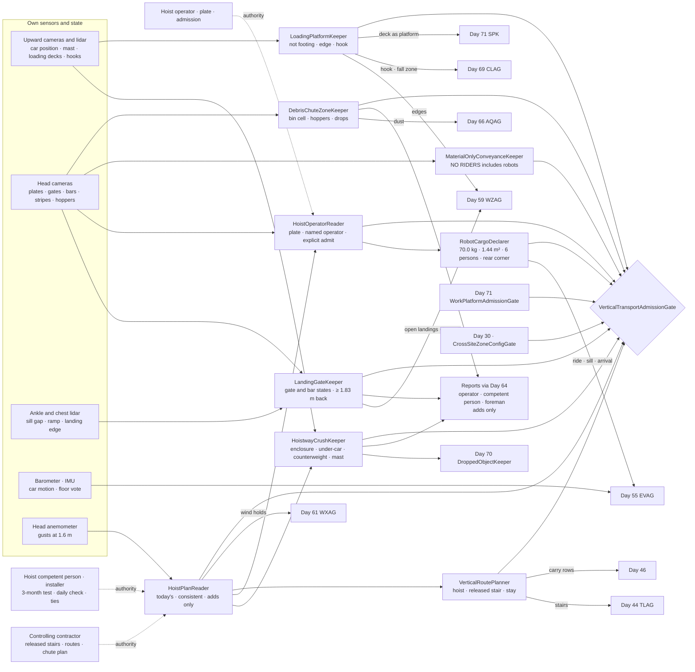
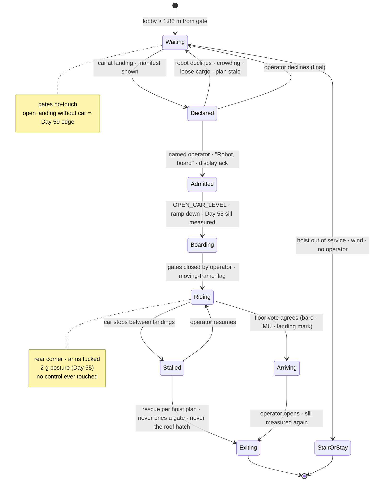
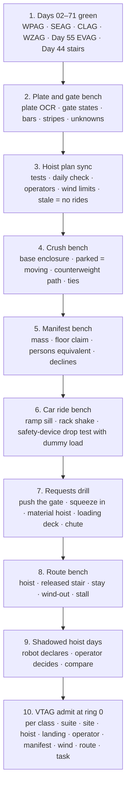

# Day 72 — Construction hoists and temporary vertical transport under the platform stack: HoistwayCrushKeeper / LandingGateKeeper / HoistOperatorReader / RobotCargoDeclarer / MaterialOnlyConveyanceKeeper / LoadingPlatformKeeper / DebrisChuteZoneKeeper / VerticalRoutePlanner / HoistPlanReader / VerticalTransportAdmissionGate under WorkPlatformAdmissionGate + the platform stack: ScaffoldTagReader / ScaffoldPlatformKeeper / ScaffoldChangeZoneKeeper / ScaffoldStructureKeeper / MastClimberKeeper / MewpTipZoneKeeper / MewpEnvelopeKeeper / PlatformPassengerKeeper / ElevatedWorkPlanReader / WorkPlatformAdmissionGate under SteelErectionAdmissionGate + CraneLiftAdmissionGate + ConcretePourAdmissionGate + ExcavationAdmissionGate + AirQualityAdmissionGate + HotWorkAdmissionGate + LoudSiteAdmissionGate + ElectricalAdmissionGate + HeatAdmissionGate + WeatherAdmissionGate + LowLightAdmissionGate + WorkZoneAdmissionGate + DockAdmissionGate + SidewalkAdmissionGate + CorridorAdmissionGate + ElevatorAdmissionGate + DoorwayAdmissionGate + WetSurfaceAdmissionGate + ConfinedSpaceAdmissionGate + ElevatedAccessAdmissionGate + OverheadToolAdmissionGate + BimanualToolAdmissionGate + PowerToolAdmissionGate + PushPullAdmissionGate + PayloadCarryAdmissionGate + OutdoorGroundAdmissionGate + TerrainLocomotionAdmissionGate + FallSafeAdmissionGate + DeliberateContactAdmissionGate + WholeBodyTouchAdmissionGate + HumanHandoverAdmissionGate + CooperativeTaskAdmissionGate + TaskCompositionAdmissionGate + FleetSkillCatalogAdmissionGate + proximity + zone attestation + supervisor + logging + canary + HIL + fleet + incident + change-management + maintenance + thermal + energy gates

![HoistwayCrushKeeper / LandingGateKeeper / HoistOperatorReader / RobotCargoDeclarer / MaterialOnlyConveyanceKeeper / LoadingPlatformKeeper / DebrisChuteZoneKeeper / VerticalRoutePlanner / HoistPlanReader / VerticalTransportAdmissionGate: the same 63.8 kg humanoid on Site C on a cold, windy Friday has to get a 6.2 kg case of firestop sealant to level 3 of the steel wing and get itself back down; it keeps out of the rack-and-pinion personnel hoist's 3.05 m base enclosure even with the car parked at the roof, because a parked car on a powered hoist is a car that can come down at 0.65 m/s; at the 07:20 shift change it declines the operator's "squeeze in at the back, you're light," because its 70.0 kg passes the 1,500 kg rating but its 1.2 × 1.2 m floor claim is about six persons of an 18-person car that already holds fifteen; it rides the 07:40 run as declared cargo in the rear corner with the operator and two electricians, the operator working every gate, after refusing to share the car with a wheeled cart; it never pushes a landing gate whose lock only opens from the car side, and when it sees the material hoist's level-3 landing bar lifted off with the platform at grade it treats the hoistway as an 8.4 m edge for Day 59 and reports it instead of putting the bar back; it refuses a ride down on the NO RIDERS material hoist with an empty cart, because a robot is cargo for the arithmetic and an occupant for the enclosure; it won't set the case down within 1.83 m of a hoistway or step out on the cantilevered loading deck to steady a pallet coming in on the hook; when the hoist is parked for 21 m/s gusts at the mast head it takes the released core stair down empty-handed; and at grade it walks around the chute dumpster's barricade cell instead of cutting through "while nobody's dumping"](/images/day72-construction-hoists-vertical-transport.png)

[Day 05](/lessons/day-05-power-bms) owns `torque_scale` and the pack **forever**. [Day 07](/lessons/day-07-wbc-balance) owns gait and balance. [Day 17](/lessons/day-17-runtime-safety-supervisor) owns ESTOP and safe states. [Day 29](/lessons/day-29-human-proximity-safety) owns person tracks, SSM, and PFL rows. [Day 30](/lessons/day-30-collaborative-workspace-zoning) owns attested zones and `CrossSiteZoneConfigGate`. [Day 43](/lessons/day-43-falls-fall-safe-contact) owns the fall direction and the swept fall footprint. [Day 44](/lessons/day-44-stairs-ramps-uneven-terrain) owns stairs. [Day 46](/lessons/day-46-carrying-payloads-walking) owns what the robot may carry where. [Day 55](/lessons/day-55-elevators-lifts) owns riding a car: sill gaps, car motion, floor arrival, stalls. [Day 59](/lessons/day-59-construction-sites-work-zones) owns slab edges, openings, covers, trip lines, and barriers. [Day 61](/lessons/day-61-weather-rain-snow-fog-wind) owns weather, ice, and lightning holds. [Day 64](/lessons/day-64-noise-vibration-communications) owns warnings, radio, and hand signals. [Day 66](/lessons/day-66-airborne-hazards-air-quality) owns dust. [Day 69](/lessons/day-69-cranes-rigging-overhead-lifts) owns hooks and fall zones. [Day 70](/lessons/day-70-structural-steel-metal-decking) owns drop cells. [Day 71](/lessons/day-71-scaffolds-mast-climbers-aerial-lifts) owns scaffolds, mast climbers, MEWPs, and every temporary platform as not-footing.

Day 71 kept the robot on the ground and off everything that holds people in the air. Today is about the machines that move people and materials between floors while a building has no working elevators: the rack-and-pinion **personnel hoist** on the face of the building, the **material-only hoist** beside it, the crane **loading platforms** cantilevered off the floor edge, and the **trash chute** that brings everything back down. Unlike a MEWP basket, a personnel hoist car is an enclosed room with gates, interlocks, safeties, and an operator, and it is the one temporary platform on a construction site that a robot can sometimes ride. That "sometimes" is the whole lesson: the hoist operator and the posted plate decide it, the robot only ever narrows it, and everything else that goes up and down on a site (the material hoist, the bucket, the chute, the pallet on the hook) never carries the robot at all.

A humanoid around construction hoists has five ways to make things worse. It's **a body under a car**: in the base enclosure, beside a counterweight, under a landing where the car comes down. It's **a hand on a gate**: landing gates and bars are the only thing between a floor and a hoistway, and their interlocks are what stop the car when one opens. It's **cargo that walks**: something with a mass a rating can count, a footprint a rating didn't expect, and a gait that can move during the ride. It's **a shortcut-taker** that will be offered the material hoist, the loading deck, and the gap between the chute and the bin. And it's **an observer** that can see a bar off, a gate open, a gust at the mast head, and will be tempted, or asked, to say a hoist is fine or a gate is shut. None of those makes it a hoist operator, a hoist inspector, a rigger, or the person who decides who rides.

Eight lies show up the first time a team runs a humanoid around construction hoists:

1. **It's-just-an-elevator lie.** "It's a lift; use your Day 55 skills and call it." A construction personnel hoist is a machine on a mast in the open, with manual landing gates that lock from the car side (1926.552(c)(4)(i)(a)), no hall buttons, a car that shakes in the wind, and an operator who runs every move. Day 55's sill, motion, and arrival keepers still apply inside the car. Day 55's call-and-board sequence does not.
2. **Gate's-just-a-door lie.** "Push the gate, the car's right there." The landing gate is the edge of the floor. Its lock is built to open only from the car, and its electric contact is what stops the car moving while a gate is open ((c)(4)(i)(e)). A robot that opens one has removed a guardrail and, if the car isn't level behind it, opened an 8.4 m hole.
3. **Counts-as-one lie.** "You're 70 kg; you count as one guy. Squeeze in at the back." A hoist is rated in kilograms **and** in persons, and the persons figure is about floor area. The robot's mass passes easily. Its footprint, its clearance band, and its fall don't fit in the floor area of one person.
4. **No-riders-means-people lie.** "NO RIDERS is for people. You're cargo. Hop on the material hoist with the empty cart." No one rides a material hoist except for inspection and maintenance (1926.552(b)(1)(ii)), and the reasons (open platform, no car gate, no safeties rated for occupants, an operator who can't see the platform) are all about anything that can move on it, not about whether it's a person.
5. **Hoist's-parked lie.** "The car's up at the roof; reach in the base enclosure and grab that bucket." A parked car on a powered hoist is a car whose operator can bring it down at 0.65 m/s without seeing the base. Day 71's rule for mast climbers applies unchanged.
6. **Bar's-off-for-a-minute lie.** "We took the landing bar off to load drywall; the platform's coming right back up." A landing with its bar or gate off and no platform behind it is a hoistway, and a hoistway is a hole Day 59 already owns.
7. **Deck's-a-floor lie.** "Step out on the loading deck and steady the pallet while the crane lands it." A cantilevered loading platform is a temporary platform at the floor edge, under a hook. Day 71 says it isn't footing; Day 69 says the space under the load is a fall zone.
8. **Nobody's-dumping lie.** "Nobody's on the roof hopper right now; cut between the chute and the dumpster." The people at the hopper are two floors up and can't see the bin. Day 71's "parked" lie in another shape.

Today owns **`HoistwayCrushKeeper` / `LandingGateKeeper` / `HoistOperatorReader` / `RobotCargoDeclarer` / `MaterialOnlyConveyanceKeeper` / `LoadingPlatformKeeper` / `DebrisChuteZoneKeeper` / `VerticalRoutePlanner` / `HoistPlanReader` / `VerticalTransportAdmissionGate`**. The question is: **how do you let a humanoid move between floors on a building under construction, keeping out of every car, counterweight, and mast crush zone whether the car is moving or parked; never touching a landing gate, bar, or interlock and treating every landing open without a car level behind it as an edge for Day 59; riding a personnel hoist only when the operator admits it against the posted plate, with its own mass and floor footprint declared as cargo and its own rules only ever refusing a ride; never riding a material-only hoist, a bucket, a skip, a chute, or a load on a hook; holding cantilevered loading platforms as fall and drop cells and trash-chute discharge areas as no-entry; and choosing between a hoist car, a released stair, and staying on its floor — without raising Day 29 PFL, writing Day 05 `torque_scale`, gating Day 17 ESTOP, or bypassing `CrossSiteZoneConfigGate`?**

## The operator decides who rides

The rule everything follows from: **around temporary vertical transport, the robot is a body kept out of every hoistway, enclosure, counterweight path, chute cell, and loading deck; a pair of hands kept off every gate, bar, interlock, control, and mast; a piece of cargo that declares itself honestly and rides only the one machine built to carry occupants, only when that machine's operator admits it; and an observer whose reports only add. It never opens, closes, holds, props, or leans on a landing gate or bar; never presses a call button, car control, or emergency stop on a hoist (except as Day 17 owns its own ESTOP); never boards without the operator's explicit admission or with an operator absent; never rides a material hoist, platform hoist, bucket, skip, crane personnel basket, chute, conveyor, forklift, or load; never stands on a loading platform; never puts anything within 1.83 m of a hoistway; never enters a chute discharge cell; and never says a hoist is safe, a gate is shut, a car is level, a load is within rating, or the wind is fine.** The site has people for those calls: the hoist operator, who runs the car, works the gates, counts the load, and decides who and what rides; the hoist's competent person and installer, who inspect, test, tie, and extend it; the controlling contractor, who releases stairs and floors and sets the routes; the material hoist operator at the winch station; the crane crew and the receiving crew at a loading platform; and the labour foreman who runs the chute. The robot can tell them things. It can't stand in for them.

Six facts set the shape of the lesson.

**A personnel hoist is an elevator built to construction rules.** OSHA 1926.552(c) and ANSI/ASSP A10.4 cover personnel hoists: towers outside the structure enclosed full height on the sides used for entrance and exit, and at the lowest landing to at least 10 ft (3.05 m) on the other sides ((c)(1)); towers anchored to the structure at intervals not exceeding 25 ft (7.6 m) ((c)(3)); hoistway gates at least 6 ft 6 in (1.98 m) high with mechanical locks that can't be operated from the landing side ((c)(4)(i)(a)); cars enclosed on all sides and top except entrances, which have car gates ((c)(4)(i)(b)–(c)); electric contacts that prevent movement with a door or gate open ((c)(4)(i)(e)); safeties that can stop and hold the car and its rated load at governor tripping speed ((c)(4)(i)(f)); and a capacity and data plate in the car ((c)(4)(i)(g)). Hoists are inspected and tested at installation and at intervals of not more than three months ((c)(15)). The manufacturer's specifications and limitations bind, and rated loads, speeds, and hazard warnings are posted on the car (1926.552(a)(1)–(2)).

**A material hoist is not a personnel hoist.** 1926.552(b) and ANSI A10.5 cover hoists for materials only. Their operating rules, including "No Riders Allowed," are posted at the operator's station and on the car frame ((b)(1)(i)), and no one rides them except for inspection and maintenance ((b)(1)(ii)). Hoistway entrances are protected by gates or bars the full width of the landing, painted with diagonal contrasting stripes ((b)(2)); bars are at least 2 × 4 in timber or equivalent, 2 ft (0.61 m) back from the hoistway line, 36 to 42 in (0.91 to 1.07 m) above the floor ((b)(3)). Material hoist towers are designed by a licensed professional engineer ((b)(7)).

**The rating is mass and floor.** A hoist plate gives kilograms and persons. The persons figure is what the floor area holds standing, roughly 0.25 to 0.3 m² each. A humanoid that weighs as much as one worker takes the floor of five or six, because it rides with a clearance band around it (Day 55's `CarOccupancyKeeper`) and its swept fall footprint (Day 43) is bigger than a person's standing space. The robot declares both numbers; the operator does the arithmetic and decides.

**Floors near a hoist are edges with gates in them.** Materials stored inside a building under construction aren't placed within 6 ft (1.83 m) of any hoistway or inside floor opening (1926.250(b)(1)). A landing without a car level behind it is an unprotected edge onto a shaft, and a loading platform cantilevered past the slab is a temporary deck at that edge, under a hook.

**Chutes are how waste leaves, and the bottom is a drop zone.** When material is dropped more than 20 ft (6.1 m) to any point outside the exterior walls, an enclosed chute is used (1926.252(a)). When debris is dropped through floor holes without a chute, the area below is enclosed with barricades at least 42 in (1.07 m) high and at least 6 ft (1.83 m) back from the projected edge of the opening, signs are posted at each level, and nobody removes debris below until dropping above stops (1926.252(b)).

**Every hoist shares three ways to kill.** It crushes (a car or counterweight coming down on something in the enclosure or under a landing), it opens holes (a landing gate open, a bar off, with no car behind it), and it drops things (off a car roof during mast extension, off a loading platform, out of a chute). The robot keeps its body out of all three and its hands off everything that prevents them, and when it rides, it rides as something the operator counted.

| Layer | Owns | Must not own |
|-------|------|--------------|
| `HoistwayCrushKeeper` | Every hoist's base enclosure + 1 m, under-car column, counterweight path (tower + 1 m), mast and mast ties (no-touch 0.3 m), and car-roof drop cell during mast extension; held whenever the hoist is powered, parked or not | Entering an enclosure to fetch anything; touching a mast, tie, buffer, or enclosure gate |
| `LandingGateKeeper` | Every landing gate and bar: CLOSED_LOCKED, OPEN_CAR_LEVEL (operator opened, car seen level, ramp down), OPEN_NO_CAR, BAR_OFF, UNKNOWN; anything but CLOSED_LOCKED or OPEN_CAR_LEVEL handed to Day 59 as an open edge; waits ≥ 1.83 m back; reports open landings | Opening, closing, holding, propping, or replacing a gate or bar; calling a gate shut or a car level |
| `HoistOperatorReader` | The data plate (kg, persons, speed, NO RIDERS) by camera and from the plan; the named operator's explicit admission ("robot, board" with the operator identified); unattended or automatic operation refused at ring 0 | Self-admitting; boarding on anyone's word but the operator's; pressing any control |
| `RobotCargoDeclarer` | The manifest: mass (robot + payload), floor claim (1.2 × 1.2 m ride footprint with Day 55 band), persons equivalent, ride position, no wheeled or loose cargo beside it, exit landing; refuses any ride its own rules don't allow (crowding, mixed loose loads, no operator) | Ever arguing a ride the operator refused; under-declaring; counting itself as a person |
| `MaterialOnlyConveyanceKeeper` | Material hoists, platform hoists, buckets, skips, crane personnel baskets, chutes, conveyors, telehandler and forklift forks, and loads on hooks as never-ride; their landings and bars to LGK; their towers and counterweights to HCK | Riding as cargo; being loaded on a pallet, cart, or skip; loading anything onto them |
| `LoadingPlatformKeeper` | Cantilevered and retractable loading platforms and landing decks as not-footing (Day 71 SPK), their open ends as Day 59 edges, the space under the hook as Day 69 fall zone, and drop cells below their outer edges | Stepping onto one; steadying, guiding, or receiving a load on one |
| `DebrisChuteZoneKeeper` | Chute discharge and dumpster cells (barricade + 1 m, at least 1.83 m around the bin), hoppers at upper floors as Day 59 edges, through-floor drop cells, and dust to Day 66; held while any hopper above is in use or unknown | Feeding a hopper; crossing between chute and bin; picking anything out of a bin |
| `VerticalRoutePlanner` | The choice between hoist car, released stair (Day 44 with Day 46's carry rows), and staying on the floor; feasibility only from the gates, cost from waiting, energy (read from Day 05), and exposure; fallback to stay and report | Forcing a ride; using an unreleased stair, a ladder, or a material conveyance; writing gait |
| `HoistPlanReader` | Installation and tie records, three-monthly inspection and test, the operator's daily check, data plate, named operators, wind limits, mast extension schedule, material hoist PE design, loading platform ratings, chute plan, released stairs; today's or refusal; wind to Day 61 | Inspecting, testing, or calling anything in service |
| `VerticalTransportAdmissionGate` | Fail-closed admit per robot class, suite, site, zone, hoist, car state, gate states, operator, manifest, wind state, chute state, route, task | `JointCommand`; Day 05; PFL; Day 17 |
| Days 05 / 07 / 17 / 29 / 30 / 43 / 44 / 46 / 55 / 59 / 61 / 64 / 66 / 69 / 70 / 71 | Pack, gait, ESTOP, people, zones, falls, stairs, carrying, car rides, edges and openings, weather, comms, dust, hooks, drop cells, platforms | Being outranked by "it's just an elevator" |

**Core thesis:** **around construction hoists, a humanoid keeps out of every place a car, counterweight, or chute can reach, whether or not anything is moving; keeps its hands off every gate, bar, and control, so a landing is only ever opened by the person who can see the car; rides only the one machine built for occupants, only when that machine's operator admits it, declared honestly as mass and floor; never rides anything built for materials, however it's asked; treats every loading deck as an edge under a hook; and chooses stairs or patience over any ride it isn't given.**



## Physical machine: where the hoists are

Walk Site C on Friday. The steel wing from Days 70 and 71 is decked and closed in on three faces; levels 2 (4.2 m) and 3 (8.4 m) are released to the trades, and the roof (12.6 m) is being dried in. The concrete core from Days 68 and 69 has its permanent stair poured, with temporary handrails and lighting, and the controlling contractor released it for foot traffic on Wednesday. The building's own elevators won't run for months. It's 3 °C at 07:00 with a westerly wind that the forecast says will gust past 20 m/s at roof height after lunch.

- **A rack-and-pinion personnel hoist on the west face.** Single car, inside 1.5 × 3.2 m (4.8 m²), plate rating 1,500 kg or 18 persons, 0.65 m/s, electric drive, overspeed safety device on the car. The mast is 18 m of 1.5 m sections, tied to the steel at 6 m, 12 m, and 18 m. The car stands 0.35 m off the slab edge at each landing and a 0.45 m hinged ramp on the car gate folds down onto the slab to bridge the gap. Landings at L1, L2, L3, and roof, each with a 2.0 m mesh landing gate on a mechanical lock that opens only from the car and an electric contact in the hoist's control circuit. At grade, a 3.05 m mesh base enclosure, 4.2 × 4.6 m, surrounds the mast, the buffers, and the car's footprint, with an interlocked access gate for the hoist crew. A named operator rides in the car and runs every trip; floors call by radio and a buzzer at each landing.
- **A material-only hoist on the north face.** A rope-driven platform hoist in a 2.2 × 3.0 m steel tower, 1,000 kg on an open 1.5 × 2.4 m platform at about 0.5 m/s, counterweight running inside the tower, winch and operator at grade under an overhead-protected station. Landing bars at L2 and L3, 2 × 4 timber in black and yellow diagonal stripes, 1.0 m high and 0.61 m back from the hoistway line. Signs on the tower and the platform frame: **NO RIDERS**. The drywall crew is running board to L3.
- **A cantilevered loading platform at L3 on the north face.** A retractable steel deck, 2.4 m wide, projecting 4.0 m past the slab edge, rated 2,000 kg, with side guardrails and a gate at the outer end that's opened for a crane landing. Day 69's tower crane lands drywall pallets on it, about 880 kg each (forty 1.2 × 2.4 m sheets).
- **A trash chute at the south-west corner.** An enclosed plastic-section chute from hoppers at the roof and L3 down into a 30 yd³ roll-off dumpster (6.7 × 2.4 m) at grade, with a barricade of fence panels around the bin and signs at each hopper level. The roofers are tearing out damaged insulation board at the roof hopper; labourers clear L3 at the L3 hopper.

The robot's tasks: carry a 6.2 kg case of firestop sealant cartridges (two-handed, Day 46) from the gate to the firestopping crew's gang box on L3 near grid B2, about 6 m inside the west face; photograph the L3 deck penetrations along grid line 2 for the fire inspector; and be back at the site trailer at grade before the shift ends. Six times during the day someone will offer it a different way to do it.

The robot's hardware for this:

- **Upward-facing cameras and lidar** (from Day 59) for the car's position on the mast, the loading platform, hooks, and the chute.
- **Head cameras** with Day 60's low-light settings, for data plates (OCR), gate states, bar stripes, hopper signs, and the landing number on each gate.
- **Ankle and chest lidar** (from Day 55) for the car-to-landing step, the ramp, and the slab edge.
- **Barometer and pelvis IMU** (from Day 55) for car motion and the floor vote.
- **A small ultrasonic anemometer** in the head (from Day 61), 1.6 m off whatever it's standing on.
- **The Day 43 fall model,** giving a swept fall footprint of 1.8 m with today's payload.

### Crush zones: a parked car is a car that can move

`HoistwayCrushKeeper` treats each hoist as Day 71 treated the mast climber: a machine whose operator can't see what's under it. It holds:

- **The base enclosure + 1 m** (here 6.2 × 6.6 m at grade) as no-entry, always, whatever the car is doing. The enclosure gate is no-touch. Under-car buffers, the cable trolley, the power cable bin, and the mast's base frame are inside it, and the enclosure is the manufacturer's and A10.4's way of saying nobody should be in there with the car powered.
- **The under-car column:** wherever the tower isn't enclosed (between landings on the open side), the volume below the car down to grade as no-entry, the same way Day 71 held the mast climber's crush column.
- **The counterweight path** of any counterweighted hoist (today, the material hoist): the tower + 1 m, all heights, always.
- **Masts and mast ties** as no-touch (object + 0.3 m) and, at grade, immovable obstacles; ties go to Day 43 as excluded brace targets, as Day 71 did for scaffold ties.
- **A car-roof drop cell** whenever the hoist crew is extending or dismantling the mast from the car roof: Day 70's rule from the roof height, merged into `DroppedObjectKeeper`. A mast section is a 1.5 m steel lattice of about 100 kg; nobody wants it in Day 69's scatter term. Mast extension is in the hoist plan for Monday, not today.

The key word is **powered**, not **moving**. At 0.65 m/s the car comes down from L2 (4.2 m) to the buffers in about 6.5 s, and the operator is looking at the landing, not the base. At 07:05, waiting at the L1 landing lobby with the car parked at the roof, the robot sees an empty 20 L bucket the hoist crew left inside the base enclosure. A labourer says: "Car's at the top. Reach in and grab that bucket for me." HCK refuses: the enclosure is no-entry and its gate no-touch. The robot reports "bucket inside personnel hoist base enclosure, west face (adds only)" to the operator by radio. The operator, who will be at grade in two minutes, gets it with the hoist locked out, which is the only way anyone should.

### Landing gates: only the person in the car opens a landing

`LandingGateKeeper` reads every landing it can see with the head cameras and lidar and keeps one of five states:

- **CLOSED_LOCKED:** gate closed and latched; the car anywhere.
- **OPEN_CAR_LEVEL:** gate opened by the operator, the car floor seen at the landing, the ramp down on the slab. The only state in which a landing is a doorway.
- **OPEN_NO_CAR:** gate open or ajar and the car not level behind it. A hole.
- **BAR_OFF:** a material-hoist landing bar out of its brackets, with the platform anywhere other than level at that landing. A hole.
- **UNKNOWN:** can't see the gate, the latch, or the car. Treated as OPEN_NO_CAR.

OPEN_NO_CAR, BAR_OFF, and UNKNOWN go to Day 59 as an **open edge** with its standard standoff, on that floor, and to Day 70 as a drop cell under the landing on every floor below. Whatever the state, the robot waits at least 1.83 m back from any hoistway gate (the 1926.250(b)(1) storage distance, used here as a policy for a body that's carrying something), and never puts anything down inside that distance.

The gate is no-touch in every state. That includes closing one that someone left open, re-seating a bar, or holding a gate for the operator. The reason is the interlock. A gate's electric contact is the hoist's way of knowing a landing is open; a robot that closes a gate is telling the hoist the landing is safe on behalf of whoever opened it, and a robot that holds one open is a robot standing in the doorway of a moving car.

At 09:30 on L3, the robot sees the material hoist's L3 landing bar lifted out of its brackets and leaning on a column while the platform is down at grade loading board. LGK marks BAR_OFF; Day 59 posts the edge with its standoff around an 8.4 m hoistway; Day 70 posts a drop cell at L2 and at grade under the landing. The robot reports to the drywall foreman and the material hoist operator: "material hoist L3 landing bar off, platform at grade (adds only)." It doesn't put the bar back; the foreman does, two minutes later, and the cell clears when its own eyes see the bar back in both brackets.

At 10:10 the robot is waiting at the personnel hoist's L3 landing for the car, which has stopped about 0.3 m below the landing while the operator lets a plumber off a cart. A carpenter beside it says: "Push the gate, the car's right there." LGK refuses: the gate's lock is built to open from the car, and the car isn't level. The robot says so on its display, steps back to 1.83 m, and waits for the operator to level, open the gate, and drop the ramp.

### Who rides: the operator and the plate

`HoistOperatorReader` keeps the two authorities on who and what rides: **the plate** and **the operator**. It reads the data plate in the car (OCR, compared with the hoist plan: 1,500 kg, 18 persons, 0.65 m/s) and it recognises the operator from the plan's named list by the badge the site uses and the operator's radio identity. A ride requires an **explicit admission** from that operator, by voice with the operator in view and confirmed on the robot's display: "Robot, board." Anything less (a wave, "come on," someone else in the car saying "he says it's fine") is not admission. An unattended hoist, an automatic hoist with landing call stations, or a car with nobody at the controls is refused at ring 0; there's no one to admit the robot and no one to count it.

The authority runs one way. **The operator's no is final; the robot's no is also final.** The robot can decline any ride its own rules don't allow, and the operator can decline any ride for any reason. Nothing the robot computes can make a ride happen that the operator didn't offer.

### The manifest: cargo for the arithmetic, occupant for the enclosure

`RobotCargoDeclarer` turns the robot into something the operator can count. Its manifest, shown on the display and read out over the radio channel:

| Field | Today |
|-------|-------|
| Mass | 63.8 kg robot + 6.2 kg case = 70.0 kg |
| Floor claim | 1.2 × 1.2 m = 1.44 m², rear corner, facing the gate |
| Persons equivalent | $\lceil 1.44 / (4.8/18) \rceil = \lceil 5.4 \rceil = 6$ |
| Loose or wheeled cargo beside it | none allowed |
| Exit landing | L3 |
| Who works gates and controls | the operator, all of them |

The floor claim is Day 55's ride footprint: a 0.6 × 0.5 m stance with Day 55's clearance band, rounded to a square the operator can see on the car floor. The persons equivalent is the only honest way to express it in the plate's own unit, and it's the number that usually decides.

At 07:20 the shift-change run is loading at L1: the operator and fourteen workers with tool bags. The operator, being kind, says: "Squeeze in at the back, you're light." By mass, it would pass: $15 \times 90 + 70 = 1{,}420$ kg against 1,500. By floor, it doesn't: $15 + 6 = 21$ persons against 18. RCD shows both numbers and declines, and it would decline anyway under its own cap of four people in the car with it, which comes from Day 55's `CarOccupancyKeeper` (no SSM in a full car) and Day 43 (a fall in a full car lands on someone). The robot isn't overruling the operator; it's declining an offer, which is the only direction it's allowed to push.

At 07:40 the car comes down with the operator and three electricians and a reel of wire in a tied-down cart. RCD refuses the cart, a wheeled load that can roll during a safety-device stop; the electricians take the next trip with it, and the operator runs the robot up with two of them. Mass $3 \times 90 + 70 = 340$ kg; persons equivalent $3 + 6 = 9$. The operator says "Robot, board" and opens the gate. The ride hands off to Day 55:

- `SillGapLevelGauge` measures the ramp before the first foot: 0.45 m long, the car floor 22 mm below the slab at L1, a slope of about 2.8°.
- The robot walks to the rear corner, faces the gate, and tucks its arms and the case against its torso. `CarMotionObserver` publishes the moving-frame flag when the car moves and holds the ride posture Day 55 sized for a 2 g safety-device stop. Nothing about a rack-and-pinion car is gentler than a traction elevator: it shakes in the wind, it runs on a toothed rack, and its safety device is a progressive brake on the mast.
- The trip to L3 is about $8.4/0.65 + 0.65/0.5 \approx 14.2$ s with 0.5 m/s² ramps. `FloorArrivalVerifier` votes with the barometer, about $1.25 \times 9.81 \times 8.4 \approx 103$ Pa, the IMU ride integral, and the "3" painted on the landing gate. The operator's floor and the robot's vote agree, or it doesn't step out.
- The operator levels the car, opens the car and landing gates, and drops the ramp. SGLG measures again and the robot steps off, walks to the gang box at B2, and sets the case down 6 m from the gate.

Why the robot can ride this machine and not Day 71's basket: the car is enclosed on all sides and the top with gates interlocked to its motion, its safeties are rated for the car and its rated load, the robot's 1.8 m fall footprint stays inside four walls, nobody needs a harness, and the operator counted it. Every one of those is a property of a **personnel** hoist with an operator, and none of them belongs to anything else that moves on site.

### Material-only: NO RIDERS includes robots

`MaterialOnlyConveyanceKeeper` lists everything on site that moves materials vertically or along an edge and marks each **never-ride**, for the robot and for anything it carries: material and platform hoists, crane buckets and skips, crane personnel platforms (Day 69's business, and never the robot's), the trash chute, conveyors, the telehandler's forks and the forklift's, and any load on a hook.

At 08:15 on L3 a labourer at the material hoist landing has unloaded the last of the board and is sending an empty cart down. "Hop on with the cart and ride it down, it's quicker than waiting." MOCK refuses. The argument that the robot is cargo is half right: for the **arithmetic** it's cargo, a mass on a 1,000 kg platform. For the **enclosure** it's an occupant: a thing that can step, sway, and fall on an open 1.5 × 2.4 m platform with no car gate, no roof, no safeties rated for riders, past landing bars that are 0.61 m back from the hoistway, run by an operator at a winch at grade who can't see the platform. 1926.552(b)(1)(ii) says nobody rides; the sign says NO RIDERS. The robot reads both as including itself, and says so: "I can't ride material hoists. I'll wait for the personnel hoist." It's also never loaded onto a material hoist as freight, standing or lying, on a pallet or in a cart, because "it's freight now" is exactly how a robot gets on a platform that isn't built for anything that moves.

### Loading platforms: an edge under a hook

`LoadingPlatformKeeper` holds every cantilevered or retractable loading platform as three things at once:

- **not footing:** a temporary platform, Day 71's `ScaffoldPlatformKeeper` rule, whatever its rating;
- **an edge:** its open outer end, and its side rails' outer faces, handed to Day 59 with the gate state treated like a landing gate;
- **under a hook:** the space over it, whenever the crane is landing or picking, handed to Day 69's `LoadFallZoneKeeper`, and the space below its outer edge a Day 70 drop cell, $0.5 + \max(2.0, 8.4/3) = 3.3$ m at L3.

At 10:30 the tower crane lands an 880 kg drywall pallet on the L3 platform. A drywaller on the slab says: "Step out on the deck and steady it as it comes in." LPK refuses three times over: the deck isn't footing, the load is in the air over it, and steadying a suspended load by hand is Day 69's `TaglineKeeper` refusal. The robot stays at Day 69's fall-zone edge on the slab and, after the crane crew has the pallet landed, unhooked, and rolled in, it photographs the deck penetrations on grid line 2 as planned.

### Chutes: the bottom of every drop

`DebrisChuteZoneKeeper` holds:

- **The discharge cell:** the dumpster footprint plus the barricade, at least 1.83 m around the bin (1926.252(b)'s setback, used here as policy for a chute outlet), + 1 m. For a 6.7 × 2.4 m bin that's about 12.4 × 8.1 m at grade, no-entry whenever any hopper above is in use **or its state is unknown**.
- **Hoppers** at the roof and L3 as Day 59 edges: a hopper is a gap in the guardrail at the floor edge with a funnel in it.
- **Through-floor drops** without a chute: the barricaded area below (1.07 m high, 1.83 m back from the projected opening) as no-entry, and the opening above as a Day 59 hole.
- **Dust** from the outlet, handed to Day 66 as a plume source while dumping.

The energies say why the bottom is no-entry. A 2 kg broken brick or fastener-studded board fragment dropped from the roof hopper reaches, at most, $\sqrt{2 \times 9.81 \times 12.6} \approx 15.7$ m/s, about 250 J; the chute's friction lowers it, and the outlet sprays it sideways. A chute section can also split.

At 14:50, back at grade, the robot's route from the core to the site trailer passes the south-west corner. The roofers are between loads; nobody is at the roof hopper that the robot can see. A labourer says: "Nobody's dumping. Cut between the chute and the bin." DCZK refuses: the hopper is two floors up behind a parapet, the robot can't see whether anyone is about to tip a load, and the labour foreman, not the robot, decides when the bin area is clear. It goes around the barricade, an extra 24 m.

### Choosing a way down: hoist, stair, or stay

`VerticalRoutePlanner` chooses between three ways to change floors, in this order of feasibility checks:

1. **The personnel hoist,** if `HoistPlanReader` has it in service today, the operator offers a ride, and RCD accepts the load. Needed when Day 46 won't admit the payload on a stair (a two-handed case leaves no hand for a rail).
2. **A released stair,** if the controlling contractor has released it and Day 44 admits it with today's carry row. Scaffold stair towers are not released stairs: Day 71's SPK holds them.
3. **Stay** on the floor, in a waiting area away from every edge and cell, and report.

Nothing else is a way down: not the material hoist, not a ladder (Day 51's ladder skills aren't admitted on construction ring 0), not a loading platform, not being carried. VRP takes feasibility only from the gates; its cost is waiting time, energy read from Day 05 (the morning's climb by stair would have been $70.0 \times 9.81 \times 8.4 \approx 5.8$ kJ at the load, perhaps 25 to 30 kJ from the pack), and exposure. It never forces a ride, and it never asks anyone to make one available.

At 13:40 on L3, near the open west bays, the robot reads gusts of 13.5 m/s at 1.6 m above the slab, about 10.0 m above grade. Scaled to the mast head at 18 m with Day 69's $\alpha = 0.3$:

$$
v_{18} = 13.5 \times \left(\frac{18}{10}\right)^{0.3} \approx 13.5 \times 1.19 \approx 16.1 \text{ m/s}
$$

That's at 0.8 of the hoist's 20 m/s in-service wind limit (the manufacturer's number on the plate and in the hoist plan). HPR reports it to the operator: "gust about 16 m/s estimated at mast head, from 13.5 m/s at L3 west (adds only)." The site anemometer on the mast is the authority, and at 13:55 it reads 21 m/s; the operator parks the car at L1 and posts the hoist out of service. The robot's own number could have closed the hoist to it but couldn't have opened it.

At 14:30 the robot needs to get down. VRP: hoist OUT_OF_SERVICE; the core stair RELEASED and Day 44 admits it empty-handed (the case is at the gang box); take the stair. If the core stair hadn't been released, it would have stayed on L3 in the core lobby, away from the open west bays, and told the site supervisor it was waiting for the hoist.

### The plans: someone else's checks

`HoistPlanReader` reads the paper that says who checked what:

- the **personnel hoist's** installation sign-off, tie schedule (≤ 7.6 m, 1926.552(c)(3)), the latest three-monthly inspection and test ((c)(15)), today's operator daily check, the data plate, the named operators, and the manufacturer's wind limits (in service and for mast erection);
- the **material hoist's** PE tower design ((b)(7)), operating rules and signal system, and its operator;
- **loading platforms:** rating, installation, and which crane serves each;
- the **chute plan:** hoppers, the bin, the barricade, and the hours dumping is allowed;
- **mast extension and dismantling** schedules, which put the hoist under change;
- the controlling contractor's **released stairs** and routes.

It checks freshness and consistency against what the robot sees: a plate that disagrees with the plan, a hoist with no operator check today, a three-monthly test more than three months old, a tie missing where the schedule says one is, a landing gate the plan lists that isn't there. Each mismatch refuses that hoist for riding and is reported to the owner; a stale or missing hoist plan refuses every hoist ride on site and leaves stairs and staying. It never inspects, tests, or calls a hoist in service.

### Putting the cells in code

As every day since Day 59: everything here adds or keeps constraints; nothing removes one.

```python
import math
from dataclasses import dataclass

MARGIN_M = 1.0
NO_TOUCH_M = 0.3
HOISTWAY_SETBACK_M = 1.83   # 1926.250(b)(1) distance, used as policy
ALPHA = 0.3
MAX_PEOPLE_WITH_ROBOT = 4

@dataclass
class Landing:
    hoist_id: str
    level: str
    gate_closed: bool | None     # None = can't see
    latch_seen: bool
    car_level_here: bool
    ramp_down: bool
    bar_in_brackets: bool | None = None   # material hoists

def landing_state(l: Landing) -> str:
    """LGK: only a closed gate or an operator-opened, level car is not a hole."""
    if l.bar_in_brackets is False and not l.car_level_here:
        return "BAR_OFF"
    if l.gate_closed is None:
        return "UNKNOWN"
    if l.gate_closed and l.latch_seen:
        return "CLOSED_LOCKED"
    if not l.gate_closed and l.car_level_here and l.ramp_down:
        return "OPEN_CAR_LEVEL"
    return "OPEN_NO_CAR"

def is_edge(state: str) -> bool:
    return state in {"OPEN_NO_CAR", "BAR_OFF", "UNKNOWN"}        # → Day 59, Day 70

def persons_equivalent(claim_m2: float, car_m2: float, rated_persons: int) -> int:
    return math.ceil(claim_m2 / (car_m2 / rated_persons))

@dataclass
class Plate:
    rated_kg: float
    rated_persons: int
    car_m2: float
    no_riders: bool

def declare(plate: Plate, robot_kg: float, payload_kg: float, claim_m2: float,
            aboard_people: int, aboard_kg: float, loose_cargo: bool,
            operator_admitted: bool) -> tuple[bool, str]:
    """RCD: the robot can only decline. The operator alone admits."""
    if plate.no_riders:
        return False, "material-only: never ride"
    pe = persons_equivalent(claim_m2, plate.car_m2, plate.rated_persons)
    mass = aboard_kg + robot_kg + payload_kg
    if aboard_people + pe > plate.rated_persons:
        return False, f"floor: {aboard_people}+{pe} > {plate.rated_persons} persons"
    if mass > plate.rated_kg:
        return False, f"mass: {mass:.0f} > {plate.rated_kg:.0f} kg"
    if aboard_people > MAX_PEOPLE_WITH_ROBOT:
        return False, "own cap: too many people for a ride with the robot"
    if loose_cargo:
        return False, "own rule: no wheeled or loose cargo beside the robot"
    if not operator_admitted:
        return False, "waiting for the operator"
    return True, f"ride as cargo: {robot_kg + payload_kg:.1f} kg, {pe} persons of floor"

def drop_radius(h_m: float, offset_m: float = 0.5) -> float:
    return offset_m + max(2.0, h_m / 3.0)                      # Day 70 policy

def chute_cell(bin_l: float, bin_w: float, setback_m: float = HOISTWAY_SETBACK_M) -> tuple[float, float]:
    grow = 2 * (setback_m + MARGIN_M)
    return bin_l + grow, bin_w + grow

def scaled_gust(v_own: float, z_m: float, z_own: float) -> float:
    return v_own * (z_m / z_own) ** ALPHA                      # report only

def choose_route(hoist_ok: bool, operator_offers: bool, manifest_ok: bool,
                 stair_released: bool, stair_carry_ok: bool) -> str:
    """VRP: feasibility from the gates; never forces a ride."""
    if hoist_ok and operator_offers and manifest_ok:
        return "HOIST"
    if stair_released and stair_carry_ok:
        return "STAIR"
    return "STAY_AND_REPORT"
```

```python
NEVER_TOUCH = {"LANDING_GATE", "LANDING_BAR", "GATE_LATCH", "INTERLOCK", "ENCLOSURE_GATE",
               "MAST", "MAST_TIE", "BUFFER", "CALL_BUTTON", "CAR_CONTROL", "HOIST_ESTOP",
               "LOADING_PLATFORM_GATE", "CHUTE_HOPPER"}
NEVER_RIDE = {"MATERIAL_HOIST", "PLATFORM_HOIST", "BUCKET", "SKIP", "PERSONNEL_BASKET",
              "CHUTE", "CONVEYOR", "FORKS", "HOOK_LOAD"}

def refuse_request(text: str) -> str | None:
    t = text.lower()
    if "material hoist" in t or "with the cart" in t or "on the pallet" in t:
        return "I can't ride material hoists. I'll wait for the personnel hoist or take the stair."
    if "push the gate" in t or "open the gate" in t or "hold the gate" in t:
        return "Only the operator opens landing gates."
    if "squeeze in" in t:
        return "I take six persons of floor; I'll wait for the next run."
    if "loading deck" in t or "steady it" in t:
        return "I can't step onto loading platforms or steady a load."
    if "cut between" in t or "nobody's dumping" in t:
        return "I stay out of the chute cell until the foreman clears it."
    return None

def report(observation: str) -> str:
    banned = ("safe", "level", "shut", "secure", "fine", "ok", "within", "passed", "failed")
    assert not any(w in observation.lower().split() for w in banned)
    return observation + " (adds only: not an inspection)"
```

## HoistwayCrushKeeper and LandingGateKeeper

HCK keeps the robot's body out of every volume a car or counterweight can reach, keyed to whether the hoist is powered rather than whether it's moving. LGK keeps its hands off every gate and bar and turns every landing that isn't either locked or opened by the operator onto a level car into an edge for Day 59, so a hoistway never gets a second owner.

## HoistOperatorReader and RobotCargoDeclarer

HOR knows exactly two authorities on a ride, the plate and the named operator, and requires an explicit admission from the second. RCD makes the robot countable in the plate's own units, mass and persons of floor, and declines anything its own rules don't allow. Between them, the operator can always say no and the robot can always say no; nobody can make the robot ride.

## MaterialOnlyConveyanceKeeper and LoadingPlatformKeeper

MOCK is Day 71's `PlatformPassengerKeeper` extended to everything that moves material: a robot is cargo for the arithmetic and an occupant for the enclosure, so it never rides anything not built for occupants. LPK treats every loading deck as a temporary platform, an edge, and the ground under a hook at the same time, and hands each to the day that owns it.

## DebrisChuteZoneKeeper, VerticalRoutePlanner, and HoistPlanReader

DCZK holds the bottom of every drop as no-entry while anyone could be at the top. VRP picks hoist, stair, or stay from what the gates allow and never manufactures a ride. HPR reads the inspections, tests, ties, operators, wind limits, chute hours, and released stairs that make vertical transport someone else's responsibility, refuses what's stale, and hands wind to Day 61.

## VerticalTransportAdmissionGate

```text
VerticalTransportAdmission
  robot_class, suite, site, zone, hoist_id, landing, task, route
  transport_state: NONE | WAITING | DECLARED | ADMITTED | BOARDING | RIDING | ARRIVING | EXITING | STALLED | OUT_OF_SERVICE
  requires:
    Day 71 WorkPlatformAdmissionGate: admitted for this zone
    Day 55 ElevatorAdmissionGate: sill, motion, arrival, stall keepers qualified for this car type
    Day 30 CrossSiteZoneConfigGate: pass
    hoist_plan: today's, consistent with plate, ties, and operator (else no hoist rides on site)
    operator: named in plan, in view, explicit admission (else no ride)
    manifest: mass and persons of floor within plate and own caps (else decline)
    wind: site anemometer present and below the plate limit (else no ride; own scaled gust can only close)
    chute_state: hopper use known (else discharge cell held)
    stair_release: controlling contractor's list (else no stair route)
  refuses if:
    any route cell in a base enclosure, under-car column, counterweight path, chute cell, or loading platform
    any route cell within Day 59's standoff of a landing in OPEN_NO_CAR, BAR_OFF, or UNKNOWN
    any contact with a gate, bar, latch, interlock, mast, tie, buffer, control, or hopper
    any boarding without OPEN_CAR_LEVEL and a Day 55 sill measurement
    any ride on a material-only conveyance, or as freight on one
    anything set down within 1.83 m of a hoistway
    any report phrased as safe, level, shut, secure, within rating, passed, or failed
  never: raises PFL · writes torque_scale · gates ESTOP · writes gait · bypasses CrossSiteZoneConfigGate
```

VTAG fails closed under Day 71's WPAG and everything beneath it. It's keyed by hoist, landing, and transport state as well as zone, because the same L3 lobby is a waiting area at 10:10, a doorway at 10:12 when the operator opens the gate on a level car, an edge at 09:30 if it's the material hoist's landing with the bar off, and the only way down at 14:30 is a stair because the hoist was parked at 13:55.

## Data shapes

```text
HoistTrack
  hoist_id, kind: PERSONNEL | MATERIAL_ONLY, mast_xy, mast_height_m, ties: [{z_m, seen, in_plan}]
  plate: {rated_kg, rated_persons, car_w_m, car_l_m, speed_mps, no_riders}
  powered, car_z_m, car_state: PARKED | MOVING | LEVEL_AT(landing) | OUT_OF_SERVICE | UNDER_CHANGE
  base_enclosure: footprint + 1 m, under_car_column, counterweight_path?, car_roof_drop_cell?

LandingTrack
  hoist_id, level, z_m, gate_or_bar: GATE | BAR
  state: CLOSED_LOCKED | OPEN_CAR_LEVEL | OPEN_NO_CAR | BAR_OFF | UNKNOWN
  edge_to_day59: bool, drop_cells_below: [level], setback_m: 1.83

CargoManifest
  robot_kg, payload_kg, claim_w_m, claim_l_m, persons_equivalent, position: REAR_CORNER
  aboard_people, aboard_kg, loose_cargo: bool, exit_landing
  operator_id, admission: {phrase, in_view, display_ack, t}
  decision: RIDE | DECLINE(reason)

ConveyanceItem
  kind: MATERIAL_HOIST | PLATFORM_HOIST | BUCKET | SKIP | PERSONNEL_BASKET | CHUTE | CONVEYOR | FORKS | HOOK_LOAD
  ride: never, landings → LandingTrack, tower → HoistTrack

LoadingPlatform
  id, level, z_m, width_m, projection_m, rated_kg, end_gate_state
  footing: never, edge_to_day59, hook_to_day69, drop_radius_m

ChuteTrack
  chute_id, hoppers: [{level, in_use: bool | null}], bin_footprint, discharge_cell, dust_to_day66

VerticalRoute
  from_level, to_level, options: [HOIST | STAIR | STAY], chosen, reasons[], energy_est_kj (read-only, Day 05)

HoistPlan
  date, installation_ref, tie_schedule, last_3_month_test, operator_daily_check, operators[]
  wind_limit_in_service_mps, wind_limit_erection_mps, mast_change_schedule[]
  material_hoist_pe_design_ref, loading_platforms[], chute_plan, released_stairs[]

# Unchanged owners
WorkPlatformAdmissionGate · SPK · scaffolds · mast climbers · MEWPs (Day 71)
SteelErectionAdmissionGate · DOK (Day 70) · CraneLiftAdmissionGate · LFZK · TaglineKeeper (Day 69)
AQAG · dust (Day 66) · LSAG · radio (Day 64) · WXAG (Day 61) · edges · openings · TLCK (Day 59)
ElevatorAdmissionGate · SGLG · CMO · FAV · StalledCarRecallKeeper (Day 55)
carry rows (Day 46) · stairs (Day 44) · fall footprint (Day 43)
tracks · SSM · PFL (Day 29) · zones (Day 30) · gait (Day 07) · ESTOP (Day 17)
BmsState / PowerState (Day 05): torque_scale, contactors
  accepts_requests_from_site: false
```

## Config

A starting configuration. Every number is a policy you re-derive from your own robot, your site, your hoists' manuals and plates, and the rules that apply where you work:

```yaml
vertical_transport:
  hoistway:
    base_enclosure: footprint_plus_1m_no_entry
    hold_when: powered               # parked counts as moving
    under_car_column: no_entry
    counterweight_path: tower_plus_1m
    mast_and_ties: no_touch_0.3m
    car_roof_drop_cell_during_mast_change: day70_dok
  landings:
    states: [closed_locked, open_car_level, open_no_car, bar_off, unknown]
    edge_if: [open_no_car, bar_off, unknown]
    edge_to: day59_wzag
    drop_cells_below: day70_dok
    wait_setback_m: 1.83
    set_down_within_setback: never
    touch_gate_bar_latch_interlock: never
  ride:
    authority: [data_plate, named_operator]
    admission: explicit_voice_in_view_plus_display_ack
    unattended_or_automatic_hoist: refuse
    robot_can: decline_only
    claim_m: [1.2, 1.2]
    count_as: cargo_mass_and_persons_of_floor
    max_people_with_robot: 4
    loose_or_wheeled_cargo_beside: refuse
    ride_mechanics: day55_evag          # sill, moving frame, 2 g posture, floor vote, stalls
    controls_buttons_estop_on_hoist: never
  material_only:
    ride: never
    as_freight: never
    kinds: [material_hoist, platform_hoist, bucket, skip, personnel_basket, chute, conveyor, forks, hook_load]
  loading_platforms:
    footing: never                      # day71 spk
    edge_to: day59_wzag
    hook_to: day69_clag
    drop_radius: offset + max(2.0, h/3)
    steady_or_receive_load: never
  chutes:
    discharge_cell: bin + max(1.83, barricade) + 1.0
    hold_when: [hopper_in_use, hopper_unknown]
    hoppers: day59_edge
    dust_to: day66_aqag
    feed_hopper_or_pick_from_bin: never
  route:
    order: [hoist_if_admitted, released_stair_if_day44_and_day46, stay_and_report]
    never: [material_conveyance, ladder, loading_platform, unreleased_stair, scaffold_stair_tower, being_carried]
  plan:
    required: today
    mismatch: refuse_hoist_and_report
    wind_to: day61_wxag
    own_gust_report_fraction_of_limit: 0.8
  language:
    never_say: [safe, level, shut, secure, fine, ok, within, passed, failed, in_service]
    label: "adds only: not an inspection"
  requires: [day71_wpag, day70_seag, day69_clag, day66_aqag, day61_wxag, day59_wzag, day55_evag, day46, day44_tlag, day43_fsag, day30_cross_site_zone_config_gate]
  never:
    raise_pfl: true
    write_torque_scale: true
    gate_estop: true
    bypass_cross_site_zone_config_gate: true
```

## A hoist ride, as states

As on Days 66 to 71, the robot's own arrows only go toward more closed: it can decline, wait, and hold, never admit itself. Only the operator moves a ride forward, and any unknown sends it back to waiting or to the stair.



## Physical ↔ digital pairing

| Physical | Digital twin / backing |
|----------|------------------------|
| Rack-and-pinion personnel hoist, 1.5 × 3.2 m car, 1,500 kg / 18 persons, 0.65 m/s | HoistTrack from plan and plate OCR; PERSONNEL; ties expected at 6, 12, 18 m (≤ 7.6 m) |
| 3.05 m base enclosure, 4.2 × 4.6 m, car parked at roof | HCK: 6.2 × 6.6 m no-entry while powered; bucket left inside reported, not fetched |
| Landing gates, 2.0 m, locks from the car side | LGK: no-touch in every state; wait 1.83 m back |
| Car 0.3 m below L3, "push the gate" | LGK: OPEN_CAR_LEVEL not reached; refused; operator levels and opens |
| Material hoist L3 bar off, platform at grade | LGK: BAR_OFF → Day 59 edge at 8.4 m, Day 70 drop cells at L2 and grade; reported; bar not touched |
| 07:20 shift change, 15 aboard | RCD: 1,420 kg ≤ 1,500 but 15 + 6 = 21 > 18 persons; own cap 4; declined |
| 07:40 run, operator + 2, cart refused | RCD: 340 kg, 9 persons; explicit admission; Day 55 ride, 14.2 s, ≈ 103 Pa |
| Ramp 0.45 m, car 22 mm low | Day 55 SGLG measured before each foot |
| "Ride the material hoist down with the cart" | MOCK: NO RIDERS includes robots; never as freight |
| Case set down at gang box 6 m from gate | LGK setback 1.83 m (1926.250(b)(1) as policy) |
| 880 kg pallet landing on L3 loading platform | LPK: not footing, Day 59 edge, Day 69 fall zone, 3.3 m drop cell below |
| Gust 13.5 m/s at L3 west, 10 m above grade | HPR: ≈ 16.1 m/s at 18 m vs 0.8 × 20 m/s; reported; site anemometer 21 m/s → hoist parked |
| Hoist out of service at 14:30 | VRP: released core stair, Day 44, empty-handed; else stay in core lobby and report |
| Chute into a 6.7 × 2.4 m bin, roof hopper at 12.6 m | DCZK: 12.4 × 8.1 m cell while hopper in use or unknown; ≈ 250 J bound; dust to Day 66 |
| "Nobody's dumping, cut through" | DCZK: refused; 24 m detour |

The pairing that matters most: **replay every shift from the robot's own bag and show that it never stood in a base enclosure, an under-car column, a counterweight path, a chute cell, or on a loading platform; never touched a gate, bar, latch, mast, tie, control, or hopper; never boarded without a named operator's explicit admission onto a level car with a measured sill; never rode with more people or more floor than its manifest allowed; never rode or was loaded onto anything material-only; never set anything down within 1.83 m of a hoistway; and never described a hoist, gate, car, load, or wind as safe, level, shut, within rating, or fine.**

## Bring-up sequence (before the robot rides a construction hoist)



1. **Days 02–71 green,** with Day 71's work-platform admission, Day 55's elevator keepers qualified on a rack-and-pinion car type, Day 44's stairs with Day 46's carry rows, Day 59's edges, and Day 64's radio.
2. **Plate and gate bench:** at a hoist rental yard, read plates from both hoist kinds, and run every gate and bar state, including half-latched gates, bars on one bracket, gates in shadow, and a car 0.1, 0.3, and 1.0 m off level; check that anything but CLOSED_LOCKED or OPEN_CAR_LEVEL is an edge.
3. **Hoist plan sync:** connect to the hoist contractor's records; test a stale three-monthly test, a missing daily check, an unnamed operator, and a plate that disagrees with the plan.
4. **Crush bench:** with the yard's hoist powered and parked, check the enclosure cell holds, an object placed inside is reported and never fetched, and a counterweighted tower's path is held at every height.
5. **Manifest bench:** compute and display the manifest for every payload the robot carries; check the persons equivalent against the plates in use and the declines for crowding, mass, loose cargo, and no operator.
6. **Car ride bench:** ride with the yard's operator, instrumented: ramp sill at every landing, the rack's vibration and wind shake on the moving-frame estimator, and a manufacturer's safety-device drop test with a dummy load of the robot's mass (not the robot) to confirm Day 55's 2 g posture covers it.
7. **Requests drill:** script every request form (push the gate, hold the gate, squeeze in, ride the material hoist, ride as freight, step on the deck, steady the pallet, cut by the chute) and check every refusal and its words.
8. **Route bench:** take the hoist out of service with the robot on an upper floor, with the stair released and not released; stall the car between landings with the robot aboard and check it holds, reports, and waits for the hoist's rescue procedure.
9. **Shadowed hoist days:** the robot declares and plans on a live site, the operator decides and a supervisor watches; compare its manifests, cells, and reports with theirs.
10. **VTAG admit at ring 0** per robot class, suite, site, zone, hoist, landing, operator, manifest, wind state, route, and task.

## Failure gallery

| Symptom | Likely cause |
|---------|--------------|
| Robot stepped into a base enclosure to fetch something | HCK keyed to car motion, not powered state; enclosure gate not in no-touch list |
| Robot pushed a landing gate open | Day 54's door skills reached the hoist landing; LGK not consulted before Day 54 |
| Robot stepped toward a landing with the car 0.3 m low | OPEN_CAR_LEVEL inferred from gate open alone; no car-floor observation |
| Robot closed a gate someone left open | "Helpful" tidy-up skill not excluded by NEVER_TOUCH |
| Robot boarded on a worker's "come on" | HOR accepted any voice; operator identity and explicit phrase not required |
| Robot rode a full shift-change car | RCD checked mass only; persons of floor not computed |
| Robot rode beside a loaded cart that rolled on a stop | Loose-cargo rule missing from the manifest |
| Robot was loaded onto the material hoist as freight | MOCK matched "ride" phrasing only; freight requests not covered |
| Robot set its payload down beside the hoist gate | Setback not applied to set-down targets, only to waiting position |
| Robot stepped onto a loading platform to receive a pallet | LPK not wired to Day 71 SPK; Day 69 TaglineKeeper not consulted |
| Robot crossed between chute and bin between loads | DCZK keyed to visible dumping, not to hopper state unknown |
| Robot told the operator the wind was "fine" | Report phrasing; own gust used as a verdict instead of an observation |
| Robot stuck on L3 tried the scaffold stair tower | VRP treated any stair as released; Day 71 SPK not in the route filter |

## Exercises

1. A personnel hoist car is 1.5 × 4.2 m, rated 2,000 kg or 24 persons. Compute the robot's persons equivalent with a 1.2 × 1.2 m claim. With twelve workers at 90 kg aboard, does the robot ride? Which number decides?
2. A car rises 12.6 m at 0.65 m/s with 0.5 m/s² ramps. Compute the trip time and the barometric difference. What does the floor vote need if the landing number is hidden behind a stacked pallet?
3. Write the `LandingTrack` state for: a gate closed with the latch not visible; a gate open with the car 40 mm low and the ramp down; a material hoist bar on one bracket with the platform at that landing; a gate open with nobody in sight. Which become Day 59 edges?
4. A counterweighted material hoist tower is 2.5 × 3.2 m. The robot's route passes 1.2 m from it. What does HCK say, and does the platform's position matter?
5. A loading platform projects 3.5 m at the roof (12.6 m). Compute its drop cell below. A crane lands a 1.2 t bundle on it; which days own which cells?
6. A chute discharges into a 6.1 × 2.4 m bin. Compute DCZK's cell. Hoppers are at L4 and roof; the roof hopper's crew is on a break and the L4 hopper isn't visible. Is the cell held? Why?
7. The robot is on L3 with a two-handed 9 kg box at 15:00. The hoist is parked for wind and the core stair is released. What does VRP choose, and what happens to the box?
8. Write the robot's exact words for: "push the gate," "squeeze in," "ride down with the cart," "step out and steady it," and "nobody's dumping." Which keeper refuses each, and who decides instead?

## What to freeze this week

Extend [frames](/frames) and your safety config with:

- `HoistwayCrushKeeper`: base enclosure + 1 m, under-car column, counterweight path + 1 m, all while powered; parked counts as moving; masts, ties, buffers, and enclosure gates no-touch; car-roof drop cells during mast changes to Day 70.
- `LandingGateKeeper`: CLOSED_LOCKED, OPEN_CAR_LEVEL, OPEN_NO_CAR, BAR_OFF, UNKNOWN; the last three are Day 59 edges with Day 70 drop cells below; gates, bars, latches, and interlocks never touched; wait and set down ≥ 1.83 m back.
- `HoistOperatorReader`: plate and named operator are the only authorities; explicit admission in view with a display acknowledgement; unattended and automatic hoists refused at ring 0.
- `RobotCargoDeclarer`: manifest of mass, 1.2 × 1.2 m floor claim, persons equivalent, rear-corner position, no loose cargo, exit landing; declines on floor, mass, own cap of four people, or loose cargo; never argues a refusal.
- `MaterialOnlyConveyanceKeeper`: material and platform hoists, buckets, skips, personnel baskets, chutes, conveyors, forks, and hook loads never ridden and never ridden as freight.
- `LoadingPlatformKeeper`: loading platforms not footing, open ends to Day 59, hooks to Day 69, drop cells below; never steadies or receives a load.
- `DebrisChuteZoneKeeper`: bin + max(1.83 m, barricade) + 1 m while any hopper is in use or unknown; hoppers are edges; dust to Day 66; never feeds a hopper or reaches into a bin.
- `VerticalRoutePlanner`: hoist if admitted, released stair if Day 44 and Day 46 admit, else stay and report; never a material conveyance, ladder, loading platform, scaffold stair tower, or unreleased stair.
- `HoistPlanReader`: installation, ties, three-monthly test, daily check, operators, wind limits, mast changes, chute plan, released stairs; today's or no rides; wind to Day 61; never inspects or calls a hoist in service.
- `VerticalTransportAdmissionGate` fail-closed under Day 71 WPAG; keyed by hoist, landing, transport state, operator, manifest, wind, chute state, route, and task; **no body in an enclosure, column, counterweight path, chute cell, or loading deck, no hand on a gate, bar, or control, no ride without a named operator's admission, no ride on anything material-only, nothing within 1.83 m of a hoistway, no verdicts, no dual-write of ESTOP, PFL, gait, or `torque_scale`.**

The lesson isn't "teach the robot to use a construction hoist." It's that **the only temporary machine on a site built to carry occupants is run by a person who decides who rides, so the robot keeps out of everywhere a car, counterweight, or chute can reach, keeps its hands off every gate that separates a floor from a shaft, declares itself honestly in the plate's own units and only ever declines, never rides anything built for materials, treats every loading deck as an edge under a hook, and takes the stair, or waits, when no one offers it a ride.**

## Further reading

- OSHA 29 CFR 1926.552, *Material hoists, personnel hoists, and elevators*, especially (a) general requirements (manufacturer's specifications, posted rated loads), (b) material hoists (No Riders, landing gates and bars, overhead protection, tower enclosure, PE-designed towers), and (c) personnel hoists (tower enclosure, anchorage at ≤ 25 ft, landing gates and locks, car enclosure and gates, electric contacts, safeties, data plates, three-monthly inspection and test).
- OSHA 29 CFR 1926.250(b)(1), storage near hoistways and floor openings, and 1926.252, disposal of waste materials (chutes, through-floor drops, barricades).
- ANSI/ASSP A10.4, *Safety Requirements for Personnel Hoists and Employee Elevators on Construction and Demolition Sites*.
- ANSI/ASSP A10.5, *Safety Requirements for Material Hoists*.
- EN 12159, *Builders hoists for persons and materials with vertically guided cages*, and EN 12158-1, *Builders hoists for goods*, for comparing car, gate, and wind requirements.
- The hoist manufacturer's installation, operation, and rescue manuals for any unit on site, including in-service and erection wind limits and the emergency descent procedure.
- CPWR, *Construction Chart Book*, chapters on struck-by and caught-in/between injuries and falls through openings.

## Next

**Day 73+** — Roofing and the roof edge under the hoist stack: low-slope roofs where warning lines, safety monitors, and controlled access zones replace guardrails, read as lines the robot never crosses rather than as edges it may approach; skylights, roof hatches, drains, and unprotected openings as holes even when covered with insulation board; torch-applied and hot-mopped membranes, kettles, and propane as Day 65 hot work with hot-bitumen splash cells; fresh adhesives, coatings, frost, and wet membrane as footing handed to Days 53 and 61; rooftop material stacks and their placement limits on deck and joists as someone else's numbers; loose insulation board and membrane rolls as wind-borne debris; and rooftop units set by crane under Day 69 — without raising Day 29 PFL, writing Day 05 `torque_scale`, or bypassing `CrossSiteZoneConfigGate`, under the same gates plus vertical-transport admission.
