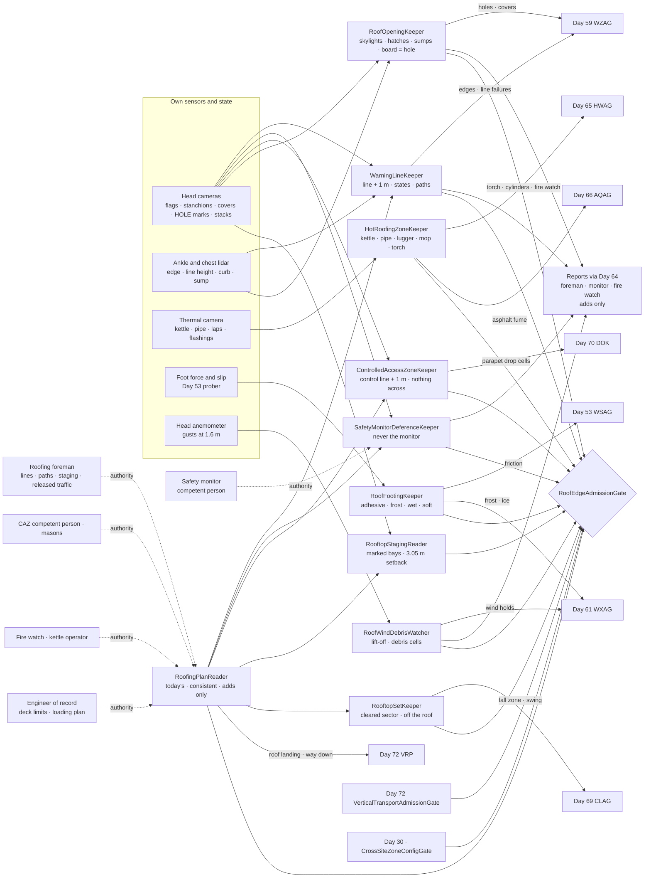
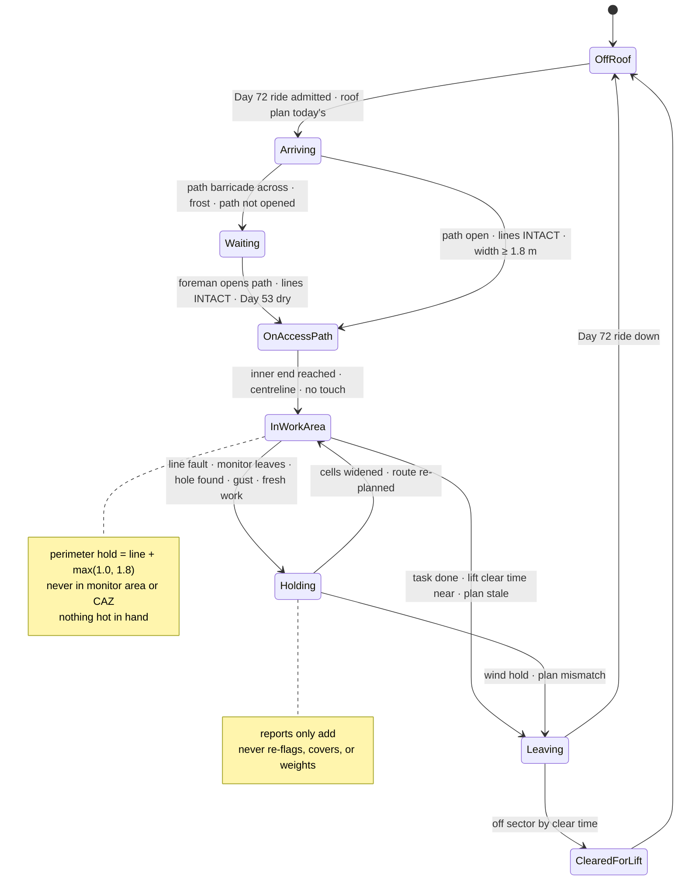
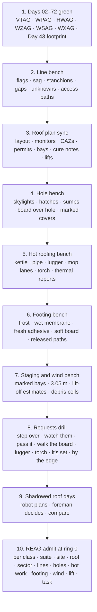

# Day 73 — Roofing and the roof edge under the hoist stack: WarningLineKeeper / SafetyMonitorDeferenceKeeper / ControlledAccessZoneKeeper / RoofOpeningKeeper / HotRoofingZoneKeeper / RoofFootingKeeper / RooftopStagingReader / RoofWindDebrisWatcher / RooftopSetKeeper / RoofingPlanReader / RoofEdgeAdmissionGate under VerticalTransportAdmissionGate + the hoist stack: HoistwayCrushKeeper / LandingGateKeeper / HoistOperatorReader / RobotCargoDeclarer / MaterialOnlyConveyanceKeeper / LoadingPlatformKeeper / DebrisChuteZoneKeeper / VerticalRoutePlanner / HoistPlanReader / VerticalTransportAdmissionGate under WorkPlatformAdmissionGate + SteelErectionAdmissionGate + CraneLiftAdmissionGate + ConcretePourAdmissionGate + ExcavationAdmissionGate + AirQualityAdmissionGate + HotWorkAdmissionGate + LoudSiteAdmissionGate + ElectricalAdmissionGate + HeatAdmissionGate + WeatherAdmissionGate + LowLightAdmissionGate + WorkZoneAdmissionGate + DockAdmissionGate + SidewalkAdmissionGate + CorridorAdmissionGate + ElevatorAdmissionGate + DoorwayAdmissionGate + WetSurfaceAdmissionGate + ConfinedSpaceAdmissionGate + ElevatedAccessAdmissionGate + OverheadToolAdmissionGate + BimanualToolAdmissionGate + PowerToolAdmissionGate + PushPullAdmissionGate + PayloadCarryAdmissionGate + OutdoorGroundAdmissionGate + TerrainLocomotionAdmissionGate + FallSafeAdmissionGate + DeliberateContactAdmissionGate + WholeBodyTouchAdmissionGate + HumanHandoverAdmissionGate + CooperativeTaskAdmissionGate + TaskCompositionAdmissionGate + FleetSkillCatalogAdmissionGate + proximity + zone attestation + supervisor + logging + canary + HIL + fleet + incident + change-management + maintenance + thermal + energy gates

![WarningLineKeeper / SafetyMonitorDeferenceKeeper / ControlledAccessZoneKeeper / RoofOpeningKeeper / HotRoofingZoneKeeper / RoofFootingKeeper / RooftopStagingReader / RoofWindDebrisWatcher / RooftopSetKeeper / RoofingPlanReader / RoofEdgeAdmissionGate: the same 63.8 kg humanoid on Site C on a frosty Monday rides the personnel hoist to the 12.6 m roof of the steel wing as declared cargo, waits at the roof landing until the sun takes the frost off the warning-line access path, and carries a 5.6 kg carton of insulation plates to the marked staging bay 6 m inside the line; it declines to set the carton on the board stack 1.2 m from the north edge because a stack by an edge is someone else's numbers and a 3.05 m policy setback; it refuses to "keep an eye on the guys at the edge" while the safety monitor goes down for coffee, and tells the roofing foreman the monitor is away instead; it walks around a drain sump that a loose tapered board hides, because a board over a hole is a hole; it photographs the north-edge drain from 1 m inside the flagged line with the zoom instead of stepping over "just a rope"; it won't pass a mortar tub across the masons' control line or carry a 19 L lugger of 230 °C asphalt to the mopper; it reads 140 °C on a torched curb flashing ten minutes after "the torch is off" and reports it to the fire watch; it stays off a fresh adhesive field "that's set"; it reports six unweighted boards on a cut bundle as wind-borne debris at 9.4 m/s gusts, about twice their 5.1 m/s lift-off speed, without weighting them itself; and it is off the roof twenty minutes before the 1,650 kg rooftop unit comes over on the hook](/images/day73-roofing-roof-edge.png)

[Day 05](/lessons/day-05-power-bms) owns `torque_scale` and the pack **forever**. [Day 07](/lessons/day-07-wbc-balance) owns gait and balance. [Day 17](/lessons/day-17-runtime-safety-supervisor) owns ESTOP and safe states. [Day 29](/lessons/day-29-human-proximity-safety) owns person tracks, SSM, and PFL rows. [Day 30](/lessons/day-30-collaborative-workspace-zoning) owns attested zones and `CrossSiteZoneConfigGate`. [Day 43](/lessons/day-43-falls-fall-safe-contact) owns the fall direction and the swept fall footprint. [Day 44](/lessons/day-44-stairs-ramps-uneven-terrain) owns stairs and slopes. [Day 46](/lessons/day-46-carrying-payloads-walking) owns what the robot may carry where. [Day 53](/lessons/day-53-water-wet-floors-spills) owns wet footing and friction. [Day 59](/lessons/day-59-construction-sites-work-zones) owns slab edges, openings, covers, trip lines, and barriers. [Day 61](/lessons/day-61-weather-rain-snow-fog-wind) owns weather, ice, frost, and wind holds. [Day 62](/lessons/day-62-heat-sun-dust) owns hot surfaces in the sun. [Day 64](/lessons/day-64-noise-vibration-communications) owns warnings, radio, and hand signals. [Day 65](/lessons/day-65-hot-work-fire-hazards) owns hot work, fuel cylinders, permits, and the fire watch. [Day 66](/lessons/day-66-airborne-hazards-air-quality) owns fumes and vapours. [Day 69](/lessons/day-69-cranes-rigging-overhead-lifts) owns hooks and fall zones. [Day 70](/lessons/day-70-structural-steel-metal-decking) owns drop cells and deck as footing. [Day 71](/lessons/day-71-scaffolds-mast-climbers-aerial-lifts) owns every temporary platform as not-footing. [Day 72](/lessons/day-72-construction-hoists-vertical-transport) owns how the robot gets up here and back down.

Day 72 got the robot between floors. Today it arrives at the last floor a building gets: the **roof**, while it's still being built. A low-slope roof under construction is the largest open edge on the site, and unlike a slab edge on level 3, the roofers are allowed to work right up to it behind nothing but a flagged rope and a person watching them. That's legal and normal: OSHA lets low-slope roofing work be protected by **warning lines** and a **safety monitor** instead of guardrails, and lets leading-edge and masonry work use **controlled access zones**. Every one of those systems depends on the people inside them being trained, being roofers or masons doing that work, and being watched. The robot is none of those things. So the whole lesson is about reading the roof's lines as walls the robot never crosses, even when everyone else on the roof walks through them all day.

A humanoid on a roof under construction has five ways to make things worse. It's **a body near an edge** that's guarded by rope, by a person, or by nothing at all. It's **a foot on a surface that isn't one**: a board over a drain, a skylight under plywood, a hatch, fresh adhesive, frost on a cover board, a soft spot in wet insulation. It's **a pair of hands that will be handed things**: luggers of hot asphalt, mop buckets, torches, mortar tubs, a pallet edge, a corner of a board in the wind. It's **a load on a structure** that has placement limits it doesn't know: the deck, the joists, the stack by the edge. And it's **an observer** that can see a monitor walk away, a line sag, a board start to lift, a flashing still too hot, and will be tempted or asked to stand in for the person whose job that is. None of that makes it a roofer, a safety monitor, a competent person, a fire watch, or the person who says where materials go.

Eight lies show up the first time a team runs a humanoid on a roof:

1. **It's-just-a-rope lie.** "It's a warning line, not a guardrail. Step over and get the photo of that drain." A warning line is the boundary of the only area where roofers may work without other protection, and nobody but a roofer doing roofing work belongs between it and the edge (1926.502(f)(3)). Its stanchions only have to resist a 16 lb (71 N) push without tipping ((f)(2)(iii)); a 70 kg robot leaning at 10° pushes about $70 \times 9.81 \times \tan 10° \approx 121$ N.
2. **You-can-watch-them lie.** "Keep an eye on the guys at the edge for five minutes while I go down." A safety monitor is a competent person on the same surface, in sight, close enough to talk, with no other duties (1926.502(h)(1)). A robot can't be one, and when the monitor leaves the roofers' rule is that the edge work stops, not that the robot takes over.
3. **Board-covers-it lie.** "There's a board over the drain sump. Walk across." Insulation board laid loose over a sump, a skylight curb, or a hatch is a hole with a lid that isn't a cover: not secured, not marked, not rated for anything (1926.502(i)).
4. **Pass-it-over lie.** "Hand the mortar tub over the control line, we can't come out." A controlled access zone is closed to everyone not authorized to work in it (1926.502(g)(1)). Passing a load across it puts the robot's arms and fall footprint inside it.
5. **You've-got-two-hands lie.** "You've got two hands. Take the lugger to the mopper." A 19 L lugger of asphalt at about 230 °C is a burn hazard whose spill path is the person beside it. Day 65 owns hot work; today adds hot bitumen, and the robot carries none of it.
6. **Torch's-off lie.** "The torch is off, bring it over." The torch tip, the cylinder hose, and the lap it just torched are still hot for minutes, and torched flashings smoulder inside for longer than that. The fire watch decides when it's out.
7. **It's-set lie.** "The adhesive's set; take the short way across." Fresh low-rise foam adhesive and bonding adhesive aren't footing until the roofers walk them, and frost on a cover board at 07:00 isn't footing until Day 61 says it's gone.
8. **Closer-to-the-edge lie.** "Drop the carton on the board stack by the edge, it's closer." Where materials go on a roof is set by the roofing contractor's loading plan and the structural engineer's limits, and nothing gets set near an edge that the next gust can take over it.

Today owns **`WarningLineKeeper` / `SafetyMonitorDeferenceKeeper` / `ControlledAccessZoneKeeper` / `RoofOpeningKeeper` / `HotRoofingZoneKeeper` / `RoofFootingKeeper` / `RooftopStagingReader` / `RoofWindDebrisWatcher` / `RooftopSetKeeper` / `RoofingPlanReader` / `RoofEdgeAdmissionGate`**. The question is: **how do you let a humanoid work on a low-slope roof under construction, treating every warning line, control line, and access-path line as a wall it never crosses, reaches over, or leans on, however many roofers walk through it; never standing in for a safety monitor or a fire watch; treating skylights, hatches, drains, sumps, and anything covered with board as holes; keeping out of every kettle, hot-pipe, lugger, mop, and torch cell and carrying nothing hot; refusing fresh adhesive, coatings, frost, and wet membrane as footing; setting things down only where the roofing plan says, never near an edge; reporting loose board and rolls as wind-borne debris without weighting them itself; and leaving the roof before a rooftop unit comes over on a hook — without raising Day 29 PFL, writing Day 05 `torque_scale`, gating Day 17 ESTOP, or bypassing `CrossSiteZoneConfigGate`?**

## The roof's lines are walls

The rule everything follows from: **on a roof under construction, the robot is a body kept inside every warning line, outside every controlled access zone, and off every hole, cover, and fresh surface; a pair of hands kept off every line, stanchion, cover, kettle, lugger, mop, torch, cylinder, and load; a load that sets itself down only where the roofing plan says; and an observer whose reports only add. It never crosses, steps over, ducks under, reaches over, moves, re-flags, or leans on a warning line, control line, or access-path barricade; never acts as, or for, a safety monitor or fire watch; never steps on a cover, skylight, hatch, drain, sump, or board over any of them; never carries, fills, moves, or steadies anything hot; never walks fresh adhesive, coating, frost, or wet membrane; never stages anything outside a marked area or within 3.05 m of an unprotected edge; never weights, chases, or catches anything in the wind; never stays on a roof sector a crane lift plan has cleared; and never says a line is good, an edge is protected, a cover is rated, a flashing is out, a surface is dry, a stack is within its limit, or the wind is fine.** The site has people for those calls: the roofing foreman, who lays out the lines, runs the crew, and owns the roof's loading areas; the safety monitor, a competent person watching roofers between the line and the edge; the competent person for the masons' controlled access zone; the kettle operator at grade; the fire watch for the torch crew; the structural engineer of record, whose numbers say what the deck can carry; and the crane crew for the rooftop units. The robot can tell them things. It can't stand in for them.

Seven facts set the shape of the lesson.

**Low-slope roofing has its own fall-protection menu.** A low-slope roof is one with a slope of 4 in 12 or less (1926.500(b)). Each employee doing roofing work on a low-slope roof with unprotected sides and edges 6 ft (1.83 m) or more above lower levels is protected by guardrails, safety nets, personal fall arrest, or a combination of a **warning line system** with one of those or with a **safety monitoring system**; on roofs 50 ft (15.2 m) or less wide, a safety monitoring system alone is allowed (1926.501(b)(10)). The menu exists because roofers have to work at the edge. It doesn't extend to anyone who isn't doing roofing work.

**A warning line is a boundary, not a barrier.** Warning lines are erected around all sides of the roof work area not less than 6 ft (1.83 m) from the edge, and where mechanical equipment is used, 6 ft from the edge parallel to the equipment's direction of travel and 10 ft (3.05 m) perpendicular to it (1926.502(f)(1)(i)–(ii)). Access points, material-handling areas, storage areas, and hoisting areas connect to the work area by an **access path formed by two warning lines**, closed by a rope or barricade across it, or offset, when not in use (1926.502(f)(1)(iii)–(iv)). The line is rope, wire, or chain flagged at not more than 6 ft intervals with high-visibility material, rigged so its lowest point including sag is 34 to 39 in (0.86 to 0.99 m) above the surface, on stanchions that resist a 16 lb (71 N) horizontal force at 30 in (0.76 m) without tipping, with a minimum tensile strength of 500 lb (1926.502(f)(2)). No employee is allowed between the line and the edge unless doing roofing work there (1926.502(f)(3)). A line built to those numbers tells a walking person where the edge zone starts. It won't stop a falling robot.

**A safety monitor is a person, and only a person.** The safety monitor is a competent person who recognizes fall hazards, warns employees when they're unaware of a hazard or acting unsafely, is on the same walking/working surface, within visual sighting distance, close enough to communicate orally, and has no other responsibilities that could take the monitor's attention away; mechanical equipment isn't used or stored where safety monitoring is the protection on low-slope roofs, and nobody other than employees doing roofing work is allowed in an area protected by safety monitoring (1926.502(h)). Everything about that definition is about a human paying attention. A robot that offers to "watch" is a robot inviting a monitor to leave.

**Controlled access zones close space to everyone not working in it.** A controlled access zone (CAZ) is an area where certain work, like overhand bricklaying or leading-edge work, may take place without guardrails, nets, or arrest, and access is controlled (1926.500(b)). Its control line is 6 to 25 ft (1.8 to 7.7 m) from the unprotected edge for leading-edge work and 10 to 15 ft (3.1 to 4.6 m) for overhand bricklaying, flagged every 6 ft, 39 to 45 in (0.99 to 1.14 m) high (up to 50 in for overhand bricklaying), at least 200 lb tensile, and only authorized employees enter (1926.502(g)). The masons building the south parapet are in one today.

**A roof is a field of holes.** Holes on walking/working surfaces, including skylights, are guarded with covers, guardrails, nets, or arrest (1926.501(b)(4)). Covers support at least twice the weight of the employees, equipment, and materials that may be on them at any one time, are secured against displacement, and are colour-coded or marked "HOLE" or "COVER" (1926.502(i)). Unglazed skylight curbs, roof hatches, drain sumps, mechanical penetrations, and the openings for rooftop unit curbs are all holes until the thing that fills them is in, and roofers routinely lay loose insulation board across them to keep rain out. That board is weatherproofing. It isn't a cover.

**Roofing is hot work and the bitumen is the heat.** Hot-mopped built-up and modified-bitumen roofs use asphalt heated in a kettle, typically at grade, to around 230 to 260 °C, pumped up a pipe or carried in luggers to mop carts and mops; torch-applied membranes melt their own bitumen with open propane torches at the laps and flashings. NFPA 241 sets kettle rules (attended at all times, a portable extinguisher nearby, cylinders away from the burner), and the torch crew works under a hot work permit with a fire watch that stays on after the last torch goes out. [Day 65](/lessons/day-65-hot-work-fire-hazards) already owns permits, fire watches, and fuel cylinders; today adds hot-bitumen splash cells and the rule that the robot carries nothing hot.

**What the roof carries, and where, is somebody else's arithmetic.** Steel deck on joists has a load limit per bay and a better limit near girders; the roofing contractor's loading plan, checked by the engineer of record, says where pallets of board and rolls of membrane go. Materials stored inside a building under construction aren't placed within 10 ft (3.05 m) of an exterior wall that doesn't extend above the top of the material (1926.250(b)(1)); the robot uses the same 3.05 m as policy from any roof edge without a parapet taller than the item. And on a roof, every light flat thing is a kite: loose insulation boards lift in a few metres per second of wind, and what leaves a 12.6 m roof lands well beyond the building.

| Layer | Owns | Must not own |
|-------|------|--------------|
| `WarningLineKeeper` | Every warning line, access-path line, and path barricade as a wall: on perimeter segments robot centre ≥ line + max(1.0 m, Day 43 fall footprint); in a released access path, centreline walking with 0.3 m no-touch and the edge checked against the fall footprint; line states INTACT / SAGGING / FLAG_GAP / STANCHION_DOWN / GAP / UNKNOWN, anything but INTACT adding 2.0 m to that segment's hold and reported | Crossing, stepping over, ducking under, reaching over, leaning on, moving, re-flagging, or closing a line; calling a line "good" |
| `SafetyMonitorDeferenceKeeper` | Which areas are safety-monitored, the monitor's identity and presence as observed facts, never-in-a-monitored-area, refusal of any request to watch, warn, or stand in; monitor-absent reported to the foreman | Being, or substituting for, a safety monitor; warning roofers about their own edge; deciding work stops or resumes |
| `ControlledAccessZoneKeeper` | Every CAZ and its control line as no-entry + 1.0 m, nothing passed, reached, or thrown across, the CAZ competent person's identity read from the plan; the parapet's masonry fall zone below to Day 70 | Entering, handing in, receiving from, or moving a control line |
| `RoofOpeningKeeper` | Skylights (glazed or not), hatches, drains, sumps, penetrations, RTU curb openings, and anything covered by board, plywood, or membrane as holes + 1.0 m; marked covers held as Day 59 covers (never footing); unmarked or loose coverings reported | Stepping on any cover; lifting, moving, re-securing, or marking a cover; calling one rated |
| `HotRoofingZoneKeeper` | Kettle footprint + 3.0 m at grade, hot-pipe run no-touch 0.3 m with an outlet splash cell, lugger fill stations, mop carts and mop lanes (2.0 m splash + 1.0 m), torch work areas to Day 65 HWAG, cylinders to Day 65 FCSK, own thermal camera reporting hot laps and flashings to the fire watch | Carrying, filling, moving, or steadying a lugger, bucket, mop, torch, hose, or cylinder; saying anything is out or cool |
| `RoofFootingKeeper` | Fresh adhesive, bonding adhesive, primer, coatings, uncured sealant, frost and ice, wet membrane, soft or wet insulation, and loose board as not-footing; dry-path verification handed to Day 53 friction and Day 61 ice; released-traffic paths from the roofing foreman only | Walking fresh work because it "looks set"; deciding a surface is dry or released |
| `RooftopStagingReader` | The roofing loading plan: marked staging bays, per-bay limits as someone else's numbers, the 3.05 m edge setback as policy, the robot's own set-down only in a marked bay on the deck (never on a stack); stack-near-edge reported | Computing deck capacity; moving, adding to, or re-stacking a stack; choosing a staging area |
| `RoofWindDebrisWatcher` | Lift-off speed estimates for loose board, membrane, and rolls (report only); own gust at 1.6 m above the roof; downwind roof and ground debris cells; wind holds to Day 61 | Weighting, chasing, catching, folding, or holding anything in the wind; calling the wind fine |
| `RooftopSetKeeper` | Rooftop unit and equipment lifts by crane under Day 69: the lift plan's cleared roof sector, the curb opening as a hole, the robot off the roof sector (or off the roof) from the plan's clear time until the crew releases it | Guiding, receiving, steadying, or landing a unit; signalling; staying "just to watch" |
| `RoofingPlanReader` | The roofing contractor's fall-protection layout (lines, monitor areas, CAZs), the fall protection plan if any (1926.502(k)), hot work permits, the kettle location, the loading plan, adhesive and coating cure notes, crane lift plans touching the roof, and released roof access paths; today's or refusal | Laying out, approving, or amending any of it |
| `RoofEdgeAdmissionGate` | Fail-closed admit per robot class, suite, site, roof, sector, line states, monitor and CAZ states, opening map, hot-work states, footing states, staging bay, wind state, lift states, route, task | `JointCommand`; Day 05; PFL; Day 17 |
| Days 05 / 07 / 17 / 29 / 30 / 43 / 44 / 46 / 53 / 59 / 61 / 62 / 64 / 65 / 66 / 69 / 70 / 71 / 72 | Pack, gait, ESTOP, people, zones, falls, slopes, carrying, friction, edges and covers, weather and frost, hot surfaces, comms, hot work and fire watch, fumes, hooks, drop cells, platforms, hoists | Being outranked by "it's just a rope" |

**Core thesis:** **on a roof under construction, a humanoid treats every line the roofers draw as a wall it never crosses, because those lines only work for trained people being watched; never becomes the person doing the watching; treats every opening as a hole whatever is lying on it; keeps away from, and carries nothing of, the heat that makes the roof; walks only on surfaces someone has released; sets things down only where the plan says and never near an edge; tells people about the wind instead of fighting it; and leaves before anything comes over on a hook.**



## Physical machine: what's on the roof

Walk Site C on Monday. The steel wing from Days 70 to 72 is closed in; its roof is a 24 × 36 m low-slope deck at 12.6 m, sloped 1/4 in per foot (about 2.1 %) to six internal drains. The east edge meets the concrete core, whose wall stands 1.5 m above the roof: that edge is protected by a wall. The other three are open. It's −1 °C at 07:00, clear, with a northerly wind forecast at 6 to 10 m/s gusting higher by late morning, and the membrane surface, radiating to a clear sky, sits near −4 °C under a dew point of −3 °C. Everything flat is white with frost.

- **The roof assembly in progress.** Steel deck, a vapour retarder, two layers of 50 mm polyiso board (1.22 × 2.44 m, about 4.8 kg each), a 13 mm gypsum cover board, then a two-ply modified-bitumen membrane: base ply **hot-mopped** in asphalt on the north half, cap sheet **torch-applied** at curbs and flashings. In the south-central field, the crew is setting tapered board in beads of **low-rise foam adhesive**, which cures slowly in the cold.
- **Warning lines on the north and west.** On the north, the line is 1.83 m back (hand work only). On the west, the crew runs a motorized material cart east–west toward that edge, so the line is 3.05 m back, as the perpendicular rule requires. Flagged polypropylene rope on weighted stanchions every 3 m, sagging to about 0.9 m between them.
- **An access path** formed by two warning lines, 2.4 m wide, from the personnel hoist's roof landing on the west face (Day 72's hoist) through the 3.05 m band into the work area, with a rope across its inner end when the hoist isn't at the roof.
- **A safety monitor** for the roofers working between the north line and the edge: a competent person from the roofing crew, in a high-visibility vest marked MONITOR, named on the roofing plan.
- **A controlled access zone on the south edge.** Masons are laying a 1.07 m CMU parapet by overhand bricklaying, so the control line is 3.05 m back (10 ft); their competent person is named on the plan. Mortar comes up by the material hoist (Day 72) to the masons' side only.
- **Holes.** Two 1.2 × 1.2 m skylight curbs over the core lobby, unglazed, covered with screwed 19 mm plywood marked HOLE; a 0.76 × 0.91 m roof hatch to the core's ship ladder, with a hatch rail; a 1.8 × 2.4 m RTU curb at grid D2 whose opening is still open, guardrailed on two sides; six drain sumps, about 0.6 m square and 50 mm deep around a 150 mm drain bowl, one of them (C4) hidden this morning under a loose tapered board.
- **Heat.** A 625 L asphalt kettle at grade on the north side, held near 260 °C, with an operator; a hot pipe up the north face to a **lugger fill station** on the roof 5 m inside the north line; a mopper and a felt layer working east–west strips; a two-person torch crew flashing the D2 curb with a propane torch and two 9 kg cylinders, under a hot work permit with a fire watch.
- **Stacks.** The roofing loading plan marks two staging bays, B2 and C3, painted on the deck over girder lines, each limited on the plan to one pallet of up to 700 kg. Someone has also set a part-pallet of cover board 1.2 m from the north edge.
- **A lift.** At 11:00 the tower crane from Day 69 sets a 1,650 kg rooftop unit on the D2 curb. The lift plan clears roof sector D–E / 1–3 of everyone but the setting crew, and the roof of non-essential people, from 10:40.

The robot's tasks: carry a 5.6 kg carton of insulation fastener plates (two-handed, Day 46) from the hoist to staging bay C3; photograph the six drains and the D2 curb flashing for the roofing consultant; and be off the roof before 10:40. Eight times during the morning someone will offer it a quicker way to do it.

The robot's hardware for this:

- **Head cameras** with Day 60's low-light settings, for flags, stanchions, HOLE and COVER markings, the MONITOR vest, staging paint, and stack edges.
- **Ankle and chest lidar** for the roof edge, line height, curbs, and the depth step of a sump under a board.
- **A thermal camera** (from Day 62's `HotSurfaceGauge`) for the kettle, the pipe, laps, and flashings.
- **Foot force sensing and the Day 53 friction prober** for frost, wet membrane, and fresh adhesive.
- **The small head anemometer** from Day 61, 1.6 m above whatever it stands on.
- **The Day 43 fall model,** with a swept fall footprint of 1.8 m with today's payload.

### Warning lines: a rope that only works on roofers

`WarningLineKeeper` treats a warning line exactly as the rules intend for anyone who isn't a roofer: the line is the outside of the robot's world. It doesn't treat the line as an edge it may approach to within Day 59's standoff, because Day 59's standoff is built for a slab edge with a guardrail or a clear drop the robot can see; a warning line puts the edge 1.83 or 3.05 m further out, and the space between is a work area for people who've accepted that edge with a monitor watching them.

On a **perimeter segment**, the robot's centre stays at least line + max(1.0 m, fall footprint) from the edge:

$$
d_{\text{north}} = 1.83 + \max(1.0, 1.8) = 3.63 \text{ m}, \qquad d_{\text{west}} = 3.05 + 1.8 = 4.85 \text{ m}
$$

The 1.8 m term is what keeps the robot's own fall, which Day 43 can steer but not cancel, from landing between the line and the edge. Nothing about the line itself would stop it: the stanchions are built to resist 71 N, and a robot that so much as leans on one at 10° puts in about 121 N.

`WarningLineKeeper` also watches the line, because a line that's down is a line nobody else may notice. It classifies each segment between stanchions as INTACT, SAGGING (lowest point below 0.86 m), FLAG_GAP (no flag in a 1.83 m run), STANCHION_DOWN, GAP, or UNKNOWN (not seen this pass). Anything but INTACT adds 2.0 m to the robot's hold on that segment and goes to the roofing foreman as a report. It never re-flags, re-tensions, or stands a stanchion back up, because the person who laid out the line is the one who knows where it is meant to be.

In a **released access path**, the rule changes shape because the path's lines are there precisely to let people pass through the edge band. The robot uses a path only if the roofing plan lists it, the foreman has opened it today, both lines are INTACT, and it's wide enough for the robot's 1.2 m claim plus 0.3 m no-touch each side (1.8 m; today's is 2.4 m). It walks the centreline, never touches either line, and checks Day 43's footprint against the **edge**, not the line: inside a 2.4 m path running perpendicular to the west edge, the edge is ahead of it, and the end of the path at the hoist landing is Day 72's `LandingGateKeeper` boarding a level car. A path with a rope across its inner end is closed; the robot waits for the foreman or the hoist operator to open it and never unhooks the rope.

At 09:30 the robot is photographing drains. N1 sits 0.6 m from the north edge, in the roofers' zone. A roofer says: "It's just a rope. Step over, get your picture, step back." WLK refuses. From 3.6 m back, with its camera at 1.55 m, it sees the drain at a depression of about $\arctan(1.55/3.0) \approx 27°$; the clamping ring's far side is hidden by the sump lip. It sends the photo with a note: "N1 photographed from 3.0 m at 27°, clamp ring partly hidden; a closer image needs someone working in that zone (adds only: not an inspection)." The roofing consultant gets an honest, slightly worse photo instead of a robot between a rope and a 12.6 m drop.

### The safety monitor: a person paying attention

`SafetyMonitorDeferenceKeeper` keeps two facts: where safety monitoring is the protection (from the roofing plan), and whether the named monitor is there (from what the robot sees). It uses neither to admit anything. Safety-monitored areas are never-entry for the robot regardless of the monitor's presence, because the rule admits only employees doing roofing work there.

At 09:00 the monitor, about to go down for a coffee, says: "You've got cameras. Keep an eye on the guys at the edge for five minutes; shout if anyone gets close." SMDK refuses in so many words: "I can't be a safety monitor. I'll tell your foreman you're going down." It sends to the foreman through Day 64: "Safety monitor leaving the north roof at 09:01; two roofers working between the north line and the edge (adds only)." What happens next is the roofing crew's call: by their own rules, the work beyond the line stops until a monitor is back. The robot doesn't announce that, enforce it, or shout at the roofers; warning a roofer about the edge is the monitor's job, and a robot doing it half the time teaches the crew to rely on something that won't be there tomorrow.

The one case SMDK speaks up for directly is Day 29's: a person about to walk into the robot. That's the robot's own hazard, and it's already owned.

### Controlled access zones: nothing crosses

`ControlledAccessZoneKeeper` holds the masons' CAZ as no-entry + 1.0 m from the control line, which is 3.05 m back from the south edge. It never passes anything in or takes anything out: a hand or a carton across a control line is part of the robot inside the zone, and its fall footprint goes with it. Below the parapet, Day 70's `DroppedObjectKeeper` already owns the drop cell for falling block and mortar at grade.

At 10:00 a mason at the line calls: "Pass us that mortar tub, we can't come out." CAZK: "I can't pass anything across the control line." The tub stays where it is; the mason's competent person sends someone out along their own access path.

### Holes: a board over a hole is a hole

`RoofOpeningKeeper` builds the roof's hole map from the roofing plan, the mechanical drawings, and its own lidar and cameras, and keeps the robot's feet and fall footprint off all of it, + 1.0 m:

- **Skylights,** glazed or not. A glazed skylight's dome isn't a walking surface either.
- **Hatches,** open or closed; a closed hatch lid isn't footing, and an open one is a hole with a ladder in it that the robot never uses.
- **RTU and equipment curb openings,** until the unit is set.
- **Drain sumps and bowls,** about 0.6 m square: a 50 mm step that's a twisted ankle for a person and a stumble Day 43 has to catch for a robot.
- **Anything with board, plywood, or membrane lying on it.**

Marked covers are held as Day 59 already holds them: real covers, not footing. Unmarked coverings, loose board, and covers that have shifted are reported. The robot never lifts, moves, re-screws, or marks a cover.

How does it know a hole is under a board? Three ways, and any one is enough: the plan or drawing shows a penetration there; lidar sees a board that doesn't sit flat on its neighbours (a tapered board over a sump sits 3 to 10 mm proud at one end, or flexes when someone steps near it); or the drain layout predicts one. At 09:15, near grid C4, a loose tapered board lies across the C4 sump. A roofer says: "There's a board over it. Walk across." ROK: "That's the C4 drain sump under there; I'll go around." It goes 1.0 m around the sump and reports: "C4 drain sump covered by a loose board, not secured or marked (adds only)."

### Hot roofing: the robot carries nothing hot

`HotRoofingZoneKeeper` turns every hot thing on the roof and below it into cells:

- **The kettle** at grade: its footprint + 3.0 m, which for a 1.5 × 3.0 m kettle is 7.5 × 9.0 m. Its cylinders go to Day 65's `FuelCylinderStandoffKeeper`, its extinguisher is never moved, and its fume plume goes to Day 66.
- **The hot pipe** up the north face: no-touch 0.3 m along its run, plus a splash cell at its roof outlet.
- **The lugger fill station, mop carts, and mop lanes:** 2.0 m splash + 1.0 m around each, moving with them. The mopper's lane is a strip; the robot's route crosses it only behind the mopper, outside the cell.
- **The torch work area** at the D2 curb: Day 65's hot work cells, the permit, the fire watch.

The robot never carries, fills, moves, or steadies a lugger, bucket, mop, torch, hose, or cylinder. The arithmetic for why is short. A 19 L lugger holds about 19 kg of asphalt at 230 °C; with a specific heat around 2.0 kJ/(kg·K), cooling it to 60 °C releases about

$$
Q = 19 \times 2.0 \times (230 - 60) \approx 6.5 \text{ MJ}
$$

all of it onto whatever it spills on. A robot carrying it two-handed has nothing free for a rail or a fall, and a Day 43 fall with a lugger in its hands puts that spill on the person nearest it.

At 09:50, the felt layer calls across: "You've got two hands. Take a lugger to the mopper." HRZK: "I can't carry anything hot." At 10:10, at the D2 curb, the torch hand says: "Torch's off. Bring it over to the cylinders." HRZK refuses the torch, and the robot's thermal camera reads about 140 °C at the curb flashing's north-east lap, ten minutes after the last flame. It tells the fire watch: "North-east lap at D2 curb about 140 °C on my thermal camera at 10:12 (adds only: not an inspection)." The fire watch's permit says 60 minutes of watch after the last torch; the robot's number can make that longer in someone's mind, and nothing it reads can make it shorter.

### Footing: only what someone has released

`RoofFootingKeeper` refuses as footing:

- **Frost and ice** on membrane, board, or deck, from Day 61's `IcePatchEstimator` and its own camera, until Day 61 clears them.
- **Wet membrane,** handed to Day 53's friction prober and rows.
- **Fresh adhesive, primer, coatings, and uncured sealant,** for as long as the roofing foreman hasn't released them for traffic. It never judges "set" by look or touch.
- **Soft or wet insulation,** where board crushes under a step.
- **Loose board** not yet fastened or adhered, which slides on the layer below.

At 07:00 the robot is at grade. RFK holds the roof: frost on the access path and the whole field. Its own walk across a frosted cover board would ask Day 53 for a friction it can't have. At 08:30 the sun is on the west face and the roofers have broomed the access path; the foreman releases it; Day 53's prober reads the path dry at the landing's edge, and the robot rides the 08:35 hoist (Day 72) to the roof as declared cargo.

At 10:25, walking from C3 back toward the access path, the shorter route crosses the south-central field set in foam adhesive an hour ago. A roofer says: "It's set, cut across." RFK refuses; the crew's flags are still out and the foreman hasn't released it. It takes the long way, about 14 m more.

### Staging: someone else's numbers

`RooftopStagingReader` reads the roofing loading plan as a list of places the robot may set things down, not as something to compute. It sets its own carton down **on the deck inside a marked bay**, beside the pallet, never on a stack and never on loose board. It never moves, adds to, or re-stacks a stack. It applies 3.05 m from any unprotected edge as its own policy for anything it sets down, taken from 1926.250(b)(1)'s 10 ft from an exterior wall that doesn't rise above the material.

At 08:45, coming off the access path, a roofer points: "Drop the carton on the board stack by the north edge, it's closer." RSR: "I can only set it down in staging bay C3." It notes the part-pallet 1.2 m from the north edge, outside any marked bay, and reports it: "Part-pallet of cover board about 1.2 m from the north edge, outside the marked bays (adds only)." It doesn't estimate whether that stack is too heavy for the deck where it is, because that's the engineer of record's number, and it doesn't move it.

### Wind: report, never fight

`RoofWindDebrisWatcher` estimates what the wind can lift, and only ever reports it. A single loose 1.22 × 2.44 m, 50 mm polyiso board weighs about $2.98 \times 0.05 \times 32 \approx 4.8$ kg. Taking a lift coefficient around 1 for a board with an edge lifted:

$$
v_{\text{lift}} = \sqrt{\frac{2 m g}{\rho\, C_L A}} = \sqrt{\frac{2 \times 4.8 \times 9.81}{1.2 \times 1.0 \times 2.98}} \approx 5.1 \text{ m/s}
$$

A banded bundle of ten boards needs $\sqrt{10}$ times that, about 16 m/s: bundles stay, cut bundles don't. A 40 kg cap-sheet roll, 0.27 m across, lying on its side unchocked, sees about $0.5 \times 1.2 \times 12^2 \times 1.0 \times 0.27 \approx 23$ N of drag at 12 m/s, against about 8 N of rolling resistance; on a 2.1 % slope gravity adds or subtracts another 8 N. Rolls on end stay; rolls on their sides go.

What leaves a 12.6 m roof doesn't land at the wall. A board falling 12.6 m takes at least $\sqrt{2 \times 12.6 / 9.81} \approx 1.6$ s, and boards glide; RWDW uses a policy downwind ground cell of $2h + 5 \approx 30$ m beyond the edge, and a roof cell from the loose item downwind to the edge.

At 10:20 the robot reads gusts of 9.4 m/s at 1.6 m above the roof. At bay B2, the top of a cut bundle has six loose boards, unweighted. That's about 1.8 times their lift-off speed, and downwind is the masons' CAZ, the south edge, and the site road. RWDW reports to the foreman and the masons' competent person: "Six loose polyiso boards on the cut bundle at B2; gusts about 9.4 m/s at 1.6 m above the roof here; estimated lift-off about 5 m/s; downwind is the south CAZ and the south road (adds only)." It holds the downwind roof cell out of its route. It doesn't put its carton on them as a weight, hold them down, or chase one that goes. Day 61 owns the wind holds; the site anemometer and the foreman decide whether the roof keeps working.

### Rooftop units: off the roof before the hook

`RooftopSetKeeper` reads the crane lift plan for anything landing on the roof and hands the hook, the fall zone, and the swing to Day 69. On top of that it adds a roof rule: when the plan clears a roof sector or the roof, the robot is out of that sector, or off the roof, **by the clear time**, not when the load is in the air. The curb opening is a hole for `RoofOpeningKeeper` until the unit is on it and the crew releases it. The robot never guides, receives, steadies, or lands a unit, and never stays to watch.

At 10:30 the robot finishes the D2 curb photos from outside the torch cells and the curb opening's hole cell; at 10:35 it rides the hoist down (Day 72). If the hoist hadn't been available, it would have waited inside the lines at the access path's inner end, outside sector D–E / 1–3, and told the foreman it couldn't leave; it doesn't use the roof hatch, because the way down from it is a ship ladder.

### The plans: someone else's checks

`RoofingPlanReader` reads the paper that says who decided what:

- the **roof fall-protection layout:** warning lines and their offsets, access paths, safety-monitored areas and the named monitor, CAZs and their competent persons, and any written fall protection plan (1926.502(k));
- **hot work permits** for torching, the fire watch, and the kettle's location and operator;
- the **roofing loading plan** and its staging bays, checked by the engineer of record;
- the roofing crew's **cure and release notes** for adhesives, coatings, and sealants;
- **crane lift plans** that land on the roof;
- the controlling contractor's **released roof access** and Day 72's hoist plan for the roof landing.

It checks freshness and consistency against what the robot sees: a line that isn't where the layout says, a monitor area with nobody in a MONITOR vest, a CAZ the plan doesn't list, a permit that's expired, a stack outside a bay, a hole on the drawings that the hole map can't find. Each mismatch is reported and narrows the robot's roof; a missing or stale roof plan refuses the roof entirely. It never lays out, approves, or amends any of it.

### Putting the cells in code

As every day since Day 59: everything here adds or keeps constraints; nothing removes one.

```python
import math
from dataclasses import dataclass

MARGIN_M = 1.0
NO_TOUCH_M = 0.3
LINE_FAULT_ADD_M = 2.0
EDGE_SETBACK_STAGING_M = 3.05     # 1926.250(b)(1) distance, used as policy
RHO_AIR = 1.2
G = 9.81

@dataclass
class LineSegment:
    seg_id: str
    kind: str                 # PERIMETER | PATH | PATH_BARRICADE | CAZ_CONTROL
    offset_from_edge_m: float
    low_point_m: float | None # None = not seen this pass
    flag_gap_m: float | None
    stanchion_up: bool | None
    continuous: bool | None

def line_state(s: LineSegment) -> str:
    """WLK: anything not seen, sagging, gapped, or down is not INTACT."""
    if None in (s.low_point_m, s.flag_gap_m, s.stanchion_up, s.continuous):
        return "UNKNOWN"
    if not s.continuous:
        return "GAP"
    if not s.stanchion_up:
        return "STANCHION_DOWN"
    if s.low_point_m < 0.86:
        return "SAGGING"
    if s.flag_gap_m > 1.83:
        return "FLAG_GAP"
    return "INTACT"

def perimeter_hold_m(s: LineSegment, fall_footprint_m: float) -> float:
    """Minimum distance of the robot's centre from the roof edge."""
    hold = s.offset_from_edge_m + max(MARGIN_M, fall_footprint_m)
    if line_state(s) != "INTACT":
        hold += LINE_FAULT_ADD_M
    return hold

def path_admitted(width_m: float, claim_m: float, lines: list[LineSegment],
                  listed: bool, opened_today: bool, barricade_across: bool) -> bool:
    if not (listed and opened_today) or barricade_across:
        return False
    if any(line_state(l) != "INTACT" for l in lines):
        return False
    return width_m >= claim_m + 2 * NO_TOUCH_M

@dataclass
class Opening:
    kind: str                 # SKYLIGHT | HATCH | CURB | SUMP | PENETRATION | UNKNOWN
    covered_by: str | None    # None | MARKED_COVER | PLYWOOD | BOARD | MEMBRANE
    secured: bool | None

def opening_cell(o: Opening) -> tuple[str, bool]:
    """ROK: every opening is a hole for the robot; returns (state, report)."""
    if o.covered_by == "MARKED_COVER" and o.secured:
        return "COVER_NOT_FOOTING", False                     # Day 59 cover
    if o.covered_by is None:
        return "HOLE_OPEN", True
    return "HOLE_HIDDEN", True                                # board over a hole

def lift_off_speed(mass_kg: float, area_m2: float, c_l: float = 1.0) -> float:
    return math.sqrt(2 * mass_kg * G / (RHO_AIR * c_l * area_m2))   # report only

def downwind_ground_cell_m(roof_h_m: float) -> float:
    return 2 * roof_h_m + 5.0                                       # policy

def bitumen_heat_mj(mass_kg: float, t_c: float, t_safe_c: float = 60.0, c_kj: float = 2.0) -> float:
    return mass_kg * c_kj * (t_c - t_safe_c) / 1000.0

def may_set_down(in_marked_bay: bool, on_stack: bool, edge_dist_m: float,
                 parapet_taller_than_item: bool) -> bool:
    """RSR: someone else's numbers decide where; the robot only narrows."""
    if not in_marked_bay or on_stack:
        return False
    return parapet_taller_than_item or edge_dist_m >= EDGE_SETBACK_STAGING_M

def footing_ok(frost: bool | None, wet: bool | None, fresh_work: bool | None,
               released_by_foreman: bool) -> bool:
    if None in (frost, wet, fresh_work):
        return False
    return released_by_foreman and not (frost or wet or fresh_work)
```

```python
NEVER_TOUCH = {"WARNING_LINE", "STANCHION", "PATH_BARRICADE", "CONTROL_LINE", "COVER",
               "SKYLIGHT", "HATCH", "KETTLE", "HOT_PIPE", "LUGGER", "MOP", "MOP_CART",
               "TORCH", "HOSE", "CYLINDER", "EXTINGUISHER", "STACK", "LOOSE_BOARD",
               "MEMBRANE_ROLL", "RTU", "TAGLINE"}
NEVER_BE = {"SAFETY_MONITOR", "FIRE_WATCH", "SIGNAL_PERSON", "KETTLE_ATTENDANT"}

def refuse_request(text: str) -> str | None:
    t = text.lower()
    if "step over" in t or "just a rope" in t or "duck under" in t:
        return "I stay inside the warning line."
    if "keep an eye" in t or "watch them" in t or "shout if" in t:
        return "I can't be a safety monitor. I'll tell your foreman you're going down."
    if "pass" in t and ("tub" in t or "over the line" in t):
        return "I can't pass anything across the control line."
    if "board over it" in t or "it's covered" in t:
        return "There's an opening under there; I'll go around."
    if "lugger" in t or "mop" in t or "torch" in t or "bucket" in t:
        return "I can't carry anything hot."
    if "it's set" in t or "cut across" in t:
        return "That area hasn't been released for traffic; I'll go around."
    if "by the edge" in t or "on the stack" in t:
        return "I can only set it down in a marked staging bay."
    if "hold it down" in t or "grab that" in t:
        return "I can't hold anything in the wind. I'll tell the foreman."
    if "guide it" in t or "steady the unit" in t:
        return "I leave the roof sector before the lift."
    return None

def report(observation: str) -> str:
    banned = ("safe", "good", "protected", "rated", "dry", "set", "cured", "out",
              "cool", "fine", "ok", "within", "passed", "failed")
    assert not any(w in observation.lower().split() for w in banned)
    return observation + " (adds only: not an inspection)"
```

## WarningLineKeeper and SafetyMonitorDeferenceKeeper

WLK treats every line the roofers lay out as the outside of the robot's world, keeps its fall footprint inside it, walks access paths only when they're listed, open, intact, and wide enough, and reports every line fault instead of fixing it. SMDK knows where people are being watched instead of guarded and stays out of all of it; it refuses every request to watch, warn, or stand in, and tells the foreman when the monitor leaves.

## ControlledAccessZoneKeeper and RoofOpeningKeeper

CAZK holds every controlled access zone as closed to the robot, its hands, and anything it holds, with the parapet's drop cells handed to Day 70. ROK makes every opening on the roof a hole whatever is lying on it, keeps marked covers as Day 59's not-footing, and reports what's hidden or loose.

## HotRoofingZoneKeeper and RoofFootingKeeper

HRZK holds the kettle, pipe, luggers, mops, and torches as cells, hands permits, cylinders, and fire watches to Day 65 and fumes to Day 66, and carries nothing hot. RFK stands only on surfaces the roofing foreman has released and Day 53 and Day 61 admit, and never decides that adhesive is set or frost is gone.

## RooftopStagingReader, RoofWindDebrisWatcher, RooftopSetKeeper, and RoofingPlanReader

RSR sets things down only in marked bays, 3.05 m from unprotected edges, never on a stack, and reports stacks that aren't where the plan says. RWDW turns loose board and rolls into lift-off estimates and debris cells, reports them, and fights nothing. RSK leaves the roof sector by the lift plan's clear time and hands the hook to Day 69. RPR reads the layout, permits, loading plan, cure notes, lift plans, and released access that make the roof somebody else's responsibility, and refuses the roof when they're stale.

## RoofEdgeAdmissionGate

```text
RoofEdgeAdmission
  robot_class, suite, site, roof_id, sector, task, route
  roof_state: OFF_ROOF | ARRIVING | IN_WORK_AREA | ON_ACCESS_PATH | WAITING | HOLDING | LEAVING | CLEARED_FOR_LIFT
  requires:
    Day 72 VerticalTransportAdmissionGate: admitted for the roof landing and the way down
    Day 30 CrossSiteZoneConfigGate: pass
    roofing_plan: today's, consistent with lines, monitor areas, CAZs, holes, permits, bays (else no roof)
    lines: every perimeter segment on the route classified this pass (else UNKNOWN, + 2.0 m)
    access_path: listed, opened today, both lines INTACT, width ≥ claim + 0.6 m (else wait at landing)
    hole_map: plan + drawings + own lidar agree or the union is held (else hold the union)
    hot_work: kettle, pipe, lugger, mop, and torch cells current; permit read (else hold the union)
    footing: frost, wet, and fresh-work states known and released by the foreman (else no step)
    staging: marked bay ≥ 3.05 m from unprotected edges for any set-down (else carry back or wait)
    wind: Day 61 state present; own gust reported (own number can only close)
    lifts: robot off the cleared sector by the plan's clear time (else leave now)
  refuses if:
    any route cell outside a perimeter line's hold, inside a safety-monitored area, or inside a CAZ + 1.0 m
    any contact with or reach over a line, stanchion, barricade, control line, or cover
    any foot or fall footprint on a skylight, hatch, curb opening, sump, cover, or board over an opening
    any route cell in a kettle, pipe, lugger, mop, or torch cell; any hot item in hand
    any step on frost, wet, fresh adhesive, coating, sealant, soft or loose board
    any set-down outside a marked bay, on a stack, or within 3.05 m of an unprotected edge
    any action to weight, hold, chase, or catch anything in the wind
    any presence on a roof sector a lift plan has cleared
    any offer to monitor, watch, warn, or stand in; any report phrased as safe, good, protected, rated, dry, set, out, or fine
  never: raises PFL · writes torque_scale · gates ESTOP · writes gait · bypasses CrossSiteZoneConfigGate
```

REAG fails closed under Day 72's VTAG and everything beneath it. It's keyed by roof sector and roof state as well as zone, because the same strip of roof south of C3 is footing at 08:50, an unreleased adhesive field at 10:25, a downwind debris cell at 10:20, and part of a cleared lift sector at 10:40.

## Data shapes

```text
RoofTrack
  roof_id, level_z_m, slope_pct, low_slope: bool, width_m, length_m
  edges: [{edge_id, protection: WALL | PARAPET(h_m) | WARNING_LINE | CAZ | NONE, line_offset_m}]
  sectors: [{sector_id, polygon, cleared_for_lift: bool, clear_from_t}]

LineSegment
  seg_id, kind: PERIMETER | PATH | PATH_BARRICADE | CAZ_CONTROL, offset_from_edge_m
  state: INTACT | SAGGING | FLAG_GAP | STANCHION_DOWN | GAP | UNKNOWN
  low_point_m, flag_gap_m, last_seen_t, hold_m, reported: bool

MonitorArea
  area_id, polygon, monitor_id (from plan), monitor_seen: bool | null, last_seen_t
  robot_entry: never, absent_reported_t?

ControlledAccessZone
  caz_id, work: OVERHAND_BRICKLAYING | LEADING_EDGE | PRECAST, control_line_offset_m
  competent_person_id, robot_entry: never, pass_across: never, drop_cells → Day 70

RoofOpening
  opening_id, kind: SKYLIGHT | HATCH | CURB | SUMP | PENETRATION | UNKNOWN, footprint
  covered_by: none | MARKED_COVER | PLYWOOD | BOARD | MEMBRANE, secured: bool | null
  state: HOLE_OPEN | HOLE_HIDDEN | COVER_NOT_FOOTING, source: PLAN | DRAWING | LIDAR | DRAIN_LAYOUT

HotCell
  kind: KETTLE | HOT_PIPE | PIPE_OUTLET | LUGGER_STATION | MOP_CART | MOP_LANE | TORCH_AREA
  footprint, radius_m, moving: bool, thermal_max_c?, permit_ref?, fire_watch_id?

FootingPatch
  patch_id, polygon, kind: FROST | ICE | WET | ADHESIVE | PRIMER | COATING | SEALANT | SOFT | LOOSE_BOARD
  released_by_foreman: bool, day53_mu?, day61_ice?, admitted: bool

StagingBay
  bay_id, polygon, limit_text (plan, read-only), edge_dist_m, robot_set_down_ok: bool
  stacks_outside_bays: [{xy, edge_dist_m, reported}]

WindItem
  item: LOOSE_BOARD | CUT_BUNDLE | ROLL_ON_SIDE | MEMBRANE_SHEET | DEBRIS, mass_kg, area_m2
  v_lift_mps (report only), own_gust_mps, roof_cell, ground_cell_m

RooftopLift
  lift_plan_ref, item, mass_kg, curb_opening_id, cleared_sector, clear_from_t, released_t?

RoofingPlan
  date, fall_protection_layout, fall_protection_plan_ref?, monitor_ids[], caz_competent_persons[]
  hot_work_permits[], kettle{xy, operator}, loading_plan_ref, cure_notes[], lift_plans[], released_access[]

# Unchanged owners
VerticalTransportAdmissionGate · LGK · VRP · HPR (Day 72)
WorkPlatformAdmissionGate · SPK (Day 71) · SteelErectionAdmissionGate · DOK · DeckFootingKeeper (Day 70)
CraneLiftAdmissionGate · LFZK · SwingRadiusKeeper (Day 69) · AQAG (Day 66)
HotWorkAdmissionGate · HotWorkPermitReader · FireWatchDeferenceKeeper · FuelCylinderStandoffKeeper (Day 65)
LSAG · radio (Day 64) · HotSurfaceGauge (Day 62) · WXAG · IcePatchEstimator (Day 61)
edges · openings · covers (Day 59) · WettedFrictionProber (Day 53)
carry rows (Day 46) · slopes (Day 44) · fall footprint (Day 43)
tracks · SSM · PFL (Day 29) · zones (Day 30) · gait (Day 07) · ESTOP (Day 17)
BmsState / PowerState (Day 05): torque_scale, contactors
  accepts_requests_from_site: false
```

## Config

A starting configuration. Every number is a policy you re-derive from your own robot, your site, the roofing contractor's layout and plans, and the rules that apply where you work:

```yaml
roof_edge:
  warning_lines:
    perimeter_hold: line_offset + max(1.0, fall_footprint)
    states: [intact, sagging, flag_gap, stanchion_down, gap, unknown]
    sag_below_m: 0.86
    flag_gap_over_m: 1.83
    fault_add_m: 2.0
    touch_step_over_duck_reach_lean: never
    fix_or_reflag: never
  access_paths:
    require: [listed_in_plan, opened_today, both_lines_intact]
    min_width: claim + 2 * 0.3
    walk: centreline
    fall_footprint_checked_against: edge
    barricade_across: closed_wait
  safety_monitoring:
    monitored_area_entry: never
    act_as_or_for_monitor: never
    monitor_absent: report_to_foreman
  caz:
    entry: never
    margin_m: 1.0
    pass_or_receive_across: never
    drop_cells_below: day70_dok
  openings:
    kinds: [skylight, hatch, curb, sump, penetration]
    margin_m: 1.0
    covered_by_board_plywood_membrane: hole_hidden
    marked_cover: day59_cover_not_footing
    touch_cover: never
    hatch_ladder: never
  hot_roofing:
    kettle: footprint_plus_3.0m
    hot_pipe_no_touch_m: 0.3
    splash_radius_m: 2.0
    splash_margin_m: 1.0
    torch_area: day65_hwag
    cylinders: day65_fcsk
    fume: day66_aqag
    carry_hot_item: never
    thermal_reports_to: fire_watch
  footing:
    refuse: [frost, ice, wet, adhesive, primer, coating, sealant, soft_board, loose_board]
    release_authority: roofing_foreman
    friction: day53_wsag
    frost_ice: day61_wxag
  staging:
    set_down: marked_bay_on_deck_only
    on_stack: never
    edge_setback_m: 3.05           # 1926.250(b)(1) distance, used as policy
    move_or_restack: never
    capacity_math: never           # engineer of record's numbers
  wind:
    lift_off: sqrt(2*m*g/(rho*cl*a))    # report only
    cl: 1.0
    ground_cell: 2*h + 5
    weight_hold_chase_catch: never
    holds: day61_wxag
  rooftop_lifts:
    leave_sector_by: plan_clear_time
    hook_fall_zone_swing: day69_clag
    guide_receive_steady: never
  plan:
    required: today
    mismatch: narrow_and_report
    missing: no_roof
  language:
    never_say: [safe, good, protected, rated, dry, set, cured, out, cool, fine, ok, within, passed, failed]
    label: "adds only: not an inspection"
  requires: [day72_vtag, day71_wpag, day70_seag, day69_clag, day66_aqag, day65_hwag, day62, day61_wxag, day59_wzag, day53_wsag, day46, day44_tlag, day43_fsag, day30_cross_site_zone_config_gate]
  never:
    raise_pfl: true
    write_torque_scale: true
    gate_estop: true
    bypass_cross_site_zone_config_gate: true
```

## A roof visit, as states

As on Days 66 to 72, the robot's own arrows only go toward more closed: it can wait, hold, and leave, never admit itself further. Plans, the foreman, and the other days move it forward; any unknown sends it back to holding or off the roof.



## Physical ↔ digital pairing

| Physical | Digital twin / backing |
|----------|------------------------|
| 24 × 36 m low-slope roof at 12.6 m, 2.1 % to six drains | RoofTrack: low_slope (≤ 4:12), width 24 m > 15.2 m so monitoring alone isn't the layout |
| North warning line 1.83 m back, hand work | WLK: perimeter hold 1.83 + 1.8 = 3.63 m from edge |
| West warning line 3.05 m back, motorized cart | WLK: 3.05 + 1.8 = 4.85 m; cart's side of the work area in the plan |
| Stanchion rated 71 N at 0.76 m | Robot lean at 10° ≈ 121 N: line is never a support |
| 2.4 m access path from hoist roof landing | WLK path: listed, opened at 08:30, lines INTACT, 2.4 ≥ 1.8 m; centreline; landing to Day 72 LGK |
| Frost at 07:00, −4 °C membrane, −3 °C dew point | RFK + Day 61: roof held; 08:30 path broomed and released, Day 53 dry; 08:35 hoist |
| Part-pallet of cover board 1.2 m from north edge | RSR: outside bays, inside 3.05 m; reported; carton set in bay C3 |
| Safety monitor leaves at 09:01 | SMDK: refused to watch; foreman told; monitored area never-entry either way |
| Loose tapered board over C4 sump | ROK: HOLE_HIDDEN; 1.0 m around; reported |
| N1 drain 0.6 m from edge | WLK: photographed from 3.0 m at 27°; partial image reported, not "fixed" |
| Lugger fill station, mop lanes, 625 L kettle at 260 °C | HRZK: 3.0 m cells, kettle 7.5 × 9.0 m at grade; ≈ 6.5 MJ per lugger; nothing hot in hand |
| D2 curb flashing 140 °C ten minutes after the torch | HRZK → Day 65 fire watch; thermal report adds only |
| South CAZ, control line 3.05 m, mortar tub request | CAZK: no entry + 1.0 m; nothing across; Day 70 drop cells below the parapet |
| Six loose boards at B2, gusts 9.4 m/s | RWDW: v_lift ≈ 5.1 m/s; downwind CAZ and road; ground cell ≈ 30 m; reported, not weighted |
| South-central foam adhesive field | RFK: not released; 14 m detour |
| 1,650 kg RTU on the hook at 11:00, sector cleared 10:40 | RSK: off the roof by 10:35 via Day 72; curb opening a hole until released |

The pairing that matters most: **replay every roof visit from the robot's own bag and show that it never stood outside a perimeter line's hold, inside a safety-monitored area, or inside a CAZ; never touched, crossed, or reached over a line, stanchion, barricade, or cover; never put a foot or its fall footprint on an opening or on anything lying over one; never entered a hot cell or held anything hot; never stepped on frost, wet, or unreleased fresh work; never set anything down outside a marked bay or within 3.05 m of an unprotected edge; never weighted, held, or chased anything in the wind; was off every cleared lift sector by the clear time; never offered to watch anyone; and never called a line, edge, cover, flashing, surface, stack, or wind safe, good, protected, rated, dry, set, out, or fine.**

## Bring-up sequence (before the robot works on a roof under construction)



1. **Days 02–72 green,** with Day 72's vertical transport to the roof landing and back, Day 65's hot work keepers, Day 59's edges and covers, Day 53's friction, Day 61's ice and wind, and Day 64's radio.
2. **Line bench:** on a mock-up roof edge at a roofing contractor's yard, run every line state: correct lines, sag to 0.8 m, a missing flag, a stanchion on its side, a gap at a corner, a line in shadow, a line seen through rain; check the hold grows and the report goes out, and that the robot never touches one. Build access paths 1.5, 1.8, and 2.4 m wide and check only the last two are admitted.
3. **Roof plan sync:** connect to the roofing contractor's daily layout; test a stale layout, a monitor area without a named monitor, a CAZ on site but not in the plan, an expired hot work permit, and a stack outside the bays.
4. **Hole bench:** a sump, a skylight curb, a hatch, and a penetration under loose board, plywood, and membrane; marked and unmarked covers; check every one becomes a hole by plan, by lidar, or by drain layout, and that no cover is ever stepped on.
5. **Hot roofing bench:** with a cold kettle and pipe (no asphalt), run the cells and the moving mop lane; with a lit torch on a test deck under a permit, check thermal reports to the fire watch and that no hot item request is accepted.
6. **Footing bench:** frost on cover board at dawn, wet membrane, adhesive beads at 10, 30, and 60 minutes, soft wet board; check every one is refused until released, and that "it's set" never releases it.
7. **Staging and wind bench:** marked bays and the 3.05 m setback for set-downs; loose boards and rolls in a wind tunnel or a measured gusty day, comparing lift-off estimates with what actually moves, and checking the robot never reaches for one.
8. **Requests drill:** script every request form (step over the line, duck under, watch them, shout if they get close, pass it over, it's covered, take the lugger, bring the torch, it's set, cut across, put it by the edge, hold that down, guide the unit) and check every refusal and its words.
9. **Shadowed roof days:** the robot plans and reports on a live roof, the foreman and monitor decide and a supervisor watches; compare its holds, holes, cells, and reports with theirs.
10. **REAG admit at ring 0** per robot class, suite, site, roof, sector, line states, monitor and CAZ states, hole map, hot-work states, footing states, staging bay, wind state, lift state, route, and task.

## Failure gallery

| Symptom | Likely cause |
|---------|--------------|
| Robot stepped over a warning line for a photo | WLK treated the line as Day 59's edge standoff instead of a wall; photo task allowed to widen a hold |
| Robot fell between the line and the edge | Hold was line + 1.0 m without the Day 43 fall footprint term |
| Robot leaned on a stanchion to steady itself in a gust | NEVER_TOUCH missing STANCHION; Day 07 contact planner allowed passive support |
| Robot re-flagged a sagging line "to help" | Tidy-up skill not excluded; line fault reported and fixed instead of reported only |
| Robot stood in for the safety monitor | Request classifier matched "monitor" only, not "keep an eye" or "shout if" |
| Robot walked across a board over a drain sump | Hole map from drawings only; lidar's proud-board cue and drain layout not used |
| Robot stepped onto a marked plywood cover | ROK treated MARKED_COVER as footing; Day 59 cover rule not wired |
| Robot carried a lugger of asphalt | HRZK keyed to visible flame; hot items classified by thermal reading at the handle |
| Robot reported a torched flashing as "cooled down" | Report phrasing; own thermal reading used as a verdict |
| Robot walked a fresh adhesive field | RFK decided "set" from surface appearance; foreman release not required |
| Robot set its carton on the stack near the edge | RSR checked marked bays for the robot's waiting position, not for set-down targets |
| Robot put its carton on loose boards to weight them | RWDW's report triggered a "mitigate" skill; weight/hold not in NEVER_TOUCH |
| Robot was on the roof sector when the RTU came over | RSK keyed to load in the air instead of the lift plan's clear time |
| Robot tried the roof hatch ladder when the hoist was down | Day 72 VRP's ladder exclusion not applied to roof egress |

## Exercises

1. A roof is 14 m wide with unprotected edges at 7.5 m. Which fall protection layouts can the roofers use under 1926.501(b)(10)? Which of them change anything for the robot?
2. A warning line is 1.83 m back with the robot's fall footprint 1.8 m loaded and 1.4 m empty. Compute the perimeter hold both ways. A segment's lowest point is 0.82 m. What's the hold on that segment?
3. A roofer's power broom runs north–south. Which edges need a 3.05 m line, and which 1.83 m? Sketch the robot's hold polygon for a 20 × 30 m roof.
4. An access path is 1.7 m wide. The robot's claim is 1.2 m. Is it admitted? What does the robot do at the hoist landing, and who can fix it?
5. Compute the lift-off speed of a 13 mm gypsum cover board (1.22 × 2.44 m, about 10.5 kg/m²) and of a 25 mm polyiso board at 32 kg/m³. Which blows first, and what does the robot do about either?
6. A lugger holds 19 kg of asphalt at 245 °C. Compute the heat released cooling to 60 °C. A worker says, "Just carry it 10 m, it's got a lid." Write the robot's words and say which keeper refuses.
7. The lift plan clears the roof from 13:20 for a 13:40 RTU set. The hoist is booked from 13:00 to 13:30 for the masons. What does the robot plan at 12:45? What if it can't get a ride?
8. Write the robot's exact words for: "step over the line," "keep an eye on them," "pass us the tub," "there's a board over it," "take the lugger," "bring the torch," "it's set, cut across," and "drop it by the edge." Which keeper refuses each, and who decides instead?

## What to freeze this week

Extend [frames](/frames) and your safety config with:

- `WarningLineKeeper`: perimeter hold = line offset + max(1.0 m, fall footprint); line states INTACT, SAGGING, FLAG_GAP, STANCHION_DOWN, GAP, UNKNOWN, with faults adding 2.0 m and reported; access paths only when listed, opened, intact, and ≥ claim + 0.6 m wide; never touched, crossed, reached over, leaned on, or fixed.
- `SafetyMonitorDeferenceKeeper`: monitored areas never-entry; never a monitor or a stand-in; monitor absence reported to the foreman.
- `ControlledAccessZoneKeeper`: CAZ + 1.0 m no-entry; nothing passed or received across; parapet drop cells to Day 70.
- `RoofOpeningKeeper`: skylights, hatches, curbs, sumps, penetrations, and anything covered by board, plywood, or membrane as holes + 1.0 m; marked covers Day 59 not-footing; never touched.
- `HotRoofingZoneKeeper`: kettle + 3.0 m, hot pipe no-touch 0.3 m, luggers, mops, and stations 2.0 + 1.0 m, torch areas and cylinders to Day 65, fumes to Day 66; nothing hot in hand; thermal readings to the fire watch.
- `RoofFootingKeeper`: frost, ice, wet, fresh adhesive, primer, coating, sealant, soft and loose board refused until the foreman releases and Days 53 and 61 admit.
- `RooftopStagingReader`: set-down only on the deck in a marked bay ≥ 3.05 m from unprotected edges; never on or to a stack; capacity is the engineer's number.
- `RoofWindDebrisWatcher`: lift-off estimates and debris cells (ground 2h + 5 m), report only; never weights, holds, chases, or catches.
- `RooftopSetKeeper`: off the cleared sector by the lift plan's clear time; hooks to Day 69; curb opening a hole until released; never guides or receives.
- `RoofingPlanReader`: layout, monitors, CAZs, fall protection plan, permits, kettle, loading plan, cure notes, lift plans, released access; today's or no roof; never lays out or approves.
- `RoofEdgeAdmissionGate` fail-closed under Day 72 VTAG; keyed by roof, sector, roof state, line states, monitor and CAZ states, holes, hot work, footing, staging, wind, lifts, route, and task; **no body beyond a line's hold or in a monitored area or CAZ, no hand on a line or cover, no foot on an opening, nothing hot in hand, no step on unreleased surfaces, no set-down near an edge, no fight with the wind, no presence under a rooftop lift, no verdicts, no dual-write of ESTOP, PFL, gait, or `torque_scale`.**

The lesson isn't "teach the robot to work on a roof." It's that **the protection on a roof under construction is built for trained roofers and masons being watched, so the robot treats every line they draw as a wall, never becomes the one watching, treats every opening as a hole whatever lies on it, keeps away from and carries none of the heat, stands only where someone has released the surface, sets things down only where the plan says, tells people about the wind instead of fighting it, and is gone before anything comes over on a hook.**

## Further reading

- OSHA 29 CFR 1926.500(b), definitions (low-slope roof, warning line system, safety-monitoring system, controlled access zone, hole, cover, roofing work).
- OSHA 29 CFR 1926.501(b)(4) (holes, including skylights) and (b)(10) (roofing work on low-slope roofs).
- OSHA 29 CFR 1926.502(f) (warning line systems), (g) (controlled access zones), (h) (safety monitoring systems), (i) (covers), and (k) (fall protection plans).
- OSHA 29 CFR 1926.250(b)(1), material storage setbacks inside buildings under construction.
- NFPA 241, *Standard for Safeguarding Construction, Alteration, and Demolition Operations*, chapters on roofing operations and asphalt and tar kettles.
- NFPA 51B, *Standard for Fire Prevention During Welding, Cutting, and Other Hot Work*, for torch-applied roofing permits and fire watch.
- NRCA, *The NRCA Roofing Manual* and NRCA/MRCA guidance on torch-applied roof system safety (CERTA) and hot-asphalt handling.
- ANSI/ASSP A10.24, *Roofing – Safety Requirements for Low-Sloped Roofs*.
- CPWR, *Construction Chart Book*, chapters on falls from roofs and through skylights.

## Next

**Day 74+** — Glazing, curtain wall, and façade work under the roof stack: unitized curtain-wall panels and glass set by crane, monorail, and spider crane, read as Day 69 loads with their own swing and drop cells; vacuum lifters and glass handling as no-touch, with a breaking or slipping lite as a cut-and-drop cell; open window and curtain-wall openings as edges until glazed and released; suspended (swing-stage) scaffolds hanging from roof outrigger beams, davits, and parapet clamps, with their counterweights, tiebacks, and wire ropes on the roof as no-touch and the zone under the stage as a drop cell; sealants, primers, and solvent wipes handed to Day 66; and façade access through the roof edge only under today's roof keepers — without raising Day 29 PFL, writing Day 05 `torque_scale`, or bypassing `CrossSiteZoneConfigGate`, under the same gates plus roof-edge admission.
