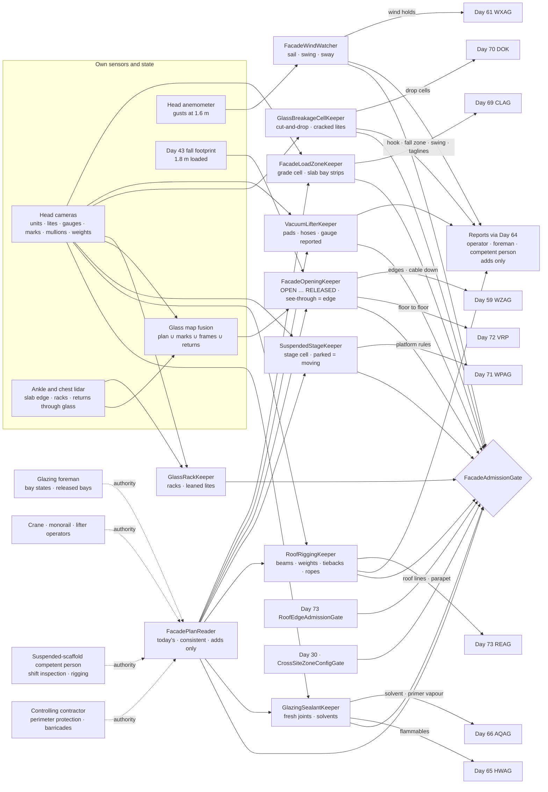
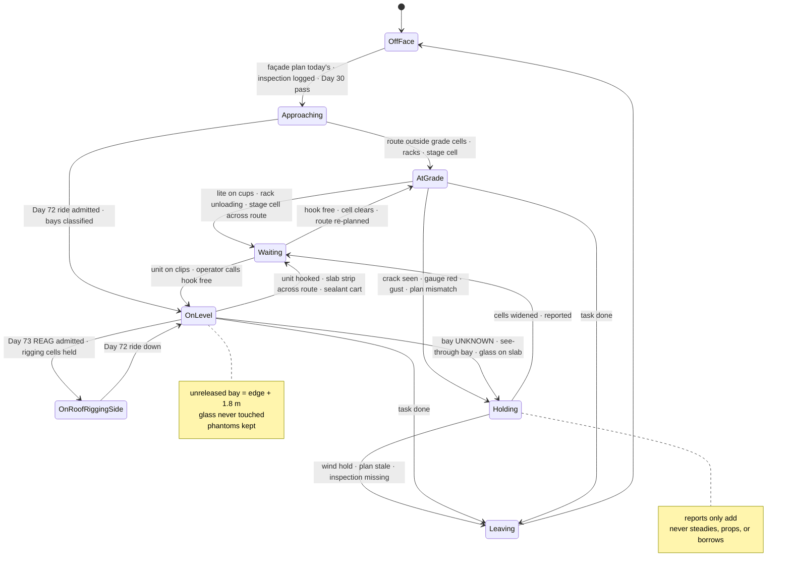
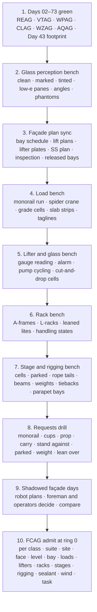

# Day 74 — Glazing, curtain wall, and façade work under the roof stack: FacadeLoadZoneKeeper / VacuumLifterKeeper / GlassBreakageCellKeeper / GlassRackKeeper / FacadeOpeningKeeper / SuspendedStageKeeper / RoofRiggingKeeper / GlazingSealantKeeper / FacadeWindWatcher / FacadePlanReader / FacadeAdmissionGate under RoofEdgeAdmissionGate + the roof stack: WarningLineKeeper / SafetyMonitorDeferenceKeeper / ControlledAccessZoneKeeper / RoofOpeningKeeper / HotRoofingZoneKeeper / RoofFootingKeeper / RooftopStagingReader / RoofWindDebrisWatcher / RooftopSetKeeper / RoofingPlanReader / RoofEdgeAdmissionGate under VerticalTransportAdmissionGate + WorkPlatformAdmissionGate + SteelErectionAdmissionGate + CraneLiftAdmissionGate + ConcretePourAdmissionGate + ExcavationAdmissionGate + AirQualityAdmissionGate + HotWorkAdmissionGate + LoudSiteAdmissionGate + ElectricalAdmissionGate + HeatAdmissionGate + WeatherAdmissionGate + LowLightAdmissionGate + WorkZoneAdmissionGate + DockAdmissionGate + SidewalkAdmissionGate + CorridorAdmissionGate + ElevatorAdmissionGate + DoorwayAdmissionGate + WetSurfaceAdmissionGate + ConfinedSpaceAdmissionGate + ElevatedAccessAdmissionGate + OverheadToolAdmissionGate + BimanualToolAdmissionGate + PowerToolAdmissionGate + PushPullAdmissionGate + PayloadCarryAdmissionGate + OutdoorGroundAdmissionGate + TerrainLocomotionAdmissionGate + FallSafeAdmissionGate + DeliberateContactAdmissionGate + WholeBodyTouchAdmissionGate + HumanHandoverAdmissionGate + CooperativeTaskAdmissionGate + TaskCompositionAdmissionGate + FleetSkillCatalogAdmissionGate + proximity + zone attestation + supervisor + logging + canary + HIL + fleet + incident + change-management + maintenance + thermal + energy gates

![FacadeLoadZoneKeeper / VacuumLifterKeeper / GlassBreakageCellKeeper / GlassRackKeeper / FacadeOpeningKeeper / SuspendedStageKeeper / RoofRiggingKeeper / GlazingSealantKeeper / FacadeWindWatcher / FacadePlanReader / FacadeAdmissionGate: the same 63.8 kg humanoid on Site C on an overcast Tuesday waits 4 m outside the cell of a 135 kg insulating glass unit hanging from a spider crane's vacuum lifter instead of walking under it because "the cups are on and the gauge is green", and reports the lifter's pump cycling every 30 s to the operator; it declines to prop a lite against a column or carry a 16 kg spare lite to level 2, because it never handles glass; on level 2 it keeps 3.1 m back from the slab edge in bays 6–8 while a 351 kg unitized curtain-wall unit goes past on the roof monorail, and won't hold the tagline; on level 3 it photographs anchor clips from 3.0 m back and refuses to stand against a set-but-unreleased glazed bay that its lidar sees straight through; on the roof, inside yesterday's lines, it counts eleven 22.7 kg counterweights on each south outrigger beam (4.38:1, and 3.98:1 with one gone), refuses to borrow one for a lifting tarp or to lean over the parapet to check a rope, and tells the foreman; it reports 11.8 m/s gusts while a unit is on the hook; and at grade it walks 22 m around a parked swing stage's barricade instead of under it](/images/day74-glazing-curtain-wall-facade.png)

[Day 05](/lessons/day-05-power-bms) owns `torque_scale` and the pack **forever**. [Day 07](/lessons/day-07-wbc-balance) owns gait and balance. [Day 17](/lessons/day-17-runtime-safety-supervisor) owns ESTOP and safe states. [Day 29](/lessons/day-29-human-proximity-safety) owns person tracks, SSM, and PFL rows. [Day 30](/lessons/day-30-collaborative-workspace-zoning) owns attested zones and `CrossSiteZoneConfigGate`. [Day 43](/lessons/day-43-falls-fall-safe-contact) owns the fall direction and the swept fall footprint. [Day 44](/lessons/day-44-stairs-ramps-uneven-terrain) owns stairs and slopes. [Day 46](/lessons/day-46-carrying-payloads-walking) owns what the robot may carry where. [Day 53](/lessons/day-53-water-wet-floors-spills) owns wet footing and friction. [Day 59](/lessons/day-59-construction-sites-work-zones) owns slab edges, openings, covers, trip lines, and barriers. [Day 61](/lessons/day-61-weather-rain-snow-fog-wind) owns weather, ice, frost, and wind holds. [Day 62](/lessons/day-62-heat-sun-dust) owns hot surfaces in the sun. [Day 64](/lessons/day-64-noise-vibration-communications) owns warnings, radio, and hand signals. [Day 65](/lessons/day-65-hot-work-fire-hazards) owns hot work, fuel cylinders, permits, and the fire watch. [Day 66](/lessons/day-66-airborne-hazards-air-quality) owns fumes and vapours. [Day 69](/lessons/day-69-cranes-rigging-overhead-lifts) owns hooks and fall zones. [Day 70](/lessons/day-70-structural-steel-metal-decking) owns drop cells and deck as footing. [Day 71](/lessons/day-71-scaffolds-mast-climbers-aerial-lifts) owns every temporary platform as not-footing. [Day 72](/lessons/day-72-construction-hoists-vertical-transport) owns how the robot gets between floors. [Day 73](/lessons/day-73-roofing-roof-edge) owns the roof, its lines, its holes, and its edge.

Day 73 put the robot on the roof. Today it works around the outside of the building while the building gets its skin: **glazing, curtain wall, and façade work**. A façade going on is a strange place. The walls the robot has been keeping away from for two weeks, open slab edges with a perimeter cable, start turning into glass one bay at a time, and glass looks exactly like a wall that it can't see. The loads that make the wall arrive on hooks from a roof monorail, a spider crane, or a tower crane, and the last metre of every one of them is a person steadying a 351 kg panel at an open slab edge. Lites of glass are carried on suction cups. And the people sealing the joints hang off the roof on a platform held up by two steel beams, eleven weights each, and a wire rope that the robot will walk past twenty times a day.

A humanoid around a façade under construction has five ways to make things worse. It's **a body under a load** that isn't on a crane hook in the Day 69 sense, but on a monorail trolley, a vacuum lifter, a glass manipulator, or a swing stage, all of which can drop what they hold. It's **a body near an edge** that is partly glass, where some bays are open, some are glazed but not set, and some are finished, and where its own lidar can't tell them apart. It's **a pair of hands that will be handed glass**: a spare lite, the corner of a unit, a pane to lean against a column. It's **a pair of hands near rigging**: counterweights, tiebacks, outrigger beams, parapet clamps, and wire ropes that hold people in the air and are built to numbers that assume nobody touches them. And it's **an observer** that can see a gauge needle, a sagging rope, a cracked lite, a fresh bead of sealant, and will be asked to say something about it. None of that makes it a glazier, a rigger, a hoist operator, the suspended-scaffold competent person, or the person who says a bay is closed.

Eight lies show up the first time a team runs a humanoid around a façade:

1. **Just-a-monorail lie.** "It's only the monorail, not the crane. Walk along the slab edge, the panel's going up to three." A unit on a monorail trolley is a suspended load with a fall zone and a swing, exactly as Day 69 defines them, and on its way up it passes every slab edge below its landing level.
2. **Cups-are-on lie.** "The cups are on and the gauge is green. Walk under, it's not going anywhere." A vacuum lifter holds glass by air pressure; it can lose a pad, a seal, a hose, or power, and the gauge is the operator's instrument, not the robot's permission.
3. **Lean-it-there lie.** "Prop this lite against the column for a minute while I shim." A lite leaned on a column is a 135 kg blade balanced on its edge; racks and leaned glass crush people every year.
4. **Just-a-small-lite lie.** "It's a 16 kg spare. Carry it up to two." Glass in a robot's grippers is point loads on an edge that was cut to be loaded along it, carried by a machine that can fall.
5. **Glass-is-a-wall lie.** "That bay's glazed now. Stand against it for your photo." A unit hung on its anchors but not set and released is an open edge with a pane in it, and safety glazing is tested to break safely, not to stop a body.
6. **Stage's-parked lie.** "The stage is parked. Walk under it to the gate." A suspended stage at rest is still a platform with people, tools, and buckets on it, hung from ropes that move whenever someone presses a button.
7. **Just-a-weight lie.** "Take one of those counterweights and put it on the tarp that's lifting." Counterweights are counted to a 4:1 moment on every outrigger beam, and they're never removed while the scaffold is rigged (1926.451(d)(3)).
8. **Lean-over-and-look lie.** "You've got cameras. Lean over the parapet and tell me if the rope's tracking on the roller." The rope, the roller, the clamp, and the parapet edge belong to the rigger and the competent person who inspects them before every shift (1926.451(f)(3)).

Today owns **`FacadeLoadZoneKeeper` / `VacuumLifterKeeper` / `GlassBreakageCellKeeper` / `GlassRackKeeper` / `FacadeOpeningKeeper` / `SuspendedStageKeeper` / `RoofRiggingKeeper` / `GlazingSealantKeeper` / `FacadeWindWatcher` / `FacadePlanReader` / `FacadeAdmissionGate`**. The question is: **how do you let a humanoid work around a building whose façade is going on, keeping out of every cell under a unit on a monorail, a lite on a spider crane or a vacuum lifter, and a swing stage, however still each of them looks; treating every lite as something that can break or slip and every glass rack and leaned lite as something that can fall over; never touching, carrying, leaning, or propping glass; treating every open, glazed-but-unreleased, and see-through bay as an edge, whatever its own sensors say; keeping its hands and body off every outrigger beam, counterweight, tieback, davit, parapet clamp, and wire rope, and reaching the roof's façade rigging only through yesterday's roof keepers; staying off fresh sealant and handing primers and solvents to Day 66; reporting wind on panels and stages without fighting it — without raising Day 29 PFL, writing Day 05 `torque_scale`, gating Day 17 ESTOP, or bypassing `CrossSiteZoneConfigGate`?**

## The façade is somebody else's load

The rule everything follows from: **around a façade under construction, the robot is a body kept out of every cell under a unit, a lite, a lifter, and a stage; a body kept off every open, glazed-but-unreleased, or unknown bay by the edge rules of Day 59 plus its own fall footprint; a pair of hands kept off all glass, racks, lifters, pads, taglines, rigging, counterweights, tiebacks, ropes, and fresh sealant; and an observer whose reports only add. It never walks under, beside, or along a hooked or cupped load; never steadies, guides, receives, or catches a unit or a lite; never carries, holds, leans, props, or racks glass; never leans on, photographs against, or walks its fall footprint into a glazed bay that hasn't been released; never steps on or rides a stage, and never stands under one, moving or parked; never touches, moves, borrows, or inspects an outrigger beam, counterweight, tieback, davit, clamp, or wire rope; never reaches over a parapet; never touches or walks on fresh sealant or masking; and never says a lifter is holding, a lite is sound, a bay is closed, a stage is secure, a rigging is good, a sealant is cured, or the wind is fine.** The site has people for those calls: the glazing foreman, who runs the install and says when a bay is set; the hoist or crane operator and the lifter operator, who say what's on the hook and the cups; the rigger and the suspended-scaffold competent person, who rig the roof and inspect it every shift; the controlling contractor, who releases a bay as enclosure and puts the perimeter protection back; and the façade engineer, whose numbers say what a unit and its anchors carry. The robot can tell them things. It can't stand in for them.

Seven facts set the shape of the lesson.

**Every unit and lite is a suspended load, whatever lifts it.** Unitized curtain-wall units are factory-assembled frames with the glass already set in structural silicone, typically one floor tall and one module wide; a 1.52 × 4.20 m unit at about 55 kg/m² weighs about 351 kg. They come up on a tower crane, a mobile crane, a roof-mounted monorail with a trolley hoist, or a mini crawler ("spider") crane on a slab, and a glazier at the landing floor reaches out of an open bay to catch and guide each one onto its anchors. Storefront and stick-system lites go in from the ground on a spider crane or a glass manipulator with a vacuum lifter. Day 69's rules for hooks, fall zones, swing, and taglines apply to all of them; today adds the façade's geometry, where the load path runs along a wall full of edges.

**A vacuum lifter is a pressure difference.** A vacuum lifter holds a lite by evacuating the space under rubber pads. ASME B30.20 covers vacuum lifters as below-the-hook devices and requires them to have a vacuum indicator and a warning for loss of vacuum; powered lifters carry a reserve so the load hangs for a while after power fails, and their rated loads for a lite held vertically, where the pads hold by friction, are lower than for a flat one. Four 250 mm pads under 60 kPa of vacuum press about $0.196 \times 60{,}000 \approx 11.8$ kN on the glass; held vertically at a pad friction around 0.5, that's about 5.9 kN, or 600 kg, before any design factor. The plate on the lifter says what it may lift. None of that is the robot's number to use.

**Glass breaks, and it breaks by its kind.** Annealed glass breaks into long, sharp shards; heat-strengthened into larger pieces; fully tempered into small cubes that still come down as a shower, and tempered glass can break with nobody touching it from a nickel-sulphide inclusion; laminated glass cracks and stays in its interlayer. A 1.5 × 3.0 m insulating glass unit (IGU) of two 6 mm lites weighs $4.5 \times 0.012 \times 2500 \approx 135$ kg. Whatever the kind, a lite that slips from cups or swings into a mullion is a falling load and a cutting load at once.

**Glass is stored on edge and falls flat.** Lites and IGUs ship and wait on A-frame racks and L-racks, leaning a few degrees from vertical; unloading one side of an A-frame unbalances it, and a lite leaned against a column or a wall falls over in one direction only, toward whoever is in front of it. Racked and leaned glass is one of the classic crushing hazards of the glazing trade.

**Open bays are edges, and glazed bays aren't walls yet.** Each employee on a walking/working surface with an unprotected side or edge 6 ft (1.83 m) or more above a lower level is protected by guardrails, nets, or personal fall arrest (1926.501(b)(1)), and the façade crew takes the perimeter cable down one bay at a time to set units. A guardrail's top rail must withstand 200 lb (890 N) (1926.502(b)(3)). A unit hung on its anchors but not yet set, engaged at its stack joint, and released by the glazing foreman is a pane in an open edge. And safety glazing is tested, under ANSI Z97.1 and CPSC 16 CFR 1201, by swinging a 100 lb (45 kg) bag into it from up to 48 in (1.22 m), about $45.4 \times 9.81 \times 1.22 \approx 543$ J: the test asks whether it breaks safely, not whether it holds you.

**Suspended scaffolds hang from the roof.** A two-point adjustable suspended scaffold ("swing stage") hangs on wire ropes from outrigger beams, davits, roof hooks, or parapet clamps. Devices that support outrigger beams resist at least 4 times the tipping moment of the scaffold at the hoist's rated load; counterweights are non-flowable, made for the purpose, secured mechanically to the beam, and **not removed until the scaffold is disassembled**; tiebacks are as strong as the suspension ropes (1926.451(d)(3)). Suspension ropes support at least six times the maximum intended load (1926.451(a)). The scaffold is inspected by a competent person before each work shift (1926.451(f)(3)), and the people on a two-point stage wear personal fall arrest on independent lifelines as well as having guardrails (1926.451(g)(1)(ii)).

**The robot's sensors don't see glass.** Lidar and time-of-flight depth cameras get a strong specular return from glass only near normal incidence; at an angle the beam passes through and returns from whatever is behind it, or reflects off the pane and returns a phantom point that appears to lie behind the glass. Stereo struggles with clean, featureless panes. A robot that builds its edge map from its own returns sees a glazed bay as either an open edge or a room that goes on forever, depending on the angle. The map of where glass is has to come from the plan and from what's marked, and the union of every source holds.

| Layer | Owns | Must not own |
|-------|------|--------------|
| `FacadeLoadZoneKeeper` | Every unit and lite on a crane, monorail trolley, spider crane, or glass manipulator as a Day 69 load: the hook's fall zone and swing to Day 69, plus a façade grade cell of max(2.0 m, h/3) + L/2 beyond the load path and, on every slab the hooked load passes or lands on, the bay ± one bay from the edge back to L/2 + 1.0 m; monorail run and its stands from the plan; taglines to Day 69 | Walking under or along a hooked load; steadying, guiding, receiving, or landing a unit; signalling; holding a tagline |
| `VacuumLifterKeeper` | Every vacuum lifter, pad frame, hose, and pump as no-touch 0.3 m; the lifter's load cell at least as large as its hook's; the gauge and alarm read as observed facts and reported when in the red or alarming; a lifter with a load attached as loaded whether moving or not | Touching a pad, hose, release valve, or control; reading a green gauge as admission; saying a lifter is holding |
| `GlassBreakageCellKeeper` | Every lite in motion or on cups as a cut-and-drop cell; cracked, chipped, or broken lites in place as drop cells below them + 1.0 m and reported; broken glass on the ground as a no-step cell + 1.0 m; glass kind from the plan (annealed, heat-strengthened, tempered, laminated) changing the report, never shrinking a cell | Removing, taping, or sweeping glass; calling a lite sound or a crack stable |
| `GlassRackKeeper` | A-frame and L-racks: rack height + 1.0 m on loaded faces, all sides while loading, unloading, or unknown; leaned lites: lite height + 1.0 m in the fall direction; glass never carried, held, leaned, propped, racked, or set by the robot | Leaning or propping a lite; taking a lite off a rack; carrying any glass; steadying a rack |
| `FacadeOpeningKeeper` | Every façade bay by state: OPEN, CABLE_DOWN, HUNG_NOT_SET, SET_NOT_RELEASED, RELEASED, UNKNOWN; everything but RELEASED an edge for Day 59, with the Day 43 fall footprint kept off it; glass never a support, released or not; own glass map = plan ∪ marks ∪ frames ∪ returns, with see-through and phantom returns held as both edge and obstacle | Calling a bay closed; leaning on, bracing against, or photographing against glass; putting cable back |
| `SuspendedStageKeeper` | Every swing stage, bosun's chair, and its ropes: stage footprint + max(2.0 m, h/3) at grade, the contractor's barricade + 1.0 m if larger; parked counted as moving; rope tails and lifelines no-touch 0.3 m; never footing, never a passenger, controls never touched | Riding, stepping on, loading, or operating a stage; touching a rope, lifeline, or hoist; walking under one parked |
| `RoofRiggingKeeper` | Outrigger beams, counterweights, tiebacks, davits, roof hooks, parapet clamps, monorail stands, and their ropes on the roof as no-touch + 1.0 m; tieback runs as trip-and-no-touch lines; the parapet or edge in a rigged bay held under Day 73 perimeter rules; counterweight counts read as facts and reported if short | Moving, borrowing, adding, or counting a counterweight toward anything; reaching over a parapet; inspecting rigging; saying it's good |
| `GlazingSealantKeeper` | Fresh sealant, structural silicone, primers, masking tape, and backer rod in place as no-touch 0.3 m; cure states from the crew's notes only; solvent wipes, primers, and cleaners as Day 66 vapour sources and Day 65 ignition rules | Touching a joint; carrying open solvent; saying a sealant is cured or a primer has flashed off |
| `FacadeWindWatcher` | Sail force and swing on hooked units and lites, sway on stages, own gust at the robot's height; downwind growth of load cells; reports to the operator, foreman, and competent person; lift and stage wind limits read, never set; holds to Day 61 | Saying the wind is within a limit; asking for a lift to stop or go; steadying anything in wind |
| `FacadePlanReader` | The façade erection plan and bay schedule, crane, monorail, and spider-crane lift plans, the vacuum lifter's rated load, the suspended-scaffold plan and today's competent-person inspection, the roof rigging layout and tieback points, released bays and restored perimeter protection, glass kinds by elevation, sealant cure notes, and the barricade plan at grade; today's or refusal | Writing, approving, or amending any of it |
| `FacadeAdmissionGate` | Fail-closed admit per robot class, suite, site, face, bay, level, load states, lifter states, rack states, opening states, stage and rigging states, sealant states, wind state, route, task | `JointCommand`; Day 05; PFL; Day 17 |
| Days 05 / 07 / 17 / 29 / 30 / 43 / 46 / 53 / 59 / 61 / 64 / 65 / 66 / 69 / 70 / 71 / 72 / 73 | Pack, gait, ESTOP, people, zones, falls, carrying, friction, edges and covers, weather, comms, hot work, vapours, hooks, drop cells, platforms, hoists, roof | Being outranked by "it's only the monorail" |

**Core thesis:** **around a façade under construction, a humanoid treats every unit and lite as a load whatever holds it and keeps out from under it; treats every pane as something that can break, slip, or fall over, and never touches one; treats every bay that isn't released as an edge, because its own sensors can't see the glass and glass was never built to hold it; keeps its hands off everything that holds a stage in the air; and tells people about gauges, cracks, sealant, and wind instead of deciding anything about them.**



## Physical machine: what's on the façade

Walk Site C on Tuesday. The steel wing from Days 70 to 73 is a three-storey frame, levels at 0, 4.2, and 8.4 m, roof at 12.6 m, with its roof membrane finished on the north half and the masons' 1.07 m CMU parapet complete on the south. The façade crews start today on three faces. It's 3 °C at 07:30, overcast and dry, with a westerly wind forecast at 5 to 8 m/s, gusting toward 12 m/s by late morning.

- **North face: unitized curtain wall.** Twenty-four units, 1.52 × 4.20 m, about 351 kg each, factory-glazed with tempered outer lites and structural silicone already cured in the shop. They come up from a staging area at grade on a **roof-mounted monorail**: a beam cantilevered 1.0 m beyond the north edge on counterweighted stands, with a 1 t electric trolley hoist. Glaziers on L2 and L3 take the perimeter cable down in the bay they're setting, tie off, and reach out to guide each unit onto its anchor clips. Bays 1–6 are hung and set on all three levels, none released yet; bay 7 goes onto L3 first thing, then bays 8 and 9.
- **West face: storefront at L1.** Two A-frame racks of 1.5 × 3.0 m IGUs (6 mm tempered + 12 mm space + 6 mm laminated), six per side, about 135 kg each, set by a 3 t spider crane carrying a four-pad vacuum lifter plated for 300 kg. The lifter operator runs the pump and the release from a pendant; two glaziers guide with hand cups. The personnel hoist from Day 72 stands at the north end of the west face.
- **South face: sealant from a swing stage.** A 7.3 m two-point suspended scaffold on two traction hoists rated 454 kg each, hanging from two outrigger beams on the roof that pass over the new parapet. Each beam has 0.46 m outboard of its fulcrum and eleven 22.7 kg counterweights bolted to its inboard end at 3.66 m, with a wire-rope tieback to a column at the roof's steel. Two sealant workers on the stage, each on an independent lifeline tied off at the roof, are cutting out and re-sealing the window perimeters on L2 and L3 with a two-rag solvent wipe, primer, backer rod, and silicone. The controlling contractor's barricade at grade is 3.0 m out from the face.
- **The roof.** Day 73's north warning line is still up, 1.83 m back, with the monorail stands and their counterweights inside it; the south parapet bay over the stage is rigged, with the lifelines' anchors and the tiebacks running back across the membrane on protection pads.

The robot's tasks: carry a 5.8 kg box of setting blocks and backer rod from the site store to the glazing foreman's gang box on L2 (two-handed, Day 46, via the Day 72 hoist); photograph the fourteen anchor clips along the L3 north slab edge for the façade consultant before units go on them; photograph the membrane protection pads under the two south outrigger beams for the roofing consultant; and leave by the south gate. Eight times during the morning someone will offer it a quicker way to do it.

The robot's hardware for this:

- **Head cameras** with Day 60's low-light settings, for units, lites, mullions, manifestation marks, lifter gauges, counterweights, and bay tags.
- **Ankle and chest lidar** for slab edges, racks, and the depth behind each bay, with the glass handling described below.
- **The small head anemometer** from Day 61, 1.6 m above whatever it stands on.
- **The Day 43 fall model,** with a swept fall footprint of 1.8 m with today's payload, 1.4 m empty.
- **The Day 64 radio,** on the glazing channel and the site channel.

### Loads on the face: every unit is a hook load

`FacadeLoadZoneKeeper` takes each unit and lite on a crane, monorail, spider crane, or manipulator and hands the hook, the fall zone, the swing, and the taglines to Day 69's keepers as they are. On top of that it adds the façade's two problems.

The first is **where a load lands if it falls off a face**. A unit doesn't drop straight down beside a wall; it tips, pivots on a corner, and can glide. FLZK adds a grade cell beyond the load's path of

$$
r_{\text{grade}} = \max\left(2.0,\ \frac{h}{3}\right) + \frac{L}{2} = \max\left(2.0,\ \frac{13.0}{3}\right) + \frac{4.20}{2} \approx 6.4 \text{ m}
$$

for a 4.20 m unit with its hook as high as 13.0 m, which puts the whole north staging strip, 6.4 m out along the run of the monorail, out of the robot's route whenever a unit is on the hook. A 351 kg unit from 12.6 m carries about $351 \times 9.81 \times 12.6 \approx 43$ kJ. Nothing about that number needs refining.

The second is **the slab edges a load passes on the way up**. A unit going to L3 passes L1 and L2 at arm's length from their slab edges, and the glaziers at the landing level pull it in. FLZK holds, on every level the hooked unit passes or lands on, the bay it's in plus one bay either side, from the slab edge back to $L/2 + 1.0 = 3.1$ m. That's on top of Day 59's edge rules, which the open bays already trigger.

At 08:55 on L2, the robot is carrying its box east along the north side, 3.5 m in from the slab edge, toward the foreman's gang box at bay 8. The monorail picks bay 7's unit at grade. A glazier waves it on: "It's only the monorail, not the crane. Walk along the edge, the panel's going up to three." FLZK has already closed bays 6–8 on L2 back to 3.1 m while the unit is hooked; the robot's route at 3.5 m runs right along the boundary of that strip, so FLZK re-plans it 2 m further in, around the column line, and the robot says: "I keep out of the bays under the panel until it's landed. I'll go round." It waits at the column line until the L3 crew calls the unit on its clips and the monorail operator calls the hook free on the glazing channel, then delivers the box. It doesn't hold the tagline the second glazier offers it on the way.

### Vacuum lifters: cups are a pressure, not a promise

`VacuumLifterKeeper` treats a vacuum lifter as a hook with extra ways to fail. Pads lose seal on dirty, wet, or coated glass, on a cold morning when the rubber stiffens, on a curved or patterned face; hoses chafe; pumps stop. The lifter's alarm and reserve are designed so the operator has time to lower the lite before it lets go, not so anyone can stand under it.

For the robot, the lifter's cell is at least the hook's cell and doesn't depend on the gauge. VLK reads the gauge and the alarm light with the head camera, because it's useful to the operator if it sees something they don't, and reports what it sees: needle in the red band, alarm lit, a pad visibly lifted at an edge. It never reads a needle in the green as anything but a fact about a needle. It keeps 0.3 m off every pad, frame, hose, pump, and pendant, whether a lite is on or not, and treats a lifter with a lite attached as loaded until the operator says the release is done.

At 08:05 on the west face, the spider crane lifts IGU W3 from the rack, about 135 kg on four pads plated together for 300 kg. A glazier, cups in hand, says: "Cups are on, gauge is green. Walk under, it's not going anywhere." VLK and FLZK hold the lift's cell, and GBCK's cut-and-drop cell sits on top of it. The robot waits 4 m outside it. At 08:11 the pump cycles twice in a minute as the lite hangs, which the robot reports to the operator as a fact: "Lifter pump on W3 cycling about every 30 s while it's hanging (adds only: not an inspection)." The operator lowers the lite to its blocks, wipes a pad, and lifts again. Whether that was a dirty pad or nothing is their call.

### Glass: cut-and-drop cells

`GlassBreakageCellKeeper` gives every lite that is moving, on cups, or hanging a cell that covers both ways it hurts people: falling, and breaking into edges. For a lite in motion at height $h$ with longest side $L$:

$$
r_{\text{glass}} = \text{swept path} + \max\left(2.0,\ \frac{h}{3}\right) + \frac{L}{2} = \text{swept path} + 2.0 + 1.5 = 3.5 \text{ m}
$$

for W3's 3.0 m IGU set no higher than 3.3 m. A 135 kg IGU falling from 3.3 m carries about 4.4 kJ, and shards from an annealed or heat-strengthened lite land with edges up; a tempered lite comes down as hot-gravel cubes that still cut. GBCK doesn't shrink any cell for laminated glass, because the interlayer holds the pieces only once the pane is supported in a frame.

GBCK also watches the glass that's already in. A crack, a chip at an edge, a run from a corner, or a lite that's shattered in place (tempered glass can do that by itself) becomes a drop cell below it to grade + 1.0 m and a report to the glazing foreman, because pieces will come out of it for days. Broken glass on a slab or the ground is a no-step cell + 1.0 m until the crew clears it, with Day 53's footing rules applying after that. GBCK never removes, tapes, or sweeps glass.

### Racks and leaned lites: glass falls flat

`GlassRackKeeper` handles glass at rest, which is where most glass crushes people. An A-frame rack of six IGUs per side carries about 810 kg each side; when the glaziers take lites off one side, the rack's balance moves with every lite. GRK holds rack height + 1.0 m (1.8 + 1.0 = 2.8 m) on each loaded face and on all sides while the rack is being loaded or unloaded or its state is unknown; 1.0 m on the ends of a rack at rest. A lite leaned against a column, a wall, or a stack falls in one direction: GRK holds its height + 1.0 m on that side.

Then the rule that does most of the work: **the robot never handles glass.** It doesn't carry it, hold it, lean it, prop it, take it from a rack, put it on one, steady it on the blocks, or hand it to anyone. Day 46's carry rows would admit a 16 kg box; they don't see what a 16 kg lite is. A tempered lite is strong across its face and fragile at its edges and corners, which is where a gripper holds; a tempered lite that loses an edge chip shatters entirely; and a robot carrying a lite down stairs is a fall with glass on top of it.

At 08:15, still on the west face, a glazier shimming the W2 opening says: "Prop this lite against the column for a minute while I shim." GRK answers: "I can't hold or lean glass. I'll stand clear." Thirty seconds later the second glazier has a better idea: "Then take this spare up to two. It's only a small one, 16 kilos." The spare is 0.9 × 1.2 m of 6 mm tempered, about $1.08 \times 0.006 \times 2500 \approx 16.2$ kg. GRK: "I can't carry glass. The hoist operator can take it up with you." The glazier carries it himself.

### Bays: an edge with a pane in it

`FacadeOpeningKeeper` gives every bay on every level a state from the façade plan, the glazing foreman's bay tags, and what the robot sees:

- **OPEN:** no unit, perimeter cable up;
- **CABLE_DOWN:** cable down for a unit to come in;
- **HUNG_NOT_SET:** unit on its anchors, not yet engaged at its stack joint, not fixed;
- **SET_NOT_RELEASED:** fixed, but the foreman and the controlling contractor haven't released the bay;
- **RELEASED:** set, inspected, and released as enclosure, with any cable or rail the crew still requires back in place;
- **UNKNOWN:** anything else, including a bay the robot can't see well.

Everything but RELEASED is a Day 59 edge, and FOK adds the Day 43 fall footprint to Day 59's standoff, so the robot's centre stays at least the fall footprint plus Day 59's margin back from the slab edge in that bay. CABLE_DOWN gets Day 59's open-edge rule, not its guarded-edge rule. And even a RELEASED bay is never a support: glass is in NEVER_TOUCH, the robot doesn't lean on it, brace against it, or let a Day 43 fall be steered toward it during construction. A 70 kg robot that stumbles into a pane at 1.5 m/s brings only about 79 J, but a real fall puts its centre of mass about 0.9 m lower, about 620 J, more than the 543 J safety-glazing impact that a pane is only required to survive by breaking safely.

### Glass the sensors can't see

FOK's other job is that the robot's own map of a façade is wrong in a particular way. Its lidar, at the angles it sees most bays, passes through clean glass and returns from the slab edge, the scaffold, or the sky beyond, so a glazed bay looks open; near normal incidence it gets a strong return and the bay looks closed; at some angles the pane acts as a mirror and the lidar puts points behind the glass that are really the robot's own surroundings reflected. Depth cameras behave similarly; stereo gets almost nothing from a clean pane.

So the glass map is a union, never a single sensor:

- the **façade plan's** bay schedule and today's bay states;
- the **marks** the crew applies to new glass (tape crosses, stickers, manufacturer labels) seen by the head cameras;
- the **frames**: mullions, transoms, and stack joints, which the cameras and lidar see well, so a bay with a frame and no return in its plane is classed as *glazed or open, unknown*;
- the **returns** themselves.

A bay any source calls open is an edge; a bay any source calls glazed is an obstacle; a bay both could be is both. Phantom points from reflections are kept as obstacles, never deleted, because they only ever add. The rule matches everything else today: no single number the robot computes can open the façade.

At 09:20 on L3 the robot photographs the anchor clips along the north slab edge, bays 8 to 21, from 3.0 m back (Day 59 standoff plus its 1.8 m footprint at the open, cabled bays). Behind it, bays 1–6 are set but not released; its lidar sees straight through bays 2 and 5 to the slab edge and the monorail staging strip below. A glazier, keen on a better photo of the clip at bay 8: "That bay's glazed now. Stand against it and shoot along the edge." FOK refuses: "Bay 6 isn't released, so for me it's an edge. I'll take the photo from here." The clip photo at bay 8 is taken at a shallower angle than the consultant would like, and the report says so.

### Swing stages: parked counts as moving

`SuspendedStageKeeper` holds every suspended stage, bosun's chair, and single-point platform and its ropes the way Day 71 held mast climbers. The cell at grade is the stage footprint plus max(2.0 m, h/3) on every side, or the contractor's barricade + 1.0 m if that's larger. With the south stage working up to 9.0 m, h/3 is 3.0 m, which happens to be where the barricade is; the robot holds 4.0 m out from the face along the stage's 7.3 m plus 4.0 m beyond each end. A 1.2 kg caulking gun from 9.0 m carries about $1.2 \times 9.81 \times 9.0 \approx 106$ J, roughly twice the 54 J a hard hat is tested to absorb. The cell holds whenever the stage is rigged: up, down, moving, or parked, because a parked stage moves the moment someone presses the button, and things fall off parked stages too.

The stage is never footing, never a platform for a hand-off, and never a ride. Its ropes, tail lines, lifelines, hoists, and pendant are no-touch 0.3 m; rope tails hanging to grade are lines the robot routes around, never steps over.

At 10:55, leaving the site, the robot reaches the south face. The stage is at L2, its two workers on lunch break, rope tails coiled at the base. A labourer at the gate calls: "Stage is parked. Walk under it, it's quicker." SSK: "I keep out from under the stage whether it's moving or not. I'll go around the barricade." The way around is 22 m longer.

### Roof rigging: counted, never borrowed

`RoofRiggingKeeper` is the roof end of the stage, and it works under Day 73's roof keepers, not instead of them. The outrigger beams, counterweights, tiebacks, davits, roof hooks, parapet clamps, monorail stands, and the ropes leaving them are no-touch + 1.0 m. Tieback runs across the roof are lines: the robot routes around them, never steps over them. In the bay where rigging crosses the parapet or edge, Day 73's perimeter hold applies as if the edge had no parapet, because the people who work there are tied off and the robot isn't.

RRK also reads the rigging as facts. It counts counterweights on each beam against the suspended-scaffold plan, notes a tieback that's slack or missing, and reports anything short. It never adds, moves, borrows, or tightens anything, and it doesn't do the moment arithmetic as an inspection. It does it here only to show why the rule is absolute. For one beam of the south stage:

$$
\frac{M_r}{M_t} = \frac{W_{cw}\, d_{in}}{P\, d_{out}} = \frac{11 \times 22.7 \times 3.66}{454 \times 0.46} = \frac{915}{209} \approx 4.38
$$

Take one weight away and it's $\frac{10 \times 22.7 \times 3.66}{209} \approx 3.98$: below the 4:1 that 1926.451(d)(3) requires, from one 22.7 kg weight that "isn't doing anything."

At 09:50 the robot is on the roof, admitted by Day 73's `RoofEdgeAdmissionGate` through the hoist's access path, photographing the protection pads under the two south beams from the inboard end, 1.0 m off the counterweight stack. A sheet of protection tarp beside the stack starts to lift in a gust. A rigger, busy at the parapet: "Grab one of those weights and put it on the tarp." RRK: "I can't move a counterweight. I'll tell your foreman the tarp's lifting." It reports through Day 64: "Tarp by the south-east outrigger lifting in gusts; counterweights on both south beams counted 11 and 11 (adds only: not an inspection)." Then the same rigger, short of a second pair of eyes: "You've got cameras. Lean over the parapet and tell me if the east rope's tracking on the roller." RRK: "I can't reach over the parapet or check the rigging. The competent person can." Yesterday's warning lines and today's rigging cells say the same thing: the robot stays 4.85 m back, behind the line Day 73 set for that bay.

### Sealant: fresh joints and solvents

`GlazingSealantKeeper` holds fresh sealant, structural silicone, primer, masking tape, and backer rod as no-touch 0.3 m, with cure states taken only from the crew's notes. Silicone skins in minutes and cures from the outside in, a few millimetres a day for a one-part sealant; a skinned joint is still wet underneath, and a brushed one is a joint someone cuts out and does again. The two-rag solvent wipe, the primer, and their rags are Day 66 vapour sources, flammable ones are Day 65 ignition sources, and the robot carries no open solvent container.

At 09:05 on L2, on its way back from the gang box, the robot passes the L2 window perimeters at bays 3 and 4, re-sealed from inside an hour earlier, masked and tooled. The route squeezes to 0.4 m past the bay 4 jamb; GSK widens it and the robot waits for a worker to move a sealant cart instead. It never asks whether the joint has cured.

### Wind: the panel is a sail

`FacadeWindWatcher` estimates what the wind does to loads on the façade and reports it. A 6.38 m² unit on a single hook with a drag coefficient around 1.2:

$$
F = \tfrac{1}{2}\rho v^2 C_d A = 0.5 \times 1.2 \times 13^2 \times 1.2 \times 6.38 \approx 776 \text{ N}
$$

at a 13 m/s gust, against its 3.44 kN weight: it hangs about $\arctan(776/3440) \approx 12.7°$ off vertical, about 0.66 m of swing on a 3 m sling, and it starts to turn. At 9 m/s it's about 372 N and 6.2°. A swing stage sways into the face, and its workers stop when their rules say so. FWW grows each load cell downwind by sling length × tan θ and 1.0 m, reports to the operator and the foreman, and reads, never sets, the lift plan's and the stage manufacturer's wind limits. The robot's own gust number at 1.6 m can only close; Day 61 owns the holds.

At 10:25, on its way down from the roof, the robot reads gusts of 11.8 m/s at the roof landing. It reports to the monorail operator and the glazing foreman: "Gusts about 11.8 m/s at the roof landing, westerly; bay 9's unit is on the hook (adds only)." Whether the lift goes on is theirs.

### The plans: someone else's checks

`FacadePlanReader` reads the paper that says who decided what:

- the **façade erection plan** and bay schedule, and today's bay states from the glazing foreman;
- the **lift plans** for the monorail, the spider crane, and any crane picks, with their wind limits, and the **vacuum lifter's** rated load and pad configuration;
- the **suspended-scaffold plan**, its rigging layout, counterweight count, tieback points, and **today's competent-person inspection** (1926.451(f)(3));
- **released bays** and restored perimeter protection, from the controlling contractor;
- **glass kinds** by elevation (annealed, heat-strengthened, tempered, laminated), for reports;
- **sealant and primer** cure notes and SDS references;
- the **barricade plan** at grade under the stages and monorail runs.

It checks freshness and consistency against what the robot sees: a unit hooked in a bay the schedule doesn't list, a lifter on a spider crane that isn't in the lift plan, a stage on a face with no inspection logged today, a beam with a count that isn't the plan's, a barricade narrower than the stage's cell, a bay tagged released with its cable still down. Each mismatch is reported and narrows the robot's façade; a missing or stale plan refuses the face entirely. It never writes, approves, or amends any of it.

### Putting the cells in code

As every day since Day 59: everything here adds or keeps constraints; nothing removes one.

```python
import math
from dataclasses import dataclass

MARGIN_M = 1.0
NO_TOUCH_M = 0.3
RHO_AIR = 1.2
G = 9.81

def facade_grade_cell_m(hook_h_m: float, longest_side_m: float) -> float:
    """FLZK / GBCK: beyond the load's swept path, at grade."""
    return max(2.0, hook_h_m / 3.0) + longest_side_m / 2.0

def slab_bay_strip_m(unit_h_m: float) -> float:
    """FLZK: on every level a hooked unit passes or lands, bay ± 1, from the edge back."""
    return unit_h_m / 2.0 + MARGIN_M

def rack_cell_m(rack_h_m: float, face_loaded: bool, handling: bool | None) -> float:
    """GRK: loaded faces, and all sides while handling or unknown."""
    if handling is None or handling or face_loaded:
        return rack_h_m + MARGIN_M
    return MARGIN_M

def stage_cell_m(stage_top_h_m: float, barricade_m: float | None) -> float:
    """SSK: parked counts as moving; the larger of the drop cell and barricade + 1 m."""
    drop = max(2.0, stage_top_h_m / 3.0)
    return max(drop, (barricade_m or 0.0) + MARGIN_M)

BAY_STATES = ("OPEN", "CABLE_DOWN", "HUNG_NOT_SET", "SET_NOT_RELEASED", "RELEASED", "UNKNOWN")

@dataclass
class BayEvidence:
    plan_state: str | None        # from the façade plan / foreman's tags
    marked: bool | None           # tape cross, sticker, label seen
    frame_seen: bool | None       # mullions / transom / stack joint
    return_in_plane: bool | None  # lidar or depth return at the glass plane
    see_through: bool | None      # returns from beyond the plane

def bay_state(e: BayEvidence) -> str:
    """FOK: only the plan can say RELEASED; sensors can only make it worse."""
    if e.plan_state not in BAY_STATES:
        return "UNKNOWN"
    if e.plan_state == "RELEASED" and (e.frame_seen is False or e.see_through and not e.marked):
        return "UNKNOWN"          # plan says released, sensors disagree: report and hold
    return e.plan_state

def bay_is_edge(state: str) -> bool:
    return state != "RELEASED"

def bay_is_obstacle(e: BayEvidence) -> bool:
    """Any source that could mean glass makes it an obstacle; phantoms included."""
    return bool(e.marked or e.frame_seen or e.return_in_plane or e.plan_state != "OPEN")

def edge_hold_m(day59_standoff_m: float, fall_footprint_m: float) -> float:
    return day59_standoff_m + fall_footprint_m

def outrigger_ratio(n_weights: int, w_kg: float, d_in_m: float, hoist_kg: float, d_out_m: float) -> float:
    """RRK: shown to explain the rule, never used to admit or inspect anything."""
    return (n_weights * w_kg * d_in_m) / (hoist_kg * d_out_m)

def sail_force_n(v_mps: float, area_m2: float, cd: float = 1.2) -> float:
    return 0.5 * RHO_AIR * v_mps ** 2 * cd * area_m2        # report only

def hang_angle_deg(v_mps: float, area_m2: float, mass_kg: float) -> float:
    return math.degrees(math.atan2(sail_force_n(v_mps, area_m2), mass_kg * G))

def downwind_growth_m(sling_m: float, angle_deg: float) -> float:
    return sling_m * math.tan(math.radians(angle_deg)) + MARGIN_M
```

```python
NEVER_TOUCH = {"GLASS", "UNIT", "LITE", "IGU", "MULLION", "VACUUM_PAD", "LIFTER", "LIFTER_HOSE",
               "PENDANT", "TAGLINE", "HAND_CUP", "GLASS_RACK", "SETTING_BLOCK_IN_PLACE",
               "PERIMETER_CABLE", "STAGE", "SUSPENSION_ROPE", "LIFELINE", "ROPE_TAIL", "HOIST",
               "OUTRIGGER_BEAM", "COUNTERWEIGHT", "TIEBACK", "DAVIT", "ROOF_HOOK", "PARAPET_CLAMP",
               "MONORAIL", "MONORAIL_STAND", "FRESH_SEALANT", "MASKING", "BACKER_ROD_IN_JOINT",
               "SOLVENT_RAG", "PRIMER"}
NEVER_CARRY = {"GLASS", "OPEN_SOLVENT", "COUNTERWEIGHT"}
NEVER_BE = {"GLAZIER", "SIGNAL_PERSON", "LIFTER_OPERATOR", "COMPETENT_PERSON", "RIGGER", "TAGLINE_HAND"}

def refuse_request(text: str) -> str | None:
    t = text.lower()
    if "only the monorail" in t or "walk along the edge" in t or "walk under" in t and "panel" in t:
        return "I keep out of the bays under the panel until it's landed. I'll go round."
    if "cups are on" in t or "gauge is green" in t:
        return "I stay out from under anything on the lifter."
    if "prop" in t or "lean this" in t or "hold this lite" in t:
        return "I can't hold or lean glass. I'll stand clear."
    if "spare" in t or "carry" in t and ("lite" in t or "glass" in t or "pane" in t):
        return "I can't carry glass. The hoist operator can take it up with you."
    if "glazed now" in t or "stand against" in t:
        return "That bay isn't released, so for me it's an edge. I'll take the photo from here."
    if "stage is parked" in t or "under the stage" in t:
        return "I keep out from under the stage whether it's moving or not."
    if "weight" in t and ("grab" in t or "take" in t or "put" in t):
        return "I can't move a counterweight. I'll tell your foreman."
    if "lean over" in t or "over the parapet" in t or "check the rope" in t:
        return "I can't reach over the parapet or check the rigging. The competent person can."
    if "hold the tagline" in t or "steady it" in t or "guide it in" in t:
        return "I can't hold a tagline or guide a load."
    return None

def report(observation: str) -> str:
    banned = ("safe", "good", "holding", "sound", "closed", "secure", "secured", "rated",
              "cured", "fine", "ok", "within", "passed", "failed", "stable")
    assert not any(w in observation.lower().split() for w in banned)
    return observation + " (adds only: not an inspection)"
```

## FacadeLoadZoneKeeper and VacuumLifterKeeper

FLZK hands every unit and lite on a hook to Day 69, then adds the façade's grade cell, max(2.0 m, h/3) + L/2, and the slab strips on every level a hooked load passes, bay ± one, back L/2 + 1.0 m from the edge; it never takes a tagline. VLK holds every lifter at least as wide as its hook, reads the gauge and alarm as facts for the operator, keeps off every pad and hose, and never lets a green needle admit anything.

## GlassBreakageCellKeeper and GlassRackKeeper

GBCK makes every moving or cupped lite a cut-and-drop cell, every cracked or broken lite in place a drop cell to grade, and broken glass on the ground a no-step cell; glass kind changes the report, never the cell. GRK holds racks and leaned lites by their fall-over geometry and keeps the robot's hands off glass entirely: no carry, hold, lean, prop, rack, or hand-off, whatever the weight.

## FacadeOpeningKeeper and SuspendedStageKeeper

FOK tracks every bay from OPEN to RELEASED, keeps everything short of RELEASED as a Day 59 edge with the fall footprint added, never treats glass as a support, and builds its glass map as a union in which see-through and phantom returns only ever add. SSK holds every stage and its ropes as a cell at grade whether moving or parked, never rides, steps on, or operates one, and routes around rope tails.

## RoofRiggingKeeper, GlazingSealantKeeper, FacadeWindWatcher, and FacadePlanReader

RRK keeps hands and body 1.0 m off beams, weights, tiebacks, davits, clamps, monorail stands, and ropes on the roof, under Day 73's lines, counts weights only to report, and never reaches over a parapet. GSK keeps off fresh joints and masking and hands solvents and primers to Days 66 and 65. FWW turns gusts into sail forces, hang angles, and downwind growth of cells, and reports them. FPR reads the erection and lift plans, the lifter's plate, the suspended-scaffold plan and today's inspection, released bays, glass kinds, cure notes, and barricades, and refuses the face when they're stale.

## FacadeAdmissionGate

```text
FacadeAdmission
  robot_class, suite, site, face, level, bay_range, task, route
  facade_state: OFF_FACE | APPROACHING | ON_LEVEL | AT_GRADE | WAITING | HOLDING | ON_ROOF_RIGGING_SIDE | LEAVING
  requires:
    Day 73 RoofEdgeAdmissionGate: admitted for any roof presence (rigging, monorail stands, parapet bays)
    Day 72 VerticalTransportAdmissionGate: admitted for floor to floor
    Day 30 CrossSiteZoneConfigGate: pass
    facade_plan: today's bay schedule, lift plans, lifter plate, suspended-scaffold plan + today's inspection, released bays (else no face)
    loads: every hooked unit and lite on the face known, with grade cells and slab strips (else hold the union)
    lifters: every vacuum lifter's cell ≥ its hook's; gauge observations reported (own reading never admits)
    racks: every rack's handling state known (else all sides rack height + 1.0 m)
    bays: every bay on the route classified; anything not RELEASED is an edge + fall footprint (else UNKNOWN = edge)
    glass_map: plan ∪ marks ∪ frames ∪ returns; see-through and phantoms held (never removed)
    stages: every rigged stage's cell held, parked counted as moving
    rigging: roof rigging cells + 1.0 m; parapet bays under Day 73 perimeter hold as unprotected
    sealant: fresh joints and masking + 0.3 m; solvent and primer cells from Day 66
    wind: Day 61 state present; own gust reported (own number can only close)
  refuses if:
    any route cell in a hooked load's fall zone, grade cell, or slab strip; in a lifter, rack, leaned-lite, or stage cell
    any contact with glass, a lifter, a tagline, a rack, a rope, a stage, rigging, a counterweight, or fresh sealant
    any glass, open solvent, or counterweight in hand
    any foot or fall footprint within an unreleased bay's edge hold; any brace, lean, or photo stance against glass
    any reach over a parapet or roof edge; any presence on a stage
    any offer to steady, guide, receive, signal, inspect, or count toward anything; any report phrased as safe, holding, sound, closed, secure, cured, or fine
  never: raises PFL · writes torque_scale · gates ESTOP · writes gait · bypasses CrossSiteZoneConfigGate
```

FCAG fails closed under Day 73's REAG and everything beneath it. It's keyed by face, level, and bay as well as zone, because the same 3 m of L2 slab beside bay 7 is an open edge at 08:30, a slab strip under a hooked unit at 08:55, a hung-not-set bay at 09:10, and a set-not-released edge with a pane in it for the rest of the week.

## Data shapes

```text
FacadeTrack
  face_id: NORTH | SOUTH | EAST | WEST, system: UNITIZED | STICK | STOREFRONT | PUNCHED | MASONRY
  levels: [{level_id, z_m}], bays: [FacadeBay]
  load_runs: [{run_id, kind: MONORAIL | SPIDER | TOWER | MOBILE | MANIPULATOR, path, grade_cell_m}]

FacadeBay
  bay_id, level_id, width_m, state: OPEN | CABLE_DOWN | HUNG_NOT_SET | SET_NOT_RELEASED | RELEASED | UNKNOWN
  glass_kind: ANNEALED | HEAT_STRENGTHENED | TEMPERED | LAMINATED | IGU | UNKNOWN
  evidence{plan_state, marked, frame_seen, return_in_plane, see_through, phantom_points}
  edge_hold_m, obstacle: bool, released_by?, released_t?

HookedFacadeLoad
  load_id, kind: UNIT | IGU | LITE | PANEL, mass_kg, w_m, h_m, hook_h_m, bay_target
  lifter_id?, grade_cell_m, slab_strips: [{level_id, bays[], depth_m}], wind_growth_m, state: STAGED | HOOKED | IN_AIR | AT_BAY | ON_CLIPS | RELEASED_HOOK

VacuumLifter
  lifter_id, pads, plate_kg (read-only), gauge_band_seen: GREEN | AMBER | RED | null, alarm_seen: bool | null
  pump_cycles_per_min?, loaded: bool, cell_m ≥ hook cell, reports[]

GlassRack
  rack_id, kind: A_FRAME | L_RACK | LEANED, height_m, lites_per_face[], handling: bool | null, cell_m

GlassDamage
  bay_id | xy, kind: CRACK | CHIP | RUN | SHATTERED_IN_PLACE | BROKEN_ON_GROUND, drop_cell_m, reported_t

SuspendedStage
  stage_id, kind: TWO_POINT | SINGLE_POINT | BOSUN, length_m, top_h_m, moving: bool | null
  barricade_m, cell_m, rope_tails: [xy], occupants_seen, inspection_ref (today?)

RoofRigging
  rig_id, kind: OUTRIGGER | DAVIT | ROOF_HOOK | PARAPET_CLAMP | MONORAIL_STAND, xy
  counterweights_seen, counterweights_plan, tieback_seen: bool | null, cell_m, parapet_bay_id

SealantJoint
  joint_id, bay_id, state: CUT_OUT | WIPED | PRIMED | ROD_IN | FRESH | SKINNED | CREW_RELEASED
  masking: bool, cure_note_ref?, vapour_cell → Day 66

FacadePlan
  date, erection_plan_ref, bay_schedule, lift_plans[], lifter_plates[], ss_plan_ref, ss_inspection_t
  rigging_layout_ref, released_bays[], glass_kinds_ref, cure_notes[], barricade_plan_ref

# Unchanged owners
RoofEdgeAdmissionGate · WLK · RoofOpeningKeeper · RooftopSetKeeper (Day 73)
VerticalTransportAdmissionGate · LGK · VRP (Day 72) · WorkPlatformAdmissionGate · MastClimberKeeper (Day 71)
SteelErectionAdmissionGate · DOK (Day 70) · CraneLiftAdmissionGate · LFZK · SwingRadiusKeeper · TaglineKeeper (Day 69)
AQAG · SolventVapourTracker (Day 66) · HotWorkAdmissionGate (Day 65) · LSAG · radio (Day 64)
WXAG (Day 61) · edges · openings · covers (Day 59) · WettedFrictionProber (Day 53)
carry rows (Day 46) · fall footprint (Day 43)
tracks · SSM · PFL (Day 29) · zones (Day 30) · gait (Day 07) · ESTOP (Day 17)
BmsState / PowerState (Day 05): torque_scale, contactors
  accepts_requests_from_site: false
```

## Config

A starting configuration. Every number is a policy you re-derive from your own robot, your site, the façade contractor's plans, and the rules that apply where you work:

```yaml
facade:
  loads:
    hook_fall_zone_swing_taglines: day69_clag
    grade_cell: max(2.0, h/3) + L/2
    slab_strip:
      levels: passed_or_landing
      bays: target_plus_minus_1
      depth: L/2 + 1.0
    steady_guide_receive_signal: never
  vacuum_lifters:
    cell: max(hook_cell, glass_cell)
    no_touch_m: 0.3
    loaded_until: operator_release
    gauge_alarm: observe_and_report
    gauge_admits: never
  glass:
    cell_in_motion: swept_path + max(2.0, h/3) + L/2
    damaged_in_place: drop_cell_to_grade + 1.0
    broken_on_ground: no_step + 1.0
    laminated_shrinks_cell: never
    remove_tape_sweep: never
  racks:
    loaded_face: height + 1.0
    handling_or_unknown: all_sides_height + 1.0
    at_rest_ends_m: 1.0
    leaned_lite: height + 1.0 fall_side
    carry_hold_lean_prop_rack_handoff: never
  bays:
    states: [open, cable_down, hung_not_set, set_not_released, released, unknown]
    edge_unless: released
    edge_hold: day59_standoff + fall_footprint
    glass_as_support: never
    fall_steer_toward_glass: never
    glass_map: union(plan, marks, frames, returns)
    see_through: edge_and_obstacle
    phantom_points: keep_as_obstacle
  stages:
    cell: max(max(2.0, h/3), barricade + 1.0)
    parked: counts_as_moving
    rope_tails_lifelines_no_touch_m: 0.3
    ride_step_load_operate: never
  rigging:
    no_touch_m: 1.0
    tieback_runs: route_around
    parapet_bay: day73_perimeter_hold_as_unprotected
    counterweights: count_and_report_only
    move_borrow_add: never
    reach_over_parapet: never
    inspect: never
  sealant:
    fresh_joint_masking_no_touch_m: 0.3
    cure_state: crew_notes_only
    solvent_primer: day66_aqag
    flammables: day65_hwag
    open_solvent_carry: never
  wind:
    sail: 0.5*rho*v^2*cd*a     # report only
    cd: 1.2
    downwind_growth: sling*tan(theta) + 1.0
    limits: read_only
    holds: day61_wxag
  plan:
    required: today
    suspended_scaffold_inspection: today_required
    mismatch: narrow_and_report
    missing: no_face
  language:
    never_say: [safe, good, holding, sound, closed, secure, secured, rated, cured, fine, ok, within, passed, failed, stable]
    label: "adds only: not an inspection"
  requires: [day73_reag, day72_vtag, day71_wpag, day70_seag, day69_clag, day66_aqag, day65_hwag, day61_wxag, day59_wzag, day53_wsag, day46, day43_fsag, day30_cross_site_zone_config_gate]
  never:
    raise_pfl: true
    write_torque_scale: true
    gate_estop: true
    bypass_cross_site_zone_config_gate: true
```

## A façade visit, as states

As on Days 66 to 73, the robot's own arrows only go toward more closed: it can wait, hold, and leave, never admit itself further. Plans, the foreman, the operators, and the other days move it forward; any unknown sends it back to holding or off the face.



## Physical ↔ digital pairing

| Physical | Digital twin / backing |
|----------|------------------------|
| North face, 24 unitized units 1.52 × 4.20 m, about 351 kg | FacadeTrack NORTH UNITIZED; HookedFacadeLoad 351 kg, ≈ 43 kJ from 12.6 m |
| Roof monorail, hook up to 13.0 m | FLZK: grade cell max(2.0, 4.33) + 2.10 ≈ 6.4 m along the run |
| Bay 7 unit passing L2 to L3 at 08:55 | FLZK: L2 bays 6–8 held 3.1 m back; route moved 2 m in; tagline offer refused |
| West storefront IGU W3, 135 kg on a lifter plated 300 kg | VLK + GBCK: cell 3.5 m beyond the swept path; gauge green ≠ admission |
| Lifter pump cycling about every 30 s at 08:11 | VLK: reported to the operator; lite lowered and pad wiped by the crew |
| A-frame rack, six IGUs a side, 1.8 m tall | GRK: 2.8 m on loaded faces and all sides while unloading |
| "Prop this lite" and the 16.2 kg spare | GRK: glass in NEVER_TOUCH and NEVER_CARRY; both refused |
| L3 bays 1–6 set, not released; lidar sees through bays 2 and 5 | FOK: SET_NOT_RELEASED = edge + 1.8 m; see-through held as edge and obstacle |
| "Stand against bay 6" | FOK: refused; photo of bay 8 clip from 3.0 m at a shallower angle, reported as such |
| South stage 7.3 m, up to 9.0 m, barricade 3.0 m | SSK: cell max(3.0, 3.0 + 1.0) = 4.0 m; parked counts as moving; 22 m detour at 10:55 |
| South outriggers, 11 × 22.7 kg at 3.66 m, 454 kg hoist at 0.46 m | RRK: ratio 4.38 with 11, 3.98 with 10; weights counted 11 and 11 and reported; none moved |
| "Lean over and check the rope" | RRK + Day 73 WLK: 4.85 m from the parapet bay; competent person named |
| L2 window perimeters re-sealed, masked | GSK: 0.3 m no-touch; route widened; waited for the cart |
| Gusts 11.8 m/s at 10:25, bay 9 unit hooked | FWW: sail ≈ 640 N, ≈ 10.5°; growth 3 tan θ + 1.0 ≈ 1.6 m downwind; reported, limits read only |

The pairing that matters most: **replay every façade visit from the robot's own bag and show that it never stood in a hooked load's fall zone, grade cell, or slab strip; never stood in a lifter, glass, rack, leaned-lite, or stage cell; never touched, carried, leaned, or propped glass, a lifter, a tagline, a rope, a stage, a beam, a counterweight, a tieback, or a fresh joint; never put a foot or its fall footprint within the edge hold of a bay that wasn't released, and never braced or posed against glass; never deleted a see-through or phantom return from its glass map; never reached over a parapet; and never called a lifter, lite, bay, stage, rigging, sealant, or wind safe, holding, sound, closed, secure, cured, or fine.**

## Bring-up sequence (before the robot works around a façade under construction)



1. **Days 02–73 green,** with Day 73's roof keepers for any roof presence, Day 72's vertical transport between floors, Day 69's hooks and taglines, Day 59's edges, and Day 64's radio.
2. **Glass perception bench:** in a mock-up bay at a glazing contractor's yard, present clean clear, tinted, low-e coated, and laminated panes, with and without tape marks, at incidence angles from 0° to 70°, in daylight and under Day 60 lighting; record where the lidar passes through, returns, or ghosts; check that every frame-seen-no-return bay becomes *glazed or open, unknown*, that phantoms are kept, and that no single sensor ever reclassifies a bay toward RELEASED.
3. **Façade plan sync:** connect to the façade contractor's daily bay schedule and lift plans; test a stale schedule, a lifter not in the lift plan, a stage without today's inspection, a beam whose counterweight count differs from the plan, and a bay tagged released with its cable still down.
4. **Load bench:** with a dummy unit on a monorail and a spider crane, run grade cells and slab strips at several hook heights and unit sizes, and check the robot never routes into them and never accepts a tagline.
5. **Lifter and glass bench:** with a lifter holding a test lite over a padded deck, run gauge bands, an alarm, a vented pad, and a pump cycling; check reports go out, wording holds, and the cell doesn't shrink with a green needle. Break a scrap tempered and an annealed lite in a test cage to see the debris fields for yourself.
6. **Rack bench:** load and unload an A-frame with dummy lites; lean a dummy lite on a column; check the rack and lean cells and that no request makes the robot touch one.
7. **Stage and rigging bench:** on a training tower with a rigged stage, run the cell moving and parked, rope tails at grade, and a roof with beams, weights, and tiebacks behind a parapet; check routes, the parapet-bay hold, the counts reported, and that nothing is ever moved.
8. **Requests drill:** script every request form (walk along the edge, it's only the monorail, cups are on, gauge is green, prop this lite, carry the spare, stand against it, stage is parked, grab a weight, lean over and look, hold the tagline) and check every refusal and its words.
9. **Shadowed façade days:** the robot plans and reports on a live façade while the glazing foreman, operators, and competent person decide and a supervisor watches; compare its cells, bay states, and reports with theirs.
10. **FCAG admit at ring 0** per robot class, suite, site, face, level, bay range, load states, lifter states, rack states, bay states, stage and rigging states, sealant states, wind state, route, and task.

## Failure gallery

| Symptom | Likely cause |
|---------|--------------|
| Robot walked along a slab edge under a unit going up | FLZK applied Day 69's fall zone at grade only; slab strips on passed levels not wired |
| Robot took a tagline "to help" | NEVER_TOUCH missing TAGLINE; Day 69 TaglineKeeper not upstream of the request classifier |
| Robot walked under a lite on cups | VLK admitted on gauge band GREEN; lifter cell computed from the gauge instead of the hook |
| Robot reported "lifter holding fine" | Report phrasing; own gauge reading used as a verdict |
| Robot propped a lite against a column | GLASS missing from NEVER_TOUCH for "hold" verbs; Day 46 carry row admitted by mass |
| Robot carried a spare lite to L2 | NEVER_CARRY keyed by mass threshold, not material |
| Robot stood beside an unreleased glazed bay for a photo | FOK took HUNG_NOT_SET as a wall; photo task allowed to widen a hold |
| Robot walked toward an open bay its lidar saw as glass | Glass map took a normal-incidence return as closed; plan state not in the union |
| Robot deleted "ghost" points behind a pane and planned through them | Reflection filter allowed to remove obstacles; phantoms must only add |
| Robot crossed under a parked stage | SSK keyed to hoist motion; parked not counted as moving |
| Robot stepped over a rope tail | Rope tails not in the map; Day 59 trip-line rule not applied |
| Robot moved a counterweight onto a tarp | RRK report triggered a "mitigate" skill; COUNTERWEIGHT not in NEVER_TOUCH |
| Robot leaned over the parapet to look at a rope | Day 73 perimeter hold relaxed for a parapet; rigged parapet bay not treated as unprotected |
| Robot brushed a fresh sealant joint | GSK took "skinned" as cured; crew notes not required |
| Robot blamed for a lift in wind | FWW phrased "within limits"; limits must be read, never judged |

## Exercises

1. A 1.52 × 3.80 m unit hangs from a tower crane at 22 m. Compute the façade grade cell. On which levels does FLZK hold slab strips if the unit lands on L5 of a seven-storey building, and how deep are they?
2. Four 300 mm pads at 55 kPa of vacuum hold a vertical lite with pad friction 0.45. Compute the holding force before any design factor. Why does none of that change the robot's cell?
3. An A-frame has five 2.0 m tall lites on the east face and none on the west, and a glazier is taking the third one off. Sketch GRK's cells. What changes when the glazier stops for a break?
4. A bay has a frame the cameras see, no tape mark, and lidar returns from 6 m beyond the glass plane. The plan says SET_NOT_RELEASED. Classify it, give the robot's edge hold with a 1.4 m fall footprint and a 1.2 m Day 59 standoff, and say what it reports.
5. An outrigger beam carries a hoist rated 680 kg at 0.6 m outboard of the fulcrum, with counterweights at 4.0 m inboard. How many 22.7 kg weights does 4:1 need? A worker asks the robot to "borrow one for the tarp". Write its words.
6. A two-point stage works at 15 m with a 4.0 m barricade. Compute SSK's cell. The stage parks at 2 m for lunch. What changes?
7. A 6.4 m² unit of 350 kg hangs on a 2.5 m sling in a 10 m/s gust. Compute the sail force, the hang angle, and FWW's downwind growth. What does the robot say, and to whom?
8. Write the robot's exact words for: "walk along the edge, it's only the monorail," "cups are on," "prop this lite," "carry the spare," "stand against the glass," "the stage is parked," "grab a weight," and "lean over and check the rope." Which keeper refuses each, and who decides instead?

## What to freeze this week

Extend [frames](/frames) and your safety config with:

- `FacadeLoadZoneKeeper`: every unit and lite on a hook to Day 69; grade cell max(2.0 m, h/3) + L/2 beyond the path; slab strips bay ± 1 back L/2 + 1.0 m on every level passed or landed; never a tagline, never a guide.
- `VacuumLifterKeeper`: lifter cell ≥ hook cell; 0.3 m off pads, hoses, pumps, and pendants; gauge and alarm observed and reported; a green needle never admits.
- `GlassBreakageCellKeeper`: moving or cupped lites as cut-and-drop cells (swept path + max(2.0, h/3) + L/2); damaged lites in place as drop cells to grade + 1.0 m; broken glass no-step + 1.0 m; laminated never shrinks a cell.
- `GlassRackKeeper`: rack height + 1.0 m on loaded faces and all sides while handling or unknown; leaned lites height + 1.0 m; glass never carried, held, leaned, propped, racked, or handed.
- `FacadeOpeningKeeper`: bays OPEN, CABLE_DOWN, HUNG_NOT_SET, SET_NOT_RELEASED, RELEASED, UNKNOWN; everything but RELEASED an edge + fall footprint; glass never a support; glass map a union with see-through and phantoms kept.
- `SuspendedStageKeeper`: stage cell max(max(2.0, h/3), barricade + 1.0 m); parked counts as moving; ropes and tails 0.3 m; never ridden, stepped on, loaded, or operated.
- `RoofRiggingKeeper`: beams, weights, tiebacks, davits, clamps, monorail stands, and ropes no-touch + 1.0 m under Day 73; counts reported, never acted on; never reaches over a parapet.
- `GlazingSealantKeeper`: fresh joints and masking 0.3 m; cure from crew notes only; solvents and primers to Days 66 and 65; no open solvent in hand.
- `FacadeWindWatcher`: sail force, hang angle, and downwind growth reported; limits read only; holds to Day 61.
- `FacadePlanReader`: erection plan, bay schedule, lift plans, lifter plates, suspended-scaffold plan and today's inspection, rigging layout, released bays, glass kinds, cure notes, barricades; today's or no face.
- `FacadeAdmissionGate` fail-closed under Day 73 REAG; keyed by face, level, bay, load states, lifters, racks, bays, stages, rigging, sealant, wind, route, and task; **no body under a hooked, cupped, or suspended load or a stage, no hand on glass or rigging, no glass in hand, no foot or fall footprint near an unreleased bay, no lean on glass, no reach over a parapet, no verdicts, no dual-write of ESTOP, PFL, gait, or `torque_scale`.**

The lesson isn't "teach the robot to work beside a curtain wall." It's that **a façade under construction is a wall of loads, edges, and rigging held up by other people's numbers, so the robot keeps out from under every unit, lite, and stage whatever is holding it, never touches glass, treats every bay that isn't released as an edge because it can't see the glass and the glass wasn't built to hold it, keeps its hands off everything that keeps a stage in the air, and tells people about what it sees instead of deciding anything about it.**

## Further reading

- OSHA 29 CFR 1926.451(a), (d)(3)–(d)(4), (f)(3), and (g)(1)(ii) (suspension scaffold capacity, outrigger beams, counterweights, tiebacks, support devices, inspections, and fall protection on two-point stages).
- OSHA 29 CFR 1926.501(b)(1) and 1926.502(b) (unprotected sides and edges; guardrail systems).
- OSHA 29 CFR 1926 Subpart CC (cranes and derricks in construction), for crane, monorail, and spider-crane picks of façade units.
- ASME B30.20, *Below-the-Hook Lifting Devices*, and ASME BTH-1, *Design of Below-the-Hook Lifting Devices*, for vacuum lifters.
- ANSI Z97.1 and CPSC 16 CFR 1201, safety glazing materials and impact tests.
- ASTM C1036 (flat glass), C1048 (heat-strengthened and fully tempered glass), and C1172 (laminated architectural glass).
- Glass Association of North America (GANA) / NGA, *Glazing Manual* and glass handling and storage guidance.
- AAMA curtain wall manuals and unitized curtain wall installation guidance.
- IWCA I-14.1, *Window Cleaning Safety*, and ANSI/ASSP A10.8, *Scaffolding Safety Requirements*, for suspended platforms and roof rigging.
- ASTM C1401, *Standard Guide for Structural Sealant Glazing*, and sealant manufacturers' cure and solvent-wipe instructions.

## Next

**Day 75+** — Interior framing, drywall, and overhead rough-in under the façade stack: stacked and leaned gypsum board and board carts as tip-and-crush cells, with board lifts and panel hoists as Day 69-style loads; powder-actuated tools and their fastener zones on both sides of a wall or deck; ceiling grid, hanger wires, and seismic bracing wires as no-touch tangle lines; overhead duct, sprinkler pipe, and cable tray going up on Day 71 lifts as drop cells below; stilts, rolling baker scaffolds, and step ladders as platforms that are never footing; temporary enclosures, heaters, and poly walls handed to Days 65 and 66; and sanding and cutting dust to Day 66 — without raising Day 29 PFL, writing Day 05 `torque_scale`, or bypassing `CrossSiteZoneConfigGate`, under the same gates plus façade admission.
