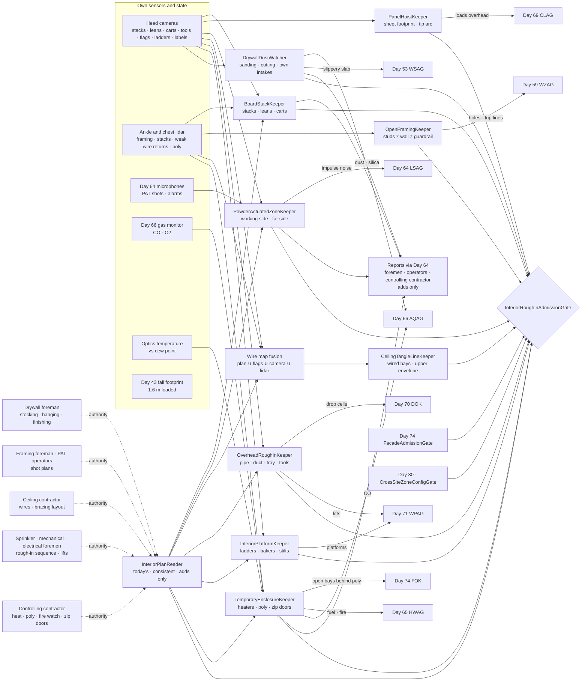
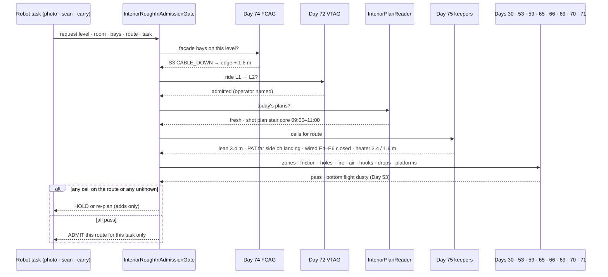
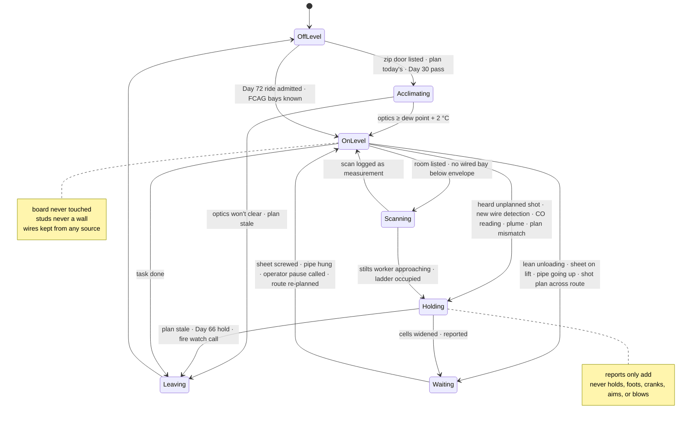
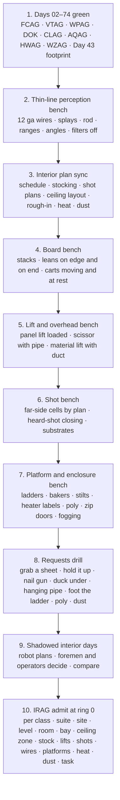

# Day 75 — Interior framing, drywall, and overhead rough-in under the façade stack: BoardStackKeeper / PanelHoistKeeper / OpenFramingKeeper / PowderActuatedZoneKeeper / CeilingTangleLineKeeper / OverheadRoughInKeeper / InteriorPlatformKeeper / TemporaryEnclosureKeeper / DrywallDustWatcher / InteriorPlanReader / InteriorRoughInAdmissionGate under FacadeAdmissionGate + the façade stack: FacadeLoadZoneKeeper / VacuumLifterKeeper / GlassBreakageCellKeeper / GlassRackKeeper / FacadeOpeningKeeper / SuspendedStageKeeper / RoofRiggingKeeper / GlazingSealantKeeper / FacadeWindWatcher / FacadePlanReader / FacadeAdmissionGate under RoofEdgeAdmissionGate + VerticalTransportAdmissionGate + WorkPlatformAdmissionGate + SteelErectionAdmissionGate + CraneLiftAdmissionGate + ConcretePourAdmissionGate + ExcavationAdmissionGate + AirQualityAdmissionGate + HotWorkAdmissionGate + LoudSiteAdmissionGate + ElectricalAdmissionGate + HeatAdmissionGate + WeatherAdmissionGate + LowLightAdmissionGate + WorkZoneAdmissionGate + DockAdmissionGate + SidewalkAdmissionGate + CorridorAdmissionGate + ElevatorAdmissionGate + DoorwayAdmissionGate + WetSurfaceAdmissionGate + ConfinedSpaceAdmissionGate + ElevatedAccessAdmissionGate + OverheadToolAdmissionGate + BimanualToolAdmissionGate + PowerToolAdmissionGate + PushPullAdmissionGate + PayloadCarryAdmissionGate + OutdoorGroundAdmissionGate + TerrainLocomotionAdmissionGate + FallSafeAdmissionGate + DeliberateContactAdmissionGate + WholeBodyTouchAdmissionGate + HumanHandoverAdmissionGate + CooperativeTaskAdmissionGate + TaskCompositionAdmissionGate + FleetSkillCatalogAdmissionGate + proximity + zone attestation + supervisor + logging + canary + HIL + fleet + incident + change-management + maintenance + thermal + energy gates

![BoardStackKeeper / PanelHoistKeeper / OpenFramingKeeper / PowderActuatedZoneKeeper / CeilingTangleLineKeeper / OverheadRoughInKeeper / InteriorPlatformKeeper / TemporaryEnclosureKeeper / DrywallDustWatcher / InteriorPlanReader / InteriorRoughInAdmissionGate: the same 63.8 kg humanoid on Site C, three weeks after the façade, comes in out of 1 °C through the west zip door and stands still for four minutes while its lenses clear instead of walking blind into a 15 °C enclosure; in the L1 east corridor it refuses to "just duck under" 12-gauge hanger-wire tails at 1.7 m that its lidar barely sees, and photographs the sprinkler mains from the bay ends; it waits 5.2 m off a 35 kg sprinkler main going up on a scissor lift instead of walking under "only hanging pipe"; on L2 it won't pull the front sheet off a 300 kg lean of board stood on end, won't hold a 49 kg ceiling sheet up while the taper fetches his screw gun, and won't crank the panel lift; it reroutes off the stair landing behind a hollow CMU wall that a framer is shooting track into; it declines to foot a stepladder; it stays out of a direct-fired heater's 3.4 m front cell, reports 22 ppm CO beside it, refuses to turn the heater onto the fresh mud, and won't push through the poly over a south window bay that is still an open edge; and it walks around the stair where tapers are sanding instead of blowing the dust off with its fans](/images/day75-interior-framing-drywall-overhead-rough-in.png)

[Day 05](/lessons/day-05-power-bms) owns `torque_scale` and the pack **forever**. [Day 07](/lessons/day-07-wbc-balance) owns gait and balance. [Day 17](/lessons/day-17-runtime-safety-supervisor) owns ESTOP and safe states. [Day 29](/lessons/day-29-human-proximity-safety) owns person tracks, SSM, and PFL rows. [Day 30](/lessons/day-30-collaborative-workspace-zoning) owns attested zones and `CrossSiteZoneConfigGate`. [Day 43](/lessons/day-43-falls-fall-safe-contact) owns the fall direction and the swept fall footprint. [Day 46](/lessons/day-46-carrying-payloads-walking) owns what the robot may carry where. [Day 47](/lessons/day-47-pushing-pulling-heavy-objects) owns pushing and pulling. [Day 50](/lessons/day-50-overhead-awkward-posture-tool-work) owns overhead reach. [Day 51](/lessons/day-51-ladders-elevated-work-platforms) owns ladders and the robot's own elevated work. [Day 53](/lessons/day-53-water-wet-floors-spills) owns footing and friction. [Day 54](/lessons/day-54-doors-gates-thresholds) owns doors and thresholds. [Day 59](/lessons/day-59-construction-sites-work-zones) owns slab edges, openings, covers, trip lines, and barriers. [Day 60](/lessons/day-60-night-work-low-light) owns degraded perception. [Day 61](/lessons/day-61-weather-rain-snow-fog-wind) owns weather and condensation holds. [Day 62](/lessons/day-62-heat-sun-dust) owns hot surfaces. [Day 63](/lessons/day-63-temporary-power-electrical-hazards) owns temporary power and cords. [Day 64](/lessons/day-64-noise-vibration-communications) owns warnings, impulse noise, and radio. [Day 65](/lessons/day-65-hot-work-fire-hazards) owns hot work, fuel cylinders, and fire. [Day 66](/lessons/day-66-airborne-hazards-air-quality) owns dust, fumes, carbon monoxide, and silica. [Day 69](/lessons/day-69-cranes-rigging-overhead-lifts) owns hooks and fall zones. [Day 70](/lessons/day-70-structural-steel-metal-decking) owns drop cells. [Day 71](/lessons/day-71-scaffolds-mast-climbers-aerial-lifts) owns every temporary platform and MEWP as not-footing. [Day 72](/lessons/day-72-construction-hoists-vertical-transport) owns how the robot gets between floors. [Day 73](/lessons/day-73-roofing-roof-edge) owns the roof. [Day 74](/lessons/day-74-glazing-curtain-wall-facade) owns the façade, its bays, and which of them is still an edge.

Day 74 wrapped the building. Today the robot goes inside it while the inside gets built: **interior framing, drywall, and overhead rough-in**. This is the part of a job where the building finally looks like a building, and that's the trap. There are walls, but half of them are studs with nothing on them. There are ceilings, but they're a grid of 2 mm wires hanging from the deck that the robot's lidar can barely see. The floor is clear, except where 2 t of gypsum board is stacked on it or 300 kg is leaned against a wall waiting to fall over. Every trade is working overhead at once: sprinkler fitters on scissor lifts, duct crews on material lifts, electricians hanging cable tray, framers shooting track into the deck with powder-actuated tools. The people doing the finishing are on stilts, baker scaffolds, and stepladders. It's cold outside, so the floors are wrapped in poly and heated with propane, and everything that gets sanded or cut puts dust in the air.

A humanoid inside a building being fitted out has five ways to make things worse. It's **a body beside things that fall over**: board stacks, leaned board, side-loaded board carts, panel lifts with a 49 kg sheet on top, studs standing unbraced. It's **a body under work going up**: pipe, duct, tray, threaded rod, and the tools that hang them, on lifts that Day 71 already says it may not touch. It's **a body on the wrong side of a wall**: a powder-actuated fastener goes through a hollow block, a steel stud, or a bare deck, and the person holding the tool can't see the robot on the other side. It's **a pair of hands that will be asked to help**: hold this sheet up, pull that one off the lean, foot the ladder, crank the lift, push the cart, move the heater, open the poly. And it's **an observer** with cameras that fog, lidar that misses wires, a gas monitor, and a voice. None of that makes it a drywall hanger, a taper, a framer, a fitter, a tool operator, the person who sets up a heater, or the person who says a ceiling is closed.

Eight lies show up the first time a team runs a humanoid through an interior fit-out:

1. **Grab-a-sheet lie.** "Pull the front sheet off that lean so I can get the twelve behind it." Board leaned against a wall is a stack balanced on its edge; take the front sheet off and the rest can come off with it, toward whoever's in front.
2. **Hold-it-up lie.** "Hold this sheet against the ceiling while I grab my screw gun," or "give the lift a few cranks." A 49 kg sheet overhead on a panel lift is a load above the robot's head, and the lift is a tool for a trained person.
3. **Just-a-nail-gun lie.** "It's only a nail gun. Wait on the other side of the wall, you're fine." A powder-actuated tool fires a hardened pin at up to about 100 m/s, and the other side of a hollow block, a steel stud, or a bare deck is exactly where a pin that goes through ends up.
4. **Duck-under lie.** "They're only wires. Duck under them, or push them out of the way." Hanger wires and seismic splay wires hold up a ceiling that hasn't been built yet; they're tangle lines at head height that the robot's sensors barely see and that someone set to a layout.
5. **Only-hanging-pipe lie.** "They're only hanging pipe. Walk under the lift." A 35 kg length of sprinkler main at 3.6 m is a load, and so is the hammer drill on the platform next to it.
6. **Foot-the-ladder lie.** "Foot the ladder for me," or "step up on the baker and pass me the box." A stepladder, a baker scaffold, and a pair of stilts are platforms holding up a person, and the robot isn't part of any of them.
7. **Just-plastic lie.** "Go through the poly there, it's quicker," or "turn the heater onto the mud to dry it." A poly wall isn't a wall or a door; behind it may be an open window bay four metres up. And a heater's clearances are on its label for a reason.
8. **Just-dust lie.** "It's only drywall dust. Walk through, and blow it off the stairs with your fans while you're at it." Sanding and cutting dust is Day 66's, gypsum on a slab is Day 53's, and the robot's fans are for cooling the robot.

Today owns **`BoardStackKeeper` / `PanelHoistKeeper` / `OpenFramingKeeper` / `PowderActuatedZoneKeeper` / `CeilingTangleLineKeeper` / `OverheadRoughInKeeper` / `InteriorPlatformKeeper` / `TemporaryEnclosureKeeper` / `DrywallDustWatcher` / `InteriorPlanReader` / `InteriorRoughInAdmissionGate`**. The question is: **how do you let a humanoid work inside a building being framed, boarded, and roughed-in, keeping out of every cell where board, a cart, a panel lift, or a stud wall can fall over; never handling, pulling, propping, or holding up board; never treating studs as a wall, a handhold, or edge protection; staying off both sides of every wall or deck a powder-actuated tool is firing into; treating every hanger wire, splay wire, and ceiling grid as a no-touch tangle line its own sensors can't be trusted to see; staying out from under every pipe, duct, and tray going up and the tools beside them; never standing on, steadying, moving, or footing any stilt, baker scaffold, or ladder; handing heaters, enclosures, and poly to Days 65 and 66 and treating poly as neither wall nor door; and handing every plume of sanding and cutting dust to Day 66 — without raising Day 29 PFL, writing Day 05 `torque_scale`, gating Day 17 ESTOP, or bypassing `CrossSiteZoneConfigGate`?**

## The inside is somebody else's work

The rule everything follows from: **inside a building being fitted out, the robot is a body kept out of every cell where something can fall over, fall down, or come through a wall; a body kept off every platform, under every lift, and away from every heater; a pair of hands kept off board, carts, panel lifts, studs, tools, wires, grid, pipe, duct, tray, ladders, scaffolds, heaters, cylinders, and poly; and an observer whose reports only add. It never pulls, props, leans, stacks, lifts, holds up, or hands board; never pushes, pulls, or steadies a board cart or a panel lift; never leans on, braces against, or trusts studs as a wall or a guardrail; never waits, walks, or works on the far side of a wall or deck that a powder-actuated tool is working into; never ducks under, pushes aside, reaches through, or hangs anything on wires or grid; never walks under a lift raising pipe, duct, or tray or a platform with tools on it; never stands on, rolls, foots, holds, or hands things up to a ladder, a baker scaffold, or someone on stilts; never moves, aims, fuels, or adjusts a heater and never cuts, lifts, or pushes through poly that isn't a door; never blows, sweeps, or stirs dust; and never says a stack is stable, a wall is braced, a shot is clear, a ceiling is hung, a lift is steady, a ladder is fine, a heater is safe, or the air is clean.** The site has people for those calls: the drywall foreman, who runs board delivery, stocking, hanging, and finishing; the framing foreman and each powder-actuated tool operator, who are trained on that tool and own its shot zone; the ceiling contractor, who owns the grid, the wires, and the bracing layout; the fire-sprinkler, mechanical, and electrical foremen, who own what goes overhead and the lifts it goes up on; the controlling contractor, who owns the temporary enclosure, the heaters, and the fire watch; and the competent person for each platform. The robot can tell them things. It can't stand in for them.

Eight facts set the shape of the lesson.

**Board is heavy, flat, and stored where people work.** A 1.22 × 3.66 m (4 × 12 ft) sheet of 15.9 mm (5/8 in) Type X gypsum board weighs about 49 kg; a 1.22 × 2.44 m sheet of 12.7 mm board about 25 kg. Board arrives on a boom truck or the hoist in bundles of two sheets taped face to face, and gets stocked on each floor: flat on dunnage in stacks a tonne or two high, on side-loading carts, and, all too often, leaned on edge against a wall or a column so the hangers can reach it. Materials stored in tiers have to be stacked, racked, blocked, interlocked, or otherwise secured against sliding, falling, or collapse (1926.250(a)(1)), and leaned board falling onto people is one of the drywall trade's classic serious injuries. A lean doesn't fall because it's heavy; it falls because someone pulls a sheet off the front, a cart bumps the bottom, or the floor is out by a few millimetres.

**A panel lift is a hoist with a sheet on top.** A drywall panel lift is a manually cranked mast on a castered tripod base that carries a sheet up to a ceiling (commonly to 3.4–4.6 m) and holds it there while the hangers screw it off. With a sheet on the cradle it's a 49 kg load overhead, about $49 \times 9.81 \times 3.0 \approx 1.4$ kJ at 3.0 m, held by a winch brake and a cable, on casters, on a floor full of offcuts. Day 69's rules for loads overhead apply; the lift itself is a tool, and Day 48 doesn't hand the robot other people's tools.

**Studs aren't a wall yet.** Cold-formed steel studs, 92 mm deep at 406 mm centres in light gauges, stand in a floor track and a top track shot or screwed to the deck. Until they're boarded and braced, a run of studs has little resistance to anything pushing sideways, the cut ends of studs and track are sharp, and the rough opening in a framed wall isn't a door. A stud wall framed around a shaft, a stair, or an unglazed window bay looks like enclosure from every sensor the robot has, and it's nothing of the kind: Day 59's hole and Day 74's open bay are still there behind it.

**Powder-actuated tools fire through things.** A powder-actuated tool drives a hardened steel pin with a cartridge charge into concrete, block, or steel. Only trained operators may use one; tools aren't used in explosive or flammable atmospheres; fasteners aren't driven into very hard or brittle materials; and easily penetrated materials are avoided unless they're backed by something that keeps the pin from passing through and becoming a flying missile on the other side (1926.302(e)). Low-velocity tools, the ones the trades use, are defined in ANSI A10.3 by a test velocity of about 100 m/s (328 ft/s) or less. A 4 g pin at 100 m/s carries $\tfrac{1}{2} \times 0.004 \times 100^2 = 20$ J on a 3.7 mm point. The operator sees the near side of the wall. Nobody sees the far side.

**Ceilings hang from wires the robot can barely see.** A suspended ceiling hangs on 12-gauge (2.05 mm) wires tied to the deck, typically at 1.22 m (4 ft) centres along the main runners (ASTM C636); where the building's seismic design calls for lateral bracing, groups of four splay wires and a compression post go in at about 3.66 m centres each way (ASTM E580), running diagonally from the deck down to the grid. Before the grid goes up, hanger wires hang with their tails loose, often to head height or below. A spinning lidar with 0.2° horizontal resolution puts its beams $3.0 \times \tan 0.2° \approx 10.5$ mm apart at 3 m; a 2.05 mm wire is hit on about one scan line in five, with a weak, partial return that outlier filters were built to throw away. A head camera with a 90° field over 1920 pixels sees about 2.5 mm per pixel at 3 m. The robot's own sensors don't see wires reliably, so it treats them the way Day 74 treated glass.

**Overhead rough-in is loads on lifts.** Sprinkler mains, ductwork, and cable tray go up on scissor lifts, boom lifts, and counterweighted material lifts ("duct jacks"), and get hung from the deck on threaded rod, clamps, and anchors drilled overhead. A 6.4 m (21 ft) length of 50 mm (2 in) Schedule 40 steel pipe weighs about 35 kg and carries about 1.2 kJ from 3.6 m; a 3.2 kg hammer drill dropped off a platform at 3.6 m carries about 113 J, about twice the 54 J a hard hat is tested to absorb. NFPA 13 and SMACNA say how pipe and duct are hung and braced; none of it says anyone can stand under the lift while it's happening. Day 71 owns the lifts; today adds what's on them.

**The finishers are on platforms.** Tapers and hangers work on drywall stilts that raise their feet 0.45–1.0 m, on rolling baker scaffolds about 1.83 m long with a platform up to about 1.83 m, and on stepladders. A stepladder's top and top step aren't steps (1926.1053(b)(13)); a rolling scaffold's casters are locked while anyone works on it (1926.452(w)). A person on stilts can't step back quickly and falls from well above their own height. Day 71 made every temporary platform not-footing for the robot; today adds the small ones, and the rule that the robot isn't part of anyone else's.

**Winter interiors are heated plastic boxes.** When it's cold, the controlling contractor closes unglazed openings with poly sheeting on temporary framing and heats floors with propane or diesel heaters so mud dries and people can work. Indirect-fired heaters put clean warm air in from outside; direct-fired ones burn in the space and add carbon monoxide and water vapour to it. Temporary heaters need fresh air, clearances to combustibles, and stability (1926.154), and the enclosure, heaters, and fuel are handled under fire-prevention practice for construction (NFPA 241), with flame-retardant sheeting. Inside, drywall sanding throws fine gypsum, calcium carbonate, talc, and mica dust; cutting fibre-cement or cement backer board throws respirable crystalline silica, which 1926.1153 controls by task; an abrasive chop saw on steel studs throws sparks. Gypsum dust on a sealed slab is slippery.

| Layer | Owns | Must not own |
|-------|------|--------------|
| `BoardStackKeeper` | Flat stacks: 1.0 m all round, never a seat, shelf, or step; leaned board: lean height + 1.0 m on the open side and 1.0 m at the ends, all sides while anyone is taking from it; side-loading board carts: load height + 1.0 m on loaded sides while moving, loading, or unknown, 1.0 m at rest, path ahead swept | Pulling, propping, leaning, stacking, carrying, or handing board; pushing, pulling, steadying, or chocking a cart; saying a stack or lean is stable |
| `PanelHoistKeeper` | Every panel lift, ceiling-sheet lift, and board hoist as a Day 69-style load: the sheet's plan footprint grown by max(1.0 m, h/3) while loaded and raised, plus a tip arc of h + 0.5 m from the mast while cranking, raising, lowering, or rolling; crank, brake, cradle, and casters no-touch 0.3 m | Holding a sheet up, guiding it, cranking, braking, rolling, or steadying a lift; standing under a raised sheet |
| `OpenFramingKeeper` | Framed but unboarded walls, rough openings, and stud runs as obstacles, never walls, handholds, brace targets, or edge protection; tall or temporarily braced studs no-touch 0.3 m with a fall-over cell of stud height + 0.5 m while unbraced; framing at shafts, stairs, and open bays leaves the Day 59 hole and Day 74 bay in place; offcuts, screws, and track on the floor to Day 59 as trip-and-puncture | Leaning on, bracing against, or passing through studs; calling a wall finished or an opening enclosed; picking up offcuts as a "help" |
| `PowderActuatedZoneKeeper` | Every active powder-actuated tool: working-side cell 3.0 m in the firing arc and 2.0 m all round the operator; through-side cell the wall or deck panel behind the shot line ± 2.0 m laterally and 3.0 m deep on the far side, for the life of the shot plan or until the operator clears it; easily penetrated substrates (hollow block, gypsum, steel stud, bare deck) never shrink it; a heard shot (Day 64) closes the nearest thin wall's far side until told; cartridges, strips, tools, and pins no-touch | Backing a shot, holding a plate or track, carrying cartridges, standing on the far side, saying a shot is clear |
| `CeilingTangleLineKeeper` | Hanger wires, wire tails, splay wires, compression posts, grid, and threaded rod as no-touch tangle lines; wire map = plan ∪ flags ∪ camera ∪ lidar, with every single detection kept and a wired bay closed to the robot's upper-body envelope + 0.3 m wherever tails may hang below it; never reaches through or above grid | Ducking under, pushing aside, bending up, hanging anything on, or photographing by reaching through wires and grid; saying a ceiling is hung or braced |
| `OverheadRoughInKeeper` | Pipe, duct, tray, rod, and equipment going up as Day 70 drop cells: item path + max(2.0 m, h/3) + L/2 below any lift or platform raising or hanging it; tools and small parts on platforms as drop cells of the platform + max(2.0 m, h/3); overhead drilling dust to Day 66; the lifts themselves to Day 71 | Walking under a lift, a raised item, or a platform with tools; handing things up; holding pipe or duct; operating a material lift |
| `InteriorPlatformKeeper` | Stepladders: ladder height + 1.0 m in all directions while occupied; baker and rolling scaffolds: platform height + 1.0 m all round while occupied, moving, or unlocked; people on stilts: their standing height + 0.5 m and right of way, no set-down in a stilts area; every one never footing, never touched, never moved, never footed | Standing on, rolling, locking, unlocking, footing, steadying, or handing things up to any of them |
| `TemporaryEnclosureKeeper` | Heaters: label clearance + 1.0 m (3.0 m front, 1.5 m sides and rear if the label isn't read); fuel, hoses, and cylinders to Day 65; combustion gas to Day 66; poly as neither wall nor door: lidar returns from poly are obstacles and what's behind is UNKNOWN; poly over an unglazed bay keeps Day 74's OPEN; zip doors only when listed as routes; condensation on own optics marked degraded on entry | Moving, aiming, lighting, fuelling, or adjusting a heater; cutting, lifting, or pushing through poly; propping a zip door; saying a heater is safe |
| `DrywallDustWatcher` | Sanding, cutting, and drilling plumes handed to Day 66 by source; silica sources named for 1926.1153 controls; sparks to Day 65; dust on the slab to Day 53; own intakes and optics fouling to Day 66's own-airflow and Day 60's degraded perception; reports only | Blowing, sweeping, or stirring dust with fans or hands; saying the air is clean |
| `InteriorPlanReader` | The interior schedule by level and room, board delivery and stocking plan, framing layout and shot plans with the operators' names, ceiling and seismic bracing layout, overhead rough-in sequence and lift plans, platform inspections, temporary heat and enclosure plan with fire watch, released zip doors, dust-control plan; today's or refusal | Writing, approving, or amending any of it |
| `InteriorRoughInAdmissionGate` | Fail-closed admit per robot class, suite, site, level, room, bay, ceiling zone, stack and cart states, lift states, framing states, shot zones, wire map, overhead states, platform states, heater and enclosure states, dust state, route, task | `JointCommand`; Day 05; PFL; Day 17 |
| Days 05 / 07 / 17 / 29 / 30 / 43 / 46 / 47 / 48 / 50 / 51 / 53 / 54 / 59 / 60 / 61 / 62 / 64 / 65 / 66 / 69 / 70 / 71 / 72 / 74 | Pack, gait, ESTOP, people, zones, falls, carrying, push/pull, tools, overhead reach, ladders, friction, doors, edges and holes, perception, condensation, hot surfaces, comms, fire, air, hooks, drop cells, platforms, hoists, façade bays | Being outranked by "it's only a nail gun" |

**Core thesis:** **inside a building being fitted out, a humanoid treats every stack, lean, cart, and panel lift as something that falls over, every wall a tool is firing into as having a dangerous far side, every wire as a line it can't see, every pipe and duct going up as a load, and every ladder, baker, and pair of stilts as somebody else's platform; it handles none of them, hands Days 65 and 66 the heat, the poly, and the dust, and tells people what it sees instead of deciding anything about it.**



## Physical machine: what's inside

Walk Site C on a raw Monday three weeks after Day 74. The steel wing is a three-storey frame with levels at 0, 4.2, and 8.4 m and the roof at 12.6 m. The north curtain wall is set and released; the west storefront is glazed; the south punched windows on L2 are still waiting for glass and are closed with flame-retardant poly on temporary studs. Outside it's 1 °C at 07:30 with a light northerly wind. Inside, the trades started interiors last week.

- **L1, west zip door and heat.** An indirect-fired propane heater stands outside the west face and ducts warm air in through the poly; L1 is at about 15 °C and, with the mud drying upstairs and on L1, about 60 % relative humidity. The way in for people and the robot is a zip door in the poly beside the storefront.
- **L1 east corridor: ceiling and sprinkler.** The ceiling contractor has hung 12-gauge wires from the L2 deck underside at about 4.0 m on a 1.22 m grid for a lay-in ceiling at 2.75 m, with four-way splay wires and compression posts at about 3.66 m centres. The grid isn't up. Most wire tails hang to about 2.4 m; in bays E4 to E6, where the crew ran out of time Friday, tails hang as low as 1.7 m. The sprinkler fitters are hanging 50 mm Schedule 40 mains, 6.4 m lengths, from a 5.8 m scissor lift with its platform at 2.4 m; the duct crew is raising 1.52 m sections of 600 × 400 mm duct on a counterweighted material lift at the other end; an electrician is hanging 3.66 m lengths of ladder tray.
- **L2, board.** Yesterday's delivery is stocked on L2: two flat stacks of forty 15.9 mm 4 × 12 sheets on dunnage, about 1.96 t and 0.74 m high each; ten 4 × 12 sheets leaned on their long edges against column C4, about 1.22 m high and 490 kg; and twelve 12.7 mm 4 × 8 sheets stood on their short ends against the stair core wall, 2.44 m high and about 300 kg. A side-loading board cart carries sixteen 4 × 12 sheets on edge, about 780 kg, load top at 1.42 m.
- **L2, hanging and framing.** Two hangers are boarding the corridor ceiling at 3.05 m with a panel lift; two framers are laying out partitions with 92 mm studs at 406 mm centres and shooting bottom track into the slab and clip angles into the stair core, which is 200 mm hollow concrete block. On the other side of that block wall is the stair landing where the hoist's L2 gate opens.
- **L2, finishing.** Two tapers on stilts at 0.76 m, a baker scaffold with its platform at 1.83 m, and a 2.44 m (8 ft) stepladder in the north rooms; one taper is pole-sanding the stair core's finished walls. A framer is cutting fibre-cement backer board for the restrooms with a shrouded saw on a vacuum, and another has an abrasive chop saw for studs set up by the hoist.
- **L2, heat.** A 125,000 BTU/h direct-fired propane forced-air heater by the stair core, fed from a 45 kg cylinder, its label calling for 2.4 m clear in front of the outlet and 0.6 m at the sides and rear. The controlling contractor's fire watch walks L2 every hour.

The robot's tasks: carry two 4.5 kg boxes of drywall screws (9.0 kg, two-handed, Day 46) from the L1 hoist gate to the drywall foreman's gang box on L2; photograph the above-ceiling sprinkler and duct in the L1 east corridor for the MEP coordinator's model before the grid goes in, which is a coordination record, not the cover inspection; scan the L2 partition layout and log deviations from the model for the digital twin; and carry its Day 66 gas monitor on its rounds and report readings. Eight times during the morning someone will offer it a quicker way to do it.

The robot's hardware for this:

- **Head cameras** with Day 60's low-light settings, for stacks, leans, carts, tool tags, wire flags, ladder labels, heater labels, and dust.
- **Ankle and chest lidar** for framing, stacks, and poly, with the wire handling described below.
- **Head microphones** from Day 64, which hear a powder-actuated shot as an impulse well above the site's floor.
- **The Day 66 gas monitor** reading CO and O₂ at chest height.
- **Optics temperature sensors and lens heaters** on the head cameras and lidar windows.
- **The Day 43 fall model,** with a swept fall footprint of 1.6 m with today's payload, 1.4 m empty.
- **The Day 64 radio,** on the interior channel and the site channel.

### Board: stacks, leans, and carts

`BoardStackKeeper` sorts stocked board by how it falls.

**Flat stacks** on dunnage don't tip, but sheets slide off their tops, their corners are at shin height, and people treat them as tables. BSK holds 1.0 m all round them, and they're never a seat, a shelf for a set-down, a step, or a brace target for Day 43. A 1.96 t stack is a floor load that the structural engineer and the drywall foreman agreed on; the robot neither judges nor adds to it.

**Leans** are the dangerous ones. A lean falls in one direction, flat, toward its open face, and the outermost sheet is the one people pull. BSK holds the lean's height + 1.0 m on the open side and 1.0 m off the ends. For the ten 4 × 12 sheets on their long edges at C4, that's $1.22 + 1.0 = 2.2$ m; for the twelve 4 × 8 sheets stood on end at the stair core, $2.44 + 1.0 = 3.4$ m. The second lean is the one that hurts: about 300 kg with its centre of mass about 1.2 m up carries about $300 \times 9.81 \times 1.2 \approx 3.5$ kJ when it comes down flat. While anyone is taking sheets from a lean, BSK holds height + 1.0 m on every side, because a lean being unloaded doesn't always fall the way it was leaning.

**Board carts** carry sheets on edge in a frame on four casters. A loaded side-loading cart tips toward its loaded side when a caster drops into a floor penetration, rolls over a stud offcut or a cord, or gets unloaded unevenly. BSK holds load height + 1.0 m on each loaded side and 1.0 m ahead and behind, plus its swept path, whenever it's moving, being loaded or unloaded, or its state is unknown; 1.0 m at rest. Day 47's push/pull rows would admit a 780 kg cart on a smooth slab, because the rolling force is small; they don't see the tip. The robot never pushes, pulls, steadies, chocks, or loads a cart.

And the rule that does most of the work: **the robot never handles board.** It doesn't pull, slide, carry, lean, prop, stack, hand, or hold a sheet, whatever it weighs. A 25 kg sheet is inside Day 46's carry rows; a 1.22 × 2.44 m sail of gypsum held by its edges in a corridor full of people, on a floor full of offcuts, is not what those rows modelled.

At 08:50 on L2, carrying its boxes from the hoist gate toward the gang box, the robot's route passes the stair core. A hanger, reaching for the 4 × 8 board stood against the wall: "Pull the front sheet off that lean so I can get the twelve behind it." BSK has already closed 3.4 m in front of the lean and closes all sides now that someone is taking from it: "I can't take board off a lean. I'll stay out of the way while you do." It routes through the north rooms instead, 14 m longer, and passes the C4 lean at 2.2 m. The side-loading cart is parked at rest by the hoist; BSK holds 1.0 m round it, and 2.4 m on its loaded side once a labourer starts pushing it at 09:02.

### Panel lifts: a sheet over your head

`PanelHoistKeeper` treats a panel lift with a sheet on it as a load overhead, in Day 69's sense, carried on a tool. While the cradle is loaded and raised, PHK holds the sheet's plan footprint grown by

$$
r_{\text{sheet}} = \max\left(1.0,\ \frac{h}{3}\right) = \max\left(1.0,\ \frac{3.05}{3}\right) \approx 1.0 \text{ m}
$$

on every side: a 3.2 × 5.7 m rectangle around a 1.22 × 3.66 m sheet at the corridor ceiling. While anyone is cranking, raising, lowering, or rolling the lift, PHK adds a tip arc of $h + 0.5 = 3.55$ m from the mast, because a lift that goes over on a caster puts the sheet's far end about that far away. A 49 kg sheet from 3.05 m carries about 1.5 kJ. The crank, brake, cable, cradle, outriggers, and casters are no-touch 0.3 m whether a sheet is on or not.

The robot never holds a sheet up, never guides one onto the cradle, never cranks, brakes, or rolls a lift, and never stands under a raised sheet "for a second" while someone fetches a screw gun. Day 50's overhead-reach rows would admit holding a light panel above the robot's head; they were written for its own tools, not other people's loads.

At 09:05 in the L2 corridor, the robot is waiting for the hangers to finish a sheet before it passes. One hanger, with the sheet cranked to the joists and not yet screwed: "Hold that against the ceiling a sec while I grab my screw gun. And give the lift a few cranks if it drops." PHK: "I can't hold the sheet or crank the lift. I'll wait out here till it's screwed off." It waits 1.0 m outside the footprint and 3.55 m from the mast until the second hanger is back on the lift and the sheet is screwed, then passes.

### Studs: not a wall, not a rail

`OpenFramingKeeper` handles walls that aren't walls yet. A framed, unboarded wall is an obstacle in the map, so the robot doesn't walk into it, and it's never anything more: not a wall the robot can lean on, not a handhold, not a Day 43 brace target, not a boundary for its route, and never edge protection. A 4.0 m stud in a track with a screw at the top resists very little sideways; a stud that's been set but not yet screwed resists nothing. OFK holds framed but unbraced studs no-touch 0.3 m and keeps a fall-over cell of stud height + 0.5 m on both faces while studs are being set or the wall is unbraced. Rough openings in framed walls aren't doors: the robot routes through them only if the plan lists the room beyond and Day 54's threshold rules admit the opening.

Two rules matter more than the rest. First, **framing never closes a hole**. The L2 duct shaft beside the stair is framed on three sides with studs today, which every sensor reads as a room; the shaft's Day 59 floor opening is still behind them, covered and marked, and OFK keeps Day 59's hole rules exactly as they were. The same goes for the south window bays framed with poly in front of them: Day 74's bay states hold. Second, **offcuts are Day 59's**. Stud and track offcuts, screws, and clip angles on the slab are trip and puncture hazards that Day 59 already maps; the robot doesn't pick them up as a "help," because what's scrap and what's somebody's layout is the framers' call, and a cleaned floor in a stilts area is the tapers' business with the foreman.

At 09:50, scanning the L2 partition layout from the corridor, the robot logs four rough openings, the shaft framing, and a 31 mm run-out on the corridor wall between grid lines 3 and 4 as a deviation for the model, worded as a measurement: "Corridor partition between 3 and 4 measured 31 mm east of the model at the north end (adds only: not an inspection)." It doesn't step into the framed shaft to get a better angle.

### Powder-actuated tools: the far side of the wall

`PowderActuatedZoneKeeper` holds two cells for every active powder-actuated tool. On the **working side**, 3.0 m in the firing arc and 2.0 m all round the operator, for ricochets, spalls, and a pin that skates off steel. On the **far side**, the wall or deck behind the shot line, ± 2.0 m along it and 3.0 m deep beyond it, for the life of the shot plan in that wall or until the operator clears it on the radio. Substrate never shrinks the far-side cell: hollow block, gypsum, steel studs, and bare deck are exactly the materials a pin goes through, and concrete spalls. The tool, cartridges, cartridge strips, and pins are no-touch; the robot never backs a shot, holds a plate, a clip, or a length of track for someone shooting it, or carries cartridges.

The robot can't see the far side of a wall, and neither can the operator. So PAZK takes shot plans from the framing foreman by wall and level, with the operators' names, and adds what it hears. A shot is an impulse that Day 64's microphones pick out easily from the site's floor; a heard shot that isn't on a plan closes the far side of the nearest thin wall or deck within 10 m until the framing foreman or an operator says where it was, and is reported. The robot's own hearing can only close.

At 09:30 the robot, on its way back to the hoist, is waiting on the L2 stair landing for the car. On the other side of the 200 mm hollow-block wall, a framer is shooting clip angles for the stair-core partitions. The framing foreman's plan lists the stair-core wall from 09:00 to 11:00; PAZK has already put the landing in its far-side cell, so the robot was never going to wait there, and the route planner moves its wait point to the corridor 4 m away. A second framer, walking past: "It's only a nail gun. Wait on the landing, you're fine." PAZK: "That wall's being shot from the other side, so I wait out here." When the car arrives, the robot asks the operator on the radio to hold until the stair-core framer pauses, and walks through the landing during the pause the framer calls.

### Wires: the ceiling the robot can't see

`CeilingTangleLineKeeper` does for wires what Day 74's `FacadeOpeningKeeper` did for glass: it refuses to trust its own sensors and builds the wire map as a union.

- the **ceiling layout**: hanger spacing, splay-wire and compression-post locations, and the ceiling contractor's note of where tails are long;
- the **flags** the crew ties to long tails (if they do), seen by the head cameras;
- **camera detections** of thin vertical and diagonal lines against the deck, with their low confidence kept;
- **lidar returns**, including the single, weak, isolated points that a normal outlier filter removes.

Any source that says wire, wires the bay. In a wired bay, CTLK closes the space below the lowest possible tail to the robot's upper-body envelope plus 0.3 m. With tails at 2.4 m and the robot's head and raised camera at 1.75 m, a bay is open with 0.65 m to spare. With tails at 1.7 m, it's closed: the robot's head would be among them. Splay wires and compression posts are no-touch 0.3 m along their whole length. Grid, once it's up, is never a handhold, a brace target, a shelf, or something to reach through or above; ceiling tiles are never lifted.

Why so strict about something so light? A 12-gauge wire caught on a camera housing, a gripper, or a shoulder actuator does three things: it drags the robot's head sideways at the top of its height, which Day 07 then has to recover; it pulls on a hanger tied to a layout someone surveyed; and, with a splay wire, it loads a brace that's part of a seismic design. None of those is the robot's to cause.

At 07:55 in the L1 east corridor, the robot needs photographs of the sprinkler mains and duct for the coordination model. CTLK has bays E1 to E3 and E7 to E9 open with tails at 2.4 m, and E4 to E6 closed with tails to 1.7 m. A fitter, carrying hangers: "They're only wires. Duck under them, or just push them out of the way." CTLK: "I can't go under the low wires or move them. I'll shoot E4 to E6 from the ends." It photographs E4 to E6 from E3 and E7, along the corridor, which leaves the middle of E5 at a shallow angle; its record for the MEP coordinator says so: "E5 sprinkler hangers photographed from 3.7 m at a shallow angle; low tails in E4–E6 (adds only: not an inspection)."

### Overhead rough-in: pipe on a lift is a load

`OverheadRoughInKeeper` treats everything going up as a Day 70 drop cell, on top of Day 71's rules for the lift it's going up on. For an item at height $h$ with longest dimension $L$:

$$
r_{\text{item}} = \text{path} + \max\left(2.0,\ \frac{h}{3}\right) + \frac{L}{2} = 2.0 + 3.2 = 5.2 \text{ m}
$$

beyond the line of a 6.4 m sprinkler main being raised and hung at 3.6 m. A 35 kg pipe from 3.6 m carries about 1.2 kJ, and a pipe that slips out of one hanger swings down on the other end before it falls. A 1.52 m duct section raised to 3.8 m on the material lift gets $2.0 + 0.76 \approx 2.8$ m; a 3.66 m length of tray at 3.3 m gets $2.0 + 1.83 \approx 3.8$ m. Platforms with people and tools on them carry their own cells, the platform footprint + max(2.0, h/3), because a 3.2 kg hammer drill from 3.6 m carries about 113 J and a 0.3 kg beam clamp about 11 J. Overhead drilling into the deck throws concrete dust down: that's Day 66's, and silica's 1926.1153.

The robot never walks under a lift raising or holding anything, never hands things up to a platform, never holds a pipe end, a duct section, or a length of tray, and never touches a material lift's winch, forks, or outriggers.

At 08:20 the fitters on the scissor lift start raising the second main in E7 to E9. ORK closes 5.2 m either side of its line, which takes the whole corridor width. The fitter at the base: "We're only hanging pipe. Walk under the lift, it's fine." ORK: "I stay out from under the pipe till it's hung. I'll wait here." It waits at E6's end until the fitter calls the main hung on both ends and the lift lowered, photographs E7 to E9, and leaves by the west end.

### Ladders, bakers, and stilts: someone else's platform

`InteriorPlatformKeeper` extends Day 71's not-footing rule to the small platforms, and adds that the robot is never part of anyone's platform. A **stepladder** gets its height + 1.0 m all round while anyone is on it: 3.4 m for the 2.44 m ladder. A **baker or rolling scaffold** gets its platform height + 1.0 m all round while anyone is on it, while it's being rolled, or while its casters are unlocked: 2.8 m for the 1.83 m baker. A **person on stilts** is a person whose fall starts with their head at about 2.5 m; IPK keeps their standing height + 0.5 m, about 3.1 m, gives them right of way, and never makes a set-down in a stilts area, because the floor a taper on stilts needs is a floor with nothing on it.

None of them is ever footing, a brace target, or something the robot moves. It never foots or holds a ladder, never rolls or locks a baker, never steadies someone on stilts, and never hands anything up to anyone on any of them. Day 51 decides when the robot itself may use a ladder; on a site, through today's stack, the answer is never.

At 10:00 in the north rooms, scanning partitions, the robot passes the 2.44 m stepladder with a taper on it. "Hey, foot the ladder for me, it's walking on this slab." IPK: "I can't foot the ladder. I'll tell your foreman you need someone." It reports on the interior channel: "Taper in N3 on a stepladder asking for someone to foot it; slab dusty (adds only: not an inspection)." A minute later the taper on the baker: "Step up and pass me that box of corner bead." IPK: "I can't go up on the baker or hand things up. I'll put it at the base for you." It sets the box on the slab 2.8 m from the baker, outside the stilts area, and leaves it for him.

### Heat and poly: the plastic box

`TemporaryEnclosureKeeper` has three jobs.

**Heaters.** Every heater gets its label clearance + 1.0 m, read from the label by the head camera: for the L2 heater, $2.4 + 1.0 = 3.4$ m in front of the outlet and $0.6 + 1.0 = 1.6$ m at the sides and rear. A heater whose label can't be read gets 3.0 m in front and 1.5 m at the sides and rear, and is reported. Fuel hoses, regulators, and cylinders are Day 65's `FuelCylinderStandoffKeeper`; outlet and casing surfaces are Day 62's hot surfaces; combustion products are Day 66's `CombustionGasWatcher`. The robot never moves, aims, lights, fuels, or adjusts a heater, and it never turns one onto a wall or a ceiling.

**Poly.** Lidar gets a good return from poly, cameras see it as opaque, so poly looks like a wall, and it isn't one. TEK keeps poly as an obstacle and what's behind it as UNKNOWN, never as a room. Poly over an unglazed bay doesn't change Day 74's bay state: an OPEN or CABLE_DOWN bay behind poly is still a Day 59 edge plus the fall footprint. The robot passes poly only at zip doors listed as routes in today's enclosure plan, through Day 54's doorway rules; it never cuts, lifts, or pushes through poly anywhere else, and never props a zip door open, because the enclosure is someone's heat and dust control.

**Its own optics.** Coming in from 1 °C into air at 15 °C and 60 % RH, the robot's lenses and lidar windows are colder than the dew point inside, which is about

$$
T_d = \frac{243.12\,\gamma}{17.62 - \gamma},\quad \gamma = \ln(0.60) + \frac{17.62 \times 15}{243.12 + 15} \approx 0.513 \ \Rightarrow\ T_d \approx 7.3\ °\text{C}.
$$

TEK marks any optic colder than $T_d + 2$ °C as degraded and holds the robot just inside the zip door, out of the door's swing and anyone's path, until its lens heaters bring the optics above that. Degraded perception can only close, as Day 60 says.

At 07:40, coming in through the west zip door, the robot's camera windows read 2.1 °C against a 9.3 °C threshold. It stands still inside the door for four minutes while the lens heaters clear the fog, tells the labourer waiting behind it why, and only then walks to the hoist.

At 10:20 on L2, on its rounds with the gas monitor, the robot passes the direct-fired heater at 3.4 m from the outlet. Its monitor reads 22 ppm CO at chest height 3.5 m from the heater, and it reports the number on the interior channel to the controlling contractor's fire watch: "CO 22 ppm at chest height 3.5 m from the stair heater, L2 (adds only: not an inspection)." Whether that matters is Day 66's and the contractor's. The taper on the baker: "While you're there, turn the heater onto the stair wall, the mud's not drying." TEK: "I can't move or aim the heater. I'll tell the fire watch you asked." A labourer: "Go through the poly at S3, it's quicker to the hoist." TEK: "That's not a door, and the bay behind it isn't glazed. I'll go round." Day 74's schedule still lists S3 as CABLE_DOWN.

### Dust: Day 66's, not the fans'

`DrywallDustWatcher` hands dust to the day that owns it and keeps the robot from adding to it. Sanding plumes from finished joints and cutting plumes from board are Day 66 particulate sources; fibre-cement and cement board cutting is named as a silica task for 1926.1153's controls, which belong to the employer and the person cutting; the abrasive chop saw's sparks go to Day 65's `SparkSpatterGuard`; gypsum dust on the slab goes to Day 53 as a friction change, with `WettedFrictionProber` asked to re-check rather than trusting yesterday's coefficient. The robot's own cooling intakes and filters are Day 66's `OwnAirflowKeeper`; dust on its lidar windows and lenses is Day 60's degraded perception.

The robot never uses its fans, its hands, or its body to blow, sweep, or stir dust, and never drives its cooling airflow at a surface to clear it. Its fans exhaust sideways and down at about 2 m/s at the outlet; turned toward a dusty stair tread, that would put a fresh plume into the air at exactly the height people breathe.

At 10:45 the robot's route to the hoist passes the stair, where a taper has been pole-sanding the core walls. DDW reports the plume to Day 66, and the route goes round through the corridor. The taper: "It's only drywall dust. Walk through, and blow it off the stairs with your fans while you're at it." DDW: "I go round dust, and I can't blow it. I'll tell your foreman the stair needs cleaning." Day 53's prober had already flagged the bottom flight as dusty.

### The plans: someone else's checks

`InteriorPlanReader` reads the paper that says who decided what:

- the **interior schedule** by level and room, and today's sequence from each foreman;
- the **board delivery and stocking plan**, including where leans are allowed;
- the **framing layout** and the **shot plans** for powder-actuated tools, by wall and level, with the trained operators' names;
- the **ceiling layout**, hanger and seismic bracing locations, and where tails are long;
- the **overhead rough-in sequence** for sprinkler, duct, and tray, with lift plans for material lifts and MEWPs and Day 71's inspections;
- **platform** inspections for bakers and rolling scaffolds;
- the **temporary heat and enclosure plan**: heater locations and fuel, fresh-air openings, released zip doors, and the fire-watch schedule;
- the **dust-control plan**, including silica tasks and their controls.

It checks freshness and consistency against what the robot sees: a lean where the stocking plan has none, a shot heard on a wall with no shot plan, wires in a bay the ceiling layout shows empty, a material lift in a bay the sequence doesn't list, a heater where the plan has none or with its label obscured, a zip door open that the plan shows closed, a saw cutting backer board with no vacuum attached. Each mismatch is reported and narrows the robot's interior; a missing or stale plan refuses the level. It never writes, approves, or amends any of it.

### Putting the cells in code

As every day since Day 59: everything here adds or keeps constraints; nothing removes one.

```python
import math
from dataclasses import dataclass

MARGIN_M = 1.0
NO_TOUCH_M = 0.3
G = 9.81

def lean_cell_m(lean_h_m: float, being_unloaded: bool | None) -> dict:
    """BSK: a lean falls flat toward its open face; all sides while anyone takes from it."""
    open_side = lean_h_m + MARGIN_M
    if being_unloaded is None or being_unloaded:
        return {"open": open_side, "ends": open_side, "back": open_side}
    return {"open": open_side, "ends": MARGIN_M, "back": 0.0}

def cart_cell_m(load_top_m: float, moving: bool | None, handling: bool | None) -> float:
    """BSK: loaded sides while moving, handling, or unknown; 1 m at rest."""
    if moving is None or handling is None or moving or handling:
        return load_top_m + MARGIN_M
    return MARGIN_M

def panel_lift_cells_m(ceiling_h_m: float, loaded: bool, in_motion: bool | None) -> dict:
    """PHK: sheet footprint grown by max(1, h/3) while loaded; tip arc h + 0.5 while moving."""
    cells = {"no_touch": NO_TOUCH_M}
    if loaded:
        cells["footprint_growth"] = max(1.0, ceiling_h_m / 3.0)
    if in_motion is None or in_motion:
        cells["tip_arc_from_mast"] = ceiling_h_m + 0.5
    return cells

def stud_fall_cell_m(stud_h_m: float, braced: bool | None) -> float:
    return NO_TOUCH_M if braced else stud_h_m + 0.5

def pat_cells_m(substrate: str) -> dict:
    """PAZK: substrate never shrinks the far side; concrete spalls, block and stud pass pins."""
    return {"working_arc": 3.0, "working_round": 2.0, "far_lateral": 2.0, "far_depth": 3.0}

def heard_shot_closes(dist_to_thin_wall_m: float, on_shot_plan: bool) -> bool:
    return (not on_shot_plan) and dist_to_thin_wall_m <= 10.0

@dataclass
class WireEvidence:
    plan_wired: bool | None        # ceiling layout says hangers / splays here
    lowest_tail_plan_m: float | None
    flags_seen: bool | None
    camera_lines: int              # thin-line detections, low confidence kept
    lidar_points: int              # isolated weak returns, never filtered out

def bay_wired(e: WireEvidence) -> bool:
    """CTLK: any source that says wire wires the bay; unknown plan counts as wired."""
    return bool(e.plan_wired is None or e.plan_wired or e.flags_seen
                or e.camera_lines > 0 or e.lidar_points > 0)

def wired_bay_open(e: WireEvidence, envelope_top_m: float) -> bool:
    if not bay_wired(e):
        return True
    if e.lowest_tail_plan_m is None:
        return False
    return e.lowest_tail_plan_m >= envelope_top_m + NO_TOUCH_M

def lidar_spacing_mm(range_m: float, res_deg: float = 0.2) -> float:
    return 1000.0 * range_m * math.tan(math.radians(res_deg))

def drop_cell_m(h_m: float, longest_m: float) -> float:
    """ORK: Day 70 drop cell beyond the item's path."""
    return max(2.0, h_m / 3.0) + longest_m / 2.0

def platform_cell_m(kind: str, height_m: float, person_h_m: float = 1.8) -> float:
    """IPK: ladders and bakers by height; stilts by the person's standing height."""
    if kind == "STILTS":
        return height_m + person_h_m + 0.5   # standing height (stilt + person) + 0.5 m
    return height_m + MARGIN_M

def heater_cell_m(label_front_m: float | None, label_side_m: float | None) -> tuple:
    front = (label_front_m + MARGIN_M) if label_front_m is not None else 3.0
    side = (label_side_m + MARGIN_M) if label_side_m is not None else 1.5
    return front, side

def dew_point_c(t_c: float, rh: float) -> float:
    g = math.log(rh) + 17.62 * t_c / (243.12 + t_c)
    return 243.12 * g / (17.62 - g)

def optic_degraded(optic_c: float, t_in_c: float, rh_in: float) -> bool:
    return optic_c < dew_point_c(t_in_c, rh_in) + 2.0

def energy_j(mass_kg: float, h_m: float) -> float:
    return mass_kg * G * h_m          # shown to explain the rule, never to admit anything
```

```python
NEVER_TOUCH = {"BOARD", "BOARD_STACK", "BOARD_LEAN", "BOARD_CART", "PANEL_LIFT", "LIFT_CRANK",
               "STUD", "TRACK", "TEMP_BRACE", "PAT_TOOL", "PAT_CARTRIDGE", "PAT_PIN", "LASER_LEVEL",
               "HANGER_WIRE", "SPLAY_WIRE", "COMPRESSION_POST", "CEILING_GRID", "CEILING_TILE",
               "THREADED_ROD", "PIPE", "DUCT", "CABLE_TRAY", "MATERIAL_LIFT", "MEWP",
               "STEPLADDER", "BAKER_SCAFFOLD", "STILTS", "HEATER", "FUEL_HOSE", "CYLINDER",
               "POLY", "ZIP_DOOR_PROP", "SAW", "VACUUM_SHROUD"}
NEVER_CARRY = {"BOARD", "PAT_CARTRIDGE", "STUD", "TRACK", "PIPE", "DUCT", "CABLE_TRAY", "FUEL"}
NEVER_BE = {"HANGER", "TAPER", "FRAMER", "PAT_OPERATOR", "FITTER", "LADDER_FOOT",
            "SPOTTER", "FIRE_WATCH", "LIFT_OPERATOR"}

def refuse_request(text: str) -> str | None:
    t = text.lower()
    if "off that lean" in t or "pull the front sheet" in t or ("sheet" in t and "grab" in t):
        return "I can't take board off a lean. I'll stay out of the way while you do."
    if "hold that against" in t or "hold the sheet" in t or "crank" in t:
        return "I can't hold the sheet or crank the lift. I'll wait out here till it's screwed off."
    if "nail gun" in t or "shooting" in t or "other side of the wall" in t:
        return "That wall's being shot from the other side, so I wait out here."
    if "duck under" in t or "push them out of the way" in t or "only wires" in t:
        return "I can't go under the low wires or move them."
    if "only hanging pipe" in t or "walk under the lift" in t:
        return "I stay out from under the pipe till it's hung. I'll wait here."
    if "foot the ladder" in t or "hold the ladder" in t:
        return "I can't foot the ladder. I'll tell your foreman you need someone."
    if "step up" in t or "pass me" in t and ("baker" in t or "up here" in t):
        return "I can't go up on the baker or hand things up. I'll put it at the base for you."
    if "heater" in t and ("turn" in t or "move" in t or "aim" in t):
        return "I can't move or aim the heater. I'll tell the fire watch you asked."
    if "through the poly" in t or "cut the poly" in t:
        return "That's not a door. I'll go round."
    if "blow it" in t or "only drywall dust" in t or "sweep" in t:
        return "I go round dust, and I can't blow it. I'll tell your foreman."
    if "push the cart" in t or "give the cart" in t:
        return "I can't move the board cart. I'll stay clear of it."
    return None

def report(observation: str) -> str:
    banned = ("safe", "stable", "braced", "clear", "clean", "fine", "ok", "hung", "secure",
              "secured", "good", "within", "passed", "failed", "closed", "dry")
    assert not any(w in observation.lower().split() for w in banned)
    return observation + " (adds only: not an inspection)"
```

## BoardStackKeeper and PanelHoistKeeper

BSK holds flat stacks at 1.0 m and never uses them as furniture, holds every lean at its height + 1.0 m on the open side and on every side while anyone is taking from it, and holds side-loading carts at load height + 1.0 m on their loaded sides whenever they move or are handled; the robot never touches board or a cart. PHK makes every loaded panel lift a load overhead, its sheet's footprint grown by max(1.0 m, h/3), with a tip arc of h + 0.5 m while it's cranked or rolled, and keeps the robot's hands off sheets, cranks, brakes, and casters.

## OpenFramingKeeper and PowderActuatedZoneKeeper

OFK keeps studs an obstacle and nothing more: never a wall to lean on, a handhold, a brace target, a route boundary, or edge protection, with unbraced studs given a fall-over cell and every hole and open bay behind framing left exactly where Day 59 and Day 74 put it. PAZK holds a working-side cell and a far-side cell for every active tool, takes the far side from the shot plan and from what it hears, never lets a substrate shrink it, and never backs a shot or carries a cartridge.

## CeilingTangleLineKeeper and OverheadRoughInKeeper

CTLK builds its wire map as a union in which single, weak detections only ever add, closes any wired bay whose tails can reach the robot's upper envelope + 0.3 m, and keeps hands, head, and tools off wires, splays, posts, grid, and tiles. ORK puts a Day 70 drop cell under every pipe, duct section, and tray going up, path + max(2.0 m, h/3) + L/2, and a platform cell under every lift with tools on it, on top of Day 71's lift rules.

## InteriorPlatformKeeper, TemporaryEnclosureKeeper, DrywallDustWatcher, and InteriorPlanReader

IPK holds ladders, bakers, and people on stilts by their heights, gives stilts right of way, and never foots, steadies, moves, or hands up to anything. TEK reads heater labels into cells, hands fuel to Day 65 and CO to Day 66, keeps poly as an obstacle with UNKNOWN behind it and Day 74's bay states intact, uses only listed zip doors, and holds the robot still while its optics clear. DDW hands plumes, silica tasks, sparks, and slab dust to Days 66, 65, and 53 and never stirs dust. IPR reads the schedule, stocking plan, shot plans, ceiling layout, rough-in sequence, platform inspections, enclosure and heat plan, and dust plan, and refuses the level when they're stale.

## InteriorRoughInAdmissionGate

```text
InteriorRoughInAdmission
  robot_class, suite, site, level, room, bay_range, ceiling_zone, task, route
  interior_state: OFF_LEVEL | ACCLIMATING | ON_LEVEL | WAITING | HOLDING | SCANNING | LEAVING
  requires:
    Day 74 FacadeAdmissionGate: admitted (bay states for every façade bay the level touches)
    Day 72 VerticalTransportAdmissionGate: admitted for floor to floor
    Day 30 CrossSiteZoneConfigGate: pass
    interior_plan: today's schedule, stocking plan, shot plans, ceiling layout, rough-in sequence, platform inspections, heat and enclosure plan, dust plan (else no level)
    board: every stack, lean, and cart on the route classified with its state (else all sides height + 1.0 m)
    lifts: every panel lift's loaded and motion state known (else footprint growth + tip arc)
    framing: unboarded studs obstacles only; holes and open bays behind framing unchanged
    shots: every wall and deck on the route checked against shot plans; heard shots close (never open)
    wires: wire map = plan ∪ flags ∪ camera ∪ lidar; wired bays closed below tails + 0.3 m (else closed)
    overhead: every item going up given a drop cell; every platform with tools a platform cell
    platforms: every ladder, baker, and stilts worker on the route held by height; no set-down in stilts areas
    enclosure: heater cells from labels (else defaults); poly = obstacle + UNKNOWN; zip doors only if listed
    optics: every optic ≥ dew point + 2 °C (else ACCLIMATING, no motion beyond the door)
    dust: Day 66 state present; plumes and silica tasks routed around; Day 53 friction re-checked on dust
  refuses if:
    any route cell in a lean, cart, stack, panel-lift, stud, shot, wired-bay, drop, platform, or heater cell
    any contact with board, carts, lifts, studs, tools, cartridges, wires, grid, pipe, duct, tray, ladders, bakers, stilts, heaters, cylinders, or poly
    any board, stud, pipe, cartridge, or fuel in hand
    any wait or pass on the far side of a wall or deck under a shot plan or a heard shot
    any pass through poly that isn't a listed zip door; any foot or fall footprint near an open bay behind poly or framing
    any offer to hold, crank, foot, steady, back, push, aim, sweep, or blow; any report phrased as safe, stable, braced, clear, clean, hung, secure, dry, or fine
  never: raises PFL · writes torque_scale · gates ESTOP · writes gait · bypasses CrossSiteZoneConfigGate
```

IRAG fails closed under Day 74's FCAG and everything beneath it. It's keyed by level, room, bay, and ceiling zone as well as zone, because the same 4 m of L2 corridor is a cart path at 08:45, a panel-lift cell at 09:05, the near end of a far-side cell at 09:30, a stilts area at 10:00, and a dust plume at 10:45.



## Data shapes

```text
InteriorLevel
  level_id, z_m, rooms: [Room], ceiling_zones: [CeilingZone], facade_bays_ref → Day 74
  plan_ref, plan_date, enclosure_ref, heat_ref

BoardStock
  stock_id, kind: FLAT_STACK | LEAN_LONG_EDGE | LEAN_ON_END | SIDE_CART | FLAT_CART
  sheets, sheet_kg, height_m, xy, open_face_dir?, being_unloaded: bool | null, moving: bool | null
  cell_m{open, ends, back} | cart_cell_m, in_stocking_plan: bool

PanelLift
  lift_id, xy, loaded: bool | null, cradle_h_m, sheet_w_m, sheet_l_m, in_motion: bool | null
  footprint_growth_m, tip_arc_m

FramedWall
  wall_id, stud_depth_mm, spacing_mm, height_m, state: LAYOUT | TRACK | STUDDED | BRACED | ONE_SIDE_BOARD | BOARDED
  openings: [{kind: ROUGH_OPENING | DOOR_FRAME, w_m, listed_route: bool}], behind: ROOM | SHAFT | STAIR | FACADE_BAY | UNKNOWN

ShotPlan
  plan_id, wall_or_deck_id, substrate: CONCRETE | HOLLOW_BLOCK | STEEL | STUD | BARE_DECK | UNKNOWN
  operators: [name], window_t, working_cell_m, far_cell{lateral_m, depth_m}, heard_shots: [{t, bearing, level}]

CeilingZone
  zone_id, deck_h_m, grid_h_m, hanger_spacing_m, splay_spacing_m, lowest_tail_m?, grid_state: WIRES_ONLY | MAINS | GRID | TILED
  evidence{plan_wired, flags_seen, camera_lines, lidar_points}, wired: bool, open_below_m?

OverheadItem
  item_id, kind: PIPE | DUCT | TRAY | ROD | EQUIPMENT, mass_kg, length_m, target_h_m
  carrier: SCISSOR | BOOM | MATERIAL_LIFT | HAND, carrier_ref → Day 71, state: STAGED | RAISING | ONE_END_HUNG | HUNG | RELEASED
  drop_cell_m

InteriorPlatform
  platform_id, kind: STEPLADDER | BAKER | ROLLING_TOWER | STILTS, height_m, occupied: bool | null
  casters_locked: bool | null, moving: bool | null, cell_m, set_down_banned_radius_m

Heater
  heater_id, kind: DIRECT_FIRED | INDIRECT_FIRED | ELECTRIC, fuel: PROPANE | DIESEL | NG | ELECTRIC
  label_read: bool, clearance{front_m, side_m, rear_m}, cell{front_m, side_m}, cylinder_ref → Day 65, co_readings: [{t, ppm, d_m}]

PolyEnclosure
  poly_id, fr_label_seen: bool | null, behind: ROOM | FACADE_BAY | UNKNOWN, bay_ref → Day 74
  zip_doors: [{door_id, listed_route: bool, state_seen: OPEN | CLOSED | PROPPED}]

DustSource
  source_id, kind: SANDING | BOARD_CUT | FIBRE_CEMENT_CUT | ABRASIVE_STEEL | OVERHEAD_DRILL
  silica_task: bool, controls_seen?, plume → Day 66, sparks → Day 65, slab_dust → Day 53

OpticState
  optic_id, temp_c, dew_point_c, degraded: bool, heater_on: bool

InteriorPlan
  date, schedule_ref, stocking_plan_ref, shot_plans[], ceiling_layout_ref, rough_in_sequence_ref
  lift_plans[], platform_inspections[], heat_enclosure_plan_ref, fire_watch_schedule, zip_doors_listed[], dust_plan_ref

# Unchanged owners
FacadeAdmissionGate · FacadeOpeningKeeper · GlassRackKeeper (Day 74)
RoofEdgeAdmissionGate (Day 73) · VerticalTransportAdmissionGate · LGK · VRP (Day 72)
WorkPlatformAdmissionGate · MewpTipZoneKeeper · ScaffoldPlatformKeeper (Day 71)
SteelErectionAdmissionGate · DroppedObjectKeeper (Day 70) · CraneLiftAdmissionGate · LFZK (Day 69)
AQAG · RespirableSilicaKeeper · CombustionGasWatcher · OwnAirflowKeeper (Day 66)
HotWorkAdmissionGate · SparkSpatterGuard · FuelCylinderStandoffKeeper (Day 65) · LSAG · radio (Day 64)
hot surfaces (Day 62) · WXAG (Day 61) · degraded perception (Day 60) · edges · holes · trip lines (Day 59)
doors (Day 54) · WettedFrictionProber (Day 53) · ladders (Day 51) · overhead reach (Day 50) · tools (Day 48)
push/pull (Day 47) · carry rows (Day 46) · fall footprint (Day 43)
tracks · SSM · PFL (Day 29) · zones (Day 30) · gait (Day 07) · ESTOP (Day 17)
BmsState / PowerState (Day 05): torque_scale, contactors
  accepts_requests_from_site: false
```

## Config

A starting configuration. Every number is a policy you re-derive from your own robot, your site, the trades' plans, and the rules that apply where you work:

```yaml
interior:
  board:
    flat_stack_m: 1.0
    flat_stack_as_seat_shelf_step_brace: never
    lean:
      open_side: height + 1.0
      ends_m: 1.0
      being_unloaded_or_unknown: all_sides_height + 1.0
    side_cart:
      moving_handling_or_unknown: load_top + 1.0 loaded_sides
      at_rest_m: 1.0
      swept_path: hold
    pull_prop_lean_stack_carry_hand: never
    push_pull_steady_chock_cart: never
  panel_lifts:
    loaded_footprint_growth: max(1.0, h/3)
    tip_arc_while_moving: h + 0.5
    no_touch_m: 0.3
    hold_sheet_crank_brake_roll: never
  framing:
    unboarded_studs: obstacle_only
    lean_brace_handhold_route_boundary: never
    edge_protection: never
    unbraced_fall_cell: stud_height + 0.5
    holes_and_bays_behind_framing: unchanged   # Day 59 / Day 74
    rough_openings: route_only_if_listed_and_day54
    offcuts: day59_trip_lines
  powder_actuated:
    working_arc_m: 3.0
    working_round_m: 2.0
    far_side: {lateral_m: 2.0, depth_m: 3.0}
    far_side_until: shot_plan_end_or_operator_clear
    substrate_shrinks_cell: never
    heard_unplanned_shot: close_nearest_thin_wall_far_side_within_10m
    back_hold_carry_cartridges: never
  ceiling:
    wire_map: union(plan, flags, camera, lidar)
    single_detection: keep
    plan_unknown: wired
    wired_bay_open_if: lowest_tail >= envelope_top + 0.3
    splays_posts_no_touch_m: 0.3
    duck_push_bend_hang_reach_through: never
    lift_tiles: never
  overhead:
    item_cell: path + max(2.0, h/3) + L/2
    platform_with_tools: footprint + max(2.0, h/3)
    lifts: day71_wpag
    overhead_drilling_dust: day66_aqag
    walk_under_hand_up_hold: never
  platforms:
    stepladder: height + 1.0 all_round_while_occupied
    baker: platform_height + 1.0 while_occupied_moving_or_unlocked
    stilts: standing_height + 0.5 right_of_way
    set_down_in_stilts_area: never
    stand_roll_lock_foot_steady_hand_up: never
  enclosure:
    heater_cell: label + 1.0
    heater_unlabelled: {front_m: 3.0, side_m: 1.5}
    move_aim_light_fuel_adjust_heater: never
    fuel: day65_hwag
    co: day66_aqag
    poly: obstacle_unknown_behind
    poly_over_bay: keep_day74_state
    pass_poly: listed_zip_doors_only
    cut_lift_push_poly_prop_door: never
    optics_degraded_below: dew_point + 2.0
  dust:
    plumes: day66_aqag
    silica_tasks: day66_rsk_1926_1153
    sparks: day65_ssg
    slab_dust: day53_reprobe
    own_intakes: day66_own_airflow
    blow_sweep_stir: never
  plan:
    required: today
    shot_plans: required_for_any_wall_on_route
    mismatch: narrow_and_report
    missing: no_level
  language:
    never_say: [safe, stable, braced, clear, clean, fine, ok, hung, secure, secured, good, within, passed, failed, closed, dry]
    label: "adds only: not an inspection"
  requires: [day74_fcag, day73_reag, day72_vtag, day71_wpag, day70_seag, day69_clag, day66_aqag, day65_hwag, day64_lsag, day61_wxag, day60_llag, day59_wzag, day54_dag, day53_wsag, day51, day50, day48, day47, day46, day43_fsag, day30_cross_site_zone_config_gate]
  never:
    raise_pfl: true
    write_torque_scale: true
    gate_estop: true
    bypass_cross_site_zone_config_gate: true
```

## An interior visit, as states

As on Days 66 to 74, the robot's own arrows only go toward more closed: it can wait, hold, acclimate, and leave, never admit itself further. Plans, the foremen, the operators, and the other days move it forward; any unknown sends it back to holding or off the level.



## Physical ↔ digital pairing

| Physical | Digital twin / backing |
|----------|------------------------|
| West zip door at 07:40, optics 2.1 °C, L1 at 15 °C and 60 % RH | TEK: dew point ≈ 7.3 °C, threshold 9.3 °C; ACCLIMATING 4 min inside the door |
| L1 east corridor wires, 12 ga at 1.22 m, tails to 1.7 m in E4–E6 | CTLK: lidar beams ≈ 10.5 mm apart at 3 m, ~1 in 5 hit; E4–E6 closed (1.7 m vs 1.75 + 0.3 m) |
| "Duck under, they're only wires" at 07:55 | CTLK: refused; E4–E6 photographed from E3 and E7, shallow angle in E5 reported |
| 35 kg, 6.4 m sprinkler main to 3.6 m on a scissor lift | ORK: 2.0 + 3.2 = 5.2 m either side, ≈ 1.2 kJ; whole corridor closed until hung |
| 3.2 kg hammer drill on the platform at 3.6 m | ORK: platform cell; ≈ 113 J vs a 54 J hard-hat test |
| Lean of twelve 4 × 8 sheets on end, 2.44 m, about 300 kg | BSK: 3.4 m open side, all sides while unloading; ≈ 3.5 kJ; "pull the front sheet" refused |
| Side-loading cart, sixteen 4 × 12 sheets, ≈ 780 kg | BSK: 2.4 m loaded side while moving; Day 47 push rows never consulted for it |
| 49 kg sheet on a panel lift at 3.05 m | PHK: footprint + 1.0 m (3.2 × 5.7 m), tip arc 3.55 m; ≈ 1.5 kJ; hold and crank refused |
| Duct shaft framed on three sides | OFK: studs obstacle only; Day 59 hole unchanged; no entry for a better scan angle |
| Corridor partition 31 mm off between grid 3 and 4 | Scan logged to the twin as a measurement, never a verdict |
| Hollow-block stair wall shot from the far side 09:00–11:00 | PAZK: landing in far-side cell (± 2.0 m, 3.0 m deep); wait moved 4 m; pass during the called pause |
| 2.44 m stepladder and 1.83 m baker in N3, tapers on 0.76 m stilts | IPK: 3.4 m, 2.8 m, and ≈ 3.1 m; "foot the ladder" and "pass me the box" refused; box set down 2.8 m out |
| 125,000 BTU/h direct-fired heater, label 2.4 m front / 0.6 m sides | TEK: 3.4 m front, 1.6 m sides; CO 22 ppm at 3.5 m reported to the fire watch; "turn it onto the wall" refused |
| Poly over south bay S3, cable down behind it | TEK + Day 74 FOK: poly = obstacle with UNKNOWN behind; S3 CABLE_DOWN = edge + 1.6 m; "go through the poly" refused |
| Pole-sanding at the stair, gypsum on the bottom flight | DDW: plume to Day 66, slab to Day 53 re-probe; "blow it off" refused |

The pairing that matters most: **replay every interior visit from the robot's own bag and show that it never stood in a lean, cart, panel-lift, stud, drop, platform, heater, or plume cell; never waited or passed on the far side of a wall or deck under a shot plan or a heard shot; never put any part of its envelope below the tails of a wired bay or touched a wire, splay, post, grid, or tile; never touched, carried, held, pulled, pushed, cranked, footed, steadied, or aimed board, a cart, a lift, a stud, a tool, a cartridge, a ladder, a baker, a heater, or poly; never removed a single weak wire detection from its map; never moved while an optic was below its dew-point threshold; never used its airflow on dust; and never called a stack, wall, shot, ceiling, lift, ladder, heater, or the air safe, stable, braced, clear, clean, hung, or fine.**

## Bring-up sequence (before the robot works inside a building being fitted out)



1. **Days 02–74 green,** with Day 74's bay states for every façade bay a level touches, Day 72's vertical transport, Day 71's lifts, Day 70's drop cells, Day 66's air, Day 65's fuel and fire, and Day 59's holes.
2. **Thin-line perception bench:** in a mock-up bay, hang 12-gauge wire, splay wires, and threaded rod at known positions; record lidar and camera detections at 1–8 m, at several angles, in Day 60 lighting and with drywall dust in the air; confirm that outlier filters never remove a wire-candidate point from the wire map, that a plan-only wire closes a bay, and that no sensor ever opens one.
3. **Interior plan sync:** connect to the interior schedule and each foreman's daily plan; test a stale stocking plan, a shot heard on a wall with no shot plan, wires where the layout shows none, a heater not in the heat plan, a zip door open that should be closed, and a silica-task saw without its vacuum.
4. **Board bench:** with dummy sheets, build flat stacks, leans on long edges and on ends, and a side-loading cart; run the cells at rest, unloading, and moving, and check that no request makes the robot touch one.
5. **Lift and overhead bench:** with a weighted dummy sheet on a panel lift and dummy pipe and duct on a scissor and a material lift over a padded floor, run cells loaded, raising, and rolling, and check the robot never enters them and never accepts a hand-up.
6. **Shot bench:** with a trained operator and a test wall in a range set-up, play back shot sounds and run far-side cells from plans and from hearing; check substrates never shrink a cell and a heard shot only closes.
7. **Platform and enclosure bench:** occupied ladders, bakers moving and locked, a person on stilts; a heater with a readable and an unreadable label; poly over a mock open bay; a cold-soaked robot walking into a warm, humid room, timing its acclimation.
8. **Requests drill:** script every request form (pull a sheet off the lean, hold the sheet up, crank the lift, wait behind the wall, duck under the wires, walk under the lift, foot the ladder, step up on the baker, turn the heater, go through the poly, blow the dust off, push the cart) and check every refusal and its words.
9. **Shadowed interior days:** the robot plans and reports on a live fit-out while the foremen, operators, and fire watch decide and a supervisor watches; compare its cells, wire maps, and reports with theirs.
10. **IRAG admit at ring 0** per robot class, suite, site, level, room, bay range, ceiling zone, stock states, lift states, shot plans, wire map, overhead states, platform states, heat and enclosure states, dust state, route, and task.

## Failure gallery

| Symptom | Likely cause |
|---------|--------------|
| Robot pulled a sheet off a lean "to help" | BOARD missing from NEVER_TOUCH for pull verbs; Day 46 carry row admitted by mass |
| Robot stood in front of a lean being unloaded | BSK held the open side only; being_unloaded not wired from the camera or plan |
| Robot pushed a board cart | Day 47 push rows consulted before BSK; tip not modelled |
| Robot held a ceiling sheet up | Day 50 overhead-hold row admitted a 49 kg panel; PANEL_LIFT and BOARD not in NEVER_TOUCH |
| Robot leaned on a stud wall during a stumble | OFK not in Day 43's brace-target exclusion list |
| Robot walked toward a framed shaft as a room | Framing allowed to overwrite Day 59's hole; holes must survive any wall |
| Robot waited on a landing behind a wall being shot | Shot plans keyed by room, not by wall and its far side; heard shots not closing |
| Robot held a track for a framer to shoot | "Hold" verb not refused for PAT_TOOL contexts; NEVER_BE missing PAT_OPERATOR helpers |
| Robot's head caught a hanger-wire tail | Lidar outlier filter removed wire returns; plan-only wires not closing the bay |
| Robot pushed wires aside to photograph | CTLK refusal only on "duck"; reach-through not in NEVER_TOUCH |
| Robot walked under a scissor lift hanging pipe | ORK delegated to Day 71's MEWP cell only; item drop cell not added |
| Robot footed a stepladder | NEVER_BE missing LADDER_FOOT; Day 51 admitted contact with a ladder for "stability" |
| Robot set a box down where tapers on stilts were working | IPK set-down ban not in the placement planner |
| Robot walked through poly into an open window bay | Poly treated as a room boundary; Day 74 bay state not carried behind poly |
| Robot moved into a room blind with fogged cameras | Optic dew-point check missing; degraded perception didn't close |
| Robot blew dust off a stair with its fans | DDW "mitigate" skill; cooling airflow allowed to be aimed |
| Robot reported "air's fine" near a heater | Report phrasing; Day 66 thresholds turned into a verdict |

## Exercises

1. Twenty 15.9 mm 4 × 12 sheets are leaned on their long edges against a wall, and a hanger starts taking sheets from it. Give BSK's cells before and during unloading, and the energy of the lean falling flat.
2. A panel lift holds a 1.22 × 3.66 m sheet at a 4.2 m ceiling. Compute PHK's footprint growth and tip arc. Where may the robot wait in a 2.4 m-wide corridor?
3. A framer will shoot track to bare metal deck from below on L2 between 10:00 and 12:00. Which cells does PAZK hold, on which level, and who clears them? What if the robot hears a shot at 12:20?
4. A lidar has 0.1° horizontal resolution. At what range are its beams 4.1 mm apart? Does that let CTLK open a wired bay on lidar alone? Why not?
5. A 6.4 m length of 100 mm Schedule 40 pipe (about 16 kg/m) is raised to 4.5 m. Compute ORK's cell and the pipe's energy from that height. What changes when one end is hung?
6. A taper on 1.0 m stilts is 1.75 m tall. Compute IPK's cell. The robot needs to set down a box in that room. Where?
7. A heater's label asks 3.0 m in front and 1.0 m at the sides; another label is covered in mud. Give TEK's cells for both, and the robot's words when asked to move either one.
8. The robot walks from −3 °C outside into a room at 18 °C and 55 % RH. Compute the dew point and the optic threshold. Its lenses warm at 1.5 °C per minute from −3 °C. How long does it acclimate?
9. Write the robot's exact words for: "pull the front sheet off that lean," "hold this against the ceiling," "it's only a nail gun," "duck under the wires," "walk under the lift," "foot the ladder," "go through the poly," and "blow the dust off." Which keeper refuses each, and who decides instead?

## What to freeze this week

Extend [frames](/frames) and your safety config with:

- `BoardStackKeeper`: flat stacks 1.0 m and never furniture; leans height + 1.0 m on the open side and all sides while unloading; side-loading carts load top + 1.0 m on loaded sides while moving or handled; board and carts never touched.
- `PanelHoistKeeper`: loaded panel lifts as loads overhead, footprint + max(1.0 m, h/3), tip arc h + 0.5 m while moving; sheets, cranks, brakes, and casters never touched.
- `OpenFramingKeeper`: unboarded studs an obstacle only, never a wall, handhold, brace target, or edge protection; unbraced studs height + 0.5 m; holes and open bays behind framing unchanged; offcuts to Day 59.
- `PowderActuatedZoneKeeper`: working side 3.0 m arc and 2.0 m round; far side ± 2.0 m and 3.0 m deep for the life of the shot plan; substrate never shrinks it; heard shots only close; never backs a shot or carries cartridges.
- `CeilingTangleLineKeeper`: wire map a union with single detections kept; wired bays closed below tails + 0.3 m; wires, splays, posts, grid, and tiles never touched or reached through.
- `OverheadRoughInKeeper`: items going up path + max(2.0 m, h/3) + L/2; platforms with tools footprint + max(2.0 m, h/3); lifts to Day 71; never under, never handing up.
- `InteriorPlatformKeeper`: ladders height + 1.0 m, bakers platform + 1.0 m, stilts standing height + 0.5 m with right of way; no set-down in stilts areas; never on, footing, steadying, rolling, or handing up.
- `TemporaryEnclosureKeeper`: heaters label + 1.0 m (3.0 / 1.5 m unlabelled), fuel to Day 65, CO to Day 66; poly an obstacle with UNKNOWN behind and Day 74's bay states kept; listed zip doors only; optics below dew point + 2 °C hold the robot.
- `DrywallDustWatcher`: plumes and silica tasks to Day 66, sparks to Day 65, slab dust to Day 53; never blows, sweeps, or stirs dust.
- `InteriorPlanReader`: schedule, stocking plan, shot plans, ceiling layout, rough-in sequence, platform inspections, heat and enclosure plan, dust plan; today's or no level.
- `InteriorRoughInAdmissionGate` fail-closed under Day 74 FCAG; keyed by level, room, bay, ceiling zone, stock, lifts, framing, shots, wires, overhead, platforms, heat, poly, optics, dust, route, and task; **no body in a fall-over, drop, far-side, wired, platform, or heater cell, no hand on board, carts, lifts, studs, tools, wires, grid, ladders, heaters, or poly, nothing of theirs in hand, no pass through poly that isn't a door, no motion on fogged optics, no verdicts, no dual-write of ESTOP, PFL, gait, or `torque_scale`.**

The lesson isn't "teach the robot to help hang drywall." It's that **a building being fitted out is a floor full of things that fall over, a ceiling full of wires and loads it can't fully see, walls with a dangerous far side, and platforms holding other people up, so the robot keeps out of every cell, handles nothing that belongs to the trades, treats poly and studs as what they really are, hands heat and dust to the days that own them, and tells people what it sees instead of deciding anything about it.**

## Further reading

- OSHA 29 CFR 1926.250(a)(1) (materials stored in tiers stacked, racked, blocked, interlocked, or otherwise secured against sliding, falling, or collapse).
- Gypsum Association GA-801, *Handling and Storage of Gypsum Panel Products*, and GA-216, *Application and Finishing of Gypsum Panel Products*.
- ASTM C840 (application and finishing of gypsum board) and ASTM C754 (installation of steel framing members to receive screw-attached gypsum panel products).
- OSHA 29 CFR 1926.302(e) (powder-actuated tools) and ANSI A10.3, *Safety Requirements for Powder-Actuated Fastening Systems*.
- ASTM C636 (installation of metal ceiling suspension systems) and ASTM E580 (installation of ceiling suspension systems in areas subject to earthquake ground motions).
- NFPA 13, *Standard for the Installation of Sprinkler Systems* (hanging and bracing), and SMACNA, *HVAC Duct Construction Standards — Metal and Flexible*.
- OSHA 29 CFR 1926.1053 (ladders, including the stepladder top-step rule) and 1926.452(w) (mobile scaffolds).
- OSHA 29 CFR 1926.154 (temporary heating devices) and NFPA 241, *Standard for Safeguarding Construction, Alteration, and Demolition Operations*.
- OSHA 29 CFR 1926.1153 (respirable crystalline silica in construction), and NIOSH guidance on controlling drywall sanding dust exposures.

## Next

**Day 76+** — Testing, energization, and commissioning under the interior stack: hydrostatic and pneumatic pressure tests of sprinkler, plumbing, and HVAC piping as stored-energy cells with test zones the robot never enters; first energization of permanent switchgear and panels, with lockout/tagout locks, tags, and test equipment as never-touch and temporary-to-permanent power cutover handed to Day 63; start-up of fans, pumps, air handlers, and rooftop units as moving-machinery and suction cells, with elevators handed to Day 55; refrigerant charging and brazing handed to Days 65 and 66; and fire-alarm and sprinkler acceptance tests (horns, strobes, flowing water) handed to Days 64 and 53 — without raising Day 29 PFL, writing Day 05 `torque_scale`, or bypassing `CrossSiteZoneConfigGate`, under the same gates plus interior rough-in admission.
